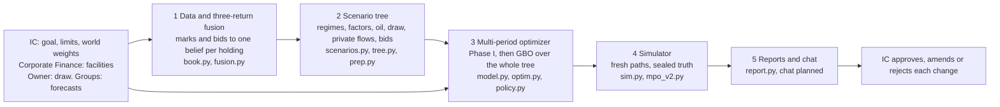

# MPO_liquidity

A multi-period, liquidity-aware portfolio optimizer for ADIC, an endowment-model sovereign fund of about USD 177bn: each quarter it chooses the changes that give the best chance of a 10% nominal return while the owner's draw is always paid and every hard limit holds.

> **All portfolio data in this repository is SYNTHETIC.** Every balance, rate, probability and price comes from the synthetic book SYN-ADIC-177, from [`examples/mpo_v2/params.json`](examples/mpo_v2/params.json), from the prototype's first run and its verification, or from a design default. None of it is ADIC data, and none of it is a forecast. The one exception is local: the stakeholder demo in [`demo/`](demo/README.md) runs on the user's own fund file and strategy returns, which are MSIP-labelled and git-ignored together with everything derived from them; nothing real is committed.

**Contents**
1. [Overview](#1-overview)
2. [Variables considered](#2-variables-considered)
3. [The multi-period approach](#3-the-multi-period-approach)
4. [The optimization mathematics, as implemented](#4-the-optimization-mathematics-as-implemented)
5. [Three-return fusion](#5-three-return-fusion)
6. [Simulator and out-of-sample certification](#6-simulator-and-out-of-sample-certification)
7. [Scenarios by example](#7-scenarios-by-example)
8. [Outputs](#8-outputs)
9. [The prototype's first run and what its verification found](#9-the-prototypes-first-run-and-what-its-verification-found)
10. [Assumptions and limitations](#10-assumptions-and-limitations)
11. [Repository, quick start and status](#11-repository-quick-start-and-status)

**What the framework decides.** ADIC holds about USD 177bn of reported NAV, roughly 60% private, in eight investment groups: PE funds, Secondaries, Capital Solutions, Co-investment, Public Markets (hedge funds and long-only), Private Credit, the Overlay (synthetic beta, a tail hedge and an opportunistic book) and Real Assets. Corporate Finance owns Treasury, facilities, collateral and distributions. Leverage is allowed. The owner takes an exogenous draw of 5–10% of opening NAV a year, higher when oil is weak, and the goal is 10% a year in nominal USD. Each quarter the framework tells the Investment Committee (IC) whether the book is safe (the draw paid, the liquidity floors and a named 24-month stress met, forced sales of private holdings below 1% probability over five years), what to change now and next year in each state of the world, how likely the goal then is, and why. It searches every lever in one problem: SELL, HOLD, ADD, REFINANCE (raise cash against a holding without selling it), LEVER (borrow to add exposure), REDEEM, PACE, REBALANCE, HEDGE and FUND.

**Sources.** The full reference, verified line by line against the specification and the prototype code (commit 2aafbad), is [`design/FRAMEWORK_DESCRIPTION.md`](design/FRAMEWORK_DESCRIPTION.md) v1.1 ("FD"). The others are the specification [DSGO](design/DECISION_SPACE_AND_GOAL_OBJECTIVE.md), the slim design [SLIM](design/SLIM_ARCHITECTURE.md) and the prototype [`examples/mpo_v2/`](examples/mpo_v2/). **Implemented** means in the prototype code, **Configurable** a change in `params.json` and a re-run, and **Planned** specified but not yet built.

---

## 1. Overview



1. **Data and three-return fusion:** three marks and a bid become one forward belief per holding.
2. **Scenario tree:** the exogenous future across capital-market worlds, as a decision tree on observable states, plus fresh paths.
3. **Multi-period optimizer:** today's changes and next year's contingent plans, for the highest *buffered* goal probability within every hard limit, with liquidity prices.
4. **Simulator:** exact probabilities of the policy that would actually run, and of baselines, on paths the optimizer never saw.
5. **Reports and chat:** the quarter's report; the analyst chat is Planned.

**The principle.** The engine is deterministic: the same inputs give the same decisions, prices and probabilities. Every parameter is in `params.json` with its unit, rationale and source, seeds are fixed, and a determinism hash confirms each rerun. People set the limits and approve: the IC sets the goal, limits and world weights, Corporate Finance signs facilities, the owner sets the draw, and the groups file forecasts, which the fusion debiases against their own record. The IC approves, amends or rejects each change; nothing executes trades. **No language model produces a number.**

---

## 2. Variables considered

**Conventions.** Each node is **BEN** (benign), **DRT** (an exit drought without a macro crisis) or **STR** (a macro crisis, frozen exits, or an oil shock with an expected next-year draw of 8% or more). Today's root is DRT, and triples such as 1.30/1.15/1.10 are for BEN/DRT/STR. Money is in USD bn. Each holding's flows are computed once for its full original position, and the decisions only scale them, so every row is linear.

### 2.1 Index sets

| Symbol | Meaning |
|---|---|
| $n$, $p(n)$, $ch(n)$ | tree node, its parent and its children |
| $\ell$, $p_{\ell}$ | leaf (an end-state at five years) and its probability |
| $i$ | holding: 55 in the prototype, about 450 positions in production |
| $g$ | group: the prototype's eight codes (PE, SEC, CO, CS, PC, HF, LO, RA) split Public Markets in two; Overlay and Corporate Finance positions are portfolio variables |
| $k$ | template, the per-USD profile of a new purchase or commitment (11) |
| $j$ | financing instrument (7): revolver, term debt, NAV facility, LP preferred, CS and SMA back-leverage, Real Assets cash-out |
| $s$ | liquidity sleeve: LIQ, HF, AMB, RED |
| $m$ | capital-market world: M1, M2, M6 |

### 2.2 State variables

| Symbol | Meaning | Units | Granularity |
|---|---|---|---|
| $C_{n}$, $LQ_{n}$ | Treasury cash (USD 15bn at t0); IG + cash, adding 98% of the Treasuries and IG sleeve (used by the floors) | USD bn | portfolio |
| $V_{n,i}$, $N_{n,i}$ | economic and reported NAV of the full original position; $\theta=V/N$ is below 1 when marks are stale | USD bn | holding |
| $x_{n,i}$, $U_{n,i}$ | fraction of the original position held; unfunded commitments | share; USD bn | holding |
| $B_{n,j}$ | debt by instrument, against collateral pools; the NAV facility and preferred accrue PIK | USD bn | instrument |
| $L^{s}$, $L^{up}$ | revolver: USD 10bn signed, plus an upsize of up to USD 5bn decided at the root | USD bn | portfolio |
| $\beta_{n}$, $\mathrm{p2s_{n}}$, $\mathrm{trs_{n,i}}$ | synthetic beta (USD 10bn at t0); physical-to-synthetic (P2S) futures replacing equities; total return swaps on hedge funds | USD bn | portfolio; lot |
| $\mathrm{hed_{n}}$, $\mathrm{opp_{n}}$, $IM_{n}$ | tail-ladder notional; opportunistic margin; all posted margin (4/6/10% of beta and P2S, 10% of TRS, plus the opportunistic margin) | USD bn | portfolio |
| $Q_{n}$ | queued redemption claims, paid the next year | USD bn | portfolio |
| $W_{n}$, $NR_{n}$, $E_{n}$ | economic and reported NAV, net of every financing claim; delta-adjusted exposure | USD bn | portfolio |
| $d_{n}$, $\hat d_{n}$ | draw rate of the year into $n$, on opening reported NAV; next year's expected rate | share | node |
| $S$, $e$, $Z$ | macro regime, exit window and oil-shock type, with market levels | state | node |
| stage, flags | event stage from the status quo's IG + cash (Green at least 8% of NAV, Amber 6–8%, Red 4–6%); "behind" and "loss year" flags | flags | node |
| $m_{n}^{red}$, $\zeta_{\ell}$ | signed red margin (§4.2); belief-error driver | USD bn; sd | node; leaf path |

### 2.3 Decision variables: lenses and levers

The user's definitions are the rule: **REFINANCE** raises cash against a holding without selling it (exposure unchanged); **LEVER** borrows to add exposure (LEVER ≡ ADD + REFINANCE).

| Lens | Variable | What it does, with prototype instruments |
|---|---|---|
| SELL | $s_{n,i}$ | sell part or all of a holding at the node's bid (LP, asset, loan and fund sales, syndication) |
| HOLD | $x$ unchanged | keep the holding and fund its calls |
| ADD | $a_{n,i}$; templates $y_{n,k}$ | buy liquid holdings or new deals (discount LP purchases, co-investments, CS new money, senior loans) |
| REFINANCE | secured draws $\Delta_{n,j}^{+}$; P2S | NAV facility and preferred, CS and SMA back-leverage, Real Assets cash-out, P2S |
| LEVER | $\mathrm{trs_{n,i}}$; $\beta_{n}$; templates | hedge-fund TRS, synthetic beta (risk budget), infrastructure and SMA with asset debt |
| REDEEM | $r_{n,i}$ | notice on hedge funds and open-end real estate, paid at the class pass-through |
| PACE | commitments $y_{n,k}$ | PE, SEC, RA, PC and CS at 0.25–1.25× plan (USD 7.5bn a year) |
| REBALANCE | net of SELL and ADD | group weights within 0.5–1.5× their share |
| HEDGE | $\mathrm{hed_{n}}$, $\mathrm{opp_{n}}$ | 90/72 put-spread ladder; opportunistic margin |
| FUND | $L^{up}$; draws | arrange and use Corporate Finance capacity |

A standing rule, not a lens, sells sleeves ($q_{n,s}$) pro rata when cash runs short. Root sales of red-tier holdings (PE, Secondaries, Co-investment, Real Assets) are zero because today's stage is Amber (ADR-39), and private holdings take no adds. The opportunistic book is filed under HEDGE but takes risk. Planned: strips, CV elections, CFO loans, sale-leasebacks, repo, redemption gates and debt by holding.

**Rule R1** labels each node's borrowing from its balance-sheet changes, not from the instrument's name:

```math
\mathrm{LEVER}_n=\min\big(\Delta B_n^{+},\,(\Delta E^{disc}_n)^{+}\big),\qquad \mathrm{REFINANCE}_n=\Delta B_n^{+}-\mathrm{LEVER}_n
```

$\Delta B_{n}$ is net new financing (facilities with PIK, derivative financing net of margin, new asset debt) and $\Delta E_{n}^{disc}$ the discretionary exposure added (adds, purchases, beta and TRS increases, minus sales; redemptions in flight do not count). Borrowing is LEVER up to the exposure added; only the excess, which funds the draw, calls, debt service or the floor, is REFINANCE. Cash is fungible, so this is conservative: borrowing USD 5bn for the draw while buying USD 5bn of equities with Treasury cash is LEVER 5. P2S is REFINANCE. DSGO §1.2's prose reverses the priority; its formula is the same.

### 2.4 Exogenous random variables

| Variable | Model and prototype calibration |
|---|---|
| Regime $S_{t}$ | expansion, late cycle, crisis, recovery; Markov; a crisis persists 0.70 a quarter |
| Exit window $e_{t}$ | open, normal, drought, frozen; starts in drought (0.87), which persists 0.88 a quarter |
| Oil shock $Z_{t}$ | normal, boom, glut, demand bust, supply shock, Gulf war; starts in Gulf war (0.85); a demand bust forces a crisis (0.85 a quarter) |
| Factors $f_{t}$ | six (below), with Student-t(5) shocks and crisis correlations |
| Private flows | calls and distributions by age and exit state (distributions × 0.47 in drought); crisis calls × 1.29 |
| Bids | per USD of economic value: buyer residual by class × age × the holding's premium |
| Defaults | PD 1.1/1.6/6.0/2.2% by regime, LGD 0.67 |
| Pass-through | redemptions paid within 12 months: hedge funds 1.00/0.95/0.66, open-end real estate 0.80/0.34/0.14 |
| Worlds | M1 (J.P. Morgan 2027), M2 (BlackRock fee-adjusted), M6 (BlackRock risk premia rise), equal weights |

**Factors** ($s$ spread, $Y$ yield, $P$ Brent, $\chi$ exit factor; state equations in FD §3.2):

```math
\begin{aligned}
f^{eq}_{t+1}&=\tfrac14\mu^{eq}_m+\big(k^{eq}_{S_{t+1}}-\mathbb{E}_t[k^{eq}_{S_{t+1}}]\big)+\tfrac12\sigma^{eq}_{S_{t+1}}\varepsilon^{1}_{t+1},\qquad f^{rt}_{t+1}=\tfrac14 tp_m-6\,(Y_{t+1}-\mathbb{E}_t Y_{t+1})\\
f^{cr}_{t+1}&=\tfrac14 s_t-3.5\,(s_{t+1}-\mathbb{E}_t s_{t+1})-\tfrac14 PD_{S_{t+1}}LGD+\tfrac14\mu^{cr}_m\\
f^{oil}_{t+1}&=\ln P_{t+1}-\mathbb{E}_t\ln P_{t+1},\qquad f^{ex}_{t+1}=\chi_{t+1}-\mathbb{E}_t\chi_{t+1},\qquad f^{vol}_{t+1}=(\mathrm{VIX}_{t+1}-\mathbb{E}_t\mathrm{VIX}_{t+1})/100
\end{aligned}
```

The regime shift is centred, so regimes move risk, flows, bids and availability, not the expected equity return. Rates and spreads earn only surprises, so **a rate shock cannot be configured**. **Code observation:** the crisis equity–yield shock correlation of −0.30 makes **bonds fall with equities in crises** (return correlation about +0.24, against −0.18 otherwise), probably a sign error.

**Owner draw.** It is set at the start of each fiscal year from Brent, with $\Pi$ clipping to the band from 5% to 10%:

```math
d^{tgt}_y=\Pi_{[5\%,10\%]}\Big(\Pi_{[5\%,10\%]}\big(5\%+5\%\cdot\tfrac{67-P^{oil}_y}{67-23}\big)+2\%\cdot\mathbf{1}[\text{override}_y]\Big),\qquad d_y=\Pi_{[5\%,10\%]}\big(0.5\,d_{y-1}+0.5\,d^{tgt}_y\big)
```

It is paid in full on opening reported NAV (H1), quarterly in the simulator and at year-end nodes in the tree. An owner override adds 2pp, with probability 0.25–2% a year. From the 6.5% prior, the 2027 draw is 5.75%.

### 2.5 Beliefs from the three return series

| Symbol | Meaning |
|---|---|
| $\hat\mu_{i}$ | fused forward return: the annual log return on current economic NAV, net of fees, over the remaining life; it excludes the holding's own bid |
| $\hat\alpha_{i}$ | fused alpha, $\hat\mu_{i}-(r_{f}+b_{i}^{\top}\bar f)$ with factor loadings $b_{i}$; this is what the tree uses |
| $\sigma_{post,i}$, $\hat\sigma_{i}$ | posterior sd of the belief (belief risk); predictive sd with outcome noise, giving t(5) P10/P50/P90 |
| $\hat b_{g}$, $Z_{g}$, $\kappa_{g}$ | the group's forecast and underwriting bias; its credibility weight; how much its stated ranges are widened |
| $c_{i}^{\star}$, $\rho_{m,i}$ | Benktander credibility of a fund interest's forecast; market-implied return from the holding's bid |
| flags | hockey stick, stale NAV, market disagreement, zombie NAV, young actual, expired underwriting; display only |

### 2.6 Limits and parameters

The IC sets the limits; `params.json` holds every value with its source. The main ones:

| Item | Prototype value |
|---|---|
| Goal | 10% a year time-weighted, gross of draws, on economic NAV over five years: $W_{0}$ = USD 169.75bn (reported 177bn) and $W^{\star}=W_{0}\cdot 1.1^{5}$ = USD 273.39bn |
| Floors | IG + cash at least 4% of NAV; 8% at BEN and DRT nodes, except the first after STR |
| Leverage | exposure at most 1.30/1.15/1.10 × NAV, tighter when behind the 10% path |
| Debt and LTV | revolver + term at most 15% of NAV; NAV facility 10% (5% at STR) of the pledge pool; other LTVs 30–55% |
| Sales | PE and Secondaries LP sales at most USD 9/7/5bn a year; per-holding trades at most 0.5% of $W_{0}$ × $\sigma_{ref}/\sigma_{post,i}$ |
| Red events | at most 1% over five years, certified; tree buffer $\varepsilon_{R}$ = 0.6%; threshold USD 0.05bn |
| Depth guard | CVaR of the miss at 90/95/99% no worse than the status quo's (δ = 0) |
| Overcommitment | private NAV + unfunded at most 80% of NAV |
| Overlay | tail premium 0.15–0.50% of NAV a year; opportunistic IM USD 1.0bn, capped at 1.5bn; P2S at most USD 10bn; gross overlay at most 30% of NAV |
| Financing | SOFR fixed at 3.89%; revolver and term +85bp; NAV facility +300bp and preferred 12%, both PIK; revolver availability 100/100/50% |
| Terminal values | private NAV at economic value; USD 0.03 per USD unfunded; post-horizon pacing value $c^{PACE}$ (PE 8.6 cents per USD) |
| Buffer cap | $c_{max}=2W^{\star}/W_{0}\approx 3.22$ |

---

## 3. The multi-period approach

### 3.1 Time grid and goal

Three annual decision stages cover a five-year horizon: t = 0, here and now (the change list); t = 1, contingent plans for each of ten year-1 branches; t = 2, recourse only; and t = 3–5, "fan" years, where every row holds but only funding moves. Engines run quarterly, and a tree node aggregates four quarters. The goal is met at a leaf when distribution-inclusive wealth reaches $W^{\star}$.

### 3.2 The tree as implemented

| Branching | Construction | Children | Probability |
|---|---|---|---|
| t = 0 to 1 | 20,000 one-year paths; five strata by class and oil shock; k-means on seven observables; medoids | 10 | cluster share |
| t = 1 to 2 | 2,000 continuations per node; branches allocated by class | 7 | parent × share |
| t = 2 to 5 | 300 paths per node, sorted by the status quo's return; one medoid per tercile | 3 | parent ÷ 3 |

That gives **10 × 7 × 3 = 210 leaves**, 81 decision nodes and 711 time nodes. Six factor drivers' means and covariance are matched exactly at stages 1–2 (fan return and belief error at the fans) by the minimum-distortion map $A=\Sigma^{1/2}(\Sigma^{1/2}\Sigma_{c}\Sigma^{1/2})^{-1/2}\Sigma^{1/2}$, which does not rotate branches. Each branching meets the rank rule $K\ge d+1$. DSGO's 640-leaf tree, skew matching and no-arbitrage test are Planned.

### 3.3 Here-and-now, contingent and recourse decisions

| Stage | In the LP | In the simulator |
|---|---|---|
| Root | every lens per holding: the change list | executed exactly |
| Stage 1 | every lens per holding and branch: the contingent plans | playbook (nearest node) or rule variant (root decision held) |
| Stage 2 | funding and forced beta cuts only | need-based funding |
| Fans | need-based funding only (H16) | myopic waterfall |

Stage 2 is recourse-only, because three fan paths per node would overfit discretionary trades. Leaves allow no new borrowing. The simulator's waterfall restores the 4% floor from fixed income, long-only, hedge funds, the revolver, amber sales and, last, red sales (a red event above USD 0.05bn).

### 3.4 Non-anticipativity

Each node has one decision vector, shared by every path through it. Nodes are clustered on observables pooled across worlds, so recourse sees markets and the draw but not which world is true. The belief-error driver is drawn below the last decision node, so no discretionary decision sees it; fan-year funding does (error-ledger row E2), which H16 is meant to bound.

### 3.5 Rolling re-optimization (MPC)

In production each quarter re-freezes the book, re-fuses beliefs, rebuilds the tree from where ADIC actually is and re-solves; only today's decisions execute. Re-solves aim at the original goal path $W_{0}\cdot 1.10^{t}$, so the plan stays pre-committed (Forsyth 2020), and G4 and G5 restrain catch-up after losses. In the prototype rolling MPC is Planned; the selection set chose the rule variant over the playbook.

### 3.6 Terminal values

At each leaf, private NAV counts at economic value, unfunded carries USD 0.03 per USD, every financing claim is deducted at face plus accrued PIK, and the post-horizon pacing value $c^{PACE}$ and range charges count. Non-red liquidity must cover next year's needs (H15), which stops end-of-horizon artefacts.

### 3.7 Why a tree for decisions and a simulator for probabilities

The tree is small enough to optimize exactly, and its duals give prices. It is the wrong tool for probabilities: its leaves average about 0.5% each, decisions are fitted to its own paths (the optimizer's curse), its ledger is annual, it uses beliefs rather than a truth, and it runs an idealized policy. The simulator fixes all five.

---

## 4. The optimization mathematics, as implemented

### 4.1 Data on the tree

`prep.py` runs every holding's full position along the tree through the quarterly unit engine, which the simulator also uses:

```math
r_{i,t+1}=\tfrac14r_f+b_i^{\top}f_{t+1}+\tfrac14\alpha_i,\qquad \mathrm{Dist}_i=\tfrac14\mathrm{yld}_iV_ie^{r}+\big(1-\tfrac14\mathrm{yld}_i\big)V_ie^{r}\big(1-e^{-k^{D}_i(\mathrm{age})\,m^{D}(e)/4}\big),\qquad \mathrm{Call}_i=U_i\big(1-e^{-k^{C}_i(\mathrm{age})\,m^{C}(e)\,s(S)/4}\big)
```

Value moves as $V'=Ve^{r}-\mathrm{Dist}+\mathrm{Call}$. Reported NAV lags, so $\theta$ falls at a crisis onset; a drought alone does not lower it. `prep.py` also builds the templates' flows, sale proceeds, stressed calls, the tail-ladder payoff $0.922\min(\max(-R^{eq}-0.10,0),0.18)$ per USD of notional, and the static-portfolio return $r^{SAA}$.

### 4.2 Node dynamics and wealth at the leaves

**Holdings** are fractions of the original position:

```math
x_{n,i}=x_{p(n),i}-s_{n,i}+a_{n,i}-r_{n,i}-\frac{q_{n,\mathrm{sl}(i)}}{V^{sl}_{n,\mathrm{sl}(i)}}-\mathbf{1}[i=\text{LO-01}]\,\frac{\mathrm{p2s}^{+}_n-\mathrm{p2s}^{-}_n}{V_{n,i}}
```

A sale scales the holding's unfunded too, so the buyer takes over the matching share. Funding sales cut the same share of every sleeve member, and P2S moves DM core equity (LO-01) into futures. Below, $\bar x$ is the holdings in force.

**Cash** balances every source against every use, with no slack:

```math
\begin{aligned}
C_n+IM_n={}&e^{r_f}(C_{p}+IM_{p}+Q_p)+\sum_i\bar x_{p,i}(\mathrm{Dist}_{n,i}-\mathrm{Call}_{n,i})+\sum_{m,k}y_{m,k}\big(T^{Dist}_{m\to n,k}-T^{Call}_{m\to n,k}-\xi_k(r_f+\varsigma_k)\big)\\
&-d_n\,NR_{p}-\sum_{j\notin\mathrm{PIK}}r^{B}_j(n)B_{p,j}-f^{u}(L^{s}+L^{up}-B_{p,\mathrm{REV}})\\
&+\beta_p\big(G^{eq}_n-e^{r_f}-f^{\beta}(n)\big)+\mathrm{p2s}_p\big(G^{eq}_n-e^{r_f}-f^{P2S}(n)\big)+\sum_i\mathrm{trs}_{p,i}\big(G_{n,i}-e^{r_f}-f^{TRS}\big)\\
&+\mathrm{hed}_p\,\mathrm{tail}_n+\mathrm{opp}_p\,\mathrm{oppret}_n+\sum_i\varphi_i(n)V_{n,i}\,r_{p,i}-c^{tail}\,\mathrm{hed}_n\\
&+\Big[\sum_i\mathrm{bid}_{n,i}s_{n,i}-\sum_iV_{n,i}(1+tc_i)a_{n,i}-\sum_{k\in\text{buy}}y_{n,k}+(1-tc)\,\mathrm{p2s}^{+}_n-(1+tc)\,\mathrm{p2s}^{-}_n\Big]_{\text{decision nodes}}\\
&+\sum_s\overline{\mathrm{bid}}_{n,s}\,q_{n,s}+\sum_j(1-oid_j)\Delta^{+}_{n,j}-\sum_j\Delta^{-}_{n,j}
\end{aligned}
```

The lines are: interest, queued claims and private flows; the owner draw (H1), cash interest and fees; variation margin on beta, P2S and TRS; the tail payoff, opportunistic P&L, redemption cash and tail premium; the decisions, with trading costs; and funding sales and financing.

**Balance sheet** at every node:

```math
\begin{aligned}
W_n&=C_n+IM_n+Q_n+\sum_i\bar x_{n,i}V_{n,i}+\sum_{m,k}y_{m,k}T^{V}_{m\to n,k}-\sum_jB_{n,j}-\sum_{m,k}\xi_ky_{m,k}\\
E_n&=\sum_i\bar x_{n,i}V_{n,i}+\sum_{m,k}y_{m,k}T^{V}_{m\to n,k}+\beta_n+\mathrm{p2s}_n+\sum_i\mathrm{trs}_{n,i},\qquad LQ_n=C_n+0.98\,\bar x_{n,\mathrm{FI}}V_{n,\mathrm{FI}}\\
B_{n,j}&=\big(1+r^{B}_j(n)\,\mathbf{1}[j\in\mathrm{PIK}]\big)B_{p,j}+\Delta^{+}_{n,j}-\Delta^{-}_{n,j},\qquad Q_n=\sum_i\big(1-\varphi_i(n)\big)V_{n,i}\,r_{p,i}
\end{aligned}
```

**The signed red margin** is the next 12 months' stressed outflows minus non-red capacity; when it is positive, red-tier assets would have to be sold:

```math
\begin{aligned}
m^{red}_n={}&\hat d_nNR_n+\sum_i\bar x_{n,i}(\hat C_{n,i}-\underline D_{n,i})+(\text{templates})+\sum_jr^{B}_j(\mathrm{STR})B_{n,j}+(\text{asset-debt service})+\big(0.358+\mathrm{im}(\mathrm{STR})-\mathrm{im}(n)\big)(\beta_n+\mathrm{p2s}_n)\\
&-\big[LQ_n-0.04W_n+0.642\,V^{LO,eq}_n+0.66\,V^{HF}_n+0.20\,V^{amber}_n+0.5(L^{s}+L^{up})-B_{n,\mathrm{REV}}+Q_n\big]
\end{aligned}
```

**Wealth at the leaves.** Time-weighted wealth satisfies $W_{0}\prod_{t}(1+r_{t})=W_{T}+\sum_{t}D_{t}G_{t\to T}$, so each draw paid is accrued forward and the goal is gross of distributions. To stay linear, the tree accrues draws at the static-portfolio return $r^{SAA}$, not the policy's own return:

```math
\widetilde W_\ell=W_\ell-\psi U_\ell+\sum_{m\in\mathcal{D}(\ell)}\sum_{k\in\mathrm{PACE}}c^{PACE}_k(y_{m,k}-\mathrm{Plan}_k)+2\sum_{k\in\mathrm{PACE}}c^{PACE}_k(y_{a_2(\ell),k}-\mathrm{Plan}_k)-\varrho\sum_{m\in\mathcal{D}(\ell)}\sum_g\mathrm{brk}_{m,g}+\sum_{n\in\mathrm{path}(\ell),\,n\neq0}d_nNR_{p(n)}\prod_{n'\in\mathrm{path}(\ell),\,n'\succ n}\big(1+r^{SAA}_{n'}\big)
```

Here $\mathcal{D}(\ell)$ is the path's decision nodes, $a_{2}(\ell)$ its stage-2 node, ψ = 0.03, and $\varrho$ = 0.5% the range charge. The miss is $X_{\ell}=(W^{\star}-\widetilde W_{\ell})/W_{0}$, and the goal is met when $X_{\ell}\le 0$. The static accrual flatters a riskier plan's bad leaves (known issue F4).

### 4.3 Hard constraints

The rows are identical under every objective, and "every node" includes the fan years and leaves.

| Row | Constraint in the prototype | Status |
|---|---|---|
| H1 Owner draw | $d_{n}NR_{p(n)}$ in every cash row, with no slack | Implemented |
| H2 Cash floors | $LQ_{n}\ge 0.04W_{n}$; $0.08W_{n}$ at BEN and DRT nodes, except the first after STR | Implemented |
| H3 Coverage | six-month non-red capacity covers half the next 12 months' needs (below) | Implemented; 30-day row Planned |
| H4 Named stress | at the root, the stressed liquid book and half the revolver cover two years of 10% draws, stressed calls, debt service and margin | Implemented |
| H5 Leverage, debt | $E_{n}\le\bar L_{n}W_{n}$; recourse debt at most $0.15W_{n}$; pledged collateral at most 20% of assets | Implemented; maturity row Planned |
| H6 LTV | per-instrument caps; a tightening cap forces repayment | Implemented |
| H7 Sale depth | per-year caps at decision nodes; sleeve caps on funding sales | Implemented |
| H8 Oil exposure | ENR at most 1.5% of NAV, GCC real estate 1.0%, oil-delta backstop | Planned |
| H9 Red events | CVaR surrogate (below) | Implemented; degenerate (M2) |
| H10(a) Depth guard | multi-level CVaR of the miss against the status quo (below) | Implemented; per-world H10(b) Planned |
| H11 Overcommitment | private NAV + unfunded at most $0.80W_{n}$, non-STR | Implemented; glide path Planned |
| H12 Concentration | company 1%, GP 5%, co-investment 4% | Planned |
| H13 Overlay | the overlay limits of §2.6 | Implemented; OV1–OV3 Planned |
| H14 Admissibility | no adds to private holdings; root red-tier sales zero; REDEEM only for hedge and open-end funds | Implemented; consents Planned |
| H15 Horizon | $m_{\ell}^{red}\le 0$ at the leaves, every claim deducted | Implemented |
| H16 Need-based funding | funding sales capped by the node's needs (below) | Implemented; vacuous (M1) |
| IC ranges | group values within 0.5–1.5× their weight, breaches charged | Implemented |
| G4 No doubling down | after a loss, exposure grows no faster than the status quo's wealth | Implemented |
| G5 Cushion caps | borrowed exposure capped by the status quo's cushion | Implemented in the tree |

The "behind", "loss year", "Green" and cushion readings come from the status quo's solution on the same tree, so every guard stays linear. H3 and H16, with $\mathrm{av}(n)$ the revolver's availability, $\Delta_{n}^{-}$ the node's repayments and $\bar C_{n}$ a bound on calls:

```math
LQ_n-0.04W_n+0.642\,V^{LO,eq}_n+0.55\,V^{HF}_n+\mathrm{av}(n)(L^{s}+L^{up})-B_{n,\mathrm{REV}}\;\ge\;\tfrac12\big(\hat d_nNR_n+\text{stressed calls}-\text{low distributions}\big)
```

```math
\sum_s\overline{\mathrm{bid}}_{n,s}\,q_{n,s}\;\le\;d_nNR_{p}+\sum_jr^{B}_jB_{p,j}+c^{tail}\,\mathrm{hed}_{p}+0.08\,W_n+\Delta^{-}_n+\bar C_n
```

**H9, red events.** A red event is a sale of a red-tier holding at a non-Green node or below 0.9 × the BEN bid, or a red-sleeve funding sale. With $RS_{n}$ those proceeds and $\vartheta$ = USD 0.05bn, the rows make the CVaR of the path maximum $R_{\ell}$ at level $1-\varepsilon_{R}$ non-positive, so $P(R_{\ell}\gt 0)\le\varepsilon_{R}$ in the tree:

```math
z_\ell\ge m^{red}_n-\eta,\quad z_\ell\ge RS_n-\vartheta-\eta\quad\forall n\in\mathrm{path}(\ell),\qquad z_\ell\ge0,\qquad \eta+\frac{1}{\varepsilon_R}\sum_\ell p_\ell z_\ell\le0
```

**H10(a), the depth guard.** At δ = 0 the plan's worst 10%, 5% and 1% of outcomes may be no worse on average than the status quo's:

```math
u_{\ell,k}\ge X_\ell-\eta_k,\quad u_{\ell,k}\ge0,\qquad \eta_k+\frac{1}{1-\alpha_k}\sum_\ell p_\ell u_{\ell,k}\le\mathrm{CVaR}_{\alpha_k}(X^{B0})+\delta,\qquad \alpha_k\in\lbrace0.90,\,0.95,\,0.99\rbrace
```

### 4.4 Objectives

**O1, the Goal-Buffered Objective (GBO).** For the miss $X$, the buffered probability of exceedance (bPOE) is:

```math
\mathrm{bPOE}_0(X)=\min_{a\ge0}\ \mathbb{E}\big[(aX+1)^{+}\big],\qquad \mathrm{bPOE}_0(X)\le p\iff\mathrm{CVaR}_{1-p}(X)\le0,\qquad \mathrm{CVaR}_{1-p}(X)=\min_{\eta}\ \eta+\tfrac1p\mathbb{E}\big[(X-\eta)^{+}\big]
```

bPOE is the size of the worst slice of outcomes whose average just reaches the goal, and $\bar P=1-\mathrm{bPOE}$ is a conservative success probability, reported beside the exact P(goal). Its properties (DSGO §4.2):
- **No reward for pure gambles.** bPOE is monotone in the increasing convex order, so a mean-preserving spread never helps, although it can raise the exact P(goal).
- **Not a full safeguard.** For a fixed $a$ it is a linear shortfall below $W^{\star}+W_{0}/a$, which can reward mean-increasing, skewed payoffs, so safety rests on the guards and the CRRA tie-break. In the first run GBO avoided threading the goal, but not risk-seeking (F10).
- **Degenerate above the mean.** If $\mathbb{E}[\widetilde W]\le W^{\star}$, then $\mathbb{E}[(aX+1)^{+}]\ge a\mathbb{E}[X]+1\ge 1$, so bPOE = 1; by Jensen, no concave lower bound of P(goal) can certify a probability there.

ADIC sits near that edge: at research-central returns (8.30% geometric) the unlevered book expects 0.974 of the goal, so its bPOE is 1.000 (DSGO's lognormal check, SYNTHETIC). GBO therefore caps the buffer:

```math
\Phi(x)=\min_{a\ge a_{min}}\sum_\ell p_\ell\big(aX_\ell(x)+1\big)^{+},\qquad a_{min}=1/c_{max}
```

In **PLAN**, when the optimal buffer $1/a$ is below $c_{max}$, Φ equals bPOE. In **STRETCH**, when no plan expects to reach $W^{\star}$, $\Phi=1+\mathbb{E}[X]/c_{max}$: GBO maximizes expected wealth within every limit, which for location–scale outcomes is P(goal)-optimal at the binding tail limit. With the miss affine, $X_{\ell}(x)=c_{\ell}-\gamma_{\ell}^{\top}x$, and rows $Ax\le b$, the spec's Charnes–Cooper substitution $\tilde x=ax$, $\tau=a$ gives one LP:

```math
\min_{\tilde x,\tau,u}\ \sum_\ell p_\ell u_\ell\quad\text{s.t.}\quad u_\ell\ge\tau c_\ell-\gamma_\ell^{\top}\tilde x+1,\ \ u\ge0,\ \ A\tilde x\le b\,\tau,\ \ \tau\ge a_{min}
```

**As implemented** (`optim.gbo`): a mean LP gives $E^{\star}$, the maximum expected leaf wealth, and STRETCH if $E^{\star}\le W^{\star}$. In PLAN, a fixed-point iteration over CVaR LPs reaches the same optimum as bisection, stopping when bPOE moves less than $10^{-3}$, with a certificate LP; the Charnes–Cooper cross-check is not built. A mandatory tie-break then holds the goal value within 0.005 and maximizes the CRRA(3) certainty equivalent, which removes unpaid risk and supplies the duals.

```math
x_k=\arg\min_x\ \mathrm{CVaR}_{1-p_k}\big(X(x)\big),\qquad p_{k+1}=\mathrm{bPOE}_0\big(X(x_k)\big)
```

In the first run $a^{\star}$ = 0.751 against $a_{min}$ = 0.310, and the recommended plan's own bPOE is 0.9617, against the reported $\Phi^{\star}$ = 0.957.

**O2, the maximum-probability comparison.** As specified, it is an exact MILP with one goal indicator per leaf, margin $\varepsilon_{g}$ = 0.001 and big-M $M_{\ell}=W^{\star}+\varepsilon_{g}W_{0}$, started from GBO. Variant A keeps every guard (the in-sample ceiling); Variant B keeps Tier 1 only, to expose the gambling pathology. It is never the recommendation:

```math
\max_{x,\,g}\ \sum_\ell p_\ell g_\ell\quad\text{s.t.}\quad\widetilde W_\ell-W^{\star}\ge\varepsilon_gW_0-M_\ell(1-g_\ell),\quad g_\ell\in\lbrace0,1\rbrace,\quad\text{every row of §4.3}
```

The prototype does not solve it exactly, because HiGHS branch and bound did not leave the root node within the budget. It runs the relaxation (an upper bound) and a deterministic LP-rounding incumbent, with every guard; Variant B is Planned. RESULTS calls this the "exact MILP", but it is a heuristic (M3).

**O3, CRRA(3) plus shortfall,** the earlier objective, is now a comparison, and its utility term is GBO's tie-break. $\hat U_{3}$ is 32 tangents on [0.25, 4], on real wealth (2.5% inflation), and $\hat\psi$ is the shortfall squared on 16 secants ($\lambda_{T}$ = 1); it is squared because a linear shortfall can reproduce probability maximization:

```math
\max\ \sum_\ell p_\ell\Big[\hat U_3\big(\widetilde W_\ell/(W_0\cdot1.025^{5})\big)-\lambda_T\,\hat\psi\big((1-\widetilde W_\ell/W^{\star})^{+}\big)\Big],\qquad U_3(w)=-\tfrac{1}{2w^{2}}
```

### 4.5 Choosing the plan

The spec scores the GBO plan and a frontier of buffered plans $\hat g^{\star}(p)$ on a 10,000-path selection set, adopts the guarded candidate with the highest exact P(goal), and reports from a separate certification set, so the choice cannot inflate the numbers. The prototype has the split (4,000 selection and 10,000 certification paths), but its selection set chooses only each optimized policy's recourse variant and the best simple rule; the frontier family is Planned.

### 4.6 Phase I

A row that cannot be met pins its dual at the penalty and corrupts every price. Phase I first minimizes the slacks on H3, H4, H11, H15 and H9, then allows each slack at that minimum in later solves. The first run needed none. DSGO's lexicographic tiers are Planned.

### 4.7 Shadow prices and the reading rules

Cards are read from the tie-break LP that made the decision, so they agree with it in sign (check A23). The cash-row dual $\lambda_{n}$ is the value of one more USD at node $n$; stationarity gives $\lambda_{n}=e^{r_{f}}\sum_{c\in ch(n)}\lambda_{c}+\mathcal M_{n}$, with $\mathcal M_{n}$ the duals of the other rows that hold cash. The one-year liquidity premium, and the average used on the cards, are:

```math
\ell_n=\frac{\lambda_n}{e^{r_f}\sum_{c\in ch(n)}\lambda_c}-1,\qquad \bar\ell=\tfrac12\ell_0+\tfrac12\,\overline{\ell}_{\text{stage 1}}
```

For holding $i$ at the root, with $\nu_{i}$ the dual of its balance row (plus any reduced cost), $D_{i}$ its duration and $p_{i}^{ce}$ its cash-equivalent bid:

```math
p^{\star}_i=\frac{\nu_i+\mathrm{rc}(x_{0,i})}{\lambda_0N_{0,i}},\qquad h_i=\hat\mu_i-\frac{\ln(p^{\star}_i/\theta_i)}{D_i},\qquad \mu^{BE}_i=h_i+\frac{\ln(p^{ce}_i/\theta_i)}{D_i}
```

The LP sells exactly when $p_{i}^{ce}$ exceeds the reservation price $p_{i}^{\star}$, which is the same as $\hat\mu_{i}\lt\mu_{i}^{BE}$. The hurdle bundles SOFR, the liquidity premium and a goal-tail risk charge $\kappa^{G}$.

| Lens | Reading rule (DSGO §3.4) |
|---|---|
| SELL | $p^{ce}\gt p^{\star}$, equivalently $\hat\mu\lt\mu^{BE}$; a red-tier sale in Amber is shown only by forced re-solve |
| HOLD | $\hat\mu\ge\mu^{BE}$, and no financing pays |
| ADD | $\hat\mu^{new}+\ln(\theta/p^{buy})/D-h^{new}\gt 0$, within capacity |
| REFINANCE | HOLD wins, and the all-in borrowing cost (spread, fee over the term, leverage dual, covenant charge and about 1.1pp) is below $\bar\ell$ over the term |
| LEVER | $\hat\mu$, less financing, the leverage dual, covenant and tightening charges and $\kappa^{G}$, is positive |
| REDEEM | net alpha plus the cost of re-entry is below $\bar\ell$ until the cash arrives |

The LP chooses REFINANCE and LEVER jointly, R1 labels them, and their card tests are Planned. **Example** (first run, SYNTHETIC): HF-01 is redeemed (USD 5.0bn) with $\hat\mu$ 4.44% against a hurdle of 4.97% and a root liquidity premium ℓ of 1.79%.

### 4.8 Size and solver

The LP has 251 columns per decision node, 51 per time node and 10 per leaf: 58,700 columns, 59,667 rows and 635,380 nonzeros. HiGHS solves it by interior point with crossover (vertex duals), on one thread with seed 0 and tolerances of $10^{-7}$. The first run made 154 LP solves and no MIP solves, in 448 s on 20 worker processes. Production targets about 450 holdings, six worlds and 500–1,000 leaves: roughly 200k columns, at 120 s per solve.

---

## 5. Three-return fusion

Each holding has three since-inception series, archived quarterly, each a net IRR or MOIC with down, base and up cases: underwritten, actual and group forecast (read as P10/P50/P90). Secondary bids add a market mark. Only the forward return on current NAV drives action, so each mark becomes an annual forward log return on nowcast economic NAV $V^{\ast}=\theta N$, over the remaining life $H$:

```math
\begin{aligned}
\rho_f&=\tfrac1H\ln\big((M_f\cdot PI-\mathrm{Dist}^{td})/V^{\ast}\big) &&\text{forecast}\\
\rho_u&=\frac{\ln M_u-\ln M_t}{T_u-\mathrm{age}},\qquad M_t=\frac{\mathrm{Dist}^{td}+V^{\ast}}{PI} &&\text{underwritten (deals)}\\
\tilde a&=\mu_k+\phi_a\big(r^{a}-r^{bench}\big) &&\text{actual}\\
\rho_m&=\big(r^{buy}-\pi_b(\mathrm{age})\big)+\ln(p^{bid}/\theta)/D &&\text{market anchor}\\
\mu_k&=r_f+b_i^{\top}\bar f+\alpha^{\star}_g &&\text{outside-view prior}
\end{aligned}
```

The underwritten signal is used for deals only while at least a year of planned life remains, and never for fund interests. The actual signal is unused before age 3. The anchor uses a buyer return of 14% (funds) or 22% (co-investments), less a 3pp buyer–seller gap. Each signal is debiased by its group's archive record, with Bühlmann credibility:

```math
\tilde s_j=s_j-\hat b_{g,j},\qquad\hat b_{g,j}=Z_g\bar e_{g,j}+(1-Z_g)b^{prior}_{g,j},\qquad Z_g=\frac{n_{eff,g}}{n_{eff,g}+20},\qquad \kappa_g=\exp\big(Z_g\ln\kappa^{arch}_g+(1-Z_g)\ln1.75\big)
```

Fund interests weight the forecast against the prior by Benktander credibility, which grows as the fund realizes its value:

```math
s_f=c^{\star}(\rho_f-\hat b_{g,f})+(1-c^{\star})\mu_k,\qquad c^{\star}=\frac{\varpi}{\varpi+0.4},\qquad \varpi=\frac{\mathrm{Dist}^{td}}{\mathrm{Dist}^{td}+N}
```

Signals are fused with precision weights, shrunk halfway to equal weights until the archive reaches $n_{eff}\ge 20$, because constrained GLS lost to simple averages out of sample:

```math
\hat\mu_i=\sum_jw_j\tilde s_j,\qquad w_j=\begin{cases}\dfrac{\mathrm{prec}_j}{\sum\mathrm{prec}}&n_{eff}\ge20\\[2mm]\tfrac12\dfrac{\mathrm{prec}_j}{\sum\mathrm{prec}}+\tfrac12\dfrac1J&\text{otherwise}\end{cases},\qquad\sigma_{post,i}=\sqrt{\textstyle\sum_jw_j^{2}\sigma_j^{2}},\qquad\hat\sigma_i=\sqrt{\sigma_{post,i}^{2}+\sigma_{out}^{2}/\max(H,1)}
```

The bid is both a price (its premium scales sale proceeds) and a belief, but it is left out of the holding's own decision belief, so the reservation price is never pulled toward the price it is compared with. In the tree, holding $i$'s annual log return is:

```math
R_{i,n}=\hat\mu_i+b_i^{\top}(f_n-\bar f)+\tfrac53\,\sigma_{post,i}\,\zeta_\ell\,\mathbf 1[t(n)\ge3]
```

One belief-error draw $\zeta_{\ell}$ per fan path, scaled by each holding's $\sigma_{post}$, penalizes tilts toward weakly evidenced holdings; the per-unit trade cap bounds belief-versus-bid swaps.

---

## 6. Simulator and out-of-sample certification

- **Paths.** Fresh 20-quarter paths start from today, with the world drawn per path; common random numbers make every comparison paired. There are 4,000 selection paths (seed 21), 10,000 pooled certification paths (seed 31), and 4,000 paths shared by the replication books (seed 1031).
- **Sealed truth.** The optimizer never sees it, and it differs from the beliefs: true group biases one prior sd above the priors, 1pp of extra forecast optimism in droughts, stated ranges covering about 44% of outcomes, and bids passing through only half the true alpha. Holdings get idiosyncratic noise, and the opportunistic book's true Sharpe is drawn from N(0.30, 0.25²): 0.672 in the headline book. Belief mode (truth = beliefs) is never the headline. Four replication books and a placebo, whose truth ignores every mark, repeat the pipeline.
- **Execution.** Each quarter pays the draw, books flows, financing and margin, and runs the waterfall to the 4% floor. Each year end pays queued claims, forces paydowns where caps tighten, and cuts beta, then TRS, to the leverage cap.
- **Baselines** share the flows, paths, floors and revolver: B0 is the status quo; B1 sells liquid first; B2 sells pro rata and rebalances; B3 is a VIX-driven exposure rule (1.30× down to 1.0×); and B4, a risk-matched measuring line, adds synthetic beta at 1.0–1.6× to the status quo.
- **Metrics:** P(goal) on economic and on reported NAV, with a Wilson interval; mean and median return; CVaR₁₀, CVaR₅ and CVaR₁, the average of the worst 10%, 5% and 1% of five-year returns; P(red) with a Clopper–Pearson bound; drawdowns; gambling signatures; dominance over B0; and the optimism gap. **Value at equal tail** is P(goal) minus the B4 line's P(goal) at the same CVaR₁₀: the part of the uplift that plain beta cannot buy.
- **Pre-registered tests** (DSGO §6.5; H1–H7 there and in RESULTS, HY1–HY7 here) are paired and Holm-adjusted. HY1 (primary): GBO beats B0 by at least +2pp. HY2: it beats the best simple rule by +1pp. HY3: HY1 holds across books. HY4: no gambling signature, and dominance. HY5: the MILP overfits more than GBO. HY6: value at equal tail is at least +1pp. HY7: the placebo value is near zero.

---

## 7. Scenarios by example

"Typical decisions" describes the economics the rows encode, not a result. Magnitudes marked 2aafbad were measured on the prototype at that commit (SYNTHETIC); FD §7 tells each story in full.

| # | Scenario | How it is represented | Typical decisions | Status |
|---|---|---|---|---|
| 1 | PE distribution drought (today's state) | drought persists 0.88 a quarter (2aafbad: drought or frozen on 53% of paths after three years); distributions × 0.47, calls × 0.97; DRT class, Amber stage | pacing cuts; non-red liquidity (Treasury, fixed income, hedge-fund notices, P2S); a revolver upsize; amber sales; the NAV facility only where ℓ beats its cost | Implemented; severity Configurable |
| 2 | Oil crash, higher draw, halved revolver | a demand bust (Brent USD 38) forces a crisis, so most such states are STR (2aafbad: about 92%); without a crisis an oil crash stays DRT or BEN. The draw rises to **about 7%** (target 8.3%, smoothed). At STR the revolver halves, NAV facility LTV falls to 5%, term debt and back-leverage close, and IM rises to 10% | draw the revolver; collect the tail ladder; pause co-investment; cut pacing; cut beta to the 1.10× cap; amber sales | Implemented; milder than the story |
| 3 | 2008-style crash | crisis regime: equity volatility 32%, spreads toward 8.5%, PD 6%; fund bids 0.82 × $\theta$ × age multiplier (2aafbad: 0.59–0.91 of reported NAV); **bonds fall with equities** (code observation) | secondary purchases open (discount above 20%); CS and PC new money at +2pp; the ladder pays up to 0.166 per USD; no red-tier sales | Implemented; larger shocks Configurable |
| 4 | Stagflation and a rate shock | rates move returns only by surprise, so **a rate shock cannot be configured** (2aafbad: +300bp leaves bond returns unchanged); no inflation factor; SOFR fixed; stagflation world M5 absent | none until a rate-shock term exists | Partial; rate-shock loss, floating SOFR, inflation and M5 Planned |
| 5 | Gulf shock, Brent spike | Gulf-war state today (USD 120 level), expected stay about two quarters (2aafbad: 6.3% of paths still there after a year); the draw at its 5% floor, override risk 2% a year; ENR funds load 0.84 on oil | lower draws free liquidity; ENR gains; ENR sales only at Green BEN nodes | Implemented as short-lived; persistence Configurable; H8 Planned |
| 6 | Private-credit default wave | credit-factor loss PD × LGD; PC loads about 0.9; at STR loans sell at 0.86 and LP interests at 0.75; evergreen tenders at 1.0 | loan sales before stress; no SMA leverage outside BEN; new loans at crisis spreads | Implemented at factor level; loan-level engine and run-off Planned |
| 7 | Real-estate repricing, open-end queue | equity and rate loadings (a rate-driven repricing cannot be configured); open-end funds pay 80/34/14% within 12 months, the rest queued; cash-out at 55% LTV | redeem early or sell at a discount; REFINANCE controlled assets | Implemented for equity-driven repricing; cap-rate factor Planned |
| 8 | Hedge-fund gating | notices pay 100/95/66% within 12 months; secondaries at 0.97/0.92/0.80; short-volatility loadings with no premium | lodge notices before stress; keep hedge funds late in the waterfall; a TRS adds no liquidity | Implemented as a static pass-through; harsher gates Configurable |
| 9 | Overlay margin spike | VM on beta and P2S, annual in the tree and quarterly in the simulator; IM 4/6/10%; the red margin charges a 35.8% fall; the opportunistic book loses in equity and volatility shocks | H9, H4, the leverage caps and the gross-overlay cap limit beta and P2S | Implemented at annual or quarterly resolution; daily VM, SIMM, OV1–OV3 Planned |
| 10 | Benign recovery | open exits (distributions × 1.25), BEN class, bids near economic NAV, every facility open, cap 1.30×; a Green stage allows planned red-tier sales | sell tail-end funds whose bid beats $p^{\star}$; upsize the revolver; restore pacing; LEVER where alpha clears financing | Implemented |
| 11 | IC view as an override ("buyout at 8%, spreads +250bp") | production: confirmed typed overrides, beliefs into the fusion and scenarios by entropy pooling; prototype: a parameter override and re-run, but the spread half cannot be entered | lower PE beliefs make more PE a marginal SELL | belief half Configurable; entropy pooling Planned |
| 12 | Reverse stress | a minimum-KL tilt to the breaking scenario; today Phase I, H4 and the δ frontier stand in | shows which lever moves the breaking point | Planned |
| 13 | Model-world disagreement | M1, M2 and M6 pooled with IC weights; recourse cannot learn the world | pooled guards limit leverage; nothing yet stops leverage that pays only in optimistic worlds | Implemented for three worlds, reported pooled; per-world floors Planned |
| 14 | Consent: no revolver, or an owner band | R1 (USD 10bn signed) by default, with baseline parity; R0 zeroes the revolver; R2 needs a draw floor | consent-sensitive labels (Planned) | R1 Implemented; R0 Configurable; R2 Planned |

---

## 8. Outputs

1. **Today's change list,** by group and holding: the lens (financing rows carry the R1 split), the size, $p^{ce}$ against $p^{\star}$, $\hat\mu$ against the hurdle and $\mu^{BE}$, the liquidity premium, consent, lag and flags. The largest rows show the out-of-sample change in P(goal) if the action is removed; red-tier sales appear only as forced cards.
2. **Contingent plans:** one card per year-1 branch.
3. **Probabilities** out of sample for every policy and baseline, with intervals, in-tree values, the optimism gap and the replication books.
4. **Attribution:** the change in P(goal) when each action family is switched off and GBO is re-solved and re-certified. Families substitute, so the rows do not sum; Shapley values are Planned.
5. **The frontier:** P(goal) against the red-event buffer $\varepsilon_{R}$ and the depth-guard slack δ, showing what each extra unit of risk buys. The IC picks the point.
6. **Diagnostics:** fused beliefs per holding, tree moments, solve status, Phase I, the acceptance checks and the error ledger.
7. **Chat (Planned):** a read-only analyst whose language model only chooses tools and words. A validator rejects any number not fetched from the engine in that turn, answers carry the SYNTHETIC flag and never recommend a vote, and what-ifs run as confirmed, typed EXPLORATORY overrides.

---

## 9. The prototype's first run and what its verification found

> **SYNTHETIC – NOT ADIC DATA.** These are the first run's numbers ([`RESULTS.md`](examples/mpo_v2/RESULTS.md) at commit 2aafbad: run of 448 s, determinism hash `aa5cc5d8c04bea4c`) and their restatement by two independent verifications, [`verify_finance.md`](examples/mpo_v2/verify_finance.md) and [`verify_math.md`](examples/mpo_v2/verify_math.md). The fixes they specify were **not implemented**.

**What the first run published.** The goal basis is economic NAV: $W_{0}$ = USD 169.8bn (177bn reported) and $W^{\star}$ = USD 273.4bn. GBO is PLAN: with every lens available, $E^{\star}$ = USD 285.2bn exceeds $W^{\star}$, and $\Phi^{\star}$ = 0.957 (status quo bPOE 1.000). Out of sample, the recommended plan (O1 with the rule recourse) reaches the goal on 46.9% of paths [45.9%, 47.9%], against 42.9% for the status quo and 44.7% for the best simple rule (B3): a paired uplift of +4.0pp (95% CI +3.6pp to +4.4pp), with mean TWR 9.12% against 8.60%. The value at equal tail is +2.9pp (95% bootstrap CI +2.5pp to +3.2pp). The run reported HY1, HY2 and HY6 ESTABLISHED, HY3 NOT ESTABLISHED, HY4 fail, HY5 pass and HY7 fail. With its own year-1 playbook O1 scores 44.4%, and on reported NAV 42.2%. The t0 change list redeemed USD 13.9bn of hedge funds, added USD 12.7bn of long-only, raised synthetic beta by USD 12.2bn and the opportunistic IM to its USD 1.5bn cap, and took a USD 6.0bn term loan.

| Measure | As published | Restated by the verification |
|---|---|---|
| P(goal) uplift vs status quo | +4.0pp (headline book) | +2.0 to +4.0pp across five books, mean +2.9pp |
| Value at equal tail (HY6) | +2.9pp, ESTABLISHED | +1.4pp mean over five books at their own draws (p = 0.21 vs the +1pp margin); **+1.2pp** with the opportunistic Sharpe at its prior mean (p = 0.17 vs +1pp; p = 0.002 vs 0); about +0.9pp without the opportunistic upsizing |
| Where the value comes from | PACE −11.9pp, HEDGE −2.8, REBALANCE −2.2, REDEEM −0.8 | Opportunistic upsizing: +1.9pp raw, +1.5pp at equal tail at the headline draw, about +0.3pp at the prior. Hedge-fund redemptions and long-only adds: about +1.6pp raw, about +0.8pp at equal tail. RA-02: +0.2pp. Pacing, TRS, term loan and PC trades: about 0 |
| Multi-period plan | Year-1 contingent plans in RESULTS §3 | Value at equal tail −0.2pp on average across books; leverage rises after a loss in 2.7% of path-years, above the 1% A14 threshold |
| Tail vs status quo | Depth guard holds (CVaR10 −6.2% vs −7.1%) | Out of sample CVaR10 −8.25% vs −6.79%; CVaR1 −20.9% vs −16.6%; P95 drawdown 53.8% vs 48.9% |
| Optimism gap (O1) | −0.2pp | +2.3pp like for like (tree 46.7% vs its own playbook 44.4%); mean TWR uplift +1.18pp in the tree vs +0.52pp out of sample |
| In-tree P(goal) and $\Phi^{\star}$ (O1) | 46.7% vs 43.2% for the status quo; $\Phi^{\star}$ = 0.957 | Rests on the vacuous H16 cap: under the cap as DSGO specifies it, 43.4% vs 43.2% and $\Phi^{\star}$ 0.970; the out-of-sample headline is unaffected (46.99% to 47.27% vs 46.90%) |
| Max-P(goal) comparison (O2) | "Exact max-P(goal) MILP": 48.0% in the tree, gap 79% | An LP-rounding heuristic: on a 60-leaf instance it finds 46.31% against a proven optimum of 48.65%; the gap is measured against a bound that says almost nothing |

**In plain terms:**
- **The arithmetic is right.** Both verifiers reproduced the optimum to machine precision and every certified probability to the last digit, and every implemented limit holds at every node.
- **The plan beats doing nothing, by less than published.** It beats the status quo in every book and every world, but the part that plain leverage cannot buy is about +1.2pp, not +2.9pp; about 40% of the published figure came from one favourable draw of the opportunistic book's skill.
- **The value sits in a few t0 trades:** hedge-fund redemptions recycled into beta and long-only, and RA-02. A four-line rule reaches 94% of the raw uplift, and the year-1 plans lose to holding the t0 decision.
- **The tail and two limits fall short.** Out of sample the plan's tail is worse than the status quo's. H16 is vacuous and H9 degenerate, so the in-tree probabilities and the red-event frontier are not reliable, and the "exact" MILP is a heuristic.

**Not fixed.** On 19 October 2026 the user decided not to rebuild. The prototype stays as first run (commit 2aafbad), and its findings are documented, with their fixes, in the two reports and in FD. RESULTS §2–§11 hold the full change list, plans, attribution, frontier and checks.

---

## 10. Assumptions and limitations

**Modelling assumptions.**
- Synthetic data tests correctness only.
- One six-factor architecture serves every world; regimes move risk, not the equity mean.
- Rates and spreads earn only surprises, SOFR is constant, and there is no inflation factor.
- Crisis correlations make bonds fall with equities, probably because of a sign error in the code.
- The tree is annual over a quarterly engine, positions scale linearly with depth caps, and draws accrue at the static return.
- Fans are buy-and-hold, status-quo readings come from an LP with foresight inside the tree, and one belief-error driver serves every holding.
- The 10% goal is a stretch on research-central assumptions (about 8.3% geometric). The framework shows what each unit of risk buys, and never maximizes raw probability without the safety rows.

**Coverage.** The prototype has 55 holdings against about 450, 210 leaves against 640–1,000, three worlds against six, and four replication books against eight. Rolling MPC, Shapley attribution, a 10-year horizon and consent scenarios other than R1 are not run. Not imposed: H8, H10(b), H12, the 30-day row, maturity limits, the H11 glide path, OV1–OV3, and ADR-39's ban on planned red-tier sales at the first node after STR.

**Main known issues** (unfixed). VM is [`verify_math.md`](examples/mpo_v2/verify_math.md) §9, VF is [`verify_finance.md`](examples/mpo_v2/verify_finance.md) §5, and FD §9.2 lists them all.
- H16 is vacuous: a same-node draw-and-repay inflates the cap, so fan years sell with foresight (VM 1; FD §4.3).
- H9 is degenerate: sales sit at the USD 0.05bn allowance, so the $\varepsilon_{R}$ frontier is inert (VM 2; FD §4.3).
- O2 is an LP-rounding heuristic, not an exact MILP (VM 3; FD §4.6).
- The value at equal tail rests on the opportunistic book, which is mis-specified, and one favourable draw (VF F1, F5; FD §2.4).
- Pacing is worth about zero, and the year-1 plans lose out of sample (VF F2, F3; FD §3.5, §8).
- The depth guard holds only in the LP's ledger (VF F4; FD §4.4).
- Hedge funds earn no volatility premium, which drives the redemptions (VF F6; FD §3.2).
- The TRS is mislabelled "portable alpha"; the term loan is a bridge held five years (VF F7; FD §2.2).
- The PC-05 sale is a fusion artefact, and R1 hides redemptions in flight (VF F11, F12; FD §4.11, §5.2).
- The headline hides the reported-NAV basis and the per-world spread (VF F13; FD §7.13).
- Reporting: $\Phi^{\star}$ is shown instead of the plan's own bPOE, some checks cannot fail, and the replication books share paths (VM 5, 8; VF L1–L5).

---

## 11. Repository, quick start and status

### Repository map

| Path | Contents |
|---|---|
| `research/` | Multi-disciplinary research: 14 topic dossiers, 15 group dossiers (eight investment groups, including Real Assets), adversarial verification logs, cluster and master syntheses, gap addenda with their calculation scripts, the literature sweep and the citation-fix log. Start with [`research/00_SYNTHESIS.md`](research/00_SYNTHESIS.md), then [`research/groups/01_GROUPS_SYNTHESIS.md`](research/groups/01_GROUPS_SYNTHESIS.md), [`research/groups/02_REAL_ASSETS_SYNTHESIS.md`](research/groups/02_REAL_ASSETS_SYNTHESIS.md) and [`research/00_RESEARCH_SUFFICIENCY.md`](research/00_RESEARCH_SUFFICIENCY.md). |
| `design/` | The design brief, the full architecture ([`ARCHITECTURE.md`](design/ARCHITECTURE.md)) and the build specification ([`BUILD_SPEC.md`](design/BUILD_SPEC.md)). The slim engine-first design ([`SLIM_ARCHITECTURE.md`](design/SLIM_ARCHITECTURE.md)) and its decision-space and goal-objective specification ([`DECISION_SPACE_AND_GOAL_OBJECTIVE.md`](design/DECISION_SPACE_AND_GOAL_OBJECTIVE.md)). The framework description ([`FRAMEWORK_DESCRIPTION.md`](design/FRAMEWORK_DESCRIPTION.md) v1.1), the full verified reference this README summarizes. The chat-analyst design ([`addenda/CHAT_ANALYST.md`](design/addenda/CHAT_ANALYST.md)), open decisions, the architecture schematic (`schematic/`) and worked examples (`examples/`). |
| `examples/tree_demo/` | A small worked multi-period tree: 3 years, 3 regimes, 40 nodes, solved by HiGHS and independently verified. The interactive page is [`design/examples/Tree_Example.html`](design/examples/Tree_Example.html). |
| `demo/` | The **stakeholder platform demo** (25 October 2026): one book, one engine, four objectives (Strategy, Balance Sheet, Liquidity, Asset Allocation) and the IC comparison, built on `examples/mpo_v2`. It runs on the user's fund-level file and ER strategy returns, replaces the three-return fusion with a Return Preference Engine (basis, world weights and risk aversion per group), optimizes a multi-period LP under every group's limits, certifies out of sample, and writes one self-contained HTML page. See [`demo/README.md`](demo/README.md). |
| `examples/mpo_v2/` | The goal-seeking optimizer prototype over the full decision space: 55 synthetic holdings across the eight groups, three-mark fusion and a 210-leaf tree. It optimizes a buffered-probability (bPOE) objective, with max-probability and CRRA comparisons, and is certified out of sample on 10,000 fresh paths. Its first run was independently verified ([`verify_math.md`](examples/mpo_v2/verify_math.md), [`verify_finance.md`](examples/mpo_v2/verify_finance.md)). The findings are documented but not fixed, so read [`RESULTS.md`](examples/mpo_v2/RESULTS.md) together with its status note. |
| `src/adic_tpa/`, `tests/` | Production package, build wave 0: data contracts, RNG, numerics, statistics, test kit and registry. |
| `orchestration/` | Scripts used to run the research, design and build workflows. |
| `tools/` | Developer helpers. `vpy.py` runs scripts with the venv's packages on the base interpreter (see Quick start). `bgrun.py` runs long jobs detached and waits on them. |
| `inputs/` | Project context and prior work. |

### Quick start (Windows, Python 3.12)

```powershell
uv venv .venv --python 3.12
uv pip install --python .venv\Scripts\python.exe -e .
# Worked tree example: solve, then render the interactive page
.venv\Scripts\python.exe examples\tree_demo\tree_demo.py
.venv\Scripts\python.exe -X utf8 examples\tree_demo\render_tree.py
# Tests for the production package
.venv\Scripts\python.exe -m pytest tests -q
```

Solvers: HiGHS (via `highspy` / cvxpy) and CLARABEL. No commercial solver is needed.

If Windows Smart App Control blocks `.venv\Scripts\python.exe` ("An Application Control policy has blocked this file"), run the same scripts through the uv base interpreter with `tools\vpy.py`. It loads the venv's packages:

```powershell
$py = "$env:APPDATA\uv\python\cpython-3.12.15-windows-x86_64-none\python.exe"
& $py -X utf8 tools\vpy.py examples\mpo_v2\mpo_v2.py     # MPO v2 prototype, about 8 minutes on 20 worker processes
& $py -X utf8 tools\vpy.py -m pytest tests -q
```

Running `mpo_v2.py` rewrites `results.json`, `RESULTS.md` and `run_log.txt`. The status note at the top of `RESULTS.md` was added by hand, so restore it from git after a rerun.

### Not included

- **The source paper.** *The Agentic Scientist* (Lange et al., Sakana AI, arXiv:2610.18933) is used as inspiration but not redistributed here. Get it from https://arxiv.org/abs/2610.18933.
- **Large regenerable research artifacts** (each over 5 MB):
  - `research/groups/addenda/gap_04_calcs/g04_shapley_M*_mixB.npz`
  - `g04_main_results.json`
  - `research/addenda/gap_02_calcs/gap02_grid_raw.json`

  Regenerate them with the calculation scripts in the same folders.

### Status (21 October 2026)

- **Research:** complete.
- **Architecture and build specification:** v1.1.
- **Slim engine-first design:** complete (`SLIM_ARCHITECTURE.md`; `DECISION_SPACE_AND_GOAL_OBJECTIVE.md` v1.1).
- **Goal-seeking optimizer prototype** (`examples/mpo_v2`): the first full run is complete and independently verified. The verification found 1 critical and 5 high findings, all documented. By decision of 19 October 2026 they have not been fixed, and the prototype stays as first run.
- **Framework description:** `design/FRAMEWORK_DESCRIPTION.md` v1.1, verified against the specification and the prototype code; this README summarizes it. It flags the prototype's unfixed findings as known issues.
- **Production build:** wave 0 (foundations). The slim build, which would productionize the prototype, has not started.
- **Stakeholder platform demo** (`demo/`, 25 October 2026): built on the user's data (git-ignored), with the PE program ($20bn of exposure over three years, underperformers first) and the falling-DPI base case the user specified. Internal sleeves and drawn debt are assumptions until the user supplies actual balances.

Open decisions and their working assumptions are listed in [`design/OPEN_DECISIONS.md`](design/OPEN_DECISIONS.md).

*This is a private repository. It contains organization-specific design material.*
