# ADIC Total Portfolio Platform: the stakeholder demo

One book, one engine, four objectives. The demo puts the whole fund in front of the four groups that steer it, each through its own lens, on one shared model of the portfolio, its liabilities and its liquidity:

| Group | Owns | Default objective | Default view |
|---|---|---|---|
| **Strategy** | the 10% hurdle | maximize the buffered probability of 10% a year over five years (GBO) | ER strategy returns; worlds 25 / 50 / 25; risk aversion 2 |
| **Balance Sheet** | assets and liabilities: whole-fund NAV, the sleeves outside the fund file, debt, leverage, LTV, overcommitment | maximize CRRA utility of five-year wealth | ER returns; worlds 35 / 50 / 15; risk aversion 4 |
| **Liquidity** | capital calls and the owner's annual distribution: reserve floor and target, the waterfall, the forced-sale appetite | minimize forced-sale and liquidity cost at an 8.5% return floor | ER returns; worlds 40 / 45 / 15; risk aversion 6; prolonged DPI decline |
| **Asset Allocation** | substitution: SELL / HOLD / REFINANCE / LEVER per holding, the PE program, what replaces it | maximize CRRA utility | blend of ER, debiased underwriting and actual performance; risk aversion 3 |
| **Investment Committee** | the decision | compares every group's plan and the consensus plan on one view | ER returns; worlds 25 / 50 / 25 |

Every optimization, whoever runs it, carries **every group's limits** as constraints, so the four objectives meet in one feasible set; the IC view prices the conflicts.

> **Data.** The inputs are the user's fund-level file (`fund_returns_actual_vs_underwritten`) and strategy forward returns (`20260911_ER_Shared_CF`). Both carry Microsoft Information Protection labels. They live in `demo/data/`, which, like `demo/state/`, `demo/out/` and the classifier's rule and override files (their patterns name managers and holdings), is git-ignored; no figure from the files is written into the tracked code or docs. **The demo page embeds holding-level data: share it only inside ADIC.** Everything that is not in those files is an ASSUMPTION in `config/assumptions.json`, with unit, rationale and source.

## Quick start (Windows)

```powershell
$py = "$env:APPDATA\uv\python\cpython-3.12.15-windows-x86_64-none\python.exe"
# put the two workbooks in demo\data\ as fund_returns.xlsx and er_strategy_returns.xlsx, then:
& $py -X utf8 tools\vpy.py demo\build_demo.py              # about 7 minutes; writes demo\out\
start demo\out\ADIC_TPP_Demo.html                           # opens offline in any browser
```

`demo\out\` holds `ADIC_TPP_Demo.html` and one copy per group (`ADIC_TPP_strategy.html`, `_balance_sheet`, `_liquidity`, `_asset_allocation`, `_ic`) that opens on that group's view. Each is one self-contained file: no server, no internet connection, no install. Deep links set the opening controls, for example `ADIC_TPP_Demo.html?stress=oil_crash&pi=40,45,15&hurdle=9#liquidity`.

Other options: `--quick` (fewer paths, about 2 minutes), `--from-payload` (re-render the page from `out\payload.json` after a front-end change), `--fund-file` / `--er-file` (other locations).

**Changing a group's settings.** Each group's preferences, objective, stress and owned limits live in `demo\state\<group>.json` (and `ic.json` for the IC view), written on the first build from the defaults in `tpp/stakeholders.py` and never overwritten. Edit and rebuild. For example, in `balance_sheet.json` set `settings.total_nav_bn` and `settings.sleeve_split` to the actual internal balances. A group's file only changes the limits that group owns; delete a file to restore its defaults.

## What the page does

- **Live controls** (top row): the ER world probabilities, the hurdle and the stress. Probabilities, intervals, distributions and tails recompute in the browser from the embedded per-path results (int16 basis points); the plans themselves were optimized by the engine at each group's own view.
- **The five years, year by year** (every group view): the growth of $1 against the target path (10% a year compounded) with bands, the annualized return to date, and a path explorer: pick the plan or the status quo, an ER world and the worst-10% / median / best-10% outcome, and see that path's markets, returns, flows, waterfall, balance sheet and the plan's dated decisions year by year.
- **Is the objective met?** (every group view): the probability that the return target, each group's objective, both together, and every objective together are met, for the status quo, the group's plan and the status quo without the PE program, and the same under every stress. The objectives are pass/fail tests on every path (see *Objectives as tests* below).
- **Strategy**: P(hurdle) with interval and by world; the return distribution against the hurdle; *what each lever buys* (re-optimized with one lever off); the risk frontier (tail allowance, leverage cap); *the 10% target alone* (every group's limit removed, swept over borrowing); NAV fans; on-track probability by year; the change list and how the engine chose it.
- **Balance Sheet**: the projected balance sheet (assets and debt by year), leverage fans against the cap, the debt-capacity frontier, the sleeves outside the fund file and the whole-fund NAV sensitivity.
- **Liquidity**: DPI by vintage (the falling-DPI evidence), owner distribution and calls against distributions, how the gap is funded (secondary sales, liquid sales, revolver, forced sales), the coverage ratio, every stress, and the owner-distribution policies.
- **Asset Allocation**: the return basis against the PE program's value, program variants, the holdings table (every live position) with forward returns recomputed live from the reader's preferences and the plan's cards, the underwriting optimism measured in the book, substitution tests and alternatives for new money.
- **IC**: the comparison matrix with each group's objective, every plan under every stress for any objective, return against tail risk, any two plans' distributions, where the groups disagree, the consensus plan. The target-only portfolios sit beside the groups' plans. *Leverage on the hedge-fund allocation*: fund-level term debt invested in hedge funds, swept from $0 to $100bn on the status quo and the consensus plan, with the borrowing at which the mean and the median five-year return reach 10%.
- **Yale model**: the Takahashi-Alexander model run on ADIC's book as a benchmark (textbook settings and fitted to ADIC's vintages): DPI and paid-in by vintage against the actual, its five-year projection of distributions and calls against the engine's distribution, and a side-by-side comparison.
- **Data & method**: what the fund file holds (live vs legacy rows), the classification and its review list, the book by ER strategy, every assumption, the method and its limitations. Every chart has a table view.

## How it works

```mermaid
flowchart LR
  A["Fund file + ER grid<br/>ingest.py"] --> B["Classify to ER buckets<br/>classify.py + rules JSON"]
  B --> C["Return Preference Engine<br/>returns.py (replaces fusion.py)"]
  C --> D["Book: tail/core units, sleeves,<br/>pacing, bids  book.py"]
  D --> E["Scenario paths: prototype generator<br/>+ private engine, ER worlds  paths.py"]
  E --> F["Multi-period LP, every house limit<br/>lp.py (GBO, utility, liquidity)"]
  F --> G["Out-of-sample simulator<br/>sim.py (quarterly waterfall)"]
  G --> H["Cards, change list, metrics<br/>substitution.py, metrics.py"]
  H --> I["build_demo.py -> one HTML file"]
```



**1. Data.** Live holdings are rows marked within 12 months of the file's as-of date; older rows (pre-restructuring stakes, old deposits, futures and loans) are reported on the Data page and excluded. The file has no strategy column, so ordered rules (`config/classifier_rules.json`, local) map each holding to an ER row with a confidence (the Data page shows the share of NAV at each level and a review list); `config/mapping_overrides.csv` (local) overrides any rule. Asia / RoW buyout has no ER row and is proxied by Buyout - US (flagged).

**2. Returns: preference and utility instead of a fixed fusion.** Each holding has three return sources: the ER strategy return (Downside / Base / Upside), the underwritten base IRR debiased by the underwriting optimism measured in this book (median underwritten minus actual IRR over mature holdings, credibility-weighted; the Asset Allocation page charts it by strategy), and the since-inception actual IRR relative to same-strategy, same-vintage peers. Each group chooses the basis (`strategy`, `blend`, `underwritten`, `actual`), the weights, the persistence of relative performance, the world probabilities and its risk aversion:

```
level_i = ER_base + w_U * youth_i * clip(UW_i - beta_b - ER_base) + w_A * clip(phi * cred_i * (actual_i - peer_i))
r_i,s   = clip(level_i + (ER_s - ER_base))                      s in {Downside, Base, Upside}
CE_i    = [sum_s pi_s (1 + r_i,s)^(5 (1 - gamma))]^(1 / (5 (1 - gamma))) - 1
```

New money in a bucket always earns the ER return (no track record yet).

**3. The book.** Private holdings group into units per ER bucket: a *tail* of credible underperformers and a *core*. For PE the tail is the department-wide program pool (worst relative performance first, 1.25x the $20bn program), so "sell underperformers" is a linear decision. Each unit keeps its age cohorts, unfunded, NAV-weighted forward returns and a secondary-bid factor (strategy, age, market state, and relative performance: underperformers bid lower). The internal sleeves fill the gap to the whole-fund NAV ($177bn by default). Status-quo pacing is the average commitment of the 2023-25 vintages.

**4. Scenarios.** The MPO v2 prototype's quarterly generator (macro, exit window, oil; six factors with t5 shocks; the oil-linked owner draw) and private-market engine (calls and distributions by age and exit window) run every unit at full size, so a decision that keeps a fraction of a unit scales its flows exactly. Each ER column is a world; every factor path runs in all three (common random numbers), and each bucket's alpha is set so its mean log return in each world equals ln(1 + the ER or preference return). The base case starts in an exit drought. Stresses shock the paths: crisis in year 1 (equities -30%), oil crash, +200bp rate shock, 2022-style stagflation, prolonged DPI decline, hedge-fund gates, a -20% private markdown, a call spike, a 10% owner draw, an exit window reopening.

**5. Optimization.** One LP over five annual stages on 360 in-sample scenarios. Decisions are non-anticipative: secondary sales of each unit in three dated tranches, today's liquid allocation and reserve, five years of commitments and deployments, dated term debt, the NAV facility and synthetic beta. Recourse is need-based only: the reserve, liquid sales carried at their expected return, the revolver after liquid sales, and forced sales as a last resort, so no path's future can be traded on. House limits are rows: leverage, recourse debt, NAV-facility LTV, overcommitment, the hard reserve floor and the soft target, the forced-sale appetite (CVaR), the depth guard (the plan's worst 10% no worse than the status quo's), IC ranges, pacing and co-invest capacity, market depth and the $20bn PE program. Objectives: GBO (the prototype's minimum bPOE of the hurdle miss with a CRRA tie-break), CRRA utility, liquidity risk at a return floor, mean-CVaR. Reservation prices for the holding cards come from the LP's duals (validated by finite differences).

**6. Certification.** Every plan re-runs on 3,000 fresh paths (1,000 per world) through an exact quarterly simulator with the Liquidity group's waterfall. The page reports those numbers; the in-sample figure is shown beside them as the optimism gap.

**7. Objectives as tests.** Each group's objective is a pass/fail test on every certified path, always against the house limits (whatever plan is judged), so every case reports P(return target), P(each objective), P(both) and P(all together):

| Group | Objective met on a path when |
|---|---|
| Strategy | the five-year annualized return reaches the hurdle (moves with the hurdle control) |
| Balance Sheet | gross leverage stays within the cap and overcommitment ((private NAV + unfunded) / NAV) within its limit at every year-end |
| Liquidity | every capital call and owner distribution is paid without a forced private sale |
| Asset Allocation | the substitutions never cost the target: wherever the status quo reaches the hurdle on a path, the plan does too |

**8. The 10% target alone.** For reference, the Strategy objective is re-optimized with every group's policy limit removed (`tpp.stakeholders.target_only`): no leverage, recourse, LTV, term-debt or overcommitment caps, no reserve floor or target, no forced-sale appetite or depth guard, no return floor, no IC ranges or pacing bands, and the PE program optional. What stays is fact: the owner's distribution and capital calls must be paid, secondary-market depth, co-invest deal flow, margin for synthetic beta, and fund commitments up to 5x today's pace. Borrowing is swept (none, 1.15x, 1.5x, 2.0x) and one variant caps hedge funds at twice today's program. There is no interior optimum: the probability rises with every turn of leverage, and without borrowing the answer concentrates in whichever sleeve the ER file rates best. The page shows what the groups' limits cost in P(10%) and what they buy in the other objectives.

**9. Against the Yale model.** The Takahashi-Alexander model (2002), the standard for illiquid fund cash flows and pacing, projects each fund's calls, distributions and NAV from its age on one deterministic path. `tpp/yale.py` runs it on ADIC's book with the same expected returns as the engine (parameters in `config/assumptions.json` `yale.families`), as given and with life and bow fitted to ADIC's DPI by vintage. The engine keeps its insight (cash flows driven by fund age) and adds what moves them: the exit window, markets and the ER world on thousands of paths, the rest of the fund, the liabilities and the waterfall, a multi-period optimization of decisions under every group's limits, and out-of-sample certification. The Yale tab shows where the deterministic model and ADIC's own vintages part ways.

**Multi-period, precisely.** The optimization has five annual stages: dated decisions taken today (sales in three tranches, liquid allocation and reserve, commitments in each of the five years, term debt drawn at the start of years 1-3, the NAV facility and synthetic beta) and need-based recourse in every year of every scenario (reserve, liquid sales, revolver, forced sales), with the NAV, reserve, floors and leverage evaluated each year; the certification simulates 20 quarters. Decisions are non-anticipative schedules, not yet re-optimized from each year's realized state (a rolling re-solve is the production step).

## Assumptions to replace before the numbers are used

- **Internal sleeves** (the whole-fund NAV less the fund file's live book) and today's **drawn debt** (revolver, term): working split and zeros in `config/assumptions.json`.
- **ER interpretation**: read as compound (geometric) annual returns. If they are arithmetic, every P(hurdle) here is optimistic by roughly the variance drag.
- **Secondary bids** are modeled (prototype bid table, a venture key, a quality pass-through of 50%); they drive the PE program's cost.
- **Overlay**: MAO returns are read as excess over cash on allocated capital (the internal MAO base is below cash).
- **Hedge-fund risk and returns**: the hedge-fund sleeve's loadings and idiosyncratic risk are an assumption (`risk.bucket_overrides`): equity beta about 0.4, credit and short-volatility exposure, about 9% volatility, a 2008-scale loss in the worst crisis paths. The ER file's hedge-fund line (higher than equities in all three worlds) is what makes an unconstrained optimizer concentrate there; review it.
- **Mappings**: review the low-confidence list on the Data page; overrides go in `config/mapping_overrides.csv`.
- **Yale-model settings** (`yale.families`): rates of contribution, fund life, bow and yield per strategy family for the benchmark.
- **Financing for leverage**: term debt at SOFR plus the term spread (`corporate_finance.term_spread`), held to the horizon.

## Limitations

Rule-based strategy mapping; modeled bids; buckets at the unit level (holding-level cards translate the LP's prices); liquid sleeves rebalanced annually to the plan's weights; SOFR flat outside the rate stresses; no inflation factor; three ER worlds rather than a full CMA distribution; recourse need-based rather than re-optimized each quarter (production would re-solve each quarter from the actual state).

## Files

| Path | Contents |
|---|---|
| `build_demo.py` | precomputes everything and writes the HTML |
| `tpp/` | the engine: `ingest`, `classify`, `buckets`, `returns`, `book`, `paths`, `plan`, `lp`, `sim`, `metrics`, `substitution`, `stakeholders`, `service`, `yale` (the Takahashi-Alexander benchmark), `legacy` (the bridge to `examples/mpo_v2`) |
| `web/` | `template.html`, `app.js` (the page, SVG charts, live statistics), `styles.css` |
| `config/` | `assumptions.json`; `classifier_rules.json` and `mapping_overrides.csv` (local, git-ignored: they name managers and holdings) |
| `tests/` | classifier, return engine, and engine invariants on the user's book; tests that need the workbooks, the rule file or `data/classifier_cases.json` skip where those are absent |
| `data/`, `state/`, `out/` | git-ignored: the workbooks and known-mapping test cases, each group's settings and latest plan, the built pages |

Tests: `& $py -X utf8 tools\vpy.py -m pytest demo\tests -q -p no:hypothesispytest` (Windows Smart App Control blocks hypothesis's native DLL, which pytest otherwise loads as a plugin).
