# ADIC Total Portfolio Platform: the stakeholder demo

One book, one engine, four objectives. The demo puts the whole fund in front of the four groups that steer it, each through its own lens, on one shared model of the portfolio, its liabilities and its liquidity:

| Group | Owns | Default objective | Default view |
|---|---|---|---|
| **Strategy** | the 10% hurdle | minimize the expected and worst-10% dollar shortfall against the 10% target account over five years (P(10%) still reported everywhere; GBO, the buffered probability of 10%, is the comparison) | ER strategy returns; worlds 25 / 50 / 25; risk aversion 2 |
| **Balance Sheet** | assets and liabilities: whole-fund NAV, the sleeves outside the fund file, debt, leverage, LTV, overcommitment | maximize CRRA utility of five-year wealth | ER returns; worlds 35 / 50 / 15; risk aversion 4 |
| **Liquidity** | capital calls and the owner's annual distribution: reserve floor and target, the waterfall, the forced-sale appetite | minimize forced-sale and liquidity cost at an 8.5% return floor | ER returns; worlds 40 / 45 / 15; risk aversion 6; prolonged DPI decline |
| **Asset Allocation** | substitution: SELL / HOLD / REFINANCE / LEVER per holding, the PE program, what replaces it | maximize CRRA utility | blend of ER, debiased underwriting and actual performance; risk aversion 3 |
| **Investment Committee** | the decision | compares every group's plan and the consensus plan on one view; the consensus plan is the Strategy objective under every group's limits, judged at the worst of the groups' world weights | ER returns; worlds 25 / 50 / 25 |

Every optimization, whoever runs it, carries **every group's limits** as constraints, so the four objectives meet in one feasible set; the IC view prices the conflicts.

**What changed on 28 October 2026 (external research the user shared, and the user's answers).** The design follows the research's order: establish feasibility before adding optimizer sophistication, and pursue 10% only inside obligations and liquidity. Concretely:
- *Feasibility first*: a new opening tab, **Can we reach 10%?**, shows the opening balance sheet as reconciled, the target account, the ladder from doing nothing to leverage, what each group's limits cost (re-optimized with one group's limits removed at a time) and how the answer changes if the exit slowdown persists.
- *The opening balance sheet*: private assets are 61% of NAV and public markets 39% (the user). The fund file's private holdings fall short of that; the difference is derived from the current private strategies (same mix by ER strategy, age profile and unfunded per dollar of NAV, earning the ER strategy returns, never sold by a plan), and status-quo pacing scales with it. The liquidity floor is ADIC's 7% of NAV (the user; read on cash + Treasury); the reserve starts at its 8% operating target. The leverage, recourse-debt, NAV-facility LTV and overcommitment caps are prototype placeholders, not ADIC policy.
- *The target account*: today's NAV growing at 10% a year and paying the owner's actual distributions; the dollar shortfall is how far year-5 NAV ends below it. The Strategy objective minimizes its expected value plus its worst-10% average; P(10%) (time-weighted) stays on every view.
- *Robust to the groups' views*: the consensus plan minimizes the worst of that measure across the groups' ER-world weightings (distributional robustness over their views); the IC tab compares it with the plan optimized at the IC's weights only.
- *A lasting exit slowdown as a weighted world*: 30% of every path set follows a persistent exit drought (about five years on average instead of two), the rest the calibrated cycle.

- *The benchmark ladder* (the same day): a static framework (one policy portfolio, Yale pacing) against the multi-period plan with one schedule, the adaptive plan, and the schedule re-planned each year, on the same paths (see *Static against multi-period* below).

Not yet built (the research's other items): a ten-year evaluation or terminal value for commitments still unfunded in year 5; three liquidity tests (compliance today, survival of each named stress without a forced sale, the chance of a breach anywhere) and a coverage ladder with stressed haircuts; re-planning from each path's exact position (the yearly re-plan conditions on the observed history of market states).

> **Data.** The inputs are the user's fund-level file (`fund_returns_actual_vs_underwritten`) and strategy forward returns (`20260911_ER_Shared_CF`). Both carry Microsoft Information Protection labels. They live in `demo/data/`, which, like `demo/state/`, `demo/out/` and the classifier's rule and override files (their patterns name managers and holdings), is git-ignored; no figure from the files is written into the tracked code or docs. **The demo page embeds holding-level data: share it only inside ADIC.** Everything that is not in those files is an ASSUMPTION in `config/assumptions.json`, with unit, rationale and source.

## Quick start (Windows)

```powershell
$py = "$env:APPDATA\uv\python\cpython-3.12.15-windows-x86_64-none\python.exe"
# put the two workbooks in demo\data\ as fund_returns.xlsx and er_strategy_returns.xlsx, then:
& $py -X utf8 tools\vpy.py demo\build_demo.py              # about 7 minutes; writes demo\out\
start demo\out\ADIC_TPP_Demo.html                           # opens offline in any browser
```

`demo\out\` holds `ADIC_TPP_Demo.html` (it opens on the feasibility tab) and one copy per group (`ADIC_TPP_strategy.html`, `_balance_sheet`, `_liquidity`, `_asset_allocation`, `_ic`) that opens on that group's view. Each is one self-contained file: no server, no internet connection, no install. Deep links set the opening controls, for example `ADIC_TPP_Demo.html?stress=oil_crash&pi=40,45,15&hurdle=9#liquidity`.

Other options: `--quick` (fewer paths, about 2 minutes), `--from-payload` (re-render the page from `out\payload.json` after a front-end change), `--fund-file` / `--er-file` (other locations).

**Changing a group's settings.** Each group's preferences, objective, stress and owned limits live in `demo\state\<group>.json` (and `ic.json` for the IC view), written on the first build from the defaults in `tpp/stakeholders.py` and never overwritten. Edit and rebuild. For example, in `balance_sheet.json` set `settings.total_nav_bn` and `settings.sleeve_split` to the actual internal balances. A group's file only changes the limits that group owns; delete a file to restore its defaults.

## What the page does

- **Live controls** (top row): the ER world probabilities, the hurdle and the stress. Probabilities, intervals, distributions, tails and the dollar shortfall recompute in the browser from the embedded per-path results (int16: returns in basis points, shortfalls in $0.01bn); the plans themselves were optimized by the engine at each group's own view.
- **Can we reach 10%?** (opening tab): the opening balance sheet with each line marked DATA, DERIVED, ASSUMPTION or PROTOTYPE; the target account against the fund; the ladder (doing nothing, the status quo, the static framework, the consensus plan, every limit removed, then leverage at 1.15x, 1.5x and 2.0x) with P(10%), the expected and worst-10% shortfall and every group's objective, live; the cost of each group's limits (static re-optimizations); the two exit models side by side; what is not built yet.
- **The north star and doing nothing** (top of every group view): the Strategy group's north star, 10% a year (time-weighted), shown as the owner sees the fund. The owner takes a distribution every year of about what the fund earns, so the fund's size stays roughly constant; 10% a year pays the owner and still grows the fund a little. The card sets this against doing nothing (no sales, no new commitments, no rebalancing, no new debt), the status quo and the group's plan: the chance of reaching it, the fund's size after the owner's distributions year by year, what the owner received, and the chance the fund keeps its size. Doing nothing also appears in every objectives table, the path explorer and the IC.
- **The five years, year by year** (every group view): the growth of $1 against the target path (10% a year compounded) with bands, the annualized return to date, and a path explorer: pick the plan or the status quo, an ER world and the worst-10% / median / best-10% outcome, and see that path's markets, returns, flows, waterfall, balance sheet and the plan's dated decisions year by year.
- **Is the objective met?** (every group view): the probability that the return target, each group's objective, both together, and every objective together are met, for the status quo, the group's plan and the status quo without the PE program, and the same under every stress. The objectives are pass/fail tests on every path (see *Objectives as tests* below).
- **Strategy**: P(hurdle) with interval and by world; the expected dollar shortfall beside it; *which objective* (the shortfall plan against the plan that maximizes the buffered chance of 10%, same limits and paths); the return distribution against the hurdle; *what each lever buys* (re-optimized with one lever off); the risk frontier (tail allowance, leverage cap); *the 10% target alone* (every group's limit removed, swept over borrowing); *static against multi-period* (the benchmark ladder: the static framework, one fixed schedule, the adaptive plan and the schedule re-planned each year, under every stress); NAV fans; on-track probability by year; the change list and how the engine chose it.
- **Balance Sheet**: the projected balance sheet (assets and debt by year), leverage fans against the cap, the debt-capacity frontier, the sleeves outside the fund file and the whole-fund NAV sensitivity.
- **Liquidity**: DPI by vintage (the falling-DPI evidence), owner distribution and calls against distributions, how the gap is funded (secondary sales, liquid sales, revolver, forced sales), the coverage ratio, every stress, and the owner-distribution policies.
- **Asset Allocation**: the return basis against the PE program's value, program variants, the holdings table (every live position) with forward returns recomputed live from the reader's preferences and the plan's cards, the underwriting optimism measured in the book, substitution tests and alternatives for new money.
- **IC**: the comparison matrix with each group's objective and the expected shortfall, *robust to every group's view* (the consensus plan against the plan optimized at the IC's weights only, under each group's world weights), every plan under every stress for any objective, return against tail risk, any two plans' distributions, where the groups disagree, the consensus plan. The target-only portfolios, the static framework and the yearly re-plan sit beside the groups' plans. *Leverage on the hedge-fund allocation*: fund-level term debt invested in hedge funds, swept from $0 to $100bn on the status quo and the consensus plan, with the borrowing at which the mean and the median five-year return reach 10%.
- **Yale model**: the Takahashi-Alexander model run on ADIC's book as a benchmark (textbook settings and fitted to ADIC's vintages): DPI and paid-in by vintage against the actual, its five-year projection of distributions and calls against the engine's distribution, and a side-by-side comparison.
- **Data & method**: what the fund file holds (live vs legacy rows), the classification and its review list, the book by ER strategy, every assumption, the method and its limitations. Every chart has a table view.

## How it works

```mermaid
flowchart LR
  A["Fund file + ER grid<br/>ingest.py"] --> B["Classify to ER buckets<br/>classify.py + rules JSON"]
  B --> C["Return Preference Engine<br/>returns.py (replaces fusion.py)"]
  C --> D["Book: tail/core units, sleeves,<br/>pacing, bids  book.py"]
  D --> E["Scenario paths: prototype generator<br/>+ private engine, ER worlds  paths.py"]
  E --> F["Multi-period LP, every house limit<br/>lp.py (GBO, utility, liquidity)"]
  F --> G["Out-of-sample simulator<br/>sim.py (quarterly waterfall)"]
  G --> H["Cards, change list, metrics<br/>substitution.py, metrics.py"]
  H --> I["build_demo.py -> one HTML file"]
```



**1. Data.** Live holdings are rows marked within 12 months of the file's as-of date; older rows (pre-restructuring stakes, old deposits, futures and loans) are reported on the Data page and excluded. The file has no strategy column, so ordered rules (`config/classifier_rules.json`, local) map each holding to an ER row with a confidence (the Data page shows the share of NAV at each level and a review list); `config/mapping_overrides.csv` (local) overrides any rule. Asia / RoW buyout has no ER row and is proxied by Buyout - US (flagged).

**2. Returns: preference and utility instead of a fixed fusion.** Each holding has three return sources: the ER strategy return (Downside / Base / Upside), the underwritten base IRR debiased by the underwriting optimism measured in this book (median underwritten minus actual IRR over mature holdings, credibility-weighted; the Asset Allocation page charts it by strategy), and the since-inception actual IRR relative to same-strategy, same-vintage peers. Each group chooses the basis (`strategy`, `blend`, `underwritten`, `actual`), the weights, the persistence of relative performance, the world probabilities and its risk aversion:

```
level_i = ER_base + w_U * youth_i * clip(UW_i - beta_b - ER_base) + w_A * clip(phi * cred_i * (actual_i - peer_i))
r_i,s   = clip(level_i + (ER_s - ER_base))                      s in {Downside, Base, Upside}
CE_i    = [sum_s pi_s (1 + r_i,s)^(5 (1 - gamma))]^(1 / (5 (1 - gamma))) - 1
```

New money in a bucket always earns the ER return (no track record yet).

**3. The book.** Private holdings group into units per ER bucket: a *tail* of credible underperformers and a *core*. For PE the tail is the department-wide program pool (worst relative performance first, 1.25x the $20bn program), so "sell underperformers" is a linear decision. Each unit keeps its age cohorts, unfunded, NAV-weighted forward returns and a secondary-bid factor (strategy, age, market state, and relative performance: underperformers bid lower). Private assets are `fund.private_share` (61%) of the whole fund at NAV; the private NAV beyond the fund file is derived from the current strategies (`fund.private_outside_file = replicate`): one *outside* unit per ER bucket with the bucket's age profile and unfunded per dollar of NAV, earning the ER strategy returns, never sold by a plan but hit by forced sales pro rata. The internal liquid sleeves fill the rest of the whole-fund NAV ($177bn by default), with the reserve (cash + Treasury) at least at its target today (`internal_sleeves.reserve_at_target`). Status-quo pacing is the average commitment of the 2023-25 vintages, scaled with the private book outside the file.

**4. Scenarios.** The MPO v2 prototype's quarterly generator (macro, exit window, oil; six factors with t5 shocks; the oil-linked owner draw, here 9-10% of opening NAV: about what the fund earns, more when oil is weak) and private-market engine (calls and distributions by age and exit window) run every unit at full size, so a decision that keeps a fraction of a unit scales its flows exactly. Each ER column is a world; every factor path runs in all three (common random numbers), and each bucket's alpha is set so its mean log return in each world equals ln(1 + the ER or preference return). The base case starts in an exit drought. Two exit models share every path set (`exits.persistent_share`, 30%): the calibrated cycle and a persistent slowdown (drought persistence 0.95 a quarter), each block's factor returns matched to its own model's population mean; the exit-window factor is a surprise against each model's expectation, so the slowdown moves distributions, calls, bids and market classes, not expected returns. Stresses shock the paths: crisis in year 1 (equities -30%), oil crash, +200bp rate shock, 2022-style stagflation, prolonged DPI decline (every path in the slowdown), hedge-fund gates, a -20% private markdown, a call spike, a 10% owner draw, an exit window reopening.

**5. Optimization.** One LP over five annual stages on 360 in-sample scenarios. Decisions are non-anticipative: secondary sales of each unit in three dated tranches, today's liquid allocation and reserve, five years of commitments and deployments, dated term debt, the NAV facility and synthetic beta. Recourse is need-based only: the reserve, liquid sales carried at their expected return, the revolver after liquid sales, and forced sales as a last resort, so no path's future can be traded on. House limits are rows: leverage, recourse debt, NAV-facility LTV, overcommitment, the hard reserve floor and the soft target, the forced-sale appetite (CVaR), the depth guard (the plan's worst 10% no worse than the status quo's), IC ranges, pacing and co-invest capacity, market depth and the $20bn PE program. A fixed plan that starts outside today's reserve target or overcommitment ceiling (the status quo, with 61% of NAV private) is evaluated with the excess priced like a hard-floor breach; optimized plans never use that valve. Objectives: **shortfall** (the Strategy default: minimize the expected dollar shortfall against the target account plus its worst-10% average, `objective.shortfall_alpha`; among plans within 1% of that minimum, CRRA utility decides; with `robust_pis`, the worst of that measure over several ER-world weightings of the same paths), GBO (the prototype's minimum bPOE of the hurdle miss with a CRRA tie-break), CRRA utility, liquidity risk at a return floor, mean-CVaR. The target account in the LP is linear: WB = NAV_5 + each year's owner distribution grown at 10% (paid quarterly), so the shortfall is max(W* - WB, 0). Reservation prices for the holding cards come from the LP's duals (validated by finite differences).

**6. Certification.** Every plan re-runs on 3,000 fresh paths (1,000 per world) through an exact quarterly simulator with the Liquidity group's waterfall. The simulator carries the target account beside the ledger (B_q+1 = B_q x 1.10^(1/4) - the quarter's owner distribution) and records the year-5 dollar shortfall per path. The page reports those numbers; the in-sample figure is shown beside them as the optimism gap.

**7. Objectives as tests.** Each group's objective is a pass/fail test on every certified path, always against the house limits (whatever plan is judged), so every case reports P(return target), P(each objective), P(both) and P(all together):

| Group | Objective met on a path when |
|---|---|
| Strategy | the five-year annualized return reaches the hurdle (moves with the hurdle control) |
| Balance Sheet | gross leverage stays within the cap and overcommitment ((private NAV + unfunded) / NAV) within its limit at every year-end |
| Liquidity | every capital call and owner distribution is paid without a forced private sale |
| Asset Allocation | the substitutions never cost the target: wherever the status quo reaches the hurdle on a path, the plan does too |

**8. The 10% target alone.** For reference, the Strategy objective is re-optimized with every group's policy limit removed (`tpp.stakeholders.target_only`): no leverage, recourse, LTV, term-debt or overcommitment caps, no reserve floor or target, no forced-sale appetite or depth guard, no return floor, no IC ranges or pacing bands, and the PE program optional. What stays is fact: the owner's distribution and capital calls must be paid, secondary-market depth, co-invest deal flow, margin for synthetic beta, and fund commitments up to 5x today's pace. Borrowing is swept (none, 1.15x, 1.5x, 2.0x) and one variant caps hedge funds at twice today's program. There is no interior optimum: the probability rises with every turn of leverage, and without borrowing the answer concentrates in whichever sleeve the ER file rates best. The page shows what the groups' limits cost in P(10%) and what they buy in the other objectives.

**9. Against the Yale model.** The Takahashi-Alexander model (2002), the standard for illiquid fund cash flows and pacing, projects each fund's calls, distributions and NAV from its age on one deterministic path. `tpp/yale.py` runs it on ADIC's book with the same expected returns as the engine (parameters in `config/assumptions.json` `yale.families`), as given and with life and bow fitted to ADIC's DPI by vintage. The engine keeps its insight (cash flows driven by fund age) and adds what moves them: the exit window, markets and the ER world on thousands of paths, the rest of the fund, the liabilities and the waterfall, a multi-period optimization of decisions under every group's limits, and out-of-sample certification. The Yale tab shows where the deterministic model and ADIC's own vintages part ways.

**Multi-period and adaptive (status, 26 October 2026).** The optimization is multi-period, and the later decisions now adapt to what has happened.

- *What it does.* One LP covers all five years on 900 in-sample scenarios. Today's decisions are fixed (liquid allocation, reserve, NAV facility, synthetic beta, the first sale tranche, year-1 commitments). Each later decision is a rule, taken when its year starts from the market class observed at that year end (benign, exit drought or stress): commitments by the class when they are made; the year-2 sale and debt draw by year 1's class; year 3's by both, so the PE program's total and the debt cap hold on every path. The rules never see the future (every path in the same situation gets the same decision) and the program stays linear. Every year, on every scenario, the cash flows balance (calls, distributions, the owner's draw, interest) and the year's limits are tested; reserve, liquid sales, the revolver and forced sales respond within the year and are priced so hindsight cannot be exploited. Each plan's tail guard and forced-sale appetite are re-checked on validation paths the optimizer never saw (tightened and re-solved if breached), then certified on 3,000 fresh paths, quarter by quarter.
- *What adaptivity adds.* Measured by optimizing the same objective twice, with the rules and with one schedule for every path, and comparing the two on the same paths. Market classes alone added nothing measurable: the generator's regimes move risk, not expected returns; most decisions sit at their limits in every state; and progress against the target says nothing about the next year. Two economic features, calibrated to the literature and centred so that only timing earns them, change that: a small vintage effect and secondary purchases at the cyclical price, with a countercyclical mandate to buy secondaries up to the market's capacity in stress years. Because the owner takes about what the fund earns, cash is scarce exactly when prices are low, and the adaptive plan comes out ahead of the fixed schedule by a small, statistically significant margin. On 360 in-sample scenarios it bought that by breaching the forced-sale appetite on fresh paths; on 900 it stays within it. The Strategy tab shows the comparison under every stress, and each group's change list shows its plan's rules.
- *What it does not do.* The rules follow three market classes, not the fund's own state (its wealth or liquidity); the yearly re-plan (below) re-optimizes on the observed history, not on each path's exact position. The overlay has no state rule (a rule by class fitted noise). Closed-loop methods (stochastic dual dynamic programming with Markov regimes, lifted decision rules, neural-network policies) would condition on the fund's own state and bound what any adaptive plan could achieve; sensitivity sweeps use one schedule on 360 scenarios for speed.

**Static against multi-period: the benchmark ladder (28 October 2026).** Four ways to plan with the Strategy group's objective, scenarios, world weights and house limits (as far as each can express them), certified on the same paths and compared path by path under every stress (Strategy tab):

- *Static* (`tpp/static.py`): the one-period framework. A policy portfolio is chosen from five-year scenario returns as if private assets traded at NAV (an index per strategy at its ER new-money return on the same factor paths), held with the owner's distribution taken pro rata, minimizing the same expected plus worst-10% shortfall against the target account. Its limits are those a one-period model can express: the reserve at least at its target, the IC range around today's weight of every sleeve and strategy, the overcommitment ceiling at today's unfunded per dollar of private NAV, new debt within today's caps. It is implemented the way a static framework would: every liquid sleeve pro rata to its policy weight on the liquid money there is, the PE program as decided, and level commitments from the Yale model fitted to ADIC's DPI, sized so each strategy's projected NAV reaches its policy weight in year 5 within the pacing bands. It has no form for the limits along the path (the balance-sheet guard, the forced-sale appetite, the depth guard).
- *Fixed schedule*: the multi-period model with one dated schedule for every path. *Adaptive*: the Strategy plan (later decisions by the market class observed). 
- *Re-planned* (`tpp/replan.py`, model predictive control): the fixed schedule is solved once and its first-year decisions carried out; at the start of each later year the same LP is re-solved on the in-sample scenarios that share the observed history of market classes, keeping the decisions already made, with one schedule for the rest (open-loop feedback); only the coming year's decisions are kept. The balance-sheet guard covers the year ends still ahead and the forced-sale appetite stays; like every plan, the re-planned plan is checked on the validation paths and its guards tightened if breached. A history seen in fewer than `replan.min_scenarios` in-sample scenarios keeps the plan in force, as does one whose re-plan is infeasible: a limit is never relaxed to re-plan. Today's liquid allocation, NAV facility and synthetic beta stay as decided, as in every plan.

## Assumptions to replace before the numbers are used

- **Private assets outside the fund file** (`fund.private_share`, `fund.private_outside_file`): private NAV is 61% of the whole fund (the user, 28 October 2026); the part the fund file does not hold is the current private book scaled up by strategy. Replace it with the actual holdings when they are available. The fund file's stale legacy rows (marked 2017-23, excluded from the live book) may hold some of them.
- **Liquidity floor** (`liquidity.floor_hard`, 7%, the user) is read on cash + Treasury; which assets ADIC counts toward it, and whether it must hold continuously, is to confirm. The 8% operating target (`liquidity.floor_target`) and the reserve held at it today (`internal_sleeves.reserve_at_target`) are assumptions.
- **Balance-sheet caps**: gross leverage 1.15x, recourse debt 15% of NAV, NAV-facility LTV 10% and the 0.80 overcommitment ceiling are prototype placeholders, not ADIC policy (the user, 28 October 2026). With 61% of NAV in private assets plus their unfunded commitments the fund starts close to the overcommitment placeholder, so it shapes every plan.
- **Persistent exit slowdown** (`exits.persistent_share`, 30%; `exits.prolonged_drought_persistence`, 0.95 a quarter): the weight on the slowdown model and its persistence.
- **Owner's distribution** (`owner_distribution.rule_*`): 9% of opening NAV a year (about the status quo's expected return, so the fund keeps roughly its size), rising toward 10% as Brent falls from about $67 to $23, smoothed half toward last year's rate.
- **Balance-sheet guard** (`constraints.bs_guard_prob`, owned by the Balance Sheet group): every optimized plan keeps gross leverage within 1.15x and overcommitment ((private NAV + unfunded) / NAV) within 0.80 at every year end on at least 95% of paths. It is a buffered-probability constraint in the LP, switched on after the status quo is evaluated and calibrated on the validation paths in both directions. The status quo is not held to it: with the owner taking about what the fund earns, the fund does not grow out of its private exposure, and the status quo breaches on a third of paths.
- **PE cycle** (`pe_cycle.*`): a small vintage effect on new PE and venture commitments (1.5pp a year between stress and benign vintages) and secondary purchases priced at the cyclical bid, both centred on the long-run mix of market classes so only timing earns them; in a stress year secondaries may go up to the market's capacity (`trading.buy_cap_year_bn`). Calibrated to Brown, Harris, Hu, Jenkinson, Kaplan and Robinson (JFE 2021), Robinson and Sensoy (JFE 2016), Nadauld, Sensoy, Vorkink and Weisbach (JFE 2019) and secondary-market pricing reports.
- **Internal sleeves** (the whole-fund NAV less the fund file's live book) and today's **drawn debt** (revolver, term): working split and zeros in `config/assumptions.json`.
- **ER interpretation**: read as compound (geometric) annual returns. If they are arithmetic, every P(hurdle) here is optimistic by roughly the variance drag.
- **Secondary bids** are modeled (prototype bid table, a venture key, a quality pass-through of 50%); they drive the PE program's cost.
- **Overlay**: MAO returns are read as excess over cash on allocated capital (the internal MAO base is below cash).
- **Hedge-fund risk and returns**: the hedge-fund sleeve's loadings and idiosyncratic risk are an assumption (`risk.bucket_overrides`): equity beta about 0.4, credit and short-volatility exposure, about 9% volatility, a 2008-scale loss in the worst crisis paths. The ER file's hedge-fund line (higher than equities in all three worlds) is what makes an unconstrained optimizer concentrate there; review it.
- **Mappings**: review the low-confidence list on the Data page; overrides go in `config/mapping_overrides.csv`.
- **Yale-model settings** (`yale.families`): rates of contribution, fund life, bow and yield per strategy family for the benchmark; the static framework paces with the version fitted to ADIC's vintages.
- **Re-planning** (`replan.min_scenarios`, 60): the fewest in-sample scenarios sharing a history for the engine to re-plan on it.
- **Financing for leverage**: term debt at SOFR plus the term spread (`corporate_finance.term_spread`), held to the horizon.

## Limitations

Rule-based strategy mapping; modeled bids; buckets at the unit level (holding-level cards translate the LP's prices); the private assets outside the fund file derived from the current strategies rather than held line by line; liquid sleeves rebalanced annually to the plan's weights; SOFR flat outside the rate stresses; no inflation factor; three ER worlds rather than a full CMA distribution; a five-year horizon with no terminal value for commitments still unfunded in year 5; recourse need-based rather than re-optimized each quarter (production would re-solve each quarter from the actual state).

## Files

| Path | Contents |
|---|---|
| `build_demo.py` | precomputes everything and writes the HTML |
| `tpp/` | the engine: `ingest`, `classify`, `buckets`, `returns`, `book`, `paths`, `plan`, `lp`, `sim`, `metrics`, `substitution`, `stakeholders`, `service`, `yale` (the Takahashi-Alexander benchmark), `static` (the static framework: one policy portfolio, Yale pacing), `replan` (re-planning each year), `legacy` (the bridge to `examples/mpo_v2`) |
| `web/` | `template.html`, `app.js` (the page, SVG charts, live statistics), `styles.css` |
| `config/` | `assumptions.json`; `classifier_rules.json` and `mapping_overrides.csv` (local, git-ignored: they name managers and holdings) |
| `tests/` | classifier, return engine, and engine invariants on the user's book; tests that need the workbooks, the rule file or `data/classifier_cases.json` skip where those are absent |
| `data/`, `state/`, `out/` | git-ignored: the workbooks and known-mapping test cases, each group's settings and latest plan, the built pages |

Tests: `& $py -X utf8 tools\vpy.py -m pytest demo\tests -q -p no:hypothesispytest` (Windows Smart App Control blocks hypothesis's native DLL, which pytest otherwise loads as a plugin).
