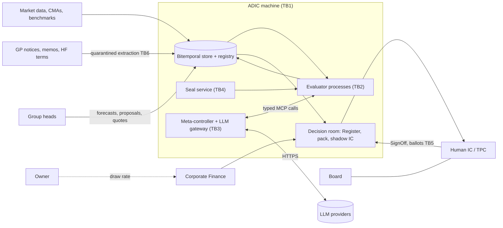
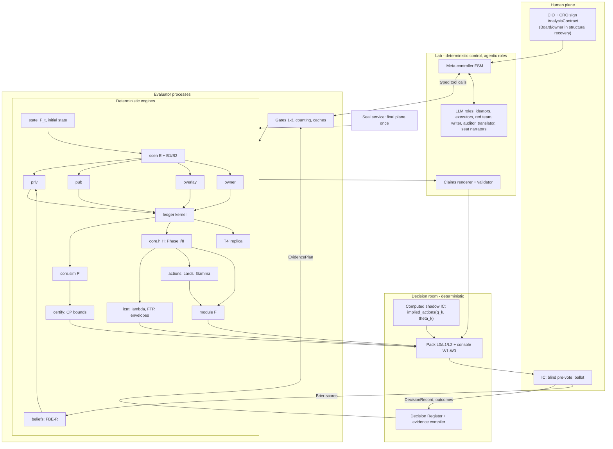

# ADIC Agentic Total-Portfolio Laboratory: Architecture

**Version:** 1.1 · **Date:** 2026-10-18 · **Author:** Chief Architect (design workflow, stage 3; revised after the quant-consistency and buildability critiques) · **Status:** the contract the build follows. `design/BUILD_SPEC.md` refines the interfaces, schemas and test plan defined here, and may not contradict them without an ADR (§12). v1.1 adopts BUILD_SPEC's spec-level ADRs S-ADR-01 to S-ADR-44 and closes the 75 critique items logged in `design/reviews/revision_log.md`; the supersession table at the end lists every v1.0 statement that changed.

> **SYNTHETIC – NOT ADIC DATA.** Every ADIC balance, probability, price, survival horizon, solve time and cost in this document comes from the synthetic working book (context §1A, census v1.0 or v1.1), research prototypes or benchmark proxies. None of it is ADIC data and none of it may be presented as ADIC data. Figures marked [I-calc] were computed in the research; [I] marks a design default to be calibrated; [M] marks a measured benchmark on a synthetic structure.

**Citation keys.**

| Key | File |
|---|---|
| brief | `design/00_DESIGN_BRIEF.md` (governs on paper mechanisms, with the paper text) |
| CTX | `inputs/00_CONTEXT_AND_PRIOR_WORK.md` |
| SYN | `research/00_SYNTHESIS.md` v1.1 |
| GROUPS | `research/groups/01_GROUPS_SYNTHESIS.md` v1.0 |
| G-gap_0k | `research/groups/addenda/gap_0k.md` (govern over GROUPS where they differ) |
| gap_0k | `research/addenda/gap_0k.md` |
| LC | `research/verification/13_paper_deepread.localcheck.md` (mapping issues M1–M14) |
| LIT14 | `research/literature/14_ic_deliberation.lit.md` |
| paper l.N | line N of `inputs/agentic_scientist_2610.18933v1.txt` |
| PA, PB, PC, PD | `design/proposals/P*_*.md`; PE = the user's blueprint |
| JQ, JE, JG | judge reports: quant/CRO, engineering, IC governance (`design/reviews/`); "JQ-MF3" = JQ must-fix 3 |

**Normative language.** "Shall" is binding on the build; "should" is a default that an ADR may change; "may" is optional.

---

## 0. Purpose, scope and reading guide

### 0.1 Purpose

This document fixes the architecture of a Python laboratory that helps ADIC's Investment Committee (IC) run a ~$177bn endowment-model fund as one controlled stochastic system. The fund must pay an owner-set 5–10% annual distribution, aims for 10% nominal USD, may lever, holds ~60% private assets (mostly PE, with declining DPI) and runs a large OTC overlay with a tail hedge and an opportunistic book (brief R1–R15). The laboratory produces, each quarter:
- a Tier-1 survival and feasibility verdict, with recovery plans when Tier 1 cannot be met;
- certified probabilities of outcomes, always with their model range;
- one state-contingent liquidity price λ, published by Corporate Finance (CF) as the funds-transfer-pricing (FTP) curve, with group quantity envelopes from the same solve;
- SELL / HOLD / REFINANCE / LEVER decision cards for every holding, organized by investment group (eight in the default taxonomy, which is configuration, not code: S-ADR-01, brief §8);
- an explicit "what you need to believe" bridge to 10%;
- an IC pack and a deliberation protocol in which humans own every decision.

The governing rule is the user's motto: **"LLMs accelerate evidence; deterministic models own numbers; humans own decisions"** (brief P1). Nothing executes trades.

### 0.2 Scope

| In scope (brief §4) | Out of scope or deferred (§12 ADR-36) |
|---|---|
| Schemas and the labelled synthetic book SYN-ADIC-177; scenario generator; private, public, overlay, liability and funding engines; belief fusion; action economics; vectorised simulator; policy classes; here-and-now optimizer with duals; robustness, views, attribution; experiment and provenance layer; agent layer with meta-controller and shadow IC; IC pack with view conditioning; CLI and MCP server; tests and an end-to-end synthetic demo | Any execution or order routing; real ADIC data before in-region serving is confirmed; SDDP water values; neural surrogates; interactive 2,000-scenario × 20-quarter trees; deep-RL policies; licensed-SIMM reconciliation; FX/CDX option surfaces until data arrive; the structural owner model |

### 0.3 The design on one page

The architecture is a **layered composite** (ADR-01), one base per layer, chosen where the three judges agree:

| Layer | Base | Grafts |
|---|---|---|
| Engines, ledger, package skeleton, measured budgets, increments, adapters | **PD** (one ledger kernel used three ways) | PA cohort-exactness rule; PC array shapes; groups addenda content |
| Optimizer, duals, certificates, verification | **PA** (Phase I-a/I-b, KKT-derived λ, Γ certificate, error ledger, tolerance cascade, counter-based RNG) | PD spare-lever cap, execution recovery, H–P ranking test; JQ-MF1/2 tree redesign |
| Laboratory integrity | **PB** (sealed evaluator, commit-reveal seeds, anchored-residual DSL, rendered claims, drills, planted-effect calibration) | PD separate final-plane instance; light seal service on the laptop |
| Decision room | **PC** (Decision Register, evidence compiler, computed shadow IC, L0/L1/L2 pack, politics rules, Treasurer decisions) | PA dual-quality labels; LIT14 corrections; JG must-fixes |
| User blueprint ideas | **PE** grafts | Market-implied fourth mark; Zombie-NAV and catalyst rules; liquidity margin as a T3 hardening plus a diagnostic; opposing utilities inside an admissible set Θ; archetypes A/B/C; typed what-ifs; phased roadmap |

Ten rules carry the design:
1. **One ledger kernel** generates the policy simulator P, the here-and-now program H and the T4′ stress test, so they reconcile by identity tests (PD §1; SYN §2.1).
2. **One price.** λ is the KKT multiplier of unencumbered cash in the *restored, feasible* H, normalized to a per-quarter premium. Prices exist only on a feasible problem; a CI test fails any card priced on a penalty-pinned dual (L15; gap_02 §4–5).
3. **Every banded model world sits inside H and the search plane,** and tree nodes are built on observable information pooled across worlds, so recourse cannot learn which model is true (JQ-MF1, JQ-MF2).
4. **Safety first.** Tier 1 is a lexicographic survival set. The ≤ 1% red event (T6) binds, banded by model class and defined by economic substance, not by code path (ADR-39). P(10%) is reported beside P(red) and never maximized (L9; gap_02 §3).
5. **The owner's distribution is exogenous** (Mode B). No payout variable exists in any decision contract; Modes A/H appear only in owner proposals (brief §6; JQ-MF6; JG-MF1).
6. **Readiness-Red is not event-Red.** A forward-looking stress indicator triggers the recovery plan, never the irreversible Red playbook (G-gap_01 §1.3).
7. **Integrity by infrastructure.** Agents emit typed specs to an out-of-process, hashed evaluator that counts every call; final seeds are commit-revealed; claims are rendered from registry placeholders (brief P2–P7; paper l.7489-7490).
8. **Humans own the contract and the vote.** AI seats compute and argue but never vote; seat numbers come only from the engine, and no LLM-originated number is ever rendered, pooled or compared (brief P1, P8; PC §6.5; ADR-46).
9. **Offline first.** The engine and all tests run with no LLM; agents have Stub and Replay backends (brief P12).
10. **Synthetic is always labelled,** generated from a sealed ground truth and validated by parameter recovery (brief R15).

### 0.4 Reading guide

| Reader | Read first | Then |
|---|---|---|
| IC members, CIO | §0, §8, §13 | §6 (FTP and envelopes), §15 (open questions) |
| CRO, model-risk management (MRM) | §1, §5, §5.13 (error ledger), §10 | §4.9 (ledger), §7.6 (gates), §12 |
| Treasurer / Corporate Finance | §4.3, §4.9–4.10, §5.5, §6 | §8.2 (Register Q1–Q3, A5–A6, E3–E4) |
| Group heads | §4.4–4.8, §6, §8.4–8.5 | §8.10 (credibility and transfer-pricing rules) |
| Quant developers | §3, §4, §5, §9 | §10.7 (tests), §11.5–11.6 (budgets, increments) |
| Agent and platform engineers | §3.4–3.6, §7, §10, §11 | §2.4 (trust boundaries) |
| BUILD_SPEC author | Everything; §3.4–3.5 and §10.7 are the contract surface | §12 for the reasons behind each choice |

### 0.5 Conventions

- **Money:** $bn float64 in the ledger and the LP; float32 in path cubes; inside the LP all money is scaled by W₀ = opening NAV for conditioning (PA §4.8.3).
- **Time:** quarters q = 0…40, months m = 0…120; rates are per period unless tagged "a year". Quarterly conversion $r_q=(1+r_a)^{1/4}-1$; intensities $x_q=1-(1-x_a)^{1/4}$ (SYN §0).
- **Returns** carry tags: arithmetic or geometric, gross or net of fees.
- **Reserved symbols** (SYN §0): F_t is market fragility only; k_MS is misspecification sensitivity; "module F" is the safety filter; LR1–LR8 are ladder rows; OV1–OV3 are overlay limits; L1–L16 are the research's conceptual leaps.
- **Census and allocation.** SYN-ADIC-177 has hashed censuses v1.1 (PE unfunded $16.4bn on the $52bn PE bucket; the user's choice, brief §8), v1.1r (the same vintage history rescaled to the allocation-v2 PE bucket, $10.7bn) and v1.0 (PE unfunded $27.4bn, total $38.0bn, the CTX working assumption, kept for research fixtures). Allocation v2 (PE $34bn, Real Assets $18bn) is the default; the decision census follows S-ADR-03 and S-ADR-37. Research figures quoted below are on allocation v1 and census v1.0 unless marked otherwise (ADR-25; Q2 closed by brief §8).

---

## 1. Requirements and principles trace

### 1.1 Requirements R1–R16

| # | Requirement | Satisfied in | Mechanism |
|---|---|---|---|
| R1 | Multi-period optimization | §5.1–5.12 | Four Powell policy classes: a cushion-monotone standing policy P0 over 40 quarters (PFA), a 12-quarter tree program H re-solved quarterly as MPC (DLA), tuned CVaR buffers (CFA), regression terminal values (VFA) |
| R2 | Robust scenario analysis | §4.1, §4.12, §7.5 | Six fee-consistent CMA worlds M1–M6 plus a second generator family in search; a sealed final plane with a held-out generator and a misspecification ensemble; KL/W∞ tilts, k_MS, reverse stress |
| R3 | Probabilities of outcomes | §5.10, §8.4 | Clopper–Pearson certification on fresh 50k-path worlds; every probability shown as "central [model range] ± MC error" with scenario hash, ICD-203 word and plane label |
| R4 | 5–10% owner distribution | §4.3, §5.2 | Exogenous stochastic draw $D_y=d_yB_y$ driven by oil, fiscal state and shock type; T1 hard row; T7 certified; Register Q2 (owner-draw response) |
| R5 | 10% nominal return target | §4.0, §4.11, §5.2 | 10-year geometric TWR; Tier-2 objective J with an L2 shortfall to 10% target wealth; P(10%) reported only; per-model WYNTB bridge |
| R6 | Leverage at portfolio and asset level | §4.8, §4.10 | Portfolio LEVER is a CF decision inside H; asset LEVER ≡ ADD + REFI; limits in T5; leverage monotone in the cushion |
| R7 | ~60% private, declining DPI | §4.4, §4.9 | Exit-window state e_t with an effective-age clock and structural scalar Φ; group cash map; pacing as the first lever; drought initial state (posterior 0.87) |
| R8 | SELL/HOLD/REFINANCE/LEVER per strategy and asset | §4.8, §5.7 | Two primitives (exposure, financing) priced on one kernel; exact column cash flows; Lagrangian scores, a certified selection MILP and decision cards with `priced_on`. REFINANCE = cash-out, LEVER = exposure-up (user, 2026-10-18) |
| R9 | Three return series fused | §4.7, §9.3 | Forward Belief Engine: three marks plus a market-implied fourth mark; since-inception net IRR/MOIC with cases translated onto the forward basis; group translations, robust bias model FBE-R and credibility κ_g estimated from ADIC's quarterly point-in-time archive from the first release (brief §9; ADR-43) |
| R10 | OTC overlay with tail hedge and opportunistic book | §4.6 | Position layer with three books, Greeks, VM by CSA, SIMM-like IM, economic net-vega limits OV1–OV3 as rows in H |
| R11 | Agentic architecture inspired by *The Agentic Scientist* | §7 | Deterministic meta-controller; typed idea bundles; engine-counted budgets; three engine-owned gates; sealed final plane; switch-off null control; claim-to-source validation; integrity enforced by infrastructure |
| R12 | IC can discuss the results | §8 | Decision Register; L0/L1/L2 pack; computed shadow IC with n_groups + 5 seats (thirteen under v2); blind human pre-vote; grounded Q&A through the analyst (R16); typed what-ifs; decision log with signposts |
| R13 | Build on the prior deck | §5.2, §5.10, §4.2, §4.13 | Two tiers rebuilt as a lexicographic program; v8 rules kept as a frozen comparator; the state engine becomes the F_t filter and a 12-row panel; v8 attribution survives only as `test_v8_replica`; the motto is P1 |
| R14 | Eight groups (taxonomy as configuration); CF as internal bank | §2, §4, §6, §8 | `group` key on every row; groups read from `config/taxonomy/groups_v2.yaml` (PE, Secondaries, Capital Solutions, Co-investment, Public Markets, Private Credit, Overlay, Real Assets) with no hard-coded count (S-ADR-01); three private engines plus the interim Real Assets engine (S-ADR-02) and group templates; group action catalogues; envelopes and FTP from one solve; CF owns the ledger, facilities, collateral, payout and λ; IC agenda by total portfolio and by group |
| R15 | Synthetic data, labelled, from a documented truth | §9.4–9.5 | SYN-ADIC-177: world, sealed truth and observation layers; census versions; marks emitted as since-inception net IRR/MOIC with cases (brief §9); gates V1–V24 and G-A–G-E; SBC and ±5pp parameter recovery through the IRR/MOIC translation; taint-propagating labels |
| R16 | Chat with the model | §8.12, §11.3–11.4 | One deterministic analyst service owns every chat tool (resolve, holding and belief cards, explain, compare, typed what-ifs confirmed by a human, run status), entitlements by role and a hash-chained transcript ledger; answers are typed cards rendered from placeholders with status and SYNTHETIC labels; `tpa chat` (Stub/Replay/live), the read-only analyst MCP server and the pack's Ask hand-off are thin surfaces over it (ADR-44) |

### 1.2 Principles P1–P15

| # | Principle (brief §2) | Enforcing mechanism | Where |
|---|---|---|---|
| P1 | LLMs accelerate evidence; models own numbers; humans decide | Claims rendered from typed placeholders; a validator rejects literal digits; shadow-IC numbers come only from `implied_actions`; LLM output schemas contain no engine-owned or human-owned fields, and no LLM-originated numeric field is rendered, pooled or compared (ADR-46); extracted numbers reach engines only after verification; no execution adapter; AI seats never vote | §7.3, §8.5, §8.12, §10.6 |
| P2 | Evaluator integrity by infrastructure | Out-of-process evaluator with read-only, content-hashed engines, scenarios, beliefs and cost models; per-request hash checks; engine-side counting; candidate self-reports are diagnostics only (paper l.6677); stale or missing caches stop evaluation (paper l.7210) | §7.2, §10.2 |
| P3 | Search and final planes fixed before search | Planes hashed at contract signing; final seeds by commit-reveal HMAC; a separate final-plane evaluator instance and cache; search sees bounded aggregates only (paper l.6825); embargoed chronological windows (paper l.6879-6882); B2 is labelled a model-family hold-out unless the contract selects the out-of-time variant, whose generator and filters are calibrated only through 2015 (ADR-45) | §7.5 |
| P4 | Typed idea bundles; engine-counted budgets | `IdeaBundle` schema (paper App. F.2); ≤ 3 validation retries (paper l.6290); every call counted, failures included; counts feed deflation (DSR, PBO, α-investing) | §7.3, §7.7 |
| P5 | Three gates: correct, selection, qualification | Gate 1 `correct` (engine-owned; Tier 1 and non-inferiority in every world, worst-world aggregated); Gate 2 selection (strict, ties keep the incumbent, paper l.6823-6824); Gate 3 sealed qualification with paired CRN and pre-declared materiality, else `not_qualified` (paper l.6926-6933); typed failure taxonomy | §7.6 |
| P6 | Controls, attribution, retrospective evidence | Frozen controls at 3/5/10 years (HOLD, static SAA, deck rules, target-chasing, shuffled-signal placebo, pro-rata, overlay-only, archetypes A/B/C); exact switch-off null control by construction (anchored residuals, paper l.2687-2700); single-change ablations with no tuning (paper l.6559-6561); disjoint selection and reporting seeds | §5.10, §7.6, §10.5 |
| P7 | "Resolves" is deterministic, "supports" is audited | Registry validator for resolution; a family-B auditor reads ledger, logs and engine diffs (paper l.1976-1979); both verdicts printed; provenance DAG (paper l.1410-1412) | §10.6 |
| P8 | Humans own the contract | `AnalysisContract` and the Register are human-signed; `SignOff` objects no agent tool can create; agents draft amendments only (paper l.596, l.1387-1389) | §7.4, §10.1 |
| P9 | Deterministic orchestration; small parallelism; memory as heuristic | Plain-Python state machine; **2 workers by default, configurable to 4** (paper l.1209-1210; LC M5); memory per campaign, never evidence, never final-plane, never cross-campaign; escalation channel and assumption log (reversing paper l.6406-6408) | §7.4, §7.8–7.9 |
| P10 | Cross-family review | Reviewer, red team, auditor and AI validator on family B; provider-agnostic `LLMBackend`; same-provider review labelled "correlated" (paper l.1423-1424) | §7.10 |
| P11 | Reproducibility | Counter-based keyed RNG (incl. `company_id`); draws generated outside parallel kernels; single-threaded evaluator solves; manifests with every hash; golden manifests reproduce bit for bit | §3.5, §10.2 |
| P12 | Offline mode | `TPA_LLM_MODE ∈ {offline, replay, live}`; engines never import agent code (layering test); full offline campaign in CI on Replay | §11.1 |
| P13 | Data confidentiality | Holdings stay local; prompts carry aggregates and IDs; holding-level prompt content needs an operator flag; quarantined extractors with no outbound tools; in-region serving before real data | §9.7, §11.7 |
| P14 | Explainability first | Every card carries binding rows, shadow prices with one-sided intervals, marginal value, attribution and flip thresholds; briefs missing a P14 field are rejected | §5.7, §8.4 |
| P15 | Anonymized, horizon-free policies | DSL forbids scenario IDs, dates, time-to-go, budgets, true regimes and economic NAV; random path IDs; filters run on simulated observables; terminal values remove end effects; no silent synthetic stand-ins (paper l.6593-6594) | §5.11 |

---

## 2. System context

### 2.1 Actors

| Actor | Decides | Sees (§8.4) | Touches the system through |
|---|---|---|---|
| Sovereign owner | The annual draw rate within 5–10%; whether to pre-agree a band (Mode H); draw convention | Owner-proposal packs (Register A6), labelled counterfactual | Treasurer; Board |
| Board | Recovery mode and glide-path extensions; CFP Black; Tier-1 contract (A1), facility programme (A5), FTP methodology (A3); value splits | Board items with minority reports | IC recommendation; `SignOff` objects |
| Investment Committee (human voting members) | Tier-A actions; envelopes and FTP (as Total Portfolio Committee, TPC); model weights (A2) | L0 fund-on-a-page, L1 briefs, L2 drill-down | Pack, console, blind pre-vote, ballot |
| CIO | Proposes exposure, pacing plan, model weights; co-signs contracts; Tier-B decisions with the CRO | Bridge, envelope coherence, package vs archetypes | Register; contract signature |
| CRO and CRO office | Tier-1 status; co-signs contracts; runs forecast registry, validation, transfer-pricing committee; custodian of the seal salt | Tier-1 board, model ranges, recovery status, gambling flags | Seal service; registry; disposition of reviewer findings |
| Treasurer / Corporate Finance | Funding, facilities, collateral, buffer, CFP stage actions (Green), FTP publication, owner-draw response (Q2) | Ladder LR1–LR8, CFP readings, infeasibility prices, facility and covenant paths, VM/IM by CSA | `ledger`, `owner`, `icm` outputs; Register Q1–Q3, A5–A6, E3–E4 |
| Group heads (eight in the default taxonomy: PE, Secondaries, Capital Solutions, Co-investment, Public Markets, Private Credit, Overlay, Real Assets; S-ADR-01) | In-envelope deals; asset-level SELL/HOLD/REFI/LEVER and PACE proposals; forecasts | Group block: envelope use, cards, hurdle, FTP, delivery share φ_g, own information value | Forecast registry; proposal intake (T−25); quote table (conflict-flagged) |
| Model-risk management (MRM) | Engine validation, release hashes, revalidation on any model/prompt/tool change | Error ledger, consistency-contract results, drills | Registry; release process |
| IC secretariat | Agenda, pack publication, minutes approval | Everything in the pack | `idm`, `pack` |
| Operators (TPA desk quant developers, data/platform engineer) | Nothing about the portfolio; run jobs | Logs, manifests, budgets | CLI, MCP server (read-only tools), CI |
| AI governance function | Model families allowed, LLM materiality tiers | LLM call records, admission tests | `agents` configuration |

Every human actor above may also query the conversational analyst (§8.12, R16) through `tpa chat` or the analyst MCP server, within the entitlements of their role.

### 2.2 External systems and data sources

| Source | Content | Enters through | Status at launch |
|---|---|---|---|
| ADIC books and records (administrator statements, GP notices, capital-call notices) | Positions, NAVs, cash flows, unfunded by vintage, consents | `data` adapters (quarantine on unknown fields) | Not connected; SYN-ADIC-177 stands in, labelled |
| Group marks archive | Underwritten, actual and forecast marks per holding as since-inception net IRR or MOIC with downside/base/upside cases, archived quarterly (brief §9); memos; declined deals | Bitemporal `marks_archive` adapter (schema frozen in wave 1) → `mark` and `forecast` tables; FBE-R and κ_g are estimated from it from the first release | Exists at ADIC (brief §9); SYN-ADIC-177 emits the same shape from 2008 |
| Hedge-fund documents | Terms τ per lot (notice, gates, revocability, consents) | Quarantined extractors → human-checked records | Decisive data item (SYN §7.2 #6) |
| Overlay blotter, CRIF, CSAs, margin statements | Trades, sensitivities, VM/IM by CSA | `overlay` adapters | Synthetic 250-trade, 12-CSA fixture |
| Funding documents | Facilities, covenants, syndicate | `ledger` facility table | Synthetic |
| Market data | SOFR, UST, Cboe VIX family and SKEW, ICE MOVE and Brent, OVX, EBP, FX, spreads, exit observables | `scen`, `state` loaders (versioned snapshots, SHA-256, labelled REAL public market data) | On disk today: the gap_04 monthly panel (1963-07 to 2026-08; 23 columns: US equity excess return, rf, log realized vol, 10y, EBP, inflation and others) and quarterly Brent from 2002. The other factor histories arrive through a one-off data work package run by a human with network access; until then B1/B2 use the panel's columns plus labelled conditional fills (ADR-45) |
| Capital-market assumptions | J.P. Morgan, BlackRock (fee-adjusted), AQR CMA files | `scen` anchors; `bridge` | Versioned by as-of date |
| Private-market benchmarks | MSCI, Jefferies, Evercore, Lincoln, Cliffwater, KBRA | Calibration targets (SYN §7.1; GROUPS §8) | Reference values |
| ISDA SIMM parameter tables | Risk weights, correlations (v2.8+2512) | `overlay.simm_like` | Own-use licence; reconciliation to a licensed calculator is a production item |
| Owner / fiscal data | Draw history, rule text, convention | `owner` | Open question Q1 |

### 2.3 LLM providers

- **Default:** Anthropic API through the `anthropic` 1.15 SDK, model `claude-opus-5-5` (family A).
- **Family B at launch:** `claude-sonnet-5-5` with a disjoint context and role prompt. It is the same provider, so every review it performs is labelled "correlated" (brief P10; ADR-30).
- **Sovereign channels:** Bedrock (`AnthropicBedrockMantle`), Vertex (`AnthropicVertex`) and Foundry (`AnthropicFoundry`) clients sit behind the same `LLMBackend`. They are deployment channels, not different model families.
- **A second model family** (another vendor) is a Phase-1 addition, subject to sovereignty approval; its SDK is a justified PyPI addition (open question Q6).

### 2.4 Trust boundaries

| ID | Boundary | What crosses | Enforcement |
|---|---|---|---|
| TB1 | Data perimeter | Real holdings never leave the machine except in operator-enabled prompts | Redaction filter at the LLM gateway; `data_class` tag; holding-level content needs an operator flag (§9.7) |
| TB2 | Evaluator boundary | Typed requests in; bounded aggregates out | Separate process, `python -I`, read-only mounts, per-request hash check, no network code (§7.2) |
| TB3 | LLM egress | Prompts and typed tool calls | Only the gateway process has network egress; agents hold no file, shell, code or network tool |
| TB4 | Seal boundary | Final-plane seeds and results | HMAC(salt, world) seeds; salt readable only by the CRO account; final store ACL; run once (§7.5). In DEV/SYNTHETIC mode only, a single-account software seal (salt in the run directory, commit–reveal checked in code) stands in; REAL mode refuses it and L0 prints the mode (ADR-47) |
| TB5 | Decision boundary | Contract adoption, votes | `SignOff` objects created only by authenticated humans; AI seats never vote |
| TB6 | Untrusted documents | GP notices, memos, adviser reports | Quarantined extractors with no outbound tools and dual extraction; an extracted number enters an engine only after 100% human verification, or after dual-extraction agreement plus a sampled human check under an error-rate gate (ADR-46); documents are data, never instructions |
| TB7 | Synthetic vs real | Data rows and every derived output | `is_synthetic` and `data_class` on every row; taint propagation; mixing is a hard error |
| TB8 | Truth seal | SYN-ADIC-177 ground truth | Sealed truth store readable only by MRM's validation jobs; agents and estimators see observation-layer data only |
| TB9 | Analyst surfaces | Questions in; typed answer cards out | One analyst service applies role entitlements, desk barriers and the pre-vote window at the tool layer, never in prompts; answers leave as cards rendered from placeholders; what-ifs run only after a human confirmation the model cannot perform; through an external MCP client (Claude Code or Desktop) the client's prose is unvalidated, so that surface is SYNTHETIC-only until Q6 is answered and labelled "analyst exploration, not for the decision record" (ADR-44) |



---

## 3. Architecture overview

### 3.1 Thesis

**Ship a ledger, not an oracle** (PD §1), **price only feasible problems** (L15), **trust only sealed evidence** (PB §1), and **organize everything around the decisions humans take** (PC §1). One deterministic liquidity-and-collateral ledger kernel is used three ways:
- forward on 10,000–50,000 paths, it is the policy simulator P, which certifies probabilities;
- linearized on a scenario tree, it is the here-and-now program H, whose restored duals give λ, the FTP curve and envelopes;
- on the canonical stress s\*(θ\*), it gives T4′ survival and the CFP readiness stage.

Agents never touch the kernel. They submit typed specs to an evaluator that prices, counts and gates them. A human-owned Decision Register compiles each quarter's agenda into the evidence the engines must produce.

### 3.2 Layers and modules

```
L10 Room      idm (Register, evidence compiler, briefs, shadow IC, ballots, decision log, signposts) · pack (HTML/JSON, ep.js) · analyst (chat service: tools, entitlements, what-ifs, transcripts; R16)
L9  Lab       lab (meta-controller FSM, budgets, memory, escalation) · agents (roles, LLM backends) · claims (renderer, validator)
L8  Evidence  evaluator (search/final instances, planes, caches, counting, gates) · seal (commit-reveal, final runner) · registry
L7  Explain   robust (ensemble, KL/W∞, k_MS, entropy pooling, reverse stress) · attrib (prices, counterfactuals, Shapley, null) · stats
L6  Decide    core.sim (P) · core.policy/dsl/search/certify · core.tree · core.h (Phase I/II, duals, kernel, colgen, Level B) · core.safety (module F) · icm
L5  Ledger    ledger (cash/HQLA/IG/encumbrance/facilities/payout; LR1–LR8; T4′ replica; CFP readiness/event)
L4  Beliefs   beliefs (FBE-R, four marks, credibility, diagnostics, forecast registry scoring, perf O3) · bridge (WYNTB)
L3  Assets    priv (funds | companies | claims; overlap graph) · pub (HF machine, long-only, P2S) · overlay (books, templates, SIMM-like, OV1–OV3) · actions
L2  World     scen (E, families B1/B2, vol and oil/fiscal states) · state (stress filter, F_t, initial state) · owner (draw engine, modes)
L1  Data      data (schemas, bitemporal store, adapters, freeze, taint) · synth (SYN-ADIC-177, censuses, gates)
L0  Contracts contracts (pydantic models, enums, array specs, units) · rng (counter-based keyed streams)
```

Dependencies point downward only. L10 never calls an engine directly: it asks the evidence compiler, which asks the evaluator. Engine packages (L0–L7) never import `lab`, `agents`, `claims` or `idm` (layering test, PA §8).



### 3.3 Deterministic versus agentic boundary

| Deterministic (owns numbers) | Agentic (proposes, extracts, argues, narrates) | Human (decides) |
|---|---|---|
| All engines L0–L8; meta-controller control flow; gates; tuners (CMA-ES inside a declared box); claim renderer and validator; evidence compiler; seat computations (`implied_actions`); module F; entropy pooling | Idea bundles (anchored residuals, action packages, overlay structures); red-team ScenarioSpecs; memo and brief text with placeholders; "supports" audit verdicts; NL → ViewSpec drafts; grounded Q&A text; seat arguments and minority reports; minutes drafts; document extraction (real-data phase) | Contracts and amendments; Register entries; view confirmation; votes and overrides; Board/owner items; execution by named humans |

Any number an LLM states outside a rendered placeholder is rejected by the validator. AI seats state no probabilities at all: a seat's numbers are its engine-computed implied actions and regrets, and a seat that wants a different belief submits a typed ViewSpec that `implied_actions` evaluates (JG-MF5; ADR-46). LLM output schemas never contain engine-owned or human-owned fields; the only LLM-originated numbers allowed anywhere are declared search boxes (replaced by tuned values), member-confirmed what-if parameters, and diagnostics such as `predicted_effect` or extraction confidence that are never rendered, pooled or compared.

### 3.4 Package layout and module ownership

Package `src/adic_tpa/` (import name `adic_tpa`; CLI `tpa`).

| Module | Responsibility | Owner (accountable) | Build stream |
|---|---|---|---|
| `contracts`, `rng` | Pydantic models, enums (GroupId, Lens, MandateMode, Plane, Stage…), array specs, units; keyed RNG | CIO office, TPA desk | A |
| `registry` | Append-only, hash-chained run/metric/claim/forecast/decision store (SQLite + Parquet) | MRM | D |
| `data`, `synth` | Bitemporal store, adapters, freeze, taint; SYN-ADIC-177 generator, census configs, gates V1–V24 | Data office; MRM holds the sealed truth | A |
| `scen`, `state` | Engine E, bootstrap families, trees' path cubes; stress filter, F_t, initial state, state panel | Risk (CRO office) | B |
| `owner` | Draw engine, mandate modes, payout-rule library (owner proposals only) | Corporate Finance | B |
| `priv`, `pub` | Three private engines with group templates, overlap graph; HF state machine, long-only, P2S | Groups own parameters; TPA desk owns code | B |
| `overlay` | Templates, surfaces, Greeks, VM by CSA, SIMM-like IM, OV1–OV3, monetization, three books, services ledger | Overlay; Risk (IM); CF (collateral) | D |
| `beliefs`, `bridge` | FBE-R, translations, credibility, diagnostics, registry scoring, O3 performance; WYNTB bridge | CRO office (validation); groups file forecasts; CIO office (bridge) | A |
| `ledger` | Cash identities, ladder, T4′ replica, survival, CFP readiness/event, facilities | Corporate Finance (Treasurer) | C |
| `actions` | Instrument library, admissibility, exact column cash flows, scores, cards, flip thresholds | Groups propose; TPA desk scores | C |
| `core` | sim (P), policy, dsl, search, certify, tree, h, phase1, phase2, duals, kernel, colgen, levelb, safety (F), terminal, mpc | TPA desk; CRO signs Phase I and module F | C |
| `icm` | Envelopes, decision/published FTP at tolerance and appetite, charges, DVA, transfers, desks, contingent budgets, pacing | CF (FTP); TPA desk (envelopes); CRO office (TP committee) | C |
| `robust`, `attrib`, `stats` | Robustness metrics and entropy pooling; attribution; CP, bootstrap, Holm, α-investing, DSR, PBO, MDE | Risk; CIO office | C |
| `evaluator`, `seal` | Plane registry, caches, counting, gates, failure taxonomy; commit-reveal and final runner | MRM; seal custody by CRO office | D |
| `lab`, `agents`, `claims` | FSM, budgets, memory, escalation; roles, prompts, LLM backends; renderer, validator, provenance | CIO office under AI governance; MRM inventories the lab as an AI system | D |
| `idm`, `pack`, `cli`, `mcp_server` | Register, compiler, briefs, shadow IC, ballots, log, signposts; HTML pack and console | IC secretariat; Register owned by the CIO, registry by the CRO office | D |
| `analyst` | Conversational analyst service (R16): tool catalogue, context handles, entitlements, what-if draft → confirm → run, answer cards, transcript ledger; `tpa chat` and the analyst MCP server are surfaces over it | CIO office (service); CRO office (entitlements, transcript access) | D |

Streams (team of four [I], PD §8): A data/synth/beliefs/contracts; B world and asset engines; C ledger, core, icm, robust, attrib; D evaluator, lab, agents, overlay, room, analyst. Contracts freeze at the end of week 2, only after a walking skeleton has called every Protocol and cross-package function once on the mini book with fakes; each stream builds against a golden 200-path mini-cube, mini FlowCube and a fixture H built from the gap_02 coefficient export.

### 3.5 Core interfaces (frozen in week 2)

```python
class AssetEngine(Protocol):                      # priv.*, pub.*, overlay
    engine_id: str; groups: tuple[GroupId, ...]
    def init(self, book: BookSnapshot, beliefs: BeliefSet, n_paths: int, *,
             draws: BeliefDraws, world: WorldSpec) -> EngineState: ...   # α draws for this world (ADR-40)
    def recourse_quotes(self, q: int, st: EngineState, world: WorldSlice) -> RecourseAvailability: ...  # phase 1 of recourse (ADR-41)
    def step(self, q: int, st: EngineState, world: WorldSlice, act: ActionSlice,
             noise: NoiseSlice) -> FlowSlice: ...     # f32[P, n_flow_types] typed by FlowType x GroupId
    def apply_recourse(self, st: EngineState, outcome: RecourseOutcome) -> None: ...   # phase 3: scale sold units before the next step
    def column_flows(self, unit_id: str, action: LensAction, cube: ScenarioCube) -> FlowCube: ...  # exact CRN cash flows
class Ledger(Protocol):
    def apply(self, m: int, ls: LedgerState, flows: Sequence[FlowSlice], draw: f32[P],
              quotes: RecourseAvailability) -> tuple[LedgerState, RecourseOutcome]: ...   # phase 2: books proceeds once
    def row_slacks(self, ls: LedgerState) -> dict[RowId, f32[P]]    # same RowIds as H's rows
    def stress_replica(self, ls0: LedgerState, stress: StressSpec) -> StressReport  # T4' monthly headroom hd_h
class Policy(Protocol):                           # compiled PolicySpec, P0, controls, archetypes
    def act(self, q: int, obs: Observables) -> ActionSlice   # obs lagged; no horizon, no path id, no world id
class EngineFactory(Protocol):                    # implemented in core.sim; applies misspecification overrides (§7.5)
    def build(self, book: BookSnapshot, world: WorldSpec) -> EngineBundle: ...   # engines, ledger, owner config, policy wrappers
def build_tree(cubes: Mapping[WorldId, ScenarioCube], spec: TreeSpec) -> Tree            # pooled-observable nodes
def build_h(tree: Tree, ls0: LedgerState, cat: ActionCatalogue, c: AnalysisContract) -> LPModel
def phase1(lp: LPModel, tiers: Sequence[RowTier], levers: LeverSet,
           scenarios: Sequence[ConsentScenario]) -> Phase1Result       # u*, IIS, Farkas ray, per consent scenario
def phase2(lp: LPModel, p1: Phase1Result, glide: GlidePath, tree: Tree) -> HSolution  # duals only from here
def price(sol: HSolution, lp: LPModel, tree: Tree, tax: GroupRegistry) -> tuple[Kernel, FTPCurves, EnvelopeSet]  # priced_on + recovery_hash
def select(lp: LPModel, sol: HSolution, cols: ColumnPool, *, basis: Basis) -> Selection   # Level-B MILP, fix-and-resolve, Gamma
def project(prop: ActionSet, state: StateSnapshot, *, ls0: LedgerState, rows: LinearizedTier1,
            exact_check: Callable[[ActionSet], ExactCheck]) -> SafeAction   # module F, with "what changed"
```

v1.1 amended six signatures before the freeze (BUILD_SPEC S-ADR-29): `init` receives the per-world belief draws; `Ledger.apply` returns the recourse outcome, because recourse became a three-phase engine–ledger protocol (§4.9); and `phase2`, `price`, `select` and `project` receive the model, tree, basis and linearized rows they need.

| Array contract | Shape and dtype | Units |
|---|---|---|
| `ScenarioCube` | factors f32[P, M, K]; regime/exit/shock i8[P, M, 3]; stress posterior f32[P, M, 3]; vol f32[P, M, V]; draw rate f32[P, Y]; meta (world, plane, seed key, generator hash, as-of, `is_synthetic`) | monthly log returns; rates a year |
| `FlowCube` | f32[P, Q, U, F] (units × flow types: call, distribution, coupon, PIK accrual, sale proceeds, fees, VM, ΔIM, premium, monetization) + unit→group map | $bn per quarter |
| `LedgerPaths` | f32[P, M, R]: LR1–LR8, CBC by tier, NCO, T4′ headroom | $bn |
| `BeliefSet` | per unit α̂ (fused forward log return in excess of the unit's benchmark at the as-of), benchmark id, β̂, μ̂_total = benchmark + α̂ (display and cards), σ̂, 80% band, flags, P(achieved ≤ k), information value; group-bias posterior | log return on nowcast economic NAV, a year |
| `BeliefDraws` | for one world: α paths f32[P, U] including the shared group-bias and GP-effect draws, adjusted to that world's CMA-line basis; learning parameters m, φ, η per unit | per quarter |
| `RecourseAvailability` / `RecourseOutcome` | per recourse-eligible unit: cash-equivalent bid, depth cap, lag, tier, normal-regime bid f32[P, U_r] / sold fraction, month, red flag, proceeds f32[P, U_r] | fraction; $bn |
| `Tree` | nodes, parent, quarter, p_n, world-conditional p_{n|m} f32[N, 6], leaf world tag, node coefficient tensors | per $ |
| `HSolution` | root actions; duals by row family with one-sided intervals; ℓ[n]; π[n]; envelopes with ranges; Γ; `priced_on`; recovery hash | per $ of W₀ |

**Determinism contract (JE-MF5).** Every uniform is a pure function $u=H(\text{seed},\text{world},\text{plane},\text{path},\text{month},\text{source},\text{slot},\text{entity})$ of a counter-based generator (Philox4x64-10, with the key derived by SHA-256 from (seed, world, plane, source, entity), the counter from (path, month, ⌊slot/4⌋) and the output lane from slot mod 4, so all four lanes are used; keys are cached per block; generated in vectorized blocks), so common random numbers hold across policies and actions by construction and results cannot depend on thread count (PA §4.3; G-gap_02 V24; S-ADR-38). Decision-dependent draws (sale success, gate hazards, CV offers) read pre-indexed slots. Draws are generated outside numba `prange` kernels (PC §2.2 P11 measured thread dependence otherwise). Evaluator LP solves run single-threaded with a fixed algorithm and `random_seed`; speed comes from parallel processes (worlds, SAA replications), never threads inside one solve (JE §5.1). Every solver option is written to the manifest.

### 3.6 Data flow for one quarterly cycle

The IC meets on day T. Gates are defined in §7.6.

| Day | Step | Produces | Gate |
|---|---|---|---|
| T−28 | Contract DRAFT from the template; the drafter proposes amendments; data cut-off announced | AmendmentDrafts | — |
| T−25 | Groups file forecasts (since-inception net IRR or MOIC with down/base/up cases, read as P10/P50/P90), proposals and quotes; CF files facility and draw data | Registry records (bitemporal) | Schema checks |
| T−23 | Snapshot and freeze: bitemporal data, initial state (π₀, e₀, Z₀, F_t, oil state, 12-month draw), FBE-R posteriors using the *previous* quarter's frozen optimizer outputs; flagged assets reviewed by humans | `StateSnapshot@hash`, `BeliefSet@hash` | G2 |
| T−22 | Contract check: Phase I per consent scenario; recovery mode; plane hashes; salt commit; CIO + CRO sign (Board/owner if structural recovery) | Signed `AnalysisContract` | G0 |
| T−21 | Design review: family-B reviewer + deterministic linter; CRO dispositions findings | DesignReview | G1 |
| T−20 | Baseline pricing: H on 5 parallel SAA replications; Level-B selection with Γ; cards for every holding; envelopes; draft FTP; candidate C_H; module F | BASELINE_PRICED artifacts | Pinned-dual CI test |
| T−19 to T−14 | Lab campaign (optional each quarter): ideation ⇄ screening on the search plane, 2 workers | Promoted candidates | G3–G5 |
| T−13 | Selection; memory closed; finalists frozen (incumbent, ≤ 3 archive cells, C_H always) | Finalist hashes | — |
| T−12 | Sealed run once on the final plane; certification against T6 bands | QUALIFIED / NOT_QUALIFIED / NOT_ASSESSED labels | G6 |
| T−11 | Retrospective: controls at 3/5/10 years, switch-off null, single-change ablations, red team, one bootstrap rerun | Retrospective evidence | — |
| T−10 | Register S0: frozen questions, options (status quo, DEFER, recommendation, archetypes A/B/C) | Agenda | — |
| T−9 to T−8 | Briefs rendered from placeholders; family-B audit; human countersignature | Audited pack | G7, G8 |
| T−7 | Pack published; shadow IC S1–S7 (computed seats, one debate round, minority reports) | Seat map, minority reports | — |
| T−1 | Human blind pre-vote locks | Pre-vote hashes | — |
| T | Meeting H1–H6 | Ballots, DecisionRecords | — |
| T+5 | Log closed; signposts armed; forecasts registered for Brier scoring at 1, 4, 8 quarters | Decision log | G9 |
| Monthly | Signpost monitor; CFP readings; event decisions (E1–E4) through the compressed protocol | Alerts, event records | — |

---

## 4. Quant core

Each module states its purpose, method and key equations, state, inputs and outputs with units, calibration source, evidence and known limitations. Parameter tables live in the cited research; this section fixes what the build must implement.

### 4.0 Time grid and the meaning of 10% (brief decision 1)

| Item | Decision |
|---|---|
| Decision clock | Quarterly, t = 0…39 (40 quarters) plus a terminal value |
| Engine clocks | Monthly: market factors, ledger (T3, T4′), hedge-fund dealing, overlay VM. Quarterly: private engines, with a fixed intra-quarter profile that spreads calls and distributions over months for the ledger, **accepted only if error-ledger row A1 passes** (|ΔP(red)| ≤ 0.1pp, a fixed bound, against a monthly private clock on ≥ 20,000 CRN paths or on importance-sampled stressed paths; 2,000 paths would let errors of ≈0.3pp pass); otherwise private engines run monthly (JE-MF8; JQ §6). Daily sub-steps only in the overlay stress module (named stresses, 2008/2020/2022 replays, a flagged 2,000-path stress subsample) |
| Horizons | P: 40 quarters, reported at 3/5/10 years. H: 12 quarters (configurable 8–20). T4′: 24 months, monthly. T6: 5 years, in P. All declared in the contract before search (paper l.6678-6679) |
| Target metric | **10-year rolling geometric TWR, nominal USD, net of fees and financing, gross of distributions:** $\Pi_{t+1}=\Pi_t(W_{t+1}+d_t)/W_t$, $\bar R_{10}=(\Pi_{40}/\Pi_0)^{1/10}-1$ (SYN §4.9, §9.3 item 2) |
| Also reported | Real TWR; 3- and 5-year windows; NAV growth net of distributions; the real-preserving payout (≈5.3% at the 8.3% mixture return, gap_05); owner IRR at a 10% accrual (reported, never optimized) |
| Arithmetic the IC sees | Holding real NAV needs a geometric return of 7.9% / 10.8% / 13.9% at payouts of 5% / 7.5% / 10% (SYN §2.3(a)). 10% is a reporting target and the bridge's reference, never a constraint and never an objective term |

### 4.1 `scen`: the scenario engine E and the second families (decision 3)

**Purpose.** Generate the exogenous law P_m of each world: monthly factor and regime paths, oil/fiscal shocks and implied-vol states, consumed by every engine with common random numbers.

**Method** (SYN §4.1; gap_03 §3; gap_04 §6).
- *Coupled chains.* Macro regime $S_t\in\{$EXP, LATE, CRIS, RECV$\}$ (K ∈ {3, 4, 5} chosen by out-of-sample log score; labels anchored on crisis volatility). Negative-binomial dwell times are implemented as a state-expanded HMM (k sub-states per regime, fitted with `hmmlearn`) or a numpy jump-penalized estimator, because no HSMM library is installed (PD §4.3). Exit window $e_t\in\{O,N,D,F\}$ is semi-Markov with exit factor $X_{t+1}=\mu_X(e_{t+1})+\phi_X(X_t-\mu_X(e_t))+\sigma_X\eta_{t+1}$. Shock type $Z_t\in\{N,B,SG,DB,SS,GW\}$ uses the principal 12th root $P^Z_m=(P^Z_a)^{1/12}$ of the annual transition matrix (negative entries clipped and rows renormalized; a test checks that $P_m^{12}$ reproduces $P^Z_a$, because the linearization $I+(P^Z_a-I)/12$ overstated year-ahead persistence by up to 15pp), coupled to S by $P(Z_{t+1}=j\mid Z_t=i,S_{t+1}=s)\propto P^Z_{m,ij}\kappa_{sj}$, with $P(S=\text{crisis}\mid DB)\ge0.8$ and $P(S=\text{crisis}\mid SG)\approx0.15$; Gulf-war dwell is conditioned on elapsed duration.
- *Factors* (20 monthly series in v1, each declared as a log return, a level or a change in `scen/factors.yaml`; the stress filter's observables log realized volatility and the short rate are factors, so F_t can be computed on simulated paths; implied-vol indices live only in the vol states; increment 1 runs an 8-factor subset, ADR-45, ADR-47): $f_t=c_{S_t}+Af_{t-1}+D_{S_t}L_{S_t}\varepsilon_t$, $\varepsilon_t=\sqrt{(\nu-2)/\nu}\;t_\nu$ with ν = 5 (standardized to unit variance; unscaled t₅ variates would inflate every factor vol by 29%), $R_s=(1-\omega_s)R_0+\omega_sR_{\text{crisis}}$; asset returns $r_{a,t}=a_{a,S_t}+b_a^\top f_t+\sigma_{a,S_t}u_{a,t}$.
- *CMA anchoring.* $c_s\leftarrow c_s+(I-A)(m^{\text{CMA}}-\bar m)$, then one-dimensional intercept roots so each asset's expected 10-year log return, $\mathbb E[\sum\log(1+r)]$, matches the CMA's geometric mean converted from its arithmetic mean and vol within 5bp (the expectation of the compounded level is undefined under t₅ log returns, so it is never the anchor); annualized vols and correlations tested against each world's CMA; Higham correlation repair.
- *Oil.* Two-factor log Brent mean-reverting to $70 with state-dependent drift, vol and equity correlation and GW jumps, **initialized from the futures curve** (χ₀ = ln spot − ln front month), never spot.
- *Implied-vol states.* VIX term structure $\Delta\sigma_T=\beta(T)\Delta VIX$, $\beta(T)\approx0.94(T/30d)^{-0.43}$; log MOVE with a regime-signed spot–vol slope; OVX keyed to Z; VIX dynamics with spot–vol slopes −1.35 / −0.94. FX and CDX vol states are specified but deferred until data exist.
- *Ensemble* (normalized net of fees, each provider keeps its own vols): M1 J.P. Morgan 2027; M2 BlackRock fee-adjusted (PE haircut 3.5pp, range 2.5–4.5); M3 AQR nominal; M4 J.P. Morgan persistent drought; M5 J.P. Morgan stagflation-heavy; M6 BlackRock "risk premia rise" with drought and overlay stress.
- *Second families* (JQ-MF1; PD §4.3): **B1**, a block bootstrap of the monthly panel 1990–2015 with a 12-month embargo, used in the search plane; **B2**, a held-out filtered-historical-simulation generator on 2017–2026, used only in the final plane. In bootstrap worlds the latent chains are replaced by the frozen filters' posteriors on the resampled observables, so engines are driven by observables (which also tests P15). **Data (ADR-45):** until the public-data work package lands, B1 and B2 resample the observed columns of the gap_04 panel (US equity, short rate, 10-year yield, EBP, inflation, log realized vol, exit proxy) and fill the remaining factors from E's conditional distribution given the resampled block, labelled PROXY in the cube metadata and in every claim; the observed block is structurally different from E, the filled block is not, and the pack says so. B2 is a **model-family hold-out**, not an out-of-time test, because E's dynamics and the stress filter are calibrated on data that overlap 2017–2026; a contract may select the out-of-time variant, in which E, the filter and F_t are calibrated only through 2015 with the 12-month embargo.

**Paths.** 2,000 per world for racing; 10,000 for search and tuning; 50,000 fresh per world for certification and reporting; 250,000 or importance sampling for tail sign-off below 0.5%. Trees for H are built from 6 × 2,000 pooled search paths (§5.4).

**Outputs.** `ScenarioCube` (§3.5); regenerated and checksum-verified rather than stored (≈2.3 s per 10,000 paths, PD §4.2); final-plane cubes are materialized once and sealed.

**Calibration.** Monthly data 1990–2026 (1970s added for inflation) where the data exist; drought distribution yields 12–15% persisting ≥ 4 years; dwell 6–18 months (crisis), 36–60 (expansion); oil–equity correlation by era −0.14 / +0.43 / +0.32; elicited shock shares N 0.55–0.65, DB 0.02–0.06 (SYN §7.1). Parameters of factors without a history on disk ship as [I] configuration **set and verified** against these targets, not fitted, until the public-data work package delivers them (ADR-45).

**Limitations.** All six worlds share one factor architecture, so a shared misspecification survives the ensemble; B1, B2 and the misspecification plane mitigate this only partly (SYN §9.2 #3). No Gulf-war analogue. The Ready-style supply/demand decomposition failed its back-check and carries near-zero weight (gap_04). **Rejected:** a full covariance per regime; i.i.d. regimes; one search generator; Viterbi labels; deep generative simulators except as challengers; turbulence and absorption ratio as state inputs.

### 4.2 `state`: stress filter, F_t and the frozen initial state

**Purpose.** Read the current state in layers (market, exit, owner) and supply non-anticipative state variables to policies.

**Method** (gap_04 §4–6; SYN §4.8).
- *Stress filter:* 3 states (calm, elevated, crisis) on monthly equity excess return, log realized vol, the excess bond premium (lagged one month) and Δ10y; `hmmlearn.GaussianHMM`, refit each January on an expanding window, **forward-filtered only** (no smoothing, no Viterbi).
- *Market fragility:* $F_t=\sigma(a+b\,\mathrm{logit}\,\hat\pi^c_t)$, a calibrated 3-month stress probability; (a, b) refit annually on realized ≥ 10% drawdowns with purge and embargo. Bands: green < 1.25× base rate, red ≥ 2×. F_t is distinct from k_MS (§4.12).
- *Harness:* walk-forward monthly from 1990, 3-month embargo, HAC log-score tests, block bootstraps, Holm over 12 primary tests; a new signal is kept only if Holm p < 0.05 on ≥ 2 targets with same-sign gains in both halves. The HSMM replaces the filter only if it passes the same harness.
- *Initial state, frozen and hashed at G2:* (1) data snapshot; (2) π₀ with its range across filter specifications and bootstraps; (3) F_t; (4) e₀ (interim Bayesian filter on annualized PE distribution rates); (5) Z₀ from a nowcaster with a disagreement alarm; (6) oil state from the futures curve; (7) the 12-month owner draw. IC disagreement enters as an entropy-pooling view, never as an edit to data.
- *In simulation,* P recomputes F_t from simulated observables with the frozen filter; it never sees the true S_t. The cube carries all four filter inputs as factors (equity return and short rate, hence the excess return; log realized vol; EBP; the 10-year yield), so no implied-vol proxy is fed to a filter frozen on realized vol; a test runs `simulate_filter` on the historical panel and must reproduce `forward_filter` exactly (ADR-45). The DSL variable `F` carries the filter's version hash.

**Outputs.** `StateSnapshot`; the 12-row IC state panel (gap_04 §8), whose liquidity-gate row now shows readiness and event stages separately (§4.9).

**October-2026 readings** [I-calc; SYNTHETIC where book-dependent]: market calm ≥ 0.99; F_t 0.10 against a 0.17 base rate; exit drought 0.87; Gulf war ≈0.85; 12-month draw $9.9–10.8bn; first-year liquid-book need ≈$8.5bn. *The layers disagree, and that is the finding:* a single fragility light would read green and miss the binding first-year risk.

**Limitations.** US proxies for secondary discounts and exits; the top reliability bin is overconfident (0.60 forecast vs 0.46 observed), hence annual recalibration and Brier scoring. Valuation (CAPE) and mean-reversion timing are excluded from policies after failing out of sample; momentum stays in the trend sleeve.

### 4.3 `owner`: the liability engine (decision 7)

**Purpose.** Model the owner's draw as an exogenous, stochastic liability with liability-side wrong-way risk, and price mandate alternatives for owner proposals only.

**Method** (SYN §4.7; L3, L4).
- *Fiscal state:* $FB^{pre}_y=100h_y(\bar P^{eff}_y\bar q_y-P^{BE}_y)/P^{ref}+w_{Z_y}+\epsilon_y$, $FN_y=-FB^{pre}_y$; hydrocarbon share 11.3% → 9.1%; breakeven lognormal, median $55 (90% interval $45–70); Gulf-war wedge $w_{GW}\sim N(-5,2^2)$pp. Both kink pairs are published at every update: ≈$67 / ≈$23 (linear), ≈$64 / ≈$31 (log).
- *Draw (Phase-1 reduced form):* $d^{tgt}_y=\Pi_{[5\%,10\%]}(c+b\,FN^{bud}_y)$, $d_y=\Pi(\rho_dd_{y-1}+(1-\rho_d)d^{tgt}_y)$ with c = 7.5%, b = 0.625, ρ_d = 0.5; override probability 0.25% (N/B/SS), 1% (SG/DB), 2% (GW/PS) a year; paid in four instalments with a mid-year reset; $D_y=d_yB_y$ with $B_y$ the opening-of-fiscal-year reported NAV, reset annually. Fixed-USD and current-NAV bases are sensitivities.
- *Mandate modes.* **B** (owner call) is the default and the only mode in DECISION contracts. **H** (hybrid) is the owner band, pre-agreed 5% draws in **event-stage Red** or a macro crisis; it requires owner sign-off and enters Phase I only as consent scenario R2 (§5.5). **A** (ADIC rule) is counterfactual. $J^*_A-J^*_B$, $J^*_H-J^*_B$ and floor/cap shadow prices (±50bp re-optimizations) are computed on CRN **only for owner-proposal packs** (Register A6).
- *Payout-rule library* (R12 payout-matched, POMV, Yale-literal 80/20, two-key, surplus barrier), compared at equal average payout on four owner dimensions; used only for proposals to the owner (PD §4.9).

**Outputs.** `DrawCube`: draw rate f32[P, Y]; instalments f32[P, Q] in $bn.

**Readings** [I-calc]: 12-month draw $9.9–10.8bn (5.6–6.1% of NAV), P90 $10.0–12.7bn; P(2027 rate ≥ 9.5%) ≈ 1.2%, almost all override; liability risk concentrates in 2028–29.

**Limitations.** Band ownership, breakeven and war wedge are unidentified; the structural financing-hierarchy model is deferred. The band's research activation frequency (12–22% of paths within a year) used the combined CFP stage; it is re-estimated with the event-stage trigger in increment v1.

### 4.4 `priv`: three private engines for five private groups (decision 4)

**Purpose.** Produce cash flows, economic and reported NAV, unfunded balances and credit states for every private unit, with exact per-action counterfactual flows on CRN.

**Representation.** Asset level by default: ≈395 positions (allocation v1; ≈445 under allocation v2 with Real Assets) plus private-credit loans in ≈20 cohorts (PD measured 10.9 s per 10,000 paths × 40 quarters on one core [M]). Cohorting switches on only above 1,500 units, behind a KS < 0.05 reconciliation and PA's exactness bound (split a cohort until $e_c\le0.5\%$ of its annual cash flow, PA §4.2).

| Engine | Groups and templates | Key equations and defaults |
|---|---|---|
| **Fund interests** (RFT-TA v2) | PE funds (G1 mechanics: subscription lines, GP NAV loans, GP-triggered CV offers, extensions with fee step, recycling ≤ 110%, fees in net flows); secondary funds (S1: calls 45% a year, NAV peak ≈65%); closed-end credit funds | Net return $r_{i,t+1}=[r_f+\beta_i\mathrm{ERP}_t+\bar\alpha_i\tilde g(h)-\tfrac12\sigma_i^2]\Delta+\beta_i\varepsilon^m+\gamma_i\Delta cs+\sigma^{id}_i\sqrt\Delta\varepsilon_i+J$. Effective age $a^e_{t+1}=a^e_t+\kappa(e_t)\Delta$, κ = 1.2/1.0/0.6/0.5 (O/N/D/F). Calls $C=(1-e^{-\lambda\Delta})U$, $\lambda=\bar\lambda_s(a)m^C(e)e^u$; stressed 12-month calls $=\lambda(U-B^{SL})+c^{SL}B^{SL}$. Distributions $D=(1-e^{-\delta\Delta})Ve^r\zeta$, $\delta=\bar\delta_s(a^e)\exp(\kappa^DX_t+\varsigma_s(q)-\theta_GG+u)$, $G=\ln N-\ln V$, θ_G calibrated on *exiting* assets only (≈75% beat their prior mark). Reported NAV $r^N_t=(1-\lambda_s)r_{t-\ell}+\lambda_sr^N_{t-1}+\eta_t$ (buyout AC1 0.66–0.71). Exit multipliers m^D 1.25/1.0/0.45–0.50/0.30–0.35, m^C 1.3/1.0/0.95–1.0/0.8 plus stress calls; structural scalar Φ ∈ [0.75, 1] |
| **Single companies** (EV jump-diffusion) | Co-investments; Secondaries S4/S5 CV stakes; Capital Solutions kickers; PE look-through | $\ln(V_{t+\Delta}/V_t)=(\alpha-\tfrac12\sigma^2)\Delta+\beta_Ar_m+\sigma\sqrt\Delta\varepsilon+\sum J$ (Kou jumps); $E=\max(V-D,0)$; write-off at $V\le\kappa D$; default hazard $h_0e^{b(ICR^*-ICR)^+}$; Weibull exits (k 1.447, η 7.70 years) × 1.3/1.0/0.5/0.3 by exit regime; recaps GP-triggered (post-recap distress ×2.0); marks $M_{t+\Delta}=\lambda M_t+(1-\lambda)E_{t-\Delta}+b_g+e_t$; deals drawn from Braun–Jenkinson–Schemmerl quartiles, P(MOIC < 1) 0.35–0.40 |
| **Contractual claims** (competing risks) | Capital Solutions families A–G; private-credit loans in wrappers (SMA, closed-end fund, evergreen, BDC) | *Capital Solutions:* states {performing, PIK, amended, extended, default, workout, redeemed}; accrual $q=Cr\Delta$, cash $q(1-a)$, $C\leftarrow C+qa$, $a\le\bar a(\text{age})$; NAV loans $B_{t+1}=B_t+(I_t-D_t)^+-\sigma(\ell_t)(D_t-I_t)^+$ on reported NAV; redemption $\max\{\kappa C,m^{min}I_0-\sum\text{cash},MW\}$; PIK share 15/30/60–80/20%, loss-relevant default 1.0/2.5/6–8/1.5%, recovery ×1.0/0.9/0.7/1.0 (EXP/LATE×D/CRIS/RECV). *Private Credit:* cohorts over {cash-pay, PIK, non-accrual, resolved, repaid}; $h^{def}=\phi\,\Phi(-\ln\overline{ICR}/\sigma_{ICR})\xi_te^{\beta'x}$; separate PIK, extension (0.2/0.3/0.5/0.6) and loss hazards; stochastic CPR; delayed-draw draws 15/20/30/60%; evergreen proceeds $\mathbb E[\min(1,\bar c\,NAV/\sum R)]R_{ADIC}$; **LGD 0.67, PD_N 1.1%** (×1.5 drought, ×3 crisis), GC1's pair as a truth variant (GROUPS R1); PIK-cohort hazard ×1.3–1.7 (×9 variant reported) |

**Couplings simulated jointly** (G-gap_04 §1.2). Co-investment offered flow runs on *simulated* PE commitments over a 20-quarter kernel with yearly weights, $O_t=\theta\sum_{j=0}^{19}\tfrac14d_{\lfloor j/4\rfloor}C^{PE}_{t-j}$ (t and j in quarters; d per year = 0.15/0.25/0.25/0.20/0.15), with θ = 0.33 and acceptance a = 0.3–0.6, so PE pacing cuts starve co-investment with G-gap_04's lag rather than a four-times faster one. Each path draws GP effects once and shares them between PE funds and co-investments with the same GP (ρ_GP ≈ 0.6).

**Overlap graph** (G-gap_02 §6; gate V24). One graph links sponsors → funds → companies and every ADIC claim (PE look-through, co-investment, Capital Solutions, private-credit loans). Each company's EV path is keyed by `company_id` in the RNG, so every claim on company k reads one draw; defaults and recaps hit every claim in the same quarter with waterfall-consistent payoffs; intra-ADIC recap flows net to zero; the GP ≤ 5% limit (of private NAV + unfunded) is computed on the graph.

**How beliefs enter (ADR-40).** The engines take the market part of every return from the world's own paths ($r_f+\beta_i\,\mathrm{ERP}_t$ in the fund equation, $r_f+\beta'F$ for hedge funds, $r_b+(\beta-1)(r_b-r_f)$ for long-only) and add only the unit's α. `BeliefSet` therefore carries α̂, the fused forward log return in excess of the unit's benchmark at the as-of (SYN §4.2: "$\bar\alpha_i$ comes from the belief engine"), never the total return, which would count $r_f+\beta\,\mathrm{ERP}$ twice (≈ +9% a year on PE in M1). `beliefs.draw_paths(…, world)` turns α̂ into per-world, per-quarter `BeliefDraws`: each path draws $\bar\alpha_i$ once from the FBE-R posterior plus a common group-bias shock and a GP effect shared through the overlap graph, shifted to the world's CMA-line basis (the bridge's double-counting guard, §4.11), then updates by $\alpha_{t+1}=m+\phi(\alpha_t-m)+\eta_t$; this learning gives HOLD its information value (SYN §4.3). Engines receive the draws through `init(…, draws=…)` and never import `beliefs`. Test: for every world, the engine's mean log return equals $r_f+\beta\,\mathrm{ERP}_m+\bar\alpha_m-\tfrac12\sigma^2$ within MC error; gate: the ≈7.7% ten-year endowment stylized fact on M1 (SYN §7.1).

**Rules.** Risk and value use economic NAV; covenants, bids and the draw basis use reported NAV. SMA run-off counts at the P05 of a stochastic-CPR simulation (≈$0.8–0.9bn in year 1, G6 verifier). Only LP-accessible actions exist (gate V23). **Unit financing** created by REFINANCE and LEVER (LP-portfolio preferred, HF unit loans, SMA and Capital Solutions back-leverage, RA asset debt) is a per-unit `UnitFinancing` state owned by the engine that owns the unit: it accrues, pays debt service, tests LTV covenants on reported NAV, forces paydowns in stress and emits DEBT_DRAW / DEBT_SERVICE / DEBT_REPAY flows; the ledger carries it in look-through leverage. **Real Assets value basis:** directs and joint ventures are carried at gross asset value with their non-recourse asset debt as a separate stock (fund interests at NAV); equity is gross value less debt, floored at zero by the non-recourse hand-back.

**Outputs.** `FlowCube` rows per unit; economic and reported NAV; unfunded by vintage; credit-state shares; exact `column_flows` for every lens action.

**Calibration.** GROUPS §3 defaults and §8 targets; SYN §7.1 reproduction targets (drought yields 12–15% for ≥ 4 years, ≈7-year holds, crisis secondary and NAV-loan levels, a central path consistent with ≈7.7% ten-year endowment outcomes); gates V3–V13.

**Limitations.** One drought spell identifies duration dependence and Φ weakly; PE unfunded by vintage decides the drought cash sign (census v1.1 vs v1.0, §9.4); θ_G is an exit-only moment. **Rejected:** plain Takahashi–Alexander; normal-era intensities (overstate today's cash 2.7–3.5×); one drought rate for the whole private book; Form PF buckets read as cash.

### 4.5 `pub`: Public Markets (hedge funds, long-only, physical-to-synthetic)

**Purpose.** Model the liquidity reservoir, which fails differently in each sleeve, and the P2S lever.

**Method** (GROUPS §3.5; gap_01 §5).
- *Hedge funds:* $r_{i,t}=r_{f,t}+\beta_{i,S_t}^\top F_t+\gamma_iP_t+\alpha_{i,t}+\sigma_{i,S_t}\epsilon_{i,t}+J_{i,t}$ (Fung–Hsieh plus liquidity factors), with $\alpha_{i,t}$ read from the unit's belief draws (prior mean 0 with α = 0 a mandatory sensitivity, S-ADR-11; ADR-40); fund-level smoothing θ₀ ≥ 0.5; NAV-weighted leverage (multi-strategy 4.5×).
- *Liquidity-term state machine:* lot states {LOCK, SOFT, OPEN, NOTICE, QUEUE, SUSP, PAY, SP, LIQ, DONE, TRS_TERM}; other investors' requests $R^{oth}=NAV\cdot\mathrm{clip}(\rho_S+\rho_1[-r^{rel}]^++\rho_2\mathbb 1\{\hat p^{gate}>p^*\})$; a gate when requests exceed gNAV (always if mandatory, otherwise a logit hazard on regime, drawdown, flows, mismatch and leverage); payout min(1, gNAV/R) only when gated; liquidation 50/30/20% by months 3/12/36; cash (1 − h)·Pay after the payment lag. ADIC's notice share $u^{red}$ is lodged only on notice dates and is irrevocable unless τ says otherwise. **The P5 cash share $\varphi_i(h,S)$ is the only interface to the ladder;** Form PF buckets measure notice capacity, not cash.
- *HF-TRS* (press-reported proposal, not ADIC data): a TRS_TERM branch with margin on reference-NAV moves, a 10% independent amount and bank termination; inside the 1.30× exposure cap; HQLA-only collateral; adds no redemption liquidity.
- *Long-only:* $r=r_b+(\beta-1)(r_b-r_f)+\alpha+TE\,\epsilon$ (plus credit beta for fixed income), with α from the unit's belief draws; impact $Y\sigma\sqrt{Q/V}$ + half-spread + tax, valid to a few % of ADV; sleeve-specific net IR priors around −0.05 (S-ADR-11).
- *P2S:* a separate variable $y^{p2s}$ from beta additions $y^{add}$; exposure unchanged, financing changed; Public Markets proposes, Overlay executes, CF funds VM; Tier B. Cost per $ freed per year 0.40–0.70% (normal), 0.80–1.11% (June 2026), 2.2–3.3% (stress); a $5bn conversion is a $1.65bn VM liability in a −33% month [I-calc].
- *Waterfall inside the group:* Treasury above its floor → P2S → passive sleeves → lowest-α mandates → short-notice, low-α hedge funds → hedge-fund secondaries (gated interests only at high λ). Monthly rebalancing on economic weights with a 2pp band.

**Outputs.** `FlowCube` rows (redemption proceeds, holdbacks, side pockets, sale proceeds, P2S cash and VM); $\varphi_i(h,S)$ tables per lot.

**Readings** [I-calc, SYNTHETIC]: ≈$4.9bn of hedge-fund cash within 90 days under static buckets; $10.7bn by month 6 under the state machine (front-loaded); ≈42% of NAV beyond a year; ADIC-LCR(30d) 2.10× with Basel caps. P5 and P50 differ by ≤ 1 month, so ADIC's documents (τ) matter more than gate randomness.

**Limitations.** Terms τ are synthetic, calibrated to Form PF on its own definition, until ADIC supplies them (open question Q4).

### 4.6 `overlay`: the position layer and its three books (decision 6)

**Purpose.** Represent the tail hedge, the opportunistic book and synthetic beta as positions with Greeks, VM by CSA and SIMM-like IM, governed on economic net Greeks and valued by liquidity (SYN §4.6, L5, L16; gap_03; G-gap_03).

**Method.**
- *Books.* **Tail** (defensive stack, IC-owned budget 0.15–0.50% of NAV a year, t₀ at the floor); **opportunistic** (exposure-rule families: trend, carry, relative value, short volatility); **synthetic beta** (services to other groups: TPA completion beta, P2S, PE beta rebuild after pacing cuts, group hedges). The Overlay group sources, prices, executes and monitors; it does not own service exposures (clients do), the tail budget (the IC does) or collateral (CF does).
- *Representation.* Level 1: each opportunistic family is a factor-exposure rule driven by E's observable state, so its premia (carry, VRP, trend) live in E and only residual skill $\alpha^f=SR^{post}_f\sigma_f-\mathbb E[\text{factor P\&L}_f]$ is credited, shrunk from N(0.3, 0.25²) and gated by DSR ≥ 0.95. Level 2: ≈15 templates (index futures/TRS, listed and OTC index options, variance swaps, VIX futures/options, cleared IRS, swaptions, FX forwards/options, Brent futures/options, CDX and CDX options, dual digitals, worst-of puts) priced on arbitrage-free surfaces (equity SSVI anchored to VIX through β(T) first; normal-SABR swaption cube; Brent SVI; FX and CDX after data).
- *P&L.* Delta-gamma-vega-theta expansion outside stress windows; full revaluation monthly, in daily stress sub-steps and at triggers. A P&L-explain test (Spearman > 0.80, KS < 0.09; forced full revaluation below 0.70 or above 0.12) decides where the Taylor form is allowed.
- *Sensitivities* follow SIMM definitions, so one CRIF serves risk and margin. VM by CSA: $C^*_{c,t}=\mathrm{sgn}(V_{c,t})(|V_{c,t}|-H_c)^+$, transfers ≥ MTA, T+1. SIMM-like IM implements ISDA SIMM v2.8+2512 per CSA and product class (expiry netting, curvature dominance at short tenors, curvature asymmetry, a deferred IM step after each post-stress recalibration). Recognition φ = 1 for cash VM, 0.7 for OTC collateral with reuse rights, 0 for pledged; listed option value 0.85 in coverage ratios only; posted IM is encumbered.
- *Economic limits (computable).* **OV1** $NV^{eq}_{overlay}(s)\ge0.75\,NV^{eq}_{tail}(s)$ with $NV^{eq}(s)=\sum_b\sum_j\nu_{b,j}(s)\beta(T_j)$ after revaluation in stress state s; **OV2** offset ratio $(-P\&L_{opp}(s))^+/P\&L_{tail}(s)\le25\%$ in every named stress; **OV3** opportunistic curvature IM within an IC-set share of the overlay IM budget. OV1 and OV2 are linear rows in H given precomputed stress revaluations; SIMM IM and OV3 are linearized conservatively in H and re-checked exactly in module F (PA §4.7). **CSA rule:** govern offsets on economics first, then allocate trades to CSAs within dealer limits (≤ 0.5% of NAV per dealer, ≥ 5 dealers). A shared-CSA IM saving is credited at λ^w only after OV1–OV3 hold.
- *Monetization.* Rule triggers (Δ ≤ −0.5, value ≥ 3× premium, or stress label with VIX ≥ 35; sell 50%, reinvest 40%), refined by least-squares Monte Carlo: monetize iff $V(1-ba)+\lambda^w\Delta L^{use}\ge\hat E[\text{continuation}]$.
- *Valuation and crediting* (G-gap_03 §4). Hedge value = carry + liquidity value $\mathbb E[\sum\delta\lambda^w\Delta L]$ + enabling value $\sum_k\eta_k\Delta\text{slack}_k$. Tail DVA is credited **ex ante** at purchase, $DVA^{tail}_t=\sum_j(A_j-P_j)\Delta t/\tau_j$ with $A_j=KV_j+LV_j+EV_j$; the reference ladder's residual and all experience go to an IC-owned policy line (≈−$96m a year at the floor, SYNTHETIC); the desk is paid on implementation against the reference ladder; a fatigue tracker shows experience.
- *Reconciled sizing* (G-gap_03 §5, SYNTHETIC): a 90/72 put-spread floor ladder costs 3.74% of notional a year, so the 0.15% floor buys ≈$7.1bn of notional (the 0.5% cap ≈$23.6bn); synthetic beta $10bn of TPA completion; opportunistic IM $1.0bn within a $1.5bn budget; the reconciled overlay stress use is −$4.0bn (not −$6.0bn). The ≈250-trade, 12-CSA blotter with a ≈$25bn tail stack is an engine test fixture only.

**Outputs.** `FlowCube` rows (premium, VM, ΔIM, monetization, opportunistic P&L); Greeks and $NV^{eq}(s)$; the offset card (tail and opportunistic P&L per named stress, offset ratio, economic vs SIMM net vega, IM by CSA, λ-priced IM saving, stress-coverage ratio).

**Limitations.** SIMM licence covers own transactions only, so reconciliation to a licensed calculator is a production item; FX and CDX vol data are missing; hybrids need ≥ 3 dealer quotes within 0.15 implied correlation and a Q-vs-P test. **Rejected:** a strategy-level Sharpe process; SIMM netting read as economic offset; P(10%) in any overlay objective; hindsight cost-per-crisis rankings.

### 4.7 `beliefs`: the Forward Belief Engine (decisions 4, 19)

**Purpose.** Turn each asset's underwritten (u), actual (a), group-forecast (f) and market-implied (m) marks into a calibrated forward belief $(\hat\mu_i,\hat\sigma_i)$, robust to strategic and regime-dependent bias.

**Method.**
- *One basis:* expected annualized forward log return on nowcast economic NAV, net of fees and carry; since-inception IRR is shown greyed out (sunk). Nowcast $V^*_t=N_{t-s}\exp(\tilde\beta_k\Delta m_{t-s\to t}-\psi_k)$; forecast return $\rho_f=H_f^{-1}\ln(R_fe^{\tilde\beta\Delta m}/V^*_t)$; underwriting $\rho_u=\ln M_u/T_u$, expiring after $T_u+1$; actuals shrunk (≈0.5 weight for buyout) and ignored before year 3 (SYN §4.3).
- *From ADIC's marks to the basis (brief §9; ADR-43).* Marks and forecasts arrive as since-inception net IRR or MOIC per holding with downside/base/upside cases. The translation uses the unit's cash-flow history (paid-in, distributions and their dates), the nowcast NAV and an exit-timing prior. The forecast's remaining value $R_f$ is the scale $k$ of the fund engine's mean-path distribution profile, conditional on the current exit-window posterior, such that history plus $k\times$profile reproduces the stated MOIC ($R_f=\mathrm{MOIC}_f\cdot\mathrm{PaidIn}-\mathrm{Dist}$) or IRR (root-found); $H_f$ is that profile's cash-weighted remaining life. Single deals use one terminal flow at the forecast exit date; Real Assets translate yield-on-cost and exit cap rate through a direct-capitalization model; credit and Capital Solutions use contractual yield less expected loss. Cases are nominal P10/P50/P90 unless a group states otherwise; the map is monotone, so the quantiles carry through, and exit-timing uncertainty widens σ̂. The unit's α̂ is the fused forward return less its benchmark's expected return at the as-of, $r_f+\hat\beta\,\mathrm{ERP}_{ref}$, on a net, median-manager, unlevered reference basis (§4.4).
- *Fusion.* Fund interests: Benktander credibility $U_{c^*}=c^*U_{CL}+(1-c^*)U_{BF}$, $c^*=p/(p+t)$, from an outside-view prior frozen at inception, fused with the forecast only. Single deals: equal (or screened) weights on the debiased signals by default, with the correlated-error covariance $\tilde\Omega$ entering the predictive variance only; constrained GLS weights, $\Lambda=\sigma_k^{-2}+\mathbf1'\tilde\Omega^{-1}\mathbf1$, $\hat\mu=\Lambda^{-1}(m\sigma_k^{-2}+\mathbf1'\tilde\Omega^{-1}\tilde s)$, weights ≥ 0, are a variant adopted only if they beat equal and screened averages out of sample on ADIC's archive; synthetic data test correctness, never select the variant (brief §7 item 7; S-ADR-27). Every linear pool is recalibrated by a beta-transformed linear pool. Group translations per GROUPS §3 and SYN §4.3 (Secondaries $(1+y_P)\approx(1+y_V)(\theta/p)^{1/D}$ with accretion removed; co-investment structural corrections first; Capital Solutions contract-plus-kicker net of loss and extension; Private Credit loss-adjusted yield; hedge funds hierarchical α; long-only benchmark + β + α̂; overlay residual skill only).
- *Fourth mark (blueprint graft 1; ADR-24).* From an **external** secondary bid p (fraction of reference NAV), solve $pN^{ref}=\sum_t\mathbb E_b[CF_t](1+y)^{-t}$ on buyer cash flows; its bias prior is the buyer–seller PME gap by fund age (+24.5 / +3.0 / −0.8pp a year); its precision is set by bid dispersion (PA §4.5; PC §4.5). Secondaries-desk inputs enter only as scored distributions of *external* clearing prices, never as quotes where the desk may bid; evidence-gated updates resting on a conflicted quote need an independent second source (LIT14 §4.4). Capital Solutions reserve quotes are a market-implied *financing* anchor for REFINANCE pricing (§4.8), not a return signal.
- *Production bias model FBE-R* (G-gap_02 §3; JQ-MF7; JG-MF7). A Huber regression $y_j-q_{50,j}=\beta_0+\beta_D\mathbb 1\{D\}+\beta_{gap}(u_j-a_j)^++\beta_{flag}\mathbb 1\{\text{SELL}_{i,t-1}\}+\beta_{env}\,\text{env\_binding}_{g,t-1}+\varepsilon_j$, slopes pooled across groups, intercepts by group/strategy/age, u–f error covariance estimated from the cross-section, bias uncertainty propagated, estimated on all forecasts including declined deals (inverse-propensity weights). The optimizer covariates (SELL flags, envelope status) are read from the **previous quarter's frozen outputs**, so the pipeline stays acyclic and G2 hashes them (JE §5.3). They do not exist for the pre-lab archive: there they are set to 0 with a history indicator, and their slopes are estimated only from go-live data.
- *Credibility.* $\kappa_g=w_{80}(\text{true})/w_{80}(\text{stated})$, prior LN(ln 1.75, 0.25²), estimated on the full point-in-time archive (optionally with time decay), not on a short window; errors $\varepsilon_j\sim t_\nu(0,\kappa_g\hat\sigma_jc_\nu)$ with $\hat\sigma_j=(q_{90}-q_{10})/2.563$, where the case quantiles stand in for $q_{10}, q_{90}$. A forecast enters once, at precision $1/(\kappa_g^2\hat\sigma^2)\cdot\min(1,8/h)$ for a horizon of h quarters, so precision is capped beyond about 8 quarters ahead (brief §7 item 7; literature §4.10), with no further credibility multiplier. **Gate G-E:** a group that fails the strategic-bias gate gets forecast precision capped at κ_g = 2.74 until the pay remedy holds (b ≤ 0.005, s ≥ 50, nothing scaling with budget).
- *Diagnostics (blueprint graft 2).* **Zombie-NAV flag:** reported NAV ≥ cost (or ≥ the prior-year mark) while the fitted distribution/exit hazard has been below the P25 of its reference class *in the same exit regime* for ≥ 4 consecutive quarters. **P(forecast achieved within k quarters)** for k = 4, 8 from the posterior predictive and exit-timing distribution. **Catalyst rule:** a recovery forecast (implied forward return > μ̂ + σ̂, or a forecast that reverts the actual toward the underwriting) without dated milestones in the `milestone` table has its precision halved; milestones are scored when due. Flags F1–F10 (hockey-stick, stale NAV, fundraising window, market disagreement > 400bp …).
- *Use.* Tier 2 uses posterior means; Tier 1 uses the posterior P10 with group bias stressed by +2 sd. Simulation draws α_i once per path and world plus shared group-bias and GP shocks (§4.4).
- *Performance module O3* (G-gap_02 §4): deterministic `perf` (XIRR with sign-change check, TVPI/DPI/RVPI, KS-PME, direct alpha, Modified-Dietz TWR, realized credit yields and loss rates, overlay book P&L), ported with its 17 golden tests.

**Outputs.** `BeliefSet`; forecast-registry scores (WIS, coverage, bias terms); information value of each group's forecast in $ (decision value with vs without it, computed by W2).

**Validation.** SBC and ±5pp parameter recovery (V16–V18), run through the IRR/MOIC translation because the synthetic observation layer emits since-inception net IRR/MOIC marks with cases (§9.4); pre-registered misspecification gates G-A–G-E frozen and hashed before the first scored release (§9.4). The production-style FBE fails four gates in the prototype; FBE-R fails only under status-quo pay (G-gap_02 §3, SYNTHETIC), which is why pay design is a deployment precondition.

**Limitations.** ADIC's quarterly point-in-time archive exists (brief §9; v1.0 wrongly assumed it did not). On real data FBE-R, κ_g and registry scoring are estimated from it from the first release, with priors only as the starting point; it is ingested by a bitemporal adapter that preserves as-of dates and maps each archived forecast to its holding and quarter. On SYN-ADIC-177 the same estimators run on the synthetic archive (2008 to the as-of) and every card stays labelled SYNTHETIC. The translation's exit-timing prior is the weakest link for young funds. **Rejected:** a precision-weighted mean ignoring correlated errors; Black–Litterman on marks; shrinking forecasts twice; PyMC/NumPyro (not installed; closed forms suffice).

### 4.8 `actions`: action economics and the instrument library (decisions 5, 17)

**Purpose.** Price every SELL / HOLD / REFINANCE / LEVER action as a bundle of state-contingent cash flows and resource uses on one kernel.

**Primitives.** Exposure (sell, hold, add) and financing (borrow b ≥ 0 against the asset). **REFINANCE = raise cash against a holding without selling it (cash-out, exposure unchanged); LEVER = borrow to add exposure (≡ ADD + REFI)**, user-confirmed and enforced as schema enums with an exposure-delta unit test (JE-MF9).

**Kernel and score** (SYN §4.4, L1).
$$\pi_{s,t}=p_sm_{s,t}\prod_{k<t}(1+\ell^q_{s,k})^{-1},\qquad \mathrm{Score}(i,a)=\textstyle\sum\pi\,\mathbb E_b[\Delta CF]+\sum\tilde\mu(h\Delta HQLA-\Delta SC)+\sum\tilde\phi(\Delta IGC-0.08\Delta NAV)-\lambda_R\Delta\mathrm{CVaR}-\lambda_{Lev}\Delta Lev-\lambda_{Enc}\Delta Enc-\sum\rho_k\Delta\mathrm{Floor}_k-\kappa^{irr}-\kappa^{GP}-\kappa^{tc}$$
m is the market-risk deflator calibrated so the α\* funding basket prices at par (dropping it flips a worked SELL by $72m). Dual terms apply only to an action's direct coefficients; ℓ comes from H (§5.6). In H the reduced cost $r_j$ already carries the transaction cost κ^tc (cash rows), the convex excess (segmented variables) and κ^GP (the accumulated-charge state K), so the operational score is $r_j-\kappa^{irr}$: only the irreversibility charge, which is not a cash flow and which H does not carry, is subtracted (ADR-42). Reading rules: **SELL** iff the cash-equivalent bid exceeds the reservation price $p^*=[\mathbb E\,\mathrm{LAPV}(\text{HOLD}+\text{best REFI})+\kappa^{GP}+\kappa^{irr}-\text{relief}]/NAV$; **REFI** iff $s_B+f/T+\lambda_{Lev}+\text{covenant charge}+\text{tightening premium}<\bar\ell_{[0,T]}$ (one-period: ρ > s, not ρ > r_f + s); **ADD** iff $\alpha^*-\bar\ell_{[0,D]}-\text{risk charge}>0$; **LEVER** (≡ ADD + REFI, cash-neutral, so ℓ̄ cancels) iff $\alpha^*-\text{risk charge}-(s_B+f/T+\lambda_{Lev}+\text{covenant charge}+\text{tightening premium})>0$, and the card shows the ADD and REFI legs separately. LEVER's flip threshold is therefore α\* − risk charge = all-in financing cost; the research's conjunctive rule ("ADD and REFI both pass") was a heuristic that rejects profitable LEVERs whenever ℓ̄ sits below the financing cost or above α\* − risk (ADR-49). Against a deal NPV use the one-off premium $L_s=\pi_{s,0}/\bar\pi-1$.

**Instrument library** (GROUPS §3; gap_01 §3; G-gap_03 §2.3; defaults [I] unless sourced there). Only external counterparties raise liquidity.

| Group | SELL | HOLD | REFINANCE (cash-out) | LEVER / ADD (exposure-up) | Lag; availability |
|---|---|---|---|---|---|
| PE funds | LP-led sale or strip at a hedonic price on economic NAV (buyout 0.91–0.94; age 0.99 → 0.70; crisis residual 0.80–0.84); a sale is a T6 red event whenever the economic-substance test of §5.2 holds (ADR-39) | Calls; GP-triggered CV elections (sell iff cash-equivalent price ≥ roll value) | Proposed to CF: LP-portfolio NAV facility, **capacity-capped column** (pledge cap ≈$2.1bn at 10% LTV, $1.1bn credited at 5% stressed LTV); LP-portfolio preferred 12% (14% stress), MOIC floor 1.3× | Up-sized re-ups on posterior option value; **PACE** corridor Green 0.75–1.25×, Amber 0.25–0.5× with a protected core sleeve | Sale 3–6 months, success 0.75–0.85 / 0.6 / 0.4–0.5; pacing 1–4 quarters |
| Secondaries | Tertiary sale or strip, external buyer only | Deferred payables count as debt and a 100% hard outflow | LP-level facility on S1/S3; CFO on a seasoned pool | Discount purchase iff $b^*\ge p^{ce}$ after a 4.2–5.1% winner's-curse haircut; contingent budget only (§6.7) | ≤ 12 months; 3–5% of segment volume |
| Co-investment | Single-asset sale at a buyer-model bid (71–79% of NAV normal, 56–65% drought) | LAPV less concentration CVaR and κ^GP | Pool facility only (LTV ≤ 10/15/20% by effective N); **single-asset REFI inadmissible** | Holdco PIK only in benign regimes (wipe-out 7.0% → 22.8% in drought) | 3–9 months |
| Capital Solutions | Syndication; secondaries at the yield mark −8–12% (crisis −20–30%) | Amendment policy max(grant, enforce, sell) by LSMC | Back-leverage D/E ≤ 0.5 with a cash-carry row; CFO (6–12-month lead) | Cash-pay families only; new money iff IRR > $(1+r_h)(1+\bar\ell)-1$ | ≤ 6 months; thin in crisis |
| Private Credit | Loans 0.99/0.96/0.85 of par; LP interests 89%; evergreen tenders ≈38% filled | SMA run-off switch ρ ∈ [0, 1] (≈$0.8–0.9bn in year 1) | SMA back-leverage, LTV ≤ 40–45%; LP-level loans on CEF interests | SMAs only, senior non-software, EL < $y_A-c_B$ ≈ 4.0% | Days to 4 months; queues in crisis |
| Public Markets (HF) | Queued redemption iff $\hat\alpha^{net}+\kappa^{reentry}<\bar\ell(T^{cash})$; HF secondaries at 15–50% discount | NAV + PV(α) − value of terms | Unit loans at 20–50% LTV with consent | Portable alpha; HF-TRS (TRS_TERM) inside 1.30× | φ(P5): 19% / 55% / 66% by months 3 / 6 / 12 |
| Public Markets (LO) | Sale at impact cost | Benchmark + TE | **P2S** (0.40–0.70% a year per $ freed, normal) | $y^{add}$ within 1.30× | 1–7 days |
| Overlay: tail | Monetize or restrike (LSMC rule); selling a lower strike against a held put (it sells payoff, so it is a partial SELL, not a REFINANCE) | Monthly roll, mandatory to the floor | UST as IM; repo of collateral received — only if coverage and OV1 hold | Add layers within the 0.5% cap; CDX, VIX calls; Brent spreads and hybrids need mandate and quotes | T+0 listed; days OTC |
| Overlay: opportunistic | Cut (mandatory at drawdown stop, any OV breach, DSR < 0.95, or event-Red) | Keep within vol/IM budgets and OV1–OV3 | Compression, novation, clearing, CSA reallocation — **only if OV1–OV3 hold before and after** | Scale iff DSR ≥ 0.95 and $SR^{post}\sigma$ > financing + risk + IM charges | T+0 listed; weeks for novation |
| Overlay: synthetic beta | Cut completion beta; reverse a P2S below break-even | Quarterly roll at the locked spread | Futures ↔ TRS ↔ ETF switch | Completion beta; PE beta rebuild on de-smoothed β | T+0 |
| Corporate Finance | — | — | Committed revolver (SOFR + 85bp drawn, ≈15bp undrawn; 0% credit in 30-day rows; from month 2 only with covenant headroom, ≥ 10 banks, none > 12.5%, a yearly test draw, credited at ≤ 50% in s\*, the joint oil–crisis state, with the research's 80% as the "as ratified" sensitivity, ADR-38); repo; term debt. Borrowing for liquidity, including against the cyclical shortfall, is cash-out, i.e. REFINANCE | Only borrowing that funds new exposure is LEVER (portfolio facilities as H variables, inside the doctrine of §4.10) | ≤ 3 months; revolver lead time 2 quarters [I] |

**Admissibility $\mathcal A(S_t)$.** At most one lens action per asset per quarter; consent probabilities and lead times on every action; HF notices only on notice dates; LP-accessible instruments only (V23). **Inadmissible:** call default; excuse-right abuse; non-consented transfers or pledges; refusing contractual delayed draws; MNPI flows between groups; counting intra-ADIC transfers as liquidity (GROUPS §3.0).

**Decision card** (generated per holding, never hand-edited): action and size; reduced cost with its one-sided dual interval and "at a kink" label; P(best) and regret both ways across trees and worlds; LAPV waterfall; flip thresholds (reservation price, break-even forward return, break-even ℓ); belief card (raw vs fused marks, market anchor, flags, Zombie/catalyst status); consents and ROFR; envelope use and the action's drag next to its α\*; `priced_on`, consent scenario and recovery hash; Γ status ("selection not certified" if Γ > 5bp, judged on exact utility); "second-order effects material" if flagged by a forced re-solve (§5.7); "counts as a T6 red event in the current state" on any red-tier SELL that meets the economic-substance test (§5.2); the ADD and REFI legs of every LEVER.

**Worked values** [I-calc, SYNTHETIC; computed under θ = 0.76–0.79, the superseded worst-model calibration of §4.9, and kept as research regression values]. Under T4′ met by a $13.4bn revolver, a 2018 buyout fund bid at 88% has a reservation price of 87.7% (marginal SELL, gap_02 §4). Priced on the critic reading's pinned dual it collapses to 0.9% of NAV; after Phase-I restoration it is 76.8%. Before any revolver is signed (group levers only) the same fund reads SELL at a 70.6% reservation price; with the revolver signed it reads HOLD at 90.7% (G-gap_01 §3).

### 4.9 `ledger`: liquidity ledger, ladder, T4′ replica and CFP stages (Corporate Finance)

**Purpose.** The single kernel of cash, HQLA, IG + cash, encumbrance, facilities and payout identities shared by P, H and the stress test.

**Identity.** $L_{t+1}=L_t+PE^{dist}-K-D-DS+Debt^{new}+\sum\varphi^{in}VM^{in}-\sum VM^{out}-\Delta IM^{post}-Prem-Fin+Mon+Sales^{liq}+\sum y_k$ (SYN §4.6), with hedge-fund "sales" replaced by machine payouts through φ. Conservation is tested to 1e-10 and intra-ADIC flows net to zero.

**Recourse protocol (ADR-41).** Recourse sales are decided monthly inside the ledger but owned by the engines, so they run in three phases with one owner each: (1) at quarter start every engine publishes `RecourseAvailability` for its recourse-eligible units (cash-equivalent bid, depth cap, settlement lag, tier, normal-regime bid); (2) `Ledger.apply` runs the recourse waterfall when unencumbered HQLA falls below the hard floor, sells fractions of units at the quoted bids, books the proceeds after the lag, scales the sold fraction out of the unit's remaining intra-quarter flows (exact by positive homogeneity) and returns a `RecourseOutcome`; (3) before the next step each engine applies the outcome, scaling the unit's NAV, unfunded and financing state, so a sold unit never pays again and proceeds are booked exactly once. The red flag comes from the outcome and the economic-substance test (§5.2), never from an engine's own label. Tests: a sold unit's later flows are zero; conservation holds across the sale; on the unreduced fixture tree H's red-margin rows and P agree on the first red month.

**Survival** (GROUPS §2.4). $\mathrm{NCO}_s(h)=\sum_{t\le h}(O_{s,t}-I_{s,t})$; $\mathrm{CBC}^R_s(h)=\sum_{k\in R}\sum_{t\le h}q_{k,s,t}P_{k,s,t}(1-\eta_{k,s,t})+F^R_s(h)$; $\mathrm{SH}^R_s=\min\{h:\mathrm{NCO}_s(h)>\mathrm{CBC}^R_s(h)\}$. Recourse tiers nest: T (Treasury) ⊂ TP (+ Public Markets) ⊂ TPF (+ facilities) ⊂ TPFA (+ amber sales: Private Credit, Capital Solutions, Real Assets open-end redemptions) ⊂ ALL (+ red sales: PE, Secondaries, Co-investment, Real Assets assets and LP interests; tiers read from the taxonomy, S-ADR-01/05). One recourse LP priced per state replaces any fixed merit order.

**Ladder rows.** LR1 (= T3) 30-day coverage on CF-controlled, Basel-capped HQLA with facilities at 0%; LR2 rows at 3, 12 and 24 months under T4′ (the 24-month row on T + P + F is hard and its duals give ℓ_h); LR3 (= T2) IG + cash 8% elastic, 4% hard; LR4 group budgets $LC_g=\sum_{i\in g}(\kappa_gU_i+c_i-\delta_gV_i)\le B_g+u_g$ with $\sum_gB_{g,h}+B_{OVL,h}\le\mathrm{Pool}_h=\mathrm{CBC}_{TP}(h)+F(h)-D(h)-\text{opex}-\text{fees}-0.04W(h)$; LR5–LR7 encumbrance, facility availability with forced paydowns, HF notice dates; LR8 private NAV + unfunded ≤ 0.80W (default pending ADIC's own limit; v1.0 census 0.814 fails, v1.1 0.752 passes, G-gap_02 §2).

**T4′ replica** (gap_02 §1; G-gap_01 §1). $s^*(\theta)$: equity −(30 + 10θ)% at t₀; PE/Secondaries/Co-investment fund distributions at 0.45(1 − θ) × drought rates; calls (1 + 0.5θ) × 28% of unfunded; Real Assets on a stressed NOI yield plus development calls and its refinancing wall (the distribution multiplier is a fund-distribution convention, decoupled from T6 red-tier membership); 24 months; cap draws for two fiscal years.

**θ\* rule (ADR-38).** θ\* sets the facility-free 24-month gap $G^*=\max_{h\le24}[\mathrm{NCO}(h)+0.04W(h)-\mathrm{CBC}_{TP}(h)]$ equal to the largest of each T6 class's quantile at that class's own tolerance: for the M1–M5 worlds and the mixture, the quantile at $1-(1-0.01)^{8/20}$ = 0.40% (P99.6); for the M6 class, the quantile at $1-(1-0.025)^{8/20}$ ≈ 1.01% (≈P99.0), **on pooled SAA replications** (≥ 10 × 50k paths). T4′ and T6 then say the same thing for every class by construction. v1.0's rule (the worst model's quantile at 0.40%) set G\* at M6's P99.6 ($11.1bn, θ\* = 0.76 on gap_02's seed, 0.79 pooled) and so re-imposed through the hard T4′ row the M6 veto that ADR-11 removed. On the research fixture the class-banded rule gives **θ\* ≈ 0.58**: gap_02's stored results put M6's P99 facility-free gap at $7.37bn, above the mixture's P99.6 ($4.1bn, θ = 0.42) and the worst of M1–M5 at P99.6 ($2.6bn, θ = 0.35), so the M6 class sets G\* [I-calc, SYNTHETIC: `research/addenda/gap_02_calcs/gap02_results.json`, `calibration.targets` and `theta_for`; allocation v1, census v1.0, research conventions, gap_02's seed; the text of gap_02 §1.2 reports only the 0.42 and 0.35 alternatives]. The decision θ\* is recalibrated at the first G0 on the decision census, allocation v2 and the pricing convention set below. The M6-at-1% value remains a **prudence overlay** the Board may ratify at A1; it is printed as a sensitivity with the facility ask it implies ($13.9–14.6bn under v1.0, SYNTHETIC), together with the cap-binding θ signpost (the severity at which the largest signed or requested facility would be exhausted). θ\* is recalibrated annually and whenever the census, allocation or book changes materially. **Canonical conventions are hashed contract fields:**

| Convention | Canonical value |
|---|---|
| Draw basis | 10% of opening-of-fiscal-year reported NAV, reset annually (fixed-USD and current-NAV as sensitivities) |
| Facility credit | 0% in every 30-day row; committed unsecured revolver credited from month 2 only with covenant headroom under s\*, ≥ 10 banks, none > 12.5%, a yearly test draw, at **≤ 50%**, because s\* represents the joint oil–crisis state in which H2h caps availability at 50% (S-ADR-12); the research's 80% is shown as the "as ratified" sensitivity; NAV facility at 5% stressed LTV on a pledge pool capped at 20% of private NAV, less forced paydowns; uncommitted lines 0% |
| IG + cash | 8% target (elastic), 4% hard, restored within 4 quarters of exiting stress; encumbered IM excluded |
| Credit cash | Private Credit 10%, Capital Solutions 7% of NAV a year |
| Real Assets | Stressed NOI yield on directs and open-end units, development calls on the committed S-curve, refinancing at maturity at the stressed spread and LTV cap (cash-in cures where LTV breaches) |
| Hedge funds | Whole book noticed at t₀ and queued through the state machine; crisis pass-through 0.83 (brackets 0.5 and 0) |
| New commitments | $12bn a year base, split by the taxonomy's `commitment_split` (a lever); a cut earns no liquidity credit for 2 quarters (S-ADR-20); lag 0 only in the ported research fixtures |
| Overlay | $10bn synthetic beta: VM on the shock; IM 4% → 10%; tail monetization; opportunistic loss at the **OV2-consistent** level, 25% of the tail payoff in the stress (≈$0.29bn at the 0.15% floor, ≈$0.98bn at the cap; G-gap_03 §5), because the research's 1.5%-of-NAV loss breaches OV2 at every budget (G-gap_03 V5); 1.5% is the "as ratified" sensitivity |
| Shock timing | Vertex: the shock hits marketable assets at t₀ |

Because no A1 vote has happened in the synthetic lab, the lab prices on this internally consistent set and prints the research ("as ratified") set as a sensitivity row; A1 may reverse the roles (ADR-38). Each change moves T4′ headroom by $1–5bn and moves θ\*, so θ\* is recalibrated on this set.

Literal T4 (θ = 1), T4 as written and the critic reading are **capacity-band reverse stresses** that never price (G-gap_01 §2.4).

**CFP stages with readiness and event split** (G-gap_01 §1.3; JQ-MF4; JG-MF3).

| Stage | Readiness indicator: SH_TP under T4′ | Event indicators: ADIC-LCR(30d) · Treasury ÷ NAV · liquid share · LaR99 ÷ CBC_TP(12m) | Playbook |
|---|---|---|---|
| Green | ≥ 24 months | ≥ 2.0 · ≥ 8% · ≥ 28% · ≤ 0.6 | Normal pacing; dry powder within budget (Treasurer) |
| Amber | 18–24 | 1.5–2.0 · 6–8% · 24–28% · 0.6–0.8 | Commitments cut to 25–50% with a protected core sleeve; co-investment paused; owner dialogue opened (CIO). Irrevocable HF notices automatic only at event-Amber; at readiness-Amber they need a Register Q8 decision |
| Red | 12–18 | 1.0–1.5 · 4–6% · 20–24% · 0.8–1.0 | **Event-Red only:** lines drawn; P2S and long-only sales; hedges monetized; opportunistic book cut; amber sales; formal band request (IC weekly). **Readiness-Red only:** PHASE2_PLAN = adopt the pacing rule, request the revolver, request the band |
| Black | < 12 | < 1.0 · < 4% · < 20% · > 1.0 | Event-Black only: red sales; non-contractual outflows suspended (Board and owner) |

The *planning stage* = max(readiness, event) drives the pacing corridor; the *event stage* alone drives irreversible actions. Any hard trigger escalates; de-escalation needs two consecutive better readings. Invariant (tested): `playbook ∈ {RED, BLACK}` only if `event_stage ≥ Red`.

**Readiness inside P.** P needs the readiness stage on every path each quarter. Under s\*(θ\*) the stressed NCO and CBC are linear in the stocks (positive homogeneity), so P computes SH_TP from precomputed per-unit-of-stock monthly response vectors on group aggregates (≤ 0.1 s per 10,000 paths per quarter) and re-runs the full replica only when a path leaves its hysteresis band; error-ledger row A20 bounds the difference (≤ 0.5 month on SH, ≤ $0.1bn on headroom) and a nightly test compares the two.

**t₀ readings** [I-calc, SYNTHETIC, census v1.0, under s\*(0.76) and the research conventions; to be re-run under ADR-38; G-gap_01 §1.3]: SH_TP 17 months (readiness-Red; 20 with the pacing rule, 29 with the band); ADIC-LCR(30d) 2.10× (Green); Treasury ÷ NAV 7.7% (Amber; 8.0% after a $0.56bn top-up); liquid share 30.8% (Green); LaR99 ÷ CBC 0.65 (Amber). **Event stage Amber, readiness Red → Amber playbook plus PHASE2_PLAN.** The do-nothing book fails the hard T4′ row by d₀ = $11.3bn with structural u\* = 0, so it is in *execution* recovery (§5.5).

**Outputs.** `LedgerState`, `LedgerPaths`, `RecourseOutcome`, `StressReport` (monthly headroom $hd_h$), `CFPReading{readiness_stage, event_stage, planning_stage, playbook}`.

### 4.10 Leverage and funding (Corporate Finance)

**Metrics** (all reported, because agency definitions differ): recourse debt ÷ (NAV + recourse debt) on the DBRS basis; repo-inclusive and Moody's-style adjusted leverage; delta-adjusted economic exposure net of hedges; look-through leverage; encumbrance ÷ total assets.

**Limits (T5; IC ratification)** (SYN §4.5): recourse debt ≤ 10% target / 15% hard; economic exposure ≤ 1.30×; encumbrance ≤ 15% / 20% of total assets; private pledges ≤ 20% of private NAV; covenants P(trigger within 12 months) ≤ 2% and P(default level over life) ≤ 1% on lagged reported NAV; ≤ 20% of debt maturing in any 12 months; 30-day coverage ≥ 1.0 hard / 1.5 soft with facilities at 0%; NSFR-style stable funding (RSF 50% Level-2B, 85% other listed equity, 100% private and encumbered; ≥ 50% on unfunded); discretionary leverage ≤ half-Kelly shrunk; a drawdown barrier on the liquid sleeve and overlay only; HF-TRS and portable alpha inside the 1.30× cap with HQLA collateral.

**Funding curves.** $c_k(B,z)=r_t+\sigma_k(z)+\eta_k(z)(B/\bar B_k)^2$. In H every cost is charged once, as cash (ADR-42): the base rate and spread in the cash rows, and the convex excess through segmented facility balances with rising spreads (at pricing nodes; fan nodes use the top-segment rate, error-ledger A23); nothing is charged again in the objective. Anchors: SOFR 3.89%; revolver SOFR + 85bp drawn, 15bp undrawn, 15bp upfront per 3 years; futures financing ≈30bp average, 81bp at the June-2026 roll, 175bp stress.

**Doctrine.** Portfolio LEVER proceeds only if Tier 1 passes with the debt included, the use's α\* exceeds shadow costs, ΔP(10%)/ΔP(breach) beats the IC's elicited exchange rate, and rating proxies hold with ≥ 95% probability. For the aggregate book the use's α\* is $r_f-c<0$ by construction: **leverage is a liquidity and implementation tool, not a route to 10%** (at SOFR + 300bp, no leverage lifts an 8%-mean, 11%-vol book's log growth above ≈7.4%, SYN §2.3(e)). Leverage moves only through the cushion-monotone rule; the gambling detector flags leverage at the cap while the fund is behind target.

**NAV facility demoted** (G-gap_01 §0 item 7; JQ-MF10): it stays only as a capacity-capped REFINANCE column (≈6× the revolver's cost per credited dollar, forced paydowns in the stress). Revolver indications of $10–15bn are a CF request, not an assumption: until signed, the revolver appears only in consent scenario R1.

### 4.11 `bridge`: what you need to believe (gap_05; SYN §4.12)

**Formulation.** For model m (arithmetic, then converted to geometric with a consistent lognormal): $m_m=w^\top a_m+\sum_j\omega_j\alpha^*_j+SR\,\sigma_O+(L-1)(a_{m,EQ}-r_{f,m}-s)-\sum_kD_{k,m}$. α\* is defined against **each CMA line's own benchmark** (median-manager or not; gross or net; levered or not), the double-counting guard; M2's PE selection α\* is capped at 0.25pp unless evidence supports more. Lever-parameter uncertainty $\tau^2=\sum_j(\omega_jsd_j)^2+(sd_{SR}\sigma_O)^2$ does not diversify over time: P(H-year return ≥ x) uses $\sigma^2_{\log}/H+\tau^2$; P(μ ≥ 10%) uses τ alone. Lever priors (P10/central/P90 per $ of sleeve) live in the forecast registry and update by credibility weighting.

**Verdict rule** [I]: Plan if P(μ ≥ 10%) ≥ 50% at central leverage; Stretch if below that but ≥ 10% at the 1.30× cap; Aspiration otherwise.

**Working-book bridge** [I-calc, SYNTHETIC]: evidence-central E[R] (10-year geometric) M1 8.84%, M2 10.47%, M3 6.82%, M4 8.61%, M5 8.86%, M6 6.06% (mixture ≈8.3%); verdicts Stretch / Plan / Aspiration / Stretch / Stretch / Aspiration; P(10y ≥ 10%) 20–54%. No single lever closes the M1 gap within the evidence; leverage buys the most P(10%) but is beta and destroys value in M6.

**Outputs.** `BridgeCard` per model (beta, levers, drags, gap to 10%, P(μ ≥ 10%) as a range from independent to comonotone levers, break-evens, verdict). Regression: reproduces verifier 10's stylized-book figures exactly.

### 4.12 `robust`: robustness, views and reverse stress (decision 11)

Robustness is a layer of probability vectors over one versioned scenario matrix, in this order (SYN §4.10, L11):
1. **Model ensemble** (min, max, mixture over M1–M6; R8) leads every metric.
2. **Divergence balls:** R1 KL worst-case probability; R2–R3 KL worst-case expectation and CVaR $\inf_{\vartheta>0}\vartheta\eta+\vartheta\ln\sum_ip_ie^{\ell_i/\vartheta}$; R4 W∞ threshold probability (0.5pp shift for fee, smoothing and measurement bias); R5 W1 for Lipschitz metrics; R6 breakdown divergence η\*; R7 misspecification sensitivity $k_{MS}=\inf\{k>0:\sum_ip_ie^{(f_i-\tau)/k}\le1\}$ for a *loss* f with target τ (Long–Sim–Zhou); for the 7% floor the loss is $f_i=-\bar R_i$ and $\tau=-7\%$, i.e. $\sum_ip_ie^{(0.07-\bar R_i)/k}\le1$ (read with f = return, the set is empty and k_MS = ∞), reported in bp of floor per 0.01 nat. Defaults: η = 0.05 (swept 0.02–0.10, anchored on the 0.02–0.06 nat cross-provider divergence); rare events η_L = 0.01. **One ESS rule everywhere** (here, in W1 and in the pack): Kish ESS warns below 0.5N and blocks below 0.2N; the KL gates are set consistently with it (§8.7).
3. **Reverse stress:** the minimum-KL tilt to failure with a Pesenti sensitivity ranking; red-team ScenarioSpecs inside declared bounds must beat the GW → SG → DB benchmark and search for opportunistic books that pass OV1–OV3 yet breach OV2 in an unnamed stress.

**Entropy pooling** is in-house (the open package is GPL-3.0): Newton on the dual of the minimum-KL problem with ≤ 20 linear views, < 1 s on 50,000 scenarios; the same solver serves IC views (§8.7) and the JS twin in the pack. **No DRO inside H**: its radius is not elicitable, providers are confused 25–38% of the time, and model dispersion (3–4pp) dwarfs MC error (≈0.2pp).

### 4.13 `attrib`: attribution and explanation

Explain with prices first, counterfactuals second and decompositions third, always on CRN; never present differences between sequential optimizations as causal (SYN §4.11).
- **Prices:** λ by regime and horizon with bands; reduced costs; the KKT interlock $\bar\ell-s_B-f/T=\lambda_{Lev}+\eta_i-\zeta_i$ (why cheap financing went unused).
- **Counterfactuals:** forced-action warm re-solves; capability values (re-solve without the facility, overlay, secondaries or opportunistic book); price of safety from ε-sweeps; value of mandate design (owner packs only).
- **Shapley:** exact over ≤ 6 action components (64 coalitions) on 50k CRN paths; **group attribution with n_groups + 2 players** (the investment groups plus TPA and CF: ten under allocation v2) against the HOLD + plan-pacing baseline, computed weekly: exact only when 2ⁿ coalitions fit the weekly budget (the exact ten-player game costs ≈102 core-hours, SYNTHETIC estimate), otherwise antithetic permutation sampling with P = 32 (258 coalition evaluations) on 10,000 CRN paths in M1, M4 and M6, with path ⊕ permutation SEs reported (G-gap_04 §6 protocol; ≈8 core-hours). Stand-alone attribution is wrong by more than the effect when levers substitute, so it is never shown alone.
- **Switch-off null control** (paper l.2687-2700): $J(\pi)-J(\text{HOLD})=[J(P_0)-J(\text{HOLD})]+[J(\pi)-J(P_0)]$, scaffolding versus searched share; exact by construction with anchored residuals (§5.11).
- **Group DVA in dollars:** $NAV_0(R_P-R_{RP})=\sum_gDVA_g+DVA_{TPA}+DVA_{CF}+\text{residual}$, $DVA_g=\sum_{i\in g}NAV_i(r_i-r^{FB}_i)-FTP^{vint}_g-\lambda_RRC_g+CR_g$.
- **What moved H:** an Aumann–Shapley path integral of duals from last quarter's inputs to this quarter's on 16 warm re-solves, with grid error reported (PA §4.11).
- **Rules.** Every attribution is non-anticipative, ex ante across worlds, costed and Tier-1 filtered, with an anticipation audit. A component claim needs an ex-ante Shapley lower 95% bound ≥ 5bp a year in ≥ 2 worlds, else NOT ESTABLISHED (gap_05). v8's +3.5pp survives only as `test_v8_replica` (±0.05pp per row); the new engine gives +0.35–0.61pp [I-calc].

---

## 5. Optimization and policies

### 5.1 The multi-period problem

ADIC is one partially observed, controlled Markov system (SYN §2.1; PA §4.0):

| Element | Instantiation |
|---|---|
| State $S_t=(R_t,I_t,B_t)$ | Physical: cash and HQLA, liquid sleeves, per-unit economic and reported NAV, unfunded, age, pledge and NAV-loan balances, credit states, HF lot states and queues, facilities and debt, overlay positions, IM/VM by CSA, draw basis $B_y$, payout year to date, TWR peak. Information: prices, curves, vol surfaces, spreads, secondary indications, financing terms, Brent and its curve, fiscal nowcast. Beliefs: filtered posteriors over (S, e, Z), F_t, FBE-R posteriors, model weights, IC view tilts |
| Decisions $x_t$ | Rebalancing; P2S ($y^{p2s}$) separate from beta adds ($y^{add}$); commitments $k_{g,t}$ inside the corridor; per asset at most one SELL fraction, REFINANCE draw or LEVER add per quarter; HF notice shares on notice dates; SMA run-off switch; facility, repo and term-debt moves; overlay trades and budgets; envelopes and FTP (quarterly). **No payout variable in Mode B** |
| Exogenous information $W_{t+1}$ | Returns and regime transitions; exit factor; call and distribution intensities; GP-triggered events; credit events and delayed draws; bids and execution success; other investors' redemptions and gates; financing spreads and LTV caps; vol moves and VM; opportunistic P&L; Brent, fiscal need, the owner's draw and any override |
| Transition $S^M$ | The ledger kernel composed with the engines: $\Phi=\Phi_{ledger}\circ(\Phi_{priv}\oplus\Phi_{pub}\oplus\Phi_{ovl}\oplus\Phi_{debt}\oplus\Phi_{owner})$. Actions at the start of each quarter, flows during it |
| Objective | Lexicographic: feasibility, Tier 1A, Tier 1B, Tier 2 J (§5.2) |
| Policy | Four classes combined (§5.3); quarterly decisions, monthly engine, annual draw paid quarterly |

**Two structural properties** make the LP exact where it matters (PA §4.0): (P-H) every position engine is positively homogeneous of degree 1 in the fraction held, so fractional lens columns have exact linear coefficients (an HF lot is homogeneous only while ADIC's request leaves the gate unchanged; otherwise it is a discrete column); (P-L) cash, HQLA, NAV and encumbrance are linear in positions and flows. Nonlinearity lives only in price impact (convex piecewise-linear), covenants, gates and SIMM margin, each handled in the error ledger (§5.13).

### 5.2 Objective and constraints: the two tiers as a lexicographic program (decision 10)

| Level | Content | Where enforced / verified |
|---|---|---|
| 0 Feasibility | Phase I u\* = 0 on every hard row under the priced consent scenario, or a signed recovery contract with glide path (§5.5) | G0; Phase I |
| 1 Tier 1A survival | **T1** payout: the annual payout is ≥ max(5% of $B_y$, owner call) and ≤ 10% of $B_y$; each quarterly instalment is the remaining annual amount ÷ instalments left (a quarterly floor of 5% of the annual basis would be a 20%-a-year floor and would pin duals). **T2** IG + cash 8% elastic / 4% hard, net of encumbered IM. **T3** 30-day coverage: unencumbered haircut HQLA ≥ max(through-the-cycle look-back, VM statistic + ΔIM) + draws + stressed calls − P10 distributions + debt service, facilities at 0%; the VM statistic is a contract field `t3_vm_stat ∈ {P99, CVaR99}` (ADR-12). **T4′** s\*(θ\*) survival ≥ 24 months on Treasury + Public Markets + facilities; appetite: ≥ 24 months on Treasury + Public Markets alone, no facility credit (the CFP-Green readiness reading, G-gap_04 §5; gap_02 §3's 36-month reading is superseded because the 24-month replica cannot evaluate it and the published appetite prices use the TP reading). **T5** structural limits (§4.10, LR8, overlay and dealer limits). **T6** red event: P(a red-tier sale that meets the economic-substance test below, or a payout below the minimum, within 5 years), banded by model class. **T7** P(shortfall vs plan within 12 months) ≤ 2.5%. **T8** 12-month stressed coverage ≥ 1.0 hard, ≥ 1.25 green for DB, GW and SG + peg stress. **T9** covenants 2% / 1% | T1–T5, T8: hard rows in H and module F; T6, T7, T9: certified in P (H carries CVaR surrogates for T6) |
| 2 Tier 1B robust floor (reading b; ADR-37) | On forward 10-year windows, re-certified at every quarterly re-solve on [t, t + 40] (the Cuoco–He–Isaenko rolling re-imposition): mixture median 10-year TWR ≥ 7%, and the CVaR₁₀% of the 10-year TWR within its model-class band (below); P(5y < 7%) reported as a range with k_MS and η\* | Certified in P; H carries per-world CVaR surrogates (H5) with buffers tuned to the class bands |
| 3 Tier 2 growth | $J=\sum_mw_m\{\mathbb E_m[U_3(\widetilde W^{real}_{40}/W_0)]-\lambda_T(\mathbb E_m[(1-\widetilde W_{40}/\widetilde W^\star_{40})_+^2])^{1/2}\}$, γ = 3, λ_T = 1 (swept 0–2), $\widetilde W^\star=W_0\,1.10^{10}$, $\widetilde W_T=W_T+\sum_td_tG_{t\to T}$ with distributions accrued at the **fund's own return** (so $\widetilde W_T=W_0\Pi_T$ and J is neutral to payout timing). Reported in CE bp (1bp a year ≈ $17.7m a year) | P exactly; H uses a PWL proxy (§5.4) |
| Report only | P(10y ≥ 10%) always beside worst-model P(red); owner IRR; drawdown appetite (provisional P(10-year max drawdown > 40%) ≤ 10%) | Pack |

**T6 bands by model class** (gap_02 §3; appetite / tolerance / capacity): M1–M5 per model and the mixture 0.5% / 1% / 2%; M6 class — / 2.5% / 5%. The bootstrap families B1 and B2 belong to the M1–M5 class; misspecification worlds to the M6 class (§7.6). A tolerance breach triggers the Amber playbook items through the planning stage; a capacity breach triggers structural recovery and a Board item. Model weights $w_m$ are an annual IC vote (Register A2); working assumption: equal weights (open question Q8).

**The red event, by economic substance (ADR-39).** A sale of a unit in a red-tier group (PE, Secondaries, Co-investment and Real Assets assets or LP interests under the default taxonomy) is a red event if **any** of the following holds: (i) it is executed inside the forced recourse waterfall, whatever the rung; (ii) it is executed while the event stage is Amber or worse, or while unencumbered IG + cash is below the 8% target; (iii) its cash-equivalent bid is below (1 − δ_max) times the unit's normal-regime hedonic bid for its age and size, with δ_max = 10% [I], an A1 contract field. Only a sale in event-Green with IG + cash at or above target and a bid inside δ_max is PLANNED, i.e. not red. Sale-reason labels survive for reporting, but the ledger decides "red" from substance, so relabelling a sale cannot change P(red) (metamorphic test), and the planned "preemptive" channel runs outside the recourse waterfall. Consequence: a red-tier SELL in today's event-Amber state counts as a red event; its card says so, and in H such root columns are priced only by forced re-solve.

**Tier 1B bands by model class (ADR-37)** [I], on the CVaR₁₀% of the forward 10-year TWR (appetite / tolerance / capacity): M1–M5 per model and the mixture +1% / 0% / −2%; M6 class — / −2.5% / −5%; misspecification worlds report-only. The mixture-median test keeps its 7% tolerance (capacity 6% [I]). A tolerance breach feeds the Amber planning response and the H5 buffers; only a capacity breach for the best reversible mix triggers Phase I-b and structural recovery, computed at G0 as for T6. Why bands: on the working book (i.i.d. lognormal check at 14.4% vol, SYNTHETIC) the 10-year CVaR₁₀% is −0.8% to −1.7% in M3 and −1.6% to −2.5% in M6, depending on whether the CMA means are read as geometric or arithmetic, so an unbanded worst-model test at 0% would put every quarter into structural recovery and re-create the M6 veto ADR-11 removed. The [I] capacity levels place those stylized readings in the tolerance band; the IC ratifies the levels at A1. Regression test: a book with an 8.5% arithmetic mean breaches 0% at ≈14.3% vol (SYN §4.9; reproduced at 14.3%).

**Rules that cannot gamble** (L9; JQ-MF14). No indicator or probability term in any objective, fitness or seat utility (a linter fails the build); shortfall exponent strictly > 1 (S-ADR-06; linear shortfall reproduces probability maximization); leverage, risk budget and pacing monotone in the cushion $c_t$ (DSL type rule); the gambling detector's two hard signatures (risk rising after losses outside the cushion channel; leverage at the cap while behind target) are Gate-1 failures; bimodal terminal distributions, P(10%) rising with a flat median, reaching for yield, and red-tier sales tested non-red rising while P(red) falls against the incumbent (a relabelling signature, sent to the auditor) are flags.

**Tolerance cascade** (PA §4.9). While optimizing level k + 1, level-k metrics may degrade by at most one paired standard error; Tier-2 gains therefore never come from statistically invisible Tier-1 erosion. Ties keep the incumbent (paper l.6823-6824).

**Time consistency.** Quarterly re-solves can drift effective risk aversion; a horizon-invariance test (T_H = 8/12/16) checks root actions and λ (PA §4.9). The IDM's commitment plan (§8.9) guards committee-level inconsistency.

### 5.3 Policy classes (decision 9)

| Class | Instance | Job |
|---|---|---|
| PFA | Standing policy P0 (≈20 parameters, cushion-monotone), plus frozen controls and archetypes (§5.10) | The simulable 40-quarter policy; certified in P; governs between quarters as a delegated rule executed by named humans |
| CFA | Tuned CVaR buffers $b^{red}_c$, $b^{floor}_m$ in H, and $\lambda^H_T$ | Make H's decisions pass T6 and Tier 1B when certified in P, and make H and P rank actions alike. One owned outer loop does both: bisection on a buffer multiplier per class, ≤ 4 warm-started iterations, stop when every class's CP bound is within tolerance and Kendall τ ≥ 0.8; starts from last quarter's values (zero buffers in the first quarter); at the cap, Phase I-b decides structural recovery on the CVaR rows, otherwise cards are flagged (BUILD_SPEC S-ADR-44) |
| DLA | Tree program H re-solved quarterly (MPC) | This quarter's actions, λ, FTP and envelopes |
| VFA | Terminal values ω_g, ψ_g (regress-later); SDDP deferred | Remove the horizon |

### 5.4 The here-and-now program H (decision 8)

**Tree construction** (`core.tree`; ADR-04; JQ-MF1, JQ-MF2). Simulate 2,000 search-plane paths per world for M1–M6 (12,000 pooled, CRN). Build nodes on **observable features only**, pooled across worlds: F_t, the stress-filter posterior, exit-state and shock-type posteriors, cumulative equity return, credit spread, the realized draw rate and override flag, and the observed PE distribution rate.
- Stage 1: K₁ = 24 Q1 nodes by seeded, regime-stratified k-means on the pooled Q1 features. Stage 2: within each Q1 node, K₄ = 4 Q4 children on Q4 features; Q2 and Q3 are pass-through nodes on the cluster's representative path, with decisions shared by the cluster.
- Fans: each Q4 node ends in L = 6 world-tagged leaf paths drawn from its members, stratified by world in proportion to $w_mp_{n|m}$ and by a tail stratum defined on information available at Q4, with likelihood-ratio weights so each world's CVaR row rests on ≥ 30 tail leaves. Fan periods are semiannual (Q6, Q8, Q10, Q12).
- Default size: 24 × 4 × 6 = **576 leaves × 8 periods** (Q1–Q4 quarterly, then four semiannual). Node probability $p_n=\sum_mw_m\,p_{n|m}$; world-conditional leaf probabilities $p_{\ell|m}$ normalize within each world. Node coefficients are probability-weighted means of exogenous rates over member paths (linear quantities) or the medoid (nonlinear ones).
- Because nodes mix worlds, recourse at Q1–Q4 cannot condition on model identity; it conditions only on what the fund can observe, which is legitimate Bayesian learning. The "model-learning optimism" gap between this pooled tree and a world-separated tree is reported (error-ledger A17).

**Variables.** Per node n (≈ 42 states, ≈ 33 decisions under allocation v2; PA §4.2, PD §4.11): states — unencumbered cash/HQLA $C_n$, economic NAV and unfunded by private group × {young, mature} ($V_{g,a,n}$, $U_{g,a,n}$; for Real Assets, directs and JVs at gross asset value), Real Assets non-recourse debt $D^{RA}_n$, long-only and HF NAV, HF queue, facility balances, synthetic beta and P2S notionals, tail notional, opportunistic budget, posted IM, accumulated non-cash charges $K_n$ (κ^GP on red sales), wealth $W_n$, draw basis $B_{y(n)}$, red-margin running maximum $R_n$; decisions — long-only sales, HF notices (notice dates only, proceeds by φ), $y^{p2s}$, $y^{add}$, facility draw/repay, commitments $k_{g,n}$, amber and red sales by group (split across age buckets by a fixed contract rule, pro-rata on the node's reference NAV shares by default), SMA run-off share, tail monetization (notional), opportunistic scale-down, contingent-budget deployment, reserve top-up, Real Assets cash-out refinancing. Convex costs are carried by segmented sale and facility variables at pricing nodes. Root (n = 0) adds cohort pro-rata lens columns (SELL fraction by group × tier, REFINANCE draws by instrument, LEVER adds), facility sizing (available from month 2 after a 2-quarter lead), tail-ladder notional within the budget band, opportunistic budget. When the frozen as-of state meets the red test of §5.2, red-tier SELL columns are T6-consuming: they are held at zero in Phase II and priced only by forced re-solve, with the T6 consequence on the card.

**Rows.**
- **(H1) Transition** $\sigma_n=\Phi_n\sigma_{p(n)}+B_ny_n+c_n+\Delta_n$, generated from the same engine outputs and ledger code as P (rates δ, q, r recorded as simple returns, bids b, VM per unit beta, draw rate $d_{y(n)}$ applied to the state $B_{y(n)}$; fan-period coefficients compounded over their two quarters, e.g. $1-(1-q_1)(1-q_2)$; the 2-quarter commitment lag mapped to node ancestry by period length). $\Delta_n$ holds the exact cash flows of asset actions already fixed (§5.7), including their unit-financing flows. Cash row (ADR-42): $C_n=(1+r^c_n)C_{p}+\sum_{g,a}(\delta+inc)_{g,a,n}(V_{g,a,p}-\omega_{g,a,p}s_{g,p})-\sum_{g,a}q_{g,a,n}(U_{g,a,p}-\kappa^U_{g,a,p}\omega_{g,a,p}s_{g,p})+\sum_g b_{g,n}s_{g,p}+(1-\tau^{LO})s^{LO}_p+\varphi\nu+(1-h^{IM})y^{p2s}_p+\Delta F_p-\text{funding cost}_n-\text{undrawn fees}_n-\text{RA debt service}_n-D_n-\text{VM}_n-\Delta IM_n-\text{tail premium}_n+\text{monetization}_n+\text{opportunistic P\&L}_n-\text{opex}_n+\Delta_n$, where $\omega$ splits a group sale across age buckets, $\kappa^U$ is the unfunded the buyer assumes per $ of NAV sold (0.53 for PE, G-gap_01 §2.3; exact under positive homogeneity for pro-rata sales) and $h^{IM}$ is the initial-margin share posted on P2S futures.
- **(H2) Node limits** $G_n\sigma_n+K_ny_n\le g_n-g^{rec}_n$: IG + cash ≥ 4% hard (8% elastic, not a pricing row when slack); T3 at the root and Q1 nodes; leverage, exposure ≤ 1.30×, encumbrance; LR8; NAV-facility LTV on lagged reported NAV; sale depth (≤ 5% of strategy depth per half-year at regime success rates); HF notice capacity; P2S cap; facility availability by regime (100/100/50%). $g^{rec}$ is the recovery glide path (§5.5).
- **(H3) Red margin** $R_n\ge R_{p(n)}$, $R_n\ge g^{red}(\sigma_n)$: the signed shortfall of non-red liquid resources against required outflows, so CVaR acts on a signed margin (CVaR of a non-negative shortfall forces zero breach). Every term is linear in the node's state, never an exogenous amount: required outflows from the stocks (stressed calls on $U$, instalments on $B$, debt service on facility and RA debt, opex); liquid capacity $(1-\tau)LO+\varphi^{12}HF$; facility capacity $\sum_k(\text{avail}_k\,\text{limit}_k-F_k)$ over signed facilities; amber capacity from depth × bid × amber NAV. Converting a non-red resource into cash (selling long-only at zero impact, drawing the revolver) therefore leaves every H3 row unchanged (metamorphic test).
- **(H4) T6 surrogates**, one per model class row c ∈ {M1, …, M6, MIX}: $\eta_c+\frac1{\varepsilon'_c}\sum_{\ell\in c}p_{\ell|c}z_\ell\le b^{red}_c$, $z_\ell\ge R_\ell-\eta_c$, $z_\ell\ge0$, with $\varepsilon'_c=1-(1-\varepsilon_c)^{12/20}$ (0.60% at ε = 1%; 1.51% at the M6 tolerance of 2.5%). Every banded class has a priced row (JQ-MF1, `test_binding_world_priced`).
- **(H5) Tier-1B surrogates:** $\mathrm{CVaR}_{10\%}(-\mathrm{NPV}_{12q})\le b^{floor}_m$ for each world m, with $\mathrm{NPV}_\ell=\widetilde W_\ell-(1+r_{f,q})^{12}$ in W₀ units and the buffers tuned to the class bands of §5.2.
- **(H6) Root rows:** T3 (facilities 0%); 24 monthly T4′ headroom rows $hd_h(x_0)\ge-g_h$ with slopes from finite differences on the ledger's stress replica, re-verified exactly at the solution; T5; T8 per shock type; LR4 group budgets; OV1 and OV2 (linear given precomputed stress revaluations); dealer limits; tail budget band 0.15–0.50%.
- **(H7) Non-anticipativity** by construction: one decision vector per node, nodes defined on pooled observables.

**Objective** (PA §4.8.2; PD §4.11):
$$\max\ \sum_\ell p_\ell\big[\hat U_3(\widetilde W^{real}_\ell/W_0)-\lambda^H_T\,\hat\psi\big((1-\widetilde W_\ell/\widetilde W^\star)^+\big)\big]$$
$\hat U_3$ is a PWL CRRA(3) with 48 tangent points placed adaptively on the leaf-wealth P1–P99 range of the previous solve (32 if the B2 fallback ladder needs it and A8 still passes); $\hat\psi$ a PWL square; terminal wealth $\widetilde W_\ell=C+IM+\text{liquid}+\sum_g\omega_gV_g-\sum_g\psi_gU_g-\sum_kF_k-D^{RA}+V^{ovl}_\ell-K_\ell+A_\ell$ with regression terminal values (§5.12), posted IM (still ADIC's asset), the residual MTM of the tail and opportunistic books (VM-settled positions are already in cash) and accumulated non-cash charges $K$; distributions accrue at each scenario's realized static-SAA return, exogenous per scenario, so the objective stays affine (SYN §4.9). **Every cost is charged once, in money that flows into $\widetilde W$** (ADR-42): linear costs (base rate, spread, impact τ, fees, tightening premium) in the cash rows; convex excess through segmented variables with rising unit costs; κ^GP relationship charges through $K$. The objective has no money term, so there is no double charge and no unit mismatch. $\lambda^H_T$ is tuned until H and P rank actions alike (Kendall τ ≥ 0.8, §5.7). A risk-neutral terminal objective is rejected (JQ-MF12).

**Robustification.** The model ensemble sits inside the tree with weights; per-class chance-constraint surrogates (H4) and per-world floor surrogates (H5); tail oversampling with likelihood ratios; buffers tuned until P certifies. No DRO ball inside H (§4.12). Probabilities are certified in P, never optimized: $\mathrm{CVaR}_{1-\varepsilon}(g)\le0\Rightarrow P(g>0)\le\varepsilon$.

**Size and solve-time budget** (ADR-05). Estimates for the default are [I]; analogues are [M] on synthetic proxies, measured on a loaded machine (JE §5.1: absolute times 3–4.5× pessimistic).

| Configuration | Leaves × periods | Columns / rows (est.) | Use | Analogue [M] |
|---|---|---|---|---|
| What-if (W2) | 400 × 8 | ≈ 136k / 131k (scaled from the default recount by node count) | Console re-optimization on cached paths, ≤ 60 s | PA 400 × 8: 9–53 s IPX; 2.8–4.8 s warm |
| **Quarterly default** | **576 × 8**, 5 SAA replications in parallel processes | ≈ 194k / 186k / ≈1.0M nnz each (BUILD_SPEC §5.2–5.3 recount, v2 taxonomy; v1.0's 80k-row estimate was half the real count) | Decisions, λ, envelopes; **≤ 120 s wall clock, per-step budgets in BUILD_SPEC §5.14: Phase I-a, assembly, Phase II, ranging, ≤ 4 selection re-solves, finite-difference checks on ≤ 10 pricing rows and ≤ 20 forced re-solves on the selected replication** | PD 600 × 12: 32 s dual simplex (177k cols); PC 500 leaves: 20.2 s IPM (132k cols); PA 1,200 × 8: 53 s IPX (227k cols) |
| Nightly sign-off | 1,000 × 12 quarterly, + 10 replications for bands | ≈ 0.6M / 0.57M (8,176 nodes, scaled) | Stability (A4, A5), published bands; full finite-difference dual verification runs here | PD 1,000 × 12: 90 s (on a smaller row structure; re-measured in the sprint-1 benchmark) |
| Overnight | 2,000 × 12; 20-quarter horizon in 4-quarter steps beyond Q8 | ≈ 1.2M / 1.1M (scaled) | Brief's large corner; tree-sensitivity flag | PD 2,000 × 12: 286 s; PA 1,200 × 12 and 2,000 × 8: not converged in 300 s |

The brief's upper corner (≈2,000 scenarios × 20 quarters) is not interactive on HiGHS in any design; it runs overnight (JE §5.1). **Solver policy** (JE-MF1, JE-MF5): matrices are assembled in `scipy.sparse` and passed to `highspy` directly (cvxpy only for small problems); money in W₀ units; penalties ≤ 10⁴. The sprint-1 production benchmark races HiGHS IPM + crossover against dual simplex on the real row structure under the evaluator's single-thread policy, records the winner per configuration in the contract, and keeps CLARABEL as a nightly agreement check. Duals are read only from a basic solution (crossover on). Fallback ladder if the budget fails: utility tangents 48 → 32 (only if A8's decision test still passes); K₁ 24 → 16; then the what-if size for decisions with the default tree overnight.

**Selection among replications.** Each replication's root actions are evaluated in P on an independent search evaluation set with CRN, at the 2,000-path race count per world, escalating to 10,000 paths only when the top two are within 2 paired SE (≤ 60 s on 4 processes, budget line B16); the best Ψ is selected (a tie keeps the replication with median duals). Finite-difference dual checks and forced re-solves then run on the selected replication only. Duals and envelopes publish as the median across replications with min–max bands; root actions stable in fewer than 4 of 5 replications are labelled "tree-sensitive".

### 5.5 Phase I, consent scenarios and recovery modes (L15; gap_02 §4; G-gap_01 §2)

**Why.** For an elastic row, complementary slackness gives u\* > 0 ⇒ y\* = M: a row that cannot be met prices at its penalty tier and every card is mispriced (a pinned dual of 100 prices every fund as a SELL at a 0.9% reservation price; after restoration the dual is 0.237 and the price 76.8% [I-calc]). No finite penalty is exact without a feasible point (Nocedal–Wright Thm 17.3).

**Phase I-a** (seconds; JE-MF2). On the linearized t₀ block (the 24 monthly T4′ rows, T1 over the s\* ladder as an annual floor with instalments of the remaining amount ÷ instalments left, T2 at 4%, T3, T8, LR8) over reversible lever columns, solve **explicit elastic LPs per tier**, each bounding earlier tiers:
$$u^*_k=\min\sum_{r\in\mathcal T_k}w_ru_r\ \ \text{s.t.}\ \ Ax+u\ge b,\ x\in\mathcal X_{rev}(\text{scenario}),\ \text{T5/legal rows hard},\ u_{\mathcal T_j}\le u^*_j+\delta\ (j<k),\ \delta=10^{-6}W_0$$
Tiers: 𝒯₁ = {T1, T3}; 𝒯₂ = {T4′}; 𝒯₃ = {T2 hard, T8}; 𝒯₄ = {T6 and Tier-1B CVaR rows at their capacity levels} (Phase I-b); appetite rows (T2 8%, T4′ on Treasury + Public Markets alone for 24 months) are never hard. $\mathcal X_{rev}$ holds facilities, pacing, the band (only in scenario R2), reserve, amber sales and HF notices; **PE, Secondaries and Co-investment sales are excluded**, so a structural deficit never presumes a fire sale. The IIS comes from `highspy.getIis` (fallback: a deletion filter over ≈30 row families), with levers named by owning group; the Farkas ray is stored as the infeasibility certificate. **Phase I-b** runs the same on the CVaR rows (H4–H5) only when a screen fails: the T6 or Tier-1B rows, evaluated at HOLD with every reversible lever at its cap, breach a class's **capacity** level (tolerance breaches feed the Amber planning response and the CFA buffers, never recovery).

**Consent scenarios** (JG-MF2). Phase I is reported for four nested lever sets, because owner and bank consent are never presumed:

| Scenario | Levers | Synthetic T4′ result [I-calc, v1.0] |
|---|---|---|
| R0x | Group levers only | u\* = 0 |
| R0 | + Treasury top-up from DM equities (CF authority) | u\* = 0 |
| R1 | + committed revolver up to $15bn (requires a signed facility) | u\* = 0 |
| R2 | + owner band (requires owner agreement, Mode H) | u\* = 0 |

λ, FTP, envelopes and cards are priced on the **highest scenario whose levers are signed** (`pricing_scenario`); the others are signposts (e.g., "with the revolver signed, the month-24 headroom price falls from 24% to 1.1% PV per $", G-gap_01 §0, computed under the superseded θ\* = 0.79 and to be re-run under ADR-38). A card whose action flips between the priced scenario and the next one (the 2018 buyout fund reads SELL at a 70.6% reservation price before the revolver and HOLD at 90.7% after it, §4.8) is labelled **consent-sensitive**; irreversible consent-sensitive actions go through the symmetric irreversibility protocol (§8.1) and never sit on the consent agenda. Reverse stresses (literal T4, critic reading) are Phase-I diagnostics only and never price.

**Recovery modes** (G-gap_01 §2.2; gap_02 §3).

| Mode | Condition | Glide path | Sign-off |
|---|---|---|---|
| NORMAL | u\* = 0 and d₀ = 0 under the pricing scenario; no T6 or Tier-1B capacity breach for the best reversible mix (tolerance breaches trigger the Amber planning response) | — | CIO + CRO |
| EXECUTION_RECOVERY | u\* = 0 but the current book fails a hard row because levers are not yet executed: $d_0=\max(0,-\min_h hd_h(x_0))>0$ | $g_t=d_0(1-t/T_{rec})^+$, T_rec = 4 quarters; group delivery shares $\varphi_{g,t}$ (§6.4); quarterly progress test | CIO + CRO sign; tabled as a Board item, because T4′ survival is below 24 months (SYN §6.1) |
| STRUCTURAL_RECOVERY | u\* > 0 on a hard row under the pricing scenario, or a T6 or Tier-1B capacity breach for the best reversible mix | $g_{r,t}=u^*_r(1-t/T_{rec})^+$; T_rec 4 quarters, extendable to 8 with Board approval and withdrawn if the progress test fails (cf. Solvency II Art. 138) | Board, and owner where the band is involved |

In both recovery modes every card, envelope and FTP point records `priced_on: restored_problem` and the recovery-target hash; Phase-I duals appear only as "infeasibility prices" on the Treasurer panel. The cushion $c_t=\min_{h\le24}[\mathrm{CBC}^{TPF}_{s^*}(h)-\mathrm{NCO}_{s^*}(h)-0.04W(h)+g_t]/W_t$ is ≥ 0 on the glide path, so cushion-monotone rules stay interior. Under the superseded θ = 0.76 calibration the synthetic book is in EXECUTION_RECOVERY today on census v1.0 (d₀ = $11.3bn, u\* = 0); under ADR-38's class-banded θ\* the stress is milder, so d₀ and the mode are recomputed at G0 on the decision census. Whether the M6 class breaches T6 capacity depends on modelling the group playbooks and their slippage (gap_02's 2.4% M6 floor came from a playbook-free engine; with playbooks Mix B reaches ≈0.1%, G-gap_04 §2), so recovery status is computed at G0 on the integrated engine, never assumed (ADR-11).

### 5.6 Duals, the kernel and λ (L1, L14; PA §4.8.6)

- **λ from KKT.** Stationarity of node cash gives $\mu_n=(1+r_f)\sum_{c\in ch(n)}\mu_c+M_n$, where $M_n=\sum_{r\in\mathcal R_c}a_{r,C_n}y_r$ is the dual mass of liquidity rows containing cash (IG, T3, T4′, red margin, ladder). Hence $\ell_n=M_n/(\mu_n-M_n)$ (SYN §4.4's $\ell=M/(\pi^H-M)$, now derived). It does not read zero when only the IG floor binds.
- **Kernel** $\pi_n=p_nm_n\prod_{k\prec n}(1+\ell_k)^{-1}$, the product over n's *strict* ancestors (from $\mu_n=(1+r)(1+\ell_n)\sum\mu_c$, a dollar at n is discounted by its ancestors' premia; including k = n would discount stressed nodes twice; a 2-node analytic test pins it); $\lambda^{spot}$ = ℓ at Q1 nodes by regime class; $FTP(h)=(\mathbb E_{\hat\pi}[\prod_{k\le h}(1+\ell_k)])^{1/h}-1$; one-off premium $L=\pi_0/\bar\pi-1$ for deal NPVs (17.5–23.7% on the research path).
- **KKT cap at the cheapest spare lever** (G-gap_01 §2.3; JQ-MF5): $\sum_h\mu_hs_{\ell h}+y_{IG}\iota_\ell\le c_\ell$ for every lever below its cap, not "buffer carry". In H, where every cost sits in the cash rows (ADR-42), $c_\ell$ is the lever's cost as it enters H, i.e. its cash-row coefficients valued at the cash duals, so the check is the lever column's reduced cost. Regression test on the research fixture LP, whose objective carries $c_\ell$ directly: revolver-signed μ ≈ 0.0113 (≈1.1% PV per $ of month-24 headroom) against 0.243 without the revolver.
- **Dual quality on every price** (PA §4.8.6; JE-MF4): one-sided derivatives $V'(b\pm\delta)$ read from the optimal basis (HiGHS ranging), with one parametric warm step only where ranging shows degeneracy; finite-difference warm re-solves on the quarterly path only for a capped, pre-declared set of ≤ 10 pricing rows (those that price cards, envelopes and FTP tenors), full finite-difference verification nightly on the sign-off preset, re-solve counts in the manifest (ADR-48) — if the one-sided values differ, cards show the interval and "at a kink"; RHS ranging gives each price's validity interval; bootstrap bands across SAA replications; sign-flip flags with hysteresis; H–P agreement of $\partial J/\partial\text{cash}_0$ in P against $\lambda^{spot}$; the extended pinned-dual test requires $\mu_n-M_n>0$ at every pricing node and invariance to ×10 penalties. Zero duals in every scenario signal an oversized buffer, not free liquidity (GROUPS §4.3). If duals stay unstable, the fallback is to publish FTP as a band and decide by forced re-solves (PA §10).

### 5.7 Lagrangian scoring, column generation and the selection MILP (ADR-03)

1. **Restricted master.** H with cohort pro-rata root columns (convex combinations of asset columns, so the master restricts the asset-fraction LP) keeps H sparse; dense scenario-specific asset columns made a measured variant slower at half the size (PA §4.8.3).
2. **Pricing.** For every candidate column j (unit, lens action, size), `actions` computes its exact node cash-flow vector $A_j$ on the tree with CRN, keyed by row key rather than row number, so columns can be built before H is assembled (call order: tree → root coefficients → `build_h` → columns → price → select); reduced cost $r_j=c_j-y^\top A_j$ (duals on direct coefficients only). Score(i, a) = $r_j-\kappa^{irr}$: $A_j$ already carries κ^tc in the cash rows and κ^GP through K, so subtracting them again would charge them twice (ADR-42; QUANT-07).
3. **Level B (integer restoration).** Maximize $\sum_jr_jx_j$ over semicontinuous asset actions (minimum tickets, consents, ≤ 1 action per asset per quarter) subject to ≤ 30 aggregated coupling rows (Q1–Q8 liquidity, T4′, leverage, encumbrance, pledges, envelopes, depth), on HiGHS MIP (≤ 1,600 binaries, seconds). Its LP relaxation splits at most one asset per binding row, gap ≤ (m + 1)·max ρ_i; the split assets form the IC's **marginal-asset agenda**.
4. **Fix and re-solve.** Selected actions enter H as exact right-hand-side updates $\Delta_n$ (no density); warm dual simplex; ≤ 5 iterations with dual damping 0.5.
5. **Certificate on every run.** $\Gamma=[z_{RMP}+\sum_ju_j(r_j)^+]-z_{fixed}\ge z^*_{MILP}-z_{fixed}\ge0$ (the Farley bound of column generation). Accept if Γ ≤ 5bp CE; otherwise cards say "selection not certified". Γ, forced re-solve differences and ε_mat comparisons are reported in exact-utility terms (exact CRRA re-evaluated at the leaves' wealth) with the PWL error bound beside them, because the PWL proxy's absolute error can exceed these thresholds (A8). Prices alone are not enough: in a 40-asset test three prices matched 36 of 40 exact decisions but were $24.7m worse (SYN §4.4).
6. **Forced re-solves** on the selected replication, capped at 20 (the top cards by |r_j| near the flip point, every marginal-agenda asset, every T6-consuming SELL), warm dual simplex in parallel processes; a difference from $r_j$ above 2bp CE (exact utility) flags "second-order effects material".
7. **H–P ranking test** (PD §4.11; JQ-MF12): Kendall τ ≥ 0.8 between H's and P's rankings of the top-30 candidates, and H's first-stage actions replayed through P on the tree's paths must match the LP's projected cash within 1%. On failure, cards are flagged and selection falls back to P (forced simulation of candidates).

### 5.8 Module F: the safety filter

$a^{safe}=\arg\min_a\|a-a^{prop}\|^2_Q$ s.t. $\hat g_k(S_t,a)\le-\delta_k$: a QP of ≤ 600 variables on cvxpy/OSQP (CLARABEL fallback) over the linearized Tier-1 rows with amber buffers δ_k, iterated with exact re-checks of SIMM IM and OV3. Gradients come from duals checked by finite differences. **Every proposal passes through F** — optimizer, agent package or IC amendment — and F returns the projected action plus a "what changed" record. In recovery it projects onto the restored set including the glide path. When F changes an IC amendment, the pack shows the change, and any Tier-1 override needs the Board exception path (JG-MF10).

### 5.9 The MPC loop and between-quarter execution

Quarterly: freeze state (G2) → Phase I and mode (G0) → H on 5 replications → selection, Γ → replication selection in P → dual checks and forced re-solves on the selected replication → module F → P certification of the resulting policy (H's quarter-1 actions, then P0) on the search plane, with the buffer and λ^H_T calibration loop (§5.3, ≤ 4 iterations) if it fails → candidate C_H enters the sealed run (§7.5) → IC. **Between quarters** the standing policy and the CFP playbooks act only as **IC-approved delegated rules executed by named humans** under CFP-stage and tier authorities (§8.1); nothing self-executes, and every rule-triggered action is logged as a DecisionRecord (JG-MF10). Event decisions (E1–E4) use W2 on the latest frozen state, labelled EXPLORATORY, with a confirmatory sealed run before any irreversible Tier-A execution when time permits.

### 5.10 Standing policy, controls, archetypes, search and certification

**P0 rules** (SYN §4.8, amended by gap_02 and gap_04; θ ≈ 20):
- reserve target $\mathrm{HQLA}^\star_t/W_t=\theta_1+\theta_2P(e_t\in\{D,F\})+\theta_3F_t$;
- pacing with a drought brake, an overcommitment term and the stage cut keyed to the **planning stage**, closing 25–50% of the gap per quarter;
- economic leverage $\mathrm{clip}(\theta_9+\theta_{10}c_t-\theta_{11}F_t,1,1.3)$;
- tail-hedge ratio $\mathrm{clip}(\theta_{12}+\theta_{13}F_t-\theta_{14}c_t,0,H^{\max})$ and an opportunistic budget falling with margin use;
- a state-dependent recourse order (brief §7 item 1; S-ADR-13): a permutation of the rungs reserve, P2S, liquid sales, facility, amber sales and red sales, chosen from a declared set and switched on the planning stage and the drought posterior, with a crowding haircut on sale prices driven by an exogenous forced-selling index in the cube; red sales only beyond a gap threshold and below a discount cap, and every one a red event (ADR-39); liquid-first, cash-last and pro-rata run as standing ablation controls. **There is no payout-to-minimum rung and no de Finetti top-up in Mode B**; both slots compile only in Mode A/H with owner sign-off (TR8);
- a drought early-raise slot `preemptive_raise` (planned tail-end and LP-interest sales within depth caps, and term funding) that executes at quarter start outside the recourse waterfall; its red-tier sales are red events whenever the substance test holds, so in event-Amber the slot can usefully raise only term funding and non-red liquidity;
- a SELL screen on fitted ρ̂ (a per-path filter of the unit's lagged reported returns, §5.11); HF notices at event-Amber.

**Controls** (frozen in the contract, run at 3/5/10 years on the reporting plane with CRN; P6): HOLD/status quo; static SAA; the deck's rule policy (v8's two-tier gate and hedge/amplify rules in their non-anticipative form, gap_05 §8, with F_t substituted for the undefined fragility light); target-chasing; a placebo (the finalist with its signal inputs block-permuted across paths); pro-rata raise; overlay-only; archetypes A/B/C.

**Archetypes** (blueprint graft 5; ADR-26), frozen PolicySpecs shown beside every recommendation, each passed through module F (a materially projected archetype is labelled "Tier-1 infeasible as specified"):
- **A — de-risking by secondary sales:** SELL screen relaxed to sell PE, Secondaries and Co-investment interests bidding ≥ reservation price − 5pp, within depth caps, until the liquid share reaches 28%; pacing at plan.
- **B — synthetic DPI via REFINANCE (cash-out) plus tail monetization:** revolver (if signed) and the capacity-capped NAV facility first, Capital Solutions back-leverage within D/E ≤ 0.5, P2S up to $10bn, tail monetization at 2× premium; no private sales; pacing at plan.
- **C — opportunistic alpha expansion:** opportunistic book scaled to its vol cap (1.5% of NAV) and IM budget, economic leverage raised along the cushion-monotone rule to its permitted maximum, within OV1–OV3.

**Search.** In-house seeded numpy CMA-ES (no `cma` dependency; scipy differential evolution as the pre-registered comparator) on CRN paths per search world (E × M1–M6 and B1), racing at 2,000 paths and confirming only promotion candidates at 10,000 (the per-kind path and core-second table is in BUILD_SPEC §7.7), Tier 1 through an augmented Lagrangian, type rules as sign constraints, successive halving (27 candidates, η = 3, rungs of 2,000 / 6,000 / 10,000 paths per world) saving ≈2× (138k vs 270k path-evaluations per world), which sizes the lab budget B8.

**Certification.** Freeze θ; fresh 50k paths per final world plus B2; a gate passes iff the one-sided 95% Clopper–Pearson upper bound ≤ the class band (at 50k paths p̂ = 0.90% passes a 1% gate, 1.00% fails); importance sampling below 0.5%; the optimism gap and the number of policies tried are reported with Smith–Winkler shrinkage; HDP-in-the-loop on 200–500 paths measures the PFA–MPC gap (A12). **Playbook slippage stresses** (one-quarter execution delay; 50% fills) are part of the misspecification ensemble, because the playbooks set the M6 floor (G-gap_04 §8).

### 5.11 The PolicySpec DSL and anonymized, horizon-free policies (P15)

Agents propose policies only as anchored residuals on frozen P0 slots (PB §5.4; ADR-18):

```text
PolicySpec := anchor "P0@"HASH residual{0..6} package{0..3} overlay{0..3}
residual   := slot ":" form "(" feature{1..3} ")" box gate_id
slot       := reserve_target | pacing_mult[g] | econ_leverage | tail_hedge_ratio | opp_budget
            | sell_screen[g] | refi_hurdle[g] | hf_notice_share | p2s_share | recourse_order | preemptive_raise
            | payout_topup  (Mode A/H only, TR8)
form       := mult_tanh(rho<1) | add_clip(lo, hi) | switch_hyst(on, off)
feature    := VAR "@lag" INT | xform(feature);  xform := logit | zscore_frozen | diff(k) | min | max | hinge(k)
VAR        := c_t | F_t@hash | P(e in {D,F}) | P(Z in {DB,GW,SG}) | planning_stage | event_stage | ftp_published
            | nav_reported | liquid_share | twr_drawdown | owner_draw_12m | sec_bid_index | facility_headroom | im_util
            | vrp_pctile | ltp_pctile | fin_window
```

| Type rule | Check |
|---|---|
| TR1 non-anticipativity | Every lag ≥ the registry minimum (reported NAV one quarter; EBP one month) |
| TR2 anonymous, horizon-free | No scenario token, world id, date, quarters left, budget, true regime, economic NAV or final-plane quantity (paper l.6803-6805, l.7464-7468) |
| TR3 cushion-monotone sizes | Anchor monotone, ρ < 1, box(w_c) ⊂ [0, ∞) |
| TR4 loss-monotone sizes | No size rule increases in past losses except through $c_t$ |
| TR5 identity at zero | The box contains w = 0 and the gate forces the identity, so the switch-off null control is exact (paper l.2687-2700) |
| TR6 complexity | ≤ 25 nodes, ≤ 8 parameters; 0.5bp fitness penalty per parameter |
| TR7 admissibility | LP-accessible instruments, consents, no call default; internal transfers count zero |
| TR8 mandate | `payout_topup` and any payout rung compile only if `mandate_mode ∈ {A, H}` and `owner_signoff` is set; OWNER_PROPOSAL outputs never reach cards, envelopes or FTP (JG §8) |

Specs compile to vectorized numpy, never `eval`. **Every variable has a producer inside P** (no H solve per path): the exit-window posterior from a per-path filter on simulated PE distribution rates; the shock-type posterior from a nowcast on simulated oil and fiscal observables; `ftp_published` and the pacing rule's ℓ_t from a lookup of the quarter's λ^spot by simulated stress class (an approximation with error-ledger row A21); per-unit observables (cash-equivalent bids, reservation prices from a table by stress class, the SELL screen's ρ̂ from a per-path filter of lagged reported returns) and per-group observables as [P, U] and [P, G] arrays with their own lag rules. Excluded variables: CAPE and mean-reversion timing (failed out of sample), true regimes, path ids. Metamorphic tests: a wider discount must not raise discretionary SELL proceeds when liquidity is slack; a costlier facility must not raise REFI volume; a tighter band must not enlarge the feasible set; relabelling and NAV scaling behave as expected. Scenarios are anonymized; path ids are random; terminal values remove end effects; required data are never silently replaced by synthetic stand-ins (paper l.6593-6594).

### 5.12 Terminal values

Phase 1 (build): regress continuation values on aggregated state each quarter from P paths, giving ω_g (value per $ of group NAV, floored at 1 − δ^sec) and ψ_g (burden per $ of unfunded). Checked by the horizon-invariance test and out-of-sample R². Phase 2 (deferred): Markov SDDP on ≈24 aggregated nodes (4 macro regimes × 2 exit buckets × 3 liability classes), whose cut slopes are the water values λ^w — built only if the H–P ranking test fails persistently (PD §8 v2).

### 5.13 Error ledger and consistency contract (PA §4.12; MRM validation plan)

| # | Approximation | Certificate or test | Acceptance | If it fails |
|---|---|---|---|---|
| A1 | Quarterly private clock; monthly ledger | Monthly-clock comparison on ≥ 20,000 CRN paths (or importance-sampled stressed paths); daily VM sub-steps; 2008/2020/2022 replays | \|ΔP(red)\| ≤ 0.1pp (fixed bound); 30-day need within 5% | Monthly private clock; daily steps on stress paths |
| A2 | Cohorting (> 1,500 units only) | First-order bound; asset vs cohort on 2,000 CRN paths; KS < 0.05 | ΔP(red) ≤ max(0.1pp, 2 SE); ΔCE ≤ 2bp | Split cohorts |
| A3 | Taylor overlay P&L | Explain test | Spearman > 0.80, KS < 0.09 | Full revaluation |
| A4 | Tree reduction | Mak–Morton–Wood gap over ≥ 5 trees; A/B stability | ≤ 10bp CE; root stable in 4 of 5 | More leaves |
| A5 | Semiannual fan periods | Nightly quarterly 12-period solve | Same root actions; Δλ^spot ≤ 10% | Quarterly grid |
| A6–A7 | Cohort master; integer restoration | Γ; (m + 1)·max ρ_i | Γ ≤ 5bp CE | More columns or iterations |
| A8 | PWL utility, shortfall and funding curves | Exact CRRA evaluated at the solution and at the top-k alternative actions; nightly CLARABEL power-cone reference on the fixture tree; the absolute PWL bound is reported, not gated (with 8 tangents it is 12–84bp a year of CE, two orders above any decision threshold) | Decision-relevant: the ranking of the solution and the top-k alternatives is unchanged and \|ΔJ_exact − ΔJ_PWL\| ≤ 0.5bp CE between them | More tangents (48 default, adaptive on leaf mass) |
| A9 | Fan clairvoyance | H's root evaluated out of sample in P; a policy-fan variant (fan recourse fixed to P0) | Root unchanged; optimism gap reported | Deeper branching or the policy-fan variant |
| A10 | CVaR for chance constraints | Conservative by construction; CP certification in P | P passes | Raise buffers |
| A11 | Terminal values | Horizon invariance; out-of-sample R² | Root stable | Longer horizon or SDDP |
| A12 | PFA class | HDP-in-the-loop | Gap ≤ 10bp CE | Enrich the DSL |
| A13 | Filters | Frozen filter on simulated data; reliability | Within bands | Recalibrate |
| A14 | Module F | Finite-difference gradients; exact re-check | Zero violations | Iterate |
| A15 | Client-side entropy pooling | ESS and KL gates (one rule with `robust`, §4.12); golden self-test | ESS ≥ 0.5N to pass cleanly, blocked below 0.2N; mismatch ≤ 10⁻⁶ | Re-simulate (W3) |
| A16 | Monte Carlo | CP intervals, paired SEs, importance sampling | Every number carries its SE | More paths |
| A17 | Pooled-world tree | Model-learning optimism: pooled vs world-separated tree | Gap reported; root actions stable | Investigate; disclose |
| A18 | Playbook execution | Slippage stresses (one-quarter delay; 50% fills) | T6 within band under slippage | Re-certify; widen buffers |
| A19 | Sales in H: fixed age split ω and buyer-assumed unfunded κ^U from reference paths | Exact under positive homogeneity for pro-rata sales with commitments at the recording policy; unreduced-tree identity test with fixed SELL actions | 1e-9 on the fixture; reported gap otherwise | Per-age sale variables |
| A20 | Closed-form readiness reading in P (linear response of s\* on group aggregates) | Full stress replica on band exits; nightly comparison | ≤ 0.5 month on SH_TP; ≤ $0.1bn headroom | Full replica every quarter |
| A21 | ℓ_t and reservation prices in P observables from λ^spot and price tables by stress class | Compare with H's node ℓ on the tree's paths | Pacing and SELL decisions unchanged on ≥ 95% of path-quarters | Finer stress classes |
| A22 | W2 re-fusion as a first-order adjustment of node coefficients | Nightly exact re-recording of group rates | Coefficients within 2%; root actions unchanged | Route FBE what-ifs to W3 |
| A23 | Segmented convex costs at pricing nodes; top-segment linear rates at fan nodes | Exact cost re-evaluation at the solution | ≤ 1bp CE | Segment fan nodes |
| A24 | Non-recourse RA equity floor not modelled in H (equity = gross − debt) | Leaves with LTV > 1 flagged | No flagged leaf carries > 1% of probability | Scenario-specific hand-back columns |

**Consistency contract** (CI on fixtures; nightly on the book): conservation to 1e-10 and intra-ADIC netting = 0, including across recourse sales; positive homogeneity; on unreduced fixture trees (one path per node; quarterly and semiannual) H's rows reproduce the simulator's cash path to 1e-9 for fixed actions, fixed SELL actions included, and on the reduced tree the replay test of §5.7 holds; a recourse-sold unit's later flows are zero; converting a non-red resource into cash leaves every H3 row unchanged; a zero-NPV RA refinancing and a cost-neutral financing round trip change the objective only by the PWL error; relabelling a sale's reason leaves P(red) unchanged; duals inside finite-difference intervals; penalty-×10 invariance; μ − M > 0; H–P agreement on λ^spot and rankings; HiGHS–CLARABEL agreement; LEVER ≡ ADD + REFI; every engine's mean log return equals the world's beta return plus α̂ within MC error; the metamorphic rules of §5.11.

---

## 6. Internal capital market (decisions 16, 18)

Groups are the organizational unit; the total portfolio is the decision unit. Groups are **price-takers inside quantity envelopes**, and both prices and envelopes come from the same optimizer, because prices alone may fail to decentralize (Baumol–Fabian) and envelopes stop groups winning capacity by lobbying (L14; GROUPS §2.1).

### 6.1 The λ/FTP curve: two price sets, two pricing levels

| Object | Definition | Owner | Use |
|---|---|---|---|
| **Decision prices** | Undamped duals of the restored H on the pricing consent scenario: ℓ_n, ℓ̄ by tenor, one-off $L_s$; no floor; c_buf = 1.5% is a ceiling on marginal liquidity cost, never a floor (GROUPS §4.3) | TPA desk computes; CRO validates | Cards, Level-B selection, envelope requests |
| **Published FTP** | EWMA of decision prices with a 2-quarter half-life and a ±50% collar, charged on each asset's liquidity tenor (cash-weighted life) | Corporate Finance publishes quarterly | Performance charges, vintage-locked at origination; CF holds the repricing mismatch (DVA_CF) |
| **Tolerance vs appetite** | H is solved nightly at the contract's Tier-1 **tolerance** and at **appetite**: T6 appetite bands plus the CFP-Green readiness reading (T4′ survival ≥ 24 months on Treasury + Public Markets alone, no facility credit), as in G-gap_04 §5 | TPC/IC states which level prices decisions (Register Q4; methodology A3) | Default: tolerance prices decisions; the appetite curve is shown as "the cost of moving to appetite" (G-gap_04 §5) |
| **Infeasibility prices** | Phase-I duals | Treasurer panel only | Never on cards, envelopes or the FTP curve |

Synthetic illustration [I-calc, G-gap_04 §5, Mix B, pooled M1–M5]: at tolerance the liquidity and T4′ duals are zero and FTP is a pure risk charge (an oversized buffer once the band exists, not free liquidity); at appetite the T4′ dual is ≈0.05 per $ of headroom, the liquidity component of FTP is ≈100–185bp per NAV-year, and PE's net α\* shrinks to ≈20bp. Mix A is infeasible at appetite and would enter recovery.

### 6.2 Envelopes and group budgets

For each coupling row k (liquidity headroom at 12 and 24 months, CVaR risk, leverage, commitments/pacing, encumbrance), the envelope is $\Lambda^k_g=\sum_{i\in g}a^k_i(x^*)$, published as the median across SAA replications with min–max ranges (GROUPS §4.4). Liquidity budgets satisfy $\sum_gB_{g,h}+B_{OVL,h}\le\mathrm{Pool}_h$ (LR4, §4.9); the 24-month row is hard. Each group sees its budget elasticity $1/H_g$ ("+100bp of credible α\* buys $X bn"; coupling makes deviations 1.1–3.5× costlier than the group's own curvature implies [I-calc]). A forecast cannot buy budget: budgets move only through envelopes and duals.

### 6.3 Requests above an envelope

Releases are free. An increase on a binding row is priced at the dual λ_k **only inside its RHS-ranging validity interval**, with $\sum_ga^k_g\delta^+_g\le\text{slack}_k$; beyond the interval the TPC re-solves (PA §4.8.6). No free band exceeds the Tier-A size (≈$0.44bn); requests up to +20% above the envelope are Tier B (CIO + CRO), beyond that Tier A; there is no ratchet (Weitzman 1980). Envelopes are refused from any pinned solve or reverse stress (G-gap_01 §2.4).

### 6.4 Envelopes in recovery and delivery shares

In EXECUTION_RECOVERY or STRUCTURAL_RECOVERY (G-gap_01 §2.2; JG-MF11):
$$B^{rec}_{g,t}=\Lambda_g(x^*)+\varphi_{g,t}\,g_t,\qquad \varphi_{g,t}=\frac{\sum_{\ell\in\mathcal L_g}s_{\ell,24}\,x^{(t)}_\ell}{\sum_\ell s_{\ell,24}\,x^{(t)}_\ell}$$
where $x^{(t)}$ is the least-cost solution over *reversible* group levers (no sales) and $s_{\ell,24}$ the month-24 relief per unit. The tolerance covers the legacy book only; new deployment pays the terminal Phase-II price. A group behind its delivery schedule loses envelope one for one, or buys it back at the dual; the quarterly progress test can withdraw the glide path. Synthetic example [I-calc]: if the revolver signs at t = 2 quarters, groups deliver $2.8bn in Q1 (co-investment pause 56%, Private Credit run-off and contingent budgets off 44%); from Q2 the revolver carries 96% of the deficit.

### 6.5 State-contingent pacing and the cost of a cut

- **Pacing rule:** $P_{g,t}=P^*_g\,\Pi_{[m^{lo},m^{hi}]}(1-\eta_g(\ell_t-\bar\ell)/\bar\ell)$, with η > 0 for PE and Co-investment (pro-cyclical cuts) and η < 0 for Secondaries and Capital Solutions (counter-cyclical). The corridor keys on the planning stage: Green 0.75–1.25× plan; Amber 0.25–0.5× with a protected core sleeve (≥ 25% of plan); Red protected re-ups only.
- **Cost of a cut** (G-gap_04 §7; replaces the withdrawn "10.5–11% financing rate"): $c^{PACE}=\sum_gw_g(\alpha^*_g-\mathrm{FTP}_g)^+D^{>T}_g+w_{PE}[\kappa^{GP}+\theta a(\alpha^*_{co}-\mathrm{FTP}_{co})^+D_{co}]$ — forgone net α\* after charges, GP access, and the co-investment flow a PE cut destroys (θa ≈ 0.149 $ per PE $ forgone). M1 example [I-calc]: 8.6¢ per PE $ forgone (κ^GP 5.1¢). Repriced, the 1% gate's CE price is 11–21bp a year and Mix A / Mix B premia are 66–76bp / 23–29bp.
- Cash effect on the sealed census v1.1 [I-calc, G-gap_02 §2]: a 2027 pause returns $0.7bn in year 1 and $3.5bn by 2030 (66% of the amount forgone), then costs $4.4bn over 2027–40.

### 6.6 Secondaries and Capital Solutions as in-house pricing sources, with conflict controls

| Control | Rule (GROUPS §4.1–4.2; LIT14 §4.4) |
|---|---|
| Secondaries desk | Registers distributions of *external* clearing prices for ADIC holdings, scored against later prints and a consensus-only benchmark; never sets the reference quote on a deal it may bid for (firewall) |
| Capital Solutions quote function | Produces a *reserve price* (P10/P50/P90 by LTV, structure, consent and regime), never a transaction price; ≥ 3 RFQs for any financing |
| Sales of ADIC assets | ≥ 2 external bids or a ≥ 20% third-party strip; fairness opinion if ≥ $250m or conflicted |
| Internal participation | ≤ 20% of a deal, counted at zero liquidity (each 10% internal anchor removes 10% of external liquidity [I-calc]) |
| Decision authority | Pricing committee owned by Corporate Finance; information barriers between desks |
| Evidence use | Quotes land in the `quote` table with `conflict_flag`; an evidence-gated update resting on a conflicted quote needs an independent second source; conflicted seats cannot be the sole source on cruxes that benefit their book |
| Blackout | No internal transfers within 30 days of a measurement date |

### 6.7 Option value of dry powder and contingent budgets

- **Hurdle.** Counter-cyclical deployment clears only if its IRR beats $(1+r_h)(1+\bar\ell)-1$ over the capital outstanding (e.g., structured equity 13.3% at the 9/9/4 fallback vs 8.3% at a 1.83% dual [I-calc]). Hold no idle reserve while $p_S\mathbb E[(NPV_S-L_S)^+]\le$ carry + forgone NPV.
- **Contingent budgets, not fixed deployment** (Secondaries purchases, Capital Solutions new money, credit-secondary purchases), entering H as contingent columns. **Redesigned gate** (G-gap_04 §4.3; ADR-28): the Secondaries desk's discount forecast d̂ > 20%, *confirmed* by a second reading or an external print, **and** Tier 1 green, in any event stage but Black. Size = min(budget, T4′ headroom − buffer), with T4′ re-tested after deployment. Funding comes from general liquidity; tail-hedge cash is credited to the Overlay and **never ring-fenced** (ring-fencing raised P(red) by 0.2–0.9pp on the do-nothing book [I-calc]).
- **Disclosure.** Without committed facilities or the owner band the franchise hedge does not exist (the trigger fires in 0.1–1.2% of quarters on the do-nothing book, because Tier 1 fails). Value under Mix A/B is $0.2–1.2bn over five years at θ = 0.92 and ≈0–0.3bn at θ = 0.75 [I-calc].

### 6.8 Netting of internal transfers and services transfer pricing

**Rule:** liquidity raised means external cash only. Every flow carries `counterparty ∈ {external, intra_adic}`; intra-ADIC flows count zero in the ladder; both legs are booked at fair value and any wedge goes to a centre line (a $1bn transfer at 85% against a 90% fair value would otherwise create $50m of fake alpha). Every transfer must show a net total-portfolio benefit; approval Tier B, Tier A if ≥ 0.25% of NAV or conflicted (Register Q9). Gate V2 checks netting **on DVA ledgers, not only on cash** (G-gap_03 §3: the naive booking double-counts −$7.05bn in the S1 year [I-calc]).

**Overlay services** (G-gap_03 §3): the client group bears exposure and liquidity, the Overlay bears execution and basis, Corporate Finance bears funding.

| Line | Client | Overlay | CF |
|---|---|---|---|
| Exposure pass-through | $+Nr_B$ | $-Nr_B$ | |
| Locked financing | $-N(r_f+s^{lock})$ | $+N(r_f+s^{lock})$ | |
| Deposit interest (funded services) | $+Nr_f$ | | $-Nr_f$ |
| Contingent-liquidity charge $CLC_j=c_{buf}\sum_h\omega_hO^{stress}_{j,h}$ (≈27bp a year of notional) | $-CLC$ | | $+CLC$ |
| Credit on cash released (P2S) at FTP | $+LPC$ | | $-LPC$ |
| External VM and execution | | $N(r_B-r_f-b_t)-TC$ | |
| External interest on collateral cash | | | $+r_fC_t$ |
| **Net** | $N(r_B-s^{lock})-CLC+LPC$ | $N(s^{lock}-b_t)-TC$ | $CLC-LPC$ |

For funded services $C_t=N$, so the CF column sums to $CLC-LPC$ and entity P&Ls sum to external P&L (G-gap_03 §3; v1.0 dropped the external-interest row, which would fail gate V2). Unit test: Σ entity P&L = external P&L for funded and unfunded services on the benign path and on S1. The PE beta rebuild after a pacing cut is booked to TPA (charging PE would double-count κ^GP).

### 6.9 Charges, attribution, pay, disputes and transparency

- **Charges:** decision prices per §6.1; the contingent-liquidity charge on unfunded commitments $CLC_g=c_{buf}\sum_h\omega_hO^{stress}_{g,h}$ (≈$0.2bn a year), charged **once**, through the dual term or the CLC, never both; Private Credit and Capital Solutions earn c_buf on stressed contractual inflows; the tail hedge is credited ex ante (§4.6).
- **Attribution:** DVA by group in dollars (§4.13), every charge reappearing in a TPA or CF line; (n_groups + 2)-player Shapley for playbook contributions, computed weekly (§4.13).
- **Pay design** (L8; G8): linear in vintage-FTP DVA with ≤ 10 points for WIS forecast skill; nothing scales with budget, AUM, notional or premium; no kinks at plan; ≥ 50% deferred for the Overlay head (G-gap_03 §4). Gate G-E makes the pay remedy a precondition for granting forecast precision (§4.7).
- **Disputes:** a transfer-pricing committee in the CRO office decides FTP disputes within 10 business days; methodology approved annually by the Board (A3).
- **Transparency:** each head sees its own itemized charges; peers' charges only in aggregate (PC §6.8).

---

## 7. Agentic laboratory (decisions 12, 13)

### 7.1 What transfers from the paper, as corrected

On paper mechanisms, the brief and the paper text govern (brief §2; LC). ADIC enforces through infrastructure what the paper enforced through prompts, because the paper's own isolation was "a cooperative research-code contract, not an adversarial sandbox" (paper l.7489-7490) and protocol gaming occurred unflagged (paper l.1224-1234, l.1320-1322, l.1393-1394).

| Paper mechanism (status in the paper) | ADIC adoption and enforcement |
|---|---|
| Human-prepared task specs; drafting "may fail" (l.596, l.1428-1432) | CIO + CRO sign the contract; agents draft amendments only; `SignOff` objects no agent can create |
| One design reviewer that assesses and repairs (l.194-195); three judges + adjudicator are repo-only (LC M1) | One family-B reviewer (findings only) + a deterministic linter + human countersignature |
| Read-only ideation; typed bundle with ≥ 1 metric and ≥ 1 implementation rubric (App. F.2) | Strict `IdeaBundle`; ideators hold no evaluate tool |
| Self-checked evaluation cap counting failures (l.6347-6349, l.6412-6413) | The evaluator counts every call; typed BUDGET_EXHAUSTED |
| `correct` includes per-family non-inferiority; ties keep the incumbent (l.6820-6824) | Gates 1–2 in evaluator code, worst-world aggregation |
| Bounded aggregate metrics during search (l.6825) | The agent view of EvalResult |
| Final evaluation on disjoint data, optional in the paper, absent for one task (l.211, l.2307); transfer test once chosen after search (l.1069-1071) | Mandatory sealed plane, world list hashed at signing, commit-reveal seeds |
| Final cases never for tuning, calibration, memory or promotion (l.6798) | Salt, ACLs, memory closed before SEALED |
| Guarded files; evaluator-injected environment (l.7335-7349) | Agents have no file or code capability; per-request hash checks |
| Anonymous, horizon-free interfaces (l.6803-6805, l.7464-7468) | DSL type rules TR1–TR2; variable registry |
| Naive controls; frozen comparator (l.6680-6681, l.6925-6926) | P0 and the controls in the contract hash |
| Exact switch-off null control (l.2687-2700); ablation fairness (l.6559-6561) | Anchored residuals (TR5); the evaluator refuses to tune ablations |
| Links resolve, support is audited (l.6200-6201, l.555-556); logs beat papers (l.1976-1979) | Rendered placeholders; family-B auditor reads ledger, logs and diffs |
| 1, 2 and 4 workers tested on one task (l.1209-1210); 3 untested (LC M5) | 2 workers default, configurable to 4 |
| Per-worker conclusions as within-campaign heuristics (l.6231-6234; LC M4) | Memory sealed per campaign; never evidence |
| "Never ask user questions" (l.6406-6408) | Reversed: `escalate` plus an assumption log |
| Several reviewer families suggested (l.1423-1424); AI review can be overfit (l.1421) | Family B for review roles; correlated-review labelling |
| Repository mechanisms (budgets, exit codes, degraded phases, multi-judge) | Adopted as ADIC design choices, not validated paper mechanisms (SYN §5.3) |

### 7.2 Process topology and trust boundaries (PB §5.2, light form)

| Process | Contents | Network | Writes |
|---|---|---|---|
| `tpa lab start` | Meta-controller FSM, budgets, tool firewall, LLM gateway, role prompts, campaign memory | **Egress only through the LLM gateway** (HTTPS to the LLM provider); `tpa chat` in live mode is the only other process that uses the gateway | Memory store; requests to the evaluator |
| `tpa evaluator serve --plane search` | Engines, gates, counting, caches; MCP 2.3 stdio server for typed tools | None (`python -I`; no network imports; Windows firewall rule in production) | Append-only, hash-chained registry |
| `tpa seal` (CRO account) | Holds the per-campaign 256-bit salt; writes SHA256(salt ‖ contract_hash) at signing; spawns `tpa evaluator serve --plane final` once with HMAC(salt, world) spawn keys; reveals the salt after the run | None | Sealed final store (ACL) |
| `tpa room` | Register compiler, briefs, shadow-IC computations, pack build | None | Pack artifacts, DecisionRecords |
| `tpa chat` / `tpa mcp serve --server analyst` | Analyst service (§8.12): tool catalogue, entitlements, what-if confirmation, answer rendering; talks to an exploration-plane evaluator instance with its own cache and counters | Live chat only through the LLM gateway (same egress rule as `tpa lab start`); none in offline or Replay mode; the MCP surface has no egress of its own | Hash-chained transcript ledger; exploration runs |

On every request the evaluator verifies the engine, config, scenario, belief and snapshot hashes against the contract; a mismatch moves the campaign to ABORTED. Caches are keyed by hash(source, snapshot, runtime, plane); a miss or mismatch stops evaluation and never triggers silent recomputation (paper l.6915-6917, l.7210); each plane has its own cache. Agents see rounded ΔΨ buckets, gate categories and budget left; humans and the auditor see the full ledger. Only `synth` may create data, and everything derived from it is tainted. On a single-user laptop isolation relies on NTFS ACLs and separate Windows accounts; this is weaker than service accounts or containers and is disclosed (PB §10). So that the offline demo and CI can reach CLOSED unattended without admin rights, a **DEV/SYNTHETIC run mode** (ADR-47) replaces the CRO account with a single-account software seal, the human signers with a test key, and the human pre-votes and ballots with a seeded synthetic committee, all labelled SYNTHETIC; REAL mode refuses every one of them, L0 prints the mode, and the ACL drills run only where the separate accounts exist.

### 7.3 Roles and tools

"A" is `claude-opus-5-5`; "B" is a different model family (Phase 0: `claude-sonnet-5-5`, labelled correlated). Every role ends with a `submit_<artifact>` tool whose output the meta-controller re-validates with Pydantic; ≤ 3 retries on validation failure. Role outputs are **draft models** that contain no engine-owned, validator-owned or human-owned field (`SeatArgumentDraft`, `MemoDraft`, `ViewSpecDraft` without `confirmed`, `AuditDraft`, `ScenarioSpecDraft`, `AnswerDraft`); deterministic code assembles the records (`SeatAssessment`, `RenderedDocument`, `ViewSpec`, `AuditReport`). LLM-facing schemas use lists of key–value items and named sub-models instead of free-form dicts and fixed-length tuples, because the strict-schema transform collapses dicts to empty objects and drops tuple item types; a CI test runs the transform on every LLM-facing model (ADR-46).

| Role | Family, effort | Tool allowlist (state-dependent) | Output | Gate |
|---|---|---|---|---|
| Contract Drafter | A, high | `read_template`, `read_state_card`, `phase1_restore`, `escalate` | AmendmentDraft | G0, human signature |
| Design Reviewer | B, high | `read_contract`, `lint_report` | Findings only | G1, CRO disposition |
| Ideators ×2 workers | A, high | `get_state_card`, `get_price_table`, `get_cards`, `get_archive_summary`, `get_memory`, `escalate`, `submit_idea_bundle` | IdeaBundle (anchored residual, action package or overlay structure) | G3 |
| Executors | A, medium | `compile_spec`, `submit_eval_request` (counted; search plane; bounded aggregates), `get_eval_result`, `write_rubric_status`, `write_memory_event`, `escalate` | Compiled spec, rubric status | G4–G5 |
| Ablation proposer / filter | A / B, medium | `get_spec_diff`, `propose_variants` / `filter_variants` | VariantSet (single-change, relevance-filtered; "zero accepted" valid) | Retrospective |
| Red Team (objective devil's advocate) | B, high | `submit_scenario_spec` (KL-bounded), `get_exploration_result`, `reverse_stress` | Findings; labelled "assigned dissent" | Disclosed at G8 |
| Memo / Brief Writer | A, high | `list_metrics`, `get_metric`, `get_provenance`, `draft_memo`, `validate_claims` | Placeholder text | G7 |
| Auditor | B, high | `read_ledger`, `read_run_logs`, `read_engine_diff`, `read_rendered_memo`, `read_bundles` | "Supports" verdicts, overclaim flags | G8 |
| Translator | A, medium | `draft_viewspec`, `draft_scenariospec`, `ep_condition` | Drafts for member confirmation | Human confirms the effective view |
| Q&A Answerer / Analyst (R16) | A, medium | The analyst service's catalogue (§8.12): `resolve`, `holding_card`, `explain_card`, `compare`, `whatif_draft`, `get_metric`, `get_provenance`, `run_status`, `submit_answer` | `AnswerCard` drafts with placeholders, each statement labelled model output / agent judgment / assumption; never a number | Claim validator; ≤ 3 retries, then a deterministic fact card |
| Shadow-IC seat narrators × (n_groups + 5) | ≥ 3 families target, ≤ 40% per family | `get_evidence_slice`, `implied_actions` (read result only), `submit_assessment` (a `SeatArgumentDraft`), `submit_minority_report` | Arguments, cruxes, minority reports; no numbers outside placeholders and no probabilities; belief changes only as typed ViewSpecs | Rubric; flag, never vote |
| Facilitator | A, medium | Protocol state only | Agenda flow; introduces no claims | — |
| AI Validator | B, medium | `read_pack`, `read_registry` | Flags packs where a card lacks `priced_on`, derives from a reverse stress, or breaks a politics rule | Pack gate |
| Minutes Drafter | A, medium | `read_ballots`, `read_transcript_structured` | Draft minutes; dissent verbatim | Secretary approves |
| Quarantined Extractors ×2 (real-data phase) | A, low | `submit_extraction` only; no outbound tools; dual extraction | ExtractionRecord (its confidence is a QA diagnostic only) | Schema; an extracted number reaches an engine only after 100% human verification, or dual-extraction agreement plus a sampled check under an error-rate gate |

**Evaluator tool catalogue** (typed MCP tools; strict JSON Schema with `additionalProperties: false`): `state_snapshot`, `phase1_restore`, `optimize_h` (what-if size), `price_actions`, `evaluate_policy`, `evaluate_scenario`, `implied_actions`, `ep_condition`, `evsi_crossfit`, `flip_thresholds`, `robustness_card`, `bridge_card`, `group_envelopes`, `overlay_offset_card`, `attribute`, `price_trade`, `crif_sensitivities`, `simm_like`, `greek_offsets`, `hybrid_quote_check`, `get_metric`, `list_metrics`, `get_provenance`, `validate_claims`, `register_forecast`, `log_assumption`, `escalate`. Deterministic enumeration prices every single-asset lens action each quarter; agents handle only packages, residual structures, overlay structures and IC questions (SYN §5.1 item 7). Prompts are frozen, versioned and hashed in the contract's `llm_policy`; any prompt, model or tool change reruns the evaluation suite (SYN §5.6). Each role's tool list is fixed for the life of a transcript, and a state change starts a new transcript: allowlists are enforced by the firewall returning `is_error` tool results, never by editing the `tools` list mid-transcript, which would invalidate the prompt-cache prefix.

### 7.4 Meta-controller state machine

```mermaid
stateDiagram-v2
  [*] --> DRAFT
  DRAFT --> FROZEN: G2 snapshot, initial state, FBE-R hashes
  FROZEN --> SIGNED: G0 Phase I (all consent scenarios), NORMAL, salt commit, CIO+CRO
  FROZEN --> SIGNED_IN_RECOVERY: G0 u*, d0, IIS, glide path; Board/owner if STRUCTURAL
  SIGNED --> DESIGN_REVIEWED: G1 findings dispositioned
  SIGNED_IN_RECOVERY --> DESIGN_REVIEWED
  DESIGN_REVIEWED --> BASELINE_PRICED: H x5, no pinned duals, cards, Gamma, C_H
  BASELINE_PRICED --> IDEATION: campaign enabled
  BASELINE_PRICED --> SELECTION: campaign disabled (C_H and incumbent only)
  IDEATION --> SCREENING: G3 schema and DSL compile
  SCREENING --> IDEATION: G4 correct, G5 selection
  SCREENING --> SELECTION: stop rule
  SELECTION --> SEALED: finalists frozen, memory closed
  SEALED --> RETROSPECTIVE: G6 labels
  RETROSPECTIVE --> MEMO
  MEMO --> REVIEW: G7 coverage = 1, validator pass
  REVIEW --> SHADOW_IC: G8 audit + human countersign
  SHADOW_IC --> PREVOTE_LOCK
  PREVOTE_LOCK --> IC
  IC --> CLOSED: G9 decision record
```



ESCALATE is reachable from every state and pauses only the requesting worker; ABORTED follows a hash mismatch, a seal breach, the hard budget cap or a human stop. The freeze precedes the contract check because Phase I needs the frozen state (PC §5.3 order). Search stops when the budget is spent, after 6 cycles without a promotion, or when no column has a positive robust reduced cost. **Finalists:** at most four — the incumbent, the best of up to three distinct MAP-Elites archive cells, and **C_H (H's quarter-1 package followed by P0) always**, so the IC is never left without a sealed verdict on the optimizer's recommendation. Engine faults retry under their own budget as degraded phases, shown and never passed silently; candidate-caused failures count as evaluations.

### 7.5 Planes (P3; JQ-MF1)

| Plane | Worlds | Paths | Seeds | Readable by |
|---|---|---|---|---|
| Calibration | History 1990–2026, ≥ 3-month embargo before any backtest window | — | — | MRM |
| Search | E × {M1…M6} and B1 (block bootstrap to 2015, 12-month embargo) | 2k racing, 10k confirm | Spawn keys in the contract | Search evaluator; agents see bounded aggregates |
| Final (sealed, run once) | Fresh E seeds on M1–M6; B2 held-out FHS (2017–2026; a model-family hold-out unless the contract selects the out-of-time variant, §4.1); misspecification ensemble (below) | 50k (250k or IS below 0.5%) | HMAC(salt, world), committed at signing | Seal service only |
| Historical | 2008–09, 2020, 2022 | 1 each | — | Sign and Tier-1 checks only, never selection |
| Exploration | E, fresh keys | ≤ 10k | Per request | What-ifs and red team, labelled EXPLORATORY |

**Misspecification ensemble** (engine changes, not seeds; PA §4.10; PB §4.3): K = 3/5 and jump-penalized regime models; drought persistence 0.95 per quarter with Φ = 0.75; PIK hazard ×9; GC1's private-credit loss pair; adverse HF terms (investor gates, semiannual dealing, hazards ×2); fixed-USD draw basis; log fiscal map; VM ×1.5 with a deferred IM step; playbook slippage (one-quarter delay, 50% fills); census v1.0 history where v1.1 is the default (and vice versa). Most members change engines, not scenarios, so each is a list of typed overrides (target module, parameter path, set or multiply, value) that the engine factory applies when it builds the engines, ledger, owner configuration and policy wrappers for that world; book variants (another census) are plane-level book variants. The effective configurations are hashed into the manifest, a test checks that each override changes only its target, and everything is hashed before search (S-ADR-43).

### 7.6 Gates and the failure taxonomy (P5)

| Gate | Plane | Pass condition (engine-side inputs only) | Labels on failure |
|---|---|---|---|
| **1 `correct`** (G4) | Search and final | (a) DSL type rules TR1–TR8. (b) Hard rows T1–T5 and T8 on every path, or on the glide path in recovery; failed paths score worst-case and are never dropped (paper l.6684-6686). (c) T6, T7, T9 within class bands, with B1 and B2 in the M1–M5 class and misspecification worlds in the M6 class: search needs a point estimate ≤ 0.8 × tolerance at 10k paths (a 2k race point estimate only screens); final needs the one-sided 95% CP bound ≤ tolerance. (d) Tier-1B floor within its class bands (misspecification worlds report-only). (e) Non-inferiority $\min_m[J_m(\pi)-J_m(\text{comparator})]\ge-5$bp CE over m ∈ {M1…M6, B1} in search and {M1…M6, B2} in the final plane (misspecification worlds report-only), where the comparator is HOLD, or the **restored Phase-II baseline when the contract is in recovery** (HOLD then shown as "control, Tier-1 infeasible"; JG-MF4). (f) OV1–OV3. (g) No element priced on a pinned dual. (h) No gambling signature. (i) Within budget | INVALID_SPEC, TIER1_FAIL, FLOOR_FAIL, NI_FAIL, OV_FAIL, PINNED_DUAL, GAMBLING, BUDGET_EXHAUSTED, EXECUTION_FAILED (distinct from BUDGET_EXHAUSTED, paper l.6685-6686) |
| **2 selection** (G5) | Search | `correct` and $\Delta\hat\Psi-2\,\mathrm{SE}_{boot}>\varepsilon_{mat}$ against the incumbent on paired CRN, with $\Psi_\tau=-\tau\ln\sum_mw_me^{-\hat J_m/\tau}$ over M1–M6 (B1 enters Gate 1, not Ψ_τ), τ = 0.5pp; ε_mat (CE bp a year) overlay 3, pacing 5, REFI/LEVER 10, SELL and other irreversible actions 15; a tie keeps the incumbent; a candidate that lowers P(red) while raising red-tier sales tested non-red is flagged for the auditor (ADR-39) | NOT_PROMOTED |
| **3 qualification** (G6) | Final, once | `correct` on the final plane, and: Holm-adjusted LCB95(ΔΨ vs comparator, base mixture) > ε_mat; LCB95(ΔJ_m) > −5bp in every world; LCB95(ΔJ_m) > 0 in ≥ 2 worlds, one of them the held-out generator family B2 (claims call it a model-family hold-out unless the out-of-time variant ran, ADR-45); PBO ≤ 0.20, computed by CSCV (≥ 8 structural blocks) on the search ledger's counted evaluations, never on the sealed plane, and reported here; MDE ≤ ε_mat | **QUALIFIED**; **NOT_QUALIFIED** (paper l.6926-6933); NOT_CORRECT; **NOT_ASSESSED** (underpowered) |

Meta-controller gates: G0 contract (Phase I, mode, hashes, signatures); G1 design review; G2 freeze; G3 admissibility (schema, DSL compile, novelty by behavioural descriptor); G4–G6 as above; G7 brief (claim coverage = 1, plane labels, ICD-203 words, P14 fields); G8 audit (family-B PASS with ≤ 4 findings; both verdicts printed; human countersignature); G9 record (pre-votes locked, ballot, dissent, overrides with reason codes, signposts, review date). Agent-verified rubrics are diagnostics and stopping rules only (paper l.6346; LC M3). A QUALIFIED label never substitutes for the ballot.

### 7.7 Budgets and the overfitting adjustment (P4)

Defaults [I], set in the contract and calibrated by §7.12: 24 idea cycles (12 per worker); ≤ 650 counted search evaluations; ≤ 2 EvalRequests per attempt; tuning jobs of ≤ 24 counted CMA-ES evaluations inside the declared box; LLM spend $50 soft / $200 hard per cycle (expected ≈$35 per campaign, PB §5.15); ≈20 core-hours, charged in measured core-seconds by evaluation kind (races at 2,000 paths ≈9 core-hours; 10,000-path Gate-1 confirmations for promotion candidates only ≈7 core-hours; SYNTHETIC estimate from the B1 budget). Error control: decaying-memory generalized α-investing across cycles (W₀ = 0.05, payout 0.05, escalate below 0.005), Holm within a cycle. The IC sees N_eval including failures, the clustered N_eff, the deflated search improvement $\Delta\hat\Psi-\mathrm{SE}\cdot q_{0.95}(\max_{N_{eff}}Z)$, a hurdle set at the 95% null quantile of the maximum (≈3.47σ at N = 200; its expectation, ≈2.75, is what DSR's benchmark Sharpe uses, with DSR's non-normality term), the search-to-final optimism gap and PBO. Search results are never claims: over ≈40 tests, P(at least one false promotion) ≈ 60% (SYN §5.4).

### 7.8 Memory (P9)

An append-only event log plus a per-worker conclusions paragraph of ≤ 300 words, changed only on a contradiction, a new category, a Do/Don't flip or a named refinement, with logged decisions. Memory is shared at cycle boundaries and pruned every 8 cycles [I]; writes close at SELECTION, before any final result exists (paper l.6798); at CLOSED it is archived read-only and never loads into another campaign (LC M4). The writer, the auditor and the seats cannot read it; the validator rejects any memo citing it. Institutional memory lives only in the forecast registry and the decision log.

### 7.9 Escalation and the assumption log

`escalate(kind, question, blocking, proposed_assumption, severity)` routes to the RACI owner in the contract. A blocking call pauses the worker (high-materiality roles always block); a non-blocking call proceeds under a logged assumption that tags every downstream artifact and prints in the memo and the pack appendix. "Data insufficient" is an admissible output, reversing the paper's "never ask" rule (paper l.6406-6408).

### 7.10 Cross-family review (P10; JG-MF14)

Reviewer, filter, red team, auditor and AI validator run on family B. Phase 0 has one provider, so family B is `claude-sonnet-5-5` with a disjoint context and role prompt — the weakest form P10 allows — and every such review is labelled "correlated", never extremized. The ≤ 40%-per-family seat rule applies only across approved families; with fewer than three, same-family seats are treated as correlated and the family mix is disclosed. If the server-side refusal fallback collapses author and reviewer into one family, the call is re-routed (§11.2). Admission tests before a role is trusted: judges κ ≥ 0.6 on ≥ 50 golden items; auditor ≥ 90% recall on seeded semantic errors; translator pass³ ≥ 0.9; sycophancy < 10% unjustified flips.

### 7.11 Integrity drills in CI (PB §5.16)

| Observed failure (source) | ADIC control | Drill |
|---|---|---|
| Agent changed the protocol (paper l.1224-1234, l.1320-1322) | No agent code; protocol inside the hashed engine; no protocol fields in requests | Tamper drill → ABORTED |
| Self-reported counts (l.6677) | Gates read the ledger only | Hash-chain verification |
| Self-checked cap (l.6412-6413) | Evaluator refusal | Over-budget drill |
| Final data reaching tuning or memory (l.6798) | Salt, ACLs, memory closed at SELECTION | Search process opens the final store → permission error |
| Transfer test chosen after search (l.1069-1071) | World list hashed at signing | Hash check at SEALED |
| NaN seeds dropped (l.1109) | Failed paths scored worst-case | `test_failed_paths_worst_case` |
| Citations resolve but do not support (l.555-556) | Placeholders + family-B audit | Seeded overclaim must be flagged |
| Tool bypass / fabricated numbers | Literal digits rejected | Fabricated-number memo must fail |
| Leakage passing DSR and PBO | TR1–TR2 at compile time | Planted leak must fail to compile |
| Fabricated missing data | Only `synth` creates data; taint | Fabrication drill |
| Horizon or identity gaming (l.7464-7468) | Variables absent from the registry | `test_no_horizon_reference` |
| Stale caches recomputed (l.7210) | Hard stop on key mismatch | Cache drill |
| Memory treated as evidence (LC M4) | ACLs; validator | `test_memo_cannot_cite_memory` |
| No escalation (l.6406-6408) | `escalate` + assumption tags | Escalation drill |
| Payout searched in Mode B | TR8 | `test_no_payout_lever_in_mode_B` |

### 7.12 Lab calibration with planted effects (PB §7)

Before ε_mat, budgets and the gate thresholds are trusted, the lab runs campaigns on SYN-ADIC-177 worlds with (i) a planted true gain of known size, (ii) a planted leak, and (iii) a null world. They measure the lab's power, its false-qualification rate and its leak detection, and set ε_mat and budgets so that power ≥ 0.8 at the planted effect and false qualification ≤ 5% (targets [I]). Statistical gates alone cannot see leakage, and missed discoveries carry a cost, so the contract states a miss-to-false-discovery cost ratio and the sealed test's MDE. "Zero qualified" is a valid campaign outcome; the deterministic baseline (cards, C_H's sealed verdict) still carries the IC.

### 7.13 Offline mode and LLM backends (P12)

`LLMBackend` has three implementations: `AnthropicBackend` (live; needs only an API key), `ReplayBackend` and `StubBackend` (seeded, schema-valid, rule-based outputs, e.g. DSL-grammar sampling). Replay uses **two-tier keys** (S-ADR-41): a structural key (role, campaign state, prompt hash, tool-schema hash, turn index) selects the cassette, then the full request digest is compared; a mismatch is `REPLAY_DRIFT`, which falls back to Stub in non-gating tests, while the integrity drills gate on exact Replay. Otherwise every engine, config or prompt change would invalidate every downstream cassette and the agent suite would stay red until a paid live re-recording. Re-recording is scheduled. Opus 5.5 accepts no sampling parameters, so replay is the only route to deterministic agent tests. CI runs a full offline campaign on Replay. Without LLM access only narrative is lost; every number is unchanged.

---

## 8. IC Deliberation Module and IC pack (decisions 14, 20)

### 8.1 Decision rights (machine-enforced; JG-MF9)

| Tier | Triggers (any one) | Process | Approval |
|---|---|---|---|
| A | Action ≥ 0.25% of NAV (≈$0.44bn); secondary discount > 10%; sleeve LTV up > 5pp or portfolio leverage up > 1pp; tail-budget change > 10bp a year; any opportunistic-limit change; conflicted internal transfer | Full lab evidence and full IDM | Simple majority plus the symmetric irreversibility protocol |
| B | Above desk mandates, below A; requests up to +20% above an envelope; P2S; internal transfers below Tier-A size | Independent assessments and minority reports | CIO + CRO |
| C | Within mandate and envelope | Ledger entry | Group / desk |
| Board / owner | A Tier-1 gate at capacity; STRUCTURAL_RECOVERY, its glide path and any extension; event-Black; survival under T4′ below 24 months or literal T4 as a reverse-stress item; payout-rate and owner-band proposals; leverage outside its band; value splits (§8.5); the annual Tier-1 contract (A1) and FTP methodology (A3) | IC recommendation plus minority report | Board (and owner where the mandate is involved) |

**CFP stage authorities:** Green — Treasurer; Amber — CIO; Red — IC weekly; Black — Board and owner (event stage for Red/Black, §4.9). **Group rights** (GROUPS §7.3): in-envelope deals by the group; portfolio LEVER (facilities, repo, term debt) and collateral by CF; envelopes and FTP by the TPC/IC quarterly. **Symmetric irreversibility:** any choice forfeiting optionality with expected loss > 0.25% of NAV — *including letting an expiring bid or financing window lapse* — needs a recorded second-chance check and CRO sign-off; after two consecutive deferrals an item escalates. **Recusal** is enforced in software: a head's vote on its own envelope is recorded but not tallied. **Delegation:** between meetings the standing policy and CFP playbooks act only as IC-approved delegated rules executed by named humans (§5.9).

### 8.2 The Decision Register (PC §6.1; ADR-22)

A signed YAML catalogue compiled into typed `DecisionType` objects. Each entry declares proposer → decider, tier, cadence and deadline, variables, the options it must always show (status quo, DEFER, recommendation, archetypes A/B/C where relevant), signpost rules and an **evidence contract** of `EvidenceSpec(metric, by, plane, max_age_days)`. `compile_agenda(register, quarter, snapshot)` turns the quarter's entries into a content-hashed DAG of run specs, deduplicated across decisions. A brief renders only if every EvidenceSpec resolves; otherwise it shows **"EVIDENCE MISSING: ⟨metric⟩"** and is never filled silently.

| ID | Decision | Proposer → decider | Cadence | Minimum evidence |
|---|---|---|---|---|
| **Q1**¹ | Fund state: CFP readiness/event stage, Tier-1 status, recovery mode | CRO + Treasurer → IC (Board in structural recovery or at capacity) | Quarterly; on stage change | State panel; Tier-1 board; T4′ survival; Phase-I u\*, d₀, IIS per consent scenario; infeasibility prices |
| **Q2**¹ | Owner-draw response: funding of the next 4 instalments, reserve top-up, band request | Treasurer (owner's advocate) → IC; band → Board + owner | Quarterly; 10 days before an instalment | Draw fan by Z; recourse waterfall and marginal cost of liquidity; T8 by shock type |
| Q3 | Buffer, funding, portfolio leverage (HQLA target, revolver, exposure 1.0–1.3×) | Treasurer decides funding; CIO proposes exposure → IC if outside band | Quarterly | LR1–LR8; λ by regime and horizon; covenant P(trigger); cushion; doctrine tests |
| **Q4**¹ | Envelopes and FTP (tolerance/appetite choice); contingent budgets | TPA + CF → TPC/IC (heads recuse) | Quarterly | Envelopes with ranges; itemized charges; elasticity; priced requests; delivery shares in recovery |
| **Q5**¹ | Pacing by group within the corridor | Group heads → group (Green), CIO (Amber), IC (Tier A) | Quarterly | Unfunded by vintage; cut cash profile; c^PACE; co-investment flow |
| **Q6**¹ | SELL/HOLD/REFI/LEVER cards on the marginal-asset agenda | Groups (CF for facilities) → group / CIO + CRO / IC | Quarterly; on events | Decision cards with `priced_on`, Γ status, dual intervals |
| Q7 | Overlay: tail budget, monetization triggers, opportunistic budget, synthetic beta | Overlay head → IC (Tier A if tail change > 10bp/yr) | Quarterly | Offset card; hedge decomposition; DSR; IM by CSA; fatigue tracker; policy residual |
| Q8 | HF notices (irrevocable) and P2S conversions | Public Markets → CIO + CRO; automatic at event-Amber | Dealing dates | φ_i(h, S); redemption rule; P2S VM in a −33% month |
| Q9 | Internal transfers; conflicted quotes; contingent-budget releases | Groups → pricing committee → Tier B/A | As they arise | Zero liquidity; fair value on both legs; ≥ 2 external bids or a 20% strip |
| Q10 | Signpost reviews | Monitor → Tier B (alarm) / Tier A (flip) | Monthly | Distance to flip |
| A1 | Tier-1 contract: θ\* rule, T6 bands, T3 VM statistic, ε_R, floor, T_rec, any new Tier-1 row | CRO → IC → Board | Annual | ε_R–cost frontier; price of safety per row |
| A2 | Model weights and the bridge | CIO → IC vote | Annual | WYNTB per model; P(μ ≥ 10%) |
| A3 | FTP and envelope methodology; c_buf | CF → IC → Board | Annual | Decentralization test; mismatch P&L |
| A4 | Pacing plan P\*_g, protected core sleeve, overcommitment limit | CIO → IC | Annual | Pacing MPC; LR8 path |
| A5 | Leverage limits and facility programme | Treasurer → IC → Board | Annual | Doctrine; facility need under T4′ |
| A6 | Mandate proposal to the owner (band, draw convention, payout rule) | Treasurer → IC → Board + owner | Budget cycle | $J^*_A-J^*_B$, $J^*_H-J^*_B$ on CRN; four owner dimensions; labelled counterfactual |
| A7 | Convex budget; opportunistic limits; OV thresholds | Overlay head → IC | Annual | Hedge valuation; DSR |
| A8 | Credibility release; pay KPIs; G-E status | CRO office → IC informed | Annual | WIS, bias terms, κ_g, information value |
| A9 | Model revalidation, including the room itself | MRM | Annual | Harness results; error ledger |
| E1 | GP-triggered events (CV elections, LPAC votes, recaps) | Group → by size tier | ≥ 30 days | Card |
| E2 | Expiring bids and financing windows (letting one lapse is a decision) | Group / CF → CRO if loss > 0.25% of NAV | Expiry | Card + irreversibility check |
| E3 | CFP stage change → pre-approved playbook (readiness vs event) | By stage authority (§8.1) | Immediate | Stage triggers |
| E4 | Owner override or unscheduled draw | Treasurer → IC | Immediate | Draw and coverage |

¹ In increment 1 (the MVP Register); the remaining entries follow a Tier-B pilot and shadow mode (JE §6; JG §5).

### 8.3 Cycles

The quarterly cycle is §3.6; A1–A9 run in Q4. Event decisions (E1–E4, and Q8 on dealing dates) run a compressed protocol — independent assessments (S1), minority reports (S5), human pre-vote (H0), ballot (H4) — on W2 evidence labelled EXPLORATORY, with a confirmatory sealed run before an irreversible Tier-A execution when the deadline allows.

### 8.4 The IC pack

- **L0 "fund on a page"** (readable in ≤ 5 minutes): CFP readiness and event stages and T4′ survival; Tier-1 summary by model-class band (and, in recovery, mode, u\*, d₀, IIS, glide path, consent scenario priced); the owner draw for the next 4 quarters and its funding; λ and the FTP change (tolerance and appetite); the WYNTB verdict by model; the package against controls and archetypes A/B/C (ΔCE, P(red) by class, P(10%) beside P(red)); this quarter's decisions with deadlines; the 12-row state panel; the one-page lab block ("what we tried, what qualified, what did not"; scaffolding vs searched share).
- **L1 briefs** (one page each; ≤ 6 pages per Tier-A item), fixed anatomy: (1) question, deadline, decider, recusals; (2) options — status quo, DEFER, recommendation, alternatives; (3) consequences — ΔTier-1 by class with CP bounds, ΔJ in bp and $, Δsurvival months, ΔP(10%) reported only; (4) economics — λ-priced waterfall, binding constraints, shadow prices with one-sided intervals, marginal value per action, envelope use, `priced_on`, Γ; (5) beliefs — raw vs fused marks, market anchor, information value, flags; (6) disagreement — implied-action map, belief/value split, minority reports (authentic first); (7) what would change it — flip thresholds, signposts, cross-fitted EVSI when DEFER is live.
- **L2 drill-down:** every number is ≤ 2 clicks from `run_id:artifact:path` and its manifest.
- **Visual grammar:** every probability as "37% [26–38%] ± 0.2pp" with the scenario hash, an ICD-203 word (half-open bins; outside 1–99% only the number) and a plane label (SEALED / SEARCH / EXPLORATORY); greyed when |Δ| < 2 paired SE; P(10%) always beside P(red); the SYNTHETIC footer whenever tainted; a linter rejects cross-group league tables and any blueprint illustrative figure.
- **What each seat sees first** (PC §6.4): CIO — bridge, package vs archetypes, envelope coherence; CRO — Tier-1 board, CP bounds, class bands, recovery, k_MS, gambling flags, OV1–OV3; Treasurer — LR1–LR8, CFP readings, facility and covenant headroom, VM/IM by CSA, draw fan, decision vs published FTP, mismatch P&L, infeasibility prices ("Can we pay the next four instalments in the binding state without a red sale?"); each group head — envelope use, hurdle, FTP, delivery share φ_g, cards, own information value; Overlay — offset card, convex budget and carry, fatigue tracker, ex-ante credit, services ledger.
- **Usability acceptance** (`tests/room`, plus IC user testing): L0 ≤ 5 minutes; every number ≤ 2 clicks from its manifest; W1 < 1 s; pack published by T−7; no item reaches the ballot with an unmet evidence contract.

### 8.5 The shadow IC: computed seats (PC §6.5; ADR-21)

n_groups + 5 seats defined by mandate and generated from the taxonomy (thirteen under allocation v2; S-ADR-22; GROUPS §7.1; G-gap_01 §5): CIO; CRO; Treasurer / CF (also the owner's advocate); one seat per investment group, including Real Assets and Public Markets; the Overlay seat keeps two briefs (convexity per unit of carry; deflated alpha and margin); an Outside-View Forecaster; a Red Team. A non-voting Facilitator and a family-B AI Validator sit outside the seats. **Seats are named by mandate** ("PE mandate (AI seat)"), never as people; the pack never shows "regret of the PE head" (JG-MF6).

Each seat is a declared pair $(q_k,\theta_k)$ with $\theta_k$ in the **admissible value set Θ**: γ ∈ [2, 6]; λ_T ∈ [0, 2]; shortfall exponent in (1, 3] (strictly above 1, S-ADR-06); a T6 limit no looser than the IC's tolerance; extra costs only on engine metrics; **no indicator or probability terms**. The blueprint's opposing institutional utilities survive here (graft 4), but no seat maximizes P(10%):

| Seat | Belief channel q_k | Values: γ, λ_T, T6 limit, extra costs |
|---|---|---|
| CIO ("total-return architect") | IC base mixture | 2, 2, 1%, — |
| CRO | Worst model class | 3, 1, 0.5%, k_MS penalty |
| Treasurer ("liquidity guardian"; owner's advocate) | Base + owner stress (draw at P90) | 5, 0.5, 0.5%, owner financing cost ×2, T7 shortfall |
| Group-mandate seats (one per investment group) | The group's filed forecasts | 3, 1, 1%, plus the mandate's loss term (κ^GP; dry-powder value; concentration; PIK/kicker; LGD ambiguity; adverse selection; hedge fatigue and hidden short vol; refinancing-wall and appraisal-lag risk for Real Assets) |
| Outside-View Forecaster | Reference-class priors only | 3, 1, 1% |
| Red Team (objective devil's advocate) | Minimum-KL failure world against the recommendation | — |

- **Numbers come only from the engine:** $a^*_k=\arg\max_{a\in\mathcal A_{T1}}J(a;q_k,\theta_k)$ via `implied_actions`, which evaluates J over the item's finite option set by re-weighting cached CRN paths (no H re-solve unless the seat's belief channel needs re-fusion); regret $R_k(a)=J(a^*_k)-J(a)$ under the seat's beliefs and values. LLM narrators argue, select evidence, rank cruxes and write minority reports; they state **no probabilities and no numbers** outside placeholders. A narrator that disputes a belief submits a typed ViewSpec, which the engine evaluates through `implied_actions` like any other belief channel (JG-MF5; ADR-46).
- **Disagreement in regret:** decision-relevant disagreement is the average regret of the committee's action; a two-factor Shapley split separates belief from value — belief splits go to diligence (cross-fitted EVSI), value splits up the delegation chain. Group-mandate disagreement is presented as the **information value** of the group's forecast in $, not as the cost of a named head's bias (GROUPS §7.4). All disagreement measures are engine outputs: Δp is the difference between seats' engine-computed probabilities of the item's frozen-question events (or P(best) per option) under their belief channels, and dispersion is the spread of those engine numbers. A minority report triggers at |Δp| ≥ 15pp or regret ≥ 10bp CE. Recused positions leave the pool; a diversity alarm fires if pairwise seat rank correlation exceeds 0.9.
- **Protocol** (SYN §6.3 with LIT14 §4–5 corrections): S0 8–15 frozen questions per Tier-A item (half resolving within 12 months); S1 independent seat assessments, hashed; S2 reveal with cruxes ranked by value of information, debating only cruxes with EVPI rank *and* engine-computed dispersion ≥ δ_p; S3 **one** debate round by default (a second only if the crux stays open and new validated evidence appeared), an **influence cap** (no seat's ViewSpec may move the engine's pooled estimate by more than δ without validator-accepted new evidence), a move > 5pp in an engine number needs a new validated artifact, conflicted quotes need a second source; S4 pre-mortem ("October 2029: this failed") and competing hypotheses on whether the DPI decline is cyclical or structural; S5–S7 hashed minority reports, **authentic dissent shown first**, the Red Team's output labelled *assigned dissent* and aimed at the model recommendation and, after H1, at the human majority.

### 8.6 The human meeting

- **H0** blind pre-vote on the fact pack (no AI narrative, seat map or minority reports), locked at T−1. **H1** reveal in order: human dispersion → model baseline → seat map → minority reports. **H2** cruxes on the console plus an **integration step** ("which uniquely held facts change any score or implied action?", recorded in a unique-fact ledger). **H3** pre-mortem led by a rotating human devil's advocate. **H4** simultaneous ballot (approve / resize / defer / reject) with probabilities, rationale and "what would change my mind", then a second-chance check; anyone accepting the model recommendation writes one line on how it could be wrong (kept light and A/B-tested, LIT14 §5 #7). **H5** AI-drafted minutes with sourced numbers, approved by the secretary, dissent verbatim. **H6** signposts armed.
- **Agenda and attention budget (180 minutes):** A total portfolio 40 min (Q1–Q4); B group blocks 90 min, ordered by decision value at stake (minimax regret in $ + EVSI) and by the marginal-asset agenda; C cross-group 20 min (internal transfers, desk quotes via the pricing committee, P2S/HF-TRS collateral, the overlay offset card); D ballot 30 min. At most four Tier-A items per meeting.
- **Consent agenda:** an item qualifies only if P(best) ≥ 0.8 in every model class, no minority report triggers, minimax regret ≤ materiality and no Board trigger applies; any member may pull it with a logged reason.
- **Decision rules:** pooled beliefs for reversible actions; **minimax regret** over the finite credal set for irreversible ones; max-min only as a diagnostic (it hands the most pessimistic member a veto). **DEFER** only if the 80% lower bound of *cross-fitted* EVSI exceeds the cost of delay (carry + P(bid expires) × bid gap + decay), no staged action dominates and there have been fewer than 2 prior deferrals. A discursive-dilemma flag is raised when the pooled answer differs from the vote.

### 8.7 Q&A, what-ifs and view conditioning (blueprint graft 7)

| Mode | What | Latency | Label |
|---|---|---|---|
| Ask | The conversational analyst (§8.12): answer cards rendered from placeholders citing `run_id:artifact:path`; "not in the artifacts" and "ambiguous: which of these?" are valid | Seconds | Model output / agent judgment / assumption, per statement; status and SYNTHETIC labels |
| W1 | Entropy-pooling re-weighting inside the pack | < 1 s | EXPLORATORY |
| W2 | Re-fusion and re-optimization on cached CRN paths (H at what-if size); an FBE view shifts node coefficients by a first-order adjustment (Δα per quarter on the affected group buckets, distributions through the fund engine's linear sensitivities), checked nightly against an exact re-recording (A22) | ≤ 60 s | EXPLORATORY |
| W3 | Re-simulation with a tilted sampler | Minutes to overnight | Confirmatory only if run on the sealed plane |

**Two-channel view conditioning** (SYN §6.4). Asset-return and lever views become FBE signals (ω = (P90 − P10)/2.563 until the member is scored); a lever view also updates the bridge, showing the implied P(μ ≥ 10%) and the distance to break-even. Scenario, cash-flow and regime views go through entropy pooling with target shrinkage $v^{eff}=\mathbb E_p[g]+c(v-\mathbb E_p[g])$ and an exact minimum-KL solve; the member confirms the *effective* view (at c = 0.6, "distributions 30% below base" becomes 18% below). KL flags, set consistently with the ESS floor (for a Gaussian tilt ESS/N = e^{−2KL}): inform > 0.05, warn > 0.20, amber > 0.35 (ESS/N ≈ 0.5), red > 0.80 nats (ESS/N ≈ 0.2; forces W3); Kish ESS warns below 0.5N (5,000 of the pack's 10,000 paths) and blocks below 0.2N, the same rule as `robust` (v1.0's amber and red gates at 1.20 and 2.30 nats could never be reached under its own ESS floor); weight ratio ≤ 50.

**Natural language → typed overrides.** The Translator turns "Buyout forecast 16% realizes at 8%, spreads +250bp" into an FBE ViewSpec (buyout forecast = 8%) and an entropy-pooling ViewSpec (HY spread +250bp over 4 quarters), shows effective views, KL and ESS, and acts only after the member confirms; W2 then re-scores cards and W1 re-weights paths. **No neural surrogate number is ever shown** (brief §6; P1). The pack embeds 10,000 paths × ≈40 metrics (float16, ≈0.8 MB) and a ≤ 150-line vanilla-JS dual-Newton solver that runs golden cases against Python reference outputs on load and disables W1 on any mismatch > 10⁻⁶; **any W1 number that enters the decision log is recomputed by the Python engine** (PD §6). An irreversible Tier-A action decided on exploratory evidence needs a confirmatory sealed run before execution.

### 8.8 Controls and archetypes in the pack

Every recommendation is shown beside the status quo, DEFER and archetypes A/B/C (§5.10), with ΔCE, P(red) by class, Δsurvival and P(10%) beside P(red), on CRN. A QUALIFIED label never substitutes for the ballot; a NOT_QUALIFIED or NOT_ASSESSED recommendation is shown with its label and the claim validator blocks improvement verbs.

### 8.9 Decision log, signposts and commitment plans

```python
class DecisionRecord(BaseModel):     # append-only, bitemporal, hashed (PC §6.7)
    decision_id: str; register_id: str; as_of: date; tier: Literal["A", "B", "C", "Board"]
    options: list[OptionSummary]; engine_recommendation: str
    evidence_plane: Literal["sealed", "search", "exploratory"]; run_manifests: list[str]
    priced_on: Literal["feasible", "restored_problem"]; consent_scenario: ConsentScenario; recovery_hash: str | None
    prevote_hashes: list[str]; ballots: list[Ballot]; decision: str
    override: Literal["belief", "value", "info_outside_model", "implementation", "legal_consent",
                      "relationship", "other"] | None
    rationale: str; minority_reports: list[str]          # hashes; text verbatim
    signposts: list[Signpost]; commitment_plan: list[ContingentAction]; review_date: date
    outcomes: dict[Literal["q1", "q4", "q8"], OutcomeScore] = {}
```

Each decision carries 3–6 signposts drawn from the pre-mortem, with flip values found by root-finding on $J(a_c;q(z))=\max_{a\ne a_c}J(a;q(z))$; alarms sit 0.5σ on the safe side and re-arm after a 0.25σ retreat; an alarm triggers a Tier-B review, a flip a Tier-A re-decision. A pre-committed state-contingent **commitment plan** guards committee dynamic inconsistency; the log tracks plan consistency and DEFER frequency (LIT14 §4.2). Every probability shown to the IC is Brier-scored at 1, 4 and 8 quarters; Brier skill against the model measures the value of overrides. Verbatim transcripts of the meeting itself are a separate, restricted choice (transparency can chill dissent); conversations with the analyst are always logged, with restricted access (§8.12).

### 8.10 Politics rules, as executable tests (JG-MF8)

| Rule | Mechanism | Test |
|---|---|---|
| Credibility is a weight on information, not a grade | Show information value in $ (decision value with vs without the forecast) and the share of actions it changed | `test_information_value_not_bias_label` |
| Own reference class only, n_eff ≥ 20 | Hidden below n_eff = 20 (SE ±8.9pp on 80% coverage at n = 20) | `test_credibility_hidden_below_neff_20` |
| No league tables; private individual scores | Linter on every pack | `test_no_league_table` |
| Symmetric scoring | WIS penalizes sandbagging (width) like optimism (coverage) | WIS golden tests |
| A forecast cannot buy budget | Budgets move only through envelopes and duals; elasticity shown | Envelope-invariance test |
| Strategic bias modelled | FBE-R with SELL-flag and envelope covariates; G-E pay precondition | Gates G-B–G-E |
| A route to contest | Groups file evidence against their bias estimate with the validator; decided within the quarter outside the IC | Ticket workflow test |
| FTP disputes and transparency | CRO-office committee, 10-business-day SLA; own itemized charges, peers in aggregate | Pack visibility test |

### 8.11 Evaluating the room

An online trial is infeasible (≈6,300 effective forecasts per arm to detect a 0.01 Brier improvement, SYN §6.6). Evidence comes from 6–12 months of **shadow mode** and offline suites: **hidden-profile decision accuracy** (not "surfacing ≥ 80%"; JG-MF15) with the surfacing-to-use conversion rate; seeded errors that include senior members and the chair; sycophancy and flip tests; a seat-diversity alarm; time-sliced replay. KPIs: reliance split by whether the model was right (over- and under-reliance), override accuracy, dissent rate, DEFER frequency, anti-portfolio returns, plan consistency, and an annual legitimacy survey. The IDM is itself an inventoried model, revalidated annually (A9). No persuasion optimization: no tuning on adoption and no personalization; agents are blind to the chair's and CIO's preferences; one seeded-error drill per Tier-A meeting and a kill switch per item.

### 8.12 The conversational analyst (R16; ADR-44)

IC members, the CIO, CRO, Treasurer, group heads and analysts ask questions in plain language: explanations ("why is this fund a SELL?"), drill-downs by group and holding (the three marks with their cases, forecast credibility), probabilities, comparisons with controls and archetypes, and what-ifs. The LLM chooses tools and words; it never computes (chat_research §0; chat_inventory §5).

| Element | Design |
|---|---|
| One service | `analyst.AnalystService` owns every tool, entitlement and transcript. `tpa chat` (typer + rich; Stub, Replay and live backends), the read-only analyst MCP server and the pack's Ask panel are thin surfaces over it |
| Tools (read-only on engines, beliefs and scenarios) | `resolve(text)` returns ranked canonical ids and asks when a name is ambiguous, never guessing; `holding_card(holding_id, as_of)`: u/a/f/m marks with cases, since-inception IRR shown as sunk, fused α̂ and μ̂, κ_g (only at n_eff ≥ 20), flags and the decision card; `explain_card(card_id)`: every P14 field; `compare(refs, horizons)`: paired differences with SE on stored results; `state_panel`, `treasury_panel`, `group_rollup`; `probability(event_id, view_id)` for registered events only; `whatif_draft`, `whatif_confirm` (a UI act), `whatif_run`; `run_status(handle)`; `get_metric`, `get_provenance` |
| Context handle | Server-minted; pins as-of, contract, census, allocation, plane and data class, so numbers never shift mid-conversation; newer runs are announced, not silently used |
| Answer card | Statements with placeholders, each labelled model output, agent judgment or assumption; a status equal to the weakest label used (QUALIFIED > SEALED NOT_QUALIFIED/NOT_ASSESSED > SEARCH > BASELINE > EXPLORATORY); SYNTHETIC and INTERIM flags; run links; a `not_answered` list. The validator of §10.6 also rejects references not fetched in this turn under this context handle, which defeats tool bypass; ≤ 3 retries, then a deterministic fact card without prose. The analyst explains recommendations and flip thresholds; it never recommends a vote |
| What-ifs | The model drafts one typed override (belief view, scenario view or lever change); the service validates bounds, back-translates it, shows the effective view after shrinkage, KL and ESS and what will be recomputed; a human confirms in ADIC-controlled UI (`tpa chat` or the Ask service); the run executes on the exploration plane under its own run id, labelled EXPLORATORY, with the override recorded under the member's name. Confirmations through an external MCP client are logged as client-attested and never count as human-confirmed |
| Entitlements | `Principal(user, roles, groups, recusals, barriers)` from the Windows account or a session token, applied at the tool layer: group heads see their own group in detail and peers in aggregate; credibility only for their own reference class at n_eff ≥ 20; desk information barriers; infeasibility prices only in the Treasurer context; never the sealed truth or the final store; voting members see facts only (no AI narrative, seat map or minority reports) until their pre-vote locks. Refusals name the rule and are logged |
| Transcripts | Append-only, hash-chained `chat_session` and `chat_turn` records: principal, surface, question, tool calls with arguments and run ids, rendered answer, validator verdict and labels, served model, tokens and cost; readable by the CRO office, MRM and the user; redacted per §9.7 |
| Budgets | A per-turn iteration cap; per-session and per-user daily USD caps; W2 quotas; W3 behind a queue; a typed budget refusal |
| Surfaces | `tpa chat` and the Ask hand-off run ADIC's own loop, renderer and validator, so they are decision-grade. In increment 1 the pack's Ask panel shows the `tpa chat` command with the pack's context handle (the pack's content-security policy forbids connections); v1 adds a loopback-only Ask service with a documented policy exception. Through Claude Code or Desktop the client's model writes the prose, so tool results are self-contained rendered cards, the surface is SYNTHETIC-only until Q6 is answered, and it is labelled "analyst exploration, not for the decision record" |
| Acceptance | The 140-question golden set in `design/addenda/chat_golden_questions.json`, on Replay and Stub, with 100% numeric exactness and correct citations, labels, taint and denials; extended to ≥ 300 items in v1 (chat_research §1.3), adding paraphrase invariance, pass³ ≥ 0.9 on what-if translation and < 10% unjustified flips |

`design/addenda/CHAT_ANALYST.md` v1.0 now exists and refines this section's names, schemas, tool catalogue (30 tools), surfaces, confirmation protocol, access matrix, logging, evaluation and work packages (BUILD_SPEC S-ADR-34, §4.35); these rules still bind. Where the addendum repeats a v1.0 value that the critiques changed, ARCH v1.1 governs: the W1 KL and ESS gates of §8.7 and the two-tier Replay keys of §7.13.

---

## 9. Data (decisions 16, 21)

### 9.1 Hierarchy and identifiers

holding → group (a validated string read from the taxonomy configuration, never a closed enum; default v2: PE, SECONDARIES, CAPSOL, COINVEST, PUBLIC, PRIVCREDIT, OVERLAY, REALASSETS, plus CF and TPA as non-investment owners; S-ADR-01) → strategy → sub-strategy, with look-through company and GP ids on every private holding. Group roll-ups are views, never stored aggregates. Synthetic identifiers carry the `SYN-` prefix. Every fact is bitemporal (valid time, transaction time) and tagged with unit, currency, gross/net, arithmetic/geometric and frequency (SYN §7.2).

### 9.2 Tables

| Entity | Key; grain | Required fields |
|---|---|---|
| `holding` | holding_id; quarter | group, strategy, sub_strategy, GP/company ids, vintage, region, sector, commitment, **unfunded by vintage**, reported NAV + reference date, wrapper, consent / ROFR / pledge flags, NAV-loan terms, side-letter terms, encumbrance, `is_synthetic`, `data_class`, source |
| `cashflow` | holding × date | type (call incl. fees, distribution, recallable, in-kind, coupon, PIK accrual, sale proceeds), amount, currency |
| `mark` | holding × mark_type × as_of × recorded_at | mark_type ∈ {underwritten, actual, forecast, market_implied}; basis (since-inception IRR / MOIC, TVPI, yield-on-cost, exit cap rate, NAV, price; gross / net, ADIC's are net); horizon or exit date; author; revision id; down / base / up cases and the case-to-quantile map (P10/P50/P90 unless the group states otherwise) |
| `milestone` | holding × milestone_id | Catalyst description, due date, verification source, status (feeds the catalyst rule) |
| `forecast` | record_id | Group, author, as-of, recorded_at, horizon or exit date, target (since-inception IRR or MOIC as ADIC files them, or forward return, distributions, calls, exit quarter, net alpha, P&L), down/base/up cases mapped to quantiles P10/P50/P90 (+ P5/P25/P75/P95 for PE, Co-investment, opportunistic overlay), 4- and 8-quarter cash flows, exit timing, snapshot (u, a, NAV, regime), decision link, shadow id for declined deals |
| `quote` | event | Bid as % of reference NAV, reference date, deferral terms, source (external / in-house), counterparty class, `conflict_flag`, second-source link |
| `hf_terms` (τ) | lot | Dealing frequency, notice, `notice_revocable` (default false), lock-up, gate type and level, holdback, payment lag, side pocket, suspension, transfer and pledge consents |
| `loan` | loan_id; month | Private-credit tapes: segment, sponsor and software flags, par incl. PIK, spread, floor, OID, maturity, undrawn, EBITDA, leverage, ICR, status, mark |
| `facility` | facility_id | Committed/uncommitted, size, spread, fees, covenants, maturity, syndicate composition and concentration, test-draw terms |
| `owner_draw` | year / event | Rule text, draw convention, notice and timing, draw history, deferral and injection rights, band agreement status |
| `overlay_trade`, `crif_row`, `csa`, `service` | trade; risk factor; CSA; service | Book {tail, opp, beta}, client group, template, strikes/expiry, premium, venue, csa_id, rung, s_lock; CRIF keys (ProductClass, RiskType, Qualifier, Bucket, Label1/2, Amount, AmountUSD); CSA threshold, MTA, IA, eligible collateral, reuse right, IM regime; service client, notional, reference index, s_lock, CLC basis (G-gap_03 §2.1) |
| `company`, `sponsor`, `claim_edge` | ids | The overlap graph (V24) |
| `decision`, `assumption`, `signpost` | ids | §8.9; assumption log entries tagged to artifacts |
| `chat_session`, `chat_turn`, `override` | ids | §8.12: principal, surface, context handle, question, tool calls, rendered answer, validator verdict, labels, model, tokens, cost; confirmed what-if overrides with effective view, KL and ESS; hash-chained |
| Registry: `run`, `metric`, `claim`, `manifest` | ids | §10 |

### 9.3 The four marks and the forecast registry

Underwritten, actual and group-forecast marks (R9) and the market-implied fourth mark enter the FBE (§4.7). The registry is append-only and bitemporal; it scores every group forecast by the weighted interval score $\mathrm{WIS}=\frac1{1.5}[\frac12|y-q_{50}|+0.1\,IS_{0.2}]$, coverage and bias terms, and shadow-tracks declined deals so the bias model avoids the optimizer's curse. The same registry holds the bridge's lever priors, IC members' probabilities and the state panel's probabilistic lights (one epistemology for every forecaster, L8). **ADIC's quarterly point-in-time archive already exists** (brief §9): the bitemporal `marks_archive` adapter ingests it with its as-of dates (no look-ahead), maps each archived forecast to its holding and quarter, reads the down/base/up cases as P10/P50/P90, and scoring, FBE-R and κ_g are estimated from it from the first release; declined deals are added from now on (ADR-43).

### 9.4 SYN-ADIC-177: the synthetic generator with sealed ground truth (decision 21)

**Layers** (GROUPS §6): *world* (regimes, factors, exit factor $X_t$, valuation gap); *sealed truth* (skill, economic NAV, true μ, bias draws, outcomes; readable only by MRM's validation jobs); *observation* (reported NAV, cash flows, u/a/f/m marks, terms, quotes, loan tapes, overlay trades, CSAs). The generator is structural, so θ is known and counterfactual action cash flows exist. Format: US$m internally, quarterly (monthly for HF, daily overlay sub-steps in stress), Parquet with metadata, keyed RNG (§3.5).

**Censuses (hashed configs; ADR-25; Q2 closed: the user chose v1.1, brief §8):**

| Census | PE unfunded | Total unfunded | Status | Note |
|---|---|---|---|---|
| **v1.1 (user's choice)** | $16.4bn (U/NAV 0.32) on the $52bn PE bucket, 2026 pace $5.3bn | $27.0bn (allocation v1); $31.0bn under v2 | Passes V6 (H1-2026 distribution rate 9.0%, contribution rate 29.0%); sealed history SHA-256 `4346dc24…` | Only V6-compliant history reproducible on RFT-TA v2 (G-gap_02 §1). Under allocation v2 it is the decision census only if a V6-compliant history fits the $34bn PE bucket and V1–V2 pass (S-ADR-03, S-ADR-37) |
| v1.1r | $10.7bn (the sealed v1.1 history rescaled by 34/52) | $25.3bn (v2) | The fallback decision census under allocation v2, disclosed on L0 | The brief's "about $10.9bn" uses the rounded U/NAV of 0.32 |
| v1.0 (working assumption, CTX §1A) | $27.4bn | $38.0bn | Fails V6's contribution half; kept for continuity and for reproducing the research tables | Research regression fixtures run on it |
| Truth variants | Mature $13.9bn; 10%-then-flat $18.4bn; 20% growth $31.9bn (stress truth, fails V6) | — | Estimators must recover pace and unfunded by vintage under every variant within V17's ±5pp | |

Allocation v1 holds ≈395 positions (PE 120 interests on ≈70 GPs; Secondaries 40; Co-investment 90; Capital Solutions 40; Private Credit 35 vehicles and ≈1,500 loans; 40 HF lots; 24 long-only mandates; 6 Treasury sleeves) plus ≈250 overlay trades on 12 CSAs, at $177bn of NAV; allocation v2 adds 50 Real Assets holdings (≈445 positions). Every liquidity metric in the pack is shown for the decision census and the side-by-side census (S-ADR-03).

**Truth process.** Vintage skill $a_v=-0.05z_v+u_v$ a year (vintage SD ≈1%), GP effect 3%, idiosyncratic 2.5% (σ_α ≈ 4%); truncated or NIG PE shocks (E[e^{t₅}] is infinite); α net of ≈1% a year write-down jumps; calibration *within* each world; co-investment deals from BJS quartiles (P(MOIC < 1) ≈ 0.35–0.40); both private-credit loss pairs; HF τ calibrated to Form PF on its own definition; optional HF-TRS scenario; the overlap graph.

**Observation layer.** O1 reported NAV: smoothing 0.5 (buyout), 0.6 (VC), 0.5–0.7 (private credit), 0.5 (Capital Solutions, co-investment); 1-quarter lag; noise N(0, 0.04²); BGK-type peer reversion ≈2.6pp per SD plus ≈+5pp at 2 SD below peers after five years without a new fund; exit uplift N(0.10, 0.15²). O2 underwriting $u=\bar\mu+0.3(\alpha-\alpha_s)+b^u+\gamma'x$ (+2pp each for leverage > 6× and multiple-expansion share > 50%). O3 actuals by the deterministic `perf` module on observation data. O4 forecasts $f_t=0.6f_{t-1}+0.4[w_uu+w_aa+(1-w_u-w_a)f^*+b^f]+\eta$. **O2–O4 are emitted in ADIC's shape** (brief §9): since-inception net IRR and MOIC per holding with down/base/up cases, archived quarterly from 2008, so every estimator and the parameter-recovery tests go through the translation of §4.7; the forward-basis truth stays sealed. O4 also carries timing optimism for 5 quarters after a high-yield shock above +150bp, κ_g-scaled stated intervals ($q_{10},q_{90}=f\mp1.2816\,\sigma_{true}/\kappa_g$), and strategic bias $b^f_{i,t}=b^f_g+b_gZ_{g,t-1}B'_{g,t}/(2s_g)+u_{def}\mathbb 1\{\text{SELL}_{i,t-1}\}$. Market-implied bids from the hedonic model with desk noise; in-house quotes flagged.

**Releases.** R0: the 2026-10-18 snapshot with history from 2008, including the quarterly point-in-time marks archive. R1: 1,000 worlds × 40 quarters on CRN across SELL / HOLD / REFINANCE / LEVER. R2: 200 history worlds (2000–2040) for time-travel scoring.

**Validation gates** (failures block the pack):

| Gates | Checks |
|---|---|
| V1–V2 | Accounting identities; group totals equal §1A; intra-ADIC flows net to zero (on DVA ledgers) |
| V3–V9 | PE dispersion vs BGK; vintage component 0.10–0.18; DPI by age; distribution and contribution rates vs MSCI ±2pp (V6); exits above prior mark 0.70–0.80; buyout AR(1); secondary prices vs Jefferies ±3pp |
| V10–V13 | HF smoothing at fund level; HF liquidity vs Form PF on its own definition ±5pp; private-credit regime-weighted loss 0.8–1.2%; VIX/MOVE quantiles ±10% |
| V14–V20 | Bias realism; classifier two-sample AUC ≤ 0.60 once ADIC data exist; SBC and parameter recovery ±5pp, both through the IRR/MOIC translation; time-travel CRPS skill > 0; regret vs oracle per group; labelling 100% |
| V21–V23 | Census and NAV-weighted leverage within ±20% of OFR; Basel caps in every coverage ratio; no LP-inaccessible instrument |
| V24 | Overlap graph: one EV draw per company per path; overlap shares inside binomial 90% bands; GP ≤ 5% on the graph (breaching draws rejected unless labelled a concentration stress); ρ_GP only among holdings sharing a GP |

A gate that needs data or a release not yet available (V15 needs ADIC data; V18 needs release R2) is n/a and non-blocking. The heavy statistical gates (V16 SBC, V17 recovery under every truth variant, V18) run as release-validation jobs whose hashed reports the pipeline only reads. In increment 1 the blocking set is V1–V2, V5–V9, V12, V20 and V22–V24, and the decision-census rule rests on V6 (the decisive gate, G-gap_02 §1) plus V1–V2 (ADR-47).

**Misspecification gates for estimators** (G-gap_02 §3; frozen and hashed before the first scored release; no tuning on release data). Variants: M0 well specified; M1 regime-dependent optimism; M2 nonlinear anchoring; M3 t₃ tails; M4 correlated u–f errors; M5 / M5s strategic bias under designed / status-quo pay; M6 prior shift; MALL. Metrics against a variant-aware oracle. **G-A** (M0): SBC passes, 80% coverage 0.75–0.85, excess CRPS ≤ 15%. **G-B** (each of M1–M6): excess CRPS ≤ 15%, coverage 0.72–0.88, SELL bias ≤ 1.5pp, excess regret ≤ 35%. **G-C** (MALL): ≤ 25%, ≥ 0.70, ≤ 2.0pp, ≤ 50%. **G-D** detection power ≥ 0.70 with false positives ≤ 0.05. **G-E** pay precondition (§4.7). The prototype SBC already caught a fusion posterior that ignored correlated u–f errors (χ²₁₉ = 207 against 30.1).

### 9.5 SYNTHETIC labelling and taint (L1–L8, enforced in code)

`SYN-` identifiers; `is_synthetic = true` and a provenance flag on every row; `data_class ∈ {SYNTHETIC, REAL}` with mixing a hard error; Parquet metadata; the footer "SYNTHETIC – NOT ADIC DATA" on every chart, table and IC page; taint propagation (any output computed from a synthetic input is synthetic); truth sealed from agents and estimators; a claim-validator rule rejecting text that attributes synthetic numbers to ADIC; synthetic sets frozen and kept separate once ADIC data arrive. CI runs a 100% labelling audit.

### 9.6 Real-data adapters

`SourceAdapter.read(raw) → pa.Table → validate(schema) → load(bitemporal) → hash`. Unknown fields or units go to quarantine; every adapter has fixture contract tests; real and synthetic data never share a snapshot. The marks-archive adapter's schema and contract test are frozen in wave 1, because FBE-R and κ_g depend on it from the first release (ADR-43). Priority by decision value (SYN §7.2): HF terms τ; PE commitments and unfunded by vintage since 2010; the marks archive with per-holding cash-flow histories (needed by the IRR/MOIC translation); the overlay blotter in CRIF with CSA terms and IM regime; the owner draw convention and history; facility documents; private-credit loan tapes and wrapper rights; co-investment offer logs; look-through company and sponsor ids; pay parameters b and s.

### 9.7 Confidentiality (P13)

Real holdings never leave the machine except in prompts the operator explicitly enables for a role and data class declared in the contract's `llm_policy`. Prompts carry aggregates and IDs by default; the gateway's redaction filter tokenizes sensitive fields (owner fiscal items, counterparties, GP names). Extractors handle untrusted documents with no outbound tools. No real data enters any prompt before in-region serving or an approved alternative is confirmed (open question Q6).

---

## 10. Experiment and provenance layer (decision 12)

### 10.1 The AnalysisContract (human-owned; PB §5.3 with JG §8 interfaces)

```python
class MandateMode(str, Enum):  B_OWNER_CALL = "B"; H_HYBRID = "H"; A_ADIC_RULE = "A"
class ContractMode(str, Enum): NORMAL = "NORMAL"; EXECUTION_RECOVERY = "EXEC_RECOVERY"; STRUCTURAL_RECOVERY = "STRUCT_RECOVERY"
class ConsentScenario(str, Enum): R0X = "R0x"; R0 = "R0"; R1 = "R1"; R2 = "R2"

class AnalysisContract(BaseModel, frozen=True, extra="forbid"):
    contract_id: str; version: int; quarter: str; data_class: Literal["SYNTHETIC", "REAL"]
    census_id: Literal["v1.1", "v1.0"] | None              # synthetic only
    purpose: Literal["DECISION", "OWNER_PROPOSAL"] = "DECISION"
    mandate_mode: MandateMode = MandateMode.B_OWNER_CALL
    owner_signoff: SignOff | None = None                   # required iff mandate_mode != B
    mode: ContractMode
    recovery: RecoveryPlan | None                          # u*, d0, IIS, glide path, T_rec, recovery_hash, phi_g
    pricing_scenario: ConsentScenario                      # highest scenario whose levers are SIGNED
    pricing_level: Literal["tolerance", "appetite"] = "tolerance"
    signoffs: list[SignOff]                                # CIO, CRO; + Board (+ owner) if STRUCTURAL_RECOVERY
    frozen_questions: list[FrozenQuestion]                 # 8-15 per Tier-A item
    objective: ObjectiveSpec        # gamma=3, lambda_T=1, target 1.10**10, own-return accrual, Psi tau=0.5pp, w_m
    tier1: Tier1Spec                # T1-T9, class bands, class-banded theta* rule and value, red-test delta_max, t3_vm_stat, convention hashes
    floor: FloorSpec                # ten-year forward windows re-certified quarterly; class bands (ADR-37)
    run_mode: Literal["DEV_SYNTHETIC", "REAL"]             # DEV seal, test signer and synthetic committee only in DEV (ADR-47)
    actions: ActionSpace            # lenses per group, instrument whitelist (V23), idea kinds allowed
    anchor: PolicyRef               # "P0@<hash>"
    controls: list[PolicyRef]       # HOLD, SAA, DECK_RULES, TARGET_CHASING, PLACEBO, PRO_RATA, OVERLAY_ONLY, ARCH_A/B/C
    planes: PlaneSpec               # search worlds + keys; final worlds + seal commitment; windows; embargo; misspec list
    gates: GateSpec                 # eps_ni, eps_mat by class, LCB level, Holm, PBO, MDE, ni_comparator, miss:FD cost
    budgets: BudgetSpec             # cycles, evals, CPU, USD soft/hard, alpha-wealth, wall clock
    horizons_q: tuple[int, ...] = (12, 20, 40)
    operating_points: list[RiskBudget]                     # declared in advance (paper l.7020-7021)
    llm_policy: LLMSpec             # family, model, effort per role; prompt hashes; data classes allowed in prompts
    raci: RACI                      # escalation owners
    engine_hash: str; config_hash: str; snapshot_hash: str; scenario_hashes: dict[str, str]
```

Validation rules: `owner_signoff` is required iff `mandate_mode ≠ B`; `purpose = OWNER_PROPOSAL` outputs never reach cards, envelopes or FTP; `STRUCTURAL_RECOVERY` requires Board sign-off; `ni_comparator = RESTORED_BASELINE` whenever `mode ≠ NORMAL`. Adopting an `AmendmentDraft` requires new `SignOff` objects, which no agent tool can create.

### 10.2 Run manifests and hashes

Every run writes a `RunManifest`: engine source (git SHA and tree hash), config hash, scenario-set hashes per plane and world, belief hash, snapshot hash, census hash, seed spawn keys, plane, cache keys, solver name, version, algorithm, options and thread count, pinned numpy / numba / highspy versions, and for each LLM call the served model id, prompt and response hashes, tokens, cost and any fallback event. Manifests map to W3C PROV and OpenTelemetry spans (opentelemetry-api is installed). Re-running a manifest reproduces the numbers bit for bit; artifacts are compared by a canonical hash that normalizes a declared list of volatile fields (run ids, datetimes, chain hashes, absolute paths), and text files are hashed with LF-normalized line endings so checkouts on other machines agree; golden manifests are regression tests (P11). Missing or stale caches stop evaluation.

### 10.3 Metric registry

Every number the IC can see is a metric instance `(metric_id, run_id, value, unit, plane, CI, model range, MC error, scenario hash)`. A metric definition records its code reference and hash, unit, aggregation, CI method (Clopper–Pearson, paired bootstrap), world-range method, ICD-203 applicability and owner. Changing a definition creates a new metric id; MRM approves registry changes.

### 10.4 Evaluator contracts

`EvalRequest` names a spec hash and an optional tuning job; it has **no fields** for metrics, seeds, worlds or path counts. `compile_spec` stores the compiled spec by hash in the plane store, which is where the evaluator fetches it; worlds and path counts come from the contract's per-kind table (races, confirmations, tuning, ablations). The agent view of `EvalResult` is `{correct, ΔΨ bucket, gate categories, promotable, budget_left}`; humans and the auditor read the full record from the ledger. The evaluator deterministically rejects malformed, duplicate, out-of-bounds, non-finite and over-budget submissions (paper l.6806-6808) and counts every call, failures and retries included.

### 10.5 Controls, null attribution and ablations

Controls are fixed in the contract (§5.10) and run at 3/5/10 years on reporting seeds disjoint from selection seeds. The switch-off null control separates scaffolding from searched value (§4.13). Single-change ablations force one gate to the identity; the evaluator refuses tuning for `kind = ablation` (paper l.6559-6561), and a family-B filter screens proposed baselines for relevance, feasibility and single-change scope ("zero accepted" is valid). Post-hoc work may run new inference and one bootstrap rerun of the evaluator, never retraining or altering the selected package (paper l.355-359).

### 10.6 Claim validation and provenance (P7)

- **Rendered, never written** (PB §5.10; ADR-20). Writers use typed placeholders `{{m:<metric_id>|<format>}}`; the renderer fills each with value, unit, plane label, CI, model range and ICD-203 word.
- **Validator rejects:** literal digits outside a whitelist (dates, section numbers); unknown or wrong-plane metrics; improvement verbs ("improves", "beats", "significantly") on NOT_QUALIFIED or NOT_ASSESSED results or within MC error; probabilities without a range; citations to memory; synthetic numbers attributed to ADIC; coverage below 1. Claims are scoped to the tested worlds (paper l.6714).
- **"Supports"** is judged by the family-B auditor, which runs four checks — score recomputation from the ledger, contract violations, reference verification, and bundle-versus-executed-spec alignment — and flags overclaims; the IC sees "resolves", "supports" and the human countersignature.
- **Provenance DAG:** recommendation → spec → attempts → bundles → mechanism references → worker, cycle and memory hash (paper l.1410-1412).

### 10.7 Test plan

| Family | Content and named suites | Pass criterion |
|---|---|---|
| Unit | Engine equations; pricers vs closed forms (Black-76, Bachelier, SSVI) and put–call parity; VM by CSA; WIS/CRPS; Benktander; entropy-pooling dual; `perf` golden tests (17/17) | Exact or within stated tolerance |
| Property (hypothesis) | Ledger identity Σ flows = Δcash; NAV ≥ 0; positive homogeneity; dual signs; envelopes within slack; netting = 0; DSL rejects look-ahead and horizon variables | No counterexample |
| Metamorphic | §5.11 rules; penalties ×10 leave duals unchanged; a dominated option leaves the recommendation unchanged | Pass |
| Regression | `test_no_pinned_duals` (8/8) and `test_no_pinned_duals_groups` (18/18), extended with μ − M > 0 and consent scenarios; `test_kkt_cap_cheapest_spare_lever` (μ ≈ 0.0113 vs 0.243); `test_v8_replica` (±0.05pp per row); bridge vs verifier 10; gap_01 group table and census cash map to $0.01bn; ported `hf_ladder.py`, `t1_engine.py`, `bridge.py` fixtures; golden manifests bit for bit | Pass |
| Must-fix pins | `test_binding_world_priced`; `test_no_world_identity_in_nodes`; `test_t6_surrogate_guard`; `test_readiness_red_never_fires_red_playbook`; `test_recovery_envelopes_sum_and_glide_shares`; `test_no_payout_lever_in_mode_B`; `test_phase1_reports_all_consent_scenarios`; `test_ni_comparator_restored_in_recovery`; `test_seat_numbers_only_from_implied_actions`; `test_no_named_person_regret_in_pack`; `test_credibility_hidden_below_neff_20`; `test_no_league_table`; `test_no_indicator_terms` (objective linter); `test_lever_equals_add_plus_refi` with an exposure-delta check on every library instrument; v1.1 additions: `test_red_event_relabel_invariant`; `test_tier1b_tenyear_class_bands` (incl. the 14.3%-vol regression); `test_engine_mean_return_by_world`; `test_recourse_sold_unit_has_no_flows`; `test_h3_conversion_invariant`; `test_no_llm_numeric_field_rendered`; `test_theta_star_class_banded` | Pass |
| Reconciliation | H vs P replay (≤ 1% cash); on unreduced quarterly and semiannual fixture trees, H rows reproduce the simulator's cash path (1e-9) for fixed actions including SELLs; cohort vs asset; DVA sums to total; services ledger: Σ entity P&L = external P&L and nets to zero on DVA ledgers; zero-NPV RA refinancing and a cost-neutral financing round trip move the objective only by the PWL error | Within tolerance |
| Solver | Finite-difference dual intervals; penalty invariance; HiGHS–CLARABEL agreement; Γ ≥ 0; Phase-I closed form; H–P Kendall τ ≥ 0.8 | Pass or card flagged |
| Statistical | CP coverage on events of known probability; paired-bootstrap calibration; Holm and α-investing on synthetic nulls | Nominal coverage |
| Recovery | SBC; ±5pp parameter recovery for FBE-R, regime filters, owner model and census pace under every truth variant; gates G-A–G-E | Gates green |
| Overlay | T1 pricing within 0.5% of vega (or 1bp) of references; T2 analytic vs bump sensitivities within 1%; T3 explain test; T4 SIMM-like within ±1% of a licensed calculator (production); T5 a seeded offset breaches OV1/OV2 while SIMM vega reads ≈0; T6 Level 2 within 10% of Level 1; the SIMM worked example ($609.7m → $418.9m; offset ratio 1.77) | Pass |
| Determinism | Same checksum and same duals at 1, 4 and 8 workers; draws outside kernels | Identical |
| Layering and packaging | Engines never import agents; import allowlist (§11.8); `pip check`; every LLM-facing schema passes the strict-transform check (no collapsed dicts, no dropped tuple types) | Pass |
| Drills | §7.11 | Each drill produces its expected failure |
| Room | Every Register entry renders; incomplete briefs rejected; seeded numbers caught; recused votes excluded; pre-votes immutable; JS = Python entropy pooling on golden cases | Pass |
| Analyst (R16) | The 140-question golden set on Replay and Stub (≥ 300 items in v1): numeric exactness, citations, labels, taint, denials, clarification behaviour, fabricated-number drill, injection through holding names | 100% numeric exactness and correct denials |
| Labelling | 100% audit of `is_synthetic`, `data_class`, footers, taint | 100% |
| Performance | B1–B18 (§11.5), asserted nightly, with every B1 component line asserted separately | Within budget |
| End to end | `tpa run quarter --synthetic --offline` builds a full pack in DEV/SYNTHETIC mode | < 30 min |

---

## 11. Runtime, deployment and security

### 11.1 Offline-first operation (P12)

`TPA_LLM_MODE ∈ {offline, replay, live}`. In `offline` the Stub backend serves every role; in `replay` recorded responses are served and any miss fails closed; `live` needs only an API key (or a provider client's credentials). The quant engine, the evaluator, the room's deterministic parts and the entire test suite run with no network. Engine processes never import networking code.

### 11.2 LLM configuration (anthropic 1.15; verified against the bundled SDK reference)

```python
resp = client.beta.messages.parse(               # typed outputs; resp.parsed_output is the Pydantic draft model
    model="claude-opus-5-5", max_tokens=16000,   # stream (messages.stream + get_final_message) for long outputs
    thinking={"type": "adaptive"},               # always on for Opus 5.5; disabling it returns 400
    output_config={"effort": role.effort},       # set explicitly: Opus 5.5 defaults to "medium"
    system=role.frozen_system_prompt,            # cached prefix; versioned and hashed in llm_policy
    messages=transcript,                         # append-only: never edit earlier turns
    output_format=role.output_model,             # an LLM-draft model with no engine- or human-owned fields (ADR-46)
    betas=["server-side-fallback-2026-07-01"], fallbacks="default")   # S-ADR-23: non-beta parse takes neither
```

- **Tools:** strict schemas (`"strict": True`, `additionalProperties: false`, `required`); `tool_choice` stays `auto` with a prompt instruction naming the tool, because forced `any`/`tool` returns 400 on Opus 5.5; parallel tool results go back in one user message; failed tools return `is_error: true`.
- **No sampling parameters** (temperature/top_p/top_k return 400) and **no assistant prefill** (400): determinism comes from Replay only.
- **Preserved thinking:** thinking blocks are bound to the model and the conversation; the meta-controller keeps transcripts append-only and passes thinking blocks back unchanged, because editing earlier turns invalidates them.
- **Refusals:** check `stop_reason == "refusal"` (and `stop_details`) before reading content. On the Claude API the opt-in server-side fallback (`betas=["server-side-fallback-2026-07-01"]`, `fallbacks="default"`) is enabled; on Bedrock, Vertex and Foundry the SDK's client-side refusal-fallback middleware is used. The manifest records the model that served each call; a fallback that collapses author and reviewer into one family triggers re-routing (§7.10).
- **Cost and caching:** frozen system prompts and deterministic tool lists first, volatile content last (prefix caching; verify with `usage.cache_read_input_tokens`); the Batches API (50% price; results keyed by `custom_id`) for non-urgent seat assessments. Opus 5.5 lists at $4 / $20 per million input / output tokens; a campaign costs ≈$35, capped at $50 soft / $200 hard per cycle.
- **Errors:** a most-specific-first typed exception chain (rate limit, not found, status, connection), default retries 2, timeouts in seconds.
- **Providers:** `AnthropicBedrockMantle(aws_region=…)` with model `anthropic.claude-opus-5-5`; `AnthropicVertex(project_id=…, region=…)`; `AnthropicFoundry(api_key=…, resource=…)`. Geography controls (e.g. the `inference_geo` request parameter where the platform supports it) are configuration, confirmed per platform before any real data is used.

### 11.3 MCP server

`mcp_server.py` (mcp 2.3, stdio) dispatches to two servers, each built by one factory in its owning package. The **evaluator server** serves the typed tools of §7.3 to the lab, on the search and exploration planes only, with per-state allowlists enforced by the meta-controller. The **read-only analyst server** exposes the analyst service's catalogue (§8.12) to Claude Code or Claude Desktop, with entitlements applied in the service, results returned as self-contained rendered cards, tools annotated read-only, and the surface limited to SYNTHETIC data until Q6 is answered. Neither server can run the final plane, read the sealed truth or the final store, or write to engines, beliefs or scenarios; the analyst may read revealed SEALED metric instances from the registry. Long simulations (W3) return a run handle polled through `run_status` (the installed mcp 2.3 has task types but no server implementation).

### 11.4 CLI (typer)

`tpa data freeze` · `tpa synth build --census v1.1` · `tpa scen build` · `tpa state snapshot` · `tpa run quarter --asof <date> [--synthetic] [--offline]` · `tpa phase1` · `tpa h solve --preset {whatif,default,signoff,overnight}` · `tpa p certify` · `tpa evaluator serve --plane {search,exploration,final}` · `tpa seal {commit,run,reveal}` · `tpa lab start|status|escalations` · `tpa room compile|pack|prevote|record` · `tpa chat [--offline|--replay|--live]` · `tpa mcp serve --server {evaluator,analyst}` · `tpa bench` · `tpa audit labels`. Structured JSON logs. Every failure stops loudly: hash mismatch, non-optimal solve, pinned dual, missing cache, unmet evidence contract.

### 11.5 Performance budgets (brief §3; JE-MF1)

| ID | Workload | Target | Evidence |
|---|---|---|---|
| B1 | P: 10,000 paths × 40 quarters, asset level, policy in the loop | ≤ 60 s; **design budget = the sum of nine tested component lines ≈ 36 s** (scenario cube 2.5, RNG 4, private engines 12, public 3, overlay 5, ledger and recourse 2, readiness reading and CFP 4, policy and observables 2, metrics 1) | PD: 10.9 s on 1 process, 5.9 s on 4 [M]; PC cohort kernel 3.96 s on 8 threads [M]. v1.0's component budgets summed to 95–125 s before HF, overlay and policy, mostly from a full stress replica every quarter (80 s) and one-lane RNG (30 s) |
| B2 | Quarterly H: Phase I-a, assembly, Phase II on 5 replications in parallel, ranging, Level B with ≤ 4 re-solves, finite-difference checks on ≤ 10 pricing rows and ≤ 20 forced re-solves on the selected replication | ≤ 120 s wall clock, per-step budgets in BUILD_SPEC §5.14, re-solve counts logged | §5.4 analogues; production benchmark in sprint 1 is an exit gate |
| B3 | Level-B MILP | ≤ 10 s | HiGHS MIP, ≤ 1,600 binaries |
| B4 | W1 entropy pooling in the browser | < 1 s | ≤ 20 views, 10k paths |
| B5 | Certification, 50k paths per world | ≤ 60 s per world on 4 processes including process start-up (5 × 36 s ÷ 4 ≈ 45 s); 7 final worlds ≤ 7 min | PD: 16.8 s per world on 4 processes [M] |
| B6 | W2 what-if | ≤ 60 s | PA what-if tree; warm re-solves 0.04–5 s |
| B7 | Nightly batch (P on all worlds, sign-off tree, bands, robustness, pack); group Shapley moves to a weekly job | < 1 hour | PD §4.15 |
| B8 | Lab campaign | ≈16 core-hours (races at 2,000 paths ≈9; 10,000-path confirmations of promotion candidates ≈7) within the 20 core-hour budget | Sized from B1 and the halving schedule (§5.10) |
| B9–B11 | Cube generation (tabulated inverse CDFs; `scipy.special.stdtrit` alone would take 4.6 s per cube); tree build incl. group rates over the tree's 12 quarters; Phase I-a | ≤ 2.5 s per 10k × 120 months; ≤ 30 s; ≤ 5 s | BUILD_SPEC §10.1 |
| B12 | End-to-end offline quarter, increment 1 | ≤ 30 min, budgeted and tested by stage | BUILD_SPEC §10.1 |
| B13–B17 | θ\* recalibration (annual or on census change); synthetic release build and V-gates (a release job outside B12); column construction; replication selection in P; buffer and λ^H_T calibration | ≤ 5 min; ≤ 30 min; ≤ 3 min; ≤ 60 s; ≤ 5 min | BUILD_SPEC §10.1 |
| B18 | Analyst latency | cached answer ≤ 5 s; W1 < 1 s; W2 ≤ 60 s with progress and cancel; W3 returns a run handle | chat_research §3 |

Budgets are asserted nightly (`tests/perf`), each B1 component line separately. Benchmarks on a loaded machine are 3–4.5× pessimistic (JE §5.1); all quoted times are synthetic proxies until re-measured on the assembled model.

### 11.6 Build increments (blueprint graft 8: a phased roadmap, as vertical slices)

| Increment | Scope | Exit criteria |
|---|---|---|
| **1 · MVP slice (weeks 0–10)** | Contracts frozen at the end of week 2, after a Wave-0 walking skeleton exercises every Protocol and cross-package call once on the mini book with fakes; SYN-ADIC-177 R0 on allocation v2 with censuses v1.1 and v1.1r, the marks archive in ADIC's shape (allocation v1 and census v1.0 only for the research fixtures); E with M1 + M6 plus B1 on an 8-factor subset that includes the filter observables, B1 on the panel's columns with labelled fills (ADR-45); simplified private engines (core mechanics; G1 mechanics, recaps, Kou jumps, amendments and extension hazards in v1) and the interim Real Assets engine; HF state machine (`hf_ladder.py` port); Level-1 overlay with the floor ladder; reduced-form draw; full ledger with the T4′ replica (`t1_engine` port), the recourse protocol and readiness/event CFP; P with P0 at 10k paths; H at the what-if size with Phase I-a, consent scenarios, λ, envelopes, 20 cards with Γ, module F; FBE-R with the IRR/MOIC translation on the synthetic archive; bridge (`bridge.py` port); evaluator as a separate process; seal service in DEV/SYNTHETIC mode; Memo Writer and claim validator on Replay; Register entries Q1, Q2, Q4, Q5, Q6; pack v0 with W1, archetypes and the Ask hand-off; analyst thin slice (`tpa chat` on Stub/Replay, W1 what-ifs, entitlements, transcripts). Seats are computed from v1 | The six MVP questions of SYN §10 answered end to end on synthetic data, each with its listed artifacts and metric ids; pinned-dual suites 8/8 and 18/18 plus the must-fix pins green; identities exact; the increment-1 blocking V-gates green (§9.4); performance assertions green; **sprint-1 production H benchmark passed**; analyst golden set green; 100% labelling audit |
| **v1 (months 3–6)** | M1–M6 + B2 + misspecification plane (typed overrides); the public-data work package (a human with network access snapshots the missing monthly series, labelled REAL public data); production F_t harness; Level-2 overlay, SIMM-like engine, OV rows in H, 2020 replay; robust + entropy pooling + reverse stress; CMA-ES search and sealed certification with slippage stresses; gates G0–G9 with live backends; the (n_groups + 5)-seat computed shadow IC; Shapley (6-component exact; group game weekly) and `test_v8_replica`; default H tree with 5 replications; adapters for τ, unfunded by vintage, blotter; analyst v1 (W2 what-ifs, loopback Ask service, ≥ 300 golden items); planted-effect lab calibration | V1–V24 (n/a gates excepted) and G-A–G-E green; sealed plane run once; room and analyst offline suites pass (hidden-profile decision accuracy baseline set) |
| **v2 (months 6–12)** | ADIC data in shadow mode (in-region serving confirmed); MRM validation; full Register; Tier-B pilot then Tier-A items; structural owner model; SDDP-lite only if the H–P test fails; a second model family if approved | Shadow recommendations logged against decisions; Brier and process KPIs reported; no unexplained gate breach |
| **Production (12+ months)** | Quarterly enumeration of every asset's lens actions; annual recalibration (θ\*, F_t, lever priors, bands); research options (belief-state SDDP, deep-RL challengers distilled into rules) | Annual MRM and ISO/IEC 42001 review |

### 11.7 Sovereign deployment and security notes

- **Residency.** Confirm in-region serving (or an approved alternative) before ADIC data enters any prompt; classify data and tokenize sensitive fields; vendor-hosted agent sandboxes that route tool I/O through a vendor control plane are for non-sensitive pilots only (SYN §5.7).
- **Prompt injection.** Quarantined extraction breaks the "lethal trifecta": untrusted documents, no outbound tools, dual extraction, human sampling; GP documents are data, never instructions. Web access is off for every agent.
- **Isolation.** Laptop phase: separate processes, NTFS ACLs, a separate Windows account for the seal (DEV/SYNTHETIC mode excepted, §7.2); production: service accounts, firewall rules denying egress to evaluator hosts, read-only engine mounts.
- **Signatures.** `SignOff` objects carry Ed25519 signatures over (object hash, role, signer, signed-at), made with per-person keys protected by Windows DPAPI and verified against a roster of public keys signed by the CRO office and MRM; DEV/SYNTHETIC mode uses a test key labelled SYNTHETIC (BUILD_SPEC S-ADR-40).
- **Governance benchmarks.** Engines under MRM practice benchmarked to SR 26-2 / OCC 2026-13 and PRA SS1/23 (SR 26-2 superseded SR 11-7 on 17 April 2026 and excludes generative AI); the LLM layer under NIST AI RMF 1.0, NIST AI 600-1 and ISO/IEC 42001 with materiality tiers (high: drafter, reviewer, translator; medium: writer, auditor, red team, extractors, seats; low: ideators); oversight benchmarks EU AI Act Art. 14, the UAE AI Charter and Santiago Principles GAPP 6–9, 19, 22 (SYN §5.6). Benchmarks, not binding law.
- **Revalidation** on any model, prompt, tool or engine change; incident review on any gate breach.
- **Literature citations** flagged as suspect in `research/literature/` must be fixed before any research claim reaches an IC pack (CHECKPOINT known issue).

### 11.8 Package policy (JE-MF6; JQ-MF9)

Only the installed stack is used (numpy, scipy, pandas, pyarrow, cvxpy with HiGHS/CLARABEL/ECOS/SCS/OSQP, highspy, statsmodels, scikit-learn, hmmlearn, arch, numba, pydantic, typer, rich, jinja2, plotly, matplotlib, pytest, hypothesis, anthropic, mcp, opentelemetry-api, pyyaml, jsonschema, pywin32), plus one justified addition: `cryptography` (installed, 50.0.2), because verifiable sign-offs need asymmetric signatures that DPAPI alone cannot provide (S-ADR-40). In-house replacements: Phase I via explicit elastic LPs on highspy with `getIis` (not Gurobi `feasRelax`); CMA-ES in numpy (not `cma`/Optuna); Black-76/Bachelier/SSVI closed forms with golden values (not QuantLib/ORE); Benktander/Mack and WIS/CRPS in numpy (not chainladder/scoringrules); closed-form empirical Bayes (not PyMC/NumPyro); Saltelli/Morris sensitivity in numpy (not SALib); entropy pooling in-house (the open package is GPL-3.0); state-expanded HMM for HSMM dwell. Not used: JAX, Pyomo/mpi-sppy, SDDP.jl/Julia, Node, Gurobi, MOSEK. Any PyPI addition needs a written justification and an ADR; a second LLM provider's SDK is the one anticipated addition. An import-allowlist test enforces this in CI.

---

## 12. Architecture decision records

Format: context · options · decision · consequences · evidence. Status of every ADR: **accepted** (2026-10-18) unless marked otherwise.

**ADR-01 — Base: a layered composite.** *Context:* the three judges recommend different bases — PA's quant core (JQ), PD (JE), PC (JG) — each as an explicit composite, and they agree on which proposal should lead each layer. *Options:* a single base (PA, PD or PC) with grafts; a layered composite. *Decision:* PD leads engines, ledger, skeleton, budgets and increments; PA leads the optimizer, duals, certificates and verification; PB leads lab integrity; PC leads the decision room; PE contributes grafts (§0.3). *Consequences:* each layer keeps its judge-verified strengths; seams are controlled by contracts frozen in week 2 (§3.5) and the consistency contract (§5.13); the build follows PD's increments. *Evidence:* JQ §6; JE §6; JG §5.

**ADR-02 — One ledger kernel generates P, H and T4′.** *Context:* PA generates H's rows from the simulator's transition code (strongest consistency, but the hardest parallel interface, JE §3.1); PD shares ledger rows and builds H from the P cube. *Options:* a separate optimization model; per-engine node-row generators; one kernel with tree coefficients taken from engine runs on the tree's paths. *Decision:* the last; `Ledger.row_slacks` shares RowIds with H; PA's identity test (on an unreduced fixture tree, H reproduces the simulator's cash path to 1e-9 for fixed actions) plus PD's replay test on the reduced tree are the consistency checks. *Consequences:* engines deliver `step` and `column_flows` only; nonlinear pieces live in the error ledger. *Evidence:* PD §1, §3; PA §4.8.2; SYN §2.1.

**ADR-03 — A sparse tree LP plus a certified post-LP selection MILP.** *Context:* SYN §4.8's 12-quarter stochastic MILP needs ≈1.8M variables per 1,000-leaf tree and tens of minutes on HiGHS; no commercial MILP exists here. *Options:* extensive MILP; Benders with an integer master; prices only; LP plus a small selection MILP. *Decision:* a node-wise sparse LP with cohort pro-rata root columns; exact column pricing; a Level-B MILP over ≤ 30 coupling rows; RHS fixing; the Farley certificate Γ ≤ 5bp; forced re-solves (§5.7). Direct dense asset columns at the root (PD) are a benchmark variant, not the default. *Consequences:* interactive solves; "selection not certified" is visible. *Evidence:* SYN §4.4 (price-only rule $24.7m worse); PA §4.8.3, §4.8.5; JE §5.1.

**ADR-04 — Every banded world in H, on a pooled-observable tree.** *Context:* PB and PD solved H on M1–M3 only; PA's stage-1 nodes were world-labelled; T6 binds in M4–M6 (Mix A's binding bound is in M5; M6 breaches capacity without the band). *Options:* per-model trees; world-labelled nodes; pooled observable nodes with world-tagged leaves. *Decision:* nodes clustered on observables pooled across all six worlds at Q1 and Q4; fans of world-tagged leaves stratified by world and tail with likelihood-ratio weights; seven T6 rows and six Tier-1B rows (§5.4). *Consequences:* λ carries the binding T6 price; recourse learns only from observables; A17 reports model-learning optimism. *Evidence:* JQ-MF1, JQ-MF2; gap_02 §2.3; G-gap_01 §3; SYN L11 (providers confused 25–38% of the time).

**ADR-05 — H size, time budget and solver policy.** *Context:* the brief targets ≈500–2,000 scenarios × 8–20 quarters in under 2 minutes; the faster HiGHS algorithm flips with tree shape and free threads; the large corner is not interactive in any design. *Options:* fix IPM; fix dual simplex; race per structure; one large tree or several replications. *Decision:* default 576 leaves × 8 periods, 5 SAA replications in parallel single-threaded processes, ≤ 120 s; nightly 1,000 × 12; overnight 2,000 × 12 and 20 quarters; IPM + crossover raced against dual simplex in the sprint-1 production benchmark; duals only from basic solutions; CLARABEL agreement nightly. *Consequences:* deterministic duals with bands; the brief's upper corner is an overnight job (a documented deviation). *Evidence:* JE §5.1, JE-MF1, JE-MF5; PC §4.11; PD §4.11; PA §4.8.3.

**ADR-06 — Lexicographic Phase I, consent scenarios and two recovery kinds.** *Context:* penalties pin duals (L15); Gurobi `feasRelax` is unavailable and highspy's `feasibilityRelaxation` does not chain tiers; every proposal let Phase I presume the band; the synthetic book has u\* = 0 but d₀ = $11.3bn. *Options:* penalty tiers; one weighted relaxation; explicit elastic LPs per tier. *Decision:* explicit elastic LPs per tier with earlier tiers bounded (Phase I-a on the t₀ block, I-b on CVaR rows); IIS and Farkas ray; consent scenarios R0x/R0/R1/R2, pricing on the highest signed one; modes NORMAL, EXECUTION_RECOVERY (glide path, delivery shares) and STRUCTURAL_RECOVERY (Board/owner). *Consequences:* no card is priced on a pinned dual or on unsigned consent. *Evidence:* gap_02 §4–5; G-gap_01 §2; JE-MF2; JG-MF2; JQ-MF3, JQ-MF5.

**ADR-07 — λ from KKT with a dual-quality protocol.** *Context:* λ is the design's central object and its biggest risk (dual instability, PA §10, PD §10). *Decision:* $\ell_n=M_n/(\mu_n-M_n)$ from cash stationarity; kernel with a market-risk deflator; one-sided intervals with "at a kink" labels; RHS ranging validity; bands across replications; sign-flip hysteresis; H–P agreement; the KKT cap at the cheapest spare lever; FTP published as a band if duals stay unstable. *Consequences:* every price shows how far it can be trusted. *Evidence:* PA §4.8.6; G-gap_01 §2.3; SYN L1, §4.4; JE-MF4; JG graft 13.

**ADR-08 — Readiness-Red is not event-Red.** *Context:* the synthetic book's only Red indicator is forward-looking (SH_TP 17 months under T4′); a combined stage would fire line draws, P2S and amber sales on a hypothetical stress. *Decision:* `CFPReading` separates readiness and event stages; the planning stage (their maximum) drives pacing; only the event stage drives irreversible actions; readiness-Red triggers PHASE2_PLAN. *Consequences:* the synthetic book reads event-Amber with readiness-Red today; HF notices at readiness-Amber need a Q8 decision. *Evidence:* G-gap_01 §1.3; JQ-MF4; JG-MF3.

**ADR-09 — The owner's distribution is exogenous.** *Context:* the user confirmed the owner sets the draw; PE made it a decision with a utility; PA, PB and PC kept top-up levers. *Decision:* Mode B is the only mode in DECISION contracts; DSL rule TR8 makes payout slots compile only in Mode A/H with owner sign-off; the payout library and $J^*_A-J^*_B$ live only in OWNER_PROPOSAL packs; the band is Mode H, triggered on event-Red or crisis. *Consequences:* no agent or optimizer can move the payout. *Evidence:* brief §6 item 6 and user answers; JQ-MF6; JG-MF1; PD §4.9.

**ADR-10 — Lexicographic objective with a tolerance cascade.** *Context:* v8's floor is infeasible on realized returns and maximizing P(10%) replicates a digital option. *Decision:* levels 0–3 (§5.2); Tier 2 CRRA(3) with an L2 shortfall and own-return accrual; H uses a PWL proxy with λ^H_T tuned by the H–P ranking test; tolerance cascade of one paired SE; no indicator terms anywhere (linter); gambling signatures are Gate-1 failures. *Consequences:* growth only inside survival; P(10%) is a reported number. *Evidence:* SYN L9, §4.9; PA §4.9; JQ-MF12, JQ-MF14.

**ADR-11 — T6 banded by model class; recovery status computed on the integrated engine.** *Context:* a per-model 1% gate hands M6 a veto; gap_02's 2.4% M6 floor came from a playbook-free engine, while modelled playbooks bring Mix B to ≈0.1% (G-gap_04). *Decision:* bands 0.5/1/2% (M1–M5, mixture) and —/2.5/5% (M6 class); recovery mode determined at G0 from Phase I plus T6 screens of the best reversible mix on the integrated engine; certification under playbook-slippage stresses (A18). v1.1 carries the same logic to Tier 1B (ADR-37) and to the T4′ calibration (ADR-38), so no hard row reintroduces the M6 veto. *Consequences:* "starts in recovery" is a computed result, not a premise. *Evidence:* gap_02 §3; G-gap_04 §2, §8; SYN §4.9.

**ADR-12 — The blueprint's liquidity margin enters as a T3 hardening option, a diagnostic and a ratio.** *Context:* PE's liquidity-margin row counts facilities and public holdings at 100%; PC added it as a hard row (double counting, JE §3.3); PD hardened T3 to CVaR₉₉ VM, a Tier-1 contract change that needs ratification (JG-MF13). *Options:* new hard row; harden T3; diagnostic only. *Decision:* contract field `t3_vm_stat ∈ {P99, CVaR99}` — P99 until the IC ratifies CVaR₉₉ at A1 with its priced ε_R–cost impact; an LM reading on canonical conventions (haircut HQLA, φ for hedge funds, facilities 0% in 30-day rows, encumbered IM excluded, CVaR₉₉ stressed VM) on the Treasurer panel; the stress-coverage ratio on the offset card, hard only through OV2. *Consequences:* the graft adds conservatism without spurious recovery triggers. *Evidence:* brief §6 graft 3; JQ-MF13; JE-MF15; PD §4.12.

**ADR-13 — The overlay is a position layer with OV rows inside H and three-book accounting.** *Decision:* §4.6 — templates, one SIMM-defined sensitivity set, VM by CSA, SIMM-like IM, OV1/OV2 as linear rows in H, SIMM and OV3 re-checked in module F, three books with S/H/R/L lenses, a services ledger, ex-ante tail credit with an IC policy residual, floor-ladder sizing from the budget, the opportunistic default SELL at event-Red. *Consequences:* net-vega governance is enforced inside the optimizer; reconciled stress use is −$4.0bn, not −$6.0bn (SYNTHETIC). *Evidence:* gap_03; G-gap_03; PA §4.7; PD §4.8; JQ-MF8.

**ADR-14 — Asset-level simulation; quarterly private clock only if A1 passes; monthly ledger.** *Context:* PD measured asset-level P at 10.9 s per 10k × 40; SYN specifies a monthly engine; PC shows a monthly cohort clock is affordable. *Decision:* asset level up to 1,500 units (cohorts above, behind KS and exactness tests); private engines quarterly with a monthly flow profile if A1 passes, else monthly; monthly ledger, HF dealing and VM always. *Evidence:* PD §4.1–4.2; PA §4.2, §4.12; PC §4.2; JE-MF8.

**ADR-15 — Counter-based keyed RNG and a determinism contract.** *Context:* PC measured thread-dependent results when drawing inside `prange`; multi-threaded IPM can land on different vertices; V24 needs one draw per company. *Decision:* uniforms as a pure function of (seed, world, plane, path, month, source, slot, company_id); draws outside kernels; single-threaded evaluator solves; options in manifests; golden manifests bit for bit. *Evidence:* PA §4.3; PC §2.2 P11; PD §2 P11; G-gap_02 §6; JE-MF5.

**ADR-16 — Planes: a second family in search, held-out families in the final plane, commit-reveal seeds.** *Context:* PA searched one family; PB's MS-VAR family needs a custom EM build; PD's embargoed bootstrap is cheap and structurally different. *Decision:* search on E × M1–M6 plus B1 (block bootstrap to 2015, 12-month embargo); final on fresh E seeds, B2 (FHS 2017–2026) and the misspecification ensemble, run once; HMAC(salt, world) seeds committed at signing. *Evidence:* SYN §4.1, §5.1; PD §4.3; PB §5.2; JQ-MF1; paper l.6879-6882, l.6798.

**ADR-17 — Two lab workers by default, configurable to four.** *Context:* brief P9 sets 2 (configurable to 4); SYN §5.3 proposed 3 (two shared, one isolated challenger) against retrieval herding; the paper tested only 1, 2 and 4 workers on one task, and its protocol violations appeared in the configuration without shared knowledge. *Options:* 3 workers (SYN, PA); 2 workers (brief, PB, PC, PD). *Decision:* 2 shared-memory workers by default, configurable to 4; the isolated challenger is an ablation arm; herding is countered by MAP-Elites quotas (every third cycle a worker targets an under-filled cell). *Evidence:* brief P9; paper l.1209-1210, l.1320-1322; LC M5; PB §5.5; JG-MF15.

**ADR-18 — Agents act only through typed specs; anchored-residual DSL.** *Decision:* agents emit IdeaBundles carrying anchored residuals on frozen P0 slots, action packages or overlay structures; deterministic tuners choose numbers inside declared boxes; identity at zero makes the switch-off null control exact; type rules TR1–TR8. *Consequences:* search stays inside a schema; scaffolding vs searched value is measured exactly. *Evidence:* PB §5.4; paper l.2687-2700 (55.8% of the CMA-ES margin was scaffolding, l.2657-2663); JE graft 6.

**ADR-19 — Integrity enforced by infrastructure, in a light form on the laptop.** *Decision:* process-separated evaluator, per-request hash checks, hash-chained ledger, separate final-plane instance, light seal service (salt under the CRO account, commit-reveal); typed failure taxonomy; integrity drills in CI; **one** family-B design reviewer plus a deterministic linter, not three validators plus an adjudicator. *Consequences:* the paper's observed failures become regression tests; laptop isolation limits are disclosed. *Evidence:* paper l.7489-7490, l.1224-1234; LC M1; PB §5.2, §5.7, §5.16; PD §5; JE §6.

**ADR-20 — Claims are rendered from registry placeholders.** *Decision:* writers emit `{{m:<metric_id>|<format>}}`; the renderer fills values with units, plane, CI, range and ICD-203 words; a validator rejects literal digits and overclaims; "supports" is a family-B audit on logs. *Consequences:* the strongest mechanical enforcement of P1; tool bypass fails. *Evidence:* PB §5.10; paper l.555-556, l.6200-6201; JE graft 2; JG graft 2.

**ADR-21 — A computed shadow IC; the blueprint's personas become points in Θ.** *Context:* PE's personas include a "Total Return Architect" maximizing P(10%); PB pooled LLM seat views (a P1 tension); PC computes seats from declared beliefs and values. *Decision:* seats are $(q_k,\theta_k\in\Theta)$ with numbers only from `implied_actions`; LLM narrators argue but state no probabilities, and change beliefs only through typed ViewSpecs that the engine evaluates (v1.1; v1.0's "agent judgment" probability channel is removed by ADR-46); seats are named by mandate and generated from the taxonomy (n_groups + 5); disagreement is shown as belief/value splits and information value, all measured on engine outputs. *Evidence:* PC §6.5; JG-MF5, JG-MF6; SYN L9, L13; GROUPS §7.1, §7.4.

**ADR-22 — The Decision Register organizes the room.** *Decision:* 23 human-owned decision types with proposer → decider, tier, cadence, deadline and evidence contracts compiled into a hashed evidence DAG; "EVIDENCE MISSING" is never filled silently; event decisions E1–E4; increment 1 ships Q1, Q2, Q4, Q5, Q6. *Consequences:* every engine output exists because a decision consumes it; process burden is the main risk, managed by attention budgets, a consent agenda and a Tier-B pilot. *Evidence:* PC §6.1; JG §5; JE graft 7; SYN §6.1.

**ADR-23 — What-ifs are exact re-weightings and engine re-runs, never surrogate numbers.** *Context:* PE proposed a neural-operator surrogate answering in < 3 s. *Decision:* W1 client-side entropy pooling with an in-browser golden self-test; W2 re-optimization on cached paths; W3 re-simulation; NL questions become member-confirmed typed overrides; any logged W1 number is recomputed in Python; a sealed confirmatory run precedes irreversible Tier-A execution on exploratory evidence. *Evidence:* brief §6 cautions; SYN L11; PC §6.6; PD §6; JE-MF14.

**ADR-24 — Production fusion is FBE-R with a market-implied fourth mark and blueprint diagnostics.** *Context:* the baseline FBE fails four pre-registered misspecification gates; FBE-R fails only under status-quo pay. *Decision:* FBE-R (Huber, pooled slopes, regime/gap/SELL-flag/envelope covariates read from the previous quarter's frozen outputs); a fourth mark solved on buyer cash flows from external bids with a buyer–seller PME bias prior; Zombie-NAV, P(achieved within k) and catalyst rules; gates G-A–G-E; G-E caps precision until the pay remedy holds. *Evidence:* G-gap_02 §3, §5; PA §4.5; PC §4.5; PD §4.5; brief §6 grafts 1–2; JQ-MF7; JG-MF7.

**ADR-25 — Census versioning with v1.1 as the synthetic default.** *Context:* census v1.0's $27.4bn PE unfunded is reproducible only by histories that fail validation gate V6; the user's working assumption is ≈$38bn total unfunded. *Options:* keep v1.0; switch to v1.1; carry both. *Decision:* both are hashed configs; v1.1 is the default for decision runs because the generator must pass its own gates; v1.0 is kept for continuity and for the research regression fixtures. v1.1 update: the user chose v1.1 (brief §8, Q2 closed); under allocation v2 the decision census is v1.1 if a V6-compliant history fits the $34bn PE bucket and V1–V2 pass, otherwise v1.1r, disclosed on L0, and every liquidity metric is shown for the decision census and the side-by-side census (S-ADR-03, S-ADR-37). *Consequences:* headline synthetic numbers move (the drought cash sign holds; L8 passes on v1.1). *Evidence:* G-gap_02 §1–2, §7; JQ-MF7; JE-MF7.

**ADR-26 — Archetypes A/B/C are frozen controls in every pack.** *Decision:* the blueprint's three policies, defined as frozen PolicySpecs (§5.10), passed through module F and shown with the status quo and DEFER beside every recommendation. *Consequences:* the IC always sees the obvious alternatives priced on the same scenarios. *Evidence:* brief §6 graft 5; PB §5.9; PD §6; PC §6.3.

**ADR-27 — Package policy with in-house replacements.** *Decision:* §11.8; an import-allowlist test in CI; additions only by ADR. *Consequences:* the research stack's absent packages (pycma, Optuna, QuantLib, chainladder, scoringrules, Pyomo, SDDP.jl, PyMC) are replaced or deferred. *Evidence:* brief §3; JE-MF6; JQ-MF9.

**ADR-28 — Contingent budgets with a redesigned gate; tail cash never ring-fenced.** *Context:* on the do-nothing book the counter-cyclical trigger is switched off by Tier 1; ring-fencing monetization raised P(red). *Decision:* gate = confirmed d̂ > 20% ∧ Tier 1 green in any event stage but Black; size bounded by T4′ headroom with a re-test; general-liquidity funding; tail cash credited to the Overlay; disclosure that the franchise hedge needs facilities or the band. *Evidence:* G-gap_04 §4; GROUPS §4.5.

**ADR-29 — FTP is published at both tolerance and appetite.** *Context:* liquidity is free at tolerance once the band exists and priced at appetite (G-gap_04 §5). *Decision:* nightly H at both levels; tolerance prices decisions by default; the IC states the pricing level in Q4 and ratifies the methodology in A3. Appetite is the CFP-Green readiness reading, T4′ survival ≥ 24 months on Treasury + Public Markets alone with no facility credit, in H and in every appetite row (ADR-38). *Evidence:* G-gap_04 §5, §8 item 5.

**ADR-30 — Honest cross-family review.** *Decision:* Phase-0 family B is `claude-sonnet-5-5` (same provider), labelled "correlated" and never extremized; the ≤ 40% seat rule applies only across approved families; Bedrock/Vertex/Foundry are channels, not families; a second vendor is a Phase-1 addition. *Evidence:* brief P10; JG-MF14; PB §5.11; SYN §5.7.

**ADR-31 — The non-inferiority comparator changes in recovery.** *Context:* when HOLD fails Tier 1, "non-inferior to HOLD" penalizes the premium survival costs. *Decision:* comparator = the restored Phase-II baseline whenever the contract is in recovery; HOLD shown as "control, Tier-1 infeasible". *Evidence:* JG-MF4; brief P5.

**ADR-32 — The standing policy never self-executes.** *Decision:* between meetings P0 and the CFP playbooks are IC-approved delegated rules executed by named humans under stage and tier authorities, each action logged; module F changes to IC amendments are shown, with a Board path for Tier-1 overrides. *Evidence:* JG-MF10; brief P1.

**ADR-33 — Lab memory is a per-campaign search heuristic only.** *Decision:* §7.8. *Evidence:* brief P9; paper l.6231-6234, l.6798; LC M4.

**ADR-34 — Increments are vertical slices; the blueprint's roadmap is the content axis.** *Context:* PE's roadmap is horizontal (data → solver → discovery → UI); PB built infrastructure first; PD ships a thin end-to-end slice in 10 weeks. *Decision:* PD's increments (1, v1, v2, production), each spanning data, beliefs, solver, lab and room, with exit criteria (§11.6). *Evidence:* brief §6 graft 8; PD §8; JE §2.4, §3.2.

**ADR-35 — The NAV facility is demoted; revolver credit is conditional.** *Decision:* the LP-portfolio NAV facility is a capacity-capped column (≈$2.1bn, $1.1bn credited stressed, ≈6× the revolver's cost per credited $); the revolver is credited from month 2 only with covenant headroom, ≥ 10 banks, none > 12.5%, and a yearly test draw, at ≤ 50% in the canonical stress (the joint oil–crisis state; 80% is the research sensitivity, ADR-38), and appears in pricing only once signed (R1). *Evidence:* G-gap_01 §0 item 7; gap_02 §1.1; JQ-MF10.

**ADR-36 — Deferred and rejected.** *Deferred:* SDDP water values; interactive Benders for 2,000-leaf trees; neural surrogates; deep-RL policies; Level-2 FX/CDX surfaces and hybrid pricers until data; the structural owner model; licensed-SIMM reconciliation; a second model family until approved; agentic task drafting (unvalidated, LC M11); cross-campaign memory; agent web access. *Rejected:* P(10%) in any objective or fitness; the distribution as a decision; DRO inside H; a risk-neutral H objective; MILP inside the tree; a single search generator; LLM-produced seat numbers, including labelled "agent judgment" probabilities; penalty duals read as prices; valuation and mean-reversion timing in policies; a 3-worker default; a conjunctive LEVER rule. *Evidence:* brief §6; SYN §4.8, §4.10, §4.12 rejections; PA §10; PB §10; PD §10; §14.3.

**ADR-37 — Tier 1B is a ten-year floor, re-certified quarterly and banded by model class.** *Context:* BUILD_SPEC v1.0 read "rolling re-imposition" (brief §7 item 4) as shrinking the floor window to 5 years, a change of meaning without an ADR, and the unbanded worst-model test CVaR₁₀% ≥ 0 already fails in M3 and M6 on the working book even with 10-year windows (−0.8% to −1.7% and −1.6% to −2.5%; with 5-year windows it fails in every world), so Phase I-b would put every quarter into structural recovery (QUANT-01). *Options:* 5-year windows; an unbanded 10-year test; a 10-year test banded by model class. *Decision:* keep the 10-year window and implement Cuoco–He–Isaenko re-imposition as re-certification of the forward 10-year floor at each quarterly re-solve on [t, t + 40]; band the CVaR test by model class (§5.2: +1/0/−2% for M1–M5 and the mixture, —/−2.5/−5% for M6, misspecification report-only, all [I] for A1); only capacity breaches trigger Phase I-b and structural recovery, computed at G0. *Consequences:* the floor keeps its meaning and stops being a structural veto; the IC ratifies the levels. *Evidence:* SYN §4.9 (binds near 14.3% vol for an 8.5% book; reproduced); critique QUANT-01 checks; revision check `rev_checks1.py` (SYNTHETIC).

**ADR-38 — θ\* is calibrated class by class; T4′ appetite is the TP-only reading; the lab prices on internally consistent conventions.** *Context:* v1.0 set G\* at the worst model's P99.6, i.e. M6's ($11.1bn, θ\* 0.76–0.79), while T6 gives the M6 class a 2.5% tolerance precisely to remove M6's veto; the hard T4′ row re-imposed it and "T4′ and T6 say the same thing" was false for M6 (QUANT-08). The appetite row had two definitions, 36 months on TPF and 24 months on TP (QUANT-09). The hard row kept conventions the design itself contradicts: an opportunistic loss that breaches OV2, 80% revolver credit in the state where H caps it at 50%, pacing lag 0 in fixtures, Real Assets under the PE distribution multiplier (QUANT-14). *Decision:* G\* is the largest of each T6 class's quantile at its own tolerance share (P99.6 for M1–M5 and the mixture; ≈P99.0 for M6), recalibrated at G0 on the decision census and allocation (≈0.58 on the research fixture, where M6's P99 gap of $7.37bn sets G\*, against 0.76–0.79 under the legacy rule; `gap_02_calcs/gap02_results.json`); the M6-at-1% value is a prudence overlay the Board may ratify, printed with its facility ask and the cap-binding θ signpost; appetite = ≥ 24 months on T + P with no facility credit (G-gap_04 §5); the synthetic lab prices on the OV2-consistent loss, ≤ 50% revolver credit in s\*, pacing lag 2 and a stressed Real Assets income convention, and shows the research set as a sensitivity until A1. *Consequences:* the facility ask, d₀, the 24% headroom price and the recovery mode computed under θ = 0.76–0.79 are research values to be re-run; T4′ and T6 now agree class by class. *Evidence:* gap_02 §1.2, §3; G-gap_04 §5; G-gap_03 §5, V5; S-ADR-12, S-ADR-20.

**ADR-39 — The T6 red event is defined by economic substance.** *Context:* v1.0 counted only sales tagged RECOURSE_RED; a "preemptive (planned)" rung inside the forced waterfall and agent-tunable discretionary channels could sell PE and Real Assets interests in distress without counting them, making P(red) a function of code path, the protocol gaming brief P2 and P5 are written against (QUANT-03). *Options:* trust labels; count only waterfall sales; define red by substance. *Decision:* a red-tier sale is red if it runs inside the forced waterfall, or while the event stage is ≥ Amber or IG + cash is below the 8% target, or at a bid more than δ_max (10% [I]) below the unit's normal-regime hedonic bid; PLANNED only in event-Green above target at a normal price; the preemptive channel runs outside the waterfall; relabelling is tested to leave P(red) unchanged and a relabelling signature is flagged at Gate 2. *Consequences:* red-tier SELLs in today's event-Amber state are red events, shown as such on cards and priced in H only by forced re-solve; archetype A becomes largely Tier-1 infeasible in stress, which is the honest reading of "liquidity-driven private sale". *Evidence:* SYN §4.9 T6 ("forced PE secondary"); G7 dossier (red event = liquidity-driven private sale); dossier 11 ("a breach is defined by which recourse had to be used").

**ADR-40 — Beliefs enter the engines as benchmark-relative α draws, per world.** *Context:* `BeliefSet` carried a total forward return while every engine adds its own beta return, double-counting $r_f+\beta\,\mathrm{ERP}$ (≈ +9% a year on PE in M1); `draw_paths` took no world, and the draws had no data path into engines that may not import `beliefs` (QUANT-02, BUILD-04). *Decision:* `BeliefSet` carries α̂ against each unit's benchmark at the as-of, the benchmark id and β̂ (μ̂_total only for display); `beliefs.draw_paths(…, world)` returns per-world, per-quarter `BeliefDraws` (α paths with group-bias and GP effects, adjusted to the world's CMA-line basis, plus learning parameters); `AssetEngine.init` receives them. *Consequences:* the six worlds move asset returns through beta while beliefs move them through α; a per-world expectation test and the 7.7% stylized fact gate the wiring. *Evidence:* SYN §4.2 ("ᾱ_i comes from the belief engine"), §4.3; gap_01 §4; §4.11 double-counting guard.

**ADR-41 — Recourse is a three-phase engine–ledger protocol.** *Context:* the ledger decided recourse sales monthly but no interface returned them to the engines that own the units, so sold units kept paying, double-counting cash on exactly the stressed paths that set T6, and red sales had two owners (BUILD-01). *Decision:* engines publish `RecourseAvailability` at quarter start; `Ledger.apply` executes, books proceeds once, scales the sold fraction out of the remaining intra-quarter flows and returns a `RecourseOutcome`; engines apply it before the next step; the engines' own red flag is deleted. *Consequences:* one owner per fact; tests for zero post-sale flows, conservation and H–P agreement on the first red month. *Evidence:* critique BUILD-01; §4.9.

**ADR-42 — One place for every cost and every asset in H.** *Context:* H transferred no unfunded commitment on sale; ignored RA debt, posted IM and overlay value in terminal wealth (a free lunch in cash-out refinancing); treated liquid, facility and amber capacity as exogenous in the red margin (so converting resources into cash "improved" it); charged financing and impact twice and added money to utility without units; recorded log returns as simple; mis-compounded fan coefficients; and used an annual rate in H5 (QUANT-04 to -07, -15, -34). *Decision:* buyer-assumed unfunded κ^U with a fixed age split of sales; gross RA value with explicit debt, IM and residual overlay MTM in W̃ and W; red-margin capacities linear in the state; every cost charged once in cash (segmented convex excess; κ^GP through an accumulated charge state), no money term in the objective; simple returns, compounded fan coefficients, period-length lag mapping; quarterly rates. *Consequences:* about 194k columns and 186k rows on the default preset; identity, metamorphic, zero-NPV and round-trip tests pin each rule. *Evidence:* G-gap_01 §2.3 (0.53 unfunded per $ of PE NAV); BUILD_SPEC §5.

**ADR-43 — The marks archive exists: since-inception IRR/MOIC with cases, translated onto the forward basis.** *Context:* brief §9 (user-confirmed) says the groups' forecasts are archived quarterly, per holding, as since-inception net IRR or MOIC with downside/base/upside cases; v1.0 assumed no archive, stored no IRR/MOIC forecast target, had no translation, and generated synthetic forward returns that never exercised one (QUANT-11, BUILD-09). Literature item 7 was also misread as an 8-quarter estimation window and GLS weights by default (QUANT-13, -24). *Decision:* adopt brief §9: a bitemporal archive adapter frozen in wave 1; a per-group, cash-flow-consistent translation with cases as P10/P50/P90 and an exit-timing prior; strategic covariates 0 with an indicator before go-live; synthetic O2/O4 in ADIC's shape; SBC and recovery through the translation; κ_g on the full archive with a horizon cap; equal or screened weights by default, GLS only if it wins out of sample on the archive. *Evidence:* brief §7 item 7, §9; literature §4.10.

**ADR-44 — The conversational analyst is one deterministic service with thin surfaces.** *Context:* R16 requires chat with the model under P1/P7 rules (numbers from engines with run links, confirmed what-ifs, status labels, role-based access, logged transcripts); v1.0 had no package, contract, command or test for it, its analyst server lacked the tools, and through an external MCP client the client's model writes answers outside the gateway, redaction and validator (BUILD-08; chat_inventory §1). *Decision:* §8.12: an `analyst` service owning tools, context handles, entitlements, what-if confirmation and a hash-chained transcript ledger; `tpa chat`, the analyst MCP server and the pack's Ask hand-off as surfaces; MCP narrative labelled unvalidated and SYNTHETIC-only until Q6; a thin slice in increment 1, full in v1. *Evidence:* brief R16; chat_research §0–§4; chat_questions (140 golden items).

**ADR-45 — Market data, the factor set and the second families.** *Context:* the only monthly history on disk is the 23-column gap_04 panel; at least 15 of the 21 v1.0 cube factors have no history, so B1/B2 could not fill a cube and `calibrate_world` could not fit (BUILD-02); the frozen stress filter uses realized vol and the short rate, which the cube did not carry (BUILD-14); factor kinds were undefined (BUILD-37); t₅ innovations were unscaled (QUANT-21); the monthly shock matrix was linearized (QUANT-29); B2 overlaps the calibration sample (QUANT-19). *Decision:* a 20-factor v1 set including log realized vol and the short rate, implied vols only in the vol states, each factor's kind declared; standardized t₅; the principal 12th root; anchoring on expected log returns; parameters without data shipped as [I] "set and verified"; B1/B2 on the panel's columns with labelled conditional fills until a one-off public-data work package (a human with network access) delivers the rest; B2 labelled a model-family hold-out unless an out-of-time variant calibrated through 2015 is selected. *Evidence:* critique checks of the panel; gap_04 §4–§6; SYN §4.1.

**ADR-46 — No LLM-originated number is rendered, pooled or compared.** *Context:* seats kept a numeric "agent judgment" probability channel the pack displayed and the debate protocol pooled; LLM output schemas asked for engine-owned numbers and the human `confirmed` flag; strict-schema transforms collapse dict fields and drop tuple types (QUANT-10, BUILD-10). *Decision:* remove the channel; seats change beliefs only through typed ViewSpecs; disagreement measures use engine outputs; LLM roles emit draft models only; dicts and fixed tuples replaced in LLM-facing schemas, checked in CI; `predicted_effect` and extraction confidence are diagnostics never rendered or aggregated; extracted numbers reach engines only after full human verification or dual agreement plus a sampled error-rate gate. *Evidence:* brief P1, R16; JG-MF5; installed SDK transform checks (critique BUILD-10).

**ADR-47 — Increment-1 fidelity and a DEV/SYNTHETIC run mode.** *Context:* BUILD_SPEC v1.0 widened increment 1 (21 factors, full engines, two allocations × three censuses, computed seats, all of V1–V24 as pack blockers) without an ADR while keeping 10 weeks, and the offline demo could not reach CLOSED without separate Windows accounts, human pre-votes and ballots (BUILD-17, -18). *Decision:* restore §11.6 fidelity (8 factors, simplified engines, allocation v2 with v1.1/v1.1r, seats in v1); name the blocking gates (V1–V2, V5–V9, V12, V20, V22–V24) and treat n/a gates as non-blocking; base the census rule on V6 plus V1–V2; add a DEV/SYNTHETIC mode (software seal, test signer, seeded synthetic committee, all labelled and refused in REAL mode). *Evidence:* PD §8; JE §6.

**ADR-48 — Performance budgets are sums of tested component lines.** *Context:* the B1 components summed to 95–125 s against a 60 s target; one-lane RNG and `stdtrit` sampling exceeded their budgets; mandated finite-difference re-solves and forced re-solves made B2 unbounded; B12 summed to 34–61 min before unbudgeted stages; the lab and group Shapley budgets did not follow from B1 (QUANT-12, -22, -33; BUILD-05, -06, -07, -30, -31). *Decision:* a nine-line B1 allocation (≈36 s) with a profile test; four-lane Philox keys and tabulated inverse CDFs; a closed-form readiness reading in P; ranging-based dual quality with capped finite-difference checks; per-step B2 and per-stage B12 budgets; a per-kind evaluation table for the lab; group Shapley weekly with sampled permutations. *Evidence:* critique measurements on the reference laptop [M]; G-gap_04 §6.

**ADR-49 — LEVER is read additively.** *Context:* LEVER ≡ ADD + REFI is cash-neutral, so ℓ̄ cancels; the conjunctive rule "ADD and REFI both pass" rejects profitable LEVERs whenever ℓ̄ is below the financing cost or above α\* − risk (QUANT-17). *Decision:* LEVER pays iff α\* − risk charge exceeds the all-in financing cost; cards show both legs. *Evidence:* SYN §4.4 (the rule was a heuristic); critique example (α\* 3%, risk 0.5%, financing 2.4%).

---

## 13. Brief §5 decisions 1–21: final answers

| # | Decision | Final answer | Implemented in |
|---|---|---|---|
| 1 | Time grid; meaning of 10% | Quarterly decisions over 40 quarters; monthly market/ledger/HF/VM clock; quarterly private engines subject to A1; daily overlay sub-steps in stress; 3/5/10-year windows. 10% = 10-year rolling geometric TWR, nominal USD, net of fees and financing, gross of distributions; real, net-of-payout and owner-IRR measures reported | §4.0 |
| 2 | State representation | Asset level (≈395 units under allocation v1, ≈445 under v2, + ≈20 credit cohorts; ≈1,800–2,000 floats per path, ≈15 KB; 2,000-path blocks); cohorts only above 1,500 units behind KS and exactness tests; ≈42 states and ≈33 decisions per H node | §4.4, §5.4 |
| 3 | Scenario generator | Monthly regime-switching, CMA-anchored factor model (20 factors including the stress filter's observables, standardized t₅; 8 in increment 1) with coupled macro × exit × shock chains, two-factor oil from the futures curve and vol states; six worlds M1–M6; B1 in search; B2 (a model-family hold-out) and the misspecification ensemble in the sealed final plane; calibration per SYN §7.1 where data exist, [I] set-and-verified otherwise (ADR-45) | §4.1, §7.5 |
| 4 | Private engine | RFT-TA v2 (fund interests, two clocks, effective age), EV jump-diffusion (single companies), competing-risks claims, interim Real Assets engine; economic NAV for value, reported NAV for covenants, bids and the draw basis; drought through e_t, κ(e) and Φ; beliefs as per-world, per-path α draws against each unit's benchmark plus shared group-bias and GP shocks with learning (ADR-40); recourse sales returned to the owning engines (ADR-41) | §4.4, §4.7, §4.9 |
| 5 | Instruments | Hedonic secondaries with size impact and an execution copula; NAV facility (capacity-capped), preferred equity, CVs as GP offer events, CFOs with 6–12-month lead; availability by regime; each instrument's implied cost of liquidity is its reduced cost on the kernel (break-even ℓ, one-off $L_s$) | §4.8, §4.10 |
| 6 | Overlay | Position layer with three books; 90/72 floor ladder sized from the 0.15–0.50% budget; opportunistic exposure rules with DSR-gated residual α; VM by CSA; SIMM-like IM; OV1–OV3 (OV1/OV2 rows in H); LSMC monetization; ex-ante tail credit; services ledger | §4.6, §6.8 |
| 7 | Liabilities | Exogenous owner draw $D_y=d_yB_y$ (clip of a smoothed fiscal-need map, overrides by shock type, opening-NAV basis); Mode B default; Modes A/H only in owner proposals; the band as an owner option | §4.3 |
| 8 | Optimizer | Pooled-observable 12-quarter tree LP on all six worlds (576 leaves × 8 periods × 5 replications, ≤ 120 s), every cost charged once in cash and every asset in terminal wealth (ADR-42), lexicographic Phase I with consent scenarios, restored Phase II, KKT-derived λ, column generation with exact pricing, Level-B MILP with Γ, Lagrangian SELL/HOLD/REFI/LEVER scores (LEVER read additively, ADR-49), module F | §5.4–5.8 |
| 9 | Policy classes | PFA standing policy P0 (cushion-monotone, ≈20 θ; the deck's two-tier gate and hedge/amplify rules as a frozen comparator); CFA buffers; DLA/MPC (H); VFA terminal values; in-house CMA-ES search; agents propose via the anchored-residual PolicySpec DSL | §5.3, §5.10, §5.11 |
| 10 | Objective and constraints | Lexicographic: feasibility; Tier 1A T1–T9 (T6 banded by model class: 0.5/1/2%, M6 —/2.5/5%; the red event defined by economic substance, ADR-39); Tier 1B reading (b) as a forward ten-year floor re-certified quarterly and banded by model class (ADR-37); Tier 2 CRRA(3) with a shortfall exponent > 1 and own-return accrual; tolerance cascade; no indicator terms | §5.2 |
| 11 | Robustness | Ensemble first, then KL/W∞ tilts (η = 0.05; 0.01 for rare events), k_MS and η\*, then minimum-KL reverse stress and red-team ScenarioSpecs; in-house entropy pooling for views; no DRO in H | §4.12 |
| 12 | Experiment layer | Human-signed AnalysisContract; hashed manifests; metric registry; evaluator contracts with engine-side counting; deflation (DSR, PBO, α-investing); rendered claims | §7.6–7.7, §10 |
| 13 | Agent roster | 15 role types on families A/B with typed tools and per-state allowlists; deterministic FSM (§7.4); three engine-owned gates and G0–G9; 2 workers; per-campaign memory; escalation and assumption log; Stub/Replay/Anthropic backends | §7 |
| 14 | IC module | Decision Register and evidence compiler; L0/L1/L2 pack; computed shadow IC; blind pre-vote; the conversational analyst (R16) for grounded Q&A; W1 client-side entropy pooling with self-test, W2, W3; typed what-ifs confirmed by humans; DecisionRecords with signposts, commitment plans and Brier scoring | §8, §8.12 |
| 15 | Package layout and contracts | `src/adic_tpa/` modules with owners and four build streams; Protocols and array contracts frozen in week 2; test plan §10.7; budgets B1–B8; increments with exit criteria | §3.4–3.5, §10.7, §11.5–11.6 |
| 16 | Group taxonomy and data schema | holding → group → strategy → sub-strategy, with groups as configuration (eight by default, S-ADR-01); group roll-ups as views; intra-ADIC transfers count zero liquidity at fair value on both legs, checked on DVA ledgers; group DVA alongside total-portfolio decisions | §9.1–9.2, §6.8, §4.13 |
| 17 | Group-specific action sets | Per-group SELL / HOLD / REFINANCE (cash-out) / LEVER (exposure-up) catalogue with pricing, availability and lags, including HF queues, P2S via the overlay, SMA back-leverage, single-asset co-investment sales, the PE pacing corridor, and the overlay's three-book lenses | §4.8 |
| 18 | Internal capital market | Envelopes and decision prices from the restored H; published FTP (EWMA, collar) at tolerance and appetite; vintage-locked charges; spare-lever cap; recovery envelopes with delivery shares; firewalled in-house desks; contingent dry-powder budgets with a redesigned gate | §6 |
| 19 | Forecast credibility | Bitemporal registry with WIS, estimated from ADIC's quarterly point-in-time archive of since-inception IRR/MOIC with cases from the first release (ADR-43); FBE-R bias model with strategic covariates (zero before go-live); κ_g precision on the full archive with a horizon cap; information value shown only against the group's own reference class at n_eff ≥ 20, never as a league table; pay decoupled from budget; G-E pay precondition; contest route | §4.7, §8.10 |
| 20 | Shadow IC and discussion | n_groups + 5 mandate seats (thirteen under v2) as $(q_k,\theta_k\in\Theta)$ plus Facilitator and AI Validator, with no LLM-originated numbers; LIT14-corrected protocol; agenda by total portfolio, group blocks, cross-group items, ballot | §8.5–8.6 |
| 21 | Synthetic data generator | SYN-ADIC-177: $177bn, eight groups under allocation v2, ≈445 positions + loans + trades; census v1.1 (user's choice) or v1.1r as the decision census, v1.0 and truth variants; three return series emitted as since-inception net IRR/MOIC with cases plus market-implied quotes with realistic biases; sealed truth; V1–V24, G-A–G-E, SBC, ±5pp recovery through the translation; SYNTHETIC labels with taint | §9.4–9.5 |

---

## 14. Provenance of the design

### 14.1 What was taken from each proposal

| Source | Taken |
|---|---|
| **PA** quant rigor | Phase I-a/I-b with IIS and Farkas certificate; KKT-derived $\ell=M/(\mu-M)$; column generation with exact pricing, the Farley certificate Γ and RHS fixing; Level-B MILP with its gap bound and the marginal-asset agenda; forced re-solves; the dual-quality protocol (one-sided intervals, ranging, bands, H–P agreement, μ − M > 0); OV1/OV2 as rows in H with SIMM/OV3 re-checked in module F; error ledger A1–A16 and the consistency contract; tolerance cascade; horizon-invariance test; counter-based CRN; the market anchor solved on buyer cash flows with the PME-gap bias; the cohort-exactness rule; Aumann–Shapley "what moved H"; direct `highspy` assembly; in-house CMA-ES; HiGHS–CLARABEL agreement; the A9 fan-clairvoyance test |
| **PB** agentic lab | Trust boundaries as processes (in a light form); commit-reveal seal; hash-chained ledger; per-request hash checks; the anchored-residual DSL with identity at zero and type rules TR1–TR7; the Gate-1 checklist, Gate 3 with MDE and NOT_ASSESSED; the typed failure taxonomy; rendered placeholders and the digit-rejecting validator; integrity drills; planted-effect lab calibration; `IdeaBundle` with `predicted_effect`; the optimizer's package as candidate C_H; MAP-Elites quotas; the AnalysisContract and `SignOff` objects; engine-level misspecification variants; the campaign cost model; the refusal-fallback family-collision rule |
| **PC** IC decision room | The Decision Register, evidence compiler and "EVIDENCE MISSING"; the L0/L1/L2 pack, visual grammar and usability acceptance; the computed shadow IC with Θ and its seat table; belief/value splits; recusal in software; LIT14 protocol corrections; consent agenda and 180-minute attention budget; DecisionRecord with override reason codes; root-found signposts and commitment plans; the politics table (credibility, FTP disputes, transparency); evaluating the room; the Treasurer's standing question and the Q2 owner-draw response; the interface shape table; draws outside parallel kernels; parallel SAA replications; duals after crossover; the JS entropy-pooling self-test; the worked NL what-if |
| **PD** pragmatic production | "Ship a ledger, not an oracle": one kernel for P, H and T4′; frozen Protocols and units; the measured performance budget; asset-level simulation; regenerate-and-verify cubes; search family B1 and final family B2; H–P Kendall-τ and replay tests; the spare-lever cap and execution-recovery semantics; GROUPS gap_03 overlay accounting and floor-ladder sizing; the payout-library boundary; the T3 CVaR₉₉ option and the stress-coverage ratio on the offset card; the adapter pipeline with quarantine; research-code ports as fixtures; increments 1/v1/v2 and team streams; the CLI; recomputation of logged W1 numbers; module F as a ≤ 600-variable QP; SDDP-lite only if the H–P test fails; the state-expanded HMM substitution |
| **PE** user blueprint | The market-implied fourth mark; the Zombie-NAV flag; P(forecast achieved within k quarters); catalyst milestones; the liquidity-margin constraint (as a T3 option and an LM diagnostic) and the stress-coverage test; opposing institutional utilities (as points in Θ); archetypes A/B/C; natural-language what-ifs as typed overrides; the phased roadmap (as the content axis of vertical increments); the tail hedge as liquidity that pays when λ peaks (consistent with L5); the dual-loop structure (lab §7 plus agora §8) |

### 14.2 Judges' must-fix items and where each is closed

| Item | Closed by |
|---|---|
| JQ-MF1 every banded world in H and search | §5.4 pooled tree on M1–M6; §7.5 planes; `test_binding_world_priced`; ADR-04, ADR-16 |
| JQ-MF2 non-anticipativity across worlds | §5.4 observable-pooled nodes; A17; `test_no_world_identity_in_nodes` |
| JQ-MF3 pinned-dual guard on T6 and Tier-1B rows | §5.5 Phase I-b; glide path on CVaR rows; `test_t6_surrogate_guard` |
| JQ-MF4 / JG-MF3 readiness- vs event-Red | §4.9 CFP table; ADR-08; `test_readiness_red_never_fires_red_playbook` |
| JQ-MF5 recovery semantics, spare-lever cap, signposts | §5.5, §5.6, §6.4; ADR-06, ADR-07 |
| JQ-MF6 / JG-MF1 owner distribution exogenous | ADR-09; TR8; `test_no_payout_lever_in_mode_B` |
| JQ-MF7 / JE-MF7 / JG-MF7 groups gap_02 (census v1.1, FBE-R, gates, O3, overlap/V24, strategic bias, pay precondition) | §4.4, §4.7, §9.4; ADR-24, ADR-25 |
| JQ-MF8 groups gap_03 overlay accounting | §4.6, §6.8; ADR-13 |
| JQ-MF9 / JE-MF6 stack fitted to the environment | §11.8; ADR-27 |
| JQ-MF10 NAV facility demoted; conditional revolver credit | §4.10, §4.9 conventions; ADR-35 |
| JQ-MF11 / JE-MF1 performance on the real assembled model; algorithm race; fallback ladder | §5.4; §11.5–11.6 sprint-1 gate; ADR-05 |
| JQ-MF12 H–P alignment; risk-neutral H rejected | §5.4 objective; §5.7 item 7; ADR-10 |
| JQ-MF13 / JE-MF15 / JG-MF13 liquidity-margin row on canonical conventions; Tier-1 changes ratified | ADR-12; Register A1 |
| JQ-MF14 P(10%) never in any objective or fitness | §5.2; `test_no_indicator_terms` |
| JE-MF2 lexicographic Phase I as explicit elastic LPs; suites ported | §5.5; §10.7 |
| JE-MF3 duals from basic solutions; `priced_on` everywhere; envelopes refused from pinned or reverse-stress solves | §5.4, §5.6, §6.3 |
| JE-MF4 dual-stability protocol | §5.6; ADR-07 |
| JE-MF5 determinism contract | §3.5; ADR-15 |
| JE-MF8 clock decision | §4.0; ADR-14 |
| JE-MF9 user semantics as enums and tests; objective linter | §4.8; §10.7 |
| JE-MF10 out-of-process evaluator as the only tool host; separate final instance; counting | §7.2, §10.4 |
| JE-MF11 provider-agnostic `LLMBackend`; Replay fails closed; layering | §7.13, §11.2; layering test |
| JE-MF12 synthetic labelling and taint | §9.5 |
| JE-MF13 real-data adapters; operator flag; in-region serving | §9.6–9.7, §11.7 |
| JE-MF14 client-side W1 with golden self-test and Python recomputation | §8.7; ADR-23 |
| JG-MF2 consent never presumed; Board sign-off in recovery | §5.5 consent scenarios; §10.1 validation rules; ADR-06 |
| JG-MF4 gate comparator in recovery | §7.6; ADR-31 |
| JG-MF5 / JG-MF6 seat numbers from the engine; seats named by mandate | §8.5; ADR-21 |
| JG-MF8 politics rules as executable tests | §8.10 |
| JG-MF9 machine-enforced decision rights incl. event decisions | §8.1–8.2 |
| JG-MF10 human authority over the standing policy and module F | §5.8–5.9; ADR-32 |
| JG-MF11 group fairness in recovery and for the Overlay | §6.4, §6.8, §4.6 |
| JG-MF12 probability communication | §8.4 visual grammar |
| JG-MF14 honest cross-family review | §7.10; ADR-30 |
| JG-MF15 2 workers; hidden-profile decision accuracy | ADR-17; §8.11 |

### 14.3 Rejected, and why

- **From PA:** the 3-worker default (brief P9; LC M5); world-labelled stage-1 nodes (recourse learns the model); a single search generator family (SYN §5.1); the de Finetti top-up in Mode B (owner-set draw); the LP-portfolio NAV facility as a primary lever (pledge cap); posterior-predictive child sampling (replaced by observable clustering of pooled paths, which gives the same information structure at lower build cost).
- **From PB:** the `payout_topup` slot in Mode B; H on M1–M3 only; pooled LLM seat views (P1); the infrastructure-first build order (no IC answers until late); the custom MS-VAR search family (replaced by B1); the four-process heavy form on a laptop (light form adopted); "starts in CFP Red" without the readiness/event split; a full-IC lab-evidence block (cut to one page).
- **From PC:** the risk-neutral H objective; M4–M6 confined to the misspecification plane; the LM row as a new hard Tier-1 row; the standing-policy top-up rule; single-path fans from Q4 without a clairvoyance test (replaced by semiannual fans plus A9); group seats "making the politics measurable" item by item (replaced by information-value framing); `scipy.optimize.linprog` for production (no basis, ranging or IIS; `highspy` used directly).
- **From PD:** H on M1–M3 with M4/M6 never searched; dual simplex fixed in advance (raced instead); the "hidden-profile surfacing ≥ 80%" KPI; T3 CVaR₉₉ as an unratified default; no Board path in recovery; differential evolution as the default search (kept as the comparator); dense asset columns at the root as the default (kept as a benchmark variant).
- **From PE:** a P(CAGR ≥ 10%) indicator in a weighted objective and as the discovery agent's fitness (digital-option pathology, L9); the distribution as a decision with its own utility; inverted REFINANCE/LEVER definitions and asset-level recaps (GP decisions) as ADIC actions; a soft liquidity-breach penalty with no Phase I (pinned prices); the neural-operator surrogate for live IC numbers (P1); a Wasserstein max-min over the whole objective; the Gurobi/MOSEK, Stan/PyMC and LangGraph/AutoGen stack; the "actual momentum" signal (actuals are shrunk and ignored before year 3); illustrative figures framed as outputs; the "nominal/real" ambiguity (nominal primary, real reported); an AI "CIO Chair Agent"; "proven insights" from search without a sealed plane; unused facilities counted at 100%.
- **Research defaults overridden (with reason):** SYN §5.3's three workers → two (P9); three blind validators + adjudicator → one reviewer + linter (LC M1); "three models in the tree" → all six, pooled (JQ-MF1); Gurobi `feasRelax` → explicit elastic LPs on `highspy`; monthly private engine → quarterly subject to A1; the NAV-facility route → capacity-capped column; "starts in Red" → readiness-Red with event-Amber; "monetization funds contingent budgets" → supplementary and never ring-fenced (G-gap_04); the 10.5–11% pacing "financing rate" → c^PACE; "KKT caps μ at buffer carry" → the spare-lever cap; κ_conf → κ_g; (v1.1) θ\* at the worst model's P99.6 → class-banded θ\* (ADR-38); the 36-month TPF appetite → the 24-month TP appetite (G-gap_04 §5); the conjunctive LEVER rule → additive (ADR-49); a 1.5%-of-NAV opportunistic stress loss → OV2-consistent (G-gap_03 V5); the 5-year co-investment kernel → 20 quarters with yearly weights (G-gap_04 §1.2).

---

## 15. Open questions for the user

Each question carries the working assumption the build uses until it is answered.

| # | Question | Working assumption until answered |
|---|---|---|
| Q1 | **Mandate.** Will the owner pre-agree 5% draws in event-stage Red or a macro crisis (Mode H)? Which draw convention applies: opening-of-fiscal-year NAV reset, fixed USD or current NAV? | Mode B; draw basis = opening-of-fiscal-year reported NAV, reset annually; the band is priced only in owner-proposal packs and is excluded from the pricing scenario (R2 shown as a signpost) |
| Q2 | **Census and unfunded.** *Closed* (brief §8): the user chose census v1.1. Open remainder: can ADIC supply PE commitments by vintage since 2010? | Decision census v1.1, or v1.1r under allocation v2 if no V6-compliant v1.1 history fits the $34bn PE bucket (S-ADR-03); v1.0 runs the research regression fixtures |
| Q3 | **Tier-1 contract (A1).** Ratify the T4′ calibration rule (class-banded, ADR-38; or the M6-at-1% prudence overlay, θ\* ≈ 0.79, and its facility ask), the T6 bands by model class, the Tier-1B floor bands (ADR-37), the red-event definition and δ_max (ADR-39), the T3 VM statistic (P99 vs CVaR₉₉) and the recovery horizon (4 quarters; 8 with Board approval)? | Class-banded θ\*; Tier-1B bands +1/0/−2% (M1–M5, mixture) and —/−2.5/−5% (M6) [I]; δ_max = 10% and red-tier sales in event-Amber count as red; T3 at P99 with the CVaR₉₉ headroom displayed alongside; the research convention set shown as a sensitivity |
| Q4 | **Hedge-fund terms.** Can ADIC supply terms τ per lot (notice, gates, revocability, consents)? Is the press-reported HF-TRS programme proceeding, and on what terms? | Synthetic terms calibrated to Form PF on its own definition; HF-TRS as a scenario only (TRS_TERM branch), never a base-case lever |
| Q5 | **Funding and instruments.** Appetite for $10–15bn of committed revolving capacity (syndicate, covenants)? Are LP-level NAV facilities, LP-portfolio preferred equity, CFOs, oil options and hybrids permitted? Is net short volatility allowed? Does P2S count toward the 0.30W gross overlay cap? | Revolver not signed (pricing on R0; R1 as a signpost); NAV facility as a capacity-capped column; oil options and hybrids off; no net short VIX-equivalent vega in stress (OV1 holds); P2S counts toward both the 1.30× exposure cap and the 0.30W gross cap |
| Q6 | **LLM deployment.** Is in-region serving available? Which model families are approved (three are needed for thirteen seats at ≤ 40% each)? May a second provider be added in Phase 1? What is the legal status of AI-drafted minutes? | No real data in any prompt; live calls only on synthetic data through the Anthropic API; family B = `claude-sonnet-5-5`, labelled correlated; minutes always approved by the secretary |
| Q7 | **Organization and pay.** Confirm the boundaries between Capital Solutions, Private Credit and Secondaries; the pay parameters b and s for gate G-E; whether CF can hold the FTP mismatch; the IC voting-core size | GROUPS §3.3 boundaries; pay remedy unconfirmed, so G-E caps forecast precision at κ_g = 2.74; CF holds the mismatch; current IC composition |
| Q8 | **Target and model weights.** Is the 10% target gross or net of distributions, and over which horizon? Which CMA model weights w_m should J, the mixture band and the bridge use? Does BlackRock's PE line already embed selection? | Nominal geometric 10-year TWR, gross of distributions; equal weights (1/6) across M1–M6 until the A2 vote; M2's PE selection α\* capped at 0.25pp |
| Q9 | **The marks archive.** From which quarter does the point-in-time archive start; does it carry each holding's cash-flow history (paid-in, distributions and dates) and the forecast's exit date or horizon; and do any groups state cases other than P10/P50/P90? | Quarterly from 2008, with cash flows and exit timing available per holding; cases read as P10/P50/P90; the synthetic archive mirrors that shape (ADR-43) |
| Q10 | **Public market data.** May a human with network access snapshot the missing monthly series (international and EM equity, 2-year yield, IG/HY spreads, USD, monthly Brent, secondary discounts and the other cube factors) into `data_public/`, and from which licensed or public sources? | Increment 1 runs on the 23-column gap_04 panel with labelled conditional fills; the data work package lands in v1 (ADR-45) |
| Q11 | **Analyst access.** Which roles may use the conversational analyst, with what visibility of peer groups; how long are chat transcripts retained and who may read them; may Claude Code or Desktop be used beyond synthetic data? | All IC members, the CIO, CRO, Treasurer, group heads and TPA analysts; group heads see peers in aggregate only; transcripts kept for the decision-record retention period, readable by the CRO office, MRM and the user; external MCP clients on synthetic data only (ADR-44) |

---

## 16. Revision history

| Version | Date | Change |
|---|---|---|
| 1.0 | 2026-10-18 | First issue (design workflow stage 3) |
| 1.1 | 2026-10-18 | Revised against `design/reviews/critique_quant.md` (QUANT-01 to QUANT-34) and `design/reviews/critique_build.md` (BUILD-01 to BUILD-41); every disposition, with the place it was changed, is in `design/reviews/revision_log.md`. New ADR-37 to ADR-49 and §8.12; adopts BUILD_SPEC S-ADR-01 to S-ADR-44, so ARCH and BUILD_SPEC no longer contradict each other |
| 1.1 (second pass) | 2026-10-18 | Completion pass, made with BUILD_SPEC's module, H, data, agent, pack, plan and test sections. Fixes: the operational score is r_j − κ^irr (§4.8, §5.7; QUANT-07); the Corporate Finance revolver row credits ≤ 50% in s\* (§4.8); the class-banded θ\* on the research fixture is ≈ 0.58, read from gap_02's stored results (§4.9, ADR-38); the H size is the BUILD_SPEC recount, ≈ 194k columns × 186k rows (§5.4, ADR-42); §8.12 points to `design/addenda/CHAT_ANALYST.md`, which appeared after the critiques |

**Superseded v1.0 statements** (a coding agent reading v1.0 or an old excerpt should apply the right-hand column):

| v1.0 statement (where) | v1.1 statement | Authority |
|---|---|---|
| Seven investment groups, a closed list (§0.1, §1.1 R14, §2.1, §9.1, §13) | Groups are configuration; eight by default, Real Assets included | S-ADR-01; brief §8 |
| Twelve shadow-IC seats (§1.1 R12, §8.5, §13) | n_groups + 5 seats, thirteen under v2 | S-ADR-22 |
| Seat probabilities labelled "agent judgment", pooled and compared (§3.3, §8.5, ADR-21) | No LLM-originated number is rendered, pooled or compared; seats change beliefs only through typed ViewSpecs | ADR-46 |
| A fixed recourse waterfall with a planned rung inside it (§5.10) | A state-dependent tuned order; the preemptive channel runs outside the waterfall | S-ADR-13; ADR-39 |
| Red event = a sale tagged as forced (§5.2 T6) | Red event by economic substance | ADR-39 |
| Shortfall exponent ≥ 1 (§5.2, §8.5) | Strictly > 1 | S-ADR-06 |
| Tier 1B: worst-model CVaR₁₀% ≥ 0, unbanded (§5.2) | Forward ten-year floor re-certified quarterly, banded by model class | ADR-37 |
| θ\* at the worst model's P99.6, θ\* = 0.79 (§4.9) | Class-banded θ\*, recalibrated at G0; 0.79 is a prudence-overlay sensitivity | ADR-38 |
| T4′ appetite 36 months (§5.2, §5.5) | ≥ 24 months on Treasury + Public Markets, no facility credit | ADR-38; G-gap_04 §5 |
| Canonical stress with 80% revolver credit, a 1.5%-of-NAV opportunistic loss and RA under the PE distribution multiplier (§4.9) | ≤ 50% revolver credit, OV2-consistent loss, stressed RA income; the research set as a sensitivity | ADR-38 |
| T1: quarterly instalment ≥ 5% of B_y (§5.2) | Annual payout ≥ max(5% of B_y, owner call); instalment = remaining amount ÷ instalments left | QUANT-25 |
| The point-in-time archive does not exist yet (§2.2, §4.7, §9.3) | It exists; FBE-R and κ_g are estimated from it; IRR/MOIC with cases translated onto the forward basis | ADR-43; brief §9 |
| GLS fusion weights by default; κ_g on 8 quarters | Equal or screened weights by default; κ_g on the full archive with a horizon cap | ADR-43; brief §7 item 7 |
| `BeliefSet` carries the total forward return and draws (§3.5, §4.4) | α̂ against each unit's benchmark; per-world `BeliefDraws` passed to `init` | ADR-40 |
| Six §3.5 signatures (`init`, `Ledger.apply`, `phase2`, `price`, `select`, `project`) | Amended, plus `recourse_quotes`, `apply_recourse` and `EngineFactory` | S-ADR-29; ADR-41 |
| H: no unfunded transfer on sale; W̃ without RA debt, IM and overlay value; exogenous red-margin capacities; costs charged in rows and objective; log returns in NAV rows; 8 tangents; ≈160k × 80k (§5.4) | ADR-42 accounting; 48 adaptive tangents with a decision-relevant A8; ≈194k columns × 186k rows | ADR-42; QUANT-18, -22 |
| Kernel discounted over the path including n (§5.6) | Over strict ancestors | QUANT-26 |
| k_MS read with f = return (§4.12) | f = −R̄, τ = −7% | QUANT-27 |
| Co-investment kernel over 5 quarters (§4.4) | 20 quarters with yearly weights | QUANT-28 |
| $P^Z_m=I+(P^Z_a-I)/12$; unscaled t₅; 10-year compound anchor (§4.1) | Principal 12th root; standardized t₅; expected-log anchor | ADR-45 |
| ≈20 factors without the filter's observables; B1/B2 assumed a full panel (§4.1, §4.2) | 20 factors incl. log realized vol and the short rate; B1/B2 on the panel with labelled fills; B2 a model-family hold-out | ADR-45 |
| LEVER iff ADD and REFI both pass (§4.8) | Additive rule | ADR-49 |
| Lower-strike sale as REFINANCE; CF liquidity borrowing as LEVER (§4.8) | Partial SELL; REFINANCE | QUANT-30 |
| A1: 2,000 paths, max(0.1pp, 2 SE) (§4.0, §5.13) | ≥ 20,000 paths, fixed 0.1pp | QUANT-31 |
| KL gates 1.20 / 2.30 nats under ESS ≥ 5,000; `robust` ESS 0.10N / 0.02N (§4.12, §8.7) | One rule: ESS warn 0.5N, block 0.2N; KL 0.05 / 0.20 / 0.35 / 0.80 | QUANT-32 |
| Successive halving saves ≈3.9× (§5.10) | ≈2× | QUANT-33 |
| "≈3.47σ" used as the expected maximum (§7.7) | 3.47 is the 95% quantile (deflation hurdle); the expectation ≈2.75 feeds DSR | BUILD-20 |
| Services ledger without the external-interest row (§6.8) | Restored | QUANT-16 |
| B1 design budget ≤ 30 s; B2 with unbounded re-solves (§11.5) | Sums of tested component lines; capped re-solves | ADR-48 |
| Non-beta `messages.parse` (§11.2) | `beta.messages.parse` with the server-side fallback | S-ADR-23 |
| Replay keyed on the full request (§7.13) | Two-tier keys with `REPLAY_DRIFT` | S-ADR-41 |
| Misspecification members as scenario worlds (§7.5) | Typed overrides applied by the engine factory | S-ADR-43 |
| No chat surface (R16 untraced) | §8.12 conversational analyst, refined by `design/addenda/CHAT_ANALYST.md` v1.0 | ADR-44; S-ADR-34 |
| Score(i, a) = r_j − κ^irr − κ^GP − κ^tc on H's reduced cost (§4.8, §5.7) | Score = r_j − κ^irr: κ^tc and κ^GP already sit inside r_j | ADR-42; QUANT-07 |
| Revolver "up to 80% from month 2 under s\*" (§4.8 Corporate Finance row) | ≤ 50% in s\*; 80% is the research sensitivity | ADR-38 |
| "M6 at P99.0 was not computed in the research" (§4.9, first v1.1 pass) | gap_02's stored results give θ\* ≈ 0.58 under the class-banded rule (M6's P99 gap $7.37bn), against 0.76 for the legacy rule | ADR-38; `gap02_results.json` |
| Increment 1 assumed separate Windows accounts and human ballots | DEV/SYNTHETIC mode; restored increment-1 fidelity | ADR-47 |

*SYNTHETIC – NOT ADIC DATA (every balance, probability, price, survival horizon, solve time and cost in this document).*

