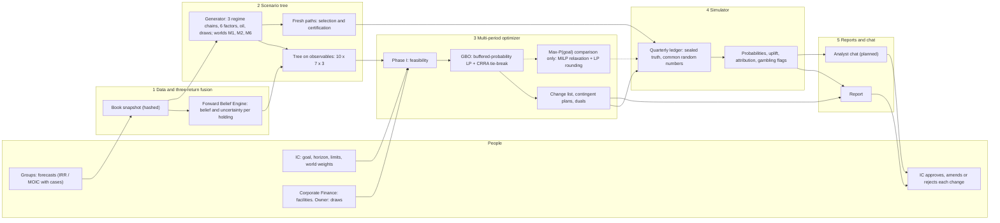

# ADIC Multi-Period Optimization Framework

*Reference description: what the framework decides, the variables it considers, its multi-period structure, its optimization mathematics, and the scenarios it can represent, by example.*

**Version** 1.1, 19 October 2026. Verified against the specification and the prototype code (commit 2aafbad). The prototype's own independent verification found defects that are documented here as known issues; they have not been fixed (decision of 19 October 2026). **Status:** describes the approved slim design (`design/SLIM_ARCHITECTURE.md`, "SLIM") and its detailed specification (`design/DECISION_SPACE_AND_GOAL_OBJECTIVE.md` v1.1, "DSGO"), and the prototype in `examples/mpo_v2/` as committed in 2aafbad. Where the spec and the code differ, both are stated. **Readers:** the quant lead, who commissioned this as the reference, should read everything. IC members can read §1, §3.1, §3.8, §7 (with the key at its top), §8, the results section after §8 and §9, plus the plain-English list under §2.2 and the "meaning" columns of §2.1 and §2.5, without the mathematics.

> **SYNTHETIC – NOT ADIC DATA.** Every balance, rate, probability and price here comes from the synthetic book SYN-ADIC-177, from `examples/mpo_v2/params.json` as committed in 2aafbad, from the prototype's first run and its verification, or from a design default. None of it is ADIC data. Prototype results are quoted only where they are marked as the first run's, with their source: in the known-issue notes, in §7's magnitude checks (marked "2aafbad") and in the results section after §8.

**Status tags.**
- **Implemented**: in the prototype code today.
- **Configurable**: representable today by changing a value in `params.json` and re-running.
- **Planned**: specified in SLIM or DSGO but not yet built.
- **Spec ≠ code**: a prototype deviation from the spec, with its reason where there is one.
- **Known issue (verification M# / F#)**: a defect or overstatement found by the prototype's independent verification and not fixed. M# is issue # in `examples/mpo_v2/verify_math.md` §9; F# and L# are findings in `examples/mpo_v2/verify_finance.md` §5. Each note says what is wrong and what the fix would be.
- **Code observation**: a code behaviour found by this document's own reviews (`design/reviews/framework_description_review_math.md` and `design/reviews/framework_description_review_scenarios.md`) that neither verification report covers.

Other source keys: SYN = `research/00_SYNTHESIS.md`; ARCH = `design/ARCHITECTURE.md`; RESULTS = `examples/mpo_v2/RESULTS.md`. Code files are named directly.

---

## 1. Overview

### 1.1 What it decides, and for whom

ADIC's book is about \$177bn of reported NAV, roughly 60% private, and leverage is allowed. It must pay an exogenous owner draw of 5–10% of opening NAV each year, set higher when oil is weak, and its goal is a 10% nominal return a year. Every quarter the framework answers four questions for the Investment Committee (IC):

1. **Is the book safe?** The draw is paid every quarter, the liquidity floors hold, a named 24-month stress is survived, and red events (selling PE, Secondaries, Co-investment or Real Assets holdings under stress or at a fire-sale price) stay below a set probability, 1% over five years.
2. **What should change now**, holding by holding and lever by lever, and what would we do next year in each state of the world?
3. **How likely is the goal** with those changes, compared with doing nothing and with simple rules, and how much does that depend on whose capital-market assumptions are right?
4. **Why?** Which limits bind, what a dollar of liquidity is worth (the liquidity price λ, and the liquidity premium ℓ it implies: how much more a dollar of cash is worth now than a dollar carried to next year), which beliefs drive each change, and what each change contributes.

It searches every lever in one problem:
- **SELL**, **HOLD** and **ADD**.
- **REFINANCE**: raise cash against a holding without selling it.
- **LEVER**: borrow to add exposure; LEVER ≡ ADD + REFINANCE.
- The portfolio levers: **PACE** (commitment budgets), **REBALANCE**, **HEDGE** (the tail ladder; the prototype also files the opportunistic book here, although that book takes risk rather than protecting against it: §2.2), **FUND** (Corporate Finance capacity) and **REDEEM** (hedge-fund and open-end notices).

Who does what:
- The TPA desk runs the framework.
- The CRO office certifies its probabilities and guards.
- Corporate Finance supplies Treasury, facility, collateral and draw data.
- The investment groups with marked holdings file forecasts. The Overlay's positions (synthetic beta, the tail ladder, the opportunistic book) carry no marks, and the prototype's eight group codes split Public Markets into hedge funds and long-only.
- The IC sets the goal and limits and approves each change.

### 1.2 The five components

| # | Component | Job | In → out | Prototype |
|---|---|---|---|---|
| 1 | Data and three-return fusion | Freeze the book; turn each holding's three marks into one forward belief | holdings, cash-flow history, marks archive, bids → book snapshot, beliefs | `book.py`, `fusion.py` |
| 2 | Scenario tree | Generate the exogenous future across capital-market worlds; reduce it to a decision tree on observable states; keep separate fresh paths | snapshot, CMAs, start state → tree with per-node flows, bids, financing terms | `scenarios.py`, `tree.py`, `prep.py` |
| 3 | Multi-period optimizer | Choose this quarter's changes and next year's contingent plans for the highest buffered goal probability that keeps every hard limit and guard (component 4 measures the exact probability); price liquidity | tree, beliefs, instruments, limits → change list, plans, duals, frontier, max-probability comparison | `model.py`, `optim.py`, `policy.py` |
| 4 | Simulator | Measure the outcomes of the policy that would actually run, and of baselines, on paths the optimizer never saw and against a sealed synthetic truth | plans, engines, fresh paths → probability board, uplift, attribution, gambling flags | `sim.py`, `mpo_v2.py` |
| 5 | Reports and chat | Publish the quarter; let IC members question it using engine-owned numbers only | run artifacts → report, analyst answers, approval record | `report.py` (report only); chat **Planned** |

### 1.3 The system on one page

### 1.4 The engine is objective; people set the limits and approve

The optimizer is deterministic: the same inputs give the same decisions, prices and probabilities. The inputs are:
- the hashed book snapshot and beliefs;
- the initial state;
- the scenario seeds;
- the IC's goal, limits and consent scenario;
- the solver options.

In the prototype this is enforced as follows:
- Every economic parameter is a value in `params.json` with its unit, rationale and source, and each run lists any parameter the code never read (check A16). A few constants are still written in code: the 0.80 amber stress bid in the red margin and the ±1% REBALANCE switch-off band (`model.py`), the 6% Amber band and the 1pp margin above the 8% target that triggers revolver repayment (`sim.py`), and the path chunks of 1,000 (selection) and 2,000 (replication books) (`mpo_v2.py`).
- Seeds are fixed for the book (20261019), the factor means (41), the tree (11), the selection paths (21), the certification paths (31) and the four replication books (7101–7104). Three more are derived in code: the template-truth seeds 501 (selection) and 502 (certification), and the replication books' path seed, certification + 1000 = 1031. **Known issue (verification M8 / F1).** Every replication book is certified on the same 4,000 paths (seed 1031); each book's template-truth seed (book seed + 1) is the next book's book seed, so seeds 7102–7104 are each used twice and produce identical normal draws; and the placebo book reuses the headline book's seed, so it draws the same opportunistic Sharpe (0.672). The between-book spread therefore understates the uncertainty. The fix would give each book its own path seed and disjoint truth seeds (for example through `SeedSequence.spawn`).
- HiGHS runs single-threaded with a fixed random seed.
- Every parallel task starts from a fresh solver instance.
- The max-probability comparison uses a deterministic LP-rounding method by default (§4.6); its optional branch-and-bound mode stops on a node limit rather than a clock.

Results therefore do not depend on scheduling. A determinism hash over the solutions, change list, out-of-sample results, frontier, attribution and hypothesis tests confirms each rerun.

Nothing inside a solve is a judgement call. Judgement lives in the inputs and limits that named people set:
- the IC sets the goal, horizon, limits, floors, world weights and consent scenario;
- Corporate Finance signs facilities;
- the owner sets the draw;
- the groups file forecasts, which the fusion debiases against each group's own track record.

The IC approves, amends or rejects each change, and nothing executes trades. In the planned chat, the language model chooses tools and words but never computes. A validator rejects any number that was not fetched from the engine in that turn.

---

## 2. Variables considered

**Conventions.**
- **Units.** Money is in \$bn; rates are annual decimals.
- **Indices.** Node $n$ with parent $p(n)$; holding $i$ (55 in the prototype, about 450 positions in production); group $g$; template $k$ (the per-dollar profile of a purchase or a commitment); financing instrument $j$; liquidity sleeve $s$, with $\mathrm{sl}(i)$ the sleeve of holding $i$; leaf $\ell$ with probability $p_\ell$. §10 lists the letters that keep more than one meaning.
- **Node class.** Every node has one of three classes:
  - BEN, benign: every node that is neither DRT nor STR (no crisis, exits open or normal), including late-cycle and oil-weak states;
  - DRT: exit drought without a macro crisis;
  - STR: macro crisis, frozen exits, or a demand-bust or glut oil shock with an expected next-year draw of 8% or more.

  Today's root is DRT. A parameter written with argument $(n)$ takes its value for the class of node $n$. In practice STR means a macro crisis or frozen exits: draw smoothing keeps the expected next draw below 8% on almost every path within the horizon (2aafbad: the oil route fires on at most 0.05% of paths in years 1–3), so an oil crash without a crisis stays DRT or BEN (§7.2).
- **Linearity.** The engines are positively homogeneous in the fraction held. Each holding's flows along the tree are therefore computed once, for the full original position, and the decisions only scale them, which keeps every row linear.

### 2.1 State variables

| Symbol | Meaning | Units | Granularity | Source |
|---|---|---|---|---|
| $C_n$ | Treasury cash and money-market funds, unencumbered | \$bn | portfolio, every node | Corporate Finance snapshot (\$15bn at t0); cash row |
| $LQ_n$ | IG + cash: $C_n$ plus 98% of the sleeve of Treasuries and investment-grade (IG) bonds, the proxy for high-quality liquid assets (HQLA); posted margin excluded | \$bn | portfolio, every node | derived |
| $V_{n,i}$, $N_{n,i}$ | Economic and reported NAV of holding $i$'s full original position; $\theta_{n,i}=V/N$ (economic value ÷ reported NAV, below 1 when reported marks are stale and too high) is path-dependent because reported marks lag | \$bn | per holding, every node | snapshot; quarterly unit engine |
| $x_{n,i}$ | Fraction of the original position held after the node's decisions | share (≤ 1 illiquid, ≤ 3 liquid) | per holding, decision nodes | LP |
| $U_{n,i}$ | Unfunded commitments | \$bn | per holding, every node | snapshot; engine (calls) |
| age, bucket | Holding age; drives call and distribution intensities and the bid's age multiplier | years | per holding | snapshot |
| $T^{V}_{m\to n,k}$, $T^{N}$, $T^{U}$ | Value, reported NAV and unfunded per \$ of template $k$ bought or committed at node $m$ | per \$ | template × start node × node | engine |
| $B_{n,j}$ | Debt by instrument: revolver, term debt, NAV facility, LP preferred, Capital Solutions back-leverage, SMA back-leverage, Real Assets cash-out. The NAV facility and the preferred accrue PIK (payment in kind: interest is added to the balance instead of paid in cash) | \$bn | portfolio, per instrument, every node | LP; Corporate Finance |
| asset debt | Acquisition debt of the levered templates (1 per \$ of equity) | \$bn | per template and start node | LP |
| $L^{s}$, $L^{up}$ | Revolver capacity: \$10bn signed (consent scenario R1). The upsize $L^{up}$, up to \$5bn, is one here-and-now FUND decision taken at the root and effective from year 1; the root's rows use $L^{s}$ only | \$bn | portfolio | Corporate Finance; LP (upsize) |
| $\beta_n$ | Synthetic equity beta notional (equity futures) | \$bn | every node | Overlay (\$10bn at t0) |
| $\mathrm{p2s}_n$ | Physical-to-synthetic (P2S) notional: developed-market (DM) core equities sold and replaced by futures with the same exposure, which frees cash; at most \$10bn | \$bn | decision nodes | Public Markets / Overlay |
| $\mathrm{trs}_{n,i}$ | Total return swap (TRS) notional on hedge-fund lot $i$: receive the fund's return for SOFR + 100bp, without buying more of the fund | \$bn | per hedge-fund lot | Overlay |
| $\mathrm{hed}_n$, $\mathrm{opp}_n$ | Tail-ladder notional; initial margin of the opportunistic book, a short-volatility, return-seeking book (§2.4) | \$bn | decision nodes | Overlay |
| $IM_n$ | Posted initial margin (collateral posted up front) $=\mathrm{im}(n)(\beta_n+\mathrm{p2s}_n)+0.10\sum_i\mathrm{trs}_{n,i}+\mathrm{opp}_n$, with $\mathrm{im}$ = 4/6/10% (BEN/DRT/STR) | \$bn | every node | derived |
| $Q_n$ | Redemption claims queued (hedge funds, open-end real estate), paid the following year | \$bn | every node | LP |
| $W_n$, $NR_n$ | Economic and reported NAV of the whole book, net of every financing claim. At a node where notices are lodged the redemption receivable appears only at the child (§4.2) | \$bn | every node | derived |
| $E_n$ | Economic exposure, delta-adjusted (derivatives counted at the holdings they are equivalent to): holdings, templates, synthetic beta, P2S and TRS. The opportunistic book is not included | \$bn | every node | derived |
| $d_n$, $\hat d_n$ | Draw rate of the year into $n$; expected rate for next year. The basis is opening reported NAV, $NR_{p(n)}$ | share | every node | owner engine |
| $(S,e,Z)$, levels | Macro regime, exit window and oil-shock type; credit spread, 10-year yield, Brent, exit factor and VIX at the node | state | every node | generator |
| class, stage, flags | Node class; event stage, the contingency-funding stage read from the status quo's IG + cash (Green ≥ 8% of NAV, Amber 6–8%, Red 4–6%, Black below 4%; at least Amber at DRT and at least Red at STR; Black cannot occur, because the status quo keeps the 4% floor); "behind" and "loss year" flags; the status quo's liquidity cushion $-m^{red,B0}_n$ | flags, \$bn | every node | status-quo (B0) LP readings |
| $m^{red}_n$, $RS_n$, $L^{bor}_n$, $cq_{n,s}$; private NAV, pledge pool | Derived for the rows: the policy's own signed red margin (§4.2; H9, H15); red-event sale proceeds (H9); borrowed exposure (G5); the fan years' cumulative sleeve cut (§4.2); private NAV and the pledge pool (H6, H11, encumbrance). Next year's stressed calls minus low distributions also enter H3 and H9 | \$bn | every node (the sleeve cut: fan years) | derived |
| $\hat\mu_i$, $\sigma_{post,i}$, $\zeta_\ell$ | Fused belief; its uncertainty after combining the marks (posterior sd); and the belief-error driver of leaf path $\ell$, a random draw for the chance that the fused beliefs are wrong | per year | per holding; per leaf | fusion; tree |

**Per-holding debt.** The prototype carries debt by instrument against collateral pools (the pledge pool, the Capital Solutions book, the SMA sleeve, controlled real assets). Debt balances by individual holding are **Planned**.

### 2.2 Decision variables, by lens and lever

| Lens | Variable | Granularity | Instruments behind it in the prototype | Status |
|---|---|---|---|---|
| SELL | $s_{n,i}$: fraction of holding $i$ sold at the node's bid | per holding | PE and Secondaries LP sales (a segment bid by node class × the age multiplier × the holding's own bid premium; no size discount, depth caps instead); co-investment single-asset sales; Capital Solutions syndication or secondaries; Private Credit SMA loan sales, LP sales, evergreen tenders and BDC sales; hedge-fund secondaries; long-only sales; Real Assets asset, LP or JV sales | Implemented. Root red-tier sales are held at zero (ADR-39: today is Amber). Strips, deferred consideration and CV elections are Planned |
| HOLD | $x$ unchanged | per holding | — | Implemented implicitly. CV elections, amend-or-enforce and cures are Planned |
| ADD | $a_{n,i}$ for liquid holdings; templates $y_{n,k}$: SEC_BUY, CO_DEAL, CS_NEW, PC_NEW | per holding; per template | Discount purchases of LP interests (gate: discount > 20%, stage not Black; ≤ \$4bn a year; Secondaries ≤ 10% of NAV; 4.5% winner's-curse haircut); new co-investments (Green only, ≤ \$1.2bn a year); Capital Solutions new money (≤ \$1.2bn); new senior loans (≤ \$2bn) | Implemented. The "not Black" gate cannot bind, because Black never occurs |
| REFINANCE | draws $\Delta^{+}_{n,j}$ on the NAV facility, the preferred, the CS and SMA back-leverage and the RA cash-out; P2S increases and decreases $\mathrm{p2s}^{+}_n$, $\mathrm{p2s}^{-}_n$ | portfolio; collateral pool | LP-portfolio NAV facility; LP-portfolio preferred; Capital Solutions back-leverage; SMA back-leverage; cash-out refinancing of controlled real assets; P2S on the DM core sleeve | Implemented. CFO, junior capital, sale-leaseback, hedge-fund unit loans and the co-investment pool facility are Planned |
| LEVER | $\mathrm{trs}_{n,i}$; templates INFRA_LEV and SMA_LEV | per lot; per template | Hedge-fund TRS (≤ 50% of the lot held, imposed at the root and stage 1); contracted-infrastructure add-on with 1:1 asset debt at SOFR + 200bp (BEN only); levered SMA sleeve at D/E 1, SOFR + 225bp (BEN only) | Implemented. Holdco PIK and deferred-payment purchases are Planned. **Known issue (verification F7):** the change list labels the TRS "portable alpha", but the cash row pays the fund's return minus SOFR + 100bp on the notional, so it is levered hedge-fund exposure (in the first run HF-03's carry is negative, and HF-02 is part-redeemed while a TRS re-adds exposure to it); the TRS lines are worth nothing out of sample. The fix would remove them or relabel them as LEVER into hedge funds |
| BETA (part of LEVER) | $\beta_n$ | every node; only cut at stage 2 and in fans | synthetic equity futures | Implemented. Reported as risk budget, never as alpha |
| PACE | $y_{n,k}$: commitments for PE, Secondaries, Real Assets, Private Credit and Capital Solutions | per group, decision nodes; fans repeat the stage-2 level | 0.25–1.25× plan (plan \$7.5bn a year); post-horizon value $c^{PACE}$ at the leaf | Implemented. **Spec ≠ code:** DSGO's Green (0.75–1.25×) and Amber (0.25–0.5×) corridors are not imposed, so no hard IC range drives the plan, and the change list does not flag a breach either (RESULTS §11 describes them as reported). **Known issue (verification F2):** in the first run pacing is worth about zero out of sample (every budget held at plan: −0.02pp). In Amber the plan raises PE to 1.10× plan and cuts Secondaries, Capital Solutions, Private Credit and Real Assets to the 0.25× floor, the opposite of the research rule (cut PE, add Secondaries and CS when liquidity is tight); only PE's $c^{PACE}$ is sourced; and the cuts are mainly a device for meeting the tree's harsh H9 row (H11 also binds PE). The fix would impose or flag the Amber corridor and the research's signs, mark the pacing rows `limit_driven`, run the 10-year check (A10) and source the non-PE values |
| REBALANCE | net of SELL and ADD across groups; elastic range breach $\mathrm{brk}_{n,g}$ | per group | free inside 0.5–1.5× the SAA weight (in the prototype, each group's share of today's economic NAV over its eight group codes); 50bp a year per \$ beyond; waived at STR | Implemented |
| HEDGE | $\mathrm{hed}_n$, $\mathrm{opp}_n$ | decision nodes | 90/72 put-spread ladder (3.74% premium a year) within 0.15–0.50% of NAV; opportunistic IM ≤ \$1.5bn | Implemented. The monetization rule, oil put spreads and the OV1–OV3 limits are Planned. The opportunistic book is filed here, on the change list and in attribution, but it is a short-volatility, return-seeking book: under the user's definitions a cash-funded IM increase is an ADD, and DSGO's lens for it is LEVER or SELL (Known issue F5, §2.4) |
| FUND | $L^{up}$ (capacity, a root decision); revolver and term draws and repayments $\Delta^{\pm}_{n,j}$ | portfolio | revolver at SOFR + 85bp (15bp undrawn); term debt at SOFR + 85bp (not at STR) | Implemented. Repo is Planned. **Known issue (verification F7):** the first run's \$6.0bn term loan is a bridge: the LP repays it at 8 of the 10 year-1 nodes, while the certified rule recourse holds it for five years, and the research uses term debt only to fund a reserve against the cyclical shortfall. The fix would remove it or relabel it as a bridge to redemption receipts with a repayment rule |
| REDEEM | $r_{n,i}$ | per hedge-fund lot and open-end real-estate fund | notice paid at the class pass-through within 12 months; the remainder queues. Bounded by the position only, outside the per-unit trade cap | Implemented. **Spec ≠ code:** DSGO §3.3 caps every unit trade. The notice-date calendar and gates are Planned |
| funding | $q_{n,s}$: need-based sales of the LIQ, HF, AMB and RED sleeves | per sleeve, every node | each sale cuts the same share of every member's original position; capped by H16 | Implemented. Not a discretionary SELL. The H16 cap is vacuous (Known issue M1, §4.3) |

**Rows and labels.** The rows group instruments by their usual lens, which is also their attribution family (§8). On the change list, every draw (revolver, term, NAV facility, preferred, back-leverage, cash-out) is labelled REFINANCE or LEVER by rule R1 at the node where it is used (§4.11); the first run's term loan therefore appears as LEVER on the change list and under FUND in the switch-off table. FUND covers arranging capacity ($L^{up}$). P2S counts as REFINANCE because exposure is unchanged: the physical equities are sold, but the futures carry the same exposure with the financing embedded (DSGO R3).

**In plain English.** SELL: sell part of a holding at today's bid. HOLD: keep it. ADD: buy more of a liquid holding, or buy into a new deal through a template. REFINANCE: raise cash against holdings without selling them. LEVER: borrow to add exposure, including synthetic beta (equity futures). PACE: commit more or less each year to new private funds. REBALANCE: move group weights within their ranges. HEDGE: buy protection against a crash (the tail ladder). FUND: arrange more bank capacity. REDEEM: give notice to leave a hedge fund or open-end fund, which pays out over the next year. Funding sales: the standing rule that sells liquid assets when cash runs short.

**Where decisions sit in the tree.** Root decisions (t = 0) are per holding and are applied exactly. Stage-1 decisions (t = 1) are per holding and contingent on the branch. Stage-2 nodes (t = 2) allow funding moves and forced deleveraging only; pacing, TRS, the tail ladder and the opportunistic book carry over from stage 1. Fan years (t = 3–5) allow funding moves only. At stage 2 and in fan years 3–4 the revolver is the only facility that can be drawn, any facility can be repaid, and synthetic beta can only be cut; the leaves (t = 5) allow no new borrowing.

### 2.3 Exogenous random variables

| Symbol | Meaning | Units | Granularity | Model and calibration |
|---|---|---|---|---|
| $S_t$ | Macro regime: expansion, late cycle, crisis, recovery | state | quarterly | Markov; crisis persistence 0.70 a quarter (about a 10-month dwell) |
| $e_t$ | Exit window: open, normal, drought, frozen | state | quarterly | Markov; drought 0.87 today, persisting 0.88 a quarter; one step worse with probability 0.35 in a crisis quarter |
| $Z_t$ | Oil-shock type: normal, boom, glut, demand bust, supply shock, Gulf war | state | quarterly | Markov; Gulf war 0.85 today, persisting 0.5 a quarter. A demand bust forces a crisis with probability 0.85 a quarter, a glut with 0.05 |
| $f_t$ | Six factors: equity excess log return; credit excess return; duration excess return; log-Brent surprise; exit-factor surprise; implied-volatility surprise | per quarter | every path | the five market shocks are standardized Student-t (5 degrees of freedom), correlated through a normal or a crisis matrix (§3.2); the implied-volatility shock is Gaussian and independent, linked to equities only through the spot–vol term; volatility by regime |
| $P^{oil}_t$ | Brent | \$/bbl | quarterly | log mean reversion (0.30 a quarter) from \$126.55 toward a shock-type level: \$70, 95, 45, 38, 110, 120 |
| VIX | Implied volatility | points | quarterly | reverts to 15/19/34/22 by regime, with an asymmetric spot–vol response |
| calls, distributions | Private calls and distributions | \$bn | per holding, quarterly | intensity by age bucket × exit multiplier (distributions 1.25/1.0/0.47/0.32; calls 1.3/1.0/0.97/0.8) × crisis call stress 1.29; income yields |
| bids | Proceeds per unit sold | per \$ of economic value | per holding, per node class | buyer residual $\rho^{bid}_{seg}(n)$ × age multiplier × the holding's own bid premium, also for holdings whose bid is a segment estimate rather than an external quote (§5.5) |
| $G^{eq}_n$, $\mathrm{tail}_n$ | Equity gross return of the year; tail-ladder payoff per \$ of notional, 0.922 × the part of the year's equity total-return fall between 10% and 28% | per \$ | per node (tree); per year (simulator) | equity factor (§4.1) |
| $\mathrm{oppret}_n$ | Opportunistic-book P&L per \$ of IM | per year | per node; per quarter in the simulator | equity and volatility surprises, plus idiosyncratic noise in the simulator only (§2.4) |
| $r^{SAA}_n$ | Static-portfolio return: the status quo's t0 weights, including its \$10bn of synthetic beta; accrues draws to the horizon (§4.4) | per year | per node | derived |
| PD, LGD | Default rate and loss given default | per year | by regime | PD 1.1/1.6/6.0/2.2%, LGD 0.67, inside the credit factor |
| $d_y$ | Owner draw | share of opening reported NAV | annual, paid quarterly | oil-linked rule with overrides (§3.2) |
| spreads, availability | Financing spreads and facility availability | per year; share | by node class | §2.4 |
| $\varphi$ | Redemption pass-through within 12 months | share | by class | hedge funds 1.00/0.95/0.66; open-end real estate 0.80/0.34/0.14 |
| $m$ | Capital-market world | label | per path | M1 (J.P. Morgan 2027), M2 (BlackRock fee-adjusted), M6 (BlackRock risk premia rise); equal weights |
| truth, noise | Sealed true alpha, idiosyncratic outcome noise, the opportunistic book's true Sharpe | — | simulator only | truth model (§6.2) |

### 2.4 Parameters and limits

The rows themselves are written out in §4.3. The values below are the prototype's `params.json` defaults, each owned and swept.

| Item | Prototype value | Source |
|---|---|---|
| Goal | 10% a year time-weighted return, gross of draws (draws are treated as withdrawals, not as losses), on economic NAV, over 5 years: $W^{\star}=W_0\cdot1.1^5$. $W_0$ = the holdings' economic NAV plus the \$15bn Treasury, \$169.75bn, below the reported \$177bn because stale private marks are restated by $\theta$; $W^{\star}$ = \$273.39bn | user; DSGO §4.1 |
| Buffer cap | $c_{max}=2W^{\star}/W_0\approx3.22$ | DSGO §4.3 |
| Cash floors | IG + cash ≥ 4% of NAV at every node; ≥ 8% at BEN and DRT nodes, except the first node after an STR node | H2 |
| Leverage | $E\le1.30W$; class caps 1.30/1.15/1.10 (BEN/DRT/STR), with the first STR node keeping its parent's cap in the tree (the STR cap is met within four quarters); at behind nodes $1+\tfrac12(L^{class}-1)$, where behind means the status quo's cumulative time-weighted return trails the 10% path by more than 2pp (log); cushion slope $\kappa_c$ = \$1 of borrowed exposure per \$ of the status quo's cushion | H5, G5 |
| Debt | recourse debt (revolver + term) ≤ 15% of NAV; pledged collateral ≤ 20% of total assets | H5 |
| LTV | NAV facility 10% (5% at STR) of the pledge pool, with the pool ≤ 20% of private NAV; preferred ≤ 30% of the pool; CS debt ≤ 1/3 of the book; SMA 45%; RA cash-out 55% and ≤ \$0.9bn | H6 |
| Sale depth | PE and Secondaries LP sales ≤ \$9/7/5bn a year (BEN/DRT/STR); co-investment ≤ 10% of group NAV; RA 21/17.5/12.5%; CS 30/20/10%; PC 50/40/25%; hedge-fund secondaries 50% | H7 |
| Per-unit trade cap | $\lvert\Delta v_i\rvert\le0.5\%\cdot W_0\cdot\sigma_{ref}/\sigma_{post,i}$ on SELL and ADD, with $\sigma_{ref}$ the median $\sigma_{post}$. REDEEM is bounded by the position only (**Spec ≠ code**: DSGO §3.3 caps every unit trade) | DSGO §3.3 |
| Red event | tree CVaR buffer $\varepsilon_R=0.6\%$ (certified limit 1%); red-tier sale threshold \$0.05bn; fire-sale bid below 0.9 × the BEN-class bid. **Spec ≠ code:** DSGO RV-22 tunes $\varepsilon_R$ so that the certified P(red) is at most 1%; the prototype fixes 0.6% and neither tunes nor tests it. The row is degenerate (Known issue M2, §4.3) | H9 |
| Event stage | Green when the status quo's IG + cash is ≥ 8% of NAV, Amber 6–8%, Red 4–6%; DRT is at least Amber and STR at least Red. Decides where planned red-tier sales and co-investment are allowed | ADR-39 |
| Depth guard | CVaR of the miss at 90/95/99% ≤ the status quo's; δ = 0 | H10(a) |
| Overcommitment | private NAV + unfunded ≤ 0.80 × NAV (not at STR) | H11 |
| Overlay | tail premium 0.15–0.50% of NAV a year; opportunistic IM ≤ \$1.5bn; P2S ≤ \$10bn; gross overlay ≤ 30% of NAV; TRS ≤ 50% of the lot held (root and stage 1) | H13 |
| Opportunistic book | IM \$1.0bn today, at most \$1.5bn. P&L a year per \$ of IM: 1.77 × (Sharpe + a factor part loading 0.3 on standardized equity surprises and −0.6 on standardized implied-volatility surprises, normalized to unit variance). The tree credits the prior Sharpe of 0.30 and carries only the factor part (40% of the variance); in the simulator 60% of the variance is idiosyncratic and the true Sharpe is drawn from N(0.30, 0.25²). **Known issue (verification F5, F1):** the research rejects a strategy-level Sharpe process: it puts premia in the scenario engine, credits skill only at a deflated Sharpe ratio of at least 0.95, and sets the OV1–OV3 limits (OV2 caps the crash loss at 25% of the tail payoff). In the first run the LP raises IM to its \$1.5bn cap in every book; in the worst 1% of equity years the book then loses \$9.1bn on average while the ladder pays \$1.0bn, and the upsizing raises P(goal) even at zero skill, because the goal sits above the median. The fix would implement the research design and size the book outside the goal objective; until then, keep IM at \$1.0bn and show any upsizing as an IC risk choice with its crash loss | `params.json` overlay; SYN §4.6 |
| Templates | SEC_BUY ≤ \$4bn a year at +1pp alpha; CO_DEAL ≤ \$1.2bn at +1pp (Green only); CS_NEW ≤ \$1.2bn and PC_NEW ≤ \$2bn at 0/0.5/2pp (BEN/DRT/STR); INFRA_LEV (+0.65pp) and SMA_LEV (0pp) ≤ \$1bn each, BEN only, with 1:1 asset debt; commitments at the group α* (§5.2) | `params.json` templates |
| Financing costs | revolver SOFR + 85bp, 15bp undrawn, 5bp a year upfront on the upsize; term SOFR + 85bp; NAV facility SOFR + 300bp (SOFR + 440bp at STR) and 1.5% OID, PIK; preferred 12% (14% at STR) and a 1% fee; CS SOFR + 300bp; SMA SOFR + 225bp; RA cash-out SOFR + 320/440/720bp; synthetic beta 30/60/175bp (Known issue L3: the DRT 60bp is below the 81bp of the June-2026 roll); P2S 45/90/250bp; TRS SOFR + 100bp; SOFR fixed at 3.89% | DSGO §2; SYN §4.4 |
| Availability | Availability scales capacity for the revolver only (100/100/50%). For the other facilities the prototype applies it as on/off: the NAV facility is open in every class at its class LTV; the preferred and term debt at BEN and DRT; CS and SMA back-leverage at BEN only; the RA cash-out in every class, within its 55% LTV and \$0.9bn. **Spec ≠ code:** DSGO's 50% NAV-facility availability at STR and 97/85/60% cash-out availability are not applied | DSGO §2.9 |
| Trading costs | 8bp DM equity, 30bp EM, 5bp fixed income; hedge funds at NAV | DSGO §2.6 |
| Liquidity haircuts | long-only equity −35.8%; hedge-fund pass-through 66% (12 months), 55% (6 months), 83% (24-month stress); amber 25% at a 0.80 bid (the 0.80 is written in code); futures VM on a 35.8% fall plus the IM step-up | H3, H4, H9 |
| Terminal values | private NAV at economic value (ω = 1); unfunded burden ψ = \$0.03 per \$; post-horizon pacing value $c^{PACE}$: PE 8.6¢, Secondaries 5¢, RA 3¢, PC 1¢, CS 1¢ per \$ (only PE's is sourced: Known issue F2, §2.2) | DSGO §4.1 |
| CRRA | relative risk aversion 3 on real wealth (2.5% inflation); 32 tangents at geometric points on [0.25, 4]; squared shortfall weight $\lambda_T=1$ with 16 secants. **Spec ≠ code:** DSGO §4.5 has 48 adaptive tangents | DSGO §4.5 |

### 2.5 Beliefs derived from the three marks

| Symbol | Meaning | Units | Granularity |
|---|---|---|---|
| $\hat\mu_i$ | Fused forward return: annualized log return on current economic NAV, net of fees, over the remaining life. It excludes the holding's own bid, so the sale decision is never compared with itself | per year | per holding |
| $\hat\alpha_i=\hat\mu_i-(r_f+b_i^{\top}\bar f)$ | Fused alpha over the factor-implied return; this is what the tree uses | per year | per holding |
| $\sigma_{post,i}$ | Posterior uncertainty of $\hat\mu_i$: how uncertain the belief remains after combining the marks (belief risk); also scales the per-unit trade cap | per year | per holding |
| $\hat\sigma_i$, P10/P50/P90 | Predictive spread including outcome noise; Student-t quantiles with 5 degrees of freedom | per year | per holding |
| $\hat b_{g,f}$, $\hat b_{g,u}$ | Group bias in forecasts and in underwriting, from the quarterly archive with Bühlmann credibility (a weight on the group's own record that grows with its length) | pp a year | per group |
| $Z_g$ | Credibility weight $n_{eff}/(n_{eff}+20)$, with $n_{eff}$ the effective number of scored past forecasts | share | per group |
| $\kappa_g$ | Ratio of true to stated 80% widths (how much stated ranges are widened); prior median 1.75, updated on archive coverage | ratio | per group |
| $c^{\star}_i$ | Benktander credibility $\varpi_i/(\varpi_i+0.4)$ for fund interests, with $\varpi_i$ the realized share of value: the forecast's weight against the outside-view prior grows as the fund realizes | share | per fund interest |
| $\rho_{m,i}$ | Market-implied forward return from the holding's secondary bid (an external quote, or a segment estimate for some holdings: §5.5) | per year | per holding with a bid |
| $\hat\mu_i^{bid}$ | Fused belief including the holding's own bid: reported beside $\hat\mu_i$, not used for the holding's own decision | per year | per holding |
| P(forecast optimistic) | $F_{\mathcal N}\big((\rho_f-\hat\mu_i)/\hat\sigma_i\big)$, with $F_{\mathcal N}$ the standard normal CDF; display only | probability | per holding |
| flags | hockey-stick forecast, stale NAV ($\theta<0.85$), market disagreement > 400bp, zombie NAV, actual unused (age < 3), underwriting expired; display only | — | per holding |

---

## 3. The multi-period approach

### 3.1 Stages and time grid

The plan has three annual decision stages and a five-year horizon:
- **t = 0**, here and now: the change list, applied this quarter;
- **t = 1**: contingent plans for each of the ten year-1 branches;
- **t = 2**: recourse only;
- **t = 3, 4 and 5**: "fan" years. These are constraint nodes: every row that §4.3 applies at every node holds there (§3.7), but only funding moves are allowed.

The engines run quarterly. A tree node aggregates four quarters, and the simulator steps quarterly. The 10-year horizon is a sensitivity (**Planned**). Of the three design documents, DSGO v1.1 and the prototype use this annual grid. SLIM describes quarterly, then semiannual, then annual stages, and ARCH's here-and-now program spans 12 quarters. Production chooses among these by the horizon-stability test.

### 3.2 The scenario generator (component 2)

**Regimes.** There are three coupled quarterly chains, each first-order Markov:
- the oil-shock type moves first, $Z_{t+1}\sim P^{Z}(Z_t,\cdot)$;
- the macro regime becomes "crisis" with probability $c(Z_{t+1})$ (0.85 in a demand bust, 0.05 in a glut), and otherwise $S_{t+1}\sim P^{S}(S_t,\cdot)$;
- the exit window follows $P^{e}$ and moves one step worse with probability 0.35 in a crisis quarter.

**Factors.** Expectations $\mathbb{E}_t$ condition only on the start-of-quarter state, so a crisis onset is a surprise loss and the equity factor offers nothing to time. The credit factor's expected return does depend on the state: its carry ($\tfrac14 s_t$) rises with the spread level, and its expected default loss with the regime.

$$
\begin{aligned}
f^{eq}_{t+1}&=\tfrac14\mu^{eq}_m+\big(k^{eq}_{S_{t+1}}-\mathbb{E}_t[k^{eq}_{S_{t+1}}]\big)+\tfrac12\sigma^{eq}_{S_{t+1}}\varepsilon^{1}_{t+1}\\
f^{cr}_{t+1}&=\tfrac14 s_t-3.5\,(s_{t+1}-\mathbb{E}_t s_{t+1})-\tfrac14 PD_{S_{t+1}}LGD+\tfrac14\mu^{cr}_m,\qquad s_{t+1}=\max\big(s_t+0.25(\bar s_{S_{t+1}}-s_t)+\sigma^{s}_{S_{t+1}}\varepsilon^{2}_{t+1},\ 0.005\big)\\
f^{rt}_{t+1}&=\tfrac14 tp_m-6\,(Y_{t+1}-\mathbb{E}_t Y_{t+1}),\qquad Y_{t+1}=\max\big(Y_t+0.05(\bar Y-Y_t)-0.004\,\mathbf{1}[\text{crisis}]+0.004\,\varepsilon^{3}_{t+1},\ 0\big)\\
f^{oil}_{t+1}&=\ln P_{t+1}-\mathbb{E}_t\ln P_{t+1},\qquad \ln P_{t+1}=\ln P_t+0.30(\ln\bar P_{Z_{t+1}}-\ln P_t)+\sigma^{oil}_{Z_{t+1}}\varepsilon^{4}_{t+1}\\
f^{ex}_{t+1}&=\chi_{t+1}-\mathbb{E}_t\chi_{t+1},\qquad \chi_{t+1}=\mu_\chi(e_{t+1})+0.6\,(\chi_t-\mu_\chi(e_t))+0.25\,\varepsilon^{5}_{t+1}\\
f^{vol}_{t+1}&=(\mathrm{VIX}_{t+1}-\mathbb{E}_t\mathrm{VIX}_{t+1})/100,\qquad \mathrm{VIX}_{t+1}=\max\big(\mathrm{VIX}_t+0.5(\overline{\mathrm{VIX}}_{S_{t+1}}-\mathrm{VIX}_t)-0.5\min(100f^{eq}_{t+1},0)-0.15\max(100f^{eq}_{t+1},0)+2.5\,\varepsilon^{6}_{t+1},\ 9\big)
\end{aligned}
$$

Here $s_t$ is the credit spread, $Y_t$ the 10-year yield, $\chi_t$ the private exit factor and $\mathrm{VIX}_t$ implied volatility.

Notes on the factor equations:
- The shocks $\varepsilon^{1..5}$ are standardized Student-t (5 degrees of freedom), correlated through a normal or a crisis correlation matrix; $\varepsilon^{6}$, the implied-volatility shock, is standard normal and independent. In a crisis, spreads widen more with equity losses and oil falls with equities.
- **Code observation: in a crisis, bonds fall with equities.** The crisis matrix sets the equity–yield shock correlation to −0.30 (+0.15 in normal regimes). A rising yield is a bond loss, so inside crisis quarters stock and bond returns move together (2aafbad: correlation about +0.24, against −0.18 outside crises, on 100,000 paths). The only flight to quality is the deterministic −40bp a quarter yield drift in crisis quarters, a surprise gain on bonds at a crisis onset. The parameter's own rationale says yields fall with equities, so the sign is probably a code error; neither verification report raises it.
- The regime shift $k^{eq}$ is centred, so regimes move volatility, tails, cash flows, bids and facility availability, but not next quarter's expected equity return.
- The worlds differ in the equity premium $\mu^{eq}_m$ (3.0/4.6/1.0% log excess for M1/M2/M6), the credit drift $\mu^{cr}_m$ (0/+0.2/−0.6%) and the term premium $tp_m$ (0.8/1.0/0.4%).
- Rate and credit returns are surprises against the expected path, so the starting level and the long-run mean of the yield or of the spread cancel out of the return: raising them changes carry (for credit) but creates no loss (§7.4, §7.11).
- $f^{vol}$ is a zero-mean surprise, so no exposure earns a variance premium. **Known issue (verification F6).** Hedge funds' negative volatility loadings (−0.15 to −0.25) therefore carry crash risk with no premium, and their alpha prior is zero; the model's hedge-fund expected returns are 4.0–6.0%, about +1.1pp over SOFR on average, against +3.6pp in J.P. Morgan 2027. The research prescribes a near-zero alpha plus a put-writing baseline. In the first run each of the five hedge-fund redemptions sits 0.26–0.58pp below its hurdle, so a baseline of about 1pp would likely flip all five; the sealed truth cannot test this, because it shares the factor model and the premia. The fix would put the variance premium in the generator for every short-volatility exposure (hedge funds and the opportunistic book alike) and re-solve.

**Owner draw.** Set at the start of each fiscal year from Brent $P^{oil}_y$ on that date:

$$
d^{tgt}_y=\Pi_{[5\%,10\%]}\Big(\Pi_{[5\%,10\%]}\big(5\%+5\%\cdot\tfrac{67-P^{oil}_y}{67-23}\big)+2\%\cdot\mathbf{1}[\text{override}_y]\Big),\qquad d_y=\Pi_{[5\%,10\%]}\big(0.5\,d_{y-1}+0.5\,d^{tgt}_y\big)
$$

- **Target.** The oil-linked target is clipped first, so an override adds a full 2pp even when Brent is above \$67, where the target is then 7%. The first $d_{y-1}$ is the 6.5% prior, so without an override the 2027 draw is 5.75%.
- **Overrides.** The probability, keyed to the oil state at the start of the year, is 0.25% a year in normal, boom and supply-shock states, 1% in a glut or demand bust, and 2% in the Gulf-war state.
- **Payment.** The draw is $d_y$ × opening-year reported NAV. The simulator pays it quarterly; the tree pays it at the year-end node.

**Holdings.** One quarterly unit engine is shared by the tree and the simulator:

$$
r_{i,t+1}=\tfrac14r_f+b_i^{\top}f_{t+1}+\tfrac14\alpha_i,\qquad \mathrm{Dist}_i=\tfrac14\mathrm{yld}_iV_ie^{r}+\big(1-\tfrac14\mathrm{yld}_i\big)V_ie^{r}\big(1-e^{-k^{D}_i(\mathrm{age})\,m^{D}(e)/4}\big),\qquad \mathrm{Call}_i=U_i\big(1-e^{-k^{C}_i(\mathrm{age})\,m^{C}(e)\,s(S)/4}\big)
$$

- **Value.** $V'=Ve^{r}-\mathrm{Dist}+\mathrm{Call}$.
- **Reported NAV** lags: its log return $r^{N}$ is $(1-\phi_i)r_{t}+\phi_i r^{N}_{t}+0.04\ln(V/N)$, built from last quarter's economic and reported returns; it applies to the NAV left after distributions, and calls are added: $N'=Ne^{r^{N}}\big(1-\mathrm{Dist}/(Ve^{r})\big)+\mathrm{Call}$. So $\theta$ falls when economic values fall faster than the lagged marks, as at a crisis onset, and drifts back toward 1 by 4% of the log gap a quarter; a drought by itself does not lower it. Liquid holdings have $N=V$.
- **Noise.** The simulator adds idiosyncratic outcome noise; the tree carries belief risk instead (§3.3).

**Spec ≠ code.**
- The chains are first-order Markov; DSGO §5.1 has a semi-Markov crisis dwell of 6–18 months (the prototype's 0.70 persistence gives a mean dwell of about 10 months).
- The factors have no VAR(1) term; DSGO has $f_t=c_S+Af_{t-1}+D_SL_S\varepsilon_t$.
- Brent starts from spot; DSGO uses the futures strip and Gulf-war dwell conditioning (§9.3).

### 3.3 The scenario tree as implemented

| Stage | Construction | Children | Probabilities | Moments matched |
|---|---|---|---|---|
| t = 0 → 1 | 20,000 one-year paths from today's state, with worlds drawn by IC weight. Five strata by class and shock type: STR demand bust (1 branch), other STR (1), DRT Gulf war (2), DRT (3) and BEN (3); a stratum with fewer than 40 paths (or fewer paths than branches) merges into a neighbour. Within strata, k-means on seven standardized observables (the year's equity log excess return, spread, 10-year yield, log Brent, exit factor, VIX, expected next draw); the medoid path represents each cluster | 10 | the cluster's share of the 20,000 paths | six annual factor drivers, mean and covariance exact |
| t = 1 → 2 | 2,000 continuations per stage-1 node, worlds drawn from that node's world mix. Branches allocated by class only (no shock-type strata), at least one per class with ≥ 3% conditional mass; k-means within class; paths of rarer classes join the nearest cluster, so no mass is dropped | 7 | parent × cluster share | six drivers, exact |
| t = 2 → 5 (fans) | 300 three-year paths per stage-2 node, sorted by the status-quo portfolio's 3-year log return; one medoid path per tercile | 3 | parent ÷ 3 | the fan return (mean and variance) and the belief error $\zeta$ (zero mean, unit variance, orthogonal to the fan return) |

The tree has 81 decision nodes, 210 leaves and 711 time nodes. Its features:
- **Matching.** Moments are matched by the minimum-distortion (Gaussian optimal-transport) affine map $A=\Sigma^{1/2}(\Sigma^{1/2}\Sigma_c\Sigma^{1/2})^{-1/2}\Sigma^{1/2}$, where $\Sigma$ is the target covariance of the drivers and $\Sigma_c$ the covariance of the cluster representatives. Unlike a Cholesky map it does not rotate branches, so a demand-bust branch stays a demand bust.
- **Rank rule.** A branching with $K$ children can match a covariance of rank at most $K-1$, so $K\ge d+1$ for $d$ matched drivers. The tree meets this at every branching (10 ≥ 7, 7 ≥ 7, 3 ≥ 3).
- **Probabilities** are the true cluster masses. The stratified allocation oversamples rare states in branch count, not in probability.

**Spec ≠ code.**
- **Size.** DSGO specifies 10 × 8 × 8 = 640 leaves, matching 8, 7 and 7 drivers (the draw rate among them) at its three branchings plus equity skew, with a no-arbitrage test on factor assets and moment-matched fans. The prototype uses 10 × 7 × 3 = 210 leaves to fit its run budget, matches the means and covariances of six drivers at stages 1 and 2, and at the fans only the fan return and $\zeta$. The draw rate is never matched (it is a function of Brent). There is no skew matching and no no-arbitrage test (**Planned**). SLIM's production target is 500–1,000 leaves.
- **Belief-error driver.** DSGO draws it at stage 1 and holds it to the leaves. The prototype draws it at the fan branching and scales it by 5/3, so that it carries a full 5-year alpha error over the three fan years. Drawn at stage 1, it was a look-ahead leak: stage-1 decisions could trade on it in the tree, but the executed playbook cannot see it.

### 3.4 Non-anticipativity

Non-anticipativity holds by construction, through three mechanisms:
- **One decision per node.** Each node carries one decision vector, shared by every path through it.
- **Observable states.** Nodes are clustered on observables that pool all worlds. Recourse can learn what the fund can see (spreads, Brent, VIX, the draw, the equity year) but not which CMA world is true.
- **Hidden belief error.** The belief-error driver is drawn below the last decision node, so no discretionary decision (root, stage 1, stage 2) conditions on the realized alpha error. Fan-year funding moves (sleeve sales, revolver use, beta cuts) are path-specific and do see it; that is error-ledger row E2, which H16 is meant to bound (as coded it does not: Known issue M1, §4.3).

### 3.5 Here-and-now decisions, contingent plans and recourse

| Stage | Decisions allowed in the LP | Executed in the simulator |
|---|---|---|
| Root, t = 0 | every lens, per holding | exactly, in dollars |
| Stage 1, t = 1 | every lens, per holding, per branch | **playbook variant:** each path maps to its nearest stage-1 node (standardized observables, same class first) and applies that node's decisions in relative form. Sales and redemptions as a share of the holding; adds and purchases as a share of NAV; commitments as a multiple of plan; financing as a share of the path's capacity; overlay as a share of NAV. Planned red-tier sales execute only on a Green BEN path at a bid ≥ 0.9 × the BEN bid. **Rule variant** (RESULTS: "rule"; the v1.0 draft called it "static"): the root decision is held with the standing funding and deleveraging rules, so there are no stage-1 trades; root pacing, the tail ladder and the opportunistic IM are held; leverage is cut to the class and behind caps; the 8% floor is restored; needs are funded by the waterfall; the planned revolver balance is kept in years 1–2 |
| Stage 2, t = 2 | funding moves (sleeve sales, revolver) and forced deleveraging of synthetic beta; pacing, TRS, tail and opportunistic book carry over from stage 1 | stage-1 settings carried; need-based funding |
| Fans, t = 3–5 | need-based funding only (H16): holdings fixed except sleeve cuts; beta can only fall; the revolver is the only facility that can be drawn; commitments repeat the stage-2 level | the same rule, with the myopic waterfall |

**Spec ≠ code.** DSGO gives stage-2 nodes cohort-basket recourse (about 40 baskets at fixed t0 weights). The prototype makes stage 2 recourse-only, because three fan paths per stage-2 node would fit discretionary trades to three outcomes.

**Known issue (verification F3): the year-1 plans add nothing out of sample.** In the first run O1 with its own playbook scores 44.4% against 46.9% under the rule variant, and its value at equal tail averages −0.2pp across books. The playbook behaves like CPPI: synthetic beta goes to zero in both STR branches and rises to the 30% gross-overlay cap in the rally branches, and leverage rises after a loss year in 2.74% of path-years, above the 1% threshold of check A14, which was run only on the selected rule variant. The headline policy is therefore the t0 change list held with the standing rules. The fix would present the plans as non-binding guidance, run A14 on every variant shown, report the like-for-like optimism gap (§6.4), and run the rolling MPC check (E3) before claiming multi-period value.

**The funding waterfall** applies every quarter in the simulator and to every baseline. It restores the 4% floor in this order:
1. fixed income, for cash;
2. long-only, pro rata;
3. hedge funds, at the class bid;
4. the revolver, within availability;
5. amber sales;
6. red sales (a red event when they exceed \$0.05bn).

### 3.6 Rolling re-optimization (MPC)

**In production**, the quarterly cycle is itself model-predictive control: each quarter the book is re-frozen and re-fused, the tree rebuilt and the problem re-solved. The tree's contingent plan is one pre-committed plan, re-solved against the original goal path $W_0\cdot1.10^{t}$ rather than a reset goal, so that the plan stays pre-committed (Forsyth 2020). After losses this makes a re-solve STRETCH and creates a catch-up incentive, which G4 and G5 restrain and certification flags (DSGO §5.5). DSGO §5.5 certifies both the playbook and rolling MPC (small trees re-solved at years 1–2 on ≥ 2,000 paired paths), and flags a difference above 2pp or any gambling signature in the re-solves.

**In the prototype**, rolling MPC is not run (**Planned**). The rule variant (no year-1 recourse) is certified beside the playbook, and the selection set chooses between them; neither measures E3, the gap between the playbook and MPC.

### 3.7 Terminal values

At each leaf, distribution-inclusive wealth $\widetilde W_\ell$ (§4.4) is built as follows:
- private NAV counts at economic value (ω = 1), since economic NAV already carries any crisis;
- unfunded commitments carry a burden of ψ = \$0.03 per \$;
- every financing claim is deducted at face plus accrued PIK, and asset debt at face;
- the post-horizon value of commitments above or below plan, $c^{PACE}$, is counted once (only PE's value is sourced: Known issue F2, §2.2);
- range charges are deducted.

Floors and leverage hold at every fan year and leaf. Non-red liquidity covers next year's needs at the leaves (H15: red margin ≤ 0), which stops end-of-horizon artefacts. Fan-year red margins enter the red-event surrogate H9 (§4.3) rather than a hard row.

**Spec ≠ code.** The preferred is deducted with its accrual but without its 1.3× MOIC floor.

**Planned:** the liquidation-basis sensitivity (ω = 0.90 after a crisis), regression-estimated ω and ψ (ARCH §5.12), and the horizon-stability test (A10).

### 3.8 Why a tree for decisions and a simulator for probabilities

The tree is the right object for choosing decisions and the wrong one for measuring probabilities, for five reasons:
1. **Resolution.** With 210 leaves, each leaf averages about 0.5% probability, so P(goal) moves in leaf-sized steps. The earlier tree demo's 27 leaves made P(≥ 10%) identical across policies.
2. **Optimism.** Decisions are fitted to the tree's own paths (the optimizer's curse). Fresh paths remove that bias, and the gap (the "optimism gap") is reported, though not like for like in the prototype (§6.4).
3. **Fidelity.** The tree's ledger is annual and accrues draws at the static-portfolio return to stay linear, which biased the first run's depth guard (Known issue F4, §4.4). The simulator is quarterly and chain-links the exact time-weighted return (error-ledger row E1).
4. **Truth.** The tree uses beliefs plus one belief-error driver. The simulator uses a sealed truth from a different model, plus idiosyncratic noise (E5).
5. **The executable policy.** The simulator measures the plan as it would run (nearest-node mapping, relative sizing, ADR-39 execution rules), not the idealized tree policy.

---

## 4. The optimization mathematics, as implemented

### 4.1 Data on the tree

Before the LP is built, `prep.py` propagates every holding's full position along the tree through the unit engine, giving $V_{n,i}$, $N_{n,i}$, $U_{n,i}$, the year's flows $\mathrm{Dist}_{n,i}$ and $\mathrm{Call}_{n,i}$, and the gross return $G_{n,i}$. It also builds:
- per-\$ trajectories for every template from every start node;
- sale proceeds per unit fraction, $\mathrm{bid}_{n,i}=\rho^{bid}_{seg}(n)\times\text{age multiplier}\times\text{the holding's bid premium}\times V_{n,i}$;
- stressed next-year calls $\hat C_{n,i}$ (×1.29) and low distributions $\underline D_{n,i}$ (frozen-exit rates), for the liquidity rows;
- the equity gross return $G^{eq}_n=1+R^{eq}_n$, with $R^{eq}_n$ the year's equity total return (SOFR plus the equity factor), and the tail payoff per \$ notional $\mathrm{tail}_n=0.922\min(\max(-R^{eq}_n-0.10,0),0.18)$;
- the opportunistic return per \$ of IM, $\mathrm{oppret}_n=1.77\big(0.30+\sqrt{0.4}\,(0.3z^{eq}_n-0.6z^{vol}_n)/\sqrt{0.3^{2}+0.6^{2}}\big)$, with $z^{eq}_n$ and $z^{vol}_n$ the year's standardized equity and implied-volatility surprises: the prior Sharpe plus the factor part only (Known issue F5, §2.4);
- the static-portfolio return $r^{SAA}_n$ (§2.3).

### 4.2 State transition and cash balance

**Holdings** (decision nodes, with $x_{p(0),i}\equiv1$):

$$
x_{n,i}=x_{p(n),i}-s_{n,i}+a_{n,i}-r_{n,i}-\frac{q_{n,\mathrm{sl}(i)}}{V^{sl}_{n,\mathrm{sl}(i)}}-\mathbf{1}[i=\text{LO-01}]\,\frac{\mathrm{p2s}^{+}_n-\mathrm{p2s}^{-}_n}{V_{n,i}}
$$

Here $V^{sl}_{n,s}$ is sleeve $s$'s value at full original positions, so a funding sale of $q_{n,s}$ (in \$ of value) cuts the same share of every member's original position. Write $\bar x_{n,i}$ for the holdings in force at node $n$: $x_{n,i}$ at decision nodes, and in fan years the stage-2 holding less the sleeve's cumulative cut $cq_{n,\mathrm{sl}(i)}$. **Known issue (verification M11).** Because the cut is the same share of every member's original position, a member that has been fully redeemed blocks its sleeve: after O1 redeems four hedge-fund lots at the root, the hedge-fund sleeve funds nothing anywhere in the first run's tree, while the simulator sells pro rata to current holdings. The verification's fix is to document the cut in error-ledger row E1.

**Cash** ($n\neq0$; templates bought or committed at an ancestor $m$ contribute their per-\$ flows):

$$
\begin{aligned}
C_n+IM_n={}&e^{r_f}(C_{p}+IM_{p}+Q_p)+\sum_i\bar x_{p,i}(\mathrm{Dist}_{n,i}-\mathrm{Call}_{n,i})+\sum_{m,k}y_{m,k}\big(T^{Dist}_{m\to n,k}-T^{Call}_{m\to n,k}-\xi_k(r_f+\varsigma_k)\big)\\
&-d_n\,NR_{p}-\sum_{j\notin\mathrm{PIK}}r^{B}_j(n)B_{p,j}-f^{u}(L^{s}+L^{up}-B_{p,\mathrm{REV}})\\
&+\beta_p\big(G^{eq}_n-e^{r_f}-f^{\beta}(n)\big)+\mathrm{p2s}_p\big(G^{eq}_n-e^{r_f}-f^{P2S}(n)\big)+\sum_i\mathrm{trs}_{p,i}\big(G_{n,i}-e^{r_f}-f^{TRS}\big)\\
&+\mathrm{hed}_p\,\mathrm{tail}_n+\mathrm{opp}_p\,\mathrm{oppret}_n+\sum_i\varphi_i(n)V_{n,i}\,r_{p,i}-c^{tail}\,\mathrm{hed}_n\\
&+\Big[\sum_i\mathrm{bid}_{n,i}s_{n,i}-\sum_iV_{n,i}(1+tc_i)a_{n,i}-\sum_{k\in\text{buy}}y_{n,k}+(1-tc)\,\mathrm{p2s}^{+}_n-(1+tc)\,\mathrm{p2s}^{-}_n\Big]_{\text{decision nodes}}\\
&+\sum_s\overline{\mathrm{bid}}_{n,s}\,q_{n,s}+\sum_j(1-oid_j)\Delta^{+}_{n,j}-\sum_j\Delta^{-}_{n,j}
\end{aligned}
$$

Reading it line by line:
- **Line 1.** Cash and posted margin earn SOFR, queued claims arrive, and holdings and templates pay distributions net of calls ($T^{Dist}$ and $T^{Call}$ are the templates' per-\$ flows) and asset-debt interest ($\xi_k$ is the debt per \$ of equity, $\varsigma_k$ its spread).
- **Line 2.** The owner draw (H1, never slack), cash-pay interest at rate $r^{B}_j(n)$, and the undrawn fee $f^{u}$ = 15bp.
- **Line 3.** Variation margin (VM: the cash settlement of futures gains and losses) on synthetic beta and P2S, net of their financing spreads $f^{\beta}(n)$ and $f^{P2S}(n)$, and the TRS, net of $f^{TRS}$ = 100bp.
- **Line 4.** The tail payoff, opportunistic P&L, redemption cash at the class pass-through, and next year's tail premium ($c^{tail}$ = 3.74% of notional).
- **Line 5.** The decisions, with trading costs $tc$.
- **Line 6.** Funding sales at the sleeve's proceeds per \$ of value $\overline{\mathrm{bid}}_{n,s}$, and financing net of the original-issue discount or fee $oid_j$ (NAV facility 1.5%, preferred 1%).

At the root, the right side is the opening \$15bn, less the year-1 tail premium and the upsize fee, plus the decision and financing terms. In fan years $\mathrm{p2s}$, $\mathrm{trs}$, $\mathrm{hed}$ and $\mathrm{opp}$ are those of the stage-2 ancestor $a_2$, which the subscripts stand for there, here and in §4.3. The upsize $L^{up}$ counts from year 1: at the root, H3, the red margin and the revolver cap use $L^{s}$ only. **Spec ≠ code:** ARCH's cash row runs monthly with fixed intra-quarter profiles; the prototype's tree row is annual.

**Balance-sheet identities** at every node:

$$
\begin{aligned}
W_n&=C_n+IM_n+Q_n+\sum_i\bar x_{n,i}V_{n,i}+\sum_{m,k}y_{m,k}T^{V}_{m\to n,k}-\sum_jB_{n,j}-\sum_{m,k}\xi_ky_{m,k}\\
E_n&=\sum_i\bar x_{n,i}V_{n,i}+\sum_{m,k}y_{m,k}T^{V}_{m\to n,k}+\beta_n+\mathrm{p2s}_n+\sum_i\mathrm{trs}_{n,i},\qquad LQ_n=C_n+0.98\,\bar x_{n,\mathrm{FI}}V_{n,\mathrm{FI}}\\
B_{n,j}&=\big(1+r^{B}_j(n)\,\mathbf{1}[j\in\mathrm{PIK}]\big)B_{p,j}+\Delta^{+}_{n,j}-\Delta^{-}_{n,j},\qquad Q_n=\sum_i\big(1-\varphi_i(n)\big)V_{n,i}\,r_{p,i}
\end{aligned}
$$

Reported NAV $NR_n$ is $W_n$ with reported values. **Known issue (verification F11, L4).** At a node where redemption notices are lodged, the redeemed units leave $\sum_i\bar x_{n,i}V_{n,i}$ there and the claim appears only at the child (as cash and $Q$), so $W_n$ excludes the redemption receivable. The first run's root E/W of 1.150 is on this basis; economic exposure in year 1 is about 1.14×, and about 1.04× once the redemptions settle. The simulator's leverage metrics use the settled basis and leave out hedge-fund redemption claims in their notice year, which still earn the funds' returns, so they understate year-1 exposure. The fix would report E/W on both bases.

**The signed red margin** is the next 12 months' stressed required outflows minus non-red capacity. A positive margin means the book would have to sell red-tier assets.

$$
\begin{aligned}
m^{red}_n={}&\hat d_nNR_n+\sum_i\bar x_{n,i}(\hat C_{n,i}-\underline D_{n,i})+(\text{templates})+\sum_jr^{B}_j(\mathrm{STR})B_{n,j}+(\text{asset-debt service})+\big(0.358+\mathrm{im}(\mathrm{STR})-\mathrm{im}(n)\big)(\beta_n+\mathrm{p2s}_n)\\
&-\big[LQ_n-0.04W_n+0.642\,V^{LO,eq}_n+0.66\,V^{HF}_n+0.20\,V^{amber}_n+0.5(L^{s}+L^{up})-B_{n,\mathrm{REV}}+Q_n\big]
\end{aligned}
$$

### 4.3 Constraint families

The rows are identical under all three objectives. "Every node" includes the fan years and the leaves.

| Row | What it stops | Form in the prototype | Status |
|---|---|---|---|
| H1 Owner draw | missing a payment | $d_nNR_{p(n)}$ in every cash row, with no slack | Implemented |
| H2 Cash floors | thin liquidity | $LQ_n\ge0.04W_n$ at every node; $LQ_n\ge0.08W_n$ at BEN and DRT nodes, except the first after STR. Hard, with the dual as its price | Implemented |
| H3 Coverage | short-horizon shortfall | at decision nodes, 6-month non-red capacity ≥ half the next 12 months' needs: $LQ_n-0.04W_n+0.642V^{LO,eq}_n+0.55V^{HF}_n+\mathrm{av}(n)(L^{s}+L^{up})-B_{n,\mathrm{REV}}\ge\tfrac12\big(\hat d_nNR_n+\text{stressed calls}-\text{low distributions}\big)$, with $\mathrm{av}(n)$ the revolver's availability (100/100/50%) | Implemented. The 30-day row with facilities at 0% is Planned |
| H4 Named 24-month stress (root) | failing the CRO's stress | liquid book after equity −35.8%, hedge funds at 83%, NAV facility at 5% LTV and 50% of the signed revolver must cover two years of 10% draws, stressed net calls (calls ×1.29, distributions at 0.189 × drought), two years of stressed debt service, and VM plus the IM step-up | Implemented. **Known issue (verification M10):** a root revolver draw is not netted from the 50% credit, as H3 and the red margin net it; latent, because O1 draws none. The fix would subtract the root revolver balance |
| H5 Leverage and debt | buying probability with solvency | $E_n\le\bar L_nW_n$; $B_{\mathrm{REV}}+B_{\mathrm{TERM}}\le0.15W_n$; $\sum_{j\,\mathrm{secured}}B_{n,j}/\mathrm{LTV}_j\le0.20(W_n+\sum_jB_{n,j})$ | Implemented. The maturity-concentration row is Planned |
| H6 LTV caps | over-borrowing on collateral | NAV facility ≤ LTV(n) × pledge pool and ≤ LTV(n) × 20% of private NAV; preferred ≤ 30% of the pool; CS ≤ 1/3, SMA ≤ 45%, RA cash-out ≤ 55% of their collateral; a tightening cap forces repayment | Implemented |
| H7 Sale depth | unrealistic sale sizes | the per-year caps of §2.4 at decision nodes; sleeve-depth caps on funding sales | Implemented. Stress-class success rates of the worst child are Planned |
| H8 Oil exposure | concentration in oil | ENR ≤ 1.5% of NAV, GCC real estate ≤ 1.0%, an oil-delta backstop | **Planned** (not in `model.py`) |
| H9 Red events | forced private sales | CVaR surrogate, below | Implemented; degenerate (Known issue M2, below) |
| H10(a) Depth guard | sacrificing bad states | multi-level relative CVaR, below | Implemented; holds in the tree's ledger only (Known issue F4, §4.4). H10(b), the absolute per-world floor, is Planned |
| H11 Overcommitment | too much unfunded | private NAV + unfunded ≤ 0.80 W at non-STR nodes | Implemented as a hard row with a Phase I allowance. **Spec ≠ code:** DSGO's glide path is Planned |
| H12 Concentration | single-name risk | company ≤ 1%, GP ≤ 5%, co-investment position ≤ 4% | **Planned**; the per-unit trade cap stands in |
| H13 Overlay | overlay excess | tail notional within its budget band; opportunistic IM ≤ \$1.5bn; P2S ≤ \$10bn; $\beta+\mathrm{p2s}+\sum\mathrm{trs}\le0.30W$; TRS ≤ 50% of the lot held, at the root and stage-1 nodes | Implemented. OV1–OV3 are Planned |
| H14 Admissibility | impossible trades | variable bounds: no adds to private holdings; root red-tier sales at zero; REDEEM only for hedge funds and open-end funds; template gates; financing availability by class; no new borrowing at leaves | Implemented. Consents and notice dates are Planned |
| H15 Horizon | end-of-horizon artefacts | at leaves $m^{red}_\ell\le0$, with floors and leverage, and every claim deducted | Implemented |
| H16 Need-based funding | clairvoyant funding | at every node, $\sum_s\overline{\mathrm{bid}}_{n,s}q_{n,s}\le d_nNR_{p}+\sum_jr^{B}_jB_{p,j}+c^{tail}\mathrm{hed}_{p}+0.08W_n+\Delta^{-}_n+\bar C_n$, with $\Delta^{-}_n$ the node's repayments and $\bar C_n$ a constant bound on calls (every original holding fully held, plus commitments at the top of the pacing range); fans buy-and-hold | Implemented; vacuous (Known issue M1, below) |
| IC ranges | hard ranges driving the answer | $0.5w_gW_n-\mathrm{brk}_{n,g}\le$ group value $\le1.5w_gW_n+\mathrm{brk}_{n,g}$ at non-STR decision nodes, with $w_g$ the group's share of today's economic NAV; the breach is charged 0.5% per \$ at the leaf | Implemented. The breach columns have no upper bound (Known issue M6, §4.6) |
| G4 No doubling down | catch-up risk after losses | at behind or loss-year nodes $E_n\le E_{p}W^{B0}_n/W^{B0}_{p}$; at decision nodes, beta + TRS and purchases ≤ the parent's | Implemented |
| G5 Cushion-monotone caps | leverage at the cap while behind | class and behind caps on $\bar L_n$ (the first STR node keeps its parent's class cap); borrowed exposure $L^{bor}_n\ge E_n-W_n$, $0\le L^{bor}_n\le\kappa_c\max(0,-m^{red,B0}_n)$ | Implemented. **Spec ≠ code:** the cushion row is in the tree only |

The "behind", "loss year", "Green" and cushion readings are exogenous: they come from the status quo's (B0's) solution on the same tree, so every guard stays linear. In the tree B0 is a funding LP with a cost-ordered waterfall and foresight within the tree; the simulator's B0 is myopic. Behind means the status quo's cumulative time-weighted return trails the 10% path by more than 2pp. **Spec ≠ code:** the event stage is read from IG + cash bands and the node class only; DSGO's full CFP indicators are Planned. ADR-39's second condition, no planned red-tier sale at the first node after an STR node, is not implemented (verification M4: two decision nodes are Green and first after STR). **Known issue (verification M11), latent:** B0's funding LP leaves the range-breach columns unpriced; at its solution they still equal the minimal breach in all 464 cells, so H10's reference distribution is not distorted. The fix would price or bound them (see M6, §4.6).

**Known issue (verification M1): H16 is vacuous.** Its right side includes the node's repayments $\Delta^{-}_n$, and a revolver draw and repayment at the same node leave cash, balances, availability, interest and the red margin unchanged, so the cap can be inflated for free. The first run's O1 does this at 102 node-instrument pairs (up to \$82.4bn at one node), and every need-row dual is zero. Fan years therefore sell long-only with foresight of the leaf path, and E2 is not bounded. Under the cap as DSGO specifies it, in-tree Φ* would be 0.970 rather than 0.957, and in-tree P(goal) 43.4% rather than 46.7% (status quo 43.2%); the out-of-sample headline is not affected (the re-optimized root decisions certify at 46.99% to 47.27%, against 46.90%). The fix would cap repayments by the parent's balance (or drop them from the row) and replace the 0.08W allowance by the floor shortfall.

**H9, the red-event surrogate.** Let $RS_n$ be the proceeds of red-tier sales that are red events at $n$ (a non-Green node, or a bid below 0.9 × the BEN-class bid) plus red-sleeve funding sales, and $\vartheta$ = \$0.05bn. Then:

$$
z_\ell\ge m^{red}_n-\eta,\quad z_\ell\ge RS_n-\vartheta-\eta\quad\forall n\in\mathrm{path}(\ell),\qquad z_\ell\ge0,\qquad \eta+\frac{1}{\varepsilon_R}\sum_\ell p_\ell z_\ell\le0
$$

This is $\mathrm{CVaR}_{1-\varepsilon_R}(R_\ell)\le0$ for the path maximum $R_\ell=\max_{n\in\mathrm{path}(\ell)}\max(m^{red}_n,RS_n-\vartheta)$, which implies $P(R_\ell>0)\le\varepsilon_R$ in the tree. The tree buffer of 0.6% is tighter than the certified 1%, because in-sample bounds slip out of sample; DSGO tunes the buffer to certify 1%, the prototype does not (§2.4).

**Known issue (verification M2, M7; F2, F8, F9): H9 is degenerate.** The first run's O1 sells red-tier units for exactly the \$0.05bn allowance at 126 nodes (120 red-sleeve funding sales in fan years and 6 planned sales at stages 1–2), so its path statistic $R_\ell$ is exactly 0 on 66.9% of the probability mass. With that many exact zeros, $\mathrm{CVaR}_{1-\varepsilon_R}\le0$ is the same as a hard rule of no red event on any path for any $\varepsilon_R$ below 66.9%: the frontier's points at 0.3%, 0.6% and 1.2% are one constraint. H9 does bind in the tree, through the allowance rather than the red margin (dropping it moves Φ* to 0.953 and in-tree P(goal) to 47.7%), and the in-tree red flag, a sale above the threshold, is fragile at this knife edge (M7). The surrogate is also much harsher than the simulator: B0's tree P(red) is 1.24% against 0.10% out of sample. The fix would count every forced red-tier sale (no allowance) or use a strict threshold with a margin, report the $\varepsilon_R$ frontier only after checking $P(R=0)<1-\varepsilon_R$, recalibrate the surrogate to the simulator's measured red events, and implement ADR-39's second condition.

**H10(a), the depth guard.** With the miss $X_\ell=(W^{\star}-\widetilde W_\ell)/W_0$:

$$
u_{\ell,k}\ge X_\ell-\eta_k,\quad u_{\ell,k}\ge0,\qquad \eta_k+\frac{1}{1-\alpha_k}\sum_\ell p_\ell u_{\ell,k}\le\mathrm{CVaR}_{\alpha_k}(X^{B0})+\delta,\qquad \alpha_k\in\lbrace0.90,\,0.95,\,0.99\rbrace
$$

At δ = 0 the plan's worst 10%, 5% and 1% of outcomes may be no worse on average than the status quo's, which approximates second-order dominance at three tail levels.

### 4.4 Wealth, the goal and the miss

Time-weighted wealth satisfies $W_0\prod_t(1+r_t)=W_T+\sum_tD_tG_{t\to T}$, where $G_{t\to T}$ compounds the returns after the draw $D_t$ is paid. Using the scenario's static-portfolio return for $G$ keeps the leaf value affine in the decisions:

$$
\widetilde W_\ell=W_\ell-\psi U_\ell+\sum_{m\in\mathcal{D}(\ell)}\sum_{k\in\mathrm{PACE}}c^{PACE}_k(y_{m,k}-\mathrm{Plan}_k)+2\sum_{k\in\mathrm{PACE}}c^{PACE}_k(y_{a_2(\ell),k}-\mathrm{Plan}_k)-\varrho\sum_{m\in\mathcal{D}(\ell)}\sum_g\mathrm{brk}_{m,g}+\sum_{n\in\mathrm{path}(\ell),\,n\neq0}d_nNR_{p(n)}\prod_{n'\in\mathrm{path}(\ell),\,n'\succ n}\big(1+r^{SAA}_{n'}\big)
$$

The terms:
- $\mathcal D(\ell)$ is the set of decision nodes on the path, and $a_2(\ell)$ its stage-2 node, whose commitments repeat in fan years 3 and 4.
- $\varrho$ = 0.5%, charged only at non-STR nodes.
- The draw sum runs over the path's nodes after the root; the product runs over the path's nodes after $n$, down to the leaf.

The goal is met at leaf $\ell$ if and only if $X_\ell\le0$, with $W^{\star}=W_0\cdot1.1^{5}$.

**Known bias (E1) and known issue (verification F4).** Accruing draws at the static-portfolio return rather than the policy's own return flatters a riskier plan's bad leaves, so the depth guard's comparison with B0 leans toward riskier plans. In the first run the guard held only in the LP's ledger: O1's tree CVaR10 was −6.2% against B0's −7.1%, but on the same 210 tree paths the quarterly simulator put O1 at −9.0% (rule) and −8.7% (playbook) against B0's −7.7%, and out of sample O1's CVaR10 was −8.25% against −6.79% (CVaR1 −20.85% against −16.62%). A second cause is that the tree carries too little tail: only the factor part of the opportunistic book, and only 4 leaves inside the 1% CVaR level (check A22 requires 6). The simulator computes the exact return. The fix would accrue draws at each policy's own node returns by a fixed-point re-solve (the planned policy's-own-return accrual), carry the opportunistic book's full variance in the tree, meet A22, and make an out-of-sample CVaR test against B0 at three levels a certification gate.

### 4.5 The Goal-Buffered Objective (GBO) and buffered probability of exceedance

**Definition.** For the miss $X$, the buffered probability of exceedance at zero is

$$
\mathrm{bPOE}_0(X)=\min_{a\ge0}\ \mathbb{E}\big[(aX+1)^{+}\big],\qquad \mathrm{bPOE}_0(X)\le p\iff\mathrm{CVaR}_{1-p}(X)\le0,\qquad \mathrm{CVaR}_{1-p}(X)=\min_{\eta}\ \eta+\tfrac1p\mathbb{E}\big[(X-\eta)^{+}\big]
$$

The equivalence follows by substituting $a=-1/\eta$ for $\eta<0$: $\eta+\mathbb{E}[(X-\eta)^{+}]/p\le0$ holds exactly when $\mathbb{E}[(aX+1)^{+}]\le p$.

In words, bPOE is the size of the worst slice of outcomes whose average just reaches the goal, and $\bar P=1-\mathrm{bPOE}$ is the buffered probability of success. It is conservative: $\bar P\le P(\text{goal})$, so the exact probability is always reported beside it.

**Why mean-preserving gambles are not rewarded (Proposition 1, DSGO §4.2).** If $X\le_{icx}X'$ (increasing convex order), then $\mathrm{bPOE}_0(X)\le\mathrm{bPOE}_0(X')$. The reason: each map $x\mapsto(ax+1)^{+}$ is convex and non-decreasing, so each expectation is icx-monotone, and so is their minimum. Two consequences follow:
- deepening a miss never raises $\bar P$;
- a pure gamble (a mean-preserving spread) is never rewarded, although it can raise the exact P(goal). Maximizing the exact probability is the "digital option" pathology.

**What it does not exclude (Remark 1).** For a fixed $a$, $\mathbb{E}[(aX+1)^{+}]=\tfrac{a}{W_0}\mathbb{E}[(W^{b}-\widetilde W)^{+}]$ with $W^{b}=W^{\star}+W_0/a$. That is a *linear* shortfall below a buffered target. It can reward mean-increasing, skewed payoffs; in a complete synthetic market its optimum is all-or-nothing. The safety therefore rests on the guards (H9, the multi-level H10, G4, G5) and on the mandatory CRRA tie-break, not on the objective alone. **Known issue (verification F10).** In the first run, minimizing bPOE at Φ* ≈ 0.957 minimizes the CVaR of the miss at the 4.3% level, close to the mean of the worst 95.7% of outcomes, so the objective is close to risk-neutral there. It avoided threading the goal (pile-up just above the goal 1.4%, against 6.0% for the max-probability comparison) but not risk-seeking: the CRRA tie-break and the guards carry the risk control, and the main guard leaks (F4). The fix is to state that bPOE avoids threading, not risk-seeking, and to report that evidence.

**The PLAN and STRETCH regimes, and the degeneracy finding.**
- *Proposition 2.* If $\mathbb{E}[\widetilde W(x)]\le W^{\star}$, then $\mathbb{E}[(aX+1)^{+}]\ge a\mathbb{E}[X]+1\ge1$ for every $a\ge0$, so bPOE = 1 for that plan; if this holds for every feasible $x$, bPOE = 1 for every plan (STRETCH). More generally, by Jensen no concave surrogate (lower bound) of P(goal) can certify a positive probability when the goal lies above the mean. The exact P(goal) can still rise there, through drift or through dispersion, and dispersion alone is gambling.
- *Proposition 3.* For location–scale outcomes $\widetilde W=\mu_W(x)+\sigma_W(x)\,\mathcal Z$, with $\mathcal Z$ a fixed standardized variable:
  - in **PLAN** ($\mu_W>W^{\star}$), minimizing bPOE maximizes P(goal) (Roy's safety-first);
  - in **STRETCH** ($\mu_W<W^{\star}$), the P(goal)-optimal point under a binding tail limit is the mean-maximizing point at that limit.

The spec's Monte Carlo check (DSGO §4.2; i.i.d. lognormal, 14.4% volatility, 300,000 paths; **SYNTHETIC, not a prototype result**) shows why the degeneracy matters for ADIC:

| Geometric return (bridge model) | Leverage | $\mathbb{E}[\widetilde W]/W^{\star}$ | P(goal, 5 years) | bPOE |
|---|---|---|---|---|
| 8.30% (six-world mixture) | 1.00× | 0.974 | 40.4% | 1.000 |
| 8.30% | 1.30× | 1.047 | 46.0% | 0.969 |
| 10.47% (M2) | 1.00× | 1.075 | 52.6% | 0.910 |
| 10.47% | 1.30× | 1.188 | 57.9% | 0.820 |

The exact lognormal values differ from the Monte Carlo ones in the third digit in three cells: $\mathbb{E}[\widetilde W]/W^{\star}$ is 1.046 (8.30%, 1.30×) and 1.076 (10.47%, 1.00×), and P(goal) is 58.0% (10.47%, 1.30×); the bPOE column matches exactly (`design/reviews/framework_description_review_math.md`, FN-12). At research-central returns the unlevered book sits on the degenerate rows. In the same check, a pure gamble on the M2 row raises P(goal) from 52.6% to 54.3% while bPOE worsens from 0.910 to 0.913.

**GBO repairs the degeneracy by capping the buffer:**

$$
\Phi(x)=\min_{a\ge a_{min}}\sum_\ell p_\ell\big(aX_\ell(x)+1\big)^{+},\qquad a_{min}=1/c_{max}
$$

Its two regimes:
- **PLAN:** when the optimal buffer is below $c_{max}$, Φ equals bPOE.
- **STRETCH:** when no feasible plan expects to reach $W^{\star}$, $\Phi=1+\mathbb{E}[X]/c_{max}$ (if $\max_\ell\widetilde W_\ell\le W^{\star}+c_{max}W_0$, which the run checks). GBO then maximizes expected wealth inside every row and guard, which by Proposition 3 is P(goal)-optimal at the binding tail limit.

Φ crosses 1 continuously, so the label PLAN or STRETCH is a fact about the book and its limits. The prototype labels the pooled tree; per-world labels are **Planned**.

**The LP form (spec).** Write the miss as affine in the decisions, $X_\ell(x)=c_\ell-\gamma_\ell^{\top}x$, where $c_\ell=(W^{\star}-\widetilde W_\ell(0))/W_0$ is the miss with every decision at zero and $\gamma_\ell$ its sensitivity to the decisions (DSGO P5), with every row in $Ax\le b$. The Charnes–Cooper substitution $\tilde x=ax$, $\tau=a$ gives one LP:

$$
\min_{\tilde x,\tau,u}\ \sum_\ell p_\ell u_\ell\quad\text{s.t.}\quad u_\ell\ge\tau c_\ell-\gamma_\ell^{\top}\tilde x+1,\ \ u\ge0,\ \ A\tilde x\le b\,\tau,\ \ \tau\ge a_{min}
$$

with $x^{\star}=\tilde x^{\star}/\tau^{\star}$. The CVaR auxiliaries of H9 and H10 are scaled by τ as well.

**The algorithm as implemented** (`optim.gbo`):
1. **Mean LP.** Compute $E^{\star}=\max\sum_\ell p_\ell\widetilde W_\ell$ under every row. If $E^{\star}\le W^{\star}$, the label is STRETCH and $\Phi=1+(W^{\star}-E^{\star})/(c_{max}W_0)$.
2. **PLAN, by fixed-point iteration** rather than bisection (same optimum, fewer LPs). Start from $p_0=\mathrm{bPOE}(X(x_{mean}))$. Solve $x_k=\arg\min_x\mathrm{CVaR}_{1-p_k}(X(x))$ (minimize $\eta+p_k^{-1}\sum p_\ell u_\ell$ with $u_\ell\ge X_\ell-\eta$, $u\ge0$) and set $p_{k+1}=\mathrm{bPOE}(X(x_k))$, computed exactly at the leaf breakpoints. Since $\mathrm{CVaR}_{1-p_k}(X(x_k))\le0$, the sequence cannot increase. Stop when it moves less than $10^{-3}$; for the headline solve, a certificate LP at $p-10^{-3}$ must show a positive minimum CVaR, or the iteration continues from the certificate's solution. The loop stops after at most 12 iterations, without a flag if it has not converged (code observation). It minimizes plain bPOE ($a\ge0$), which equals Φ only if the optimal multiplier $a^{\star}\ge a_{min}$; in the first run $a^{\star}$ = 0.751 against $a_{min}$ = 0.310.
3. **Mandatory tie-break.** Hold the goal value — in PLAN, $\mathrm{CVaR}_{1-(\Phi^{\star}+0.005)}(X)\le0$; in STRETCH, $\mathbb{E}[\widetilde W]\ge E^{\star}-0.005\,c_{max}W_0$ — and maximize the piecewise-linear CRRA(3) certainty equivalent. This removes unpaid risk, damps the all-or-nothing tendency, and supplies the duals in ordinary units. Φ* is the minimum bPOE; with the tie-break's 0.005 allowance, the recommended plan's own bPOE is Φ* + 0.005 (0.9617 in the first run, against a reported Φ* of 0.957).

**Spec ≠ code.** The perspective-LP cross-check (DSGO A7) is not built; the certificate LP checks optimality of the fixed point instead. **Known issue (verification M5).** Check A5 compares the GBO function with itself and its pass flag is hard-coded, as are those of A7, A8 and the "solves" check, and DSGO §4.3 step 4 (the LP value against the exact bPOE to $10^{-6}$) is not run. The verifier ran it: the fixed point stopped $2.5\times10^{-7}$ above the exact optimum. RESULTS reports only Φ*. The fix would make A5 compare the LP's CVaR row with an exact recomputation, run the perspective cross-check, and report both Φ* and the plan's own bPOE.

### 4.6 The maximum-probability comparison (O2): exact MILP in the spec, LP rounding in the prototype

$$
\max_{x,\,g}\ \sum_\ell p_\ell g_\ell\quad\text{s.t.}\quad\widetilde W_\ell-W^{\star}\ge\varepsilon_gW_0-M_\ell(1-g_\ell),\quad g_\ell\in\lbrace0,1\rbrace,\quad\text{every row of §4.3}
$$

- **Big-M.** $M_\ell=W^{\star}+\varepsilon_gW_0-L_\ell$, with the lower bound $L_\ell=0$, so the row reads $\widetilde W_\ell\ge(W^{\star}+\varepsilon_gW_0)\,g_\ell$. DSGO justifies $L_\ell=0$ by H5 keeping wealth non-negative. The margin $\varepsilon_g=0.001$ stops knife-edge successes. **Known issue (verification M6).** H5 bounds $W$, not $\widetilde W=W-\psi U\pm$ pacing terms − range charges + accrued draws, and the breach columns brk are unbounded above, so the minimum of $\widetilde W_\ell$ over the feasible set is negative (−\$192.9bn on the verifier's 60-leaf instance). $L_\ell=0$ is valid in substance: with brk at its breach the minimum is +\$109.0bn, and the MILP optimum is unchanged with a valid M. The fix would bound brk by the breach (it then needs no cost in B0) and correct DSGO §4.4's argument.
- **Integers.** Only the 210 goal indicators; the start point is the GBO solution.
- **Variants (DSGO).** Variant A carries every guard: it is the in-sample ceiling, and its gap to GBO is the price of buffering. Variant B carries Tier 1 only and exposes the pathology. The MILP is never the recommendation; both plans go through the simulator.

**Spec ≠ code.** HiGHS branch and bound did not leave the root node within the run budget (DSGO expects 30–90 minutes at full scale). The default method (`objective.milp_method = "round"`) therefore computes two things:
- the MILP relaxation with $g\in[0,1]$, which RESULTS reports as an upper bound;
- a deterministic incumbent, built by fixing $g_\ell=1$ on the leaves whose relaxed $g_\ell$ is at least 0.5, 0.75, 0.9 or 0.99 (largest set first, plus the start's successes), maximizing CRRA, then bisecting on the relaxation's ranking.

Branch and bound remains an option with a node limit. Variant B is **Planned**; the prototype's comparison runs with every guard, but neither variant is solved to optimality.

**Known issue (verification M3, F10).** RESULTS labels O2 the "exact max-P(goal) MILP", but it is an LP-rounding heuristic started from the GBO solution: on the verifier's 60-leaf instance it finds 46.31% against a proven optimum of 48.65%. Its bound is weak by construction: with $g$ relaxed, the optimal $g_\ell$ equals $\min(1,\widetilde W_\ell/M_\ell)$, so the bound is $\max\mathbb{E}[\min(1,\widetilde W/M)]$ (0.859876 at full scale, behind the reported 79% gap), and because it carries the $\varepsilon_g$ margin it is not strictly a bound on the no-margin P(goal) that the incumbent reports (0.85988 against 0.86013 without the margin). Variant A's in-sample ceiling and hypothesis HY5 (§6.5) were therefore measured on a heuristic. The fix would label O2 an LP-rounding incumbent (heuristic) and run HY5 on the exact MILP on a subtree (DSGO §4.4's fallback), or report it as indicative.

### 4.7 The CRRA(3) + shortfall alternative

$$
\max\ \sum_\ell p_\ell\Big[\hat U_3\big(\widetilde W_\ell/(W_0\cdot1.025^{5})\big)-\lambda_T\,\hat\psi\big((1-\widetilde W_\ell/W^{\star})^{+}\big)\Big],\qquad U_3(w)=-\tfrac{1}{2w^{2}}
$$

- $\hat U_3$ is the lower envelope of 32 tangents at geometric points on [0.25, 4] (**Spec ≠ code:** DSGO §4.5 has 48 adaptive tangents); $\hat\psi$ interpolates the square on 16 secants; $\lambda_T=1$.
- The shortfall exponent is 2 > 1, because a linear shortfall penalty can reproduce probability maximization.
- This was the design's previous objective. It now runs as the third comparison (O3), and its utility term is GBO's tie-break.

### 4.8 Choosing the plan by out-of-sample probability

**Spec** (SLIM §3.3; DSGO §4.3). The candidates are the GBO solution plus the buffered-frontier plans $\hat g^{\star}(p)$ for $p$ from 5% to 95%. Each maximizes the mean of the worst $1-p$ of outcomes under every guard, with the CRRA tie-break. All are scored on a 10,000-path selection set. The guarded candidate with the highest exact P(goal) that passes the gambling detector is adopted, with ties within 2 paired SE going to GBO. Reported numbers come from a separate certification set, so the choice does not bias them. The IC may instead fix $p$.

**Prototype.** The selection/certification split is implemented: 4,000 selection paths (seed 21, chunks of 1,000) and 10,000 certification paths (seed 31). The selection set chooses two things:
- for each optimized policy (O1 GBO, O2 the max-probability comparison, O3 CRRA), whether the year-1 playbook or the rule variant runs;
- the best simple rule among B1–B3, for hypothesis HY2.

The $\hat g^{\star}(p)$ family is **Planned**. The recommendation is O1, GBO at the default limits ($\varepsilon_R$ = 0.6%, δ = 0). The frontier over $\varepsilon_R$ and δ is certified and shown, so the IC can choose another point; in the first run the $\varepsilon_R$ axis was inert (Known issues M2 and F9: §4.3, §8).

### 4.9 Phase I: feasibility before prices

A row that cannot be met pins its dual at the penalty tier. Every price would then be wrong: in the research, a fund's reservation price collapsed to 0.9% of NAV on a pinned dual.

**In the prototype**, Phase I minimizes the sum of slacks on five row families: H3, H4, H11, H15 and H9. It then bounds each slack at its Phase I value, as an allowance, for every later solve. The label is STRUCTURAL_RECOVERY if $u^{\star}>0$, otherwise FEASIBLE. A variant that turns infeasible (a switch-off, say) runs its own Phase I before any price is read.

**Spec ≠ code.** DSGO and ARCH §5.5 specify lexicographic tiers over reversible levers only (no PE, Secondaries or Co-investment sales), with the irreducible infeasible subsystem and recovery glide paths. The prototype uses one unweighted tier.

### 4.10 Duals: the liquidity price, the reservation price and the reading rules

Every card quantity is read from the LP that made the decision: the CRRA tie-break LP, with the goal value held. A card therefore agrees with its decision in sign, up to binding shared caps (below); test A23 checks the sign on every root holding.

**The liquidity price.** Let $\lambda_n$ be the dual of node $n$'s cash row. Stationarity in $C_n$ gives $\lambda_n=e^{r_f}\sum_{c\in ch(n)}\lambda_c+\mathcal{M}_n$, where $\mathcal M_n$ collects the duals of every other row containing node cash (floors, coverage, red margin, wealth). So

$$
\ell_n=\frac{\lambda_n}{e^{r_f}\sum_{c\in ch(n)}\lambda_c}-1,\qquad \bar\ell=\tfrac12\ell_0+\tfrac12\,\overline{\ell}_{\text{stage 1}}
$$

$\ell_n$ is the one-year premium a dollar of cash at $n$ commands over carrying it to the children at SOFR (DSGO's $\ell=\mathcal M/(\pi^{H}-\mathcal M)$). It is read only on a feasible problem. Test A9 checks the root cash dual against ±\$0.01bn finite-difference re-solves. **Spec ≠ code:** $\bar\ell$ is one unweighted average, half of $\ell_0$ plus half the mean of the ten stage-1 $\ell_n$, used for every holding; DSGO's $\bar\ell_i(D_i)$ is a term average over each holding's duration.

**The reservation price, hurdle and break-even return.** For holding $i$ at the root:

$$
p^{\star}_i=\frac{\nu_i+\mathrm{rc}(x_{0,i})}{\lambda_0N_{0,i}},\qquad h_i=\hat\mu_i-\frac{\ln(p^{\star}_i/\theta_i)}{D_i},\qquad \mu^{BE}_i=h_i+\frac{\ln(p^{ce}_i/\theta_i)}{D_i}
$$

- $D_i$ is the holding's duration in years (§5.2), floored at 0.5 years in the cards.
- $\nu_i$ is the dual of the holding's root balance row: the value of one more unit of the position held.
- The reduced cost of $x_{0,i}$ is added when the holding sits at a bound, for example a private holding that cannot be added to.
- Dividing by $\lambda_0$ converts the value into dollars, and by $N_{0,i}$ into a price per \$ of reported NAV.
- When the sale column is interior and no shared row containing it binds, its zero reduced cost gives $\lambda_0\,\mathrm{bid}_{0,i}=\nu_i$. So the LP sells exactly when the cash-equivalent bid $p^{ce}_i$ exceeds $p^{\star}_i$, which is equivalent to $\hat\mu_i<\mu^{BE}_i$. The shared rows are the PE/Secondaries LP-depth row, the CO, RA, CS, PC and HF group-depth rows, and $RS_n$ when the sale is a red event. With a binding group cap, $p^{ce}>p^{\star}$ even at an interior sale, and a group member left at $s=0$ can show $p^{ce}>p^{\star}$, which A23's hold test would report as a false mismatch.
- The goal-basis hurdle $h_i$ inverts the closed form $p^{\star}=\theta e^{(\hat\mu-h)D}$. It is the forward return at which holding is worth exactly the LP's marginal value, and it bundles $r_f$, the liquidity premium and the goal-tail risk charge $\kappa^{G}$ (DSGO: $h=r_f+\bar\ell+\kappa^{G}$).
- **Spec ≠ code:** the prototype backs out $h_i$; reporting $\kappa^{G}_i$ separately is **Planned**. The closed form also omits DSGO's unfunded term $u_i\psi_i$ and the charges, while the LP's $p^{\star}$ covers the whole position including its unfunded commitments, so the backed-out $h$ absorbs the unfunded value; that is material where $U/N$ is large (PE-12: 1.3). **Known issue (verification L2):** in the first run, goal hurdles of 18–30% for short-duration holdings (RA-03, RA-07, PC-03) are numerically unstable, because $h$ divides by a $D$ of about one year; and the cards say "redeem at NAV" while the LP pays economic value.
- A "utility view" hurdle, $r_f+b_i^{\top}\bar f+\max(\bar\ell,0)$, is shown beside it. `goal_driven` flags a HOLD or ADD that passes the goal hurdle but fails the utility view.

| Decision | Reading rule (DSGO §3.4) | Prototype |
|---|---|---|
| SELL | $p^{ce}>p^{\star}$ (equivalently $\hat\mu<\mu^{BE}$) and the sale is admissible. A red-tier sale in Amber or worse is a red event, so at the root it is shown only by forced re-solve | Implemented (A23) |
| HOLD | $\hat\mu\ge\mu^{BE}$ and no financing pays | Implemented |
| REFINANCE | HOLD wins and $s_B+f/T+\lambda_{Lev}+\text{covenant charge}+\approx1.1\text{pp}<\bar\ell_{[0,T]}$. Display aid: the sell-versus-borrow horizon $T^{\star}=(\ln(\theta/p^{ce})-f)/s_B$ | the LP chooses; labelled by R1. The card test is Planned |
| LEVER | additively: $\hat\mu-(r_f+s_B+f/T)-\lambda_{Lev}-\text{covenant}-\text{tightening}-\kappa^{G}>0$, within the guards; beta is shown as "risk budget" | the LP chooses; labelled by R1. The card test is Planned |
| ADD | $\hat\mu^{new}+\ln(\theta/p^{buy})/D-h^{new}>0$, within capacity and gates | liquid adds read from $p^{\star}$; templates by the LP |
| REDEEM | $\hat\alpha^{net}+\kappa^{reentry}<\bar\ell(T^{cash})$ | the LP chooses (queue and pass-through) |

In the table, $s_B$ is the financing spread, $f$ the upfront fee and $T$ the term; $\lambda_{Lev}$ the dual of the leverage cap; $T^{\star}$ the sell-versus-borrow horizon; $\hat\mu^{new}$, $p^{buy}$ and $h^{new}$ the belief, price and hurdle of a new position; $\hat\alpha^{net}$ the net alpha of a redeemable holding; $\kappa^{reentry}$ the cost of re-entering later; and $T^{cash}$ the time until redemption cash arrives.

**Flip thresholds** (DSGO): $\mu^{BE}$, $p^{\star}$ and the break-even $\ell$ come from parametric re-solves. In the prototype, the six largest root actions by size in \$bn get a forced re-solve (the action removed), certified out of sample; the tail ladder is excluded, and rows with no fixable column (the revolver upsize, say) are skipped, so fewer than six may run (`params.json` describes the ranking as by goal value: code observation). The three red-tier holdings with the highest bid-over-$p^{\star}$ get forced-sale cards, with H9 relaxed so that the card shows what forcing the sale would cost or gain.

### 4.11 Lens labels (rule R1)

Labels come from the node's balance-sheet changes, not from the instrument name:

$$
\mathrm{LEVER}_n=\min\big(\Delta B_n^{+},(\Delta E^{disc}_n)^{+}\big),\qquad\mathrm{REFINANCE}_n=\Delta B_n^{+}-\mathrm{LEVER}_n
$$

- $\Delta B_n$ is net new financing: facility balances (PIK accrual included), plus embedded derivative financing (notional net of posted margin), plus new asset debt. The opportunistic book's IM cancels out of it.
- $\Delta E^{disc}_n$ is discretionary exposure added: liquid adds, plus template purchases, plus the increase in beta and TRS, minus sales. Redemptions in flight do not count as a reduction.

Borrowing counts as LEVER up to the discretionary exposure the node adds; only borrowing beyond that, which must be funding the draw, calls, debt service or the floor, counts as REFINANCE. When the node's cash and reserves are unchanged, this is the same as saying that borrowing first funds the draw, calls and debt service. The rule is conservative on purpose: cash is fungible, so at a node that adds exposure, borrowing is treated as leverage first. For example, a node that draws \$5bn to pay the owner's draw while buying \$5bn of equities with Treasury cash is labelled LEVER \$5bn and REFINANCE \$0. DSGO §1.2 states the priority the other way round and should be corrected in its next revision. The rule enforces the user's definitions: REFINANCE raises cash against a holding without selling it, and LEVER borrows to add exposure.

**Known issue (verification F11).** The labels are right by rule but hide what a CRO wants to see. LEVER is reported gross of redemptions in flight: at the first run's root, \$16.25bn of notices count as no exposure reduction, so LEVER is \$19.6bn (ΔB \$19.6bn, ΔE \$27.7bn, REFINANCE \$0); net of them it would be \$11.5bn, the remaining \$8.2bn being bridge financing against redemption receipts. Node netting can hide revolver use: at the demand-bust node the revolver is drawn to its full STR availability (\$5bn) while equities are bought, yet R1 reads LEVER 0 and REFINANCE 0, because the synthetic-beta cut nets against the draw. REFINANCE is zero at every node of the first run, which is correct at today's liquidity (ℓ is 1.8% and the red margin a −\$28.9bn cushion). The fix would report LEVER gross and net of redemptions in flight, flag instrument-level revolver use in stress, and add a scenario in which REFINANCE activates. **Code observation:** at the root, `policy.r1_labels` takes the gross \$10bn status-quo beta, not its \$9.4bn net of margin, as the prior synthetic financing, which understates the root's ΔB by about \$0.6bn (immaterial).

### 4.12 Problem size and solver

The prototype LP has three blocks:
- 251 columns per decision node (four per holding, eleven templates, plus overlay and range variables);
- 51 per time node (aggregates, sleeves, and seven instruments × balance, draw and repayment);
- 10 per leaf (wealth, CVaR auxiliaries, utility and shortfall).

That gives 58,700 columns, 59,667 rows and 635,380 nonzeros on the 210-leaf tree; `run_log.txt` records the exact size and status of every solve.

**Solver settings.** The LP is assembled in `scipy.sparse` and passed to `highspy`: HiGHS interior point with crossover (so that the duals are vertex duals), a single thread, random seed 0, and primal and dual feasibility tolerances of $10^{-7}$. Check A5 is meant to compare the GBO value with the exact bPOE function to $10^{-6}$ ($10^{-9}$ would sit below the solver tolerance), but as coded it compares the function with itself and always passes (Known issue M5, §4.5).

**Production scale (SLIM).** About 450 root holdings, six pooled worlds and 500–1,000 leaves, roughly 200k columns. Five tree replications run in parallel within a 120-second budget each; the MILP is time-limited and reports its gap.

---

## 5. Data and three-return fusion

### 5.1 The three marks and the archive

Each holding carries three return series, each a since-inception net IRR or MOIC with down/base/up cases, archived quarterly:
- **underwritten**: set at inception;
- **actual**: realized to date;
- **group forecast**: P10/P50/P90.

Secondary bids add a fourth, market-implied mark. In the prototype every non-liquid holding with a bid key carries a synthetic bid, including the holdings whose bid is a segment estimate rather than an external quote (CS-01 to CS-05, PC-01, PC-02, PC-05, RA-02, RA-04 and RA-08); both kinds act as prices and as beliefs (§5.5). The archive scores each group's past forecasts against realized forward returns. In the prototype it is summarized per group as an effective count $n_{eff}$, the mean forecast error, the mean underwriting error, and the coverage of stated 80% ranges.

Only the forward return on current NAV drives action; since-inception IRR is sunk and only displayed.

### 5.2 Translating each mark onto one forward basis

The basis is the annualized forward log return on economic NAV $V^{\ast}=\theta N$, net of fees, over the remaining life $H$. Notation for the table: $PI$ is paid-in, $\mathrm{Dist}^{td}$ the distributions to date in \$, $M$ a MOIC, age the holding's age in years, and $D$ its duration in years (a duration share × $H$).

| Signal | Translation | Error scale | Used for |
|---|---|---|---|
| Forecast f | $\rho_f=\ln\big((M_f\cdot PI-\mathrm{Dist}^{td})/V^{\ast}\big)/H$; liquid mandates $\ln M_f/H$ | $\sigma_f=\kappa_g(\rho_{f,90}-\rho_{f,10})/2.563$; for fund interests blended with the prior as $\sqrt{(c^{\star}\sigma_f)^{2}+((1-c^{\star})\sigma_k)^{2}}$; then divided by $\sqrt{\min(1,8/(4H))}$ because precision is capped beyond 8 quarters | every holding |
| Underwritten u | deals: $\rho_u=(\ln M_u-\ln M_t)/(T_u-\mathrm{age})$ with $M_t=(\mathrm{Dist}^{td}+V^{\ast})/PI$, used only while $T_u-\mathrm{age}\ge1$, so it expires after $T_u-1$; liquid mandates: $\ln M_u/(T_u\times\text{duration share})$, until $T_u+1$ | $\kappa_g$ × case spread ÷ 2.563 | deals and liquid mandates; not fund interests |
| Actual a | $\tilde a=\mu_k+\phi_a(r^{a}-r^{bench})$ in log terms, with $\phi_a$ = 0.5 for buyout; unused before age 3 | $\sqrt{(\phi_a\sigma_{out})^{2}/\mathrm{age}+((1-\phi_a)\sigma_k)^{2}}$ | age ≥ 3 |
| Market anchor m | $\rho_m=(r^{buy}-\pi_b(\mathrm{age}))+\ln(p^{bid}/\theta)/D$, with $p^{bid}$ the bid per \$ of reported NAV; buyer return $r^{buy}$ 14% for fund interests and 22% for single-asset co-investments; buyer–seller gap $\pi_b$ ≈ 3pp at ages 4–9; unused below age 4 for funds; $D$ floored at 0.5 years | $0.05/D$ | leave-one-out: excluded from the holding's own decision belief |
| Prior | $\mu_k=r_f+b_i^{\top}\bar f+\alpha^{\star}_g$; $\alpha^{\star}_g$ in pp: PE +0.75, Secondaries +1.0, Co-investment +1.0, CS 0, PC 0, hedge funds 0 (Known issue F6, §3.2), long-only −0.15, RA +0.25 | unit prior sd 0.8–4.5pp by group | every holding; for fund interests it enters through the Benktander channel below, not as a separate signal |

Here $\bar f$ is the 5-year average expected factor return over 20,000 pooled paths.

**Known issue (verification F12): the underwritten signal is a required-return target.** For a holding already past its underwritten MOIC, $\rho_u$ becomes a large negative "forecast". In the first run PC-05, an evergreen fund given a 4-year life, has earned 16.3% against a 5.2% underwriting, so its signal is −16.5% a year (−17.1% after debiasing); at 13% weight it pulls the fused $\hat\mu$ from about 8.4% to 5.2%, below its 5.8% hurdle, and triggers the PC-05 sale. The fix would treat the underwritten case as a level prior on total return, drop it for evergreen vehicles and for holdings already past their underwritten MOIC, and flag them.

**Fund interests** use Benktander credibility between the forecast and the outside-view prior, with no separate underwriting signal:

$$
s_f=c^{\star}(\rho_f-\hat b_{g,f})+(1-c^{\star})\mu_k,\qquad c^{\star}=\frac{\varpi}{\varpi+0.4},\qquad \varpi=\frac{\mathrm{Dist}^{td}}{\mathrm{Dist}^{td}+N}
$$

**Spec ≠ code.** The nowcast is $\theta N$ at the snapshot date, without ARCH's market-move adjustment $e^{\tilde\beta\Delta m}$, and Real Assets do not yet translate through cap rate, NOI growth and exit cap (**Planned**).

### 5.3 Group bias and credibility from the archive

$$
\tilde s_j=s_j-\hat b_{g,j},\qquad\hat b_{g,j}=Z_g\bar e_{g,j}+(1-Z_g)b^{prior}_{g,j},\qquad Z_g=\frac{n_{eff,g}}{n_{eff,g}+20}
$$

- **Bias priors** (pp a year, underwriting / forecast): PE +5.0/+3.0; Secondaries +2.0/+1.5; co-investment +6.0/+3.5; CS +2.0/+1.5; PC +0.75/+0.75; hedge funds +3.0/+2.0; long-only +1.0/+0.75; RA +2.5/+1.5.
- **Range widening.** $\kappa_g=\exp\big(Z_g\ln\kappa^{arch}_g+(1-Z_g)\ln1.75\big)$, with $\kappa^{arch}=1.2816/F_{\mathcal N}^{-1}((1+\text{coverage})/2)$.
- **No double shrinking.** Forecasts enter once, at precision $1/(\kappa_g^{2}\sigma^{2})$, with no second credibility multiplier.

### 5.4 Fusion

$$
\hat\mu_i=\sum_jw_j\tilde s_j,\qquad w_j=\begin{cases}\dfrac{\mathrm{prec}_j}{\sum\mathrm{prec}}&n_{eff}\ge20\\[2mm]\tfrac12\dfrac{\mathrm{prec}_j}{\sum\mathrm{prec}}+\tfrac12\dfrac1J&\text{otherwise}\end{cases},\qquad\sigma_{post,i}=\sqrt{\textstyle\sum_jw_j^{2}\sigma_j^{2}},\qquad\hat\sigma_i=\sqrt{\sigma_{post,i}^{2}+\sigma_{out}^{2}/\max(H,1)}
$$

- **Signals.** The sum runs over the prior (deals and liquid mandates), f, u and a. Weights shrink halfway toward equal until the archive reaches $n_{eff}\ge20$, because constrained GLS lost to simple averages out of sample.
- **Outcome noise.** $\sigma_{out}$ is 15% a year for funds, 30% for single deals, and lower for credit, real assets and liquid mandates.
- **Correlated errors.** DSGO enters them only in the predictive variance. The prototype's $\sigma_{post}$ treats signal errors as independent (**Spec ≠ code**).
- **Output.** The tree receives $\hat\alpha_i=\hat\mu_i-(r_f+b_i^{\top}\bar f)$.

### 5.5 The market-implied anchor from bids

The bid enters in two places:
1. **As a price.** The holding's bid premium (its observed bid over the generic segment bid) scales its sale proceeds at every node.
2. **As a belief.** $\rho_m$ backs out the forward return a buyer requiring $r^{buy}$ would need. It is reported, it sets the market-disagreement flag (> 400bp from the forecast), and it enters $\hat\mu_i^{bid}$.

It is left out of the holding's own decision belief, so the reservation price is never pulled toward the price it is compared with. In-house desk quotes are never prices. **Spec ≠ code (disclosure).** In the prototype the holdings whose bid is a segment estimate (`bid_external = false`: CS-01 to CS-05, PC-01, PC-02, PC-05, RA-02, RA-04 and RA-08) also get a synthetic bid with alpha pass-through, which acts as a price premium on sale proceeds and as a market-anchor signal; in the first run PC-02 and PC-05 are sold at such bids. Restricting both channels to external bids is the alternative.

### 5.6 Beliefs in the tree

$$
R_{i,n}=\hat\mu_i+b_i^{\top}(f_n-\bar f)+\tfrac53\,\sigma_{post,i}\,\zeta_\ell\,\mathbf 1[t(n)\ge3]
$$

$R_{i,n}$ is holding $i$'s annual log return in the year into node $n$, $f_n$ that year's factor return, and $\zeta_\ell$ the belief-error driver of the leaf paths through $n$, active in fan years only. Because $\hat\mu$ is a log return and $b_i^{\top}(f_n-\bar f)$ has mean zero, $\mathbb{E}[R]=\hat\mu$ needs no convexity correction. Templates carry the same driver at their group's prior sd. **Spec ≠ code:** DSGO §3.3 subtracts $\tfrac12\sigma^{2}_{sys,i}$ (the holding's systematic variance), which is right only if $\hat\mu$ were an arithmetic mean; the prototype does not apply it (with it, a beta-1 equity holding at 16% volatility would sit about 1.3pp a year below its belief), and DSGO should be corrected.

**Why belief risk matters, and what one driver does.** Without belief risk, two holdings with the same loadings but different $\hat\mu$ would form a riskless spread, and the LP would push belief-versus-bid swaps to their caps. The prototype's driver is one draw $\zeta_\ell$ per fan path, shared by every holding and scaled by its own $\sigma_{post}$. It penalizes a tilt toward weakly evidenced holdings as a whole, but a long/short pair with equal loadings carries belief risk of only $\tfrac53\lvert\sigma_{post,1}-\sigma_{post,2}\rvert\,\zeta_\ell$: zero when the two $\sigma_{post}$ are equal, and 2.5pp a year at 3% against 1.5% (5.6pp with independent errors). Most such spreads are therefore nearly riskless in the tree, and the per-unit trade cap on SELL and ADD is what actually bounds the swaps (REDEEM is outside it: §2.4). Idiosyncratic outcome noise stays in the simulator; idiosyncratic belief errors are not in the tree. DSGO's group-bias component $\rho_g$ of the belief error, which would add cross-group spread risk, is **Planned**.

---

## 6. The simulator and out-of-sample certification

### 6.1 Fresh paths and common random numbers

Fresh paths are generated from today's state with the world drawn per path from the IC weights: 20 quarters, in chunks seeded by (seed, chunk) of 1,000 paths for the selection set, 1,250 for the certification set and 2,000 for the replication books. Every policy sees identical paths and identical noise, which makes the comparisons paired; results do not depend on the number of workers. Three path sets are used, and the certification set is fresh (the verification found no overlap between it and the selection set, the tree's raw paths or the book paths):
- the selection set (4,000 paths, seed 21) for choices;
- the certification set (10,000 pooled paths, seed 31) for every reported headline-book number;
- the replication and placebo books' set (4,000 paths, seed 1031), shared by every book (Known issue M8, §1.4).

**Spec ≠ code:** DSGO specifies 10,000 per world and SLIM 50,000 per world for reporting.

### 6.2 Sealed truth against beliefs

The truth is sealed: the optimizer never sees it. In the headline book it deliberately differs from the model the fusion assumes through four channels:
- true group biases sit one prior sd above the bias priors;
- forecasts carry 1pp of extra optimism in droughts;
- stated ranges cover about 44% of outcomes;
- bids pass through only half of the true alpha deviation per year of duration (up to four years).

The headline book's true alpha has the prior's dispersion (1.0×); the 0.5× and 1.5× dispersions apply only to the replication books. Templates draw their own true alpha; the opportunistic book draws a true Sharpe from N(0.3, 0.25²) (0.672 in the headline book, 1.5 sd above the prior, which carries about 40% of the first run's value at equal tail: Known issue F1, results section); and each holding receives idiosyncratic noise at its segment's volatility.

Two further runs test the beliefs:
- **Belief mode** (truth = beliefs: point beliefs $\alpha=\hat\alpha$, the prior opportunistic Sharpe and no idiosyncratic noise) is reported beside the main run but never as the headline, because it confirms the beliefs by construction. **Spec ≠ code:** DSGO §5.5's posterior mode draws $\alpha\sim N(\hat\mu,\sigma^{2}_{post})$.
- **Replication books** repeat the pipeline: each is regenerated, re-fused, re-solved and re-certified on 4,000 paths, on the headline book's tree. The prototype runs four books (alpha dispersion 0.5× or 1.5×, bid information 1.0 or 0.5) plus a **placebo book** whose true alpha is independent of every mark and bid; DSGO requires K ≥ 8. All share one path set, and their seeds partly collide (Known issue M8 / F1, §1.4).

### 6.3 Policies executed

Each policy executes as §3.5 describes: the root exactly, then the playbook or the rule variant, then the fan rule. Every quarter:
- the draw is paid, at $d_y$ × opening reported NAV ÷ 4;
- flows, financing costs, PIK accrual, VM and the opportunistic P&L arrive, and redemption claims accrue (hedge-fund claims at the fund's return, queued claims at SOFR);
- the common waterfall restores the 4% floor.

At each year end:
- queued claims pay out, new notices pay at the class pass-through, and the tail-ladder payoff arrives;
- forced paydowns of the NAV facility (LTV) and the revolver (availability) occur where those caps tighten; CS and SMA back-leverage and the RA cash-out are not forced down (code observation);
- 8% is restored where the policy restores it;
- synthetic beta, then TRS, is cut to the leverage cap: the class and behind caps for optimized policies, a flat 1.30× for B0–B3; B4 is uncapped;
- surplus above 9% repays the revolver, but for optimized policies the repayment is skipped in years 1–2 under the rule variant as well as the playbook. **Known issue (verification M11):** the rule variant should repay as the baselines do; no effect in the first run (the revolver is drawn on 0.05% and 0.19% of paths, and P(goal) stays at 46.90% either way). **Code observation:** the rule variant also never receives the revolver upsize's capacity, although it pays its fee; latent, because O1 arranges no upsize.

**Baselines** share the flows, paths, hard floors and the signed revolver (facility parity); their leverage caps differ as above:

| Baseline | Rule |
|---|---|
| B0 | Status quo: hold, plan pacing, waterfall, 4% floor |
| B1 | Sell liquid first; restore 8% |
| B2 | Pro rata; yearly rebalance of long-only and hedge funds |
| B3 | v8-style rule: exposure from 1.30× down to 1.0× as $F_t=(\text{VIX}-10)/60$ rises from 0.17 to 0.34 |
| B4 | Risk-matched line: B0 plus synthetic beta at 1.0–1.6× status-quo exposure, uncapped (a measurement device) |

The tuned standing policy P0 and archetypes A–C are **Planned**. **Known issue (verification F8):** no baseline tests whether a simple rule matches the optimizer; in the first run a four-line rule reaches 94% of O1's raw uplift (results section). The fix would add it as a baseline.

### 6.4 Metrics

| Metric | Definition |
|---|---|
| P(goal) | five-year time-weighted return on economic NAV ≥ 10%, chain-linked quarterly, with a Wilson 95% interval; also on reported NAV, with a flag if reported exceeds economic by > 2pp |
| Return and tail | mean and median return; CVaR of the return at 10%, 5% and 1% (CVaR₁₀ is the average of the worst 10% of five-year returns: a return, not the loss-tail $\mathrm{CVaR}_\alpha$ of §4); bPOE at the goal, at 7% and at 0% |
| P(red) | share of paths with a red event, in practice a waterfall sale of red-tier assets above \$0.05bn, because planned red-tier sales outside a Green BEN path at ≥ 0.9 × the BEN bid are skipped, not executed; one-sided Clopper–Pearson 95% bound |
| Drawdowns | median and P95 maximum drawdown; leverage path |
| Gambling (G6) | Sarle bimodality (flag > 0.555); pile-up mass just above the goal; leverage raised after a loss year; leverage at the class cap while behind |
| Dominance (G7) | second-order dominance over B0 (lower partial moment at 199 thresholds) |
| Value at equal tail | P(goal) minus the B4 line's P(goal) at the same CVaR₁₀, with a bootstrap interval: the part of the uplift plain beta cannot buy |
| Optimism gap | in-tree P(goal) minus out-of-sample P(goal) |

**Known issue (verification F3, F10, L4).** Check A14, whose flag blocks the change list, was run only on the selected variant (the rule variant: leverage raised after a loss in 0.02% of path-years), while O1's playbook shows 2.74%, above the 1% threshold. Sarle's coefficient falls with kurtosis, so O1's lower "bimodality" (0.140 against B0's 0.229) reflects fatter tails (excess kurtosis 5.4), not less gambling, and no factor or equity-beta concentration measure is reported. The simulator's leverage leaves out hedge-fund redemption claims in their notice year (which still earn the funds' returns), so the signatures understate year-1 exposure. The reported optimism gap compares the tree with the selected rule variant, a different policy from the LP's own: like for like (the tree against its own playbook) O1's gap is +2.3pp, not −0.2pp. The fix would run A14 on every variant shown, replace Sarle with explicit left-tail, skew and kurtosis checks against B0, add concentration measures, and report the like-for-like gap.

### 6.5 Confidence and pre-registered tests

Differences against baselines are paired on common random numbers, reported with standard errors and 95% intervals, and tested by McNemar's exact test and a one-sided test against the pre-registered margin. The hypotheses were pre-registered (DSGO §6.5) before the first out-of-sample run. DSGO and RESULTS number them H1–H7; this document writes HY1–HY7 to keep them apart from the hard rows H1–H16.

| Id | Hypothesis (DSGO §6.5) | As tested in the prototype |
|---|---|---|
| HY1 (primary) | GBO beats B0 by ≥ +2pp of P(goal), clustered by synthetic book, with P(red) ≤ 1% | paired test against the +2pp margin on the headline book only; the P(red) clause is not tested and nothing is clustered |
| HY2 | GBO beats the best simple rule (DSGO: also P0 and archetypes A–C) by ≥ +1pp | against the best of B1–B3, on the headline book |
| HY3 | HY1 holds across synthetic books whose truth model differs from the belief model, clustered by book | five books (the headline book and four replications), standard error clustered by book, against the +2pp margin |
| HY4 | No gambling signature (playbook or rolling MPC), and dominance over B0 | A14's signatures on the selected variant only, and SSD against B0 |
| HY5 | The MILP's optimism gap exceeds GBO's | O2 is an LP-rounding heuristic (Known issue M3, §4.6), and O1's gap compares the tree with the rule variant (§6.4) |
| HY6 | Value at equal tail ≥ +1pp, across K ≥ 8 books, clustered | on the headline book only (Known issue F1: results section) |
| HY7 | Placebo: on the null-information book the fusion's value is within one paired SE of zero, and O1's value at equal tail ≤ +0.5pp | the beliefs switch-off's ΔP(goal) within 1pp of zero, instead of one SE, plus O1's value at equal tail ≤ 0.5pp |

The prototype applies a Holm adjustment across the tests with p-values (HY1, HY2, HY3, HY6); DSGO adjusts all seven as one family. A failed test prints **NOT ESTABLISHED**, with the attribution showing why.

---

## 7. Scenarios it can consider, by example

Each example gives the story, how the model represents it, the levers it typically brings into play, and its status. "Typically" describes the economics the rows encode, not a result. Magnitudes marked "2aafbad" were measured on the prototype's generator and tree at that commit by this document's scenario review (`design/reviews/framework_description_review_scenarios.md`; SYNTHETIC).

**Key for IC readers.**

| Term | Meaning |
|---|---|
| BEN, DRT, STR | node classes: benign; exit drought; stress (in practice a macro crisis or frozen exits) |
| Event stage, ADR-39 | the contingency-funding stage (Green, Amber, Red, Black), read from the status quo's cash. In Amber or worse, selling PE, Secondaries, Co-investment or Real Assets is a red event, so such sales are planned only at Green nodes |
| Red event | a forced or stressed sale of those red-tier holdings, or one below 0.9 × the benign-class bid |
| H3, H4, H8, H9, H10(b), H16 | six-month liquidity coverage; the named 24-month stress (today only); the oil-exposure caps (planned); the red-event limit; a floor on bad outcomes in each capital-market world (planned); the need-based funding cap in the last three years |
| G5 | leverage caps that tighten by node class and when the plan is behind |
| θ | economic value ÷ reported NAV: below 1 when reported marks are stale and too high |
| ρ (buyer residual) | what buyers pay per \$ of economic value, by node class |
| ℓ | liquidity premium: how much more a dollar of cash is worth now than a dollar carried to next year |
| $p^{\star}$, $p^{ce}$ | reservation price (below it we would rather hold); cash-equivalent bid (what a sale pays now) |
| $c^{PACE}$ | value beyond the five-year horizon of each \$ committed above or below plan |
| $\varepsilon_R$, δ | the red-event buffer in the tree; the slack allowed in the depth guard |
| IM, VM | initial margin posted up front; cash settlement of futures gains and losses |
| P2S | sell developed-market equities and keep the same exposure through futures, which frees cash |
| TRS | total return swap: receive a hedge fund's return for a financing cost, without buying more of the fund |
| SIMM; OV1–OV3 | the industry's standard initial-margin model; the overlay limits the research prescribes (planned) |
| Entropy pooling; KL | re-weighting simulated paths so they agree with a stated view; the measure of how far that re-weighting moves from the model |
| Phase I | a first solve that finds the smallest breach of the limits before any price is read |
| CFP Red; R0–R2 | the contingency-funding plan's Red stage; consent scenarios: no revolver, revolver signed, revolver plus an agreed owner draw band |
| PIK; D/E; BDC; SMA; CV election | interest added to the loan balance; debt to equity; a listed business development company; a separately managed loan account; the choice to roll into a GP's continuation vehicle |
| CMA; M1, M2, M6 | capital-market assumptions; the three providers' worlds the prototype pools (§7.13) |
| ENR; GCC; LTV; TWR | energy and natural-resources holdings; the Gulf Cooperation Council states (GCC real estate is held there); loan-to-value; time-weighted return |
| Fans | the last three years of each tree path, where only funding moves are allowed |
| CVaR₁₀ | average of the worst 10% of outcomes |

**7.1 A persistent PE distribution drought** (today's starting state)
- *Story:* exits stay shut for two to four years; distributions run at half the normal rate while calls continue; marks stay stale.
- *Representation:*
  - the exit window starts in drought (0.87) and persists 0.88 a quarter (2aafbad: drought or frozen on 65% of paths after one year, 57% after two and 53% after three);
  - the distribution multiplier is 0.47 (0.32 if frozen) against 1.0 normal, and the call multiplier 0.97;
  - the node class stays DRT, so fund bids are 0.96 of economic NAV (co-investments 0.68) and the event stage is Amber on the status quo's path;
  - θ falls only if economic values fall faster than the lagged marks; the drought itself does not lower it (2aafbad: the fund book's θ is 0.92 today and averages 0.99 at the year-1 DRT nodes).

  Persistence and severity are `regimes.exit.P_q` and `private_engine.exit_dist_mult`.
- *Levers:* pacing cuts, which save calls at the cost of $c^{PACE}$; non-red liquidity (Treasury, fixed income, hedge-fund notices, P2S); a revolver upsize effective in year 1; amber sales (loan sales, syndication) within depth caps. There are no planned red-tier sales while Amber (ADR-39). The NAV facility or preferred is used only where $\ell$ exceeds its all-in cost (the REFINANCE card rule; in the LP the choice is joint).
- *Status:* Implemented; severity Configurable.

**7.2 An oil crash with a higher owner draw and a halved revolver**
- *Story:* a demand bust takes Brent toward \$40, so the owner's draw rises just as markets fall, exits shut and banks cut lines. The rule's target rises to about 8.3% at \$38, and the 50/50 smoothing brings next year's draw to about 7% (6.8% at the first run's demand-bust node, Brent \$42).
- *Representation:*
  - the oil state enters demand bust (Brent level \$38, 15% quarterly volatility) or glut (\$45, 12%);
  - a demand bust forces a crisis with probability 0.85 a quarter, so most demand-bust states are STR (2aafbad: about 92%); a glut, or an oil crash without a crisis, stays DRT or BEN, without the STR cuts to facilities (2aafbad: about 45% of states with Brent below \$50);
  - the draw target rises linearly below \$67 and is smoothed 50/50, so the oil route into STR (an expected next draw of 8% or more) almost never fires;
  - at STR the revolver's availability halves, the NAV facility's LTV falls to 5% (DSGO's 50% availability is not applied: §2.4), term debt, the preferred and back-leverage close, IM is 10%, and beta financing costs 175bp.

  The strata reserve a demand-bust branch when at least 40 of the 20,000 simulated one-year paths end in one.
- *Levers:* draw the signed revolver to its availability; collect the tail-ladder payoff; pause co-investment; cut pacing; deleverage synthetic beta toward the STR cap of 1.10× (in the tree the first STR node keeps its parent's cap, so the STR cap is met within four quarters; the simulator applies it at the first STR year end); make amber sales. The rows that guard this state are H9 at every node and H3 at decision nodes; at the root, H4's named stress plays out a state like this.
- *Status:* Implemented. The draw response is milder, and the STR mapping narrower, than the story suggests.

**7.3 A 2008-style equity and credit crash with secondary discounts of 20–40%**
- *Story:* equities fall 35–50%, spreads go to 8–9%, defaults to 5–6%; exits freeze and secondary bids fall to 60–80% of reported NAV.
- *Representation:*
  - crisis regime: equity volatility 32% with a centred −8% quarterly shift; crisis correlations, in which bonds fall with equities (§3.2);
  - spreads revert to 8.5% with PD 6% at LGD 0.67, and exits are pushed toward frozen;
  - fund bids are 0.82 × θ × the age multiplier per \$ of reported NAV: about 18% below reported NAV at θ = 1 and 33% at θ = 0.82. Discounts of 30–40% appear where the crisis has pushed economic values well below the lagged marks (2aafbad: fund bids at STR decision nodes are 0.59/0.74/0.91 of reported NAV at P10/P50/P90). A sharper 2008 profile needs a change to `bids.rho.fund` at STR or to the marks' smoothing;
  - co-investment bids fall to 0.55 and real-estate LP bids to 0.60 of economic NAV.
- *Levers:* the secondary-purchase template opens (discount > 20%, stage not Black), deploying dry powder at crisis nodes (2aafbad: open at 14 of 23 STR decision nodes); CS and PC new money carries +2pp alpha in STR; the tail ladder pays up to 0.166 per \$ of notional; red-tier sales are avoided (H9). Fixed income does not cushion the crash inside crisis quarters.
- *Status:* Implemented; larger shocks Configurable.

**7.4 Stagflation and a rate shock**
- *Story:* inflation re-accelerates; the 10-year yield rises 200–300bp; stocks and bonds fall together, as in 2022; real assets reprice.
- *Representation:* partial.
  - The rates factor exists: the 10-year yield reverts from 5.09% toward 4.6%, the bond sleeve has duration 6, and real assets load 0.2–0.5 on rates (GCC real estate 0.2; ENR 0).
  - Rate returns are surprises against the expected path, so raising the yield level or mean (`factors.rt.start`, `factors.rt.mean`) changes the yield path but not returns (2aafbad: +300bp on either leaves the duration return at +0.76% a year in years 1 and 2). A crude proxy is a positive `factors.rt.crisis_shift_q`, so that crises raise yields by surprise, or a larger `factors.rt.vol_q`. The late-cycle regime does not move rates.
  - Inside crisis quarters stocks and bonds already fall together (§3.2), but an inflation-driven regime in which they fall together outside crises is absent.
  - There is no inflation factor; SOFR is fixed at 3.89%, so floating debt and futures financing do not reprice; the stagflation-heavy world (M5) is absent.
- *Levers:* none follow in the prototype, because a rate shock carries no P&L. Once it does: losses on fixed income weaken it as the liquidity reserve, shifting the reserve toward cash, and real-asset bids and cash-out capacity fall.
- *Status:* Partial. The rates factor exists, but a rate-shock loss is Planned (it needs a shock term in the generator); floating SOFR, an inflation factor and M5 are Planned.

**7.5 A Gulf geopolitical shock with a Brent spike**
- *Story:* the conflict continues or escalates and Brent stays above \$110–120. The fiscal position improves, so the draw falls to its floor, but override risk rises.
- *Representation:*
  - the state starts in Gulf war (0.85; \$120 target level; 14% volatility a quarter). It persists 0.5 a quarter, an expected stay of about two quarters, and decays mainly to normal (0.33 a quarter; 0.10 to glut), so a persistent spike is a tail outcome (2aafbad: 6.3% of paths are still in the state after a year and 1.6% after two; mean Brent falls from \$126.55 to about \$85 after one year and \$73 after two). A persistent spike is Configurable through the Gulf-war row of `regimes.oil.P_q`;
  - the draw target sits at the 5% floor above \$67, and an override (2% a year in this state) adds 2pp; the first-year draw is 5.75%, smoothed from the 6.5% prior;
  - oil loadings: ENR funds 0.84, ENR direct 0.30, GCC real estate 0.10, EM equity 0.10;
  - the strata keep two Gulf-war continuation branches.
- *Levers:* lower draws free liquidity for adds and pacing; ENR holdings gain on oil surprises. ENR holdings are red-tier, so planned ENR sales can run only at Green BEN nodes; in the Gulf-war branches (DRT, so Amber) they would be red events. The H8 oil caps are not yet imposed.
- *Status:* Implemented as a short-lived state; persistence Configurable; H8 Planned.

**7.6 A private-credit default wave**
- *Story:* direct-loan defaults rise to 5–6% a year at 67% severity; marks fall; evergreen funds prorate redemptions.
- *Representation:*
  - the credit factor's loss term $-PD\cdot LGD/4$ a quarter, plus spread-duration losses;
  - credit loadings about 0.9 for PC (1.0 for the listed BDC), 0.6 for CS and 0.4 for credit hedge funds;
  - in STR, SMA loans sell at 0.86 of value and LP interests at 0.75, with amber depth at 25% (PC) and 10% (CS) a year;
  - evergreen tenders sell at 1.0 of value in every class, the opposite of stress proration.

  Severity is `factors.cr.pd_annual` and `lgd`. The spread level (`factors.cr.level`) moves carry, not losses: a uniform +250bp raises the year-1 credit return (2aafbad: +3.2% against +2.4%).
- *Levers:* loan sales before stress (run-off is Planned: SMA loans neither amortize nor run off); no SMA leverage outside BEN; new loans at crisis spreads; forced repayment of back-leverage as collateral falls (in the tree; the simulator does not force it down).
- *Status:* Implemented at factor level. The loan-level claims engine (PIK, non-accrual, extensions, evergreen proration) and run-off are Planned.

**7.7 A real-estate repricing and an open-end queue**
- *Story:* cap rates widen and core real estate falls 15–25%; open-end funds queue redemptions; LP secondaries trade at deep discounts.
- *Representation:*
  - values move through equity (0.57 true beta) and rate (0.5) loadings, and rates move returns only by surprise, so a rate-driven repricing cannot be configured (§7.4);
  - the open-end fund can be redeemed, paying 80%/34%/14% within 12 months (BEN/DRT/STR) with the rest queued in $Q$; its LP bid is 0.85/0.75/0.60;
  - controlled assets can be refinanced by cash-out at 55% LTV, up to \$0.9bn, in every class (DSGO's 97/85/60% availability is not applied: §2.4).

  There is no separate cap-rate factor: a sharper repricing is an equity-driven parameter change or, once built, an entropy-pooling view.
- *Levers:* redeem early while the pass-through is high, or sell at a deep discount; REFINANCE controlled assets; no red-tier sales while Amber.
- *Status:* Implemented for equity-driven repricing. The cap-rate factor, a rate-shock term and the desmoothed real-asset nowcast are Planned.

**7.8 Hedge-fund gating**
- *Story:* in a crisis, managers gate or slow redemptions; notice capacity is not cash.
- *Representation:*
  - notices pay 100%/95%/66% within 12 months by class, the rest queued;
  - hedge-fund secondaries sell at 0.97/0.92/0.80;
  - liquidity rows credit hedge funds at 66% (12 months), 55% (6 months) and 83% (24-month stress);
  - four of the five segments carry short-volatility loadings of −0.15 to −0.25 (global macro +0.05), with no volatility premium (Known issue F6, §3.2).

  Harsher gates are `trading.redeem_phi.hf` and the margin pass-throughs.
- *Levers:* lodge notices before stress; keep hedge funds late in the waterfall. A TRS adds no liquidity. The first run's five hedge-fund redemptions at the root (four of them in full) are assumed to pass through at the class rate, with no gates or holdbacks (F6).
- *Status:* Implemented as a static pass-through by class; harsher gates Configurable; gate hazards and the liquidity-term state machine Planned.

**7.9 An overlay variation-margin spike**
- *Story:* equities fall 30% in a month; futures behind synthetic beta and P2S call margin; IM steps up; the short-volatility opportunistic book loses.
- *Representation:*
  - each \$ of beta or P2S notional settles $G^{eq}-e^{r_f}-f$ in cash, annually in the tree and quarterly in the simulator, so a one-month fall cannot be represented;
  - IM steps from 4% to 6% to 10%;
  - the red margin charges a 35.8% fall plus the IM step;
  - the opportunistic P&L loads 0.3 on equity and −0.6 on implied-volatility surprises, normalized, at 1.77 a year per \$ of IM (first run: at \$1.5bn of IM the book loses \$9.1bn on average in the worst 1% of equity years while the tail ladder pays \$1.0bn; Known issue F5, §2.4);
  - the ladder pays when the annual equity total return is below −10%.
- *Levers:* H9 (VM on a 35.8% fall plus the IM step), H4 at the root, the class and cushion caps, and the gross-overlay cap limit beta and P2S. H3 sees beta only through the initial margin it consumes, and P2S loosens H3 (cash counts at 100%, physical equity at 64.2%). Liquidity is held against VM; the ladder and the opportunistic IM are sized within their budgets, but the OV limits that would cap the opportunistic book's crash loss are Planned.
- *Status:* Implemented at annual or quarterly resolution. Daily VM, SIMM margin and OV1–OV3 are Planned.

**7.10 A benign recovery with the exit window opening**
- *Story:* exits reopen, distributions rebound, bids return to about NAV and spreads tighten.
- *Representation:*
  - exit window open (distribution multiplier 1.25, call multiplier 1.3) and BEN class, with buyer residual about 1.0 on economic NAV;
  - every facility and both levered templates are available, and the class cap is 1.30×;
  - a Green stage on the status quo's path permits planned red-tier sales at bids ≥ 0.9 × the BEN bid, and co-investment opens. ADR-39's second condition, no planned red-tier sale at the first node after an STR node, is not implemented (Known issue M4, §4.3).
- *Levers:* planned sales of tail-end funds whose bid beats $p^{\star}$; arranging the revolver upsize at the root while the book is benign (contingent arrangement is Planned); restoring pacing; LEVER where alpha clears financing, such as infrastructure acquisition debt; synthetic beta up to the cushion-gated cap.
- *Status:* Implemented.

**7.11 An IC view entered as a typed override**
- *Story:* "Our buyout forecasts of 16% will realize at 8%, and spreads widen 250bp."
- *Representation (production, ARCH §8.7):* the view is translated into two typed overrides, confirmed by a member, and run labelled EXPLORATORY:
  - a belief view into the fusion (buyout forecast = 8%), re-fused and re-scored;
  - a scenario view by entropy pooling, which reweights paths as $q_i\propto p_ie^{-\lambda^{\top}g_i}$ so that $\mathbb{E}_q[\Delta\text{spread}]=v^{eff}=\mathbb{E}_p[g]+0.6\,(v-\mathbb{E}_p[g])$, under KL and effective-sample-size gates.
- *Representation (prototype):* a parameter override and a full re-run.
  - The belief half: override the PE forecasts, or the PE bias prior and the archive error together. The bias prior alone passes through only $1-Z_{PE}$ = 20/44 ≈ 45% (archive $n_{eff}$ = 24), and fund interests also weight the forecast by Benktander $c^{\star}$. PE pacing in the tree follows the commitment template's alpha (`fusion.alpha_star_pp.PE`, +0.75pp), not the forecast, so that parameter must change too if pacing should respond.
  - The spread half cannot be entered as a widening: a higher spread level (`factors.cr.start` or `level`) raises carry and new-money returns without marking existing credit down (2aafbad: +250bp on `start` lifts the year-1 credit return from +2.4% to +4.1%).
- *Levers:* lower PE beliefs lower reservation prices, so more PE becomes marginal SELL (executable only at Green nodes), and PE pacing falls if the template alpha is lowered too; wider spreads raise PC and CS new-money returns.
- *Status:* Partly configurable now (the belief half); a spread widening cannot be represented. Entropy pooling and the translator are Planned.

**7.12 A reverse stress: find the scenario that breaks a limit**
- *Story:* "What is the most plausible world in which we breach the red-event limit, or the 4% floor?"
- *Representation (planned):* the minimum-KL tilt to failure, $q^{\star}=\arg\min_q\mathrm{KL}(q\Vert p)$ subject to the limit's margin reaching zero in expectation (or the breach probability reaching its band), so $q\propto pe^{\lambda g}$. It reports the tilted factor means, regimes and draw paths, the detection-error probability and a sensitivity ranking. Today's prototype tools: Phase I minimum violation, the named stress H4, and the frontier over δ (its $\varepsilon_R$ axis is inert in the first run: Known issue M2, §4.3).
- *Levers:* shows which lever (revolver size, pacing, reserve) moves the breaking point.
- *Status:* Planned.

**7.13 Model-world disagreement**
- *Story:* CMA providers disagree: J.P. Morgan (M1), BlackRock fee-adjusted (M2), BlackRock risk-premia-rise (M6).
- *Representation:*
  - the worlds shift the equity premium, credit drift and term premium;
  - they are pooled with IC weights, and nodes are clustered on observables, so recourse cannot learn the world;
  - the truth-model variants and the placebo book test the beliefs.
- *Levers:* the pooled depth guard and the class caps limit leverage overall. Nothing yet stops leverage that pays only in the optimistic worlds: per-world floors (H10(b)) and per-world labels are Planned, and in the first run the synthetic-beta increment lowers mean TWR in M6.
- *Status:* Implemented for three worlds, with results reported pooled only; weights and premia Configurable. Six worlds, the bootstrap families, per-world labels, per-world reporting and floors are Planned. **Known issue (verification F13):** by world, the first run's P(goal) is 35.0–38.9% in M6, 43.7–47.9% in M1 and 50.0–53.9% in M2, so the CMA world moves P(goal) by about 15pp while the plan moves it by about 4pp. The fix would put the per-world results in the headline.

**7.14 Consent: no revolver signed, or an owner band agreed**
- *Story:* banks do not sign (consent scenario R0), or the owner pre-agrees 5% draws in CFP Red (R2).
- *Representation:*
  - R1 is the default: \$10bn signed, upsizable to \$15bn, with parity for every baseline;
  - R0 sets `revolver_signed` and `revolver_upsize_max` to zero; the `consent_scenario` label alone has no effect;
  - R2 needs a state-dependent draw floor.
- *Levers:* (Planned) actions that flip between scenarios will be labelled consent-sensitive.
- *Status:* R1 Implemented; R0 Configurable; R2 Planned.

---

## 8. Outputs

**The t0 change list.** One row per root action with a nonzero size. Each row carries:
- the holding or instrument, group, action and lens (financing rows carry the root's R1 split; the TRS rows are labelled "portable alpha", Known issue F7, and the opportunistic book HEDGE, Known issue F5);
- the size in \$bn and as a percentage of the unit;
- $p^{ce}$ and $p^{\star}$;
- $\hat\mu$ (P10/P50/P90), the goal-basis and utility-view hurdles, and $\mu^{BE}$;
- the root $\ell$;
- consent and lag;
- the flags: `goal_driven` (the action passes the goal hurdle but fails the utility view); `risk_budget`, computed only for rows with a forced re-solve (the out-of-sample gain disappears at equal tail); and `limit_driven`, which fires only on holding rows, and only when one of the three limits A20 relaxes (the 8% floor, the class caps, H11) moves out-of-sample P(goal) by more than 1pp and changes the action by more than 20%.

The largest rows also carry the out-of-sample ΔP(goal) of a forced re-solve without them (§4.10). Template, financing, overlay, beta and pacing rows carry their own notes, and red-tier SELL candidates appear only as forced cards. **Planned:** tree-seed agreement (k of 5), consent sensitivity across R0/R1/R2, and $\kappa^{G}$ and $G_a$ per \$.

**Known issue (verification F2, F8).** In the first run no row is flagged `limit_driven`, because none of the three relaxed limits moved P(goal) by more than 0.2pp. The limits that bind (the opportunistic cap, the per-unit trade caps, the TRS caps, the pacing floor, the red-sale threshold, the gross overlay) were not tested, and the large rows are corner solutions that recur in every book. The fix would run A20 on the binding caps, mark the pacing rows `limit_driven`, and add the four-line rule as a baseline (§6.3).

**Known issue (verification L1).** Signs differ across tables: on the change list "dP(goal) forced" is positive when removing the row hurts; in the switch-off table a negative ΔP means removing the family hurts; on the red cards a positive ΔP means forcing the sale helps. The fix is one convention.

**Contingent plans.** One card per year-1 branch. It shows the class, probability, stratum, equity year, Brent, VIX and next draw. It then gives the plan's sales by group, adds, redemptions, purchases, commitments, debt, beta, P2S, tail and opportunistic IM, the resulting leverage, IG + cash and red margin, and the node's $\ell$. DSGO presents these as the pre-committed plan the IC adopts; how much weight they deserve depends on the playbook-versus-rule certification. In the first run they add nothing out of sample (Known issue F3, §3.5). RESULTS shows a subset of the fields that `results.json` holds (`contingent_year1`).

**Probabilities and their confidence.** A board covers every policy: B0–B4, O1–O3 in both recourse variants (playbook and rule), frontier points and switch-offs. It shows every §6.4 metric out of sample; intervals exist for P(goal) (Wilson), P(red) (a one-sided Clopper–Pearson bound) and value at equal tail (bootstrap), not for every metric. In-tree values exist for B0 and O1–O3 from the LP, and for B0–B3 and O1 from the simulator run on the tree's leaf paths. The board adds the optimism gap, belief-mode values and replication-book results, and, in production, the model range (min, max, mixture) first. In the prototype every probability is pooled over the three worlds, and P(goal) on reported NAV appears only below the headline (Known issue F13: on reported NAV, likely the owner's basis, O1 reaches 42.2% against 38.3% for the status quo).

**Attribution by action family.** GBO is re-solved with each family's columns fixed: SELL, ADD, REFINANCE, BETA, LEVER, PACE, REDEEM, HEDGE, FUND, REBALANCE, and BELIEFS (fused beliefs replaced by group priors). Families group instruments; they are not the R1 labels (§2.2). REBALANCE is a row restriction (each group within ±1% of B0's share), HEDGE fixes the opportunistic IM at \$1.0bn and caps the ladder at its floor, and BETA fixes synthetic beta at decision nodes only. Each switch-off is certified on the same paths. The table reports:
- ΔP(goal) with a paired interval;
- Δ value at equal tail, Δ mean return, ΔCVaR₁₀ and ΔP(red), as point estimates;
- any Phase I allowance a switch-off needed.

**Known issue (verification M9, F2).** The families are not clean: REBALANCE limits SELL, ADD, REDEEM and PACE at once; BETA excludes the completion adds DSGO F4a puts there (the first run's \$12.7bn of long-only adds sit in ADD); BELIEFS also rebuilds the status quo's readings and keeps the fused $\sigma_{post}$; and the switch-off solves skip the certificate. PACE cannot be switched off as stated: at plan pacing H9 cannot be met, so its re-solve needed a Phase I allowance and fell back to a conservative STRETCH plan. Its −11.9pp therefore measures that fallback, while O1 with every budget held at plan loses only 0.02pp. The fix would state these boundaries, move index-like long-only adds to BETA, certify the switch-off solves, and drop the reading of PACE as the main source of value.

The exact Shapley table over seven grouped players is **Planned**, because switch-offs do not sum when families substitute.

**The frontier.** GBO is re-solved across the tree red-event buffer $\varepsilon_R$ ∈ {0.3, 0.6, 1.2, 2.5, 5%, unbounded}, with the max-probability comparison solved at 0.3% and unbounded (the main O2 sits at 0.6% and is reused at 1.2%, where the GBO solution is identical), and across depth-guard slack δ ∈ {0.01, 0.02, 0.04}·$W_0$. Each point is certified out of sample and tabulated, not drawn: for the $\varepsilon_R$ points, P(goal), bPOE and P(red) out of sample and the value at equal tail (there is no CVaR₁₀ column); for the δ points, P(goal), CVaR₁₀, the value at equal tail and dominance over B0. The IC chooses the point; the recommendation sits at δ = 0. **Known issue (verification M2, F9).** In the first run the $\varepsilon_R$ points 0.3–1.2% are one constraint (§4.3); every GBO point is certified with the rule recourse, which discards the stage-1 and stage-2 decisions that the red limit changes, so out-of-sample P(goal) is 46.9% at every point; and the comparison column mixes recourse variants for one solution (41.8% under the rule at 0.3%, 44.0% under the playbook at 0.6% and 1.2%). The fix would certify each point with its own playbook, with red-tier sales executed and counted, and use one recourse variant per column.

**Diagnostics.** The fused belief per holding (raw marks against the fused belief, weights and flags), tree moments and the rank rule, every solve's status and size, Phase I, the acceptance checks (A1, A3, A5–A9, A11–A14, A16, A17, A22–A24), the spec-deviation table and the error ledger E1–E5. **Known issue (verification M5, L5):** A5, A7, A8 and "solves" are hard-coded to pass; "solves" passes with 16 Infeasible statuses, which are expected (rounding probes and the PACE switch-off's Phase I) but not explained.

**How the chat answers (Planned, SLIM §1.8; ARCH §8.12).** One deterministic analyst service owns every number:
- **Tools.** The language model chooses among `resolve`, `holding_card`, `explain_change`, `change_list`, `probability` (registered events only), `compare`, `frontier`, `get_metric` and `get_provenance`.
- **Numbers.** A context handle pins the run, so numbers never shift mid-conversation. A validator rejects any digit not fetched in that turn, retrying at most three times before falling back to a fact card without prose.
- **Labels.** Answers label each statement as model output, judgement or assumption, carry the SYNTHETIC flag, and never recommend a vote.
- **What-ifs.** `whatif_draft` produces a typed override that a human confirms; it then runs labelled EXPLORATORY under its own run id.
- **Offline.** Stub and Replay backends run offline, and every turn is logged in a hash-chained transcript.

---

## Results from the prototype's first run, and what its verification found

> **SYNTHETIC – NOT ADIC DATA.** These are the first run's numbers (`examples/mpo_v2/RESULTS.md` and `results.json` at commit 2aafbad: run of 448 s, params hash `f39d2ae004b742a6`, determinism hash `aa5cc5d8c04bea4c`) and their restatement by the run's two independent verifications (`examples/mpo_v2/verify_finance.md` §1 and `examples/mpo_v2/verify_math.md`). The fixes the verifications specify were **not implemented** (decision of 19 October 2026), so every figure is the first run's output, not a verified result.

**What the first run published.** The goal basis is economic NAV: $W_0$ = \$169.8bn (\$177bn reported) and $W^{\star}$ = \$273.4bn. GBO is PLAN: with every lens available, $E^{\star}[\widetilde W]$ = \$285.2bn exceeds $W^{\star}$, and Φ* = 0.957 (status quo bPOE 1.000). Out of sample, on 10,000 fresh paths against the sealed truth, the recommended plan (O1: GBO with the rule recourse chosen on the selection set) reaches the goal on 46.9% of paths [45.9%, 47.9%], against 42.9% for the status quo and 44.7% for the best simple rule (B3): a paired uplift of +4.0pp (95% CI +3.6pp to +4.4pp), with mean TWR 9.12% against 8.60%. Its value at equal tail, the part of the uplift that plain synthetic beta cannot buy, is +2.9pp (95% bootstrap CI +2.5pp to +3.2pp). In the tree, P(goal) is 46.7% against 43.2%, with CVaR10 −6.2% against −7.1%. The run reported HY1, HY2 and HY6 ESTABLISHED, HY3 NOT ESTABLISHED, HY4 fail, HY5 pass and HY7 fail (H1–H7 in RESULTS). With its own year-1 playbook O1 scores 44.4%, and on reported NAV 42.2%.

**The headline as published and as restated by the verification (SYNTHETIC).**

| Measure | As published | Restated by the verification |
|---|---|---|
| P(goal) uplift vs status quo | +4.0pp (headline book) | +2.0 to +4.0pp across five books, mean +2.9pp |
| Value at equal tail (HY6) | +2.9pp, ESTABLISHED | +1.4pp mean over five books at their own draws (p = 0.21 vs the +1pp margin); **+1.2pp** with the opportunistic Sharpe at its prior mean (p = 0.17 vs +1pp; p = 0.002 vs 0); about +0.9pp without the opportunistic upsizing |
| Where the value comes from | PACE −11.9pp, HEDGE −2.8, REBALANCE −2.2, REDEEM −0.8 | Opportunistic upsizing: +1.9pp raw, +1.5pp at equal tail at the headline draw, about +0.3pp at the prior. Hedge-fund redemptions and long-only adds: about +1.6pp raw, about +0.8pp at equal tail. RA-02: +0.2pp. Pacing, TRS, term loan and PC trades: about 0 |
| Multi-period plan | Year-1 contingent plans in RESULTS §3 | Value at equal tail −0.2pp on average across books; leverage rises after a loss in 2.7% of path-years, above the 1% A14 threshold |
| Tail vs status quo | Depth guard holds (CVaR10 −6.2% vs −7.1%) | Out of sample CVaR10 −8.25% vs −6.79%; CVaR1 −20.9% vs −16.6%; P95 drawdown 53.8% vs 48.9% |
| Optimism gap (O1) | −0.2pp | +2.3pp like for like (tree 46.7% vs its own playbook 44.4%); mean TWR uplift +1.18pp in the tree vs +0.52pp out of sample |
| In-tree P(goal) and Φ* (O1) | 46.7% vs 43.2% for the status quo; Φ* = 0.957 | Rests on the vacuous H16 cap: under the cap as DSGO specifies it, 43.4% vs 43.2% and Φ* 0.970; the out-of-sample headline is unaffected (46.99% to 47.27% vs 46.90%) |
| Max-P(goal) comparison (O2) | "Exact max-P(goal) MILP": 48.0% in the tree, gap 79% | An LP-rounding heuristic: on a 60-leaf instance it finds 46.31% against a proven optimum of 48.65%; the gap is measured against a bound that says almost nothing |

The first six rows come from `verify_finance.md` §1, the last two from `verify_math.md` (verdict, §5 and §8).

**What this means, in plain terms.**
- **The arithmetic is right.** Both verifiers rebuilt the run independently. The optimizer's numbers reproduce to machine precision with a separately written LP and a second solver, every certified probability reproduces to the last digit, and every implemented hard limit holds at every node of the tree.
- **The plan beats doing nothing, but by less than published.** O1 beats the status quo out of sample in every synthetic book and every capital-market world (+3.9 to +4.2pp in each of M1, M2 and M6). The part that plain leverage cannot buy is about +1.2pp, not +2.9pp: about 40% of the published figure came from one favourable synthetic draw of the opportunistic book's skill (a Sharpe ratio of 0.67 against a prior of 0.30), and tested across books as pre-registered, it is not established at its +1pp margin.
- **The value sits in a few t0 trades, not in the multi-period plan.** Ten rows of the change list can be explained and add value: five hedge-fund redemptions recycled into synthetic beta and long-only, four long-only adds, and the RA-02 redemption. The pacing changes, the hedge-fund TRS, the term loan and the Private Credit trades are worth about zero, and the PC-05 sale rests on a fusion artefact. A four-line rule reaches 94% of O1's raw uplift. The year-1 contingent plans lose to holding the t0 decision.
- **The plan's tail is worse than today's.** The depth guard holds only in the optimizer's own ledger. Out of sample the plan's worst outcomes are deeper than the status quo's, and the optimizer's own tail check missed it, because it accrues draws at the status quo's return and carries too little of the opportunistic book's risk.
- **Two limits do not work as designed.** The need-based funding cap (H16) is vacuous and the red-event limit (H9) is degenerate, so the in-tree probabilities and the red-event frontier are not reliable; H16 does not affect the out-of-sample headline. The "exact" maximum-probability comparison is a heuristic. Lower-severity findings: the reported Φ* is the minimum bPOE, while the recommended plan's own bPOE is 0.9617; checks A5, A7, A8 and "solves" cannot fail; the replication books share one path set and partly reuse seeds; and several DSGO rows are absent (H8, H10(b), H12, OV1/OV2, the 30-day coverage test, the maturity limit and ADR-39's first-node-after-STR condition).
- **Not fixed.** The findings are listed in §9.2, and their fixes are specified in the two reports and in this document's known-issue notes; none was implemented (decision of 19 October 2026). The full first-run change list, contingent plans, attribution, frontier, books and checks are in RESULTS §2–§11.

---

## 9. Assumptions, limitations and what the production build adds

### 9.1 Modelling assumptions

- **Synthetic data.** Synthetic data tests correctness only; it never chooses a fusion variant or calibrates ADIC parameters.
- **One factor architecture.** All worlds share one architecture with six factors, so a shared misspecification survives the ensemble.
- **Regimes.** Regimes move risk, not equities' next-quarter mean. Credit carry and expected default losses depend on the state.
- **Surprise-only rates and spreads.** Rate and credit returns are surprises against the expected path, so a change in the yield or spread level carries no P&L (a higher spread level only raises carry); a rate shock cannot be configured (§7.4, §7.11).
- **Crisis correlations.** Inside crisis quarters stocks and bonds fall together (equity–yield shock correlation −0.30), probably a sign error in the code (§3.2).
- **Node classes.** In practice STR means a macro crisis or frozen exits; an oil crash without a crisis stays DRT or BEN (§2, §7.2).
- **Constant SOFR**, and no inflation factor.
- **Annual decision grid.** The quarterly engine is aggregated annually in the tree. Ages run on calendar time, with exit multipliers rather than DSGO's effective-age clock.
- **Positive homogeneity.** Positions scale linearly: a segment bid by class × the age multiplier × the holding's premium, with no size discount (depth caps instead).
- **Accrual.** Draws accrue at the static-portfolio return in the tree (E1), which left the depth guard holding only in the LP's ledger (Known issue F4, §4.4).
- **Fans.** Fans are buy-and-hold with need-based funding, meant to bound clairvoyance (E2); as coded, the H16 cap is vacuous and does not bound it (Known issue M1, §4.3).
- **Status-quo readings.** B0's readings (behind, loss year, Green, cushion) come from a funding LP with foresight inside the tree; the simulator's B0 is myopic.
- **One belief-error driver.** The driver is one scalar shared by every holding, so the per-unit trade cap, not belief risk, is what stops riskless belief-versus-bid spreads between holdings with similar $\sigma_{post}$ (§5.6).
- **Terminal values.** ω = 1, ψ = \$0.03 per \$, and the assumed post-horizon pacing values (only PE's 8.6¢ is sourced from the research).

### 9.2 Known limitations of the prototype

Beyond the "Spec ≠ code" items flagged above:
- **Scale.** 55 holdings against about 450 positions; 210 leaves against 640 to 1,000; one tree seed (the 5-seed stability test and the optimality-gap estimate are not run).
- **Evaluation.** 10,000 pooled certification paths; four replication books plus a placebo, against K ≥ 8, sharing one 4,000-path set; no rolling MPC, no Shapley attribution, no 10-year run, consent scenario R1 only; baselines B0–B4 only.
- **The max-probability comparison** is a relaxation plus a rounding heuristic, not a proven optimum, although RESULTS labels it the exact MILP (Known issue M3).
- **Rows not imposed:** H8 oil caps, H12 concentration, H10(b) per-world floors, the 30-day coverage row, debt-maturity concentration, the H11 glide path, OV1–OV3, and ADR-39's first-node-after-STR condition (`model.py`'s docstring nevertheless claims every DSGO §4.6 row: M4). On the first run's O1 only ENR breaches its H8 limit (at 68 of 711 nodes, through oil-price drift that the status quo shows too). The G5 cushion row applies in the tree only.
- **Instruments not modelled:** CFO, sale-leaseback and ground leases, holdco PIK, deferred-payment purchases, hedge-fund unit loans, the co-investment pool facility, oil put spreads, CV elections; the preferred lacks its MOIC floor.
- **Engines simplified:**
  - credit losses are a factor term, not a loan-level state machine; SMA loans neither amortize nor run off, and evergreen tenders sell at NAV in every class (§7.6);
  - hedge-fund liquidity is a static pass-through without gates;
  - the opportunistic book is a strategy-level Sharpe process carrying only its factor part in the tree. The research prescribes exposure templates with premia generated in the scenario engine, a deflated-Sharpe gate and OV limits (Known issue F5);
  - the volatility factor is a zero-mean surprise, so hedge funds' short-volatility exposure earns no premium; the research's put-writing baseline is absent (Known issue F6);
  - a rate shock carries no P&L (§7.4);
  - availability fractions scale capacity for the revolver only; the other facilities are on or off by class (§2.4);
  - the simulator's year-end forced paydowns cover only the NAV facility (LTV) and the revolver (availability), not back-leverage or the cash-out.
- **Trade sizing.** REDEEM is outside the per-unit trade cap (§2.4).
- **Fusion:**
  - the underwritten signal is a required-return target, which misreads holdings already past their underwritten MOIC and evergreen vehicles (Known issue F12);
  - signal errors are treated as independent in $\sigma_{post}$;
  - segment-estimate bids act as prices and as beliefs (§5.5).
- **Red events.** The \$0.05bn red-sale threshold lets small red-tier sales pass (the year-1 plans sell exactly \$0.05bn of red-tier assets at six nodes), and the tree's H9 surrogate is far harsher than the simulator's measured red events, so the surrogate needs calibration to the simulator (Known issue M2).
- **Selection.** The $\hat g^{\star}(p)$ candidate family is not implemented, and A20 relaxes only three IC limits (the 8% floor, the class caps, H11), not the caps that typically bind (opportunistic IM, trade caps, TRS caps, the pacing floor, the red-sale threshold) (Known issue F8).
- **Cards.** $\kappa^{G}$ is not separated, $\bar\ell$ is one unweighted average, $h$ absorbs the unfunded value, and the REFINANCE and LEVER card tests are not computed (§4.10).

**Unfixed findings of the prototype's independent verification.** None of these was fixed (decision of 19 October 2026). The reports give the evidence and the fix; this document describes each where noted.

| Finding | Report | Where |
|---|---|---|
| The H16 need-based funding cap is vacuous, so the in-tree numbers rest on fan-year clairvoyance | M1 | §4.3 |
| The H9 red-event limit is degenerate and its $\varepsilon_R$ frontier inert; ADR-39's first-node-after-STR condition and other DSGO rows are absent | M2, M4; F8, F9 | §4.3, §8, §9.2 |
| O2, labelled the "exact max-P(goal) MILP", is an LP-rounding heuristic, so HY5 was tested on a heuristic | M3; F10 | §4.6 |
| Φ* is reported instead of the plan's own bPOE; checks A5, A7, A8 and "solves" cannot fail | M5; L5 | §4.5, §8 |
| The big-M lower bound $L_\ell=0$ is not valid as stated (unbounded breach columns) | M6 | §4.6 |
| The in-tree red flag is fragile at the \$0.05bn knife edge | M7 | §4.3 |
| The replication books share one path set and partly reuse seeds; the placebo reuses the headline seed | M8; F1 | §1.4, §6.2 |
| Attribution families overlap (REBALANCE), leave out completion adds (BETA), change the status quo's readings (BELIEFS), need Phase I (PACE) and are not certified | M9; F2 | §8 |
| H4 does not net a root revolver draw (latent) | M10 | §4.3 |
| B0 leaves the breach columns unpriced; the rule variant never repays the revolver in years 1–2; a redeemed member blocks its sleeve's funding cut (no effect or latent) | M11 | §4.2, §4.3, §6.3 |
| The headline value at equal tail rests on the opportunistic book and one favourable draw; HY6 was not tested across books | F1 | §2.4, results |
| Pacing is worth about zero out of sample, its −11.9pp attribution is a Phase I artefact, and its direction contradicts the research | F2 | §2.2, §8 |
| The year-1 contingent plans lose out of sample and carry a gambling signature; A14 ran on one variant; the optimism gap is not like for like | F3 | §3.5, §6.4 |
| The depth guard holds only in the LP's ledger (draws accrued at the static return; too little tail in the tree) | F4 | §4.4 |
| The opportunistic book is mis-specified against the research and is the largest new tail risk | F5 | §2.4 |
| Hedge funds earn no volatility premium, so the redemptions rest on an incomplete prior | F6 | §3.2 |
| The TRS is mislabelled "portable alpha"; the term loan is a bridge the certified policy holds for five years | F7 | §2.2 |
| The large rows are corner solutions; A20 tested none of the binding caps; a four-line rule reaches 94% of the raw uplift | F8 | §6.3, §8 |
| The gambling checks: Sarle's coefficient falls with kurtosis, and no concentration measure is reported | F10 | §6.4 |
| R1 is reported gross of redemptions in flight, node netting hides revolver use, and E/W is reported on one basis | F11; L4 | §4.11, §4.2 |
| The PC-05 sale comes from the underwritten-signal artefact | F12 | §5.2 |
| The headline hides the goal basis (reported NAV) and the per-world results | F13 | §7.13, §8 |
| Sign conventions differ across tables; short-duration card hurdles are unstable; the DRT synthetic financing spread is low | L1, L2, L3 | §8, §4.10, §2.4 |

### 9.3 What the production build adds (SLIM §5)

- **Component 1:** data freeze and hashing; the full archive schema with point-in-time marks; the fusion with GLS only if it wins out of sample; per-group translations (Real Assets through the desmoothed nowcast); belief cards.
- **Component 2:**
  - six CMA worlds plus the bootstrap family B1;
  - monthly market factors, the futures-curve oil start and Gulf-war dwell conditioning;
  - the three private engines (fund interests, single companies, contractual claims), the hedge-fund liquidity-term state machine, the Level-1 overlay with SIMM-style margin, and real assets with asset-level debt;
  - trees of 500–1,000 leaves with likelihood-weighted tails, and regression terminal values.
- **Component 3:**
  - holding-level root columns for about 450 positions and the full instrument library;
  - lexicographic Phase I per consent scenario (R0, R1, R2) with recovery glide paths;
  - the $\hat g^{\star}(p)$ frontier search;
  - Level-B integer restoration (minimum tickets, consents, one action per holding per quarter) with the Γ certificate;
  - the safety filter (module F) on every root action and IC amendment;
  - the exact MILP with its subtree fallback, and leave-one-out re-solves;
  - roughly 200k columns within 120 seconds per solve.
- **Component 4:** 50,000 fresh paths per world; rolling MPC; P0 and archetypes A–C; full gambling and dominance certification. DSGO (§5.5, §6.3) also requires K ≥ 8 books and an exact Shapley table; SLIM (§2.3, §5.3) defers Shapley to an optional add-on.
- **Component 5:** the registry-backed offline report and the analyst chat.
- **Deferred add-ons:** entropy-pooling views and reverse stress (§7.11–7.12), the IC deliberation module, the shadow IC and the agentic lab (SLIM §2.3).

---

## 10. Glossary of symbols

| Symbol | Meaning |
|---|---|
| $n$, $p(n)$, $ch(n)$, $a_2(\ell)$ | tree node, its parent, its children; the stage-2 node above leaf $\ell$ (or above a fan node) |
| $\ell$, $p_\ell$ | leaf (as a subscript or summation index) and its probability. With a node subscript, $\ell_n$ is the liquidity premium |
| $i$, $g$, $k$, $j$, $s$, $\mathrm{sl}(i)$, $m$ | holding, group, template, financing instrument, liquidity sleeve, sleeve of holding $i$, CMA world (also a start node in $T_{m\to n}$ and $y_{m,k}$) |
| BEN, DRT, STR | node classes: benign, drought, stress |
| $S_t$, $e_t$, $Z_t$ | macro regime, exit window, oil-shock type |
| $f_t$, $b_i$ | six factor returns; holding $i$'s loadings |
| $s_t$, $Y_t$, $P^{oil}_t$, $\chi_t$, $\mathrm{VIX}_t$ | credit spread, 10-year yield, Brent, exit factor, implied volatility |
| $\varepsilon^{1..6}$ | factor shocks (1–5 Student-t and correlated; 6 the independent normal VIX shock) |
| $\Sigma$, $\Sigma_c$ | target covariance of the drivers; covariance of the cluster representatives (§3.3) |
| $V$, $N$, $\theta$, $U$, $V^{\ast}$ | economic NAV, reported NAV, their ratio, unfunded; nowcast economic NAV $\theta N$ (§5.2) |
| $x$, $\bar x$, $s$, $a$, $r$, $y$, $q$ | held fraction, holdings in force, sold fraction, added fraction, redeemed fraction, template \$, sleeve funding sale |
| $V^{sl}_{n,s}$, $cq_{n,s}$, $\overline{\mathrm{bid}}_{n,s}$ | sleeve value at full original positions; the fan years' cumulative sleeve cut; sleeve proceeds per \$ of value |
| $\mathrm{p2s}^{+}_n$, $\mathrm{p2s}^{-}_n$, $\mathrm{p2s}_n$ | P2S increase, decrease, notional |
| $\beta$, $\mathrm{trs}$, $\mathrm{hed}$, $\mathrm{opp}$ | synthetic beta, TRS notional, tail-ladder notional, opportunistic IM |
| $G_{n,i}$, $G^{eq}_n$, $R^{eq}_n$, $\mathrm{tail}_n$, $\mathrm{oppret}_n$, $r^{SAA}_n$ | holding gross return; equity gross and total return; ladder payoff per \$ of notional; opportunistic return per \$ of IM; static-portfolio return |
| $C$, $LQ$, $IM$, $Q$ | Treasury cash, IG + cash, posted margin, queued redemption claims |
| $B_{n,j}$, $\Delta^{\pm}$, $L^{s}$, $L^{up}$ | debt balance, draws and repayments, signed and upsized revolver |
| $W$, $NR$, $E$ | economic NAV, reported NAV, exposure |
| $\widetilde W_\ell$, $W^{\star}$, $W_0$ | distribution-inclusive leaf wealth, goal wealth $W_0\cdot1.1^5$, starting economic wealth |
| $X_\ell$, $c_\ell$, $\gamma_\ell$ | normalized miss $(W^{\star}-\widetilde W_\ell)/W_0$; the miss with every decision at zero; its sensitivity to the decisions |
| $d_n$, $\hat d_n$ | draw rate of the year into $n$; expected next draw |
| $m^{red}_n$, $RS_n$, $\vartheta$ | signed red margin, red-event sale proceeds, red-sale threshold |
| $z_\ell$, $\eta$ | H9's path hinge and threshold |
| $\varepsilon_R$, δ, $\alpha_k$, $\eta_k$, $u_{\ell,k}$ | red-event CVaR buffer, depth-guard slack, depth-guard levels, and H10's thresholds and hinges |
| bPOE, $\bar P$, Φ, Φ*, $c_{max}$ | buffered probability of exceedance, buffered success probability, GBO value, its minimum (the reported GBO value), buffer cap |
| $a$, $a_{min}$, $a^{\star}$ | the bPOE multiplier, its floor $1/c_{max}$, its optimum |
| $\tilde x$, τ | Charnes–Cooper variables: scaled decisions and the scale |
| $E^{\star}$ | the mean LP's maximum expected leaf wealth |
| $\mathrm{CVaR}_\alpha$ | mean of the worst $1-\alpha$ share of a loss (§4) |
| CVaR₁₀, CVaR₅, CVaR₁ | mean of the worst 10%, 5% or 1% of five-year returns (a return; §6, §8 and the results section) |
| $g_\ell$, $M_\ell$, $\varepsilon_g$ | MILP goal indicator, big-M, success margin |
| $\hat g^{\star}(p)$ | buffered-frontier plan at level $p$ (Planned) |
| $\hat U_3$, $\hat\psi$, $\lambda_T$ | piecewise-linear CRRA(3) utility, squared shortfall, shortfall weight |
| $\lambda_n$, $\nu_i$, $\mathcal M_n$ | cash-row dual, holding-balance dual, dual mass of other cash-containing rows |
| $\ell_n$, $\bar\ell$ | one-year liquidity premium at node $n$; term average |
| $p^{\star}$, $p^{ce}$, $h$, $\mu^{BE}$, $\kappa^{G}$ | reservation price, cash-equivalent bid, goal-basis hurdle, break-even forward return, goal-tail risk charge |
| $\hat\mu$, $\hat\alpha$, $\sigma_{post}$, $\hat\sigma$ | fused forward return, fused alpha, posterior sd, predictive sd |
| $H$, $D$ | remaining life; duration in years |
| $\rho_f$, $\rho_u$, $\tilde a$, $\rho_m$, $\mu_k$ | forecast, underwritten, actual, market and prior signals on the forward basis |
| $r^{buy}$, $\pi_b$, $p^{bid}$, $\mathrm{Dist}^{td}$, $PI$ | buyer's required return, buyer–seller gap, bid per \$ of reported NAV, distributions to date, paid-in (§5.2) |
| $\hat b_{g}$, $Z_g$, $\kappa_g$, $c^{\star}$, $\varpi$ | group bias, credibility weight, range widening, Benktander credibility, realized share of value |
| $F_{\mathcal N}$ | standard normal CDF |
| $\zeta_\ell$ | belief-error driver on leaf path $\ell$ |
| $\rho^{bid}_{seg}(n)$, $\mathrm{bid}_{n,i}$ | buyer residual on economic NAV by class; sale proceeds per unit fraction |
| $\varphi$ | redemption pass-through within 12 months |
| $c^{PACE}$, ψ, ω, $\varrho$ | post-horizon pacing value, unfunded burden, private-NAV terminal factor, range charge |
| $\bar L_n$, $\kappa_c$, $L^{bor}$ | leverage cap at $n$, cushion slope, borrowed exposure |
| $F_t$ | B3's volatility signal, (VIX − 10)/60 |
| R0, R1, R2 | consent scenarios: no revolver; revolver signed; revolver plus owner band |
| R1 (rule) | lens classification: LEVER = min(ΔB⁺, ΔE⁺) |
| H1–H16, G1–G7 | hard rows and guards (DSGO numbering; SLIM's G1–G9 map to them in DSGO §4.7) |
| HY1–HY7 | pre-registered hypotheses (§6.5; numbered H1–H7 in DSGO and RESULTS) |
| A1–A24 | acceptance checks (DSGO §7.2) |
| E1–E5 | error-ledger rows: the annual tree ledger against the quarterly simulator; fan-year clairvoyance; the playbook against MPC; the MILP subtree; belief risk in the tree against the simulator's truth |
| M#, F#, L# | verification findings (`verify_math.md` §9; `verify_finance.md` §5) |
| O1, O2, O3; B0–B4 | GBO; the max-probability comparison (an LP-rounding heuristic in the prototype); CRRA + L2; baselines |

**Letters with more than one meaning.** Context separates these: $s$ (sold fraction $s_{n,i}$; sleeve index in $q_{n,s}$; credit spread $s_t$; financing spread $s_B$; call stress $s(S)$; signals $s_j$, $s_f$); $r$ (redeemed fraction $r_{n,i}$; returns $r_f$, $r^{B}_j$, $r^{SAA}$, $r_{i,t}$); $m$ (CMA world; start node; exit multipliers $m^{D}$, $m^{C}$); $k$ (template; CVaR level in H10; intensities $k^{eq}$, $k^{D}$, $k^{C}$; prior $\mu_k$); $a$ (added fraction; bPOE multiplier; $a_2(\ell)$); $p$ (leaf probability; parent $p(n)$; probability level and iterate $p_k$ in §4.5); $D$ (duration $D_i$; draw $D_t$ in §4.4; set $\mathcal D(\ell)$); $G$ (gross returns; compounding $G_{t\to T}$; guards G4, G5); λ (cash dual; shortfall weight $\lambda_T$; leverage dual $\lambda_{Lev}$; entropy-pooling multiplier in §7.11–7.12); $g$ (group; MILP indicator $g_\ell$; entropy-pooling view $g_i$ in §7.11–7.12); $q$ (sleeve funding sale $q_{n,s}$; re-weighted path probabilities in §7.11–7.12); $M$ (big-M; MOIC; worlds M1–M6); $Z$ (oil state $Z_t$; credibility weight $Z_g$); ε (buffers $\varepsilon_R$, $\varepsilon_g$; shocks). Φ is the GBO value only; the normal CDF is $F_{\mathcal N}$.

*SYNTHETIC – NOT ADIC DATA.*

*Revision note: v1.1 (19 October 2026) applies the mathematics and scenarios reviews in `design/reviews/`, checks the text against commit 2aafbad, records the prototype verification's unfixed findings as known issues, and fills the results section; no prototype fix was implemented.*
