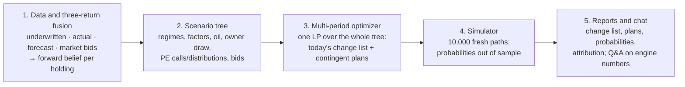

# ADIC Multi-Period Optimization Framework: Description

*Version 0, 19 October 2026. Written quickly from `design/DECISION_SPACE_AND_GOAL_OBJECTIVE.md` (v1.1), `design/SLIM_ARCHITECTURE.md` and the first prototype run in `examples/mpo_v2`. A version checked line by line against the code will replace this file. All numbers are SYNTHETIC: they are not ADIC data and not a forecast.*

---

## 1. Overview

**What the framework does.** Each quarter it decides which changes to make to ADIC's ~$177bn book to give the highest probability of meeting the 10% nominal return goal. It must meet hard limits throughout:
- the owner's draw is paid at every point;
- cash and stress-coverage floors hold;
- leverage, borrowing and concentration caps hold;
- the probability of a red event stays within its limit.

It is the slim, engine-first design, with five components:

**Principle: the engine is objective.** Given the data, the scenarios and the limits, it computes every decision, price and probability deterministically. The same inputs give the same outputs, bit for bit. People set the limits and approve the plan. No language model produces a number.

---

## 2. Variables considered

### 2.1 Index sets

| Symbol | Meaning |
|---|---|
| $i \in \mathcal I$ | holdings: about 60 in the prototype, across the eight groups |
| $g \in \mathcal G$ | the eight investment groups, plus Corporate Finance (CF) |
| $k \in \mathcal K$ | financing facilities: revolver, term debt, NAV loans, back-leverage, asset-level debt, futures and total-return-swap (TRS) financing |
| $n \in \mathcal N$ | tree nodes, each with parent $p(n)$, stage $t(n)$ and probability $\pi_n$ |
| $\ell \in \mathcal L \subset \mathcal N$ | leaves: the end-states at the 5-year horizon |

### 2.2 State variables

These are carried from node to node.

| Symbol | Meaning | Units | Granularity |
|---|---|---|---|
| $C_n$ | unencumbered cash and HQLA (Treasury, owned by Corporate Finance) | $bn | portfolio |
| $V_{i,n}$ | economic value of holding $i$ | $bn | holding |
| $U_{i,n}$ | unfunded commitments (PE, Secondaries, Real Assets and other funds) | $bn | holding / programme |
| $B_{k,n}$ | debt outstanding by facility, including holding-secured REFINANCE loans | $bn | facility / holding |
| $X_n$ | synthetic equity exposure (futures) and HF TRS notionals | $bn | portfolio / holding |
| $H_n$, $IM_n$ | tail-hedge ladder notional; posted initial margin (opportunistic book) | $bn | overlay |
| $Q_{i,n}$ | hedge-fund and open-end fund redemption queues | $bn | holding |
| $B^{draw}_{y(n)}$ | the owner's draw basis: opening-year reported NAV | $bn | portfolio |
| $W_n$, $E_n$ | NAV and gross economic exposure, derived from the above | $bn | portfolio |

### 2.3 Decision variables: lenses and levers

The decisions are taken at every decision node.

| Lens / lever | Variable | What it does (user definitions) | Instruments, by group (examples) |
|---|---|---|---|
| **SELL** | $s_{i,n}\ge 0$ | Dispose of part or all of a holding at a regime-dependent bid | PE and Secondaries LP sales and strips; single-asset co-investment sales; loan and LP sales in Private Credit; Capital Solutions syndication; Real Assets asset or stake sales |
| **HOLD** | (default) | Keep the holding and fund its calls | — |
| **ADD** | $a_{i,n}\ge 0$ | Buy more, re-up or co-invest | Long-only purchases; new private-credit money; co-investment deals; discount secondary purchases; Capital Solutions new money |
| **REFINANCE** | $\Delta B^{+}_{k,n}$ against holding $i$ | **Raise cash against a holding without selling it.** Exposure is unchanged. | NAV facility on PE interests; LP preferred equity; back-leverage on credit or Capital Solutions; cash-out refinancing of real-asset debt; physical-to-synthetic switch of long-only holdings |
| **LEVER** | $\Delta X_n$, debt-funded $a_{i,n}$ | **Borrow to add exposure** (≡ ADD + REFINANCE) | Synthetic equity beta; HF TRS (portable alpha); facility-funded ADDs; asset-level acquisition debt |
| **REDEEM** | $r_{i,n}$ | Redeem from hedge funds and open-end funds, subject to notice periods, gates and queues | HF redemptions; open-end real-estate redemptions |
| **PACE** | $k_{g,n}$ | Raise or cut new commitments by programme | PE, Secondaries, Real Assets, Private Credit, Capital Solutions |
| **REBALANCE** | (net of the above) | Move capital across groups | — |
| **HEDGE** | $H_n$, $IM_n$ | Size the tail-hedge ladder; set the opportunistic book's margin budget | Overlay |
| **FUND** | $\Delta B_{k,n}$ | Draw or repay Corporate Finance facilities | Revolver, term debt |

**Labelling rule (R1).** At each node, net new financing is split between LEVER and REFINANCE using an exposure-delta test:
- $\mathrm{LEVER} = \min(\Delta B^+, \Delta E^+)$, the borrowing that adds exposure;
- the rest is REFINANCE, borrowing that raises cash with exposure unchanged.

### 2.4 Exogenous random variables

These are scenario inputs.

| Variable | Description |
|---|---|
| Regime class and shock type | Benign (BEN), drought (DRT) and stress (STR) classes. Shock types include an oil-demand bust (DB) and a Gulf geopolitical shock (GW). |
| Factor returns | Equity, rates, credit spreads, Brent and VIX, quarterly, fat-tailed and regime-dependent |
| Private cash flows | PE and fund capital calls (rate on unfunded) and distributions (rate on NAV), by regime and fund age |
| Secondary bids | Price as a fraction of NAV, by strategy, age and regime. Hedge-fund and open-end pass-through rates by regime (e.g. HF 1.00 / 0.95 / 0.66; open-end real estate 0.80 / 0.34 / 0.14) |
| Credit outcomes | Defaults and recoveries in Private Credit and Capital Solutions |
| Financing | Spreads by regime; facility availability (the revolver credited at ≤ 50% in stress) |
| **Owner draw** | $D_n = d_n \cdot B^{draw}_{y(n)}$ with $d_n = \mathrm{clip}(f(\text{oil}, \text{fiscal}, \text{regime}), 5\%, 10\%)$. It is **exogenous** and paid in full at every node. |

### 2.5 Beliefs from the three return series

For each holding:
- $\hat\mu_i$: forward expected return on current economic NAV, net of fees;
- $\hat\sigma_i$: its uncertainty;
- factor loadings;
- $\hat b_g$: the group's forecast bias;
- a credibility weight for the group;
- a market-implied anchor from bids.

Section 5 gives the equations.

### 2.6 Limits and parameters

These are the hard constraints H1–H15, set by humans. The main ones are listed in §4.3. The rest are costs, haircuts, lags and capacity limits per instrument, recorded with their sources in `examples/mpo_v2/params.json`.

---

## 3. The multi-period approach

### Time grid
- The decision horizon is 5 years, simulated quarterly.
- The goal is a 10% a year time-weighted return, gross of distributions, over the horizon. With $W_0$ = $169.8bn economic NAV ($177bn reported), the goal wealth is $W^* = $273.4bn.

### Scenario tree in the prototype
- **Stage 1:** 10 year-1 nodes, stratified across the regime classes and shock types.
- **Stage 2:** 7 nodes under each stage-1 node.
- **Fans:** 3 paths to the horizon under each stage-2 node.

That makes **10 × 7 × 3 = 210 leaves**. Node probabilities multiply down the tree. Moment matching keeps the tree's means, volatilities and correlations close to the scenario generator's, and the tree is checked for arbitrage.

### Here-and-now versus contingent decisions
- **Root (today):** the change list that is actually executed.
- **Stage-1 nodes:** a full contingent plan for each year-1 world, with every lens and lever.
- **Stage-2 nodes:** recourse only, meaning funding moves and forced deleveraging, with pacing and overlay carried over. With only three fan paths each, discretionary trades there would be fitted to three outcomes.

### Non-anticipativity
Each node has one decision vector. A decision can only depend on information available at that node: the path so far, never the branch that follows.

### Rolling re-optimization (MPC)
Only today's decisions are executed. Next quarter the state is refreshed, beliefs are re-fused and the tree is rebuilt from where ADIC actually is.

Between quarters, a pre-committed recourse rule applies; the plan is pre-committed in Forsyth's sense. The rule funds needs, forces deleveraging when limits tighten, and holds pacing and the overlay. The rule recourse was the variant certified and chosen for the main plan.

### Terminal values
At the leaves:
- private holdings are valued at economic NAV;
- unfunded commitments carry a charge;
- every financing claim is deducted at fair value.

This means the optimizer cannot gain by pushing costs past the horizon.

### Why a tree and a simulator
The tree is for decisions and prices: it is small enough to optimize exactly and it yields shadow prices. The simulator is for probabilities: it uses 10,000 fresh paths the optimizer never saw. The probability the optimizer reports on its own tree is always optimistic.

---

## 4. The optimization math

### 4.1 Dynamics at node $n$ with parent $p = p(n)$

**Holding value.**

$$V_{i,n} = V_{i,p}\,(1+R_{i,n}) \;-\; \delta_{i,n}V_{i,p} \;+\; \kappa_{i,n}U_{i,p} \;-\; s_{i,n} \;+\; a_{i,n}$$

where:
- $R_{i,n}$ is the holding's return on the branch, built from its belief, its factor loadings and the node's factor outcomes;
- $\delta$ is the distribution rate;
- $\kappa$ is the call rate on unfunded.

**Unfunded commitments.** When a fund interest is sold, the buyer takes over the matching unfunded share $\phi_i$.

$$U_{i,n} = U_{i,p}\,(1-\kappa_{i,n}) \;+\; k_{i,n} \;-\; \phi_i\, s_{i,n}$$

**Cash balance.** Every source equals every use; there is no slack.

$$C_n = (1+r^c_n)\,C_p + \sum_i \delta_{i,n}V_{i,p} - \sum_i \kappa_{i,n}U_{i,p} - D_n + \sum_i \beta_{i,n}\, s_{i,n} - \sum_i a_{i,n} + \sum_k \big(\Delta B^+_{k,n}-\Delta B^-_{k,n}\big) - \sum_k (r_n+\varsigma_{k,n})\,B_{k,p} - \Delta IM_n - \text{premia}_n + \text{VM}_n$$

The terms are:
- $\beta_{i,n}$: the bid as a fraction of NAV;
- $\varsigma_{k,n}$: the facility spread;
- $\text{VM}_n$: variation margin on futures and TRS;
- $\text{premia}_n$: the tail-hedge cost.

**Debt.** $B_{k,n} = B_{k,p} + \Delta B^+_{k,n} - \Delta B^-_{k,n}$.

All of these are **linear**. That is what keeps one optimization over the whole tree tractable and exact.

### 4.2 Wealth at the leaves

$$\tilde W_\ell = \underbrace{C_\ell + \sum_i V_{i,\ell} - \sum_k B_{k,\ell} - \text{charges}_\ell}_{\text{terminal NAV}} \;+\; \sum_{n \in \text{path}(\ell)} D_n\, G_{n\to T}$$

Distributions paid are accrued forward at the fund's own return. This makes the goal *gross of distributions* and neutral to payout timing.

### 4.3 Hard constraints

These apply under every objective.

| Row | Constraint |
|---|---|
| H1 | Owner draw paid at every node: $D_n$ appears in every cash row, with no slack |
| H2 | Cash floor: $C_n \ge 4\%\,W_n$ everywhere, and $\ge 8\%$ at benign and drought nodes (except the first node after a stress); posted IM excluded |
| H3 | Short-horizon coverage: 30-day HQLA cover at the root and stage 1, with facilities at 0%; 6-month non-red capacity ≥ draws + stressed net calls − P10 distributions |
| H4 | 24-month stress coverage at the root (the calibrated stress $s^*(\theta^*)$) |
| H5 | Leverage and debt: $E_n \le 1.30\,W_n$; recourse debt ≤ 15% of $W$; encumbrance and maturity limits |
| H6 | LTV caps per instrument (e.g. NAV facility 10%, 5% in stress), with forced paydowns when caps tighten |
| H7 | Sale-depth caps (e.g. PE and Secondaries LP sales ≤ 5% of segment depth per half-year × success probability). In liquidity rows, planned sales count at stress success rates. |
| H8 | Oil exposure: energy and natural resources ≤ 1.5% of NAV; GCC real estate ≤ 1.0%; total barrel delta within the Tier-1 backstop |
| H9–H10 | Red-event limit (a forced PE sale at a crisis discount, or a payout below the minimum) as a CVaR surrogate on a signed margin; downside depth guard relative to the status quo |
| H11 | Overcommitment: private NAV + unfunded ≤ 80% of $W$, with a glide path |
| H12 | Concentration: company ≤ 1% of NAV; GP ≤ 5% of private NAV + unfunded |
| H13 | Overlay: tail budget 0.15–0.50% of NAV a year; economic-vega offset limits; opportunistic IM ≤ $1.5bn |
| H14 | Admissibility: consents, lead times, notice dates |
| H15 | Horizon rows at the leaves: no new borrowing; next-year liquidity cover; claims at fair value |

### 4.4 Objectives

Let $L_\ell = (W^* - \tilde W_\ell)/W_0$ be the normalized **shortfall** against the goal at leaf $\ell$.

**(a) Main objective: the Goal-Buffered Objective (GBO), based on the buffered probability of exceedance (bPOE).** For a random loss $L$ and threshold $z$:

$$\mathrm{bPOE}_z(L) \;=\; \min_{a \ge 0}\; \mathbb E\big[(a(L-z)+1)^+\big]$$

Two facts make this the right tool:
- **It is the "probability" whose matching tail average equals the threshold:** $\mathrm{bPOE}_z(L) = 1-\alpha$ exactly when $\mathrm{CVaR}_\alpha(L)=z$.
- **It is never below the true probability:** $\mathrm{bPOE}_z(L) \ge P(L>z)$.

With $z=0$, minimizing $\mathrm{bPOE}_0(L)$ minimizes a buffered probability of missing the goal. Unlike the raw probability, it also counts *how badly* the misses fall short, so it never rewards a gamble that adds dispersion. Formally it is monotone in the increasing-convex order.

On the tree it is an LP. Introduce $\tau_\ell \ge a L_\ell + 1$ and $\tau_\ell \ge 0$, minimize $\sum_\ell \pi_\ell \tau_\ell$, and use a perspective (Charnes–Cooper) scaling of the decision variables by $a$. CVaR bisection over the threshold gives the same result.

**When 10% is out of reach on average.** When $\mathbb E[\tilde W] \le W^*$, the buffered probability of missing equals 1 for every plan. No convex surrogate can then "buy" probability with extra dispersion; this follows from Jensen's inequality. The research-central case is close to this boundary: about 8.3% geometric.

The GBO therefore bounds $a \ge 1/c_{\max}$ with $c_{\max} = 2W^*/W_0$. This gives two regimes:
- **PLAN** (goal reachable on average): the GBO equals the exact bPOE.
- **STRETCH:** the GBO becomes *maximize expected wealth within the tail limits*. For location-scale outcomes this is the probability-optimal plan at a binding tail limit.

**(b) Comparison: the exact maximum-probability MILP.** It has one binary per leaf:

$$\max_{x,\,y}\; \sum_\ell \pi_\ell\, y_\ell \quad \text{s.t.}\quad \tilde W_\ell \ge W^* - M_\ell\,(1-y_\ell),\;\; y_\ell \in\{0,1\}$$

It is solved with HiGHS MIP, warm-started from the GBO solution. It reports the *in-sample ceiling* and exposes the gambling pathology: without guards, it levers to the cap.

**(c) Comparison: risk-averse utility.** Maximize $\sum_\ell \pi_\ell\,\hat U(\tilde W_\ell/W_0) - \lambda_T\,\psi(\cdot)$, where $\hat U$ is a piecewise-linear CRRA($\gamma=3$) utility and $\psi$ a squared shortfall penalty.

### 4.5 Choosing the plan

The optimizer generates candidate plans: the GBO plan plus plans at a grid of risk levels. On a separate **selection** set of simulated paths, it picks the one with the highest exact $P(\text{goal})$. That plan is then **certified** on a third, independent set, so selection cannot inflate the reported probability.

### 4.6 Shadow prices and the reading rules

The LP's duals explain each decision:
- **Liquidity premium $\ell$:** from the cash-row duals, the value of $1 of extra cash at a node.
- **Reservation price $p^*_i$:** the hold value of the holding divided by the value of $1 of root cash, per $ of reported NAV.
- **Hurdle:** $h_i = \mu_i - \ln(p^*_i/\theta_i)/D_i$.
- **Break-even return:** $\mu^{BE}_i = h_i + \ln(p^{ce}_i/\theta_i)/D_i$.

These turn into actions as follows:
- **SELL** if the cash-equivalent bid is above $p^*_i$, or equivalently the belief $\mu_i$ is below the hurdle.
- **ADD** if $\mu_i$ is above the hurdle by more than the risk and liquidity charges.
- **REFINANCE** if the all-in borrowing cost is below the liquidity premium over the term.
- **LEVER** if ADD and REFINANCE both pass.

**Example from the first prototype run (SYNTHETIC):** "HF-01: redeem; $\mu$ 4.44% vs hurdle 4.94%; liquidity premium 1.62%."

### 4.7 Size and solver

Each solve is a single LP, or a MILP for the comparison, with tens of thousands of variables. It is solved by HiGHS: open-source, single-threaded per solve, parallel across cases. The full prototype run, including the out-of-sample simulation and attribution, took 449 seconds on 20 processes.

---

## 5. Data and three-return fusion

Each holding's three series are since-inception, net IRR/MOIC with cases, archived quarterly. They are put on one basis: the forward annual log return on nowcast economic NAV.
- **Underwritten:** $\rho^u = \ln(M^u)/T^u$, the multiple over the planned life. It expires after the planned life.
- **Actual:** $\rho^a$ from the realized IRR/MOIC, shrunk toward the prior and ignored in the J-curve years.
- **Forecast:** $\rho^f = \frac{1}{H}\ln\!\big(R^f/V^*\big)$, the forecast proceeds against today's nowcast value. The cases (downside, base, upside) are read as P10/P50/P90.
- **Market anchor:** the buyer IRR implied by secondary bids, minus the buyer–seller PME gap by fund age.

These are fused with credibility weights shrunk toward equal, after removing each group's estimated bias:

$$\hat\mu_i = \sum_{m\in\{u,a,f,\text{mkt}\}} w_{m,i}\,\big(\rho^m_i - \hat b_{g(i),m}\big)$$

- The bias $\hat b$ and the credibility weights are estimated from the archive by Bühlmann credibility: realized outcomes against forecasts, by group, strategy and age.
- The spread of the stated cases, scaled by the group's measured coverage, gives $\hat\sigma_i$.
- Returns have $t_5$ tails.

---

## 6. Simulator and out-of-sample certification

- **Paths:** 10,000 fresh quarterly paths, pooled across capital-market worlds (M1, M2 and M6 in the prototype), with common random numbers across policies.
- **Sealed truth:** the true holding returns come from a truth model that differs from the beliefs. It includes forecast bias, drought optimism, overly narrow ranges and only partly informative bids. So the optimizer cannot be right merely by construction.
- **Metrics:**
  - $P(\text{goal})$ with a 95% confidence interval;
  - mean and median return;
  - CVaR at the 10%, 5% and 1% levels;
  - $P(\text{red event})$ with a Clopper–Pearson bound;
  - drawdowns;
  - a bimodality flag;
  - value at equal tail: the gain beyond a risk-matched beta line.
- **Pre-registered tests** (Holm-adjusted) against the status quo and simple rules, including a placebo and a test for a gambling signature.

---

## 7. Scenarios it can consider: examples

Status key:
- **Prototype:** represented in `examples/mpo_v2` now.
- **Partial:** in the prototype in simplified form.
- **Planned:** in the production build.

The checked version will confirm each status.

| # | Scenario | How it is represented | Typical decisions it triggers | Status |
|---|---|---|---|---|
| 1 | **Persistent PE distribution drought** | DRT regime persisting; PE distribution rate falls from ~18% to ~9% of NAV while calls stay ~29% of unfunded; wider secondary discounts | Pre-fund liquidity early; cut lower-alpha commitments (PACE); REFINANCE rather than sell PE at a discount; keep the cash floor | Prototype |
| 2 | **Oil crash, higher owner draw, credit line half available** | STR class with oil-demand-bust shock (Brent ~$40s); owner draw rises toward 10%; revolver credited at ≤ 50% | Draw committed facilities before they shrink; switch liquid holdings to synthetic exposure; avoid red-tier PE sales; hold the tail hedge | Prototype |
| 3 | **2008-style equity and credit crash** | STR class: equity log-excess ≈ −29%, VIX ~44; secondary bids 30–40% below NAV; HF pass-through drops (0.66); open-end queues | The tail-hedge ladder pays out; draw facilities; forced deleveraging of synthetic beta; no fire sales unless the red margin is exhausted | Prototype |
| 4 | **Gulf geopolitical shock** | GW shock type: Brent spike (e.g. ~$160), regime-specific equity and vol moves; owner draw lower when oil is high | Rebalance, oil-exposure limit binds (H8), opportunistic book sized to its margin | Prototype |
| 5 | **Benign recovery, exit window opens** | BEN class: distributions recover, bids near NAV, equity up | Raise pacing back to plan, ADD to high-belief private programmes, rebuild beta, repay facilities | Prototype |
| 6 | **Hedge-fund gating** | HF pass-through by regime (1.00 / 0.95 / 0.66) and redemption queues with notice lags | Redeem early in benign states; use HF TRS (portable alpha) to keep alpha without the illiquidity | Prototype |
| 7 | **Real-estate repricing and open-end queues** | Open-end pass-through by regime (0.80 / 0.34 / 0.14); RA value shocks; asset-level debt LTV caps | Redeem open-end units before queues lengthen; cash-out refinancing (REFINANCE) only within LTV caps | Prototype |
| 8 | **Private-credit default wave** | Regime-dependent defaults and recoveries; bids for loans and LP interests fall (e.g. 0.85 of par in stress) | Sell or stop adding to weaker credits, run off SMAs, avoid back-leverage at tightening LTVs | Partial (class-level losses; loan-level in production) |
| 9 | **Overlay variation-margin spike** | Vol spike raises VM and IM on futures, TRS and the opportunistic book | Cut the opportunistic book (forced), keep the tail ladder, keep cash cover for margin (H3) | Partial (full SIMM-like margin in production) |
| 10 | **Stagflation and a rate shock** | Capital-market world with high inflation and rising rates; financing spreads and discount rates up | Lower leverage, favour floating-rate credit, reduce long-duration real assets | Planned (production worlds M1–M6) |
| 11 | **IC view entered as an override** (e.g. "the buyout forecast realizes at 8%, spreads +250bp") | Typed overrides to beliefs and scenario parameters, or entropy-pooling re-weighting of paths, confirmed before running | Re-scores every holding's hurdle and reservation price; shows which decisions flip | Planned (chat analyst and views) |
| 12 | **Model-world disagreement** | Different capital-market assumptions (e.g. J.P. Morgan vs BlackRock vs a stress world) pooled or compared | Shows how robust the change list is; flags decisions that change with the world | Partial (M1/M2/M6 pooled in the prototype) |
| 13 | **Reverse stress** | Search for the scenario that breaks a limit (e.g. 24-month cover or the red-event limit) | Identifies the binding vulnerability and the cheapest protection | Planned |

---

## 8. Outputs

1. **Today's change list,** by group and holding. Each row gives the lens, the size and the justifying numbers: bid against reservation price, belief against hurdle, and the liquidity premium. It also gives the marginal change in $P(\text{goal})$ if that action is removed.
2. **Contingent plans** for each year-1 world.
3. **Probabilities** out of sample with confidence intervals: $P(\text{goal})$, expected and median return, tail metrics, $P(\text{red event})$ and drawdowns.
4. **Attribution:** the change in $P(\text{goal})$ when each action family is switched off and the plan re-optimized.
5. **The frontier:** $P(\text{goal})$ against the red-event limit, showing what each extra unit of risk buys.
6. **Chat:** a read-only analyst answers questions using only engine numbers, each with a link to the run that produced it. What-ifs are confirmed before they run.

---

## 9. Results from the prototype

*To be filled in after independent verification. A first, unverified run is in `examples/mpo_v2/RESULTS.md`.*

---

## 10. Assumptions and limitations

- **All data is SYNTHETIC.** Real data enters through adapters that read the holdings, the quarterly marks archive, facility terms and hedge-fund terms.
- **The prototype's tree is coarse:** 210 leaves, stage-2 recourse only. Production adds quarterly stages, a larger tree, six capital-market worlds and all eight groups at full holding count.
- **The prototype does not yet include:** loan-level credit, full SIMM-like margin, the stagflation world, IC view conditioning and reverse stress.
- **The 10% goal is a stretch** on research-central assumptions. The framework reports honestly how much probability each unit of risk buys, and never maximizes raw probability without the safety rows.

*Revision 0, 19 October 2026: written under time pressure. The checked version will replace it.*
