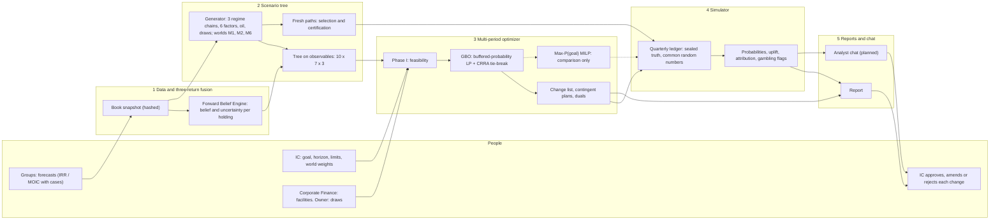

# ADIC Multi-Period Optimization Framework

*Reference description: what the framework decides, the variables it considers, its multi-period structure, its optimization mathematics, and the scenarios it can represent, by example.*

**Version** 1.0 (draft), 19 October 2026. **Draft:** this version has not yet been independently verified line by line, and the prototype it describes is being corrected after its own verification; a verified version will replace it. **Status:** describes the approved slim design (`design/SLIM_ARCHITECTURE.md`, "SLIM") and its detailed specification (`design/DECISION_SPACE_AND_GOAL_OBJECTIVE.md` v1.1, "DSGO"), cross-checked against the prototype in `examples/mpo_v2/`, which is being verified now. Where the spec and the code differ, both are stated. **Readers:** the quant lead, who commissioned this as the reference, should read everything. IC members can read §1, §3.1, §3.8, §7 and §8, plus the "meaning" columns of §2, without the mathematics.

> **SYNTHETIC – NOT ADIC DATA.** Every balance, rate, probability and price here comes from the synthetic book SYN-ADIC-177, from `examples/mpo_v2/params.json`, or from a design default. None of it is ADIC data. No prototype result is quoted. Results go in the marked placeholder after §8 once verification is complete.

**Status tags.**
- **Implemented**: in the prototype code today.
- **Configurable**: representable today by changing a value in `params.json` and re-running.
- **Planned**: specified in SLIM or DSGO but not yet built.
- **Spec ≠ code**: a deliberate prototype deviation, with its reason.

Other source keys: SYN = `research/00_SYNTHESIS.md`; ARCH = `design/ARCHITECTURE.md`. Code files are named directly.

---

## 1. Overview

### 1.1 What it decides, and for whom

ADIC's book is about \$177bn of reported NAV, roughly 60% private, and leverage is allowed. It must pay an exogenous owner draw of 5–10% of opening NAV each year, set higher when oil is weak, and its goal is a 10% nominal return a year. Every quarter the framework answers four questions for the Investment Committee (IC):

1. **Is the book safe?** The draw is paid every quarter, the liquidity floors hold, a named 24-month stress is survived, and no forced sale of private assets (a "red event") happens.
2. **What should change now**, holding by holding and lever by lever, and what would we do next year in each state of the world?
3. **How likely is the goal** with those changes, compared with doing nothing and with simple rules, and how much does that depend on whose capital-market assumptions are right?
4. **Why?** Which limits bind, what a dollar of liquidity is worth (the liquidity price λ), which beliefs drive each change, and what each change contributes.

It searches every lever in one problem:
- **SELL**, **HOLD** and **ADD**.
- **REFINANCE**: raise cash against a holding without selling it.
- **LEVER**: borrow to add exposure; LEVER ≡ ADD + REFINANCE.
- The portfolio levers: **PACE** (commitment budgets), **REBALANCE**, **HEDGE** (tail ladder and opportunistic book), **FUND** (Corporate Finance capacity) and **REDEEM** (hedge-fund and open-end notices).

Who does what:
- The TPA desk runs the framework.
- The CRO office certifies its probabilities and guards.
- Corporate Finance supplies facilities and draw data.
- The eight investment groups file forecasts.
- The IC sets the goal and limits and approves each change.

### 1.2 The five components

| # | Component | Job | In → out | Prototype |
|---|---|---|---|---|
| 1 | Data and three-return fusion | Freeze the book; turn each holding's three marks into one forward belief | holdings, cash-flow history, marks archive, bids → book snapshot, beliefs | `book.py`, `fusion.py` |
| 2 | Scenario tree | Generate the exogenous future across capital-market worlds; reduce it to a decision tree on observable states; keep separate fresh paths | snapshot, CMAs, start state → tree with per-node flows, bids, financing terms | `scenarios.py`, `tree.py`, `prep.py` |
| 3 | Multi-period optimizer | Choose this quarter's changes and next year's contingent plans for the highest goal probability that keeps every hard limit and guard; price liquidity | tree, beliefs, instruments, limits → change list, plans, duals, frontier, max-probability comparison | `model.py`, `optim.py`, `policy.py` |
| 4 | Simulator | Measure the outcomes of the policy that would actually run, and of baselines, on paths the optimizer never saw and against a sealed synthetic truth | plans, engines, fresh paths → probability board, uplift, attribution, gambling flags | `sim.py`, `mpo_v2.py` |
| 5 | Reports and chat | Publish the quarter; let IC members question it using engine-owned numbers only | run artifacts → report, analyst answers, approval record | `report.py` (report only); chat **Planned** |

### 1.3 The system on one page

### 1.4 The engine is objective; people set the limits and approve

The optimizer is deterministic: the same inputs give the same decisions, prices and probabilities. The inputs are:
- the hashed book snapshot and beliefs;
- the initial state;
- the scenario seeds;
- the IC's goal, limits and consent scenario;
- the solver options.

In the prototype this is enforced as follows:
- Every number the program uses is a value in `params.json` with its unit, rationale and source, and each run lists any parameter the code never read.
- Seeds are fixed for the book, the factor means, the tree, the selection paths and the certification paths.
- HiGHS runs single-threaded with a fixed random seed.
- Every parallel task starts from a fresh solver instance.
- The comparison MILP stops on a node limit rather than a clock.

Results therefore do not depend on scheduling. A determinism hash over the solutions, change list, out-of-sample results, frontier, attribution and hypothesis tests confirms each rerun.

Nothing inside a solve is a judgement call. Judgement lives in the inputs and limits that named people set:
- the IC sets the goal, horizon, limits, floors, world weights and consent scenario;
- Corporate Finance signs facilities;
- the owner sets the draw;
- the groups file forecasts, which the fusion debiases against each group's own track record.

The IC approves, amends or rejects each change, and nothing executes trades. In the planned chat, the language model chooses tools and words but never computes. A validator rejects any number that was not fetched from the engine in that turn.

---

## 2. Variables considered

**Conventions.**
- **Units.** Money is in \$bn; rates are annual decimals.
- **Indices.** Node $n$ with parent $p(n)$; holding $i$ (55 in the prototype, about 450 positions in production); group $g$; template $k$ (the per-dollar profile of a purchase or a commitment); financing instrument $j$; liquidity sleeve $s$; leaf $\ell$ with probability $p_\ell$.
- **Node class.** Every node has one of three classes:
  - BEN, benign: expansion or recovery, with exits open or normal;
  - DRT: exit drought without a macro crisis;
  - STR: macro crisis, frozen exits, or a demand-bust or glut oil shock with next year's draw at or above 8%.

  Today's root is DRT. A parameter written with argument $(n)$ takes its value for the class of node $n$.
- **Linearity.** The engines are positively homogeneous in the fraction held. Each holding's flows along the tree are therefore computed once, for the full original position, and the decisions only scale them, which keeps every row linear.

### 2.1 State variables

| Symbol | Meaning | Units | Granularity | Source |
|---|---|---|---|---|
| $C_n$ | Treasury cash and money-market funds, unencumbered | \$bn | portfolio, every node | Corporate Finance snapshot (\$15bn at t0); cash row |
| $LQ_n$ | IG + cash: $C_n$ plus 98% of the Treasuries-and-IG sleeve (the HQLA proxy); posted margin excluded | \$bn | portfolio, every node | derived |
| $V_{n,i}$, $N_{n,i}$ | Economic and reported NAV of holding $i$'s full original position; $\theta_{n,i}=V/N$ is path-dependent because reported marks lag | \$bn | per holding, every node | snapshot; quarterly unit engine |
| $x_{n,i}$ | Fraction of the original position held after the node's decisions | share (≤ 1 illiquid, ≤ 3 liquid) | per holding, decision nodes | LP |
| $U_{n,i}$ | Unfunded commitments | \$bn | per holding, every node | snapshot; engine (calls) |
| age, bucket | Holding age; drives call and distribution intensities and the bid's age multiplier | years | per holding | snapshot |
| $T^{V}_{m\to n,k}$, $T^{N}$, $T^{U}$ | Value, reported NAV and unfunded per \$ of template $k$ bought or committed at node $m$ | per \$ | template × start node × node | engine |
| $B_{n,j}$ | Debt by instrument: revolver, term debt, NAV facility, LP preferred, Capital Solutions back-leverage, SMA back-leverage, Real Assets cash-out. The NAV facility and the preferred accrue PIK | \$bn | portfolio, per instrument, every node | LP; Corporate Finance |
| asset debt | Acquisition debt of the levered templates (1 per \$ of equity) | \$bn | per template and start node | LP |
| $L^{s}+L^{up}$ | Revolver capacity: \$10bn signed (consent scenario R1) plus an upsize of up to \$5bn, effective from year 1 | \$bn | portfolio | Corporate Finance |
| $\beta_n$ | Synthetic equity beta notional (futures) | \$bn | every node | Overlay (\$10bn at t0) |
| $\mathrm{p2s}_n$ | Physical-to-synthetic notional on the DM core sleeve | \$bn | decision nodes | Public Markets / Overlay |
| $\mathrm{trs}_{n,i}$ | Hedge-fund TRS notional on lot $i$ | \$bn | per hedge-fund lot | Overlay |
| $\mathrm{hed}_n$, $\mathrm{opp}_n$ | Tail-ladder notional; opportunistic-book initial margin | \$bn | decision nodes | Overlay |
| $IM_n$ | Posted margin $=\mathrm{im}(n)(\beta_n+\mathrm{p2s}_n)+0.10\sum_i\mathrm{trs}_{n,i}+\mathrm{opp}_n$, with $\mathrm{im}$ = 4/6/10% (BEN/DRT/STR) | \$bn | every node | derived |
| $Q_n$ | Redemption claims queued (hedge funds, open-end real estate), paid the following year | \$bn | every node | LP |
| $W_n$, $NR_n$ | Economic and reported NAV of the whole book, net of every financing claim | \$bn | every node | derived |
| $E_n$ | Economic exposure: delta-adjusted, including synthetic beta, P2S and TRS | \$bn | every node | derived |
| $d_n$, $\hat d_n$ | Draw rate of the year into $n$; expected rate for next year. The basis is opening reported NAV, $NR_{p(n)}$ | share | every node | owner engine |
| $(S,e,Z)$, levels | Macro regime, exit window and oil-shock type; credit spread, 10-year yield, Brent, exit factor and VIX at the node | state | every node | generator |
| class, stage, flags | Node class; event stage (Green, Amber, Red or Black) read on the status quo's path; "behind" and "loss year" flags; the status quo's liquidity cushion $-m^{red,B0}_n$ | flags, \$bn | every node | status-quo (B0) LP readings |
| $\hat\mu_i$, $\sigma_{post,i}$, $e_\ell$ | Fused belief, its uncertainty, and the belief-error driver of leaf path $\ell$ | per year | per holding; per leaf | fusion; tree |

**Per-holding debt.** The prototype carries debt by instrument against collateral pools (the pledge pool, the Capital Solutions book, the SMA sleeve, controlled real assets). Debt balances by individual holding are **Planned**.

### 2.2 Decision variables, by lens and lever

| Lens | Variable | Granularity | Instruments behind it in the prototype | Status |
|---|---|---|---|---|
| SELL | $s_{n,i}$: fraction of holding $i$ sold at the node's bid | per holding | PE and Secondaries LP sales (one hedonic bid per segment and class); co-investment single-asset sales; Capital Solutions syndication or secondaries; Private Credit SMA loan sales, LP sales, evergreen tenders and BDC sales; hedge-fund secondaries; long-only sales; Real Assets asset, LP or JV sales | Implemented. Root red-tier sales are held at zero (ADR-39: today is Amber). Strips, deferred consideration and CV elections are Planned |
| HOLD | $x$ unchanged | per holding | — | Implemented implicitly. CV elections, amend-or-enforce and cures are Planned |
| ADD | $a_{n,i}$ for liquid holdings; templates $y_{n,k}$: SEC_BUY, CO_DEAL, CS_NEW, PC_NEW | per holding; per template | Discount purchases of LP interests (gate: discount > 20%, stage not Black, Secondaries ≤ 10% of NAV, 4.5% winner's-curse haircut); new co-investments (Green only, ≤ \$1.2bn a year); Capital Solutions new money (≤ \$1.2bn); new senior loans (≤ \$2bn) | Implemented |
| REFINANCE | draws $\Delta^{+}_{n,j}$ on the NAV facility, the preferred, the CS and SMA back-leverage and the RA cash-out; P2S increases and decreases $u_n$, $v_n$ | portfolio; collateral pool | LP-portfolio NAV facility; LP-portfolio preferred; Capital Solutions back-leverage; SMA back-leverage; cash-out refinancing of controlled real assets; P2S on the DM core sleeve. A revolver or term draw that funds needs is REFINANCE by rule R1 (§4.11) | Implemented. CFO, junior capital, sale-leaseback, hedge-fund unit loans and the co-investment pool facility are Planned |
| LEVER | $\mathrm{trs}_{n,i}$; templates INFRA_LEV and SMA_LEV; draws labelled LEVER by R1 | per lot; per template | Hedge-fund TRS (≤ 50% of the lot); contracted-infrastructure add-on with 1:1 asset debt at SOFR + 200bp (BEN only); levered SMA sleeve at D/E 1, SOFR + 225bp (BEN only) | Implemented. Holdco PIK and deferred-payment purchases are Planned |
| BETA (part of LEVER) | $\beta_n$ | every node; only cut at stage 2 and in fans | synthetic equity futures | Implemented. Reported as risk budget, never as alpha |
| PACE | $y_{n,k}$: commitments for PE, Secondaries, Real Assets, Private Credit and Capital Solutions | per group, decision nodes; fans repeat the stage-2 level | 0.25–1.25× plan (plan \$7.5bn a year); post-horizon value $c^{PACE}$ at the leaf | Implemented. **Spec ≠ code:** the Green and Amber corridors are reported, not imposed, so no hard IC range drives the plan |
| REBALANCE | net of SELL and ADD across groups; elastic range breach $\mathrm{brk}_{n,g}$ | per group | free inside 0.5–1.5× the SAA weight; 50bp a year per \$ beyond; waived at STR | Implemented |
| HEDGE | $\mathrm{hed}_n$, $\mathrm{opp}_n$ | decision nodes | 90/72 put-spread ladder (3.74% premium a year) within 0.15–0.50% of NAV; opportunistic IM ≤ \$1.5bn | Implemented. The monetization rule, oil put spreads and the OV1–OV3 limits are Planned |
| FUND | $L^{up}$; revolver and term draws and repayments $\Delta^{\pm}_{n,j}$ | portfolio | revolver at SOFR + 85bp (15bp undrawn); term debt at SOFR + 85bp (not at STR) | Implemented. Repo is Planned |
| REDEEM | $r_{n,i}$ | per hedge-fund lot and open-end real-estate fund | notice paid at the class pass-through within 12 months; the remainder queues | Implemented. The notice-date calendar and gates are Planned |
| funding | $q_{n,s}$: need-based pro-rata sales of the LIQ, HF, AMB and RED sleeves | per sleeve, every node | the funding waterfall, capped by H16 | Implemented. Not a discretionary SELL |

**Where decisions sit in the tree.** Root decisions (t = 0) are per holding and are applied exactly. Stage-1 decisions (t = 1) are per holding and contingent on the branch. Stage-2 nodes (t = 2) allow funding moves and forced deleveraging only; pacing, TRS, the tail ladder and the opportunistic book carry over from stage 1. Fan years (t = 3–5) allow funding moves only.

### 2.3 Exogenous random variables

| Symbol | Meaning | Units | Granularity | Model and calibration |
|---|---|---|---|---|
| $S_t$ | Macro regime: expansion, late cycle, crisis, recovery | state | quarterly | Markov; crisis persistence 0.70 a quarter (about a 10-month dwell) |
| $e_t$ | Exit window: open, normal, drought, frozen | state | quarterly | Markov; drought 0.87 today; one step worse with probability 0.35 in a crisis quarter |
| $Z_t$ | Oil-shock type: normal, boom, glut, demand bust, supply shock, Gulf war | state | quarterly | Markov; Gulf war 0.85 today. A demand bust forces a crisis with probability 0.85 a quarter, a glut with 0.05 |
| $f_t$ | Six factors: equity excess log return; credit excess return; duration excess return; log-Brent surprise; exit-factor surprise; implied-volatility surprise | per quarter | every path | Student-t shocks (5 degrees of freedom); volatility by regime; normal and crisis correlations (§3.2) |
| $P^{oil}_t$ | Brent | \$/bbl | quarterly | log mean reversion (0.30 a quarter) from \$126.55 toward a shock-type level: \$70, 95, 45, 38, 110, 120 |
| VIX | Implied volatility | points | quarterly | reverts to 15/19/34/22 by regime, with an asymmetric spot–vol response |
| calls, distributions | Private calls and distributions | \$bn | per holding, quarterly | intensity by age bucket × exit multiplier (distributions 1.25/1.0/0.47/0.32; calls 1.3/1.0/0.97/0.8) × crisis call stress 1.29; income yields |
| bids | Proceeds per unit sold | per \$ of economic value | per holding, per node class | buyer residual $\rho^{bid}_{seg}(n)$ × age multiplier × the holding's own bid premium |
| PD, LGD | Default rate and loss given default | per year | by regime | PD 1.1/1.6/6.0/2.2%, LGD 0.67, inside the credit factor |
| $d_y$ | Owner draw | share of opening reported NAV | annual, paid quarterly | oil-linked rule with overrides (§3.2) |
| spreads, availability | Financing spreads and facility availability | per year; share | by node class | §2.4 |
| $\varphi$ | Redemption pass-through within 12 months | share | by class | hedge funds 1.00/0.95/0.66; open-end real estate 0.80/0.34/0.14 |
| $m$ | Capital-market world | label | per path | M1 (J.P. Morgan 2027), M2 (BlackRock fee-adjusted), M6 (BlackRock risk premia rise); equal weights |
| truth, noise | Sealed true alpha, idiosyncratic outcome noise, the opportunistic book's true Sharpe | — | simulator only | truth model (§6.2) |

### 2.4 Parameters and limits

The rows themselves are written out in §4.3. The values below are the prototype's `params.json` defaults, each owned and swept.

| Item | Prototype value | Source |
|---|---|---|
| Goal | 10% a year time-weighted return, gross of draws, on economic NAV, over 5 years: $W^{\star}=W_0\cdot1.1^5$. $W_0$ is economic NAV plus Treasury, below the reported \$177bn because stale private marks are restated by $\theta$ | user; DSGO §4.1 |
| Buffer cap | $c_{max}=2W^{\star}/W_0\approx3.22$ | DSGO §4.3 |
| Cash floors | IG + cash ≥ 4% of NAV at every node; ≥ 8% at BEN and DRT nodes, except the first node after an STR node | H2 |
| Leverage | $E\le1.30W$; class caps 1.30/1.15/1.10 (BEN/DRT/STR); at behind nodes $1+\tfrac12(L^{class}-1)$ | H5, G5 |
| Debt | recourse debt (revolver + term) ≤ 15% of NAV; pledged collateral ≤ 20% of total assets | H5 |
| LTV | NAV facility 10% (5% at STR) of the pledge pool, with the pool ≤ 20% of private NAV; preferred ≤ 30% of the pool; CS debt ≤ 1/3 of the book; SMA 45%; RA cash-out 55% and ≤ \$0.9bn | H6 |
| Sale depth | PE and Secondaries LP sales ≤ \$9/7/5bn a year (BEN/DRT/STR); co-investment ≤ 10% of group NAV; RA 21/17.5/12.5%; CS 30/20/10%; PC 50/40/25%; hedge-fund secondaries 50% | H7 |
| Per-unit trade cap | $\lvert\Delta v_i\rvert\le0.5\%\cdot W_0\cdot\sigma_{ref}/\sigma_{post,i}$ | DSGO §3.3 |
| Red event | tree CVaR buffer $\varepsilon_R=0.6\%$ (certified limit 1%); red-tier sale threshold \$0.05bn; fire-sale bid below 0.9 × the normal bid | H9 |
| Depth guard | CVaR of the miss at 90/95/99% ≤ the status quo's; δ = 0 | H10(a) |
| Overcommitment | private NAV + unfunded ≤ 0.80 × NAV (not at STR) | H11 |
| Overlay | tail premium 0.15–0.50% of NAV a year; opportunistic IM ≤ \$1.5bn; gross overlay ≤ 30% of NAV; TRS ≤ 50% of the lot | H13 |
| Financing costs | revolver SOFR + 85bp, 15bp undrawn, 5bp a year upfront on the upsize; term SOFR + 85bp; NAV facility SOFR + 300bp (+440bp at STR) and 1.5% OID, PIK; preferred 12% (14% at STR) and a 1% fee; CS SOFR + 300bp; SMA SOFR + 225bp; RA cash-out SOFR + 320/440/720bp; synthetic beta 30/60/175bp; P2S 45/90/250bp; TRS SOFR + 100bp; SOFR fixed at 3.89% | DSGO §2; SYN §4.4 |
| Availability | revolver 100/100/50%; NAV facility 100/100/50%; preferred and term BEN and DRT only; CS and SMA back-leverage BEN only; RA cash-out 97/85/60% | DSGO §2.9 |
| Trading costs | 8bp DM equity, 30bp EM, 5bp fixed income; hedge funds at NAV | DSGO §2.6 |
| Liquidity haircuts | long-only equity −35.8%; hedge-fund pass-through 66% (12 months), 55% (6 months), 83% (24-month stress); amber 25% at a 0.80 bid; futures VM on a 35.8% fall plus the IM step-up | H3, H4, H9 |
| Terminal values | private NAV at economic value (ω = 1); unfunded burden ψ = \$0.03 per \$; post-horizon pacing value $c^{PACE}$: PE 8.6¢, Secondaries 5¢, RA 3¢, PC 1¢, CS 1¢ per \$ | DSGO §4.1 |
| CRRA | γ = 3 on real wealth (2.5% inflation); 32 tangents on [0.25, 4]; squared shortfall weight $\lambda_T=1$ with 16 secants | DSGO §4.5 |

### 2.5 Beliefs derived from the three marks

| Symbol | Meaning | Units | Granularity |
|---|---|---|---|
| $\hat\mu_i$ | Fused forward return: annualized log return on current economic NAV, net of fees, over the remaining life. It excludes the holding's own bid, so the sale decision is never compared with itself | per year | per holding |
| $\hat\alpha_i=\hat\mu_i-(r_f+b_i^{\top}\bar f)$ | Fused alpha over the factor-implied return; this is what the tree uses | per year | per holding |
| $\sigma_{post,i}$ | Posterior uncertainty of $\hat\mu_i$ (belief risk); also scales the per-unit trade cap | per year | per holding |
| $\hat\sigma_i$, P10/P50/P90 | Predictive spread including outcome noise; Student-t quantiles with 5 degrees of freedom | per year | per holding |
| $\hat b_{g,f}$, $\hat b_{g,u}$ | Group bias in forecasts and in underwriting, from the quarterly archive with Bühlmann credibility | pp a year | per group |
| $Z_g$ | Credibility weight $n_{eff}/(n_{eff}+20)$ | share | per group |
| $\kappa_g$ | Ratio of true to stated 80% widths (how much stated ranges are widened); prior median 1.75, updated on archive coverage | ratio | per group |
| $c^{\star}_i$ | Benktander credibility $p/(p+0.4)$ for fund interests, with $p$ the realized share of value | share | per fund interest |
| $\rho_{m,i}$ | Market-implied forward return from the external secondary bid | per year | per holding with a bid |
| $\hat\mu_i^{bid}$ | Fused belief including the holding's own bid: reported beside $\hat\mu_i$, not used for the holding's own decision | per year | per holding |
| P(forecast optimistic) | $\Phi\big((\rho_f-\hat\mu_i)/\hat\sigma_i\big)$ | probability | per holding |
| flags | hockey-stick forecast, stale NAV ($\theta<0.85$), market disagreement > 400bp, zombie NAV, actual unused (age < 3), underwriting expired | — | per holding |

---

## 3. The multi-period approach

### 3.1 Stages and time grid

The plan has three annual decision stages and a five-year horizon:
- **t = 0**, here and now: the change list, applied this quarter;
- **t = 1**: contingent plans for each of the ten year-1 branches;
- **t = 2**: recourse only;
- **t = 3, 4 and 5**: "fan" years. These are constraint nodes: every hard row holds there, but only funding moves are allowed.

The engines run quarterly. A tree node aggregates four quarters, and the simulator steps quarterly. The 10-year horizon is a sensitivity (**Planned**). Of the three design documents, DSGO v1.1 and the prototype use this annual grid. SLIM describes quarterly, then semiannual, then annual stages, and ARCH's here-and-now program spans 12 quarters. Production chooses among these by the horizon-stability test.

### 3.2 The scenario generator (component 2)

**Regimes.** There are three coupled quarterly chains:
- the oil-shock type moves first, $Z_{t+1}\sim P^{Z}(Z_t,\cdot)$;
- the macro regime becomes "crisis" with probability $c(Z_{t+1})$ (0.85 in a demand bust, 0.05 in a glut), and otherwise $S_{t+1}\sim P^{S}(S_t,\cdot)$;
- the exit window follows $P^{e}$ and moves one step worse with probability 0.35 in a crisis quarter.

**Factors.** Expectations $\mathbb{E}_t$ condition only on the start-of-quarter state, so a crisis onset is a surprise loss and nothing is predictable to time.

$$
\begin{aligned}
f^{eq}_{t+1}&=\tfrac14\mu^{eq}_m+\big(k^{eq}_{S_{t+1}}-\mathbb{E}_t[k^{eq}_{S_{t+1}}]\big)+\tfrac12\sigma^{eq}_{S_{t+1}}\varepsilon^{1}_{t+1}\\
f^{cr}_{t+1}&=\tfrac14 s_t-3.5\,(s_{t+1}-\mathbb{E}_t s_{t+1})-\tfrac14 PD_{S_{t+1}}LGD+\tfrac14\mu^{cr}_m,\qquad s_{t+1}=\max\big(s_t+0.25(\bar s_{S_{t+1}}-s_t)+\sigma^{s}_{S_{t+1}}\varepsilon^{2}_{t+1},\ 0.005\big)\\
f^{rt}_{t+1}&=\tfrac14 tp_m-6\,(y_{t+1}-\mathbb{E}_t y_{t+1}),\qquad y_{t+1}=\max\big(y_t+0.05(\bar y-y_t)-0.004\,\mathbf{1}[\text{crisis}]+0.004\,\varepsilon^{3}_{t+1},\ 0\big)\\
f^{oil}_{t+1}&=\ln P_{t+1}-\mathbb{E}_t\ln P_{t+1},\qquad \ln P_{t+1}=\ln P_t+0.30(\ln\bar P_{Z_{t+1}}-\ln P_t)+\sigma^{oil}_{Z_{t+1}}\varepsilon^{4}_{t+1}\\
f^{ex}_{t+1}&=X_{t+1}-\mathbb{E}_tX_{t+1},\qquad X_{t+1}=\mu_X(e_{t+1})+0.6\,(X_t-\mu_X(e_t))+0.25\,\varepsilon^{5}_{t+1}\\
f^{vol}_{t+1}&=(v_{t+1}-\mathbb{E}_tv_{t+1})/100,\qquad v_{t+1}=\max\big(v_t+0.5(\bar v_{S_{t+1}}-v_t)-0.5\min(100f^{eq}_{t+1},0)-0.15\max(100f^{eq}_{t+1},0)+2.5\,\eta_{t+1},\ 9\big)
\end{aligned}
$$

Notes on the factor equations:
- The shocks $\varepsilon^{1..5}$ are standardized Student-t (5 degrees of freedom), correlated through a normal or a crisis correlation matrix. In a crisis, spreads widen more with equity losses, yields fall (flight to quality) and oil falls with equities.
- The regime shift $k^{eq}$ is centred, so regimes move volatility, tails, cash flows, bids and facility availability, but not next quarter's expected return.
- The worlds differ in the equity premium $\mu^{eq}_m$ (3.0/4.6/1.0% log excess for M1/M2/M6), the credit drift $\mu^{cr}_m$ (0/+0.2/−0.6%) and the term premium $tp_m$ (0.8/1.0/0.4%).

**Owner draw.** Set at the start of each fiscal year:

$$
d^{tgt}_y=\Pi_{[5\%,10\%]}\Big(5\%+5\%\cdot\tfrac{67-P^{oil}_y}{67-23}+2\%\cdot\mathbf{1}[\text{override}]\Big),\qquad d_y=\Pi_{[5\%,10\%]}\big(0.5\,d_{y-1}+0.5\,d^{tgt}_y\big)
$$

- **Overrides.** The probability is 0.25% a year in normal, boom and supply-shock states, 1% in a glut or demand bust, and 2% in the Gulf-war state.
- **Payment.** The draw is $d_y$ × opening-year reported NAV. The simulator pays it quarterly; the tree pays it at the year-end node.

**Holdings.** One quarterly unit engine is shared by the tree and the simulator:

$$
r_{i,t+1}=\tfrac14r_f+b_i^{\top}f_{t+1}+\tfrac14\alpha_i,\qquad \mathrm{Dist}_i=\tfrac14\mathrm{yld}_iV_ie^{r}+(\cdot)\big(1-e^{-k^{D}_i(a)\,m^{D}(e)/4}\big),\qquad \mathrm{Call}_i=U_i\big(1-e^{-k^{C}_i(a)\,m^{C}(e)\,s(S)/4}\big)
$$

- **Value.** $V'=Ve^{r}-\mathrm{Dist}+\mathrm{Call}$.
- **Reported NAV** lags: its log return is $(1-\phi_i)r_{t}+\phi_i r^{N}_{t}+0.04\ln(V/N)$, scaled down by exits, so $\theta$ falls in droughts and crises. Liquid holdings have $N=V$.
- **Noise.** The simulator adds idiosyncratic outcome noise; the tree carries belief risk instead (§3.3).

### 3.3 The scenario tree as implemented

| Stage | Construction | Children | Probabilities | Moments matched |
|---|---|---|---|---|
| t = 0 → 1 | 20,000 one-year paths from today's state, with worlds drawn by IC weight. Five strata by class and shock type: STR demand bust (1 branch), other STR (1), DRT Gulf war (2), DRT (3) and BEN (3); a stratum with too few paths merges into a neighbour. Within strata, k-means on seven standardized observables (year equity return, spread, 10-year yield, log Brent, exit factor, VIX, expected next draw); the medoid path represents each cluster | 10 | the cluster's share of the 20,000 paths | six annual factor drivers, mean and covariance exact |
| t = 1 → 2 | 2,000 continuations per stage-1 node, worlds drawn from that node's world mix. Branches allocated by class, at least one per class with ≥ 3% conditional mass; k-means within class; paths of rarer classes join the nearest cluster, so no mass is dropped | 7 | parent × cluster share | six drivers, exact |
| t = 2 → 5 (fans) | 300 three-year paths per stage-2 node, sorted by the status-quo portfolio's 3-year log return; one medoid path per tercile | 3 | parent ÷ 3 | the fan return (mean and variance) and the belief error (zero mean, unit variance, orthogonal to the fan return) |

The tree has 81 decision nodes, 210 leaves and 711 time nodes. Its features:
- **Matching.** Moments are matched by the minimum-distortion (Gaussian optimal-transport) affine map $A=S^{1/2}(S^{1/2}S_cS^{1/2})^{-1/2}S^{1/2}$. Unlike a Cholesky map it does not rotate branches, so a demand-bust branch stays a demand bust.
- **Rank rule.** A branching with $K$ children can match a covariance of rank at most $K-1$, so $K\ge d+1$ for $d$ matched drivers. The tree meets this at every branching (10 ≥ 7, 7 ≥ 7, 3 ≥ 3).
- **Probabilities** are the true cluster masses. The stratified allocation oversamples rare states in branch count, not in probability.

**Spec ≠ code.**
- **Size.** DSGO specifies 10 × 8 × 8 = 640 leaves, matching eight drivers at stage 1, plus equity skew, with a no-arbitrage test on factor assets. The prototype uses 10 × 7 × 3 = 210 leaves to fit its run budget, matches means and covariances exactly, and has no skew matching and no no-arbitrage test (**Planned**). SLIM's production target is 500–1,000 leaves.
- **Belief-error driver.** DSGO draws it at stage 1 and holds it to the leaves. The prototype draws it at the fan branching and scales it by 5/3, so that it carries a full 5-year alpha error over the three fan years. Drawn at stage 1, it was a look-ahead leak: stage-1 decisions could trade on it in the tree, but the executed playbook cannot see it.

### 3.4 Non-anticipativity

Non-anticipativity holds by construction, through three mechanisms:
- **One decision per node.** Each node carries one decision vector, shared by every path through it.
- **Observable states.** Nodes are clustered on observables that pool all worlds. Recourse can learn what the fund can see (spreads, Brent, VIX, the draw, the equity year) but not which CMA world is true.
- **Hidden belief error.** The belief-error driver is drawn below the last decision node, so no decision conditions on the realized alpha error.

### 3.5 Here-and-now decisions, contingent plans and recourse

| Stage | Decisions allowed in the LP | Executed in the simulator |
|---|---|---|
| Root, t = 0 | every lens, per holding | exactly, in dollars |
| Stage 1, t = 1 | every lens, per holding, per branch | **playbook variant:** each path maps to its nearest stage-1 node (standardized observables, same class first) and applies that node's decisions in relative form. Sales and redemptions as a share of the holding; adds and purchases as a share of NAV; commitments as a multiple of plan; financing as a share of the path's capacity; overlay as a share of NAV. Planned red-tier sales execute only on a Green BEN path at a bid ≥ 0.9 × normal. **Static variant:** no year-1 decisions |
| Stage 2, t = 2 | funding moves (sleeve sales, revolver) and forced deleveraging of synthetic beta; pacing, TRS, tail and opportunistic book carry over from stage 1 | stage-1 settings carried; need-based funding |
| Fans, t = 3–5 | need-based funding only (H16): holdings fixed except pro-rata sleeve cuts; beta can only fall; revolver the only facility; commitments repeat the stage-2 level | the same rule |

**Spec ≠ code.** DSGO gives stage-2 nodes cohort-basket recourse (about 40 baskets at fixed t0 weights). The prototype makes stage 2 recourse-only, because three fan paths per stage-2 node would fit discretionary trades to three outcomes.

**The funding waterfall** applies every quarter in the simulator and to every baseline. It restores the 4% floor in this order:
1. fixed income, for cash;
2. long-only, pro rata;
3. hedge funds, at the class bid;
4. the revolver, within availability;
5. amber sales;
6. red sales, each above \$0.05bn a red event.

### 3.6 Rolling re-optimization (MPC)

**In production**, the quarterly cycle is itself model-predictive control: each quarter the book is re-frozen and re-fused, the tree rebuilt and the problem re-solved. The tree's contingent plan is one pre-committed plan, re-solved against the original goal path $W_0\cdot1.10^{t}$ rather than a reset goal, so that losses do not trigger catch-up risk. DSGO §5.5 certifies both the playbook and rolling MPC (small trees re-solved at years 1–2 on ≥ 2,000 paired paths), and flags a difference above 2pp or any gambling signature in the re-solves.

**In the prototype**, rolling MPC is not run (**Planned**). The static variant is certified beside the playbook as a proxy, and the selection set chooses between them.

### 3.7 Terminal values

At each leaf, distribution-inclusive wealth $\widetilde W_\ell$ (§4.4) is built as follows:
- private NAV counts at economic value (ω = 1), since economic NAV already carries any crisis;
- unfunded commitments carry a burden of ψ = \$0.03 per \$;
- every financing claim is deducted at face plus accrued PIK, and asset debt at face;
- the post-horizon value of commitments above or below plan, $c^{PACE}$, is counted once;
- range charges are deducted.

Hard rows (floors, leverage, and a red margin ≤ 0, meaning non-red liquidity covers next year's needs) hold at every leaf and fan year, which stops end-of-horizon artefacts.

**Spec ≠ code.** The preferred is deducted with its accrual but without its 1.3× MOIC floor.

**Planned:** the liquidation-basis sensitivity (ω = 0.90 after a crisis), regression-estimated ω and ψ (ARCH §5.12), and the horizon-stability test (A10).

### 3.8 Why a tree for decisions and a simulator for probabilities

The tree is the right object for choosing decisions and the wrong one for measuring probabilities, for five reasons:
1. **Resolution.** With 210 leaves, each leaf averages about 0.5% probability, so P(goal) moves in leaf-sized steps. The earlier tree demo's 27 leaves made P(≥ 10%) identical across policies.
2. **Optimism.** Decisions are fitted to the tree's own paths (the optimizer's curse). Fresh paths remove that bias, and the gap (the "optimism gap") is reported.
3. **Fidelity.** The tree's ledger is annual and accrues draws at the static-portfolio return to stay linear. The simulator is quarterly and chain-links the exact time-weighted return (error-ledger row E1).
4. **Truth.** The tree uses beliefs plus one belief-error driver. The simulator uses a sealed truth from a different model, plus idiosyncratic noise (E5).
5. **The executable policy.** The simulator measures the plan as it would run (nearest-node mapping, relative sizing, ADR-39 execution rules), not the idealized tree policy.

---

## 4. The optimization mathematics, as implemented

### 4.1 Data on the tree

Before the LP is built, `prep.py` propagates every holding's full position along the tree through the unit engine, giving $V_{n,i}$, $N_{n,i}$, $U_{n,i}$, the year's flows $\mathrm{Dist}_{n,i}$ and $\mathrm{Call}_{n,i}$, and the gross return $G_{n,i}$. It also builds:
- per-\$ trajectories for every template from every start node;
- sale proceeds per unit fraction, $\mathrm{bid}_{n,i}=\rho^{bid}_{seg}(n)\times\text{age multiplier}\times\text{the holding's bid premium}\times V_{n,i}$;
- stressed next-year calls $\hat C_{n,i}$ (×1.29) and low distributions $\underline D_{n,i}$ (frozen-exit rates), for the liquidity rows;
- the equity gross return $G^{eq}_n$, the tail payoff per \$ notional $\mathrm{tail}_n=0.922\min(\max(-R^{eq}_n-0.10,0),0.18)$, and the opportunistic return per \$ of IM, $\mathrm{oppret}_n$;
- the static-portfolio return $r^{SAA}_n$.

### 4.2 State transition and cash balance

**Holdings** (decision nodes, with $x_{p(0),i}\equiv1$):

$$
x_{n,i}=x_{p(n),i}-s_{n,i}+a_{n,i}-r_{n,i}-\frac{q_{n,s(i)}}{V^{sl}_{n,s(i)}}-\mathbf{1}[i=\text{LO-01}]\,\frac{u_n-v_n}{V_{n,i}}
$$

Write $\bar x_{n,i}$ for the holdings in force at node $n$: $x_{n,i}$ at decision nodes, and the stage-2 holding less cumulative pro-rata sleeve cuts in fan years.

**Cash** ($n\neq0$; templates bought or committed at an ancestor $m$ contribute their per-\$ flows):

$$
\begin{aligned}
C_n+IM_n={}&e^{r_f}(C_{p}+IM_{p}+Q_p)+\sum_i\bar x_{p,i}(\mathrm{Dist}_{n,i}-\mathrm{Call}_{n,i})+\sum_{m,k}y_{m,k}\big(T^{Dist}_{m\to n,k}-T^{Call}_{m\to n,k}-\xi_k(r_f+\varsigma_k)\big)\\
&-d_n\,NR_{p}-\sum_{j\notin\mathrm{PIK}}r^{B}_j(n)B_{p,j}-f^{u}(L^{s}+L^{up}-B_{p,\mathrm{REV}})\\
&+\beta_p\big(G^{eq}_n-e^{r_f}-f^{\beta}(n)\big)+\mathrm{p2s}_p\big(G^{eq}_n-e^{r_f}-f^{P2S}(n)\big)+\sum_i\mathrm{trs}_{p,i}\big(G_{n,i}-e^{r_f}-f^{TRS}\big)\\
&+\mathrm{hed}_p\,\mathrm{tail}_n+\mathrm{opp}_p\,\mathrm{oppret}_n+\sum_i\varphi_i(n)V_{n,i}\,r_{p,i}-c^{tail}\,\mathrm{hed}_n\\
&+\Big[\sum_i\mathrm{bid}_{n,i}s_{n,i}-\sum_iV_{n,i}(1+tc_i)a_{n,i}-\sum_{k\in\text{buy}}y_{n,k}+(1-tc)u_n-(1+tc)v_n\Big]_{\text{decision nodes}}\\
&+\sum_s\overline{\mathrm{bid}}_{n,s}\,q_{n,s}+\sum_j(1-oid_j)\Delta^{+}_{n,j}-\sum_j\Delta^{-}_{n,j}
\end{aligned}
$$

Reading it line by line:
- **Line 1.** Cash and posted margin earn SOFR, queued claims arrive, and holdings and templates pay distributions net of calls and asset-debt interest ($\xi_k$ is the debt per \$ of equity, $\varsigma_k$ its spread).
- **Line 2.** The owner draw (H1, never slack), cash-pay interest and the undrawn fee.
- **Line 3.** Variation margin on futures and TRS.
- **Line 4.** The tail payoff, opportunistic P&L, redemption cash at the class pass-through, and next year's tail premium.
- **Line 5.** The decisions.
- **Line 6.** Funding sales and financing.

At the root, the right side is the opening \$15bn, less the year-1 tail premium and the upsize fee, plus the decision and financing terms. **Spec ≠ code:** ARCH's cash row runs monthly with fixed intra-quarter profiles; the prototype's tree row is annual.

**Balance-sheet identities** at every node:

$$
\begin{aligned}
W_n&=C_n+IM_n+Q_n+\sum_i\bar x_{n,i}V_{n,i}+\sum_{m,k}y_{m,k}T^{V}_{m\to n,k}-\sum_jB_{n,j}-\sum_{m,k}\xi_ky_{m,k}\\
E_n&=\sum_i\bar x_{n,i}V_{n,i}+\sum_{m,k}y_{m,k}T^{V}_{m\to n,k}+\beta_n+\mathrm{p2s}_n+\sum_i\mathrm{trs}_{n,i},\qquad LQ_n=C_n+0.98\,\bar x_{n,\mathrm{FI}}V_{n,\mathrm{FI}}\\
B_{n,j}&=\big(1+r^{B}_j(n)\,\mathbf{1}[j\in\mathrm{PIK}]\big)B_{p,j}+\Delta^{+}_{n,j}-\Delta^{-}_{n,j},\qquad Q_n=\sum_i\big(1-\varphi_i(n)\big)V_{n,i}\,r_{p,i}
\end{aligned}
$$

Reported NAV $NR_n$ is $W_n$ with reported values.

**The signed red margin** is the next 12 months' stressed required outflows minus non-red capacity. A positive margin means the book would have to sell red-tier assets.

$$
\begin{aligned}
m^{red}_n={}&\hat d_nNR_n+\sum_i\bar x_{n,i}(\hat C_{n,i}-\underline D_{n,i})+(\text{templates})+\sum_jr^{B}_j(\mathrm{STR})B_{n,j}+(\text{asset-debt service})+\big(0.358+\mathrm{im}(\mathrm{STR})-\mathrm{im}(n)\big)(\beta_n+\mathrm{p2s}_n)\\
&-\big[LQ_n-0.04W_n+0.642\,V^{LO,eq}_n+0.66\,V^{HF}_n+0.20\,V^{amber}_n+0.5(L^{s}+L^{up})-B_{n,\mathrm{REV}}+Q_n\big]
\end{aligned}
$$

### 4.3 Constraint families

The rows are identical under all three objectives. "Every node" includes the fan years and the leaves.

| Row | What it stops | Form in the prototype | Status |
|---|---|---|---|
| H1 Owner draw | missing a payment | $d_nNR_{p(n)}$ in every cash row, with no slack | Implemented |
| H2 Cash floors | thin liquidity | $LQ_n\ge0.04W_n$ at every node; $LQ_n\ge0.08W_n$ at BEN and DRT nodes, except the first after STR. Hard, with the dual as its price | Implemented |
| H3 Coverage | short-horizon shortfall | at decision nodes, 6-month non-red capacity ≥ half the next 12 months' needs: $LQ_n-0.04W_n+0.642V^{LO,eq}_n+0.55V^{HF}_n+\mathrm{av}(n)(L^{s}+L^{up})-B_{n,\mathrm{REV}}\ge\tfrac12\big(\hat d_nNR_n+\text{stressed calls}-\text{low distributions}\big)$ | Implemented. The 30-day row with facilities at 0% is Planned |
| H4 Named 24-month stress (root) | failing the CRO's stress | liquid book after equity −35.8%, hedge funds at 83%, NAV facility at 5% LTV and revolver at 50% must cover two years of 10% draws, stressed net calls (calls ×1.29, distributions at 0.189 × drought), two years of stressed debt service, and VM plus the IM step-up | Implemented |
| H5 Leverage and debt | buying probability with solvency | $E_n\le\bar L_nW_n$; $B_{\mathrm{REV}}+B_{\mathrm{TERM}}\le0.15W_n$; $\sum_{j\,\mathrm{secured}}B_{n,j}/\mathrm{LTV}_j\le0.20(W_n+\sum_jB_{n,j})$ | Implemented. The maturity-concentration row is Planned |
| H6 LTV caps | over-borrowing on collateral | NAV facility ≤ LTV(n) × pledge pool and ≤ LTV(n) × 20% of private NAV; preferred ≤ 30% of the pool; CS ≤ 1/3, SMA ≤ 45%, RA cash-out ≤ 55% of their collateral; a tightening cap forces repayment | Implemented |
| H7 Sale depth | unrealistic sale sizes | the per-year caps of §2.4 at decision nodes; sleeve-depth caps on funding sales | Implemented. Stress-class success rates of the worst child are Planned |
| H8 Oil exposure | concentration in oil | ENR ≤ 1.5% of NAV, GCC real estate ≤ 1.0%, an oil-delta backstop | **Planned** (not in `model.py`) |
| H9 Red events | forced private sales | CVaR surrogate, below | Implemented |
| H10(a) Depth guard | sacrificing bad states | multi-level relative CVaR, below | Implemented. H10(b), the absolute per-world floor, is Planned |
| H11 Overcommitment | too much unfunded | private NAV + unfunded ≤ 0.80 W at non-STR nodes | Implemented as a hard row with a Phase I allowance. **Spec ≠ code:** DSGO's glide path is Planned |
| H12 Concentration | single-name risk | company ≤ 1%, GP ≤ 5%, co-investment position ≤ 4% | **Planned**; the per-unit trade cap stands in |
| H13 Overlay | overlay excess | tail notional within its budget band; opportunistic IM ≤ \$1.5bn; $\beta+\mathrm{p2s}+\sum\mathrm{trs}\le0.30W$; TRS ≤ 50% of the lot held | Implemented. OV1–OV3 are Planned |
| H14 Admissibility | impossible trades | variable bounds: no adds to private holdings; root red-tier sales at zero; REDEEM only for hedge funds and open-end funds; template gates; financing availability by class; no new borrowing at leaves | Implemented. Consents and notice dates are Planned |
| H15 Horizon | end-of-horizon artefacts | at leaves $m^{red}_\ell\le0$, with floors and leverage, and every claim deducted | Implemented |
| H16 Need-based funding | clairvoyant funding | $\sum_s\overline{\mathrm{bid}}_{n,s}q_{n,s}\le d_nNR_{p}+\sum_jr^{B}_jB_{p,j}+c^{tail}\mathrm{hed}_{p}+0.08W_n+\Delta^{-}_n+\bar C_n$, with $\bar C_n$ a constant bound on calls; fans buy-and-hold | Implemented |
| IC ranges | hard ranges driving the answer | $0.5w_gW_n-\mathrm{brk}_{n,g}\le$ group value $\le1.5w_gW_n+\mathrm{brk}_{n,g}$ at non-STR decision nodes; the breach is charged 0.5% per \$ at the leaf | Implemented |
| G4 No doubling down | catch-up risk after losses | at behind or loss-year nodes $E_n\le E_{p}W^{B0}_n/W^{B0}_{p}$; at decision nodes, beta + TRS and purchases ≤ the parent's | Implemented |
| G5 Cushion-monotone caps | leverage at the cap while behind | class and behind caps on $\bar L_n$; borrowed exposure $L^{bor}_n\ge E_n-W_n$, $0\le L^{bor}_n\le\kappa_c\max(0,-m^{red,B0}_n)$ | Implemented. **Spec ≠ code:** the cushion row is in the tree only |

The "behind", "loss year", "Green" and cushion readings are exogenous: they come from the status quo's (B0's) solution on the same tree, so every guard stays linear. Behind means the status quo's cumulative time-weighted return trails the 10% path by more than 2pp. **Spec ≠ code:** the event stage is read from IG + cash bands and the node class only; DSGO's full CFP indicators are Planned.

**H9, the red-event surrogate.** Let $RS_n$ be the proceeds of red-tier sales that are red events at $n$ (a non-Green node, or a bid below 0.9 × normal) plus red-sleeve funding sales, and $\vartheta$ = \$0.05bn. Then:

$$
z_\ell\ge m^{red}_n-\eta,\quad z_\ell\ge RS_n-\vartheta-\eta\quad\forall n\in\mathrm{path}(\ell),\qquad z_\ell\ge0,\qquad \eta+\frac{1}{\varepsilon_R}\sum_\ell p_\ell z_\ell\le0
$$

This is $\mathrm{CVaR}_{1-\varepsilon_R}(R_\ell)\le0$ for the path maximum $R_\ell=\max_{n\in\mathrm{path}(\ell)}\max(m^{red}_n,RS_n-\vartheta)$, which implies $P(R_\ell>0)\le\varepsilon_R$ in the tree. The tree buffer of 0.6% is tighter than the certified 1%, because in-sample bounds slip out of sample.

**H10(a), the depth guard.** With the miss $X_\ell=(W^{\star}-\widetilde W_\ell)/W_0$:

$$
u_{\ell,k}\ge X_\ell-\eta_k,\quad u_{\ell,k}\ge0,\qquad \eta_k+\frac{1}{1-\alpha_k}\sum_\ell p_\ell u_{\ell,k}\le\mathrm{CVaR}_{\alpha_k}(X^{B0})+\delta,\qquad \alpha_k\in\lbrace0.90,\,0.95,\,0.99\rbrace
$$

At δ = 0 the plan's worst 10%, 5% and 1% of outcomes may be no worse on average than the status quo's, which approximates second-order dominance at three tail levels.

### 4.4 Wealth, the goal and the miss

Time-weighted wealth satisfies $W_0\prod_t(1+r_t)=W_T+\sum_tD_tG_{t\to T}$, where $G_{t\to T}$ compounds the returns after the draw $D_t$ is paid. Using the scenario's static-portfolio return for $G$ keeps the leaf value affine in the decisions:

$$
\widetilde W_\ell=W_\ell-\psi U_\ell+\sum_{m\in\mathcal{D}(\ell)}\sum_{k\in\mathrm{PACE}}c^{PACE}_k(y_{m,k}-\mathrm{Plan}_k)+2\sum_{k\in\mathrm{PACE}}c^{PACE}_k(y_{a_2(\ell),k}-\mathrm{Plan}_k)-\varrho\sum_{m\in\mathcal{D}(\ell)}\sum_g\mathrm{brk}_{m,g}+\sum_{n\in\mathrm{path}(\ell)}d_nNR_{p(n)}\prod_{k\succ n}^{\ell}\big(1+r^{SAA}_k\big)
$$

The terms:
- $\mathcal D(\ell)$ is the set of decision nodes on the path, and $a_2(\ell)$ its stage-2 node, whose commitments repeat in fan years 3 and 4.
- $\varrho$ = 0.5%, charged only at non-STR nodes.
- The last product runs over the path's nodes after $n$, down to the leaf.

The goal is met at leaf $\ell$ if and only if $X_\ell\le0$, with $W^{\star}=W_0\cdot1.1^{5}$.

**Known bias (E1).** Accruing draws at the static-portfolio return rather than the policy's own return flatters a riskier plan's bad leaves, so the depth guard's comparison with B0 leans toward riskier plans. The simulator computes the exact return. The policy's-own-return accrual, by fixed-point re-solve, is **Planned**.

### 4.5 The Goal-Buffered Objective (GBO) and buffered probability of exceedance

**Definition.** For the miss $X$, the buffered probability of exceedance at zero is

$$
\mathrm{bPOE}_0(X)=\min_{a\ge0}\ \mathbb{E}\big[(aX+1)^{+}\big],\qquad \mathrm{bPOE}_0(X)\le p\iff\mathrm{CVaR}_{1-p}(X)\le0,\qquad \mathrm{CVaR}_{1-p}(X)=\min_{\eta}\ \eta+\tfrac1p\mathbb{E}\big[(X-\eta)^{+}\big]
$$

The equivalence follows by substituting $a=-1/\eta$ for $\eta<0$: $\eta+\mathbb{E}[(X-\eta)^{+}]/p\le0$ holds exactly when $\mathbb{E}[(aX+1)^{+}]\le p$.

In words, bPOE is the size of the worst slice of outcomes whose average just reaches the goal, and $\bar P=1-\mathrm{bPOE}$ is the buffered probability of success. It is conservative: $\bar P\le P(\text{goal})$, so the exact probability is always reported beside it.

**Why it cannot be gamed (Proposition 1, DSGO §4.2).** If $X\le_{icx}X'$ (increasing convex order), then $\mathrm{bPOE}_0(X)\le\mathrm{bPOE}_0(X')$. The reason: each map $x\mapsto(ax+1)^{+}$ is convex and non-decreasing, so each expectation is icx-monotone, and so is their minimum. Two consequences follow:
- deepening a miss never raises $\bar P$;
- a pure gamble (a mean-preserving spread) is never rewarded, although it can raise the exact P(goal). Maximizing the exact probability is the "digital option" pathology.

**What it does not exclude (Remark 1).** For a fixed $a$, $\mathbb{E}[(aX+1)^{+}]=\tfrac{a}{W_0}\mathbb{E}[(W^{b}-\widetilde W)^{+}]$ with $W^{b}=W^{\star}+W_0/a$. That is a *linear* shortfall below a buffered target. It can reward mean-increasing, skewed payoffs; in a complete synthetic market its optimum is all-or-nothing. The safety therefore rests on the guards (H9, the multi-level H10, G4, G5) and on the mandatory CRRA tie-break, not on the objective alone.

**The PLAN and STRETCH regimes, and the degeneracy finding.**
- *Proposition 2.* If $\mathbb{E}[\widetilde W]\le W^{\star}$, then $\mathbb{E}[(aX+1)^{+}]\ge a\mathbb{E}[X]+1\ge1$ for every $a\ge0$, so bPOE = 1 for every plan. More generally, no concave lower bound on P(goal) can certify a positive probability above the mean (Jensen). Above the mean, probability can rise only through dispersion, which is gambling.
- *Proposition 3.* For location–scale outcomes $\widetilde W=m(x)+s(x)Z$:
  - in **PLAN** ($m>W^{\star}$), minimizing bPOE maximizes P(goal) (Roy's safety-first);
  - in **STRETCH** ($m<W^{\star}$), the P(goal)-optimal point under a binding tail limit is the mean-maximizing point at that limit.

The spec's analytic check (DSGO §4.2; i.i.d. lognormal, 14.4% volatility, 300,000 paths; **SYNTHETIC, not a prototype result**) shows why the degeneracy matters for ADIC:

| Geometric return (bridge model) | Leverage | $\mathbb{E}[\widetilde W]/W^{\star}$ | P(goal, 5 years) | bPOE |
|---|---|---|---|---|
| 8.30% (six-world mixture) | 1.00× | 0.974 | 40.4% | 1.000 |
| 8.30% | 1.30× | 1.047 | 46.0% | 0.969 |
| 10.47% (M2) | 1.00× | 1.075 | 52.6% | 0.910 |
| 10.47% | 1.30× | 1.188 | 57.9% | 0.820 |

At research-central returns the unlevered book sits on the degenerate rows. In the same check, a pure gamble on the M2 row raises P(goal) from 52.6% to 54.3% while bPOE worsens from 0.910 to 0.913.

**GBO repairs the degeneracy by capping the buffer:**

$$
\Phi(x)=\min_{a\ge a_{min}}\sum_\ell p_\ell\big(aX_\ell(x)+1\big)^{+},\qquad a_{min}=1/c_{max}
$$

Its two regimes:
- **PLAN:** when the optimal buffer is below $c_{max}$, Φ equals bPOE.
- **STRETCH:** when no feasible plan expects to reach $W^{\star}$, $\Phi=1+\mathbb{E}[X]/c_{max}$ (if $\max_\ell\widetilde W_\ell\le W^{\star}+c_{max}W_0$, which the run checks). GBO then maximizes expected wealth inside every row and guard, which by Proposition 3 is P(goal)-optimal at the binding tail limit.

Φ crosses 1 continuously, so the label PLAN or STRETCH is a fact about the book and its limits. The prototype labels the pooled tree; per-world labels are **Planned**.

**The LP form (spec).** Write the miss as $X_\ell(x)=c_\ell-g_\ell^{\top}x$, with every row in $Ax\le b$. The Charnes–Cooper substitution $y=ax$, $\tau=a$ gives one LP:

$$
\min_{y,\tau,u}\ \sum_\ell p_\ell u_\ell\quad\text{s.t.}\quad u_\ell\ge\tau c_\ell-g_\ell^{\top}y+1,\ \ u\ge0,\ \ Ay\le b\,\tau,\ \ \tau\ge a_{min}
$$

with $x^{\star}=y^{\star}/\tau^{\star}$. The CVaR auxiliaries of H9 and H10 are scaled by τ as well.

**The algorithm as implemented** (`optim.gbo`):
1. **Mean LP.** Compute $E^{\star}=\max\sum_\ell p_\ell\widetilde W_\ell$ under every row. If $E^{\star}\le W^{\star}$, the label is STRETCH and $\Phi=1+(W^{\star}-E^{\star})/(c_{max}W_0)$.
2. **PLAN, by fixed-point iteration** rather than bisection (same optimum, fewer LPs). Start from $p_0=\mathrm{bPOE}(X(x_{mean}))$. Solve $x_k=\arg\min_x\mathrm{CVaR}_{1-p_k}(X(x))$ (minimize $\eta+p_k^{-1}\sum p_\ell u_\ell$ with $u_\ell\ge X_\ell-\eta$, $u\ge0$) and set $p_{k+1}=\mathrm{bPOE}(X(x_k))$, computed exactly at the leaf breakpoints. Since $\mathrm{CVaR}_{1-p_k}(X(x_k))\le0$, the sequence cannot increase. Stop when it moves less than $10^{-3}$; for the headline solve, a certificate LP at $p-10^{-3}$ must show a positive minimum CVaR.
3. **Mandatory tie-break.** Hold the goal value — in PLAN, $\mathrm{CVaR}_{1-(\Phi^{\star}+0.005)}(X)\le0$; in STRETCH, $\mathbb{E}[\widetilde W]\ge E^{\star}-0.005\,c_{max}W_0$ — and maximize the piecewise-linear CRRA(3) certainty equivalent. This removes unpaid risk, damps the all-or-nothing tendency, and supplies the duals in ordinary units.

**Spec ≠ code.** The perspective-LP cross-check (DSGO A7) is not built; the certificate LP checks optimality of the fixed point instead.

### 4.6 The exact maximum-probability MILP (comparison only)

$$
\max_{x,\,g}\ \sum_\ell p_\ell g_\ell\quad\text{s.t.}\quad\widetilde W_\ell-W^{\star}\ge\varepsilon_gW_0-M_\ell(1-g_\ell),\quad g_\ell\in\lbrace0,1\rbrace,\quad\text{every row of §4.3}
$$

- **Big-M.** $M_\ell=W^{\star}+\varepsilon_gW_0-L_\ell$, with the lower bound $L_\ell=0$, so the row reads $\widetilde W_\ell\ge(W^{\star}+\varepsilon_gW_0)\,g_\ell$. $L_\ell=0$ is valid because H5 holds at every node, keeping leaf wealth non-negative. The margin $\varepsilon_g=0.001$ stops knife-edge successes.
- **Integers.** Only the 210 goal indicators; the start point is the GBO solution.
- **Variants (DSGO).** Variant A carries every guard: it is the in-sample ceiling, and its gap to GBO is the price of buffering. Variant B carries Tier 1 only and exposes the pathology. The MILP is never the recommendation; both plans go through the simulator.

**Spec ≠ code.** HiGHS branch and bound did not leave the root node within the run budget (DSGO expects 30–90 minutes at full scale). The default method (`objective.milp_method = "round"`) therefore reports two things:
- a valid upper bound, from the MILP relaxation with $g\in[0,1]$;
- a deterministic incumbent, built by fixing $g=1$ on the leaves with relaxed $g\ge\tau$ for $\tau\in\lbrace0.5,0.75,0.9,0.99\rbrace$ (plus the start's successes), maximizing CRRA, then bisecting on the relaxation's ranking.

Branch and bound remains an option with a node limit. Variant B is **Planned**; the prototype's MILP runs with every guard.

### 4.7 The CRRA(3) + shortfall alternative

$$
\max\ \sum_\ell p_\ell\Big[\hat U_3\big(\widetilde W_\ell/(W_0\cdot1.025^{5})\big)-\lambda_T\,\hat\psi\big((1-\widetilde W_\ell/W^{\star})^{+}\big)\Big],\qquad U_3(w)=-\tfrac{1}{2w^{2}}
$$

- $\hat U_3$ is the lower envelope of 32 tangents at geometric points on [0.25, 4]; $\hat\psi$ interpolates the square on 16 secants; $\lambda_T=1$.
- The shortfall exponent is 2 > 1, because a linear shortfall penalty can reproduce probability maximization.
- This was the design's previous objective. It now runs as the third comparison (O3), and its utility term is GBO's tie-break.

### 4.8 Choosing the plan by out-of-sample probability

**Spec** (SLIM §3.3; DSGO §4.3). The candidates are the GBO solution plus the buffered-frontier plans $\hat g^{\star}(p)$ for $p$ from 5% to 95%. Each maximizes the mean of the worst $1-p$ of outcomes under every guard, with the CRRA tie-break. All are scored on a 10,000-path selection set. The guarded candidate with the highest exact P(goal) that passes the gambling detector is adopted, with ties within 2 paired SE going to GBO. Reported numbers come from a separate certification set, so the choice does not bias them. The IC may instead fix $p$.

**Prototype.** The selection/certification split is implemented: 4,000 selection paths (seed 21) and 10,000 certification paths (seed 31). The selection set chooses two things:
- for each optimized policy (O1 GBO, O2 MILP, O3 CRRA), whether the year-1 playbook or the static variant runs;
- the best simple rule among B1–B3, for the comparison H2.

The $\hat g^{\star}(p)$ family is **Planned**. The recommendation is O1, GBO at the default limits ($\varepsilon_R$ = 0.6%, δ = 0). The frontier over $\varepsilon_R$ and δ is certified and shown, so the IC can choose another point.

### 4.9 Phase I: feasibility before prices

A row that cannot be met pins its dual at the penalty tier. Every price would then be wrong: in the research, a fund's reservation price collapsed to 0.9% of NAV on a pinned dual.

**In the prototype**, Phase I minimizes the sum of slacks on five row families: H3, H4, H11, H15 and H9. It then bounds each slack at its Phase I value, as an allowance, for every later solve. The label is STRUCTURAL_RECOVERY if $u^{\star}>0$, otherwise FEASIBLE. A variant that turns infeasible (a switch-off, say) runs its own Phase I before any price is read.

**Spec ≠ code.** DSGO and ARCH §5.5 specify lexicographic tiers over reversible levers only (no PE, Secondaries or Co-investment sales), with the irreducible infeasible subsystem and recovery glide paths. The prototype uses one unweighted tier.

### 4.10 Duals: the liquidity price, the reservation price and the reading rules

Every card quantity is read from the LP that made the decision: the CRRA tie-break LP, with the goal value held. A card therefore cannot contradict its decision; test A23 checks the sign on every root holding.

**The liquidity price.** Let $\lambda_n$ be the dual of node $n$'s cash row. Stationarity in $C_n$ gives $\lambda_n=e^{r_f}\sum_{c\in ch(n)}\lambda_c+\mathcal{M}_n$, where $\mathcal M_n$ collects the duals of every other row containing node cash (floors, coverage, red margin, wealth). So

$$
\ell_n=\frac{\lambda_n}{e^{r_f}\sum_{c\in ch(n)}\lambda_c}-1,\qquad \bar\ell=\tfrac12\ell_0+\tfrac12\,\overline{\ell}_{\text{stage 1}}
$$

$\ell_n$ is the one-year premium a dollar of cash at $n$ commands over carrying it to the children at SOFR (DSGO's $\ell=\mathcal M/(\pi^{H}-\mathcal M)$). It is read only on a feasible problem. Test A9 checks the root cash dual against ±\$0.01bn finite-difference re-solves.

**The reservation price, hurdle and break-even return.** For holding $i$ at the root:

$$
p^{\star}_i=\frac{\nu_i+\mathrm{rc}(x_{0,i})}{\lambda_0N_{0,i}},\qquad h_i=\hat\mu_i-\frac{\ln(p^{\star}_i/\theta_i)}{D_i},\qquad \mu^{BE}_i=h_i+\frac{\ln(p^{ce}_i/\theta_i)}{D_i}
$$

- $\nu_i$ is the dual of the holding's root balance row: the value of one more unit of the position held.
- The reduced cost of $x_{0,i}$ is added when the holding sits at a bound, for example a private holding that cannot be added to.
- Dividing by $\lambda_0$ converts the value into dollars, and by $N_{0,i}$ into a price per \$ of reported NAV.
- When the sale column is interior, its zero reduced cost gives $\lambda_0\,\mathrm{bid}_{0,i}=\nu_i$. So the LP sells exactly when the cash-equivalent bid $p^{ce}_i$ exceeds $p^{\star}_i$, which is equivalent to $\hat\mu_i<\mu^{BE}_i$.
- The goal-basis hurdle $h_i$ inverts the closed form $p^{\star}=\theta e^{(\hat\mu-h)D}$. It is the forward return at which holding is worth exactly the LP's marginal value, and it bundles the liquidity premium and the goal-tail risk charge $\kappa^{G}$.
- **Spec ≠ code:** the prototype backs out $h_i$; reporting $\kappa^{G}_i$ separately is **Planned**.
- A "utility view" hurdle, $r_f+b_i^{\top}\bar f+\max(\bar\ell,0)$, is shown beside it. `goal_driven` flags a HOLD or ADD that passes the goal hurdle but fails the utility view.

| Decision | Reading rule (DSGO §3.4) | Prototype |
|---|---|---|
| SELL | $p^{ce}>p^{\star}$ (equivalently $\hat\mu<\mu^{BE}$) and the sale is admissible. A red-tier sale in Amber or worse is a red event, so at the root it is shown only by forced re-solve | Implemented (A23) |
| HOLD | $\hat\mu\ge\mu^{BE}$ and no financing pays | Implemented |
| REFINANCE | HOLD wins and $s_B+f/T+\lambda_{Lev}+\text{covenant charge}+\approx1.1\text{pp}<\bar\ell_{[0,T]}$. Display aid: the sell-versus-borrow horizon $T^{\star}=(\ln(\theta/p^{ce})-f)/s_B$ | the LP chooses; labelled by R1. The card test is Planned |
| LEVER | additively: $\hat\mu-(r_f+s_B+f/T)-\lambda_{Lev}-\text{covenant}-\text{tightening}-\kappa^{G}>0$, within the guards; beta is shown as "risk budget" | the LP chooses; labelled by R1. The card test is Planned |
| ADD | $\hat\mu^{new}+\ln(\theta/p^{buy})/D-h^{new}>0$, within capacity and gates | liquid adds read from $p^{\star}$; templates by the LP |
| REDEEM | $\hat\alpha^{net}+\kappa^{reentry}<\bar\ell(T^{cash})$ | the LP chooses (queue and pass-through) |

**Flip thresholds** (DSGO): $\mu^{BE}$, $p^{\star}$ and the break-even $\ell$ come from parametric re-solves. In the prototype, the six largest root actions get a forced re-solve (the action removed) certified out of sample. The three red-tier holdings with the highest bid-over-$p^{\star}$ get forced-sale cards, with H9 relaxed so that the card shows what forcing the sale would cost or gain.

### 4.11 Lens labels (rule R1)

Labels come from the node's balance-sheet changes, not from the instrument name:

$$
\mathrm{LEVER}_n=\min\big(\Delta B_n^{+},(\Delta E^{disc}_n)^{+}\big),\qquad\mathrm{REFINANCE}_n=\Delta B_n^{+}-\mathrm{LEVER}_n
$$

- $\Delta B_n$ is net new financing: facility balances, plus embedded derivative financing (notional net of posted margin), plus new asset debt.
- $\Delta E^{disc}_n$ is discretionary exposure added: liquid adds, plus template purchases, plus the increase in beta and TRS, minus sales.

Borrowing therefore first counts as REFINANCE, funding the draw, existing calls and debt service; only the remainder that funds new exposure is LEVER. This enforces the user's definitions: REFINANCE raises cash against a holding without selling it, and LEVER borrows to add exposure.

### 4.12 Problem size and solver

The prototype LP has three blocks:
- about 250 columns per decision node (four per holding, eleven templates, plus overlay and range variables);
- about 52 per time node (aggregates, sleeves, and seven instruments × balance, draw and repayment);
- about 10 per leaf (wealth, CVaR auxiliaries, utility and shortfall).

That gives roughly 59k columns, 60k rows and 0.6M nonzeros on the 210-leaf tree; `run_log.txt` records the exact size and status of every solve.

**Solver settings.** The LP is assembled in `scipy.sparse` and passed to `highspy`: HiGHS interior point with crossover (so that the duals are vertex duals), a single thread, random seed 0, and primal and dual feasibility tolerances of $10^{-7}$. The GBO value is checked against the exact bPOE function to $10^{-6}$ (A5), since $10^{-9}$ would sit below the solver tolerance.

**Production scale (SLIM).** About 450 root holdings, six pooled worlds and 500–1,000 leaves, roughly 200k columns. Five tree replications run in parallel within a 120-second budget each; the MILP is time-limited and reports its gap.

---

## 5. Data and three-return fusion

### 5.1 The three marks and the archive

Each holding carries three return series, each a since-inception net IRR or MOIC with down/base/up cases, archived quarterly:
- **underwritten**: set at inception;
- **actual**: realized to date;
- **group forecast**: P10/P50/P90.

External secondary bids add a fourth, market-implied mark. The archive scores each group's past forecasts against realized forward returns. In the prototype it is summarized per group as an effective count $n_{eff}$, the mean forecast error, the mean underwriting error, and the coverage of stated 80% ranges.

Only the forward return on current NAV drives action; since-inception IRR is sunk and only displayed.

### 5.2 Translating each mark onto one forward basis

The basis is the annualized forward log return on economic NAV $V^{\ast}=\theta N$, net of fees, over the remaining life $H$. Notation for the table: $PI$ is paid-in, $DPI$ distributions to date, $M$ a MOIC, $a$ the holding's age, and $D$ its duration (a share of $H$).

| Signal | Translation | Error scale | Used for |
|---|---|---|---|
| Forecast f | $\rho_f=\ln\big((M_f\cdot PI-DPI)/V^{\ast}\big)/H$; liquid mandates $\ln M_f/H$ | $\sigma_f=\kappa_g(\rho_{f,90}-\rho_{f,10})/2.563$, divided by $\sqrt{\min(1,8/(4H))}$ because precision is capped beyond 8 quarters | every holding |
| Underwritten u | $\rho_u=(\ln M_u-\ln M_t)/(T_u-a)$ with $M_t=(DPI+V^{\ast})/PI$; expires after $T_u+1$ | $\kappa_g$ × case spread ÷ 2.563 | deals and liquid mandates; not fund interests |
| Actual a | $\tilde a=\mu_k+\phi_a(r^{a}-r^{bench})$ in log terms, with $\phi_a$ = 0.5 for buyout; unused before age 3 | $\sqrt{(\phi_a\sigma_{out})^{2}/a+((1-\phi_a)\sigma_k)^{2}}$ | age ≥ 3 |
| Market anchor m | $\rho_m=(y_b-\pi_b(a))+\ln(p/\theta)/D$; buyer return $y_b$ 14% for fund interests and 22% for single-asset co-investments; buyer–seller gap $\pi_b$ ≈ 3pp at ages 4–9; unused below age 4 for funds | $0.05/D$ | leave-one-out: excluded from the holding's own decision belief |
| Prior | $\mu_k=r_f+b_i^{\top}\bar f+\alpha^{\star}_g$; $\alpha^{\star}_g$ in pp: PE +0.75, Secondaries +1.0, Co-investment +1.0, CS 0, PC 0, hedge funds 0, long-only −0.15, RA +0.25 | unit prior sd 0.8–4.5pp by group | every holding |

Here $\bar f$ is the 5-year average expected factor return over 20,000 pooled paths.

**Fund interests** use Benktander credibility between the forecast and the outside-view prior, with no separate underwriting signal:

$$
s_f=c^{\star}(\rho_f-\hat b_{g,f})+(1-c^{\star})\mu_k,\qquad c^{\star}=\frac{p}{p+0.4},\qquad p=\frac{DPI}{DPI+N}
$$

**Spec ≠ code.** The nowcast is $\theta N$ at the snapshot date, without ARCH's market-move adjustment $e^{\tilde\beta\Delta m}$, and Real Assets do not yet translate through cap rate, NOI growth and exit cap (**Planned**).

### 5.3 Group bias and credibility from the archive

$$
\tilde s_j=s_j-\hat b_{g,j},\qquad\hat b_{g,j}=Z_g\bar e_{g,j}+(1-Z_g)b^{prior}_{g,j},\qquad Z_g=\frac{n_{eff,g}}{n_{eff,g}+20}
$$

- **Bias priors** (pp a year, underwriting / forecast): PE +5.0/+3.0; Secondaries +2.0/+1.5; co-investment +6.0/+3.5; CS +2.0/+1.5; PC +0.75/+0.75; hedge funds +3.0/+2.0; long-only +1.0/+0.75; RA +2.5/+1.5.
- **Range widening.** $\kappa_g=\exp\big(Z_g\ln\kappa^{arch}_g+(1-Z_g)\ln1.75\big)$, with $\kappa^{arch}=1.2816/\Phi^{-1}((1+\text{coverage})/2)$.
- **No double shrinking.** Forecasts enter once, at precision $1/(\kappa_g^{2}\sigma^{2})$, with no second credibility multiplier.

### 5.4 Fusion

$$
\hat\mu_i=\sum_jw_j\tilde s_j,\qquad w_j=\begin{cases}\dfrac{\mathrm{prec}_j}{\sum\mathrm{prec}}&n_{eff}\ge20\\[2mm]\tfrac12\dfrac{\mathrm{prec}_j}{\sum\mathrm{prec}}+\tfrac12\dfrac1J&\text{otherwise}\end{cases},\qquad\sigma_{post,i}=\sqrt{\textstyle\sum_jw_j^{2}\sigma_j^{2}},\qquad\hat\sigma_i=\sqrt{\sigma_{post,i}^{2}+\sigma_{out}^{2}/\max(H,1)}
$$

- **Signals.** The sum runs over the prior (deals and liquid mandates), f, u and a. Weights shrink halfway toward equal until the archive reaches $n_{eff}\ge20$, because constrained GLS lost to simple averages out of sample.
- **Outcome noise.** $\sigma_{out}$ is 15% a year for funds, 30% for single deals, and lower for credit, real assets and liquid mandates.
- **Correlated errors.** DSGO enters them only in the predictive variance. The prototype's $\sigma_{post}$ treats signal errors as independent (**Spec ≠ code**).
- **Output.** The tree receives $\hat\alpha_i=\hat\mu_i-(r_f+b_i^{\top}\bar f)$.

### 5.5 The market-implied anchor from bids

The bid enters in two places:
1. **As a price.** The holding's bid premium (its observed bid over the generic segment bid) scales its sale proceeds at every node.
2. **As a belief.** $\rho_m$ backs out the forward return a buyer requiring $y_b$ would need. It is reported, it sets the market-disagreement flag (> 400bp from the forecast), and it enters $\hat\mu_i^{bid}$.

It is left out of the holding's own decision belief, so the reservation price is never pulled toward the price it is compared with. In-house desk quotes are never prices.

### 5.6 Beliefs in the tree

$$
R_{i,c}=\hat\mu_i-\tfrac12\sigma^{2}_{sys,i}+b_i^{\top}(f_c-\mathbb{E}f)+\sigma_{post,i}\cdot\tfrac53\,e_\ell\quad\text{(fan years only)}
$$

**Why belief risk matters.** Without it, two holdings with the same loadings but different $\hat\mu$ would form a riskless spread, and the LP would push belief-versus-bid swaps to their caps. Idiosyncratic outcome noise stays in the simulator; in the tree it acts through the per-unit trade cap, so weaker evidence trades in smaller size. DSGO's group-bias component $\rho_g$ of the belief error is **Planned**.

---

## 6. The simulator and out-of-sample certification

### 6.1 Fresh paths and common random numbers

Fresh paths are generated from today's state with the world drawn per path from the IC weights: 20 quarters, in chunks of 1,250 seeded by (seed, chunk). Every policy sees identical paths and identical noise, which makes the comparisons paired; results do not depend on the number of workers. Two disjoint path sets are used:
- the selection set (4,000 paths, seed 21) for choices;
- the certification set (10,000 pooled paths, seed 31) for every reported number.

**Spec ≠ code:** DSGO specifies 10,000 per world and SLIM 50,000 per world for reporting.

### 6.2 Sealed truth against beliefs

The truth is sealed: the optimizer never sees it, and it deliberately differs from the model the fusion assumes:
- true alpha dispersion is 0.5× or 1.5× the prior's;
- true group biases sit one prior sd above the bias priors, plus 1pp of extra forecast optimism in droughts;
- stated ranges cover about 44% of outcomes;
- bids pass through only half of the true alpha deviation.

Templates draw their own true alpha; the opportunistic book draws a true Sharpe from N(0.3, 0.25²); and each holding receives idiosyncratic noise at its segment's volatility.

Two further runs test the beliefs:
- **Belief mode** (truth = beliefs, no idiosyncratic noise) is reported beside the main run but never as the headline, because it confirms the beliefs by construction.
- **Replication books** repeat the pipeline: each is regenerated, re-fused, re-solved and re-certified. The prototype runs four books plus a **placebo book** whose true alpha is independent of every mark and bid; DSGO requires K ≥ 8.

### 6.3 Policies executed

Each policy executes as §3.5 describes: the root exactly, then the playbook or the static variant, then the fan rule. Every quarter:
- the draw is paid, at $d_y$ × opening reported NAV ÷ 4;
- flows, financing costs, PIK accrual, VM, the opportunistic P&L and redemption cash arrive;
- the common waterfall restores the 4% floor.

At each year end:
- queued claims pay out;
- forced paydowns occur where caps tighten;
- 8% is restored where the policy restores it;
- synthetic beta, then TRS, is cut to the leverage cap;
- surplus above 9% repays the revolver, except in playbook years.

**Baselines** share the flows, limits, paths and the signed revolver (facility parity):

| Baseline | Rule |
|---|---|
| B0 | Status quo: hold, plan pacing, waterfall, 4% floor |
| B1 | Sell liquid first; restore 8% |
| B2 | Pro rata; yearly rebalance of long-only and hedge funds |
| B3 | v8-style rule: exposure from 1.30× down to 1.0× as $F_t=(\text{VIX}-10)/60$ rises from 0.17 to 0.34 |
| B4 | Risk-matched line: B0 plus synthetic beta at 1.0–1.6× status-quo exposure, uncapped (a measurement device) |

The tuned standing policy P0 and archetypes A–C are **Planned**.

### 6.4 Metrics

| Metric | Definition |
|---|---|
| P(goal) | five-year time-weighted return on economic NAV ≥ 10%, chain-linked quarterly, with a Wilson 95% interval; also on reported NAV, with a flag if reported exceeds economic by > 2pp |
| Return and tail | mean and median return; CVaR of the return at 10%, 5% and 1%; bPOE at the goal, at 7% and at 0% |
| P(red) | share of paths with a red event; one-sided Clopper–Pearson 95% bound |
| Drawdowns | median and P95 maximum drawdown; leverage path |
| Gambling (G6) | Sarle bimodality (flag > 0.555); pile-up mass just above the goal; leverage raised after a loss year; leverage at the class cap while behind |
| Dominance (G7) | second-order dominance over B0 (lower partial moment at 199 thresholds) |
| Value at equal tail | P(goal) minus the B4 line's P(goal) at the same CVaR₁₀, with a bootstrap interval: the part of the uplift plain beta cannot buy |
| Optimism gap | in-tree P(goal) minus out-of-sample P(goal) |

### 6.5 Confidence and pre-registered tests

Differences against baselines are paired on common random numbers, reported with standard errors and 95% intervals, and tested by McNemar's exact test and a one-sided test against the pre-registered margin. The hypotheses were pre-registered (DSGO §6.5) before the first out-of-sample run:

| Id | Hypothesis |
|---|---|
| H1 (primary) | GBO beats B0 by ≥ +2pp of P(goal), with P(red) ≤ 1% |
| H2 | GBO beats the best simple rule by ≥ +1pp |
| H3 | H1 holds across synthetic books whose truth model differs from the belief model, clustered by book |
| H4 | No gambling signature, and dominance over B0 |
| H5 | The MILP's optimism gap exceeds GBO's |
| H6 | Value at equal tail ≥ +1pp |
| H7 | Placebo: the fusion's value on the null-information book is within one SE of zero |

The prototype applies a Holm adjustment across the tests with p-values (H1, H2, H3, H6); DSGO adjusts all seven as one family. A failed test prints **NOT ESTABLISHED**, with the attribution showing why.

---

## 7. Scenarios it can consider, by example

Each example gives the story, how the model represents it, the levers it typically brings into play, and its status. "Typically" describes the economics the rows encode, not a result.

**7.1 A persistent PE distribution drought** (today's starting state)
- *Story:* exits stay shut for two to four years; distributions run at half the normal rate while calls continue; marks stay stale.
- *Representation:*
  - the exit window starts in drought (0.87) and persists 0.88 a quarter;
  - the distribution multiplier is 0.47 (0.32 if frozen) against 1.0 normal, and the call multiplier 0.97;
  - the node class is DRT, so the event stage is Amber on the status quo's path;
  - reported NAV lags economic NAV, so $\theta$ and reported-NAV bids fall.

  Persistence and severity are `regimes.exit.P_q` and `private_engine.exit_dist_mult`.
- *Levers:* pacing cuts, which save calls at the cost of $c^{PACE}$; non-red liquidity (Treasury, fixed income, hedge-fund notices, P2S); a revolver upsize effective in year 1; amber sales (loan sales, syndication) within depth caps. There are no planned red-tier sales while Amber (ADR-39). The NAV facility or preferred is used only where $\ell$ exceeds its all-in cost.
- *Status:* Implemented; severity Configurable.

**7.2 An oil crash with a higher owner draw and halved credit-line availability**
- *Story:* a demand bust takes Brent toward \$40, so the owner's draw rises toward 8–9% just as markets fall, exits shut and banks cut lines.
- *Representation:*
  - the oil state enters demand bust (Brent level \$38, 15% quarterly volatility) or glut (\$45);
  - a demand bust forces a crisis with probability 0.85 a quarter;
  - the draw target rises linearly below \$67 and is smoothed 50/50;
  - the node becomes STR, where revolver availability halves, the NAV facility falls to 5% LTV and 50% availability, term debt, preferred and back-leverage close, IM is 10%, and beta financing costs 175bp.

  The tree's strata guarantee at least one demand-bust branch.
- *Levers:* draw the signed revolver to its availability; collect the tail-ladder payoff; pause co-investment; cut pacing; deleverage synthetic beta toward the STR cap of 1.10× within four quarters; make amber sales. H9, H3 and H4 bind first.
- *Status:* Implemented.

**7.3 A 2008-style equity and credit crash with 30–40% secondary discounts**
- *Story:* equities fall 35–50%, spreads go to 8–9%, defaults to 5–6%; exits freeze and secondary bids reach 60–70% of reported NAV.
- *Representation:*
  - crisis regime: equity volatility 32% with a centred −8% quarterly shift, crisis correlations;
  - spreads revert to 8.5% with PD 6% at LGD 0.67, and exits are pushed toward frozen;
  - the fund buyer residual is 0.82 of economic NAV; with $\theta$ around 0.73–0.85 that is a 30–40% discount to reported NAV;
  - co-investment bids fall to 0.55 and real-estate LP bids to 0.60.
- *Levers:* the secondary-purchase template opens (discount > 20%, stage not Black), deploying dry powder at crisis nodes; CS and PC new money carries +2pp alpha in STR; the tail ladder pays up to 0.166 per \$ of notional; red-tier sales are avoided (H9).
- *Status:* Implemented; larger shocks Configurable.

**7.4 Stagflation and a rate shock**
- *Story:* inflation re-accelerates; the 10-year yield rises 200–300bp; stocks and bonds fall together, as in 2022; real assets reprice.
- *Representation:* partial.
  - The rates factor (10-year yield from 5.09% toward 4.6%, duration 6 for the bond sleeve, rate loadings 0.3–0.5 for real assets) and the late-cycle regime carry part of it.
  - A shock is entered through `factors.rt.start` and `factors.rt.mean`.
  - There is no inflation factor; SOFR is fixed at 3.89%, so floating debt and futures financing do not reprice; the stagflation-heavy world (M5) and a positive stock–bond correlation regime are absent.
- *Levers:* losses on fixed income weaken it as the liquidity reserve, shifting the reserve toward cash; real-asset bids and cash-out capacity fall.
- *Status:* Configurable (the yield path). Floating SOFR, an inflation factor and M5 are Planned.

**7.5 A Gulf geopolitical shock with a Brent spike**
- *Story:* the conflict continues or escalates and Brent stays above \$110–120. The fiscal position improves, so the draw falls to its floor, but override risk rises.
- *Representation:*
  - the state starts in Gulf war (0.85) with a \$120 level and 14% quarterly volatility, decaying through a post-war glut channel;
  - the draw target sits at the 5% floor above \$67, with a 2% a year override probability adding 2pp;
  - oil loadings: ENR funds 0.84, ENR direct 0.30, GCC real estate 0.10, EM equity 0.10;
  - the strata keep two Gulf-war continuation branches.
- *Levers:* lower draws free liquidity for adds and pacing; ENR holdings gain and become SELL candidates where the bid beats $p^{\star}$. The H8 oil caps are not yet imposed.
- *Status:* Implemented; H8 Planned.

**7.6 A private-credit default wave**
- *Story:* direct-loan defaults rise to 5–6% a year at 67% severity; marks fall; evergreen funds prorate redemptions.
- *Representation:*
  - the credit factor's loss term $-PD\cdot LGD/4$ a quarter, plus spread-duration losses;
  - credit loadings about 0.9 for PC, 0.6 for CS and 0.4 for credit hedge funds;
  - in STR, SMA loans sell at 0.86 of value and LP interests at 0.75, with amber depth at 25% (PC) and 10% (CS) a year.

  Severity is `factors.cr.pd_annual`, `lgd` and `level`.
- *Levers:* loan sales and run-off before stress; no SMA leverage outside BEN; new loans at crisis spreads; forced repayment of back-leverage as collateral falls.
- *Status:* Implemented at factor level. The loan-level claims engine (PIK, non-accrual, extensions, evergreen proration) is Planned.

**7.7 A real-estate repricing and an open-end queue**
- *Story:* cap rates widen and core real estate falls 15–25%; open-end funds queue redemptions; LP secondaries trade at deep discounts.
- *Representation:*
  - values move through equity (0.57 true beta) and rate (0.5) loadings;
  - the open-end fund can be redeemed, paying 80%/34%/14% within 12 months (BEN/DRT/STR) with the rest queued in $Q$; its LP bid is 0.85/0.75/0.60;
  - controlled assets can be refinanced by cash-out at 97/85/60% availability.

  There is no separate cap-rate factor: a sharper repricing is a parameter change or, once built, an entropy-pooling view.
- *Levers:* redeem early while the pass-through is high, or sell at a deep discount; REFINANCE controlled assets; no red-tier sales while Amber.
- *Status:* Implemented. The cap-rate factor and the desmoothed real-asset nowcast are Planned.

**7.8 Hedge-fund gating**
- *Story:* in a crisis, managers gate or slow redemptions; notice capacity is not cash.
- *Representation:*
  - notices pay 100%/95%/66% within 12 months by class, the rest queued;
  - hedge-fund secondaries sell at 0.97/0.92/0.80;
  - liquidity rows credit hedge funds at 66% (12 months), 55% (6 months) and 83% (24-month stress);
  - lots carry short-volatility loadings of −0.15 to −0.25.

  Harsher gates are `trading.redeem_phi.hf` and the margin pass-throughs.
- *Levers:* lodge notices before stress; keep hedge funds late in the waterfall. A TRS adds no liquidity.
- *Status:* Configurable. Gate hazards and the liquidity-term state machine are Planned.

**7.9 An overlay variation-margin spike**
- *Story:* equities fall 30% in a month; futures behind synthetic beta and P2S call margin; IM steps up; the short-volatility opportunistic book loses.
- *Representation:*
  - each \$ of beta or P2S notional settles $G^{eq}-e^{r_f}-f$ in cash, annually in the tree and quarterly in the simulator;
  - IM steps from 4% to 6% to 10%;
  - the red margin charges a 35.8% fall plus the IM step;
  - the opportunistic P&L loads 0.3 on equity and −0.6 on implied-volatility surprises;
  - the ladder pays when the annual equity return is below −10%.
- *Levers:* H9, H3, the cushion cap and the gross-overlay cap limit beta and P2S; liquidity is held against VM; the ladder and opportunistic IM are sized within their budgets.
- *Status:* Implemented at annual or quarterly resolution. Daily VM, SIMM margin and OV1–OV3 are Planned.

**7.10 A benign recovery with the exit window opening**
- *Story:* exits reopen, distributions rebound, bids return to about NAV and spreads tighten.
- *Representation:*
  - exit window open (distribution multiplier 1.25, call multiplier 1.3) and BEN class, with buyer residual about 1.0 on economic NAV;
  - every facility and both levered templates are available, and the class cap is 1.30×;
  - a Green stage on the status quo's path permits planned red-tier sales at bids ≥ 0.9 × normal, and co-investment opens.
- *Levers:* planned sales of tail-end funds whose bid beats $p^{\star}$; arranging facilities while cheap (FUND); restoring pacing; LEVER where alpha clears financing, such as infrastructure acquisition debt; synthetic beta up to the cushion-gated cap.
- *Status:* Implemented.

**7.11 An IC view entered as a typed override**
- *Story:* "Our buyout forecasts of 16% will realize at 8%, and spreads widen 250bp."
- *Representation (production, ARCH §8.7):* the view is translated into two typed overrides, confirmed by a member, and run labelled EXPLORATORY:
  - a belief view into the fusion (buyout forecast = 8%), re-fused and re-scored;
  - a scenario view by entropy pooling, which reweights paths as $q_i\propto p_ie^{-\lambda^{\top}g_i}$ so that $\mathbb{E}_q[\Delta\text{spread}]=v^{eff}=\mathbb{E}_p[g]+0.6\,(v-\mathbb{E}_p[g])$, under KL and effective-sample-size gates.
- *Representation (prototype):* a parameter override and a full re-run: the PE forecast bias or the archive for the first half, and +0.025 on `factors.cr.start` or `level` for the second.
- *Levers:* lower PE beliefs lower reservation prices, so more PE becomes marginal SELL (executable only at Green nodes) and PE pacing falls; wider spreads raise PC and CS new-money returns.
- *Status:* Configurable now. Entropy pooling and the translator are Planned.

**7.12 A reverse stress: find the scenario that breaks a limit**
- *Story:* "What is the most plausible world in which we breach the red-event limit, or the 4% floor?"
- *Representation (planned):* the minimum-KL tilt to failure, $q^{\star}=\arg\min_q\mathrm{KL}(q\Vert p)$ subject to the limit's margin reaching zero in expectation (or the breach probability reaching its band), so $q\propto pe^{\lambda g}$. It reports the tilted factor means, regimes and draw paths, the detection-error probability and a sensitivity ranking. Today's prototype tools: Phase I minimum violation, the named stress H4, and the frontier over $\varepsilon_R$ and δ.
- *Levers:* shows which lever (revolver size, pacing, reserve) moves the breaking point.
- *Status:* Planned.

**7.13 Model-world disagreement**
- *Story:* CMA providers disagree: J.P. Morgan (M1), BlackRock fee-adjusted (M2), BlackRock risk-premia-rise (M6).
- *Representation:*
  - the worlds shift the equity premium, credit drift and term premium;
  - they are pooled with IC weights, and nodes are clustered on observables, so recourse cannot learn the world;
  - the truth-model variants and the placebo book test the beliefs.
- *Levers:* the depth guard and class caps stop leverage that pays only in optimistic worlds; probabilities are reported per world.
- *Status:* Implemented for three worlds; weights and premia Configurable. Six worlds, the bootstrap families, per-world labels and floors are Planned.

**7.14 Consent: no revolver signed, or an owner band agreed**
- *Story:* banks do not sign (consent scenario R0), or the owner pre-agrees 5% draws in CFP Red (R2).
- *Representation:*
  - R1 is the default: \$10bn signed, upsizable to \$15bn, with parity for every baseline;
  - R0 sets `revolver_signed` and `revolver_upsize_max` to zero;
  - R2 needs a state-dependent draw floor.
- *Levers:* actions that flip between scenarios are labelled consent-sensitive.
- *Status:* R1 Implemented; R0 Configurable; R2 Planned.

---

## 8. Outputs

**The t0 change list.** One row per root action with a nonzero size. Each row carries:
- the holding or instrument, group, action and lens (R1);
- the size in \$bn and as a percentage of the unit;
- $p^{ce}$ and $p^{\star}$;
- $\hat\mu$ (P10/P50/P90), the goal-basis and utility-view hurdles, and $\mu^{BE}$;
- the root $\ell$;
- consent and lag;
- the flags: `goal_driven`, `risk_budget` (value disappears at equal tail) and `limit_driven` (relaxing one IC limit changes the action by more than 20%).

The largest rows also carry the out-of-sample ΔP(goal) of a forced re-solve without them. Template, financing, overlay, beta and pacing rows carry their own notes, and red-tier SELL candidates appear only as forced cards. **Planned:** tree-seed agreement (k of 5), consent sensitivity across R0/R1/R2, and $\kappa^{G}$ and $G_a$ per \$.

**Contingent plans.** One card per year-1 branch. It shows the class, probability, stratum, equity year, Brent, VIX and next draw. It then gives the plan's sales by group, adds, redemptions, purchases, commitments, debt, beta, P2S, tail and opportunistic IM, the resulting leverage, IG + cash and red margin, and the node's $\ell$. DSGO presents these as the pre-committed plan the IC adopts; how much weight they deserve depends on the playbook-versus-static certification.

**Probabilities and their confidence.** A board covers every policy: B0–B4, O1–O3 in both recourse variants, frontier points and switch-offs. It shows every §6.4 metric, in the tree and out of sample, with intervals. It adds the optimism gap, belief-mode values and replication-book results, and, in production, the model range (min, max, mixture) first.

**Attribution by action family.** GBO is re-solved with each family's columns fixed: SELL, ADD, REFINANCE, BETA, LEVER, PACE, REDEEM, HEDGE, FUND, REBALANCE, and BELIEFS (fused beliefs replaced by group priors). Each is certified on the same paths. The table reports, with paired intervals:
- ΔP(goal) and Δ value at equal tail;
- Δ mean return, ΔCVaR₁₀ and ΔP(red);
- any Phase I allowance a switch-off needed.

The exact Shapley table over seven grouped players is **Planned**, because switch-offs do not sum when families substitute.

**The frontier.** GBO is re-solved across the tree red-event buffer $\varepsilon_R$ ∈ {0.3, 0.6, 1.2, 2.5, 5%, unbounded}, with the MILP at two points, and across depth-guard slack δ ∈ {0.01, 0.02, 0.04}·$W_0$. Each point is certified out of sample: P(goal) against CVaR₁₀ and P(red), drawn against the risk-matched beta line. The IC chooses the point; the recommendation sits at δ = 0.

**Diagnostics.** The fused belief per holding (raw marks against the fused belief, weights and flags), tree moments and the rank rule, every solve's status and size, Phase I, the acceptance checks (A1, A3, A5–A9, A11–A14, A16, A17, A22–A24), the spec-deviation table and the error ledger E1–E5.

**How the chat answers (Planned, SLIM §1.8; ARCH §8.12).** One deterministic analyst service owns every number:
- **Tools.** The language model chooses among `resolve`, `holding_card`, `explain_change`, `change_list`, `probability` (registered events only), `compare`, `frontier`, `get_metric` and `get_provenance`.
- **Numbers.** A context handle pins the run, so numbers never shift mid-conversation. A validator rejects any digit not fetched in that turn, retrying at most three times before falling back to a fact card without prose.
- **Labels.** Answers label each statement as model output, judgement or assumption, carry the SYNTHETIC flag, and never recommend a vote.
- **What-ifs.** `whatif_draft` produces a typed override that a human confirms; it then runs labelled EXPLORATORY under its own run id.
- **Offline.** Stub and Replay backends run offline, and every turn is logged in a hash-chained transcript.

---

## Results from the prototype (to be filled after verification)

> **Placeholder: no results are quoted here.** The prototype run (`examples/mpo_v2/RESULTS.md`, `results.json`, `run_log.txt`) is under verification. See `examples/mpo_v2/verify_finance.md` for the finance review in progress and `examples/mpo_v2/spec_review.md` for the review that produced DSGO v1.1. Once verification closes, this section will report:
> 1. **Headline:** the GBO label (PLAN or STRETCH) and Φ; in-tree and out-of-sample P(goal) with intervals, pooled and per world, on economic and reported NAV; value at equal tail.
> 2. **The t0 change list,** with forced re-solve values and flags.
> 3. **Contingent plans,** with the playbook-versus-static result.
> 4. **The comparison** of GBO, the MILP and CRRA + L2: in-tree, out of sample, optimism gaps and pile-up.
> 5. **Attribution** by family, raw and at equal tail.
> 6. **The frontier** over $\varepsilon_R$ and δ against the risk-matched line.
> 7. **Replication and placebo books.**
> 8. **Pre-registered tests H1–H7** with Holm-adjusted p-values, and acceptance checks.
> 9. **Fixes** made in response to verification findings, with before and after.

---

## 9. Assumptions, limitations and what the production build adds

### 9.1 Modelling assumptions

- **Synthetic data.** Synthetic data tests correctness only; it never chooses a fusion variant or calibrates ADIC parameters.
- **One factor architecture.** All worlds share one architecture with six factors, so a shared misspecification survives the ensemble.
- **Regimes.** Regimes move risk, not next quarter's mean.
- **Constant SOFR**, and no inflation factor.
- **Annual decision grid.** The quarterly engine is aggregated annually in the tree. Ages run on calendar time, with exit multipliers rather than DSGO's effective-age clock.
- **Positive homogeneity.** Positions scale linearly, with one bid per segment and class.
- **Accrual.** Draws accrue at the static-portfolio return in the tree (E1).
- **Fans.** Fans are buy-and-hold with need-based funding (bounding clairvoyance, E2).
- **Terminal values.** ω = 1, ψ = \$0.03 per \$, and the assumed post-horizon pacing values (only PE's 8.6¢ is sourced from the research).

### 9.2 Known limitations of the prototype

Beyond the "Spec ≠ code" items flagged above:
- **Scale.** 55 holdings against about 450 positions; 210 leaves against 640 to 1,000; one tree seed (the 5-seed stability test and the optimality-gap estimate are not run).
- **Evaluation.** 10,000 pooled certification paths; four replication books plus a placebo, against K ≥ 8; no rolling MPC, no Shapley attribution, no 10-year run, consent scenario R1 only; baselines B0–B4 only.
- **The MILP comparison** is a relaxation bound plus a rounding heuristic, not a proven optimum.
- **Rows not imposed:** H8 oil caps, H12 concentration, H10(b) per-world floors, the 30-day coverage row, debt-maturity concentration, the H11 glide path, OV1–OV3. The G5 cushion row applies in the tree only.
- **Instruments not modelled:** CFO, sale-leaseback and ground leases, holdco PIK, deferred-payment purchases, hedge-fund unit loans, the co-investment pool facility, oil put spreads, CV elections; the preferred lacks its MOIC floor.
- **Engines simplified:**
  - credit losses are a factor term, not a loan-level state machine;
  - hedge-fund liquidity is a static pass-through without gates;
  - the opportunistic book is a strategy-level Sharpe process carrying only its factor part in the tree. The research prescribes exposure templates with premia generated in the scenario engine, a deflated-Sharpe gate and OV limits;
  - the volatility factor is a zero-mean surprise, so hedge funds' short-volatility exposure earns no premium (the research's put-writing baseline is absent).
- **Fusion:**
  - the underwritten signal is a required-return target, which misreads holdings already past their underwritten MOIC and evergreen vehicles;
  - signal errors are treated as independent in $\sigma_{post}$.
- **Red events.** The \$0.05bn red-sale threshold lets small red-tier sales pass, and the tree's H9 surrogate is harsher than the simulator's measured red events, so the surrogate needs calibration to the simulator.
- **Selection.** The $\hat g^{\star}(p)$ candidate family is not implemented, and A20 relaxes only three IC limits (the 8% floor, the class caps, H11), not the caps that typically bind (opportunistic IM, trade caps, TRS caps, the pacing floor, the red-sale threshold).
- **Cards.** $\kappa^{G}$ is not separated, and the REFINANCE and LEVER card tests are not computed.

### 9.3 What the production build adds (SLIM §5)

- **Component 1:** data freeze and hashing; the full archive schema with point-in-time marks; the fusion with GLS only if it wins out of sample; per-group translations (Real Assets through the desmoothed nowcast); belief cards.
- **Component 2:**
  - six CMA worlds plus the bootstrap family B1;
  - monthly market factors, the futures-curve oil start and Gulf-war dwell conditioning;
  - the three private engines (fund interests, single companies, contractual claims), the hedge-fund liquidity-term state machine, the Level-1 overlay with SIMM-style margin, and real assets with asset-level debt;
  - trees of 500–1,000 leaves with likelihood-weighted tails, and regression terminal values.
- **Component 3:**
  - holding-level root columns for about 450 positions and the full instrument library;
  - lexicographic Phase I per consent scenario (R0, R1, R2) with recovery glide paths;
  - the $\hat g^{\star}(p)$ frontier search;
  - Level-B integer restoration (minimum tickets, consents, one action per holding per quarter) with the Γ certificate;
  - the safety filter (module F) on every root action and IC amendment;
  - the exact MILP with its subtree fallback, and leave-one-out re-solves;
  - roughly 200k columns within 120 seconds per solve.
- **Component 4:** 50,000 fresh paths per world; rolling MPC; P0 and archetypes A–C; K ≥ 8 books; Shapley attribution; full gambling and dominance certification.
- **Component 5:** the registry-backed offline report and the analyst chat.
- **Deferred add-ons:** entropy-pooling views and reverse stress (§7.11–7.12), the IC deliberation module, the shadow IC and the agentic lab (SLIM §2.3).

---

## 10. Glossary of symbols

| Symbol | Meaning |
|---|---|
| $n$, $p(n)$, $ch(n)$, $a_2(\ell)$ | tree node, its parent, its children; the stage-2 node above leaf $\ell$ |
| $\ell$, $p_\ell$ | leaf (as a subscript or summation index) and its probability. With a node subscript, $\ell_n$ is the liquidity premium |
| $i$, $g$, $k$, $j$, $s$, $m$ | holding, group, template, financing instrument, liquidity sleeve, CMA world |
| BEN, DRT, STR | node classes: benign, drought, stress |
| $S_t$, $e_t$, $Z_t$ | macro regime, exit window, oil-shock type |
| $f_t$, $b_i$ | six factor returns; holding $i$'s loadings |
| $V$, $N$, $\theta$, $U$ | economic NAV, reported NAV, their ratio, unfunded |
| $x$, $s$, $a$, $r$, $y$, $q$ | held fraction, sold fraction, added fraction, redeemed fraction, template \$, sleeve funding sale |
| $u_n$, $v_n$, $\mathrm{p2s}_n$ | P2S increase, decrease, notional |
| $\beta$, $\mathrm{trs}$, $\mathrm{hed}$, $\mathrm{opp}$ | synthetic beta, TRS notional, tail-ladder notional, opportunistic IM |
| $C$, $LQ$, $IM$, $Q$ | Treasury cash, IG + cash, posted margin, queued redemption claims |
| $B_{n,j}$, $\Delta^{\pm}$, $L^{s}$, $L^{up}$ | debt balance, draws and repayments, signed and upsized revolver |
| $W$, $NR$, $E$ | economic NAV, reported NAV, exposure |
| $\widetilde W_\ell$, $W^{\star}$, $W_0$ | distribution-inclusive leaf wealth, goal wealth $W_0\cdot1.1^5$, starting economic wealth |
| $X_\ell$ | normalized miss $(W^{\star}-\widetilde W_\ell)/W_0$ |
| $d_n$, $\hat d_n$ | draw rate of the year into $n$; expected next draw |
| $m^{red}_n$, $RS_n$, $\vartheta$ | signed red margin, red-event sale proceeds, red-sale threshold |
| $\varepsilon_R$, δ, $\alpha_k$ | red-event CVaR buffer, depth-guard slack, depth-guard levels |
| bPOE, $\bar P$, Φ, $c_{max}$ | buffered probability of exceedance, buffered success probability, GBO value, buffer cap |
| CVaR$_\alpha$ | mean of the worst $1-\alpha$ share of a loss |
| $g_\ell$, $M_\ell$, $\varepsilon_g$ | MILP goal indicator, big-M, success margin |
| $\hat U_3$, $\hat\psi$, $\lambda_T$ | piecewise-linear CRRA(3) utility, squared shortfall, shortfall weight |
| $\lambda_n$, $\nu_i$, $\mathcal M_n$ | cash-row dual, holding-balance dual, dual mass of other cash-containing rows |
| $\ell_n$, $\bar\ell$ | one-year liquidity premium at node $n$; term average |
| $p^{\star}$, $p^{ce}$, $h$, $\mu^{BE}$ | reservation price, cash-equivalent bid, goal-basis hurdle, break-even forward return |
| $\hat\mu$, $\hat\alpha$, $\sigma_{post}$, $\hat\sigma$ | fused forward return, fused alpha, posterior sd, predictive sd |
| $\rho_f$, $\rho_u$, $\tilde a$, $\rho_m$, $\mu_k$ | forecast, underwritten, actual, market and prior signals on the forward basis |
| $\hat b_{g}$, $Z_g$, $\kappa_g$, $c^{\star}$ | group bias, credibility weight, range widening, Benktander credibility |
| $e_\ell$ | belief-error driver on leaf path $\ell$ |
| $\rho^{bid}_{seg}(n)$, $\mathrm{bid}_{n,i}$ | buyer residual on economic NAV by class; sale proceeds per unit fraction |
| $\varphi$ | redemption pass-through within 12 months |
| $c^{PACE}$, ψ, ω, $\varrho$ | post-horizon pacing value, unfunded burden, private-NAV terminal factor, range charge |
| $\bar L_n$, $\kappa_c$, $L^{bor}$ | leverage cap at $n$, cushion slope, borrowed exposure |
| R0, R1, R2 | consent scenarios: no revolver; revolver signed; revolver plus owner band |
| R1 (rule) | lens classification: LEVER = min(ΔB⁺, ΔE⁺) |
| H1–H16, G1–G7 | hard rows and guards (DSGO numbering; SLIM's G1–G9 map to them in DSGO §4.7) |
| O1, O2, O3; B0–B4 | GBO, MILP, CRRA + L2 plans; baselines |

*SYNTHETIC – NOT ADIC DATA.*
