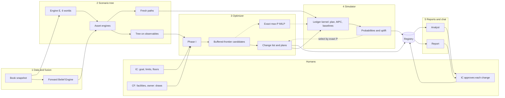

# ADIC TPA Lab: Slim Architecture (engine-first)

**Version** 1.0, 2026-10-19. **Status:** the slim, engine-first architecture the user approved on 2026-10-19, built from five components. It narrows `design/ARCHITECTURE.md` v1.1 and `design/BUILD_SPEC.md` v1.1 rather than replacing them. Where this document is silent they still govern; where it differs (§2.4), this document wins. **Companions:**
- `design/DECISION_SPACE_AND_GOAL_OBJECTIVE.md`: every decision and the objective in full detail;
- `examples/mpo_v2/`: the working prototype of components 2–4, which the build productionizes.

> **SYNTHETIC – NOT ADIC DATA.** Every balance, probability, price and timing here comes from the synthetic book SYN-ADIC-177, the research prototypes or a design default marked [I]. None of it is ADIC data, and none of it may be presented as such.

**Citation keys.**
- SYN = `research/00_SYNTHESIS.md` v1.1
- GROUPS = `research/groups/01_GROUPS_SYNTHESIS.md`
- RA = `research/groups/02_REAL_ASSETS_SYNTHESIS.md`
- LIT = `research/literature/00_LITERATURE_SYNTHESIS.md`
- ARCH = `design/ARCHITECTURE.md` v1.1
- BUILD = `design/BUILD_SPEC.md` v1.1
- TOY = `examples/tree_demo/` (`RESULTS.md`, `verify_finance.md`)

---

## 0. Summary

**The request.** One system that decides across every lever (sell, hold, refinance, lever, add, pace, fund, hedge). It should find the changes that give the greatest probability of reaching the return goal under the IC's limits, and show clearly more value than the toy example.

**Why the toy was thin** (TOY §3, §10; `verify_finance.md`).
- It had three aggregate books with identical beliefs, so there was nothing to select.
- Its CRRA objective was almost flat.
- With three branches a year, P(≥ 10%) moved in leaf-sized steps and read 41.3% in every column.
- The yield book had no levers.
- Its probabilities were read from the tree itself.

It mostly sold liquid assets and drew the revolver, and it beat a simple rule by about $0.04bn.

**What changes.**
1. **Holding-level decisions across the full decision space** (§3.1). About 450 positions in eight groups plus Corporate Finance, each with its own fused forward belief. The definitions are the confirmed ones: REFINANCE = raise cash against a holding without selling it; LEVER = borrow to add exposure.
2. **A goal-seeking objective.** Candidate plans come from the convex *buffered*-probability frontier, which deeper losses cannot game. The system adopts the candidate with the highest exact, out-of-sample probability of reaching 10%. The exact maximum-probability MILP is the comparison, and hard safety guards apply (§3.3–3.5).
3. **An explicit change list plus contingent plans.** Each change has a size, timing, owner, the limit it relieves, a flip threshold and its measured contribution to P(goal).
4. **Out-of-sample probabilities** for the policy that would actually run, against named baselines on common random numbers, with the model range first.
5. **Light governance** (§2). The agentic lab, sealed planes, shadow IC and most governance machinery become optional add-ons.

**What it cannot promise.** Optimization cannot manufacture return the evidence does not support:
- No single lever closes M1's gap to 10% within the evidence (SYN §4.12).
- Evidence-central expected returns are 6.1–10.5% across models, with a mixture of 8.3% [I-calc].

So the value add is *measured, not assumed*. The report states the uplift over the best baseline with a confidence interval, and prints NOT ESTABLISHED when the interval includes zero.

---

## 1. Purpose and the five components

### 1.1 Purpose

The book: ADIC's ~$177bn, about 60% private, with an exogenous 5–10% owner draw that rises when oil is weak, a 10% nominal goal and leverage allowed. Each quarter the system answers four questions:
1. **Is the book safe?** Tier 1: the owner is paid every quarter, liquidity floors hold, the named stress is survived, and no fire sale is forced.
2. **What should change now**, and what would we do next in each state?
3. **How likely is the goal** with those changes, against doing nothing or a rule, and across models?
4. **Why?** Which limits bind, what liquidity costs (λ), which beliefs drive each change, and what each change is worth.

### 1.2 The five components at a glance

| # | Component | Job | In → out | Owner |
|---|---|---|---|---|
| 1 | Data and three-return fusion | Freeze the book; turn three marks per holding into one forward belief | holdings, cash flows, marks archive → `BookSnapshot`, `BeliefSet`, `BeliefDraws` | Data office; CRO office validates; groups file forecasts |
| 2 | Scenario tree | Generate six worlds; reduce them to a tree on observables; keep fresh paths | snapshot, CMAs, initial state → `ScenarioCube`, `Tree`, `GroupRates` | CRO office; CF for draws; groups own engine parameters |
| 3 | Multi-period optimizer | Choose changes now and contingent plans with the highest goal probability under Tier 1 and guards | tree, beliefs, instruments, limits → change list, plans, λ, frontier, MILP comparison | TPA desk; CRO signs Phase I and guards; IC sets limits |
| 4 | Simulator | Measure out-of-sample probabilities for the policy that runs and for baselines | engines, ledger, plan → probability board, uplift, attribution, gambling flags | CRO office certifies; TPA desk builds |
| 5 | Reports and chat | Publish the quarter; answer questions with engine-owned numbers | registry → report, analyst answers, approval record | CIO office; CRO office for entitlements |

### 1.3 The system on one page

### 1.4 Component 1: data and three-return fusion

**Job.** Freeze one hashed snapshot each quarter and give every holding a calibrated forward belief. Only the forward net return on current NAV drives action; since-inception IRR is sunk (SYN L7).

**Inputs.**
- Holdings with cash-flow history, unfunded commitments by vintage, facilities, hedge-fund terms τ and the Level-1 overlay book.
- The quarterly point-in-time marks archive: underwritten, actual and group forecast, each a since-inception net IRR or MOIC with down/base/up cases (ARCH §4.7).
- External secondary bids, which add a market-implied mark.
- Until ADIC data exists: SYN-ADIC-177 R0 on allocation v2, with an archive from 2008.

**Outputs.**
- `BookSnapshot@hash`.
- `BeliefSet@hash`: α̂ (the fused forward log return over the unit's benchmark), σ̂, an 80% band and flags.
- `BeliefDraws` per world.
- A belief card per holding.

**Method** (SYN §4.3; ARCH §4.7).
- **Translation.** Every mark goes onto one basis, the forward log return on nowcast economic NAV net of fees, using the cash-flow history and an exit-timing profile.
- **Fund interests.** Benktander credibility $c^*=p/(p+t)$ from an outside-view prior frozen at inception.
- **Single deals.** Equal or screened weights; GLS only if it wins out of sample (LIT §4.10).
- **Debiasing.** FBE-R bias terms by group, strategy, age and regime.
- **Credibility.** κ_g is estimated on the archive. Stated ranges are widened ×1.8–2.7, forecast precision is capped beyond about 8 quarters, and pools are recalibrated (Ranjan–Gneiting).
- **Group priors** (SYN §4.3; RA §8):
  - hedge-fund α near zero (Jurek–Stafford; LIT §3.9);
  - Private Credit on a fund-age prior;
  - PE weighted to access over selection;
  - co-investment exit multiples shrunk toward entry;
  - Secondaries accretion removed;
  - Real Assets on the desmoothed nowcast with leave-one-out bids.
- **Simulation.** α is drawn once per path with a shared group-bias shock. Tier-1 rows use the posterior P10.

**Why it adds value.** Dispersion across holdings is what lets the optimizer sell a holding whose bid beats its reservation price and add where fused α\* clears the liquidity charge (SYN §4.4). A drought sale of a good asset can be value-maximizing (Dai et al.; LIT §3.6).

**Owner.** The Data office; validated by the CRO office; the groups file forecasts.

**Done when:**
- the IRR/MOIC translation round-trips;
- on the sealed synthetic truth, calibration checks pass and parameters are recovered within ±5pp (V16–V18);
- every card reproduces from hashed inputs;
- flags (stale NAV, zombie NAV, hockey-stick) are populated.

Synthetic data tests correctness only and never chooses the fusion variant (LIT §3.13).

### 1.5 Component 2: scenario tree

**Job.** Generate the exogenous future across six model worlds, and reduce it to a decision tree whose nodes the fund could observe. Keep disjoint fresh paths for component 4.

**Inputs.**
- The snapshot.
- CMA lines for M1–M6.
- Group-owned engine parameters.
- The frozen initial state: regime posterior, exit window (drought 0.87), shock type, F_t, oil from the futures curve and the 12-month draw (SYN §4.1).

**Outputs.**
- `ScenarioCube` per world.
- `GroupRates` per node: rates by group and age bucket, returns, bids, financing terms.
- Exact per-holding cash flows for root columns.
- `Tree`: pooled node probabilities and world-conditional leaf probabilities.

**Method.**
- **Engine E** (SYN §4.1; ARCH §4.1). A regime-switching factor model with standardized t₅ shocks, anchored to fee-consistent CMAs. It carries an exit-window chain, oil/fiscal shock types coupled to the regime, and Brent started from the futures curve.
- **Owner draws.** An exogenous liability, banded 5–10% (Mode B; SYN §4.7; ARCH §4.3).
- **Asset engines** (ARCH §4.4–4.6): fund interests; companies on one overlap graph; contractual claims; the hedge-fund liquidity-term machine; long-only and P2S; the Level-1 overlay; interim Real Assets with asset-level debt.
- **Tree construction.** Nodes are clustered on pooled observables, so recourse cannot learn which model is true (ARCH §5.4). The tree is reduced by filtration distance (Heitsch–Römisch; LIT §3.1), with tails oversampled by likelihood weights.
- **Stages.** Quarterly, then semiannual, then annual to the horizon H (default 5 years [I]). Terminal values ω and ψ come from regression (ARCH §5.12).

**Owner.** The CRO office; Corporate Finance for draws.

**Done when:**
- CMA anchors hold within 5bp, and the drought and dwell targets pass (SYN §7.1);
- the root decision is stable in at least 4 of 5 trees and across horizons (ARCH §5.13);
- fixture trees reproduce the simulator's cash path to 1e-9;
- the no-arbitrage check passes.

### 1.6 Component 3: the multi-period optimizer at scale

**Job.** Choose this quarter's changes and contingent plans to give the highest probability of the goal under Tier 1 and the guards (§3.3–3.5). Price liquidity and name the binding limits.

**Inputs.**
- The tree and beliefs.
- The instrument library with admissibility (§3.1; ARCH §4.8).
- The IC's goal and limits.
- The consent scenario: which facilities are signed, and whether the owner band exists.

**Outputs.**
- The change list and contingent plans.
- λ by node with binding-limit prices.
- The frontier.
- The MILP comparison.
- The Phase-I verdict.
- The safety filter's "what changed" record.

**Method.** A stochastic linear program on the tree. Rows H1–H7 of ARCH §5.4 use the simulator's ledger code. Root columns are holding-level: SELL fraction, REFINANCE draw by instrument, LEVER or ADD size, pacing by group. Recourse is by group and age bucket. Every cost is charged once, in cash. The steps:
1. **Phase I.** Minimum violation over reversible levers per consent scenario, with no PE, Secondaries or Co-investment sales; restore before reading any price (SYN L15; ARCH §5.5).
2. **Candidates.** The buffered-frontier plans, each with its certainty-equivalent tie-break (§3.3). λ, the one price of liquidity, comes from the KKT conditions of the selected plan (SYN L1; ARCH §5.6). Group envelopes (SYN L14) come from the same solve once the icm add-on returns.
3. **Integer restoration.** Minimum tickets, consents, and one action per holding per quarter, via the Level-B MILP with the Γ certificate (ARCH §5.7).
4. **Exact MILP comparison**, variants A and B (§3.4).
5. **Selection.** The candidate with the highest out-of-sample exact P(10%) from component 4.
6. **Safety filter** on every root action and amendment (ARCH §5.8).
7. **Leave-one-out re-solves** for each change.

**Scale.** About 450 root holdings, six pooled worlds and 500–1,000 leaves, which is roughly 200k columns. The problem is assembled in `scipy.sparse` and solved with `highspy`, with five replications in parallel processes. The budget is 120 s each (ARCH §11.5) [I]. The MILP is time-limited and its gap is reported.

**Owner.** The TPA desk. The CRO signs Phase I, the guards and the filter; the IC sets the goal and limits.

**Done when:**
- the identity and `test_no_pinned_duals` tests pass;
- the LP's buffered probability equals `stats.bpoe` on the solution (1e-9), and both LP forms agree;
- the guarded MILP's in-sample P is at least the selected plan's;
- every `LensAction` passes its rules;
- the root is stable, the budget is met, and the same inputs give the same outputs.

### 1.7 Component 4: the simulator for probabilities

**Job.** Measure, out of sample, the outcome distribution of the policy that would actually run, and of the baselines. Nothing is read from the tree (the toy's H2 finding).

**Inputs.**
- Fresh paths: 10k per world for search and 50k for reporting, over M1–M6, plus the bootstrap family B1.
- The engines and ledger.
- The candidate plans, the change list and the baselines.

**Outputs.**
- A probability board per world, with min, max and mixture first.
- Uplift with paired standard errors.
- Each change's contribution.
- Gambling flags.
- The optimism gap.

**Method.**
- **Engine.** The ledger kernel runs forward on common random numbers, with the recourse protocol, CFP stages and red events judged by economic substance (ARCH §4.9, §5.2).
- **Policies:**
  - *plan-following*: root actions now, then each path's nearest tree node, scaled to its state, with the standing rule P0 beyond the tree;
  - *rolling MPC*: re-solve component 3 each year on a 200–500-path subsample;
  - *baselines*: do nothing; the toy's rule; P0; pro-rata; archetypes A, B and C (ARCH §5.10);
  - *the MILP plan*.
- **Metrics.** Exact and buffered P(goal) at H and over 10 years; P(hurdle); P(red); CVaR₁₀%; certainty equivalent; drawdown; survival months.
- **Statistics.** Clopper–Pearson bounds and the ARCH §5.2 gambling detector.
- **Attribution.** Leave-one-out and leave-one-family-out. A contribution needs a paired 95% interval that excludes zero, or it reads NOT ESTABLISHED (a slim form of ARCH §4.13's rule).

**Owner.** The CRO office certifies; the TPA desk builds.

**Done when:**
- results are identical at 1, 4 and 8 workers;
- Clopper–Pearson coverage passes;
- cash is conserved to 1e-10;
- 10k paths × 40 quarters run within 60 s [I];
- every probability carries its model range and Monte Carlo error.

### 1.8 Component 5: reports and chat

**Job.** Publish the quarter in one self-contained report, and let IC members question it without any number leaving engine control.

**Inputs and outputs.** Registry artifacts for one run, pinned by a context handle, produce:
- `report.html`, which works offline;
- analyst answer cards;
- a hash-chained transcript;
- an approval record per change.

**Report sections:**
1. **L0:** exact and buffered P(goal) with model range; the top changes; Tier-1 status; what moved.
2. The change list with decision cards (SYN §4.4).
3. Contingent plans.
4. The frontier and MILP comparison.
5. Uplift and attribution.
6. λ and binding limits.
7. A sensitivity table naming each input's owner (TOY §7).
8. The bridge card (SYN §4.12).
9. Manifests.

**Chat.** One deterministic analyst service (ARCH §8.12; `design/addenda/CHAT_ANALYST.md`, slimmed).
- **Tools:** `resolve`, `holding_card`, `explain_change`, `change_list`, `probability` (registered events), `compare`, `frontier`, `get_metric`, `get_provenance`, and `whatif_draft`, which needs human confirmation and then runs labelled EXPLORATORY.
- The LLM chooses tools and words; a validator rejects any number not fetched in the turn.
- Stub and Replay backends run offline; live calls run on synthetic data only.

**Owner.** The CIO office; the CRO office owns transcripts.

**Done when:**
- every number resolves to a registry metric;
- labelling reaches 100%;
- the decision-and-probability subset of `chat_golden_questions.json` passes on Stub;
- the report rebuilds bit for bit offline.

---

## 2. Guardrails kept, add-ons deferred

### 2.1 The optimizer is objective

**Same inputs, same outputs.** The inputs are:
- the hashed snapshot, beliefs and initial state;
- the scenario seeds;
- the IC's goal, limits and consent scenario;
- the solver options.

Every random number is a pure function of (seed, world, plane, path, month, source, slot, entity) drawn from a keyed Philox stream (ARCH §3.5). Solves are single-threaded with a fixed algorithm, and artifacts carry canonical hashes. So the same inputs reproduce every decision, price and probability bit for bit.

Nothing inside a solve is a judgement call. Judgement lives in the inputs and limits people set, and the report names each owner.

### 2.2 Light guardrails kept

- **Deterministic engines own every number.** The chat LLM chooses tools and words, and a validator rejects any digit not taken from a tool result.
- **Reproducibility and provenance.** Hashed inputs, keyed RNG and deterministic solves. A registry with manifests, metrics and a hash chain gives every report number a `data-ref`.
- **SYNTHETIC labels** as taint on every artifact, a footer on every report section and a label on every answer.
- **Humans set limits and approve.**
  - The IC sets the goal, horizon, limits, floors and model weights.
  - Corporate Finance signs facilities; the owner sets the draw.
  - One approval record covers each change, and nothing executes trades.
- **Feasibility before prices.** Phase I, restored duals only, and the pinned-dual test.
- **Out-of-sample probabilities.** Search paths build the tree; fresh paths measure; the optimism gap is reported.
- **Safety filter** on every root action and amendment, with a "what changed" record.
- **Lens semantics.** `contracts.actions.LensAction` enforces REFINANCE = cash-out and LEVER ≡ ADD + REFI, so the toy's H5 mislabel cannot recur.

### 2.3 Deferred to optional add-ons

| Add-on | Why deferred |
|---|---|
| Full IC Deliberation Module (Register, briefs, ballots, blind pre-votes, signposts) | The IC can deliberate on the report and change list; the protocol adds no number and can sit on the same registry later |
| Shadow IC (computed seats per member view) | It re-runs component 3 per member view, so it waits until the optimizer is fast and stable |
| Agentic research lab (meta-controller, ideators, red team, memo writer, budgets) | The optimizer searches the decision space directly; agent policies become an optional challenger |
| Sealed planes and evaluator processes | They stop agents gaming the simulator; without the lab, the tree/fresh-path split suffices |
| Seal service (commit-reveal seeds, canaries) | Same reason; seeds stay hashed and recorded, so runs stay reproducible |
| mFDR ledger | False-discovery control matters when many agent hypotheses are tested; the table stays unwired |
| Most governance machinery (signed contracts and SignOffs, Register entries, recusal, politics linters, event protocols) | One approval record and the IC's own process suffice for a synthetic lab; re-add before production |
| icm (FTP, envelopes, DVA), robustness beyond model ranges, Shapley, Level-2 overlay, SDDP, MCP server | Not needed to produce and test decisions and probabilities; each plugs into the same contracts later |

### 2.4 What changes relative to ARCHITECTURE v1.1

| ARCH v1.1 | Slim design | Why |
|---|---|---|
| P(10%) is "never maximized" (rule 4; §5.2) | Plans come from the buffered frontier and are chosen by exact out-of-sample P(goal); the unguarded exact maximizer appears only as the comparison MILP | The user's request; the anti-gambling intent survives in the measure, the floors and the detector |
| Shortfall exponent > 1; no probability term | A hinge objective with no indicator but a linear shortfall weight, so guard G3 is hard | Linear shortfall can reproduce probability maximization (Krabichler et al.; LIT §4.7) |
| Tier 2: CRRA with an L2 shortfall | CRRA becomes the tie-break | One goal term |
| A 28-day cycle with lab, seal and shadow IC; 31 increment-1 work packages | A 10-working-day cycle (§4); about 20 slimmed packages (§5) | Engine-first |

Everything else in ARCH §4–5 carries over in reduced form: engines, ledger, Phase I, duals, the safety filter and the error ledger.

---

## 3. The decision space and the goal-seeking objective

### 3.1 The full decision space at a glance

The detail lives in `design/DECISION_SPACE_AND_GOAL_OBJECTIVE.md`: every instrument's cash-flow template, admissibility, lead time, capacity, pricing rule and test, plus the derivation of the objective. Economics come from SYN §4.4–4.6, GROUPS §2.3 and §3, and RA §7 [I unless sourced there].

| Lens | Instruments by group | Key economics and limits |
|---|---|---|
| **SELL**: exposure down, cash in | PE LP sale or strip; Secondaries tertiary sale; Co-investment single-asset sale; Capital Solutions syndication; Private Credit loan sales, LP interests, evergreen tenders; queued HF redemptions; long-only sales; RA LP sale, open-end redemption, JV sell-down; tail monetization | Hedonic bids (buyout 0.91 normal; crisis 0.80–0.84 of economic NAV); depth ≤ 5% per half-year; a red-tier sale in stress is a red event (T6) |
| **HOLD** | CV elections; SMA run-off switch; Capital Solutions amend or enforce; RA cure or hand-back | CV offers are GP-triggered events, not controls |
| **REFINANCE**: cash against a holding, exposure unchanged | Revolver draws, term debt, repo; capacity-capped LP NAV facility (≈$2.1bn), preferred equity, CFO; Capital Solutions back-leverage (D/E ≤ 0.5); Private Credit SMA back-leverage; RA cash-out at maturity (control only); long-only P2S | Refinance iff spread + fees/T + leverage dual + covenant charge + ≈1.1pp tightening premium < ℓ̄; a NAV loan beats a sale only if repaid within ≈2 years |
| **LEVER**: borrow to add exposure (≡ ADD + REFINANCE) | Completion beta within 1.30× exposure; portable alpha; HF-TRS; co-investment holdco PIK (benign regimes); SMA leverage for new loans; RA asset debt (control); revolver draws that fund purchases | Lever iff α\* − risk charge > all-in financing; never lever PE; leverage at the cap destroys value in M6 |
| **ADD**: exposure up with cash | Secondaries discount purchases (discount > 20%, Tier 1 green); co-investment acceptance; new money and loans; HF and long-only adds; opportunistic scale-up | Add iff α\* − ℓ̄ − risk charge > 0; winner's-curse haircut 4.2–5.1% |
| **PACE** | Commitments per group per year | Green 0.75–1.25×, Amber 0.25–0.5× with a protected core; no liquidity credit for 2 quarters; costs forgone net α (≈8.6¢ per $ for PE) |
| **Fund** (CF) | Arrange and size the revolver ahead of need (2-quarter lead); reserve target; term debt | SOFR + 85bp drawn, 15bp undrawn; 0% credit in 30-day rows; ≤ 50% in the joint oil–crisis stress (LIT §4.3) |
| **Hedge** (Overlay) | Tail-ladder size within the IC's 0.15–0.50%-of-NAV annual premium budget; monetization; opportunistic budget | Valued as liquidity plus enabling value; must beat an equal-cost cash buffer (LIT §3.10) |
| **Not decisions** | Owner draw (Mode B); GP calls and distributions; CV offers; gates | Exogenous |

*SYNTHETIC – NOT ADIC DATA.*

**Placement in the tree.** Root columns are per holding, and recourse is per group and age bucket.

**Admissibility** (ARCH §4.8).
- At most one action per holding per quarter.
- Consents and lead times apply.
- HF notices go only on notice dates.
- LP-accessible instruments only.
- No REFINANCE, LEVER or HEDGE on RA LP or minority holdings.
- Intra-ADIC transfers raise no liquidity.

**Why this space adds value where the toy could not.**

| Mechanism | Basis | Toy |
|---|---|---|
| Sell or refinance holdings whose bids beat their reservation price; add where α\* clears the charge | SYN §4.4; LIT §3.6 | One belief per book |
| State-dependent liquidation order; early planned sales and term funding in a drought | Duffie–Ziegler (LIT §3.5, §4.4) | Liquid first |
| Facilities arranged in benign states, drawn in crises | LIT §3.5; SYN L2 | Never sized |
| Dry powder: secondaries bought at crisis nodes | LIT §3.7, §4.16 | No crisis purchases |
| Pacing by group and state | SYN finding 4 | Rarely chosen |
| Leverage only where it raises buffered P(goal) inside the floors | SYN §4.5, §4.12 | Zero |
| Yield-book levers (SMA run-off, loan sales) | GROUPS §2.3 | Missing |
| A goal-sensitive objective | SYN L9 | Flat CRRA |

### 3.2 The goal

**Definition.** g = 10% a year: nominal, net of fees and financing, distribution-inclusive (a time-weighted return; ARCH §4.0; OPEN_DECISIONS item 5). It is measured over the plan horizon H, and the simulator also reports the 10-year window. A protective goal is the real-preservation hurdle: 7.9% at a 5% payout (SYN §2.3(a)).

**Notation.**
- Target wealth: $W^*=W_0(1+g)^H$.
- Distribution-inclusive leaf wealth $\widetilde W_\ell(x)$ is affine in the decisions, because distributions accrue at each scenario's exogenous static-portfolio return (ARCH §5.4).
- Shortfall: $L_\ell(x)=(W^*-\widetilde W_\ell(x))/W_0=c_\ell^\top x+e_\ell$.
- Leaf probabilities pool the worlds: $p_\ell=\sum_m w_mp_{\ell|m}$.

The exact probability, $P(x)=\sum_\ell p_\ell\,\mathbb 1\{L_\ell(x)\le0\}$, is non-convex and pays nothing for how far a miss falls. That is why maximizing it replicates a digital option (SYN L9).

### 3.3 The buffered-probability objective

$$\bar P(x)=1-\mathrm{bPOE}_0\big(L(x)\big)=1-\min_{a\ge0}\sum_\ell p_\ell\,\big[1+a\,L_\ell(x)\big]^+$$

This follows Mafusalov–Uryasev, as implemented in `stats.bpoe`. **In words:** P̄ = 1 − q, where q is the size of the worst slice of outcomes whose *average* just meets the goal.

**Properties.**
- **Conservative:** P̄ ≤ P. P̄ falls far below P when the goal sits near the mean, so the exact probability is always reported beside it.
- **Depth-aware:** deepening a miss never raises P̄, and lowers it whenever P̄ > 0, so a plan cannot buy P̄ by sacrificing bad states.
- **Recognized:** it is the CVaR satisficing measure of Brown and Sim (2009), from SYN L9's robust-satisficing discipline, and it reads as a probability (Dang et al. 2025; LIT §4.7).

**One linear program.** Let $\mathcal X=\{x:Ax\le b\}$ hold every Tier-1 row and guard. The Charnes–Cooper substitution $y=a\,x$, $t=a$ gives

$$\min_{y,\;t\ge0,\;u\ge0}\ \sum_\ell p_\ell u_\ell\quad\text{s.t.}\quad u_\ell\ge 1+c_\ell^\top y+e_\ell\,t,\qquad Ay\le b\,t$$

with $\bar P^*=1-$ the optimum and $x^*=y^*/t^*$. Bisection on q over CVaR LPs gives the same answer, because $\mathrm{bPOE}_0(L)\le q\iff\mathrm{CVaR}_{1-q}(L)\le0$. Both forms are built and tested against each other.

**Frontier.** The same LPs trace one curve, read two ways:
- P̄\*(g): the best buffered probability for each goal g;
- ĝ\*(p): the highest goal reached with buffered probability p, which maximizes the average of the worst 1 − p of outcomes.

The two readings agree: P̄\*(g) ≥ p ⇔ ĝ\*(p) ≥ g. The report shows the hurdle, 8%, 9%, 10% and 11%.

**When 10% sits above what the book can expect.** If no feasible plan's expected wealth reaches W\*, then P̄\* = 0 for every plan. That is a fact, not a defect. For any convex bound φ ≥ 𝟙{L > 0}, Jensen gives E[φ(L)] ≥ φ(E[L]) ≥ 1 whenever E[L] ≥ 0. Above the mean, probability rises only through added dispersion, which is gambling. Several worlds may sit there, because the bridge reads 10% as a Plan only in M2 (SYN §4.12).

**Choosing the plan: frontier search.** The buffered frontier is the search space, and exact probability is the selection criterion.
1. **Candidates.** The P̄\*(10%) plan when it exists, plus the ĝ\*(p) plan for p on a grid from 5% to 95%. Each is one convex LP under every guard, and none rewards deepening losses.
2. **Evaluation.** Component 4 measures each candidate's exact P(10%) out of sample.
3. **Adoption.** Adopt the candidate with the highest exact P(10%) that passes the guards and the gambling detector, with ties going to the higher certainty equivalent. The IC may instead fix p.
4. **Disclosure.** When P̄\*(10%) = 0, say plainly that 10% is not buffer-reachable under these limits, with the bridge's gap.

**A check made while writing this document** [I-calc, SYNTHETIC; scratch script `check_frontier_search.py`]. On three assets with leverage to 1.3×, 600 tree scenarios and 20,000 fresh paths:
- the frontier search recovered the guarded MILP's plan, at 19% exact P(10%) out of sample;
- the unguarded MILP reached 33% by levering to the cap, while the CVaR₁₀% of wealth fell from 0.67 to 0.30;
- a fixed p = 50% would have given 16%.

**Tie-break and prices.** Each candidate is solved twice. The first pass finds its goal value. The second holds that value within δ (0.5pp [I], written as a CVaR row) and maximizes the piecewise-linear CRRA(3) certainty equivalent (ARCH §5.4). That removes unpaid risk, and its duals give λ in ordinary units.

**Pre-commitment.** The tree's contingent plans are one pre-committed plan (Forsyth 2020; LIT §3.2; `TargetMode.PRECOMMITTED`), which the IC adopts as its contingent plan (Garlappi et al.; LIT §3.12). Guards G3 and G5 police the catch-up incentive after losses. The rolling target is a sensitivity.

### 3.4 The exact maximum-probability MILP (comparison)

$$\max_{x\in\mathcal X,\;z\in\{0,1\}^{|\mathcal L|}}\ \sum_\ell p_\ell z_\ell\quad\text{s.t.}\quad\widetilde W_\ell(x)\ge W^*-M_\ell(1-z_\ell)$$

Here $M_\ell$ is a big-M constant taken from wealth bounds. The MILP runs in two variants on the same tree:
- **A, with every guard.** This is the in-sample ceiling on P within the same limits; its gap to the buffered plan is the *price of buffering*.
- **B, with Tier 1 only.** This exposes the pathology.

HiGHS solves it with a time limit and reports the gap. If it does not close, it runs on a reduced tree with the same root.

It is never the decision. In SYN L9's toy, maximizing P lifted P(target) from ≈34% to ≈68% while buying a ≈4.6% chance of a loss above 40% [I]. Both plans go through component 4, so the IC compares them out of sample.

### 3.5 Safety guards

| Guard | Stops | Form and place |
|---|---|---|
| G1 Tier 1 | Buying probability with solvency | T1 payout every quarter; T2 cash 4% hard, 8% priced; T3 30-day coverage; T4′ 24-month stress; T5 exposure ≤ 1.30×, debt, encumbrance, LR8; T8. Hard rows, certified in 4 |
| G2 Red events | Forced private sales in stress | T6 CVaR surrogate per model class; economic-substance test |
| G3 Downside floor | Sacrificing the worst states | CVaR₁₀% of the horizon return ≥ a floor per world, banded by class (ARCH §5.2); optionally P̄(hurdle) ≥ p₂. Hard rows, re-certified out of sample with tuned buffers (ARCH §5.3), because in-sample floors can slip on fresh paths |
| G4 Depth-aware objective | Digital payoffs | The buffered probability |
| G5 No doubling down | Catch-up risk | After a loss (an exogenous node condition), exposure, leverage and illiquid adds may not exceed the parent's |
| G6 Gambling detector | Leakage | Risk rising after losses; leverage at the cap while behind; bimodal wealth; P(goal) rising with a flat median. Hard signatures fail the plan |
| G7 Leverage doctrine | Unpaid leverage | The LEVER rule; never PE; RA control gate |
| G8 Out of sample | Optimism | Fresh paths only; optimism gap shown |
| G9 Feasibility first | Mispricing | Phase I; no pinned duals |

**Why G3 must be hard.** Goal-seeking leans on leverage, since a safety-first ratio rises with leverage whenever the target exceeds the financing rate. In the research, leverage at the cap buys the most P(10%), +7.6pp in M1, yet destroys value in M6 (SYN §4.12) [I-calc]. The per-world floor binds there.

**The program, in order.**
- Level 0: feasibility.
- Level 1: survive (G1, G2).
- Level 2: protect (G3, G5).
- Level 3: seek, through the buffered-frontier candidates, selected by exact out-of-sample P(10%).
- Level 4: tie-break on certainty equivalent.
- Then report the exact probabilities, from the MILP in sample and the simulator out of sample.

---

## 4. One quarter, end to end

The IC meets on day T; the cycle takes ten working days.

| Day | Component and step | Output (hashed) | People |
|---|---|---|---|
| T−10 | 1: groups file forecasts (IRR or MOIC with cases); CF files cash, facility and draw data; freeze | `BookSnapshot` | Data office |
| T−9 | 1: translate, debias, fuse; credibility; flags | `BeliefSet`, `BeliefDraws` | CRO office reviews flags |
| T−9 | 2: initial state; six-world cubes (search and fresh); node rates; tree | `StateSnapshot`, `ScenarioCube`, `Tree` | CRO office |
| T−8 | 3: Phase I per consent scenario; mode | `Phase1Result` | CIO and CRO |
| T−8 to T−7 | 3: frontier candidates with tie-breaks, integer restoration, MILP comparison | Candidates, `HSolution` | — |
| T−7 to T−6 | 4 and 3: candidates, rolling MPC and baselines on fresh paths; select by exact P; safety filter; leave-one-out; gambling detector | Change list, plans, probability board | CRO office certifies |
| T−5 | 5: report from registry metrics; analyst indexes the run | `report.html` | CIO office |
| T−5 to T | 5: members ask; what-ifs confirmed by a human, run as EXPLORATORY | Transcripts | IC members |
| T | Approve, amend (through the filter) or reject each change | Approval record | IC |
| After T | Named humans execute; outcomes recorded; forecasts scored | — | Groups, CF |

**What the IC receives** (illustrative shapes, not results).
- **Here-and-now changes**, for example:
  - sell 40% of a named buyout fund whose bid beats its reservation price;
  - refinance through Capital Solutions back-leverage;
  - cut PE pacing to 0.75×;
  - arrange a revolver of a stated size;
  - lodge HF notices.
- **Contingent plans**, for example: "if drought persists and the event stage reaches Amber, cut PE pacing to 0.5×, draw the revolver and switch on the SMA run-off; in a demand bust with weak oil, monetize the tail and buy secondaries if discounts exceed 20% and Tier 1 is green."
- **Probabilities and reasons.** Exact and buffered P(10%) for the plan, the baselines and the MILP plan, each with its model range, plus λ, binding limits and flip thresholds.

---

## 5. Slim build plan

### 5.1 Wave-0 code to reuse (`src/adic_tpa/`)

| Module | Used for | Status (2026-10-19) |
|---|---|---|
| `contracts` | `BookSnapshot`, `Holding`, `Mark`, `ForecastRecord`, `BeliefSet`, `BeliefDraws`, `BridgeCard`, `StateSnapshot`, `ScenarioCube`, `Tree`, `GroupRates`, `LPModel`, `Phase1Result`, `HSolution`, `DualSet`, `SafeAction`, `LensAction`, `DecisionCard`, ledger and engine I/O, analyst contracts, `TargetMode`, hashing, taxonomy v2 | WP-01 green (728 tests) |
| `rng` | Keyed Philox streams: common random numbers across plans, baselines and worlds | Implemented; review pending |
| `numerics` | PWL utility tangents, roots, correlation repair | Implemented; review pending |
| `stats` | `bpoe` and `cvar` (the objective's oracle), Clopper–Pearson, paired bootstrap, certainty equivalent | Implemented; review pending |
| `testing` | Mini books, mini cube, fixture trees, fixture H, fakes, golden loader, walking skeleton | Implemented; review pending |
| `registry` | Runs, metrics, artifacts, hash chain, provenance (mFDR unwired) | Review found one critical and two high findings; fix before component 5 |

### 5.2 BUILD_SPEC work packages that remain (slimmed)

- **Component 1**
  - WP-05 `data`: freeze and hash, the archive schema, taint.
  - WP-14 `beliefs` and `bridge`: the FBE and the bridge card.
  - WP-15 `synth`: SYN-ADIC-177 R0 with the archive and the increment-1 V-gates.
- **Component 2**
  - WP-06 `scen`: M1 and M6 first, then M2–M5 from WP-31, plus B1.
  - WP-07 `state`: the initial state only.
  - WP-08 `owner`: Mode B.
- **Engines behind components 2 and 4**
  - WP-09/10 `priv`: fund, company, claims, credit and interim RA, with recourse and unit financing.
  - WP-11 `pub`.
  - WP-12 `overlay`, Level 1 only.
  - WP-13 `ledger`: kernel, ladder, T4′ replica, CFP stages, linear rows.
- **Component 3**
  - WP-16 `actions`: the instrument library, admissibility, column flows, cards.
  - WP-18 `core.tree` and `core.h`, plus a new `core.goal` (buffered LP, frontier, MILP, tie-break).
  - WP-19 `core.select`: Level B, Γ, the safety filter, the change list.
  - WP-20 `core.mpc`, without icm.
- **Component 4**
  - WP-17 `core.sim`: policies, baselines, certification, the gambling detector.
  - WP-23 `attrib`: leave-one-out only.
- **Component 5**
  - WP-25 `claims`: renderer and validator only.
  - WP-28 `report`: a slim HTML report and its linter.
  - WP-39 `analyst`: a slim version.
  - WP-29/30 `cli` and `pipeline`, slimmed.

The new contracts (`GoalSpec`, `ChangeList`, `FrontierCard`, `MILPComparison`, `ApprovalRecord`) are added by ADR. No frozen contract changes.

### 5.3 Dropped or deferred

- **Lab and agents beyond the analyst:** WP-25 roles, WP-26, WP-38.
- **Evaluator, planes and seal:** WP-24, WP-34.
- **Full IC room and pack:** WP-27, WP-35, plus the view conditioning and console of WP-28 and the MCP server of WP-29.
- **Policy DSL and search:** WP-21.
- **Robustness beyond model ranges, Shapley, Level-2 overlay and production presets:** WP-22, WP-36, WP-32, most of WP-33.
- **icm**, from WP-20.
- **B2 and the misspecification plane, real-data adapters, analyst v1, the public-data snapshot:** part of WP-31, WP-37, WP-40, WP-41. WP-41 is the cheapest early add-on, because it needs only someone with network access.

### 5.4 Order

| Step | Content | Exit | Indicative [I] |
|---|---|---|---|
| S0 | Close wave 0: fix registry R01–R03, finish the WP-02 and WP-03 reviews, tag contracts, ADR for the new contracts | Wave-0 suites green | 1 week |
| S1 | Port `examples/mpo_v2` into `core.tree`, `core.h`, `core.goal`, `core.select` and `core.sim` on fixtures; slim walking skeleton (snapshot to report stub) | Prototype results reproduced as golden regressions | 1–2 weeks |
| S2 | `synth`, `data`, `beliefs`: holding-level beliefs | Component 1 done | 3–4 weeks, parallel |
| S3 | `scen`, `state`, `owner`: tree from E | Component 2 done | parallel with S2 |
| S4 | `priv`, `pub`, `overlay`, `ledger`: simulator on real engines with baselines | Identity, conservation, budget | overlaps S2–S3 |
| S5 | `actions` into `core.h`: full space, consent scenarios, Level B, filter, change list, MILP at scale, benchmark | Component 3 done | 2 weeks |
| S6 | Report, analyst, CLI, pipeline | §5.5 acceptance | 2 weeks |

**`examples/mpo_v2` → production.** The prototype is the reference for components 2–4:
- its tree builder becomes `core.tree`;
- its optimizer becomes `core.h`, `core.goal` and `core.select`;
- its simulator becomes `core.sim`;
- its parameters become owned configuration;
- its results become golden files (BUILD §10.5).

Its numbers are SYNTHETIC. The build re-derives them through the production engines and treats any difference as a finding, not something to tune away.

**Toy pitfalls the build must avoid.**
- End-of-horizon artefacts (H1): add Tier-1 rows and terminal values at the leaves, and run the horizon test.
- A hard IC range driving the answer (H3): make ranges elastic and priced.
- Mislabels (H5): enforce the `LensAction` rules.
- In-sample probabilities (H2): use the simulator and the MPC subsample.
- An unmeasured value add: report paired intervals against baselines.

### 5.5 Acceptance for the slim build

The command `.venv\Scripts\python.exe -m adic_tpa run quarter --asof 2026-10-18 --synthetic --offline` must:
1. exit 0 within 30 minutes;
2. reproduce every artifact hash on rerun;
3. resolve every report number to a registry metric, with 100% labelling and no network;
4. hold every Tier-1 row at every node and in simulation;
5. pass the identity, pinned-dual, lens and bPOE-oracle tests;
6. report ΔP(10%), ΔCE and ΔP(red) against the best baseline with paired 95% intervals, per world and pooled, printing NOT ESTABLISHED where an interval includes zero;
7. raise no hard gambling signature;
8. pass the analyst golden subset on Stub.

---

## 6. Risks and open items

1. **Degenerate goal.** If no plan can expect 10%, P̄ is zero. The frontier search still picks the non-gambling plan with the highest exact probability, and the report must frame the zero as the finding.
2. **Leverage pressure.** Goal-seeking pushes toward the 1.30× cap. The G3 floors and M6's weight decide how far, and the IC owns both.
3. **Terminal values.** ψ moved the toy's certainty equivalent by −$1.34bn (TOY §7). ω and ψ need the regression estimate and the horizon test.
4. **ADIC data** (OPEN_DECISIONS A1, C6, D8). HF terms τ, PE commitments by vintage, facility terms, the owner band and draw convention, and RA debt tapes.
5. **Scale.** If the MILP does not close at production size, it runs on a reduced tree and reports its gap.
6. **Policy mapping.** The rolling-MPC subsample measures the nearest-node approximation.
7. **Shared model structure.** All worlds share one factor architecture (ARCH §4.1); B1 is only a partial check.
