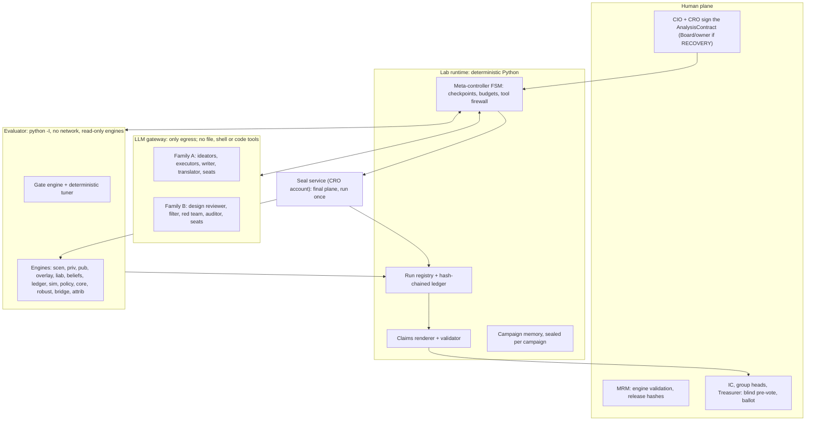
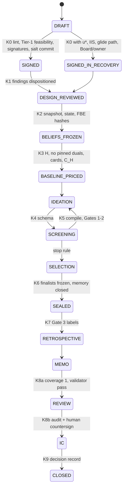

# Proposal PB: Agentic-laboratory first

*ADIC Agentic Total-Portfolio Laboratory: architecture proposal, angle PB. 2026-10-18.*

> **SYNTHETIC-DATA NOTICE.** No ADIC data was used. Every book-level balance, probability and cost below comes from the working allocation (CTX §1A), census v1.0 (GRP §6) or the research prototypes, and is labelled SYNTHETIC. On what *The Agentic Scientist* does and does not do, BR §2 and LC govern; paper facts cite the local text by line (AS l.N).

**Keys.** BR = brief · CTX = context file · SYN = synthesis v1.1 · GRP = groups synthesis · gap_01–05 = addenda · LC = local paper check (M1–M14 are its mapping issues) · AS l.N = paper line · BP = user blueprint · LIT12 = agentic-AI literature check. Tags: [S] sourced, [C] corrected, [I] design default, [I-calc] research computation on the synthetic book.

---

## 1. Thesis

The laboratory is the system, and the quant engines are its instruments. Each quarter ADIC runs one pre-registered research campaign. Humans sign an AnalysisContract that fixes the objective, the Tier-1 gates, the admissible actions, the frozen controls, the evaluation planes and the budgets. A deterministic meta-controller executes the contract, and a sealed, content-hashed evaluator service owns every number, count and gate. LLM agents act only by emitting typed artifacts: anchored-residual PolicySpecs, ActionPackages and OverlayStructures. Their action space is therefore a schema, not a codebase, and they never see a path, a seed or a final-plane result. Agents choose the structure of an idea; deterministic tuners choose its numbers. Every candidate, including the optimizer's own recommendation, must pass three engine-owned gates (correct, selection, qualification). It must also survive one sealed run on worlds the search never touched, against controls frozen before search. An exact switch-off null control then separates the fixed scaffolding from what search added. That is the construction the paper's own CMA-ES study used to show that scaffolding supplied 55.8% of its margin (AS l.2657-2663, l.2687-2700). What reaches the IC is rendered from the run registry, audited by a different model family, and labelled QUALIFIED, NOT_QUALIFIED or NOT_ASSESSED. The paper enforced most of this by prompt, inside "a cooperative research-code contract, not an adversarial sandbox" (AS l.7489-7490). ADIC enforces it with process boundaries, permissions, hashes and commit-reveal seeds, because its evaluator is a model of the future that unconstrained search will exploit (SYN L12).

---

## 2. Requirements and principles trace

| # | Where | How satisfied |
|---|---|---|
| R1 | §4.10 | A 12-quarter here-and-now LP (H) sets this quarter's actions. A 40-quarter standing policy P0, plus searched residuals, governs later quarters. MPC re-solves quarterly, and every candidate is evaluated over 40 quarters |
| R2 | §4.3, §5.7 | Search runs on 5 worlds from 2 generator families. Sealed qualification runs on 15 worlds, including a held-out generator and 6 misspecification variants. Non-inferiority to HOLD in every world sits inside `correct` |
| R3 | §5.10 | Every probability is rendered with its central value, model range, Monte Carlo (MC) error, Clopper–Pearson (CP) bound and ICD-203 word |
| R4 | §4.8 | Owner draw $D_y=\mathrm{clip}(f(\text{oil},\text{fiscal},Z),5\%,10\%)\times B_y$, an exogenous liability; Tier-1 row T1; a mandate switch prices the owner band |
| R5 | §4.1, §4.11 | The metric is the 10-year geometric TWR, nominal, gross of distributions. J carries an L2 shortfall to 10% target wealth. P(10%) is reported only. WYNTB bridge per model |
| R6 | §4.6, §4.8 | A LEVER lens per group; a cushion-monotone leverage slot capped at 1.30×; Corporate Finance (CF) facilities in H |
| R7 | §4.4 | Drought-keyed private engines with exit states O/N/D/F; group cash map; T4′; CFP stages |
| R8 | §4.6, §5.4 | One kernel scores ≈1,600 single-asset lens actions; ActionPackages cover non-separable combinations. REFI = cash-out, LEVER = exposure-up |
| R9 | §4.5 | The Forward Belief Engine (FBE) fuses the three marks plus a market-implied anchor, with credibility per group |
| R10 | §4.7 | Overlay as a position layer; OV1–OV3 inside `correct`; OverlayStructure as an idea type |
| R11 | §5 | The paper's pipeline is mapped stage by stage and enforced by infrastructure |
| R12 | §6 | 12-seat shadow IC; blind human pre-vote; agenda by portfolio, group and lab; grounded Q&A; views; decision log |
| R13 | §4.11, §5.9 | The two tiers become the gate order. v8's rules are a frozen control. The state engine becomes the F_t panel. v8's attribution survives only as `test_v8_replica` |
| R14 | §3, §4.9, §6 | Every artifact carries a group tag. Engines and lenses are group-specific. Envelopes and FTP come from one LP. CF owns the ledger, facilities, collateral, payout and λ |
| R15 | §7 | SYN-ADIC-177: sealed truth, simulation-based calibration (SBC), V1–V23, labelling with taint propagation |

| # | Mechanism | Enforced by (infrastructure, not prompt) |
|---|---|---|
| P1 | Agents emit no reportable numbers; tuners own parameter values | Placeholder renderer + digit-rejecting validator; evaluator-only tuning; no agent holds a trade tool |
| P2 | Out-of-process, hashed evaluator; the ledger counts every call; stale caches stop evaluation | Process boundary, read-only mounts, per-request hash check, hash-chained ledger |
| P3 | Planes fixed and hashed at signing; final seeds by commit-reveal; embargoed calibration | CRO-owned seal service; ACLs; memory writes closed before SEALED |
| P4 | Typed IdeaBundles; ≤3 validation retries; engine-counted budgets; deflation reported | Strict schemas; ledger; typed BUDGET_EXHAUSTED |
| P5 | Gate 1 `correct` (non-inferiority to HOLD, worst world); Gate 2 selection (a tie keeps the incumbent); Gate 3 qualification (`not_qualified` is valid) | Evaluator and seal-service code; rubrics are diagnostics |
| P6 | Frozen controls at 3/5/10 years; placebo; exact null control; ablations with no tuning | Contract hash; DSL identity rule; evaluator refuses to tune ablations |
| P7 | "Resolves" is deterministic; "supports" is audited by family B from logs and diffs; provenance map | Renderer and validator; auditor allowlist |
| P8 | Humans sign contracts; agents only draft amendments | FSM signature guard; no agent has a `sign` tool |
| P9 | Plain-Python FSM; 2 workers (configurable to 4); memory per campaign; escalation | FSM; memory ACL and lifecycle; `escalate` tool |
| P10 | Family B for review, red team and audit | Backend routing; family-collision check after any fallback |
| P11 | SeedSequence; manifests with every hash; replay | ReplayBackend reproduces campaigns bit for bit |
| P12 | Engines and tests run offline; stub and replay backends | CI runs a full campaign offline |
| P13 | Aggregates and IDs in prompts; extractors have no outbound tools; in-region serving | Gateway redaction filter; role allowlists |
| P14 | Cards show binding rows, shadow prices, marginal value, attribution and flip points | Card generator in `core/` |
| P15 | Anonymous scenarios; no ID, date, horizon or budget variables; synthetic data labelled | DSL compiler; taint propagation |

---

## 3. System decomposition



| Module | Responsibility (in → out) | Type | Owner | Interfaces |
|---|---|---|---|---|
| `contracts/` | Pydantic v2 schemas for every artifact | Det | CIO office; MRM | All |
| `data/` + adapters | Bitemporal store, snapshots, taint, transfer netting (sources → `Snapshot@hash`) | Det | Data science; groups and CF as data owners | Engines |
| `synth/` | SYN-ADIC-177 world, sealed truth, observation; V1–V23 | Det | Data science; MRM | data, evaluator |
| `scen/`, `state/` | Families F1–F3, vol states, owner-draw driver, F_t, initial state | Det | Risk (CRO office) | sim, core |
| `priv/`, `pub/` | Three private engines; hedge-fund term machine; long-only | Det | TPA desk (CIO office); group heads sign calibrations | sim, core, ledger |
| `overlay/` | Templates, surfaces, SIMM-like IM, OV1–OV3, collateral | Det | Overlay (positions), Risk (IM), CF (collateral) | ledger, gates |
| `liab/`, `ledger/` | Owner draw and mandate switch; liquidity ledger, LR1–LR8, CFP, cushion | Det | Corporate Finance | core, gates |
| `beliefs/` | FBE, market anchor, forecast registry, credibility | Det | CRO office | priv, core, bridge |
| `sim/`, `policy/` | Cohort simulator; P0, controls, DSL compiler | Det | TPA desk; controls frozen by CIO + CRO | evaluator |
| `core/` | Phase I, H LP, duals, kernel, scoring, MILP, envelopes, FTP, module F | Det | TPA desk; CF publishes FTP; TPC/IC approves envelopes | evaluator, IDM |
| `robust/`, `bridge/`, `attrib/` | R1–R8, k_MS; WYNTB; null control, Shapley, DVA | Det | Risk; CIO office | claims |
| `evaluator/`, `seal/` | Planes, gates, tuner, ledger, budgets, caches; salt custody and final runs | Det | MRM-validated; seal owned by the CRO office | lab, registry |
| `lab/` | FSM, roles, memory, escalation, LLM backends | Det control, agentic roles | CIO office; MRM inventories it as an AI system | evaluator, claims |
| `claims/`, `idm/`, `pack/` | Registry, renderer, validator; shadow IC, ballots, decision log, HTML pack | Det + agentic auditor and seats | CRO office; IC secretariat | forecast registry |

---

## 4. Quant core: the evaluator's instruments

The engines are deterministic, versioned services behind the evaluator boundary (§5.2), and agents never edit them. Designs follow SYN §4 and GRP §3; this section fixes interfaces and sizes the computation.

### 4.1 Time grid and the meaning of 10%

- **Clock.** Decisions are quarterly over 40 quarters. The generator steps monthly. The ledger runs monthly for quarters 1–8, which covers rows T3 and T4′, and quarterly after that. The overlay takes daily sub-steps only in flagged stress windows. Horizons of 12, 20 and 40 quarters are declared in advance (AS l.6678-6679).
- **The 10% target** is the 10-year geometric TWR, nominal USD, gross of distributions. That equals distribution-inclusive wealth when distributions accrue at the fund's own return (SYN §4.9, §9.3 item 2). Net growth, real return and owner IRR are also reported.
- **P(10y ≥ 10%)** carries its model range and enters no objective (SYN L9). On the working book the evidence-central expected return is 6.1–10.5% (mixture 8.3%), and P(10y ≥ 10%) is 20–54% [I-calc; SYN finding 1]. SYNTHETIC.

### 4.2 State representation and memory budget

| Block | Per-path state (float32) | Floats |
|---|---|---|
| Private cohorts, 300–500 (strategy × vintage × region × sector) | Economic and reported NAV; unfunded; effective age; NAV-loan balance; quality; ≤5 credit shares or accreted claim | ≈3,600 |
| Hedge-fund lots (40) | State X, request, queue position, times gated, holdback, side pocket | ≈240 |
| Long-only (24) + overlay (≈30 templates, 12 CSAs) | NAV and P2S notional; Greeks; IM and VM by CSA | ≈170 |
| CF / Treasury | Cash, HQLA, facilities, debt, encumbrance, draw basis, payout year to date, CFP stage, cushion c_t | ≈20 |
| Observable beliefs + trackers | Filtered posteriors over S, e, Z; F_t; group-bias draws; TWR, peak, red-event flags | ≈28 |
| **Total** | | **≈4,050 (16 KB per path)** |

- **Batching.** Paths run in 2,000-path batches (32 MB); history keeps ≈30 metrics per quarter.
- **CRN.** Factor paths are cached per world. Idiosyncratic shocks are regenerated from Philox streams keyed by (world, path, entity), so common random numbers (CRN) hold across policies by construction.
- **Cohorts and holdings.** Cohorts drive simulation. Holdings (≈395 positions plus 35 credit vehicles) are scored on a 2k-path CRN subsample, each sharing its cohort's common shocks (SYN §4.2).
- **Time budget** for 10k paths × 40 quarters [I]: factors 8 s, private engines 20 s, numba state machines 6 s, overlay 8 s, ledger 10 s. The total is ≈52 s against the 60 s target, or ≈15 s per policy on cached factors.

### 4.3 Scenario generator and planes

Family **F1** is SYN §4.1's engine E:
- a monthly regime-switching factor model, $f_t=c_{S_t}+Af_{t-1}+D_{S_t}L_{S_t}\varepsilon_t$ with $\varepsilon_t\sim t_5$;
- coupled chains: the macro regime $S_t$ (4-state HSMM), the exit window $e_t\in\{O,N,D,F\}$ and the shock type $Z_t\in\{N,B,SG,DB,SS,GW\}$;
- implied-volatility states;
- six fee-consistent CMA models M1–M6.

The initial state is frozen at checkpoint K2 by gap_04's procedure: drought 0.87, Gulf war ≈0.85, F_t 0.10 against a 0.17 base rate [I-calc]. SYNTHETIC.

| Plane | Worlds | Paths | Seeds | Readable by |
|---|---|---|---|---|
| Calibration | History 1990–2026, embargoed ≥3 months before backtest windows (AS l.6879-6882) | — | — | MRM |
| Search | F1 × {M1, M2, M3}; **F2** = a 3-regime MS-VAR with mixture innovations × {M1, M3} | 2k to race; 10k to confirm | Spawn keys in the contract | Search evaluator; agents get aggregates only |
| Final (sealed) | F1 × M1–M6; F2 × {M1, M3}; **F3** = held-out block bootstrap/FHS; MS1–MS6: 15 worlds | 50k (250k or importance sampling below 0.5%) | HMAC(salt, world): commit at SIGNED, reveal after the run | Seal service only |
| Historical | 2008–09, 2020, 2022 | 1 each | — | Sign and Tier-1 checks only |
| Exploration | F1, fresh keys | ≤10k | Per request | What-ifs, red team (EXPLORATORY) |

The misspecification ensemble changes engines, not seeds:
- MS1: drought persistence 0.95 per quarter with Φ = 0.75 (gap_02);
- MS2: PIK hazard ×9 (SYN §4.2);
- MS3: GC1's credit-loss pair (GRP §3.6);
- MS4: adverse hedge-fund terms (gap_01 §5);
- MS5: fixed-USD draw basis with owner mode H (SYN §4.7);
- MS6: VM ×1.5 with a deferred IM step (SYN §4.6).

A single search generator is rejected, because search would exploit its quirks (SYN §4.1).

### 4.4 Private engines per group

| Engine | Groups | Core mechanics (SYN §4.2; GRP §3) |
|---|---|---|
| Fund interests (RFT-TA v2) | PE; Secondaries S1/S3; closed-end credit | Calls $C=(1-e^{-\lambda\Delta})U$. Distributions on effective age, $a^e_{t+1}=a^e_t+\kappa(e)\Delta$ with κ = 1.2/1.0/0.6/0.5. Exit multipliers m^D 1.25/1.0/0.45–0.50/0.30–0.35. Reported NAV smoothed to AC1 0.66–0.71 |
| Single companies (EV jump-diffusion) | Co-investment; CV stakes; kickers; PE look-through | $E=\max(V-D,0)$. Weibull exits (k 1.447, η 7.70 years) scaled by exit regime. BJS-quartile deals, P(MOIC < 1) ≈ 0.35–0.40 |
| Contractual claims (competing risks) | Capital Solutions; private-credit loans | PIK share 15/30/60–80/20% and default 1.0/2.5/6–8/1.5% by regime. LGD 0.67, PD_N 1.1% |
| Term state machine | Hedge funds | {LOCK … TRS_TERM}; φ(h,S) is the only interface to the ladder (gap_01 §5) |

### 4.5 Belief fusion: three marks plus a market anchor

- **Translation and fusion.** Marks become a forward log return on nowcast economic NAV, net of fees. Fund interests use Benktander credibility, $U=c^*U_{CL}+(1-c^*)U_{BF}$, from a prior frozen at inception. Single deals use constrained GLS with correlated errors (SYN §4.3).
- **Market anchor** (BP graft 1). For a bid $p$ (fraction of NAV), remaining duration $D$ and buyer hurdle $y_B$, the implied forward return is $y^{MKT}=(1+y_B)p^{1/D}-1$; the inverse is GRP §3.2's $(1+y_P)\approx(1+y_V)(\theta/p)^{1/D}$. A 91% bid with D = 3.4 years and a 12% hurdle implies ≈8.9% [I-calc]. Precision is cut for in-house or stale quotes (GRP §4.2).
- **Credibility.** Each group forecast enters once, at precision $1/(\kappa_g^2\hat\sigma^2)$, with bias priors b^u/b^f such as PE +5.0/+3.0pp (GRP §5). It is shown only against the group's own reference class, when n_eff ≥ 20, never as a league table.
- **Flags** (BP graft 2): Zombie NAV (the mark gap exceeds a threshold while the distribution hazard runs below the regime norm [I]); P(forecast achieved within k quarters); recovery forecasts without registered catalysts get half precision [I].
- **Tiers.** Tier 2 uses posterior means; Tier 1 uses the posterior P10 with group bias at +2 sd.

### 4.6 Action economics per group

**Kernel and scores.** One kernel prices every action: $\pi_{s,t}=p_sm_{s,t}\prod_{k<t}(1+\ell^q_{s,k})^{-1}$, with ℓ from H's cash-row duals.
- SELL if $p^{ce}>p^*$.
- REFI if $s+f/T+\lambda_{Lev}+\text{cov}<\bar\ell$.
- ADD if $\alpha^*-\bar\ell-\text{risk}>0$.
- LEVER needs both; LEVER ≡ ADD + REFI is a reconciliation test (SYN §4.4).
- Only external cash counts as liquidity raised (GRP §4.1).

| Group | SELL | HOLD | REFINANCE (cash-out) | LEVER (exposure-up) | Lag; availability |
|---|---|---|---|---|---|
| PE | Hedonic LP sale: buyout 0.91–0.94; age 0.99 → 0.70; crisis 0.80–0.84. A forced sale is a T6 red event | Calls; GP-triggered CVs | LP NAV facility (CF) at SOFR + 300bp, pledge-capped near $2bn; preferred 12% (14% in stress) | Re-ups on posterior option value; PACE corridor Green 0.75–1.25×, Amber 0.25–0.5× | 3–6 months; success 0.75–0.85 / 0.6 / 0.4–0.5 |
| Secondaries | External tertiary sale | Deferred payables = debt | LP-level facility; CFO | Discount buys after a 4.2–5.1% winner's-curse haircut; contingent budget | ≤12 months |
| Co-investment | Buyer-model bid 71–79% (normal), 56–65% (drought) | LAPV less concentration CVaR | Pool facility; single-asset REFI inadmissible | Holdco PIK rejected | 3–9 months; benign regimes |
| Capital Solutions | Syndication; secondaries −8–12% (normal) to −20–30% (crisis) | max(grant, enforce, sell) | Back-leverage D/E ≤ 0.5 with a cash-carry row | Cash-pay families only | ≤6 months |
| Private Credit | SMA loans 0.99/0.96/0.85; LP 89%; evergreen ≈38% filled | SMA run-off: +$0.8–0.9bn in year 1 | SMA back-leverage, LTV ≤40–45% | SMAs only, EL < y_A − c_B | Days to 4 months |
| Hedge funds | Queued redemption; secondaries at 15–50% discounts | NAV + PV(α) − terms | Unit loans, 20–50% LTV | Portable alpha / HF-TRS, HQLA collateral | Cash 19/55/66% by months 3/6/12 |
| Long-only | 4–40bp | Benchmark + TE | P2S at 0.40–0.70% a year per $ freed (2.2–3.3% in stress) | y^add separate from y^p2s | 1–7 days |
| Overlay / CF | Tail monetization if $V(1-ba)+\lambda^w\Delta L\ge$ continuation | Carry | IM release; revolver at SOFR + 85bp (0% credit in 30-day rows) | Synthetic beta; portfolio LEVER by CF | 1 day to 3 months |

*SYNTHETIC parameters from GRP §3.1–3.7 and SYN §4.4.*

Each card shows P(best), regret, the LAPV waterfall, flip thresholds, consents and `priced_on`. Under T4′ the 2018 buyout fund bid at 88% has a reservation price of 87.7%, a marginal SELL [I-calc gap_02 §4]. SYNTHETIC.

### 4.7 Overlay

The overlay is a position layer (SYN §4.6; gap_03):
- three books settle through one signed collateral ledger;
- Level-1 then Level-2 templates are priced on surfaces driven by E;
- Taylor P&L is gated by a P&L-explain test, with full revaluation in stress;
- VM by CSA, $C^*=\mathrm{sgn}(V)(|V|-H)^+$, and SIMM-like IM (v2.8+2512);
- OV1 (economic net vega ≥0.75 × the tail sleeve's), OV2 (offset ratio ≤25%), OV3 (a short-dated gamma budget);
- a convex floor of 0.15% of NAV a year;
- opportunistic α credited only if the deflated Sharpe ratio is ≥0.95;
- hedges valued as carry plus liquidity value plus enabling value.

OV1–OV3, the surface no-arbitrage checks and the ≥3-quote rule for hybrids are parts of `correct`.

### 4.8 Leverage and liabilities

- **Leverage** (SYN §4.5): recourse debt ≤10% of adjusted NAV (15% hard); economic exposure ≤1.30×; encumbrance ≤15% (20% hard); covenant trigger probability ≤2% at 12 months.
  - The slot is $\mathrm{clip}(\theta_9+\theta_{10}c_t-\theta_{11}F_t,1,1.3)$.
  - At SOFR + 300bp, no leverage lifts an 8%-mean book's log growth above ≈7.4% [I-calc].
- **Liabilities.** In Mode B, $d_y=\Pi_{[5\%,10\%]}(0.5d_{y-1}+0.5\Pi(7.5\%+0.625FN_y))$, with $D_y=d_yB_y$ on opening reported NAV and overrides at 0.25–2% a year by shock type (SYN §4.7).
  - The mandate switch prices the band. Mix B (band) certifies the 1% red-event gate at 21bp a year in premium, against 62bp for Mix A [I-calc gap_02]. SYNTHETIC.
  - Payout is not a decision variable.

### 4.9 Corporate Finance as internal bank

- **Prices.** H's cash-row duals give $\ell^q_{s,t}=M_{s,t}/(\pi^H_{s,t}-M_{s,t})$.
- **FTP.** CF publishes the FTP curve as an EWMA with a ±50% collar. Decisions use the undamped duals, with no floor (GRP §4.3).
- **Envelopes.** The same LP gives $\Lambda^k_g=\sum_{i\in g}a^k_i(x^*)$, pooled over 10 SAA replications. Releases are free; increases on binding rows pay the dual (L14).
- **Charges.** Performance charges are vintage-locked. The contingent-liquidity charge uses $c_{buf}$ = 1.5%.
- **Desks.** Firewalled desk quotes are evidence, not prices.
- **Pacing.** Counter-cyclical groups get η_g < 0.
- **Illustration.** Duals of 1.83% and 0.81% give charges of 58–212bp [I-calc]. SYNTHETIC.

### 4.10 Optimizer formulation

**(a) Phase I** (L15; gap_02 §4):

$$u^*_k=\min\sum_{r\in\mathcal T_k}w_ru_r\ \text{ s.t. }\ Ax+u\ge b,\ x\in\mathcal X_{rev},\ u_{\mathcal T_j}\le u^*_j+\delta\ (j<k)$$

$\mathcal X_{rev}$ holds facilities, pacing, the band request, the reserve, amber sales and HF notices. PE sales are excluded. Each tier is a warm-started LP on HiGHS, and the step reports the irreducible infeasible subsystem (IIS).

**(b) Restored Phase II LP.** Maximize $J^H$ subject to $A_rx\ge b_r-g_{r,t}$, with glide path $g_{r,t}=u^*_r(1-t/T_{rec})^+$.
- Stage 1 holds ≈1,000 shared variables: relaxed asset-lens fractions, pacing, facilities, notices, P2S and hedge budget.
- Recourse is group-level on a tree branching at quarters 1, 4 and 8, with ≈34 variables per node-quarter.
- CRRA(3) is piecewise-linear in 8 segments; CVaR applies to signed margins.
- The matrix is built in `scipy.sparse` and solved by HiGHS IPM (duals from `marginals`), with CLARABEL as a cross-check.

**(c) Selection loop.** Read λ and π; score every holding's actions on CRN; solve a HiGHS MILP over ≤30 coupling rows plus agent package columns; re-solve; iterate 2–5 times. Integrality stays outside the tree because three prices reproduced 36 of 40 exact decisions, but a price-only rule was $24.7m worse [S, SYN §4.4].

**(d) Module F** projects every proposal (H, agent or IC) onto the Tier-1 safe set and logs the change. **(e) MPC.** H decides quarter 1 and is re-solved every quarter. In simulation, P0 governs later quarters. P0 is the ≈20-parameter cushion-monotone standing policy (SYN §4.8), re-tuned annually by CMA-ES and frozen within campaigns.

| Mode | Models × leaves | Variables | Rows | Nonzeros | HiGHS IPM / CLARABEL [I] |
|---|---|---|---|---|---|
| What-if | 2 × 200 | ≈82k | ≈40k | ≈0.4M | 5–15 s / 10–30 s |
| **Interactive** | 3 × 400 (M1–M3; branching 20×4×5) | **≈244k** | **≈119k** | ≈1.2M | **30–90 s / 60–150 s** |
| Phase I, per tier | + ≈20k slacks | ≈264k | ≈119k | ≈1.3M | +20–60 s, warm-started |
| Dual bands | 10 SAA replications | — | — | — | 20–30 min on 8 cores |
| Selection MILP / module F | — | ≈1,050 / ≈1,000 | ≤30 / ≈50 | — | <10 s / <1 s |

The counts rest on 3 × 2,380 node-quarters × (≈34 variables, ≈15 rows), plus ≈10 rows per leaf. SYN's asset-level stochastic MILP needed ≈1.8M variables per 1,000-leaf tree and "tens of minutes on HiGHS" (SYN §4.8); moving integrality out of the tree is what meets the 2-minute target. M4–M6 discipline H through the gates: **H proposes, the gates dispose.** `bench_h.py` is a month-1 exit criterion.

### 4.11 Objective and constraints: the two tiers become the gate order

| Level | Content | Gate |
|---|---|---|
| L0 feasibility | Phase I u\* = 0 on hard rows, or signing in RECOVERY with a glide path | Checkpoint K0 |
| L1 survival | T1–T9; T4′ = s\*(0.76); T6 bands by model class (0.5/1/2% for M1–M5 and the mixture; —/2.5/5% for M6) | Gate 1 |
| L2 robustness | Tier 1B floor (mixture median 10y TWR ≥ 7%; worst-model CVaR10 ≥ 0%); non-inferiority vs HOLD in every world | Gate 1 |
| L3 growth | $\Psi_\tau=-\tau\ln\sum_mw_me^{-\hat J_m/\tau}$ with τ = 0.5pp; J = CRRA(3) utility of distribution-inclusive real wealth minus an L2 shortfall to $W_0\,1.10^{10}$ | Gates 2–3 |
| Report only | P(10%), owner IRR, drawdown appetite | — |

Four improvements on SYN §4.9:
1. **Non-inferiority to HOLD in every world becomes part of correctness** (AS l.6820-6822).
2. **H, the tuner and the gates share one objective**, so they cannot disagree on "better".
3. **The IC sets targets** (bands, materiality, τ), not radii.
4. **The gambling detector's two hard signatures become Gate-1 failures**: risk rising after losses outside the cushion channel, and leverage at the cap while behind target.

The canonical conventions (gap_02 §1.1) are hashed contract fields.

### 4.12 Robustness and attribution

- **Robustness** comes in three layers, in order (SYN §4.10):
  1. the 15-world ensemble plus historical windows;
  2. KL worst cases (η = 0.05; η_L = 0.01 for rare events), W∞, breakdown η\* and k_MS;
  3. reverse stress: the minimum-KL tilt to failure, plus red-team ScenarioSpecs.

  IC views tilt the same matrix (L11).
- **Attribution** runs on CRN: prices, then counterfactual capability values, then the switch-off null and ablations (§5.9), exact Shapley over ≤6 groups, group DVA in dollars and an anticipation audit. v8's +3.5pp fell to +0.35–0.61pp: ≈30% path knowledge and ≈54% unevidenced claims (gap_05 §8). SYNTHETIC.

---

## 5. Agentic layer: the laboratory

### 5.1 What transfers from the paper, as corrected

| Paper mechanism (line) | Status | ADIC adoption and enforcement |
|---|---|---|
| Hand-prepared specs; drafting "may fail" (l.596, l.1428-1432) | All tasks hand-made | CIO + CRO sign; agents draft amendments (FSM signature guard) |
| One reviewer that assesses and repairs (l.194-195); 3 judges + adjudicator are repo-only (LC M1) | Paper / repo | One family-B reviewer, findings only, plus a deterministic linter |
| Read-only ideation; typed bundle with ≥1 metric and ≥1 implementation rubric (l.6246-6264) | Prompt rule | Strict `IdeaBundle`; ideators hold no evaluate tool |
| Self-checked evaluation cap that counts failures and retries (l.6347-6349, l.6412-6413) | Prompt rule | The engine counts every call; typed BUDGET_EXHAUSTED |
| `correct` includes per-family non-inferiority; a tie keeps the incumbent (l.6820-6824) | Task spec | Gates 1–2 in evaluator code |
| Bounded aggregate metrics during search (l.6825) | Task spec | Agent-view EvalResult |
| Sealed final run with `not_qualified` (l.6826-6829, l.6926-6933); optional, and absent for Doc-to-LoRA (l.2307) | Optional | Mandatory Gate 3 via the seal service |
| Final cases never for tuning, calibration, memory or promotion (l.6798, l.6670-6671) | Spec | Commit-reveal seeds; OS ACLs |
| Guarded files; evaluator-injected environment (l.7335-7349) | Per task | No agent file or code capability; per-request hashes |
| Anonymous, horizon-free interfaces (l.6803-6805, l.7464-7468) | Spec | Observable registry without IDs, dates, horizon or budget |
| Frozen hand-designed comparator; naive controls (l.6680-6681, l.6925-6926) | Spec | P0 + ten controls in the contract hash |
| Exact switch-off null control (l.2687-2700) | Generated C.2 paper | Anchored residuals make it exact by construction (TR5) |
| "change ONLY the declared component" (l.6559-6561) | Prompt rule | Gate-off mechanics; evaluator refuses to tune ablations |
| Post-hoc work on the frozen program; one bootstrap rerun (l.354-359) | Paper | Retrospective state on the frozen package |
| Links resolve; support is audited (l.6200-6201, l.555-556); logs beat papers (l.1976-1979) | Paper | Rendered placeholders; auditor reads ledger, logs and diffs |
| 1, 2, 4 workers tested; 2 default (l.1206-1210) | One task | 2 workers, configurable to 4 |
| Per-worker conclusions ≤300 words, ≤3 retries; authoritative JSONL (l.6231-6234, l.6285-6293) | Paper | Sealed per campaign; never evidence |
| "Never ask user questions" (l.6406-6408) | Prompt rule | Reversed: `escalate` + assumption log |
| Reviewers from several families (l.1423-1424); idea provenance (l.1410-1412) | Suggestions | Family B; provenance DAG |

### 5.2 Planes, processes and trust boundaries

- **B1 Processes.** Four OS processes: meta-controller (MC), LLM gateway (GW), evaluator (EV) and seal service (SS). Only GW has network egress. EV and SS run `python -I` with no network code.
- **B2 Tool firewall.** GW exposes no file, shell or code tools. MC relays typed tool calls to EV over MCP 2.3 stdio, after checking each against the role's allowlist for the current state, the contract and the budget.
- **B3 Hashes.** EV mounts engines and caches read-only (NTFS ACLs now, service accounts in production). On every request it verifies the engine, config, scenario and belief hashes against the contract; a mismatch moves the campaign to ABORTED.
- **B4 Commit-reveal.** SS keeps a per-campaign 256-bit salt readable only by its own account.
  - At SIGNED it writes $\mathrm{SHA256}(\text{salt}\parallel\text{contract\_hash})$.
  - Final spawn keys are HMAC(salt, world), so search cannot generate final paths.
  - SS runs only on a SEALED request listing frozen finalist hashes, then reveals the salt for verification.
- **B5 Ledger.** An append-only, hash-chained log records every request, result, failure and cost. Gates read only from it; self-reports are diagnostics (AS l.6677).
- **B6 Caches.** Keys are hash(source, snapshot, runtime, plane). A miss stops evaluation (AS l.6915-6917, l.7210), and each plane has its own cache (AS l.6883-6885).
- **B7 Two views.** Agents see rounded ΔΨ, gate categories and budget left. Humans and the auditor see the full ledger.
- **B8 Data creation.** Only `synth/` may create data, and everything derived from it is tainted. Agents left to themselves fabricate missing data (LIT12 [3]).

### 5.3 The AnalysisContract (human-owned)

```python
class AnalysisContract(BaseModel, frozen=True, extra="forbid"):
    contract_id: str; version: int; quarter: str; synthetic: bool
    signoffs: list[SignOff]                 # CIO, CRO; + Board/owner when mode == "RECOVERY"
    mode: Literal["NORMAL", "RECOVERY"]     # RECOVERY carries u*, IIS, glide path, T_rec
    frozen_questions: list[FrozenQuestion]  # 8–15 per Tier-A item
    objective: ObjectiveSpec    # gamma=3, lambda_T=1, target 1.10**10, own-return accrual, Psi tau=0.5pp
    tier1: Tier1Spec            # T1–T9, model-class bands, theta*=0.76, canonical-convention hashes
    floor: FloorSpec
    actions: ActionSpace        # lenses per group, instrument whitelist (V23), idea kinds allowed
    anchor: PolicyRef           # "P0@<hash>", frozen comparator
    controls: list[PolicyRef]   # HOLD, SAA, v8, target_chasing, placebo, pro_rata, overlay_only, A, B, C
    planes: PlaneSpec           # search worlds + keys; final world list + commitment; windows; embargo
    gates: GateSpec             # delta_NI, eps_mat by class, LCB level, Holm, PBO, MDE, miss:false-discovery cost
    budgets: BudgetSpec         # cycles, evals, CPU, USD soft/hard, alpha-wealth, wall-clock
    horizons_q: tuple[int, ...] = (12, 20, 40)
    operating_points: list[RiskBudget]     # declared in advance (AS l.7020-7021)
    llm_policy: LLMSpec         # family and effort per role; data classes allowed in prompts
    raci: RACI                  # escalation owners
    engine_hash: str; config_hash: str; snapshot_hash: str | None
```

Adopting an `AmendmentDraft` requires new `SignOff` objects, which no agent tool can create. The contract also states a miss-to-false-discovery cost ratio and the sealed test's minimum detectable effect (MDE), following Harvey et al. (LIT12 [9]).

### 5.4 Typed idea bundles

```python
class IdeaBundle(BaseModel, extra="forbid"):         # after AS l.6246-6256
    idea_id: str; title: str; worker: int; cycle: int
    kind: Literal["policy_residual", "action_package", "overlay_structure"]
    hypothesis: str                # falsifiable: direction, mechanism, gates expected to move
    mechanism_refs: list[str]      # registry ids (lambda curve, cards, binding rows)
    implementation_plan: list[str]
    spec: ResidualSpec | ActionPackage | OverlayStructure
    target_rubrics: list[Rubric]   # >=1 metric, >=1 constraint; diagnostics only
    predicted_effect: EffectForecast   # scored later; never fed back into prompts
    assumptions: list[str]
```

**PolicySpec DSL: anchored residuals.** Each searched rule is a bounded residual on a slot of the frozen anchor P0. Its gate can force it back to the identity, as in the paper's C.2 construction.

```text
PolicySpec := anchor "P0@"HASH residual{0..6} package{0..3} overlay{0..3}
residual   := slot ":" form "(" feature{1..3} ")" box gate_id
slot       := reserve_target | pacing_mult[g] | econ_leverage | tail_hedge_ratio | opp_budget
            | sell_screen[g] | refi_hurdle[g] | hf_notice_share | p2s_share | payout_topup | recourse_order
form       := mult_tanh(rho<1)      # a = a0 * (1 + rho * tanh(w . phi))
            | add_clip(lo, hi)       # a = clip(a0 + w . phi, lo, hi)
            | switch_hyst(on, off)   # a0 <-> a_alt with re-arm band
feature    := VAR "@lag" INT | xform(feature);   xform := logit | zscore_frozen | diff(k) | min | max
VAR        := c_t | F_t@hash | P(e in {D,F}) | P(Z in {DB,GW,SG}) | cfp_stage | ftp_published | nav_reported
            | liquid_share | twr_drawdown | owner_draw_12m | sec_bid_index | facility_headroom | im_util | vrp_pctile
```

| Type rule | Check | Source |
|---|---|---|
| TR1 Non-anticipativity | Every lag ≥ the registry minimum (reported NAV: 1 quarter) | SYN §5.5 |
| TR2 Anonymous, horizon-free | No scenario token, date, quarters left, budget, true regime, economic NAV or final-plane quantity | AS l.6803-6805, l.7464-7468 |
| TR3 Cushion-monotone sizes | Anchor monotone, ρ < 1, box(w_c) ⊂ [0, ∞) | SYN §4.9 |
| TR4 Loss-monotone sizes | box(w_drawdown) ⊂ (−∞, 0] unless the loss acts through c_t | gap_04 |
| TR5 Identity at zero | The box contains w = 0, and the gate forces the identity | AS l.2687-2700 |
| TR6 Complexity | ≤25 nodes and ≤8 parameters; 0.5bp fitness penalty per parameter [I] | SYN §5.5; LIT12 [8] |
| TR7 Admissibility | LP-accessible instruments, consents, no call default; internal transfers count zero | GRP §3.0 |

- **Compile failures** are typed errors, and the executor gets ≤3 retries (AS l.6290).
- **Excluded variables.** CAPE and mean-reversion timing are absent from the registry, because both failed out of sample (gap_04 §7).
- **ActionPackages** list (holding or group, lens, instrument, size, trigger, window), with at most one lens per asset per quarter. Before evaluation they are priced by robust reduced cost on H's duals. These counted pricing calls return "dominated" when the reduced cost is ≤ 0.
- **OverlayStructures** name a template, legs, a sleeve and a monetization trigger.
- **Tuning.** An EvalRequest names a spec hash and an optional tuning job: seeded in-house numpy CMA-ES with ≤24 counted evaluations inside the box. The request has no fields for metrics, seeds, worlds or path counts.

### 5.5 Roles, models and tools

| Role | Family / Phase-0 model | Effort | Tool allowlist | Output |
|---|---|---|---|---|
| Amendment drafter | A: `claude-opus-5-5` | high | `read_template`, `read_state_card`, `escalate` | AmendmentDraft |
| Design reviewer | B (§5.11) | high | `read_contract`, `lint_report` | Findings only |
| Ideators ×2 | A | high | `get_state_card`, `get_price_table`, `get_cards`, `get_archive_summary`, `get_memory`, `escalate`, `submit_idea_bundle` | IdeaBundle |
| Executors | A | medium | `compile_spec`, `submit_eval_request`, `get_eval_result`, `write_rubric_status`, `write_memory_event`, `escalate` | Spec, rubric status |
| Ablation proposer / filter | A / B | medium | `get_spec_diff`, `propose_variants` / `filter_variants` | VariantSet |
| Red team | B | high | `submit_scenario_spec` (KL-bounded), `get_exploration_result` | Findings |
| Memo writer | A | high | `list_metrics`, `get_metric`, `get_provenance`, `draft_memo`, `validate_claims` | Placeholder memo |
| Auditor | B | high | `read_ledger`, `read_run_logs`, `read_engine_diff`, `read_rendered_memo`, `read_bundles` | AuditReport |
| Translator | A | medium | `draft_viewspec`, `draft_scenariospec`, `answer_grounded` | Drafts for human confirmation |
| Shadow-IC seats ×12 | ≥3 families target, ≤40% per family | medium | `get_evidence_slice`, `submit_assessment`, `submit_minority_report` | SeatAssessment |
| Extractors (real data) | A, dual extraction | low | None outbound | ExtractionRecord |

Deterministic enumeration prices every single-asset lens action. Agents handle only packages, residual structures, overlay structures and IC questions (SYN §5.1 item 7). A MAP-Elites archive of behavioural cells forces each worker to target an under-filled cell every third cycle [I]. This counters retrieval herding, in which action correlation rose from 0.04 to 0.41 (LIT12 [33]).

### 5.6 Meta-controller



- **Escalation and abort.** ESCALATE, reachable from any state, pauses only the requesting worker. ABORTED follows a hash mismatch, a seal breach, the hard budget cap or a human stop.
- **Search stops** when the budget is spent, after 6 cycles without a promotion, or when no column has a positive robust reduced cost (SYN §5.3).
- **Finalists.** ≤4 reach SEALED: the incumbent plus the best of up to three distinct archive cells, and C_H if distinct.
- **Faults.** Engine faults retry under their own budget as degraded phases. Candidate-caused failures count as evaluations (AS l.6347-6349).
- **The optimizer is a candidate.** C_H (H's quarter-1 bundle, then P0) becomes the incumbent only by passing Gate 2 against P0, and it qualifies only through Gate 3.

### 5.7 The three gates

| Gate | Plane | Pass condition (engine-side inputs only) | Labels on failure |
|---|---|---|---|
| **1 `correct`** | Search and final | (a) TR1–TR7. (b) Hard rows T1–T5 and T8 on every path; failed paths score worst-case and are never dropped (AS l.6684-6686). (c) T6, T7 and T9 within model-class bands: search at 10k per world needs a point estimate ≤0.8 × tolerance; final needs a one-sided 95% CP bound ≤ tolerance. (d) Tier 1B floor. (e) $\min_m[J_m(\pi)-J_m(\text{HOLD})]\ge-5$bp CE. (f) OV1–OV3. (g) No element priced on a pinned dual. (h) No gambling signature. (i) Within budget | INVALID_SPEC, TIER1_FAIL, FLOOR_FAIL, NI_FAIL, OV_FAIL, PINNED_DUAL, GAMBLING, BUDGET_EXHAUSTED, EXECUTION_FAILED |
| **2 selection** | Search | `correct` and $\Delta\hat\Psi-2\,\mathrm{SE}_{boot}>\varepsilon_{mat}$ vs the incumbent on paired CRN. ε_mat in CE bp a year: overlay 3, pacing 5, REFI/LEVER 10, SELL 15 (SYN §5.4). A tie keeps the incumbent | NOT_PROMOTED |
| **3 qualification** | Final, once | `correct` on the final plane, and all of: <br>• Holm-adjusted LCB95(ΔΨτ vs HOLD, base mixture) > ε_mat; <br>• LCB95(ΔJ_m) > −5bp in every world; <br>• LCB95(ΔJ_m) > 0 in ≥2 worlds, one of them F3; <br>• PBO ≤ 0.20 (CSCV, ≥8 structural blocks); <br>• MDE ≤ ε_mat | **QUALIFIED**; **NOT_QUALIFIED** (AS l.6926-6933); NOT_CORRECT; **NOT_ASSESSED** |

Agent-verified rubrics serve only as diagnostics and as a stopping rule for an attempt (AS l.6346). Promotion in the paper rests on `correct` (AS l.330-333; LC M3).

### 5.8 Budgets and the overfitting adjustment

Defaults [I]:
- **Cycles:** 24 idea cycles, 12 per worker; the paper ran 20–60 (AS l.7539, l.7645).
- **Evaluations:** 650 counted search evaluations; ≤2 EvalRequests per attempt.
- **Racing:** successive halving over 27 candidates with η = 3 (≈3.9× saving, SYN §5.4).
- **Money and machines:** LLM spend $60 soft / $200 hard; 20 core-hours; 4 nights.
- **Error control:** α-wealth W₀ = 0.05 under decaying-memory generalized α-investing, weighting IC-sponsored hypotheses higher (LIT12 [11]).

BUDGET_EXHAUSTED is distinct from EXECUTION_FAILED (AS l.6685-6686).

The IC sees:
- N_eval, including failures, and the clustered N_eff;
- the deflated search improvement $\Delta\hat\Psi-\mathrm{SE}\cdot E[\max_{N_{eff}}Z]$, with DSR's non-normality term (LIT12 flag 3);
- the search-to-final optimism gap;
- PBO.

Search results are never claims: over ≈40 tests, P(at least one false promotion) ≈ 60% (SYN §5.4).

### 5.9 Controls, the switch-off null and ablations

- **Controls,** frozen and run at 12, 20 and 40 quarters on the reporting plane with CRN:
  - HOLD;
  - static SAA;
  - non-anticipative v8 rules (gap_05 §8);
  - target-chasing;
  - a placebo (the finalist with its signal inputs block-permuted across paths);
  - pro-rata raise;
  - overlay-only;
  - BP archetypes A (secondary-sale de-risking), B (synthetic DPI via refinancing plus tail monetization) and C (opportunistic expansion).
- **Null control.** For π = P0 ⊕ residuals ⊕ packages ⊕ overlays:

  $$J(\pi)-J(\text{HOLD})=\underbrace{J(P_0)-J(\text{HOLD})}_{\text{scaffolding}}+\underbrace{J(\pi)-J(P_0)}_{\text{searched}}$$

  Each component also gets a single-change ablation (gate forced to the identity) and an exact Shapley value over ≤6 components. The pack reports the scaffolding share, as the paper did.
- **Fairness.** The evaluator refuses tuning for `kind=ablation` (AS l.6559-6561). A family-B filter screens baselines for relevance, feasibility and single-change scope (AS l.347-348); "zero accepted" is valid.
- **Post-hoc work** may run new inference and one bootstrap rerun (AS l.355-359).
- **Component claims** need an ex-ante Shapley lower 95% bound ≥5bp a year in ≥2 worlds (gap_05 §9).

### 5.10 Claims: rendered, never written

- **Placeholders.** The writer uses typed placeholders, `{{m:<metric_id>|<format>}}`. The renderer fills each with value, unit, plane label (SEALED / SEARCH / EXPLORATORY), CI, model range and ICD-203 word (SYN §5.5).
- **Validator.** It rejects:
  - literal digits outside a whitelist;
  - unknown or wrong-plane metrics;
  - improvement verbs on a NOT_QUALIFIED result;
  - probabilities without a range;
  - citations to memory;
  - synthetic numbers attributed to ADIC;
  - coverage below 1.

  This blocks "tool bypass" (LIT12 [6]).
- **Scope.** "Improves on the status quo" requires QUALIFIED, and every claim is scoped to the tested worlds (AS l.6714).
- **Supports.** The family-B auditor runs ScientistOne's four checks (LIT12 [2]): score recomputation, contract violations, reference verification, and bundle-versus-executed-spec alignment. It also flags overclaims. The IC sees "resolves", "supports" and the human countersignature.
- **Provenance DAG.** recommendation → spec → attempts → bundles → mechanism_refs → worker, cycle, memory hash (AS l.1410-1412).

### 5.11–5.13 Cross-family review, memory, escalation

- **Cross-family review.**
  - Family B covers the reviewer, filter, red team, auditor and IC AI validator.
  - Phase 0 has only the `anthropic` SDK, so B is `claude-sonnet-5-5` with a disjoint context and role prompt: the weakest form BR P10 allows, and disclosed as such. Phase 1 adds a second provider behind `LLMBackend`, subject to sovereignty approval (SYN §9.3 item 11).
  - Similar models share misconceptions (LIT12), and AI review can be overfit (AS l.1421).
  - Admission tests: judges κ ≥ 0.6 on ≥50 golden items; auditor recall ≥90% (SYN §5.5).
- **Memory.**
  - Per-worker conclusions of ≤300 words, changed only through the (a)/(b)/(c)/(d) gate with logged decisions (the triggers are repo-only; LC #48).
  - Memory is shared at cycle boundaries and pruned every 8 cycles [I]. Writes close at SELECTION, before any final result exists (AS l.6798). At CLOSED it is archived read-only and never loads into another campaign (LC M4).
  - The writer and the seats cannot read it.
- **Escalation.** `escalate(kind, question, blocking, proposed_assumption)` routes to the RACI owner.
  - A blocking call pauses the worker.
  - A non-blocking call proceeds under a logged assumption that tags downstream artifacts and appears in the memo.
  - "Data insufficient" is an admissible output (LIT12 [3]), reversing AS l.6406-6408.

### 5.14 One quarterly campaign, end to end (IC date T)

| Day | State | What happens | Compute / tokens |
|---|---|---|---|
| T−25 | DRAFT | Template pre-filled; drafter proposes amendments | 1 call |
| T−21 | SIGNED or SIGNED_IN_RECOVERY | Linter; Phase I; certification of P0 + best reversible mix; salt commit; signatures | ≈1 core-hour |
| T−20 | DESIGN_REVIEWED | Family-B review; CRO dispositions findings | 1 call |
| T−16 | BELIEFS_FROZEN | Snapshot; initial state; FBE; flagged assets reviewed | ≈1 core-hour |
| T−15 | BASELINE_PRICED | H + 10 SAA replications; ≈1,600 cards; envelopes; draft FTP; C_H | ≈2 core-hours |
| T−15 to T−12 | IDEATION ⇄ SCREENING | 2 workers × 12 cycles; tuning; racing; confirm runs | ≈4 core-hours; ≈$15 |
| T−12 to T−11 | SELECTION, SEALED | Finalists frozen; one final run (15 worlds × 50k) | ≈2 core-hours |
| T−10 | RETROSPECTIVE | 10 controls, null control, ≤8 ablations, red team, one bootstrap rerun | ≈6 core-hours |
| T−9 to T−8 | MEMO, REVIEW | Render, audit, countersign | ≈$6 |
| T−7 to T+2 | Shadow IC, IC, CLOSED | S1–S7 on audited evidence; blind pre-vote; meeting; minutes, signposts, archive | ≈$12 |

**The first campaign on SYN-ADIC-177** [I-calc, SYNTHETIC]:
- **It likely signs in RECOVERY.** Without the owner band, the M6 class breaches its 5% capacity band (5.2–5.8%) (gap_02 §3). The contract carries u\*, the IIS, a 4-quarter glide path and Board sign-off, and every card records `priced_on: restored_problem`.
- **It starts in CFP stage Red:** 17 months of survival under T4′ (SYN §4.9).
- **An illustrative bundle:** "move Private Credit SMA loan sales ahead of revolver draws at CFP Amber".
  - The bundle cites the SMA cards (sales beat run-off once ℓ̄ > 0.8–1.0%, GRP §3.6) and the revolver's covenant-conditional credit (gap_02 §1.1).
  - Its spec is `recourse_order: switch_hyst(cfp_stage, facility_headroom)` plus `hf_notice_share: mult_tanh(P(e in {D,F}))`.
  - The executor sees only `{correct, ΔΨ bucket, gate categories, promotable, budget_left}`.

### 5.15 What it costs

List prices: Opus 5.5 at $4 / $20 per million input / output tokens, cache reads at $0.20, the Batch API at −50% (claude-api reference). Stable prefixes are cached.

| Item | Volume | Cost [I] |
|---|---|---|
| Ideators | 24 calls × (15k new + 30k cached in, 5k out) | ≈$4 |
| Executors | 72 calls × (10k + 25k cached, 4k out) | ≈$9 |
| Drafter, reviewer, ablation proposer/filter, red team | ≈22 calls | ≈$5 |
| Memo writer (4) + auditor (2 × 300k in) | 6 calls | ≈$5 |
| Shadow IC (S1 via Batch) + Q&A translator | ≈80 calls | ≈$12 |
| **LLM total** | | **≈$35** (caps: $60 soft, $200 hard) |
| Evaluator CPU | ≈16 core-hours | 2 nights on 8 cores |
| Human attention | ≈35 person-hours outside the meeting | The scarce resource |
| Document extraction (Phase 1) | ≈400 documents, dual, Batch | ≈$60–70 a quarter |

The paper's Fig. 16 plots cumulative costs up to ≈$400 for campaigns of ≈48 coding-agent cycles (AS l.1262-1273). ADIC agents emit compact bundles, not code, and in benchmarks token spend did not predict quality (LIT12 [4]).

### 5.16 Integrity by infrastructure, not prompts

| Observed failure (source) | Paper's control | ADIC control | CI drill |
|---|---|---|---|
| Protocol changed by the agent (AS l.1224-1234, l.1320-1322) | Manual audit | No agent code; protocol in the hashed engine; no protocol fields in requests | Tamper drill → ABORTED |
| Self-reported counts (AS l.6677) | Rule text | Gates read the ledger only | Chain verification |
| Self-checked cap (AS l.6412-6413) | Prompt | Evaluator refusal | Over-budget drill |
| Final data reaching tuning or memory (AS l.6798) | Instruction | Salt; ACLs; memory closed at SELECTION | Search opens final store → permission error |
| Transfer test chosen after search (AS l.1069-1071) | — | World list hashed at signing | Hash check at SEALED |
| NaN seeds dropped (AS l.1109) | Spec | Failed paths scored worst-case | `test_failed_paths_worst_case` |
| Citations resolve but do not support (AS l.555-556) | LLM audit | Rendered placeholders + family-B audit | Seeded overclaim flagged |
| Tool bypass (LIT12 [6]) | — | Literal digits rejected | Fabricated-number memo fails |
| Leakage passing DSR and PBO (LIT12 [7]: leaky oracle at Sharpe 35) | — | TR1–TR2 at compile time | Planted leak must fail to compile |
| Fabricated missing data (LIT12 [3]) | Instruction | Only `synth/` creates data; taint | Fabrication drill |
| Horizon or identity gaming (AS l.7464-7468) | Spec | Variables absent from the registry | `test_no_horizon_reference` |
| Stale caches recomputed (AS l.7210) | Spec | Hard stop on key mismatch | Cache drill |
| Memory treated as evidence (LC M4) | — | ACLs; validator | `test_memo_cannot_cite_memory` |
| No escalation (AS l.6406-6408) | "Never ask" | `escalate` + assumption tags | Escalation drill |

### 5.17 LLM runtime and the offline stub

```python
resp = client.messages.parse(
    model="claude-opus-5-5", max_tokens=16000,
    thinking={"type": "adaptive"},           # cannot be disabled on Opus 5.5
    output_config={"effort": role.effort},   # default is "medium": always set it
    system=role.frozen_system_prompt,        # cached prefix
    messages=transcript, output_format=role.output_model)    # resp.parsed_output
```

- **Tool roles** run a manual loop that MC owns.
  - Tools carry `"strict": True` with `additionalProperties: false`.
  - `tool_choice` stays `auto`, because forced choice returns a 400 on Opus 5.5.
  - Each role ends with a `submit_<artifact>` tool, which MC re-validates with Pydantic.
- **Fallback.** Server-side refusal fallback is opt-in (`server-side-fallback-2026-07-01`, `fallbacks="default"`). The manifest records the model that served each call, and a fallback that collapses author and reviewer into one family triggers re-routing.
- **Backends.** `StubBackend` scripts roles deterministically. `ReplayBackend` keys responses by the SHA-256 of the canonical request and raises on any mismatch. `AnthropicBackend` needs only an API key.

---

## 6. IC layer

**What each audience sees each quarter.**

| Audience | Pack block | Content |
|---|---|---|
| Whole IC | **A. Total portfolio** | CFP stage. Tier-1 board (nominal, range, CP bound, KL(0.01) worst case, band; in recovery also u\*, IIS, glide path, infeasibility prices). T4′ survival. λ curve and MCL. Mandate (Mix A vs Mix B). WYNTB by model. 12-row state panel (gap_04 §8) |
| Whole IC | **D. Lab evidence** | Evaluations and ideas by kind. Finalists and labels. Scaffolding vs searched. Controls at 3/5/10 years. Ablations. Deflation, optimism gap, PBO. "Resolves" and "supports" verdicts. Provenance DAG. Open assumptions |
| Group heads | **B. Group blocks** | Envelope use and priced requests. Decision cards. Net α\* after charges. Forecast information value against the own reference class. Zombie-NAV flags. Marginal-asset agenda |
| Treasurer (CF) | A + **C. Cross-group** | LR1–LR8 and stage triggers. Facility and covenant paths. VM/IM by CSA. Owner-draw paths and band activation. Published FTP vs decision prices. Internal transfers |
| CRO | A + D | Model ranges, k_MS, reverse stress, red-team findings, recovery status |

**Shadow-IC roster and protocol.**
- **Twelve mandate seats** (gap_01 §7):
  - CIO;
  - CRO;
  - Treasurer / CF, who is also the owner's advocate, with BP's "Liquidity Guardian" loss emphasis;
  - five private-group heads;
  - Public Markets head;
  - Overlay head, with two briefs;
  - Outside-View Forecaster;
  - Red Team.

  A non-voting Facilitator and a family-B AI Validator sit outside the twelve. There are no personality personas (GRP §7.1). Group heads recuse on their own envelopes and are scored on total-portfolio regret.
- **Protocol** (SYN §6.3):
  - **S0:** frozen questions, including the status quo and DEFER.
  - **S1:** independent assessments.
  - **S2:** pooled reveal and cruxes.
  - **S3:** ≤3 cruxes for ≤2 rounds; a move of more than 5pp needs a new, validated artifact.
  - **S4:** pre-mortem.
  - **S5–S7:** hashed minority reports and a ≤6-page pack.
  - **H0:** locked blind human pre-vote.
  - **H1–H4:** reveal and ballot.
  - **H5–H6:** minutes and signposts.
- **Aggregation.** Seat views are linearly pooled, not settled by debate. Debate gains come mostly from voting, and one persuasive agent can swing a group (LIT12). AI seats flag; humans vote.

**Discussion structure.**
1. **A. Total portfolio.**
2. **B. Group blocks,** in marginal-asset order.
3. **C. Cross-group:** transfers (zero liquidity, fair value on both legs), contingent budgets, desk quotes via the pricing committee, P2S and HF-TRS collateral, the offset card.
4. **D. Lab evidence:** "what we tried, what qualified, what did not".
5. **E. Ballot.**

BP's archetypes A–C appear beside every recommendation. A QUALIFIED label never substitutes for the ballot. Decision rights follow SYN §6.1 and GRP §7.3.

**Q&A, what-ifs and views.**
- **Grounded answers** cite `run_id:artifact:path` and label each statement as model output, agent judgment or assumption.
- **What-ifs** are all EXPLORATORY:
  - W1: client-side entropy pooling in under 1 s;
  - W2: re-optimization on cached paths;
  - W3: re-simulation.
- **Translation.** Natural-language what-ifs become typed overrides, confirmed by the member (BP graft 7). The neural surrogate is not adopted (BR §6).
- **Confirmation.** An irreversible Tier-A action decided on exploratory evidence needs a confirmatory sealed run.
- **Views** (SYN §6.4). Asset-return views become FBE signals (ω = (P90 − P10)/2.563). Scenario views go through entropy pooling with target shrinkage, $v^{eff}=E_p[g]+c(v-E_p[g])$, KL flags at 0.05 / 0.25 / 1.20 / 2.30 nats (red forces re-simulation) and Kish ESS ≥5,000. The pack embeds a 5,000-path matrix and a JavaScript minimum-KL solver.

**Decision log.** It is append-only and records ballots with probabilities, overrides with reason codes, verbatim dissent, hashed minority reports and 3–6 signposts per decision. Every IC probability is Brier-scored at 1, 4 and 8 quarters (SYN §6.5–6.6).

---

## 7. Data and synthetic generator

- **Schema.** holding → group (7 + CF) → strategy → sub-strategy, with look-through company and GP IDs.
  - Data are bitemporal, and every value carries unit, currency, gross/net, arithmetic/geometric and frequency tags (SYN §7.2).
  - Tables: positions, cash flows, marks (u/a/f with basis and author), quotes (external or in-house, with a conflict flag), HF terms τ, funding, overlay blotter + CSA, owner, forecast registry, decisions.
  - Internal transfers net to zero liquidity at fair value (gate V2).
- **Generator.** SYN-ADIC-177 has three layers: world, sealed truth, observation (GRP §6).
  - Census v1.0: ≈395 positions, ≈1,500 loans and ≈250 overlay trades; $177bn of NAV and $38bn unfunded. SYNTHETIC.
  - Truth: vintage α of −0.05z a year, a 3% GP effect, NIG PE shocks, both credit-loss pairs.
  - Observation:
    - O1: smoothed and manipulated NAV;
    - O2: underwriting $u=\bar\mu+0.3(\alpha-\alpha_s)+b^u+\gamma'x$;
    - O3: actuals;
    - O4: forecasts $f_t=0.6f_{t-1}+0.4[w_uu+w_aa+(1-w_u-w_a)f^*+b^f]+\eta$.
  - Hedonic market quotes, with in-house quotes flagged.
- **Checks.** V1–V23, including:
  - SBC and parameter recovery within ±5pp (V16–V18);
  - regret against the oracle per group;
  - Form PF on its own definition (V11);
  - a private-credit loss of 0.8–1.2% (V12);
  - LP-accessible actions only (V23).

  The SBC prototype has already caught a fusion posterior that ignored correlated errors (GRP §6).
- **Labelling.** L1–L8 cover `SYN-` IDs, Parquet metadata, the footer "SYNTHETIC – NOT ADIC DATA", taint propagation, and truth sealed from agents and estimators.
- **Lab calibration** [I]. Campaigns on SYN worlds with a planted true gain, a planted leak and a null world measure the lab's power, false-qualification rate and leak detection, and set ε_mat and the budgets. Statistical gates alone cannot see leakage (LIT12 [7]), and misses carry a cost (LIT12 [9]).
- **Adapters.** `SourceAdapter.load(as_of) -> Snapshot`. Real and synthetic data never share a snapshot.

---

## 8. Package layout and build order

```text
src/adiclab/  contracts/ data/ synth/ scen/ state/ priv/ pub/ overlay/ liab/ beliefs/ ledger/ sim/ policy/
              core/ robust/ bridge/ attrib/ evaluator/ seal/ lab/ claims/ idm/ pack/ cli/ mcp_server/
tests/        unit/ property/ metamorphic/ regression/ recovery/ drills/ bench/
```

| Stream | Modules | Weeks | Depends on |
|---|---|---|---|
| S1 | `contracts`, `data`, `synth` (census, R0) | 1–4 | — |
| S2 | `scen`, `state`, `liab` | 1–6 | S1 schemas |
| S3 | `priv`, `pub`, `overlay` (Level 1, SIMM-like) | 2–8 | S1, S2 interfaces |
| S4 | `ledger`, `sim`, `policy` (P0, controls, DSL) | 3–8 | S3 interfaces |
| S5 | `core` | 4–10 | S4 |
| S6 | `evaluator`, `seal`, `claims`, on mock engines | 2–8 | S1 |
| S7 | `lab` (FSM, roles, memory, Stub/Replay) | 3–9 | S6 |
| S8 | `robust`, `bridge`, `attrib` | 6–11 | S4–S5 |
| S9 | `idm`, `pack`, `cli`, `mcp_server` | 6–12 | S6–S8 |

S2–S4 and S6–S7 run in parallel against frozen interfaces in `contracts/`: arrays of shape (paths, quarters, entities), float32, US$m.

**MVP slice, end to end by about week 6.**
- SYN R0 reduced to PE fund interests, Treasury, long-only and a simple HF ladder.
- F1 with 2 models; ledger rows T1–T4′.
- P0, HOLD and SAA.
- Gates 1–2 on search, and Gate 3 through the seal service on 2 final worlds.
- A 3-slot DSL, Stub roles, renderer, validator and a minimal pack.

**Tests.**
- Unit tests.
- Property tests with hypothesis: accounting identities; LEVER ≡ ADD + REFI; monotone compiled specs.
- Metamorphic tests (SYN §5.5).
- Regression: `test_no_pinned_duals` (8/8 on its fixture, gap_02 §5), `test_v8_replica` (±0.05pp), the bridge, and the census cash map to $0.01bn.
- SBC and parameter recovery.
- Integrity drills (§5.16).
- Replay determinism.
- Benchmarks: 10k × 40 in under 60 s; H in under 2 minutes.

**Exit criteria.** SYN §10's six MVP questions answered; one offline and one live campaign; all drills passing; a 100% labelling audit.

---

## 9. Key choices versus alternatives

| # | Choice | Rejected alternative | Evidence |
|---|---|---|---|
| 1 | Agents emit typed specs and never write code | Coding agents editing programs | Unflagged protocol changes (AS l.1224-1234, l.1320-1322); "neither deviation is apparent from the reported numbers alone" (AS l.1393-1394); tool bypass (LIT12 [6]) |
| 2 | Anchored-residual DSL, identity at zero | Free-form policies + post-hoc Shapley | Exact null control found 55.8% scaffolding (AS l.2657-2663); v8's +3.5pp fell to +0.35–0.61pp (gap_05 §8) |
| 3 | Deterministic tuners own the numbers | LLM executor iterating edits | P1; 1 evaluation per idea in the case studies (AS l.7517, l.7647); deficits are model-level (LIT12 [5]) |
| 4 | The optimizer's output is a candidate | Presenting H's solution directly | Model dispersion 3–4pp vs MC 0.2pp (SYN finding 2); optimizer's curse (LIT12 [10]) |
| 5 | Mandatory commit-reveal sealed plane | Optional final evaluator / prompt holdout | Absent for one task (AS l.2307); transfer test chosen after search (AS l.1069-1071) |
| 6 | Numbers rendered from placeholders | LLM-written numbers + parser | Resolving ≠ supporting (AS l.555-556); Kosmos 79.4% accurate despite citations (LIT12) |
| 7 | 2 workers + MAP-Elites quotas | SYN's 3 workers with an isolated challenger | 1/2/4 tested on one task (LC M5); violations without shared knowledge (AS l.1320-1322); herding (LIT12 [33]) |
| 8 | One family-B reviewer + linter | 3 validators + adjudicator | The paper has one reviewer; multi-judge is repo-only (LC M1) |
| 9 | Memory sealed per campaign | Institutional lessons ledger | Unvalidated per-worker heuristics (AS l.6231-6234; LC M4) |
| 10 | LP + Lagrangian scoring + small MILP | Full stochastic MILP | No commercial MILP (BR §3); "tens of minutes on HiGHS" (SYN §4.8); price-only $24.7m worse (SYN §4.4) |
| 11 | Engine-owned gates; rubrics diagnostic | Rubric gates | AS l.330-333, l.659-660; LC M3 |
| 12 | Escalation + assumption log | "Never ask, assume" (AS l.6406-6408) | Every model tested fabricated missing data (LIT12 [3]) |
| 13 | Planted-effect calibration of the lab | Trusting gates on theory | A leaky oracle passed DSR and PBO (LIT12 [7]); missed discoveries cost (LIT12 [9]) |

---

## 10. Risks, and what this proposal leaves out

**Biggest risk: the lab certifies a misspecification shared by every world.** The sealed plane protects against overfitting to sampling noise and to any single model. It cannot protect against a structural error shared by all the worlds the humans specified, such as private-exit dynamics or owner behaviour (SYN §9.2 items 1 and 3). Search would exploit such an error and qualification would certify it. Rigorous-looking labels could then raise automation bias exactly where it is most dangerous (LIT12). Mitigations:
- structurally different generators F2 and F3;
- engine-level misspecification variants;
- historical windows;
- claims scoped to the tested worlds (AS l.6714);
- model ranges leading every probability;
- Brier scoring at 1, 4 and 8 quarters;
- annual MRM revalidation.

**Other risks.**
1. **Zero yield.** Honest evaluation rejected every LLM-discovered strategy in the closest analogue (LIT12 [7]). The deterministic baseline and NOT_QUALIFIED reports still carry the IC. Ablate the agentic layer against scaffolding alone at a fixed budget.
2. **Power.** NOT_ASSESSED may be common when the MDE exceeds ε_mat. CRN, importance sampling and 250k paths help.
3. **Weak Phase-0 cross-family review** (Claude-only). Disclose it; add a second provider in Phase 1.
4. **Unbenchmarked HiGHS solve time for H.** Fallbacks: what-if sizing, model-wise solves.
5. **Laptop isolation** is weaker than service accounts or containers.
6. **Data dependency.** Without τ, unfunded commitments by vintage and point-in-time memos, cards stay illustrative.
7. **Meta-adaptivity.** Humans may tune contracts after seeing sealed results. World sets change only through MRM, under decaying-memory α-investing.

**Deferred or left out:**
- SDDP water values;
- deep-RL challengers;
- the neural surrogate (P1);
- Julia and commercial solvers;
- asset-level SDDP;
- agentic task drafting;
- cross-campaign memory;
- autonomous execution;
- agent web access;
- the structural owner model;
- real-document extraction before in-region serving;
- licensed-SIMM reconciliation;
- FX/CDX surfaces until data arrive.

---

## 11. Brief §5 decisions 1–21

1. **Time grid.** Quarterly decisions over 40 quarters, with a monthly engine and daily overlay sub-steps in stress; reporting at 3, 5 and 10 years. 10% = the 10-year geometric TWR, nominal, gross of distributions; net and real also reported; P(10%) reported only.
2. **State.** Cohorts (300–500) for simulation; holdings on CRN for scoring. ≈4,050 float32 values per path, in 2k-path batches.
3. **Scenario generator.** F1 = E (HSMM S, exit state e, shock type Z, ≈20 factors, t5, six CMA models); F2 = MS-VAR(3); F3 = held-out bootstrap. Search on 5 worlds, final on 15 plus 3 windows, hashed at signing.
4. **Private engine.** RFT-TA v2 with the effective-age drought clock, plus the EV and credit engines. Economic NAV for risk, reported NAV for covenants and bids. μ drawn per path with a group-bias shock; Tier 1 uses the P10.
5. **Instruments.** Hedonic secondaries (buyout 91%; crisis 0.80–0.84); NAV facility at SOFR + 300bp, pledge-capped near $2bn; preferred 12%/14%; GP-triggered CVs; CFO with a 6–12-month lead. Availability by regime; liquidity cost from the kernel.
6. **Overlay.** A three-book position layer. Convex floor 0.15%; LSMC monetization; DSR-gated α; VM by CSA; SIMM-like IM; OV1–OV3 in `correct`.
7. **Liabilities.** Mode B owner call on an opening-NAV basis, Z-driven. The mandate switch prices the band (Mix A vs Mix B).
8. **Optimizer.** Phase I → restored LP (≈244k variables, ≈119k rows, an estimated 30–90 s on HiGHS) → duals → Lagrangian scores → MILP over ≤30 rows → module F.
9. **Policy classes.** P0 (cushion-monotone PFA); v8 rules as a control; CE-MPC as a benchmark; agents propose anchored DSL residuals, tuned deterministically.
10. **Objective and constraints.** L0–L3 mapped to the gates: T6 bands by model class, ε_R = 1%, non-inferiority to HOLD, Ψτ with τ = 0.5pp, no indicator terms.
11. **Robustness.** Ensemble, then KL/W balls (η = 0.05; η_L = 0.01), then reverse stress; k_MS; entropy-pooling views.
12. **Experiment layer.** Contract, manifests, hash-chained ledger, budgets, deflation, PBO, optimism gap, decaying-memory α-investing.
13. **Agent roster.** §5.5–5.6 and §5.11–5.13.
14. **IC module.** Blind pre-vote, 12 seats, EXPLORATORY what-ifs, client-side entropy pooling, append-only log.
15. **Package layout.** Streams S1–S9 against frozen `contracts/`; MVP by week 6; drills and benchmarks in CI.
16. **Group taxonomy.** holding → group → strategy → sub-strategy; transfers count zero liquidity at fair value; group DVA is attribution only.
17. **Group actions.** The §4.6 table: HF notices and gates, P2S, credit back-leverage, co-investment sales, the PE pacing corridor.
18. **Internal capital market.** Envelopes and decision prices from one LP; FTP published by CF (EWMA, ±50% collar); vintage locking; firewalled desks; contingent dry powder with η_g < 0.
19. **Forecast credibility.** P10/P50/P90 registry, WIS scoring, bias model with κ_g; shown only against the own reference class, at n_eff ≥ 20; pay decoupled from budget.
20. **Shadow IC.** Twelve mandate seats plus a facilitator and an AI validator; discussion blocks A–E.
21. **Synthetic data.** SYN-ADIC-177 with sealed truth, V1–V23, labelling and taint, plus planted-effect campaigns that calibrate the lab.
