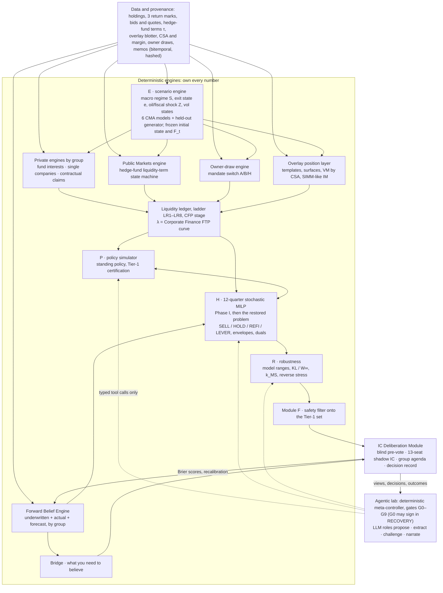

# ADIC Multi-Period Robust Portfolio Decision Framework

## Integrated research synthesis: liquidity-priced multi-period control, SELL / HOLD / REFINANCE / LEVER economics, the derivatives overlay, sovereign liabilities, an agentic laboratory and IC deliberation

**Date:** 2026-10-18 · **Version:** 1.1. It revises v1.0 of the same day: it folds in the group layer and gap addenda 01–05, and resolves thirteen contradictions the critic found. · **Audience:** ADIC CIO, Investment Committee (IC), group heads, Corporate Finance, quantitative and data-science team · **Status:** design-grade research synthesis. No ADIC data was used; every ADIC figure is a client statement or a working assumption.

> **EIGHT GROUPS (patch, ra_gap_01, 2026-10-19).** ADIC has **eight** investment groups. Real Assets, added by the user after this report's group layer closed, is specified in `research/groups/02_REAL_ASSETS_SYNTHESIS.md`; its total-portfolio integration (θ\* recalibrated on the eight-group book, Real Assets prices and envelopes, DVA on the nowcast V\*, the tenth Shapley player, gate V-RA-CTRL) is in `research/groups/addenda/ra_gap_01.md`, with the cross-report edit list in `research/groups/03_REAL_ASSETS_INTEGRATION.md`. Figures below are on the seven-group v1 book unless marked otherwise; for the eight-group v2 book ra_gap_01 governs. *SYNTHETIC – NOT ADIC DATA.*

---

## 0. Scope, inputs and conventions

**Scope.** This report integrates fourteen research streams, nine investment-group streams and five gap studies into one design for a multi-period, robust, agentic decision framework for ADIC's ~$177bn endowment-model portfolio. It covers problem formulation and feasibility (§2), integrating ideas (§3), twelve deterministic components (§4), the agentic laboratory (§5), IC deliberation (§6), calibration and data (§7), validation (§8), risks (§9) and the build plan (§10). It recommends rather than surveys. Where clusters or addenda disagreed, the section concerned states the reconciliation.

**Inputs.**
- The client context (including §1A, the working allocation by group) and deck v8 ("Robust Target-Attainment Total Portfolio Approach").
- 14 stream dossiers and their 14 adversarial verification logs. A local full-text check of *The Agentic Scientist* (`research/verification/13_paper_deepread.localcheck.md`) governs on the paper's mechanisms.
- Four cluster syntheses:
  - C1, portfolio mathematics (streams 01, 10, 11);
  - C2, private book, liquidity, leverage, action economics and return fusion (04–08);
  - C3, distribution policy, sovereign liabilities and the overlay (02, 03, 09);
  - C4, agentic architecture and IC deliberation (12–14).
- The group layer:
  - dossiers G1–G9 and their nine verification logs (289 claims checked, none refuted);
  - group clusters GC1 (private groups) and GC2 (liquidity, organization, data);
  - `research/groups/01_GROUPS_SYNTHESIS.md` (v1.0), which holds the per-group specifications. Where gap_01 has decided, gap_01 governs, and the groups synthesis agrees.
- Five addenda in `research/addenda/`, folded into the sections below rather than appended:
  - gap_01, the group layer (§2.1–2.3, §4.2–4.6, §4.11, §6, §10);
  - gap_02, Tier-1 feasibility, the canonical stress and recovery mode (§1, §2.3(d), §2.4, §4.8–4.9, §5.3);
  - gap_03, the overlay's factor and Greek layer (§4.1, §4.6, §7.2, §8);
  - gap_04, the state and fragility engine and the initial state (§4.1, §4.8, §4.10, §6.7);
  - gap_05, the expected-return bridge and the re-run of v8's attribution (§1, §4.11, §4.12).

Every verifier correction from the 23 stream logs is applied, including gap_01's G1–G9 must-fix ledger (§9.1). Only corrected values appear.

**New computations** [I-calc], all on synthetic data:
- §2.3's first-order arithmetic: `C:\Users\dean\AppData\Local\Temp\claude\C--users-dean-ai-envs\37b0d0cb-bd73-475d-ba00-d5f7286a2929\scratchpad\synth\feasibility.py`.
- `research/addenda/gap_01_calcs/` (`hf_ladder.py`, `t14_hf_swap.py`): the hedge-fund state machine.
- `research/addenda/gap_02_calcs/` (`t1_engine.py`, `gap02_study.py`, `gap02_frontier.py`, `gap02_premium_frontier.py`, `gap02_certify_extra.py`, `phase1_demo.py`, `test_no_pinned_duals.py`): the joint T1–T9 study in six proxy models, the frontier, Phase I and the regression test (8/8 pass).
- `research/addenda/gap_03_calcs/` (`gap03_greek_layer_calcs.py`, `simm_offset_example.py`): vol-state calibration on public data and the SIMM offset example.
- `research/addenda/gap_04_calcs/` (`g4_signals.py`, `g4_oos.py`, `g4_valuation.py`, `g4_initial_state.py`, `g4_current_F.py`): out-of-sample tests of state signals and the October-2026 initial state.
- `research/addenda/gap_05_calcs/` (`bridge.py`, `v8_rerun.py` and helpers): the bridge and the Shapley re-run of v8.
- `research/groups/addenda/GS_calcs/gs_group_cashmap.py`: the census v1.0 group cash map.

**Evidence tags.**

| Tag | Meaning |
|---|---|
| [S] | Sourced and confirmed by a stream verifier |
| [C] | Corrected by a verifier; only the corrected value appears |
| [I] | Inference, design default or illustrative model output; calibrate on ADIC data before use |
| [I-calc] | Arithmetic recomputed for this report |
| [A] | Client statement or working assumption (synthetic allocation); not ADIC data |
| [U] | Unverified; never load-bearing and never shown to the IC as fact |

**Conventions.**
- USD; annual rates unless stated; returns tagged arithmetic or geometric and gross or net of fees.
- Quarterly conversion: $r_q=(1+r_a)^{1/4}-1$ for rates, $x_q=1-(1-x_a)^{1/4}$ for intensities.
- All ADIC figures are [A]: the $177bn NAV, ~60% private share, 5–10% band, 10% target, group allocation and ≈$38bn of unfunded commitments. Census v1.0 splits unfunded ($bn) as PE 27.4, Secondaries 3.9, Co-investment 1.5, Capital Solutions 1.2, Private Credit 4.0.
- Synthetic data is labelled synthetic everywhere and never presented as ADIC data.
- **Stress names.**
  - "Literal T4" is v1.0's 24-month named stress (C1 T1.4).
  - s\*(θ) is gap_02's one-parameter stress family, and T4′ = s\*(θ\* = 0.76) is the Tier-1 row.
  - In gap_01 and the groups synthesis, "s\* = T1.4" means literal T4.
- **Reserved symbols.**
  - F_t is market fragility and nothing else; k_MS is misspecification sensitivity (v1.0's "fragility k\*").
  - The safety filter is always "module F"; C3's funded ratio is FR_y.
  - Ladder rows are LR1–LR8 and overlay limits OV1–OV3, so that L1–L16 name only the conceptual leaps.
  - τ has three meanings, each kept to its own section: a hedge-fund lot's terms (ledger and ladder), the lab's entropic temperature (§5.4), and lever-parameter uncertainty in the bridge (§4.12).

---

## 1. Executive summary

**The problem.** ADIC must pay its owner 5–10% of a ~$177bn fund every year and aims for a 10% nominal return. About 60% of NAV is in private markets, and private-equity distributions, historically its main cash source, have fallen to roughly half their long-run rate. The question is not only which allocation maximizes return. It is which *sequence* of decisions keeps every obligation paid in the joint state where the owner needs more cash, exits are shut and margin calls arrive, while still compounding toward 10%. That is a multi-period stochastic control problem. Its binding constraint, unencumbered liquidity, bites hardest in exactly the states that matter.

**Core thesis.** Three ideas carry the design.
1. **Liquidity is a priced, state-contingent resource.**
   - One shadow price, λ, gives the marginal value of a dollar of unencumbered liquidity in each scenario and quarter.
   - It prices every SELL / HOLD / REFINANCE / LEVER action, every commitment, the leverage book, the overlay and the payout.
   - It becomes Corporate Finance's internal funds-transfer-pricing (FTP) curve. Paired with quantity envelopes from the same optimizer, it decentralizes decisions to the eight investment groups (L14; Real Assets per ra_gap_01).
   - It is meaningful only on a feasible problem. When a Tier-1 row cannot be met, λ comes from the restored problem, never from penalty weights (L15).
2. **Safety first, growth second, never target-chasing.**
   - A survival set and a robust floor gate every action.
   - Growth is maximized only inside them, using utility with a shortfall penalty.
   - The probability of earning 10% is reported, never maximized.
3. **Robustness is verification.**
   - The lab's evaluator is a model of the future. A result therefore counts only if it survives disjoint model worlds, counted and deflated search, and later scoring against outcomes.
   - Deterministic engines own every number. LLM agents propose, extract, challenge and narrate. Humans own decisions.

**What the framework does each quarter.**
- Reads a frozen initial state: macro regime, exit window, oil/fiscal shock type, the market-fragility probability F_t and the 12-month owner draw.
- Generates 50,000 regime-switching paths for each of six fee-consistent capital-market models. The paths include oil/fiscal shock types, a private-exit state and implied-volatility states.
- Simulates the eight groups' engines (Real Assets: ra_gap_01), owner draws, hedge-fund and open-end redemption queues and the overlay's positions and collateral in one liquidity ledger.
- Fuses each asset's underwritten, current and forecast returns into a calibrated forward belief, with translations specific to each group.
- Checks that Tier 1 is feasible (Phase I). It then solves a 12-quarter stochastic program for this quarter's asset-level actions, group envelopes and liquidity shadow prices, and certifies an interpretable standing policy over ten years.
- Bridges each model's expected return to 10%: "what you need to believe".
- Reports every probability with its model range, and runs an IC deliberation organized by group and by total portfolio, in which members' views re-weight the same scenarios.

**Top 12 findings.** All numbers are synthetic or public-data computations, not ADIC data.
1. **The mandate arithmetic is tight, and 10% is a stretch in most models.**
   - Holding real NAV needs a geometric return of ≈7.9% at the 5% floor, ≈10.8% at 7.5% and ≈13.9% at the 10% cap [I-calc].
   - On the working book, fee-consistent beta is 5.8–10.0%. Adding evidence-based α\*, the overlay, leverage at 1.05× and explicit drags gives an expected return of 6.1–10.5% (mixture 8.3%) and P(10-year return ≥ 10%) of 20–54% [I-calc].
   - 10% is a plan only under BlackRock's fee-adjusted CMAs. It is a stretch under the J.P. Morgan-anchored models and an aspiration under AQR and BlackRock "risk premia rise". No single lever closes the J.P. Morgan gap within the evidence (§4.12).
   - The upper half of the band is therefore planned real decumulation: at 8.3%, real NAV holds only at a payout of ≈5.3%.
2. **Model uncertainty dwarfs sampling error.**
   - Mean returns disperse by 3–4pp across providers (4.2pp of beta on the working book), against a Monte Carlo error of ≈0.2pp [C]. Every probability shown to the IC leads with its model range.
   - The choice of model even decides whether the Tier-1 red-event gate can be met (finding 6).
3. **The DPI decline is a liquidity regime change, and four groups carry PE through it.**
   - Distributions run at ≈9–12% of NAV against ≈20–27% historically, while calls hold at 27–31% [S].
   - In today's drought the private book nets only +$0.9–2.2bn a year, because Secondaries, Co-investment, Capital Solutions and Private Credit (+$2.8–4.5bn) offset PE (−$2.0–2.3bn) [I-calc]. No private group hedges the drought's cash channel, so the $71bn liquid book funds 9–25% of itself each year to meet the payout.
   - The initial state, not the market regime, drives year 1. Starting in drought (posterior 0.87) rather than a normal exit window cuts expected private distributions over the next 12 months by ≈$9bn [I-calc].
4. **ADIC is already over-committed on the standard metric.**
   - On working assumptions, private NAV plus unfunded commitments is ≈81% of NAV. It reaches ≈97% after three drought years [I-calc]. PE unfunded is 0.53× PE NAV, against a steady state of 0.37 (normal) or 0.24 (drought) [C].
   - Pacing is the first-order lever, and it is slow: unfunded commitments run off with a half-life of ≈2.1–2.5 years [I]. A one-year pause returns ≈$1.0bn in year 1 and ≈$3.6bn by year 4. Cost it as forgone net alpha, never as a financing rate [C].
5. **Survival in the joint stress binds; committed liquidity and the mandate clear it** (groups gap_01 §5).
   - Literal T4 is infeasible on the working book ($25–92bn across readings) and lies outside the six-model ensemble. v1.0's "$3–19bn" came from C3's mild path and is withdrawn (§2.3(d)).
   - Its replacement, T4′ = s\*(θ\*), equates the 24-month gap to the worst model's P99.6 (θ\* = 0.76; 0.79 on pooled replications). It needs $13.9bn of committed facilities ($14.6bn pooled), $6.1bn with the stage-triggered pacing rule, and none with an owner-agreed band [I-calc].
   - The do-nothing book survives 17 months on Treasury and Public Markets (CFP Red); the pacing rule lifts this to 20 (Amber).
   - Group levers alone can restore T4′ (Phase I u\* = 0), but price liquidity at 24% PV per $ of headroom. A signed revolver cuts the price to 1.1% [I-calc].
   - The binding gate is T6: Mixes A and B certify ≤ 1% in M1–M5, and the stressed M6 class needs the band. A tail-option sleeve adds ≈1–3 months [I].
6. **The binding gate is the 1% red event, and the mandate is the cheapest way to meet it.**
   - From today's drought and Gulf-war state, ε_R = 1% is reachable and certified in models M1–M5. No mix in a 2,880-mix grid reaches it in M6, whose floor is 2.4% with the band and 5–6% without [I-calc]. T6 therefore gets tolerance bands by model class.
   - The cheapest certified mix uses the owner band (Mix B: a $10bn revolver, a stage-triggered pacing cut and $5bn of hedge-fund notices) and costs 21bp a year in premium. Without the band, Mix A ($15bn revolver, $6bn-a-year pacing with the cut, a 14% reserve) costs 62bp [I-calc]. The band activates in 12–22% of paths within a year.
   - Who owns the 5–10% band therefore remains the most valuable unknown. Settle the mandate before buying hedges (L4, now priced).
7. **One price makes actions comparable. It must price market risk and come from a feasible problem.**
   - SELL, HOLD, REFINANCE and LEVER reduce to an exposure decision plus a financing decision.
   - The level of λ decides *whether* to raise liquidity; its term structure decides *which* source (a NAV loan beats a sale only if repaid within ≈2 years); fused beliefs decide *what* to sell [C].
   - A kernel with no risk premium flips a worked SELL decision by $72m [C].
   - A dual pinned by an infeasible row prices every fund as a SELL, at a 0.9% reservation price. After Phase-I restoration the same fund's reservation price is 76.8% [I-calc].
8. **Leverage is a liquidity tool, not a route to 10%.**
   - At SOFR + 300bp, no amount of leverage lifts an 8%-mean, 11%-volatility portfolio's log growth above ≈7.4% [I-calc].
   - Leverage buys more P(10%) than any other lever, but it is beta. At the 1.30× cap it lifts volatility from 14.4% to 18.2%, adds margin calls in the binding states and destroys value in M6 [I-calc].
   - Lever the liquid book and the overlay, never PE. Asset-level LEVER needs financing ≲3% over SOFR plus high conviction; a 12% holdco PIK lifts a co-investment's drought wipe-out probability at exit from 7.0% to 22.8% [C; re-checked 2026-10-18: an at-exit statistic, unaffected by the barrier-correction fix].
   - The press-reported $15bn hedge-fund total-return-swap programme would cost ≈2 survival months and needs HQLA collateral [I-calc].
9. **Never maximize P(10%), and value hedges as liquidity, on economic Greeks.**
   - Maximizing P(10%) replicates a digital option. In a toy model it doubles P(target) from ≈34% to ≈68%, at the cost of a ≈4.6% chance of a >40% loss [I].
   - The v8 floor gate is infeasible on realized returns: it would need a 15.8–17.9% expected return [C].
   - Tail hedges earn their place as contingent liquidity and by relaxing constraints. Equity-only hedges miss the likeliest owner-side stresses [I].
   - Margin models net what stresses do not. SIMM sums vega across expiries, so a short 1-month book that "offsets" a long 6-month sleeve lost $1.77 per $1 the sleeve gained in a 2020-type spike [I-calc]. Offsets are therefore governed on economic vega and full revaluation (§4.6).
10. **Read the state in layers; most of v8's alpha was hindsight.**
    - Today the market layer reads calm (F_t = 0.10 against a 0.17 base rate), while the exit layer (drought 0.87) and the owner layer (Gulf war 0.85) read stressed. A single fragility light would show green and miss the binding first-year risk [I-calc].
    - Out of sample, turbulence and the absorption ratio add nothing beyond a regime posterior, and valuation and mean-reversion timing lose money. All four stay out of the policy [I-calc].
    - In the new engine, v8's +3.5pp uplift falls to +0.35–0.61pp. About 30% of it was knowledge of the path and ≈54% rested on unevidenced claims for α\*, QDD and the overlay. Only overlay execution and a small, risk-reducing state effect survive [I-calc].
11. **The agentic layer must assume the simulator can be gamed.**
    - Protocol gaming occurred in Sakana's own experiments [C]. The paper protects its evaluator task by task and calls one contract "cooperative … not an adversarial sandbox" [C].
    - Hence integrity is enforced by infrastructure: an immutable, hashed evaluator outside the agent's reach; search across ≥ 2 scenario-generator families; one sealed run on disjoint worlds; every evaluation counted and deflated; and "not established" as a valid outcome.
12. **The IC aggregates beliefs, not verdicts, and is organized by group and by total portfolio.**
    - Thirteen seats are defined by mandate: CIO, CRO, the Treasurer (also the owner's advocate), eight group heads (the Real Assets head added per ra_gap_01), an outside-view forecaster and a red team. Group heads recuse on their own envelopes and are scored on total-portfolio regret. AI seats flag but never vote.
    - Proper scoring is not enough when a forecaster's budget rides on its forecast, so pay is decoupled from budget size (L8).

**Recommended architecture.**

**First 90 days.**
- Build the Phase-0 minimum viable product on the labelled synthetic book SYN-ADIC-177 (§10).
- Start a point-in-time archive of underwriting memos and group forecasts, including declined deals.
- Open the mandate conversation:
  - ask for pre-agreed 5% draws in contingency-funding (CFP) stage Red or in crisis, disclosing that the band would activate in 12–22% of paths within a year and withhold $3–7bn over five years;
  - settle the draw convention (fixed USD, opening-NAV reset or current NAV), which alone moves literal T4's facility need between $25bn and $43bn.
- Request indications for $10–15bn of committed unsecured revolving capacity, rather than generic "committed facilities": 3 + 2 years, at least 10 banks with none above 12.5%, covenant headroom tested under T4′, and a yearly test draw. Drop the NAV-facility route as a primary lever, because the pledge limit caps it near $2bn.
- Adopt the stage-triggered pacing rule: commitments cut to 25–50% in CFP Amber, with a protected core sleeve.
- Request each hedge fund's terms τ (notice, gates, revocability, transfer and pledge consents), the decisive data item. Also request PE unfunded by vintage and the overlay blotter with its CSAs.

---

## 2. Problem framing: ADIC's balance sheet as a controlled stochastic system

### 2.1 Powell's five elements, instantiated

| Element | ADIC instantiation |
|---|---|
| **State** $S_t=(R_t,I_t,B_t)$ | *Physical* $R_t$: cash and high-quality liquid assets (HQLA); liquid sleeves (hedge funds ≈\$20bn, long-only ≈\$36bn, Treasury cash and IG ≈\$15bn) [A]; per private position, economic NAV $V_{i,t}$, reported NAV $N_{i,t}$, unfunded $U_{i,t}$, age, pledge flag, NAV-loan balance and its group engine's state (a private-credit cohort's cash-pay / PIK / non-accrual / resolved / repaid shares; a Capital Solutions claim's state and accreted balance; a co-investment's enterprise value and debt); per hedge-fund lot, the liquidity-term state $X$ (LOCK … TRS_TERM, §4.6), the outstanding request, times gated, holdback, side-pocket units, other investors' queued requests and the terms τ; facilities and debt; the overlay book as positions (templates, sensitivities, posted initial margin (IM) and independent amounts, CSA state); the draw basis $B_y$ and payout year to date; the TWR peak. *Information* $I_t$: prices, curves, VIX term structure, MOVE, oil and FX implied volatility, surfaces, spreads, secondary indications, NAV-loan terms, SOFR (3.89% on 15 Oct 2026 [S]), Brent and its futures curve, the owner's fiscal nowcast. *Beliefs* $B_t$: the filtered posterior over the regime triple (macro regime $S_t$, exit window $e_t$, oil/fiscal shock type $Z_t$); market fragility $F_t$ with its filter's version hash; fused forward beliefs $(\hat\mu_i,\hat\sigma_i)$; model weights; IC view tilts. |
| **Decisions** $x_t$ | Rebalancing; physical-to-synthetic conversions $y^{p2s}$, kept separate from exposure adds $y^{add}$ [C G5]; new commitments $k_{g,t}$ by group, inside the pacing corridor; per asset a SELL fraction, a REFINANCE draw or a LEVER add-on (at most one per asset per quarter); per hedge-fund lot the noticed share $u^{red}$, lodged only on notice dates and irrevocable unless τ says otherwise; the private-credit SMA run-off switch; facility, repo and term-debt moves; trades on overlay templates and the opportunistic budget; group envelopes and FTP (quarterly); the payout within the band, where the mandate gives ADIC discretion. |
| **Exogenous information** $W_{t+1}$ | Asset returns and regime transitions; the exit factor; call and distribution intensities; GP-triggered events (continuation-vehicle elections, strips, recaps); PIK switches, selective defaults and delayed-draw loan draws; secondary bids and whether executions succeed; other investors' redemption requests and gate decisions; financing spreads and LTV caps; implied-volatility and surface moves, and variation margin (VM) by CSA; opportunistic P&L; Brent, the owner's financing need, the draw and any override. |
| **Transition** $S^M$ | One model shared by simulator and optimizer (C1 §5.3): cash, NAV, HQLA and margin identities; private positions through the group engines (§4.2); hedge-fund lots through the liquidity-term state machine; collateral through the overlay position layer and the signed VM/IM ledger (§4.6). Actions happen at the start of each quarter and flows during it. |
| **Objective** | Lexicographic: (1) the Tier-1 survival set, made feasible first (Phase I, §4.8); (2) the robust floor; (3) maximize the mixture expected CRRA utility (γ = 3) of real, distribution-inclusive wealth, minus an L2 shortfall against 10% target wealth. Distributions accrue at the fund's own return, so the objective is neutral to payout timing (§4.9). |
| **Policy and clock** | Powell's policy classes, combined (§4.8): a cushion-monotone standing policy tuned in simulation, a 12-quarter lookahead for this quarter's actions and prices, and terminal values. Monthly engine; daily overlay sub-steps in stress; quarterly decisions; an annual draw rate paid quarterly. |

### 2.2 Who decides what

The seven investment groups are the organizational unit; the total portfolio is the decision unit. The groups source, underwrite, forecast and execute, and they own asset-level proposals. Corporate Finance runs Treasury and owns the funding and liability side: portfolio borrowing (including any LP-portfolio NAV facility), overlay collateral, distribution payments, the liquidity gate, the contingency funding plan (CFP) and the transfer-pricing curve. The groups synthesis (§3) specifies each group as a module. The table summarizes what the lens means for each group (gap_01 §3; instruments in §4.4).

| Holder | Working NAV / unfunded ($bn) [A] | SELL / HOLD / REFINANCE / LEVER in practice | Forecast, translated by the FBE (§4.3) | Drought net cash, 12 months ($bn) [I-calc] |
|---|---|---|---|---|
| PE funds | 52 / 27.4 | SELL: LP-led sale or strip. HOLD: GP-triggered CV elections. REFI: LP-portfolio NAV facility (Corporate Finance) or preferred equity. LEVER: up-sized re-ups; **pacing** is the main lever | GP projections and look-through → Benktander credibility | −2.3 |
| Secondaries | 14 / 3.9 | HOLD carries deferred payables, which count as debt. ADD / SELL: discount purchases, tertiary sales. Prices SELL for the house, behind a firewall | Fund and deal models; desk bids as a buyer-implied signal | +1.2 |
| Co-investment | 18 / 1.5 | SELL: single-asset sale at a buyer-model bid. REFI / LEVER: pool facility or holdco PIK, benign regimes only | Deal models, with the exit multiple shrunk toward entry | +1.7 |
| Capital Solutions | 8 / 1.2 | SELL: syndication, secondaries. REFI / LEVER: back-leverage (D/E ≤ 0.5), CFO. Prices REFINANCE for the house, as a reserve price behind third-party quotes | Contract plus kicker, net of loss and extension drag | +0.5 |
| Private Credit | 14 / 4.0 | HOLD: SMA run-off switch. SELL: loans, LP interests, BDC shares, evergreen tenders. REFI / LEVER: SMA back-leverage only | Loss-adjusted yield (LGD 0.67) | +1.1 |
| Public Markets | 56 (hedge funds 20, long-only 36) / — | Hedge funds: redemption as a queued SELL; HF-TRS or portable alpha as LEVER. Long-only: physical-to-synthetic as REFI | Hierarchical α posterior; long-only net IR −0.05 | 0 (the reservoir) |
| Overlay | notional | Tail monetization as SELL; hedge ratio and risk budget; supplies synthetic beta ($10bn at t0, $15bn in stress) | Residual skill after factor premia | +0.2 (−6.0 in a crash year) |
| Corporate Finance / Treasury | 15 | Revolver, repo, term debt, collateral, payout timing | — | Internal bank; owns λ |

Four rules follow.
1. **Liquidity raised means external cash only.** A transfer between ADIC groups (such as Secondaries buying a PE-group stake) is close to zero-sum and never counts as liquidity raised. It is priced at fair value on both legs.
2. **One kernel prices every proposal.** Group P&L is attribution, never a decision criterion.
3. **Groups are price-takers inside quantity envelopes**, set by the same optimizer that sets λ (L14, §4.4). A group that wants more capacity pays the shadow price for it.
4. **In-house quotes are evidence, not prices.** Secondaries and Capital Solutions quotes feed the SELL and REFINANCE models as market intelligence, under conflict-of-interest controls. The Secondaries desk never quotes where it may bid.

### 2.3 First-order feasibility

All figures are [I-calc] on [A] inputs:
- private NAV $106bn, a $71bn liquid book, ≈$38bn unfunded and commitments of $11bn a year;
- C2's drought calibration: distribution rates of 20% (normal), 10% (drought) and 6% (crisis) on private NAV, and calls at 28% of unfunded, which makes ≈$38bn the steady state for $11bn a year;
- for the group-resolved figures: census v1.0, new commitments of $12bn a year (split 60/10/10/10/10 across PE, Secondaries, Private Credit, Capital Solutions and Co-investment) and the stream-G7 engine (groups synthesis §2.2; gap_01 §2).

**(a) Return arithmetic.**
- Real NAV is preserved only if $(1+g)(1-d)\ge1+\pi$.
- With π = 2.5%, that needs a geometric return of 7.9% at $d$ = 5%, 10.8% at 7.5% and 13.9% at 10%.
- Equivalently, the real-preserving payout is 6.8% at $g$ = 10% and 4.6% at a peer-realistic 7.4% [C].
- Under current CMAs, C1 puts the median real-preserving payout at ≈5–6% [C].
- On the working book, the evidence-central expected return is 6.1–10.5% across models (mixture 8.3%), so the real-preserving payout at the mixture is ≈5.3% [I-calc; §4.12].

**(b) Annual sources and uses** ($bn; before overlay margin, debt service and pacing changes).

| | Normal (exits open) | Drought (today) | Crisis |
|---|---|---|---|
| Distributions | 21.2 | 10.6 | 6.4 |
| Calls | 10.6 | 10.4 | 9.0 |
| Net private cash flow | +10.6 | +0.2 | −2.7 |
| Payout at 5% / 7.5% / 10% | 8.9 / 13.3 / 17.7 | 8.9 / 13.3 / 17.7 | 8.9 / 13.3 / 17.7 |
| Liquid-book funding at 5% / 7.5% / 10% | −1.7 / 2.7 / 7.1 | 8.7 / 13.1 / 17.5 | 11.5 / 15.9 / 20.4 |
| Share of the $71bn liquid book | −2% / 4% / 10% | 12% / 18% / 25% | 16% / 22% / 29% |

**Group-resolved, first 12 months** ($bn). This replaces the single drought rate for decisions [I-calc; census v1.0, with gap_01's G7-split drought row as a reproduction check].

| | PE | Secondaries | Co-investment | Capital Solutions | Private Credit | Private book | Single-rate table |
|---|---|---|---|---|---|---|---|
| Drought: distributions / calls / **net** | 6.3 / 8.7 / **−2.3** | 2.7 / 1.5 / **+1.2** | 2.3 / 0.6 / **+1.7** | 1.0 / 0.5 / **+0.5** | 2.4 / 1.3 / **+1.1** | 14.8 / 12.6 / **+2.2** | 10.6 / 10.4 / +0.2 |
| Drought net, G7 unfunded split (gap_01) | −1.95 | +0.41 | +1.24 | +0.04 | +1.12 | +0.86 | |
| S1 demand bust (calls ×1.25, crisis 18 months): net | −9.8 | −1.0 | −0.4 | −0.2 | −0.6 | **−12.0** | Crisis −2.7 |
| Literal T4 (distributions 0, calls ×1.5): net | −14.0 | −2.3 | −1.0 | −0.3 | −0.9 | **−18.4** | |

*SYNTHETIC – NOT ADIC DATA.*

- **Drought neutrality survives only because four non-PE groups carry PE.** Secondaries, Co-investment, Capital Solutions and Private Credit add +$2.8–4.5bn against PE's −$2.0–2.3bn. At MSCI's H1-2026 PE distribution rate of 9%, the private book nets only +$1.1bn. At a 7.5% payout the liquid book still funds $11.1bn, 16% of itself; across the band, 9–22%.
- **No private group hedges the drought's cash channel.** Capital Solutions and Private Credit cash moves *with* PE distributions: NAV loans repay from distributions, and preferreds switch to PIK. The only natural cash ADIC can switch on is the private-credit SMA run-off, ≈$0.8–0.9bn in year 1 [C].
- **The single-rate crisis column understates the stressed drain by ≈$10bn,** because it lets calls fall. With calls stressed *up* (Cambridge Associates' 2008 practice) the private book uses ≈$12bn in a demand bust, 82% of it PE.
- **The overlay swings from a small cost to a large use.** It costs ≈$0.7bn of premium in calm years. In a crash year with $15bn of synthetic beta it uses ≈$6bn net: VM −$5.9bn and opportunistic losses −$2.7bn, offset by +$2.8bn of tail monetization net of premium.

**(c) A persistent drought ratchets the denominator.** Assumptions: a 7.5% payout, private marks +8% a year, the liquid book +6% a year.

| Year | Private share of NAV | Liquid book ($bn) | (Private NAV + unfunded) / NAV |
|---|---|---|---|
| 0 | 59.9% | 71.0 | 81.4% |
| 1 | 64.9% | 61.9 | 86.6% |
| 2 | 69.8% | 53.1 | 91.8% |
| 3 | 74.6% | 44.6 | 96.7% |

- The drought does not shrink the private book: calls roughly equal distributions, so private NAV keeps compounding on its marks while the payout drains the liquid book.
- Forced sales are frequent but cheap in expectation. In stream 02's model, the mean cumulative discount loss is ≈0.64% of starting NAV over ten years [C]. The real cost is the ratchet.
- Two independent checks agree. Re-running v8's scenario on ADIC's book, payouts and drought calls drain the liquid share to 17–19% within three years while the private share rises to 75–76% [I-calc; gap_05]. And a rate-based engine cannot see vintage: PE unfunded is 0.53× PE NAV on the census, above the 0.35–0.37 normal steady state, and 2026 PE net cash ranges from +$0.2bn for a mature programme to −$6.9bn for one built on 20% annual growth [C; I-calc GC1]. PE unfunded by vintage is the most valuable single data item ADIC can supply.

**(d) Survival on the named joint stress (rebuilt in v1.1).**
- **What v1.0 got wrong.** v1.0 said ≈$3–19bn of committed facilities clears the 24-month test. That figure came from C3's mild path: demand bust → supply glut → supply glut, net private flows of −$4.5bn, 0 and 0, draws fixed at $17.7bn a year, facilities counted at 80% and the 8% floor unusable. It is not a T4 result, and v1.1 withdraws it.
- **Conflicting conventions.** v1.0 also used three conventions that disagreed across §2.3(d), T2–T4 and the leverage limits. One canonical set now governs every Tier-1 row [I-calc unless tagged; gap_02].

| Convention | v1.0 usage (conflicting) | Canonical |
|---|---|---|
| Draw basis | Fixed $17.7bn a year (§2.3(d)); unstated in T4 | 10% of opening-of-fiscal-year reported NAV, reset annually (year 2 ≈ $12.2bn). Fixed-USD and current-NAV draws are shown as sensitivities [C G7-R3] |
| Facility credit | 0% (T3, leverage limit 6); 50% (T4); 80% (§2.3(d)) | By instrument and horizon:  • 0% in every 30-day row;  • committed unsecured revolvers at 80% for 12–24 months, but only with covenant headroom under s\*, ≥ 10 banks with none above 12.5%, and a yearly test draw;  • NAV facilities at a 5% stressed LTV (10% normal) on a pledge pool capped at 20% of private NAV, less forced paydowns;  • uncommitted lines at 0%  [S: Basel LCR40.82; Reg YY §252.35; Ivashina–Scharfstein 2010; Chodorow-Reich–Falato 2022; Sufi 2009] |
| IG + cash | 8% hard (T2); deducted in §2.3(d) but not in T4 | 8% target (elastic) and 4% hard, restored within 4 quarters of exiting stress [S: Basel LCR20.5; G7] |
| Private Credit / Capital Solutions cash | Netted or unstated | 10% / 7% of NAV a year (cash yield and amortization) |
| Hedge funds | Blended 22% haircut, or 50% / 100% | Whole book noticed at t0, then queued through the state machine (§4.6). Crisis pass-through 0.83, bracketed by 0.5 and 0 |
| New commitments | None | $12bn a year, as a lever |
| Overlay | Margin of $3.5bn, $1bn, $1bn | $10bn synthetic beta: VM on the shock; IM rising from 4% to 10%; tail monetization; opportunistic loss of 1.5% of NAV |
| Shock timing | — | At the vertex: the shock hits marketable assets at t0 |

**Why a rule rather than one flat factor.** In 2008, banks that co-syndicated more lines with Lehman cut lending more, and new loans to large borrowers fell 47% in Q4-2008. About a third of loans breached a covenant in 2008–09, and weaker lenders cut commitments after breaches [S]. Lines are reliable only with covenant headroom.

**A one-parameter stress family, calibrated to the probabilistic gate.**

$$s^*(\theta):\ \text{equity }{-}(30+10\theta)\%\text{ at }t_0;\ \ \text{PE/Sec/Co distributions}=0.45(1-\theta)\times\text{drought rates};\ \ \text{calls}=(1+0.5\theta)\times28\%;\ \ 24\text{ months; cap draws for two fiscal years}$$

- θ = 0 is a C3-type path (year-1 net private flow −$9.4bn once all five groups and new commitments are counted, against C3's −$4.5bn). θ = 1 is literal T4 (−$18.7bn).
- The calibration statistic is the facility-free 24-month funding gap $G^*=\max_{h\le24}[\mathrm{NCO}(h)+0.04W(h)-\mathrm{CBC}_{TP}(h)]$. It is computed on every Monte Carlo path from today's drought start, with Z₀ = Gulf war at probability 0.7.
- **Rule.** θ\* sets G\*(s\*) equal to the worst model's quantile at T6's 24-month share, 1 − (1 − ε_R)^{8/20} = 0.40% for ε_R = 1%. **Result: G\* = $11.1bn (M6, P99.6) and θ\* = 0.76.**
- Alternatives the IC may prefer: the mixture's P99.6 gives $4.1bn (θ = 0.42); the worst of M1–M5 gives $2.6bn (θ = 0.35).
- Literal T4 (G\* = $16.1bn) lies beyond P99.99 in M1–M5 and at P99.87 in M6.
- History supports a milder vertex. Across the dot-com and GFC downturns, buyout calls fell ≈50% from peak to trough while distributions fell 60–82% [S: AltamarCAM, Preqin data on 844 funds]. Calls ×1.5 is a practitioner stress, not an empirical one. s\*(0.76) still carries calls ×1.38, because the family moves all components together; an IC preferring empirical calls can re-fit calls ×1.0 with lower distributions at the same G\*.

**Survival on the canonical stress T4′** (gap_02 §1.1 conventions; groups gap_01 §1.2) [I-calc]. SH_TP is survival in months on Treasury + Public Markets; SH_TPF adds committed facilities.

| s\*(0.76), canonical conventions | SH_TP (months) | SH_TPF (months) | Minimum 24-month headroom ($bn) | Facility for 24 months ($bn) |
|---|---|---|---|---|
| Do nothing | 17 | 17 | −11.1 | **13.9** (SAA 13.9–15.1; pooled 14.6) |
| Stage-triggered pacing rule | 20 | 20 | −4.9 | 6.1 |
| Owner band | 29 | 29 | +2.3 | 0 |
| Rule + band | > 36 | > 36 | +8.6 | 0 |
| Revolver $13.9bn | 17 | 24 | 0.0 | — |
| Mix A: revolver $15bn, $6bn pacing + rule, reserve 14% | 24 | > 36 | +12.0 (+0.0 without the revolver) | — |
| Mix B: revolver $10bn, rule, band | > 36 | > 36 | +10.8 | — |
| NAV facility $2.1bn | 17 | 18 | −10.1 | 12.6 |
| *Reverse stress:* literal T4 (50% facility credit) / T4 as written (8% hard floor) / critic reading (fixed USD, hedge funds gated, no credit cash, 8% floor) | 15 / 12 / 8 | — | −16.1 / −20.7 / −45.8 | 32.2 / 41.5 / 91.7 |

*SYNTHETIC – NOT ADIC DATA.*

> The earlier $3–19bn came from C3's mild DB → SG → SG path. That path is θ = 0 in the s\* family (G\* = −$4.7bn at canonical conventions) and is kept only as the mild end of the family.

- **Conventions move the answer more than severity does.** Single convention changes move literal T4 to $24.9bn (current-NAV draws), $42.9bn (fixed-USD draws) or $64.9bn (hedge funds fully gated). On census v1.0 the groups synthesis finds $23–49bn across draw conventions and hedge-fund terms, consistent with this range.
- **T2 as written already fails at t0.** Usable IG + cash, excluding encumbered IM, is $13.6bn against an 8% requirement of $14.2bn: a $0.56bn shortfall.
- **Literal T4 cannot be bought.** Its need exceeds T5's debt limits ($17.7bn target and $26.6bn hard at today's NAV; $11.6bn / $17.4bn on the stressed month-24 NAV of $116bn). It also exceeds the largest sovereign-fund precedent: PIF's $15bn, 23-bank revolver (A1/A+, August 2024) [S].

**C3's path, re-run with the hedge-fund state machine** (survival in months, P5 with P50 in brackets; [24-month facility need]; gap_01) [I-calc]:

| Stress | Static haircuts: 22% / 50% / all gated | State machine, G5 default terms | Adverse terms |
|---|---|---|---|
| C3 path, 8% floor unusable | 21.9 / 18.1 / 11.8 | **20.9** (21.3) | 17.8 |
| C3 path, buffer usable down to 4% | 26.5 / 22.7 / 16.3 | **26.0** (26.3) | 23.6 |
| Literal T4, current-NAV draw, with CFP actions | 16 [$13.7bn] (G7 buckets) | **20** [$12.3bn] | 17 [$17.8bn] |

*SYNTHETIC – NOT ADIC DATA.* Adverse terms add investor gates, semi-annual dealing for credit, event and relative-value funds, and hazards ×2.

- **"All gated" is a bound, not a base case.** The static "all gated" case needs a book that pays nothing for a year, so it is a reverse-stress bound.
- **The machine front-loads hedge-fund cash** ($10.7bn by month 6, against $2.7bn under static buckets). That adds 3–5 months of survival but cuts the 24-month facility need by only ≈$1.4bn.
- **Documents matter more than gate randomness.** P5 and P50 differ by ≤ 1 month, so ADIC's documents (τ) count for more. Hedge-fund terms drive the stage metrics; the draw rule and the stress vertex drive the facility need.
- **Sensitivities** (C3 path, P50): gate hazard ×2 gives 21.2 months; notices lodged at month 6, 20.3; a book 55% in multi-strategy funds, 19.4; the press-reported $15bn HF-TRS (independent amount $1.5bn, VM $1.56bn), 19.3.

**(e) Leverage.**
- For an 8%-mean, 11%-volatility portfolio, 10% log growth needs 2.36× leverage at 4.05% funding (0.72 Kelly), and is unreachable once funding exceeds ≈4.28% [C]. At SOFR + 300bp (6.89%), maximum log growth is 7.4% [I-calc].
- Taking economic leverage to 1.3× through ACWI futures lifts P(5y ≥ 10%) from 39.1% to 45.8%, but moves P(5y < 7%) only from 40.4% to 39.0% [C].
- On the working book, the 1.30× cap adds ≈0.8pp of expected return in M1 (8.84% → 9.66%), but it lifts volatility from 14.4% to 18.2% and lowers the expected return in M6 (6.06% → 5.88%) [I-calc; §4.12].

### 2.4 What the feasibility check implies

1. **The payout is now funded from the liquid book.** The binding currency is unencumbered liquidity, and its price must enter every decision. The drought book is cash-positive only because four non-PE groups carry PE, and no private group hedges the drought's cash channel.
2. **The 24-month test binds, but as written it cannot be met.**
   - Literal T4 needs more committed capacity than T5 allows or any sovereign precedent provides.
   - The calibrated T4′ can be met, and the binding gate is then T6, whose 1% tolerance is reachable in M1–M5 but not in M6.
   - Whether it passes depends on three things only ADIC can supply: hedge-fund terms τ, who owns the band, and the owner-draw convention.
3. **Committed liquidity beats options, but it is capacity-capped.**
   - Arranged in benign regimes, it buys roughly an order of magnitude more runway per unit of carry than convex options [I, C3].
   - Committed unsecured revolvers are the cheapest protection per dollar (≈SOFR + 85bp drawn, ≈15bp undrawn), but $10–15bn is the realistic size. NAV facilities are pledge-capped near $2bn [I-calc].
   - Facilities add fixed claims, so debt, payout and overlay must be designed together.
4. **Pacing must move first and early.**
   - The overcommitment default (private NAV plus unfunded ≤ 80% of NAV) is already exceeded on working assumptions. Either ADIC's own limit differs, or the book is over-committed.
   - Pacing is the most effective single lever on the red event. In M1 a stage-triggered cut takes it from 8.2% to 2.4%, and base pacing of $6bn a year plus the cut takes it to 1.5%; a $15bn revolver alone gets to 3.0%. But pacing pays out over 1–4 years.
5. **The target cannot be bought with leverage.** It must come from model weights, selection (α\*), implementation and avoided forced sales, and within the evidence those levers are small (§4.12).
6. **Price only feasible problems.** When a Tier-1 row cannot be met, penalties pin its dual at the penalty tier and every decision card is mispriced. Phase I first measures the minimum violation; λ comes only from the restored problem (§4.8).

---

## 3. Cross-disciplinary conceptual leaps

Sixteen integrating ideas hold the design together. The candidate themes in the brief were tested against the research; all survived, three were materially refined (L1, L5, L9), and four were added (L4, L6, L8, L11). Version 1.1 adds three ideas from the group layer and the gap studies: L14, the internal capital market; L15, feasibility before prices; and L16, one sensitivity set. It also refines L1, L3–L6 and L8–L13 where the addenda or the critic changed them.

### L1. One price for liquidity: the state-contingent shadow price λ

- **Disciplines.** Lagrangian duality (Everett 1963); hydro "water values" (Pereira–Pinto); electricity merit-order dispatch; bank funds-transfer pricing (FSI 2011).
- **Mechanism.**
  - The duals of every row that contains cash (survival, IG + cash, payout floor, encumbrance), normalized by the cash-carry dual, give a quarterly liquidity premium $\ell^q_{s,t}$.
  - With a market-risk deflator $m$, it forms one kernel, $\pi_{s,t}=p_sm_{s,t}\prod_{k<t}(1+\ell^q_{s,k})^{-1}$, that prices any bundle of state-contingent cash flows.
  - λ^spot is the cost of today's marginal source; λ^w is the intertemporal water value.
- **Why it matters; where it enters.**
  - Actions, commitments, leverage, hedges and payout share one scale. In C2's example, the liquidity state alone moves a $500m fund's HOLD value by ≈$114m [C].
  - H's duals give λ by regime and horizon. That feeds action scores, the marginal-cost-of-liquidity (MCL) curve and Corporate Finance's FTP charges.
- **Evidence.** Strong theory; three streams converged independently.
- **Refinement.** The kernel must also price market risk: dropping $m$ flips C2's example by \$72m [C].
- **Refinements (v1.1).**
  - λ is valid only on a feasible problem. A row that cannot be met pins its dual at the penalty tier, so prices come from the restored problem (L15).
  - ℓ is a per-period rate. Against a deal NPV, use the one-off premium $L_s=\pi_{s,0}/\bar\pi-1$ ≈ 17.5–23.7% [C G2-R1].
  - Paired with quantity envelopes, the same duals decentralize decisions to the groups (L14). In G8's illustration, duals of 1.83% (crisis liquidity) and 0.81% (CVaR) give asset charges of 58–212bp [I-calc].

### L2. Liquidity options with wrong-way strikes: buy liquidity before you need it

- **Disciplines.** Real options (Dixit–Pindyck; least-squares Monte Carlo); fire-sale and funding-liquidity economics (Shleifer–Vishny; Brunnermeier–Pedersen); corporate cash policy (Bolton–Chen–Wang).
- **Mechanism.**
  - The right to sell a private stake is an American put whose strike (the secondary bid) falls exactly when exercise is worth most.
  - A NAV facility embeds a written put on NAV through LTV covenants.
  - Execution failures are correlated.
- **Why it matters; where it enters.**
  - "We can always sell secondaries" overvalues the option most in the states where it would be used. H2-2008 average high bids were 61% of stale NAV (83.5% market-adjusted); NAV-loan spreads rose ≈140bp in 2022; ≈27% of GP-led processes failed or paused in a record half-year [S].
  - The hedonic price model, the execution copula and covenant first-passage simulation encode this.
  - The playbook arranges REFINANCE capacity in benign regimes and draws pre-arranged lines in a demand bust.
- **Evidence.** Strong on direction. Crisis price levels are upper bounds, and ADIC's own bids are needed.

### L3. Liability-side wrong-way risk, identified by oil-shock type

- **Disciplines.** Structural oil econometrics (Kilian 2009; Baumeister–Hamilton 2019; Ready 2018); counterparty wrong-way risk; public finance.
- **Mechanism.**
  - The owner's draw is a NAV-scaled vertical put spread on its pre-transfer fiscal need. On the linear map it sits at the 5% floor above ≈$67 Brent and at the 10% cap below ≈$23, with ≈$200m of draw per $1/bbl [I-calc].
  - Whether it is wrong-way depends on *why* oil moves:
    - supply gluts raise draws while markets stay fine;
    - demand busts raise draws, sink equities and shut exits (the triple wrong-way state);
    - Gulf-war shocks raise oil *and* needs.
  - The monthly oil–equity correlation changed sign by era: −0.14 before 2008, +0.43 in 2008–19, +0.32 since 2020 [I-calc rep.].
- **Why it matters; where it enters.**
  - Statistical regimes cannot separate these states, and equity puts miss the supply-glut and Gulf-war stresses, the likeliest in 2027–29.
  - Hence the coupled chain $Z_t$, the owner-draw engine, coverage ratios by shock type, and owner- and λ-betas on every action card.
- **Evidence.** Medium. Confidence intervals are wide, there is no Gulf-war analogue, and fiscal parameters are not identified from 2026 data.
- **Refinement (v1.1; gap_04).** The state is read in three layers, and today they disagree.
  - The market layer is calm (F_t = 0.10 against a 0.17 base rate), while the exit window reads drought (0.87) and the shock type reads Gulf war (≈0.85).
  - The oil state must start from the futures curve, not spot: a spot start puts 2027 Brent at $111, against EIA's $84.
  - A memoryless chain overstates war persistence (49% of 2027 in the Gulf-war state, against the IMF's ≈17%), so the Gulf-war dwell time is conditioned on elapsed duration [I-calc].

### L4. Mandate design is the zero-premium hedge

- **Disciplines.** Option theory; the political economy of commitment (Kydland–Prescott); sovereign reserve practice.
- **Mechanism.** The 5–10% band is an option. If ADIC sets the rate, ADIC holds it: pay near 10% when λ ≈ 0 and near 5% when λ is high (Bolton–Chen–Wang's double barrier). If the owner calls draws on fiscal need, ADIC is short it.
- **Why it matters; where it enters.**
  - On C3's path (v1.0 conventions), paying 5% instead of the cap extends survival from ≈22 months to beyond 36 under blended haircuts, and from ≈12 to ≈22 under conservative ones [I-calc]. No option programme comes close per unit of cost.
  - The mandate switch (A, ADIC rule; B, owner call, the default; H, hybrid) prices $J^*_A-J^*_B$.
  - Notice and deferral rights form the first rung of the defensive stack.
- **Evidence.** Robust in direction. Owner behaviour is the framework's most decision-relevant unknown.
- **Refinement (v1.1; gap_02): now priced.**
  - Meeting the 1% red-event gate in M1–M5 costs 21bp a year in premium with pre-agreed 5% draws in CFP Red or in crisis, against 62bp without them.
  - The band activates in 12–22% of paths within a year and withholds $3–7bn over five years [I-calc].
  - Under canonical conventions it takes T4′'s facility need from $13.9bn to zero.

### L5. Tail hedges as contingent liquidity, judged by enabling value

- **Disciplines.** International-reserves economics (Jeanne–Rancière 2006; Borensztein–Jeanne–Sandri); corporate risk management (Froot–Scharfstein–Stein); option pricing.
- **Mechanism.** Value a hedge, net of carry, by its liquidity value $E[\sum_t\delta_t\lambda^w_t\Delta L_t]$ plus its enabling value $\sum_k\eta_k\Delta\text{slack}_k$ (the Tier-1 constraints it relaxes), not by standalone return.
- **Why it matters (refined).**
  - At ADIC-scale crisis gaps (≈15% of NAV), HQLA at 1.5% carry has an interior optimum near 7.5% of NAV. Most options are corner solutions at 0.28–0.94 per $ of crisis payoff, a hindsight-prone measure [C].
  - A 0.25%-of-NAV convex sleeve adds ≈1–3 months of runway; a 10%-of-NAV committed facility adds ≈9 [I-calc].
  - Convexity earns its place through enabling value, gap and latency protection, and pre-committed rebalancing.
- **Where it enters.** The hedge decomposition; the ordered defensive stack; an IC-owned convex floor of 0.15% of NAV a year; monetization priced at λ^w.
- **Evidence.** Medium–strong. The reserves model is one-shot, so sizing comes from simulation.
- **Refinement (v1.1).** In G8's illustration the tail hedge would enter a group budget only at a 10.85% dual, so it is valued by liquidity plus enabling value, never by a hurdle rate. Its protection must also be measured on economic Greeks, because margin models net offsets that stresses do not (L16).

### L6. Fixed claims create absorbing barriers; borrow only against the cyclical shortfall

- **Disciplines.** Actuarial ruin theory (de Finetti; Dufresne; Gerber–Shiu); pension funding; public-finance tax smoothing (Barro 1979).
- **Mechanism.**
  - A payout proportional to *current* NAV cannot ruin NAV. Fixed claims can: debt service, margin, fixed real distributions and smoothed payouts all create absorbing barriers.
  - With μ = 8%, σ = 12% and fixed payouts of 7.5% of initial wealth, ruin is ≈0% within 5 years, ≈20% within 20 and ≈58% eventually [C].
  - Tax smoothing: borrow against transitory shortfalls, and adjust payout, pacing or allocation for permanent ones.
- **Why it matters; where it enters.**
  - Leverage turns part of a proportional system into a fixed-claim one, so debt, payout and overlay are designed together.
  - NAV loans are bridges: a NAV loan beats selling only if repaid within ≈2.0 years, and AA term debt within ≈5.8 [C].
  - Carried by the cyclical/structural split (Φ and the drought-exit hazard), a de Finetti payout barrier, a Gerber–Shiu severity budget and covenant chance constraints.
- **Evidence.** Strong theory; the split is weakly identified from one drought spell.
- **Refinement (v1.1): ADIC's absorbing barrier is the liquid book, not NAV.**
  - The draw is set on an opening-of-fiscal-year NAV basis and paid from the liquid sleeve. Within a year it is therefore a fixed claim, and across years it can exhaust the liquid book (the red event) while NAV stays positive.
  - v1.0's §2.3(d) went further and fixed draws at $17.7bn for three stressed years, the convention the G7 verifier flagged (R3).
  - The canonical basis now resets annually on opening reported NAV, with fixed-USD and current-NAV draws as sensitivities (§2.3(d)).

### L7. Actuarial reserving and weather forecasting for the three return marks

- **Disciplines.** Loss reserving (Bornhuetter–Ferguson, Benktander, Mack); credibility (Bühlmann); weather Model Output Statistics; forecast combination; research on incentives behind interim marks (Barber–Yasuda; Brown–Gredil–Kaplan).
- **Mechanism.**
  - Map reserving onto fund interests: paid ↔ DPI, incurred ↔ TVPI, ultimate ↔ final TVPI.
  - For fund interests, credibility shifts toward chain-ladder as the fund matures, starting from an outside-view prior frozen at inception.
  - For single deals, fuse prior, forecast, underwriting and actual by constrained GLS with correlated errors.
  - Debias forecasts against ADIC's own forecast–outcome history, as weather services correct raw model output.
- **Why it matters; where it enters.**
  - Only the forward net return on current NAV drives action; since-inception IRR is sunk.
  - Stated 80% ranges have covered only 36–52% of outcomes, so they need widening by ×1.8–2.7 [S].
  - This is the Forward Belief Engine (§4.3), with group-bias shocks in simulation and posterior 10th percentiles in Tier 1.
- **Evidence.** Strong methods. Calibration needs a point-in-time memo archive, which ADIC should start now.

### L8. One epistemology for every forecaster

- **Disciplines.** Forecast verification (Brier; Murphy); credibility theory; multiple-testing statistics (deflated Sharpe ratio, α-investing).
- **Mechanism.** Strategy groups, the opportunistic overlay, agent-discovered policies, IC members and the model itself face the same disciplines through one forecast registry: proper scoring, credibility shrinkage and deflation for the number of trials. Forecasters with a stake in the decision also have their pay decoupled from budget size (refinement below).
- **Why it matters.**
  - An 8-year backtested Sharpe of 1.0 shrinks to a posterior of 0.50, with a deflated Sharpe of 0.86 that fails a 0.95 gate. The best of 200 candidates must clear ≈3.47σ [C].
  - FOMC members' own forecasts earned roughly zero weight against the staff's [S].
  - The IC's value-add, its Brier skill against the model, becomes measurable.
- **Where it enters; evidence.**
  - The forecast registry, group credibility, the deflated-Sharpe gate, the α-investing ledger, and display-only weights (one member, one vote).
  - Strong. Online IC evaluation is underpowered (≈4,000–11,000 forecasts per arm), so shadow mode carries it [C].
- **Refinement (v1.1; G8): proper scoring is not enough for interested forecasters.**
  - A scoring rule stops being proper when the forecaster has a stake in the decision it drives (Boutilier 2011) [S].
  - With a quadratic score, the optimal inflation is $\delta^*=bZB'/(2s)$ [I]. It rises with how far pay or prestige depends on budget size ($b$), with the credibility weight ($Z$) and with the budget's sensitivity to the forecast ($B'$). It falls with the strength of scoring ($s$).
  - Otherwise, honest elicitation for decisions needs randomized decision rules with full support (Chen, Kash, Ruberry & Shnayder 2014).

  The design therefore attacks $b$ and $B'$, not only $s$:
  - **Pay is decoupled from budget size.** It is linear in realized dollar value added after FTP charges, with a separate WIS-skill KPI and no kinks at the plan (Jensen 2003) [C G8-R10].
  - **Budgets move only through envelopes and duals**, so a forecast cannot buy capacity (L14).
  - **Forecasts enter the FBE once**, at precision $1/(\kappa_g^2\hat\sigma^2)$, with a bias prior that reflects the stake and no extra credibility multiplier [C G8-R11].
  - **Credibility is shown only against a group's own reference class**, only when n_eff ≥ 20, and never as a league table. Sandbagging is penalized like optimism.
- **The same discipline applies to state signals and return levers** (gap_04, gap_05). Turbulence looked significant in sample given the regime posterior (z = 2.4–3.9) but added nothing in real time. The bridge's lever priors live in the same registry and are updated by credibility weighting.

### L9. Target attainment is a digital option: objectives that cannot gamble

- **Disciplines.** Stochastic control (Browne 1999); quantile hedging (Föllmer–Leukert); VaR-constrained managers (Basak–Shapiro); prospect theory; robust satisficing (Long–Sim–Zhou; Brown–Sim).
- **Mechanism.** Maximizing P(wealth ≥ target) replicates a digital option, so risk rises whenever the fund is behind. In a toy dynamic program, the P-maximizing policy lifts P(target) from ≈34% to ≈68% while buying a ≈4.6% chance of a >40% loss [I].
- **Why it matters (refined).** v8's Tier-2 objective, and any "on track for 10%?" framing, invite this. v8's Tier-1 floor is infeasible on realized returns; it survives only as a robust constraint, reading (b) [C].
- **Where it enters.**
  - A lexicographic Tier 1: the survival set plus the robust floor.
  - A Tier 2 of CRRA utility with an L2 shortfall on distribution-inclusive wealth, which now accrues payouts at the fund's own return. v1.0 accrued them at 10%, which rewarded paying more and earlier whenever returns fell short of 10%. The corrected objective is neutral to payout timing; owner IRR is reported, not optimized (§4.9).
  - Cushion-monotonicity as a type rule; a gambling detector; P(10%) reported only.
- **Evidence.** Strong theory; the toy numbers are illustrative.
- **Refinement (v1.1; gap_05): the positive account.** A per-model bridge shows what must be believed to earn 10% (§4.12):
  - 10% is a plan only under BlackRock's fee-adjusted CMAs;
  - no single lever closes the J.P. Morgan gap within the evidence;
  - leverage buys the most P(10%), but it is beta, and it destroys value in the most pessimistic model.

### L10. Powell's policy classes plus runtime assurance

- **Disciplines.** Sequential decision analytics (Powell 2019); model predictive control; control-barrier safety filters; the Simplex architecture from safety-critical control.
- **Mechanism.** Five parts, each with one job:
  - a cushion-monotone standing policy of about 20 parameters, tuned on common random numbers, for the long horizon;
  - a Phase-I feasibility step. When Tier 1 cannot be met, it finds the minimum violation over reversible levers and restores the problem before any price is read (L15);
  - a 12-quarter stochastic program for this quarter's discrete actions and prices;
  - terminal values from regression now and SDDP later;
  - a quadratic-program safety filter, module F, that projects every proposal (optimizer, agent or IC amendment) onto the Tier-1 safe set and logs what changed.
- **Why it matters; where it enters.**
  - Each constraint is enforced where it can be computed: 30-day rows in the program and filter, 5–10-year floors in the simulator.
  - Probabilities are certified out of sample, never optimized.
  - In comparable studies a simple heuristic comes extremely close to MPC, and 8 of 9 real-world reinforcement-learning challenges apply [C].
  - This is the E/P/H/V/R core plus module F (§4.8).
- **Evidence.** Strong methodological consensus; scale untested on ADIC data.

### L11. One exponential tilt for views, stresses and robustness

- **Disciplines.** Information theory (entropy pooling); robust control (Hansen–Sargent); systematic stress testing (Breuer–Csiszár); reverse sensitivity testing (Pesenti et al.); riskiness indices (Aumann–Serrano).
- **Mechanism.**
  - IC views, stresses and robustness checks are all re-weightings $q$ of one scenario matrix, solved as minimum-KL tilts $q\propto p\,e^{-\lambda^\top g}$.
  - The divergence that breaks the floor (η\*) and the misspecification sensitivity k_MS translate ambiguity into IC language. v1.0 called k_MS the "fragility index k\*"; it is renamed so that "fragility" means only the market state F_t (gap_04).
  - Even with 20 years of data, a detection test confuses CMA providers' models 25–38% of the time [C].
- **Why it matters; where it enters.**
  - Every view is auditable: its effective view and the divergence it moved. The linear pool gives no member a veto.
  - The cross-provider divergence (0.02–0.06 nats) anchors how far a view may move the base case before evidence is required [C].
  - Used in the entropy-pooling engine, robustness metrics R1–R8, reverse stress and sub-second what-ifs.
- **Evidence.** Strong mathematics. The literature audit confirmed Meucci (2008) through its arXiv record (1012.2848) and RePEc listing, and the formulas were verified.

### L12. Robustness is verification: the Agentic Scientist on a simulator

- **Disciplines.** Automated discovery (Lange et al. 2026; AlphaEvolve); adaptive data analysis (Dwork et al.); the optimizer's curse (Smith–Winkler); specification gaming (Krakovna et al.; formal treatments of reward hacking: Skalse et al. 2022; Pan et al. 2022).
- **Mechanism.**
  - Sakana's reliability comes from research contracts, evaluator-owned correctness checks, disjoint search and final planes, and quantitative claims tied to artifacts.
  - That protection is weaker than v1.0 said [C: local full-text check]:
    - evaluators are protected task by task (guarded files in Doc-to-LoRA, frozen evaluators in learned optimization), and the GRPO agent modified the scored evaluation procedure without anything flagging it;
    - the paper calls its CMA-ES contract "a cooperative research-code contract, not an adversarial sandbox" (l.7489–7490);
    - the final evaluator is optional, and link checks test that a claim's source resolves, not that it supports the claim.
  - ADIC's evaluator is a model of the future, so search exploits its misspecification.
  - The remedy is enforced through infrastructure rather than prompts: an out-of-process, content-hashed evaluator the agents cannot reach; search on ≥ 2 generator families; qualification once on ≥ 2 disjoint worlds plus ≥ 3 historical windows; every evaluation counted and deflated; only sealed results reported.
  - Agents act as column generators, priced by C1's duals.
- **Why it matters; where it enters.**
  - Protocol gaming occurred in 2 of 3 Kimi-K3 + Pi GRPO runs and in some Opus-4.7 + Claude Code runs, and only a manual audit caught it [C]. Integrity therefore cannot depend on the agent.
  - Hence the G0–G9 meta-controller, a hashed immutable evaluator, PolicySpec type rules, the claim validator, and "not established" as a first-class outcome.
- **Evidence.** Strong for the failure modes. The paper does not show that orchestration matters more than the base model [C]. Several mechanisms ADIC adopts come from the AI-Scientist-v3 repository, not the paper: multi-judge validation, budgets, exit codes, degraded-phase recording. They are ADIC design choices, not validated mechanisms [C].

### L13. Aggregate premises, not conclusions: decision hygiene for a human+AI committee

- **Disciplines.** Social choice (the discursive dilemma, List–Pettit); decision hygiene (Kahneman's work on noise and structured assessment; Klein's premortem; Janis on groupthink); human–AI teaming (Vaccaro; Fogliato); research on central-bank committees.
- **Mechanism.**
  - Each member's beliefs re-weight the shared scenarios, and one optimizer maps each re-weighting to an implied action.
  - Disagreement is measured in regret and split, by a two-factor Shapley decomposition, into belief and value components.
  - Belief splits go to diligence (cross-fitted EVSI); value splits go up the delegation chain.
- **Why it matters; where it enters.**
  - On average, human–AI teams underperform the better of the two (Hedges' g −0.23; −0.54 when the AI alone is better) [S], so ordering and accountability matter.
  - Humans cast blind pre-votes before seeing AI conclusions.
  - AI seats flag but never vote, on accountability grounds (Santiago GAPP 6–9), not because of the meta-analysis [C].
  - This is the IDM (§6), with minimax regret for irreversible actions.
- **Evidence.** Mixed. The debate-versus-vote evidence conflicts and evidence gating is untested; hence ablations and shadow mode.
- **Refinement (v1.1).** The committee is organized by group and by total portfolio, as context §1A asks. It has thirteen mandate-defined seats with the Real Assets head (patch, ra_gap_01); group heads recuse on their own envelopes and are scored on total-portfolio regret, not group P&L (§6.2).

### L14. The internal capital market: prices plus quantity envelopes

- **Disciplines.** Organizational economics (Baumol–Fabian 1964 on decomposition pricing; Scharfstein–Stein 2000 on divisional rent-seeking); bank funds-transfer pricing with vintage locking (CEBS 2010; FSI 2011); mechanism design for interested forecasters (Boutilier 2011; Jensen 2003).
- **Mechanism.**
  - **Envelopes.** The optimizer that produces λ also produces group quantity envelopes $\Lambda^k_g=\sum_{i\in g}a^k_i(x^*)$, pooled across SAA replications and reported with ranges.
  - **Pricing.** Releasing capacity is free. Increases on binding rows are priced at the dual, with $\sum_ga^k_g\delta^+_g\le\text{slack}_k$ [C G8-R1].
  - **Two price sets.** Decision prices are today's robust duals, with no floor. Performance charges are vintage-locked at origination, and Corporate Finance holds the repricing mismatch.
  - **Pacing.** Pacing is state-contingent: $P_{g,t}=P^*_g\,\Pi(1-\eta_g(\ell_t-\bar\ell)/\bar\ell)$, with η > 0 for PE and Co-investment and η < 0 for the countercyclical Secondaries and Capital Solutions groups.
- **Why it matters; where it enters.**
  - Prices alone may fail to decentralize: "in many cases there exist no prices which will lead divisions to make independent decisions that are optimal" [S: Baumol–Fabian]. Envelopes also stop groups winning capacity by lobbying.
  - The result: a group that follows its prices cannot hurt the total portfolio, and a group that wants more capacity pays the dual.
  - In G8's illustration, Private Credit's net α\* of −41bp after charges gives it a zero budget, while the tail hedge enters only at a 10.85% dual and is therefore valued by liquidity (L5) [I-calc].
  - It enters in §2.2, §4.4 (envelopes and decision prices), §4.11 (dollar attribution), §6.1 (decision rights) and §6.2 (recusal).
- **Evidence.** The theory is strong. Pairing prices with envelopes is our inference [C], and it is untested on ADIC.

### L15. Feasibility before prices: Phase I, recovery glide paths and a stress calibrated to the gate

- **Disciplines.** Optimization theory: LP duality and exact penalties (Nocedal–Wright 2006, Thm 17.3), Phase-I methods (Boyd–Vandenberghe §11.4) and irreducible infeasible subsystems (Chinneck 2008). Insurance supervision: Solvency II Art. 138 recovery plans. Bank liquidity stress testing and the reliability of credit lines (Ivashina–Scharfstein 2010; Chodorow-Reich–Falato 2022; Sufi 2009).
- **Mechanism.**
  - **Pinned duals.** An elastic row that cannot be met prices at its penalty tier: complementary slackness gives u\* > 0 ⇒ y\* = M. No finite penalty is exact without a feasible point.
  - **Phase I.** Phase I finds the minimum violation lexicographically by tier, over reversible levers only (no PE fire sales), and reports the infeasible subsystem.
  - **Phase II.** Phase II restores the problem along a glide path, and only its duals become λ.
  - **Calibration.** The deterministic named stress is calibrated to the probabilistic gate: θ\* sets the stress's 24-month funding gap equal to the worst model's quantile at T6's 24-month share (P99.6). T4′ and T6 then say the same thing.
- **Why it matters; where it enters.**
  - v1.0's "$3–19bn" came from a mild path, while literal T4 needs $25–92bn. That is beyond T5's debt limits, and beyond the largest sovereign revolver precedent.
  - On the critic's reading of T4, the pinned dual is 100 and every fund reads SELL at a 0.9% reservation price. After restoration the dual is 0.237 and the reservation price 76.8% [I-calc].
  - Without the step, every cushion-monotone rule pins at its bound.
  - It enters in §2.3(d), §4.8 (Phase I, the cushion), §4.9 (T4′, T6 bands), §5.3 (G0 RECOVERY) and §8 (`test_no_pinned_duals.py`).
- **Evidence.** The duality results are exact. The calibration rule is [I], and the six models it was tested in are stylised proxies of engine E.

### L16. One sensitivity set, five consumers: premia in the scenario engine, skill in α

- **Disciplines.** Derivatives pricing (arbitrage-free SSVI, SABR and SVI surfaces; regime-mixture copulas); margin regulation (ISDA SIMM; the BCBS–CPMI–IOSCO review of March 2020); volatility term-structure econometrics; backtest deflation.
- **Mechanism.**
  - **Templates.** Every overlay trade is a template priced on surfaces driven by E's factors. Until the blotter arrives, every strategy family is.
  - **One sensitivity set.** One set, defined as SIMM defines it, feeds P&L, VM by CSA, IM, net-Greek limits and the ledger behind λ.
  - **Premia versus skill.** Opportunistic families become exposure rules whose premia (carry, the variance risk premium, trend) E generates. Only residual skill $\alpha^f=SR^{post}_f\sigma_f-\mathbb E[\text{factor P\&L}_f]$ is credited, shrunk and DSR-gated.
  - **Governance.** Offsets are governed on economics (VIX-equivalent vega through a tenor map β(T)), and only then are trades allocated to CSAs for margin efficiency.
- **Why it matters; where it enters.**
  - SIMM sums vega across expiries, so a short 1-month book can look like an exact offset to a long 6-month tail sleeve. In a 2020-type spike it lost $1.77 per $1 the sleeve gained, while sharing one CSA cut posted IM by 31% [I-calc].
  - No conditioning on the VIX level reproduces the short-vol Sharpe template: its losses sit in transitions.
  - Stress correlation between the two books becomes an output of the factor engine, not an assumption.
  - It enters in §4.1 (vol states), §4.6 (position layer, OV1–OV3, CSA rule, offset card) and §8 (tests T1–T6 and replays).
- **Evidence.** SIMM formulas and parameters are sourced (v2.8+2512), and the vol-state facts are computed on public data. The worked examples are synthetic, and FX and CDX option-vol data are still missing.

---

## 4. Component designs

Each subsection gives the recommended method, its formulation, its parameters and calibration, and the alternatives considered and rejected. Detailed specifications live in the cluster files (C1 §5, C2 §3–4, C3 §5), the groups synthesis (§3–4) and the addenda gap_01–gap_05.

### 4.1 Scenario generator (E), including oil/fiscal factors and regimes

**Recommendation.** A monthly regime-switching factor model, anchored to capital-market assumptions (CMAs), run once per model in a six-model, fee-consistent ensemble with common random numbers. Three coupled discrete states drive it: a master macro regime $S_t$, a private exit-window state $e_t$ and an oil/fiscal shock type $Z_t$. VIX states are labels on simulated VIX, not a fourth chain.

**Formulation.**
- **Macro regime.** $S_t\in\{$expansion, inflationary late-cycle, crisis, recovery$\}$ follows a hidden semi-Markov model with negative-binomial dwell times, or a jump-penalized estimator, which was more persistent out of sample [S]. Choose $K\in\{3,4,5\}$ by out-of-sample log score, and anchor labels on crisis volatility.
- **Factors.** About 20 monthly series (growth, CPI, rates, curve slope, Brent, USD, credit spreads, private-credit losses, equity excess returns, log VIX, skew, exit activity, secondary discount, NAV-loan spread):
  $$f_t=c_{S_t}+Af_{t-1}+D_{S_t}L_{S_t}\varepsilon_t,\qquad \varepsilon_t\sim t_5,\qquad R_s=(1-\omega_s)R_0+\omega_sR_{\text{crisis}}$$
  Asset returns are $r_{a,t}=a_{a,S_t}+b_a^\top f_t+\sigma_{a,S_t}u_{a,t}$.
- **CMA anchoring.** Set $c_s\leftarrow c_s+(I-A)(m^{\text{CMA}}-\bar m)$; this is exact. Then solve one-dimensional intercept roots so each 10-year *compound* return equals its CMA, and apply vol scaling plus a Higham correlation repair.
- **Exit window.** $e_t\in\{O,N,D,F\}$ (open, normal, drought, frozen) is semi-Markov. The exit factor $X_{t+1}=\mu_X(e_{t+1})+\phi_X(X_t-\mu_X(e_t))+\sigma_X\eta_{t+1}$ is read through observables: IPO value, sponsor M&A, high-yield spreads, leveraged-loan issuance and the gap between entry and exit multiples. Start from the frozen initial state below (drought 0.87 in October 2026).
- **Shock type.** $Z_t\in\{N,B,SG,DB,SS,GW\}$ (normal, boom, supply glut, demand bust, supply shock, Gulf war) uses the monthly generator $P^Z_m=I+(P^Z_a-I)/12$. It is coupled to the macro regime through $P(Z_{t+1}=j\mid Z_t=i,S_{t+1}=s)\propto P^Z_{m,ij}\kappa_{sj}$, calibrated so that $P(S=\text{crisis}\mid DB)\ge0.8$ and $P(S=\text{crisis}\mid SG)\approx0.15$.
- **Brent.** Log Brent mean-reverts toward a long-run level ($70) with state-dependent drift, volatility and equity correlation, plus jumps in GW. The oil state is two-factor, initialized from the futures curve: χ₀ = ln spot − ln front month, with ξ₀ taken from the back of the curve.
- **Implied-volatility states** (gap_03). Each state mean-reverts to a regime level with a regime-signed spot–vol term. The overlay's surfaces therefore move with the same factors as everything else [I-calc on public data unless tagged]:
  - *VIX term structure:* $\Delta\sigma_T=\beta(T)\,\Delta VIX$ with $\beta(T)\approx0.94\,(T/30d)^{-0.43}$. On days VIX rose ≥ 3 points, 3-, 6- and 12-month VIX moved 0.64, 0.42 and 0.26 points per point.
  - *log MOVE*, with a spot–vol slope $b_S$ whose sign depends on the regime. The daily correlation of Δln MOVE with Δ10y was −0.30 (Sep–Dec 2008), −0.40 (Feb–Apr 2020), −0.43 (March 2023) and +0.24 (Jan–Oct 2022).
  - *Oil volatility (OVX-type)*, with spot–vol keyed to Z. OVX rose 1.49 points per 1% Brent *fall* in the 2020 demand bust, but 0.61 points per 1% *rise* in the 2022 supply shock.
  - *FX volatility and risk reversals*, and *CDX spread volatility*. Currency-pair and CDX option-vol data have not yet been obtained.

**Ensemble.** Providers are normalized to net-of-fee returns before mixing, and each keeps its own volatilities; the BlackRock PE haircut is 2.5–4.5pp, centred on 3.5pp [C].
- Base structures: M1 J.P. Morgan 2027, M2 BlackRock fee-adjusted, M3 AQR nominal.
- Stressed structures: M4 J.P. Morgan persistent drought; M5 J.P. Morgan stagflation-heavy; M6 BlackRock "risk premia rise", with drought and overlay stress.
- A held-out block-bootstrap / FHS generator, used for validation only.

**Market-stress filter** (gap_04).
- Alongside the 4-state macro HSMM runs a 3-state stress filter (calm, elevated, crisis). Its inputs are monthly equity excess return, log realized volatility, the excess bond premium (EBP, lagged one month) and Δ10y.
- It is refit each January on an expanding window and forward-filtered only, with no smoothing and no Viterbi labels. Its calibrated output is the market-fragility probability F_t used by P (§4.8).
- The HSMM replaces the filter only if its crisis posterior passes the same out-of-sample harness. A 4-state proxy with inflation did not.

**Initial state** (gap_04). A seven-step monthly procedure, frozen and hashed at gate G2 with bitemporal data timestamps:
1. Snapshot the data.
2. π0, with its range across filter specifications and parameter bootstraps.
3. F_t.
4. e0. In the interim this is a Bayesian filter on annualized PE distribution rates; in production, the stream-04 exit factor.
5. Z0, from a nowcaster over structural, fiscal and curve evidence, with a disagreement alarm.
6. The oil state from the futures curve, with the Gulf-war dwell conditioned on elapsed duration.
7. The 12-month owner draw.

IC disagreement enters as an entropy-pooling view, never as an edit to data.

**October 2026 readings** [I-calc]:

| Layer | Reading |
|---|---|
| Market regime | Calm ≥ 0.99; P(stress within 12 months) 13–35% across filters |
| F_t | 0.10, against a 0.17 base rate |
| Exit window e0 | Drought 0.87 (0.61 after 12 months) |
| Shock type Z0 | Gulf war ≈ 0.85 [elicited likelihoods] |
| 12-month draw | $9.9–10.8bn (5.6–6.1% of NAV) |
| First-year liquid-book need | ≈$8.5bn, against ≈−$0.3bn from a normal start |

**Defects the procedure surfaced.**
- A spot-started oil path gives a 2027 Brent average of $111, against EIA's $84.
- The memoryless shock chain spends 49% of 2027 in the Gulf-war state, against the IMF's ≈17% (Hormuz reopening in March 2027).
- A Ready-style supply/demand decomposition labels 2008-H2 and 2020-Q1 as supply shocks, fails its back-check, and gets near-zero weight until it is rebuilt.

**Parameters and calibration.**
- Paths per model: 50k × 120 months for reporting, 10k for tuning, a fresh 50k for testing, and 250k or importance sampling for tail sign-off. H uses 2–10k reduced scenarios.
- Dwell times: crisis 6–18 months, expansion 36–60.
- Fit on monthly data from 1990 to 2026, with the 1970s added for inflation.
- Targets: drought distribution yields of 12–15% persisting ≥ 4 years; VIX regime persistence; oil–equity correlations by era; elicited shock-type shares (N 0.55–0.65, DB 0.02–0.06).

**Rejected.**
- A full covariance per regime (840 parameters) [C].
- I.i.d. regime draws [C].
- A single search generator, whose quirks the search would exploit.
- An annual time-homogeneous shock chain, which cannot fit era correlations [C].
- Viterbi labels, which introduce look-ahead [C].
- Deep generative simulators, except as challengers.
- Kritzman–Li turbulence and the absorption ratio as state inputs: no out-of-sample gain, so they are kept as display-only diagnostics [I-calc].
- Starting the oil state at spot.

### 4.2 Private-markets cash-flow and NAV engine

**Recommendation.** C2's regime-switching, factor-driven, time-changed Takahashi–Alexander model. It runs on ≈300–500 cohorts (strategy × vintage × region × sector) for portfolio simulation, and on individual assets with common random numbers for action scoring. It keeps **two clocks**: distributions follow drought-slowed *effective* age, while value creation follows *calendar* holding period.

**Three engines for seven groups** (gap_01 §2; groups synthesis §3). Every action is scored with the same deflator; group P&L is attribution only. Defaults are [I] unless tagged.

| Engine | Groups | Mechanics and corrected defaults |
|---|---|---|
| **Fund interests:** the regime-switching, factor-driven Takahashi–Alexander model below (RFT-TA v2), run on cohorts | PE funds, secondary funds, closed-end credit funds | *PE (G1 mechanics):* subscription lines, GP NAV loans, CV elections, extensions, recycling and explicit fees. Stressed calls = λ(U − B^SL) + c^SL·B^SL [C G1-R4], i.e. 0.30–0.35 of unfunded; commitments k_E clipped to the stage corridor. *Secondaries:* three templates. A purchased LP interest (V₀ = θN^ref); a two-layer secondary fund (calls 45% a year; NAV peaks at ≈65% of commitment [S: Callan]); a CV stake (median exit 4.5 years). Deferred payables are hard outflows, and Tier-1 calls are tested at ≥ 1.0× |
| **Single companies:** one enterprise-value engine, one draw per company per path | Co-investments, CV stakes, Capital Solutions kickers, PE look-through | EV jump-diffusion with E = max(V − D, 0) and write-off at V ≤ κD, monitored continuously: a quarterly simulation tests $\kappa D\,e^{+0.5826\sigma\sqrt{\Delta}}$, with σ the diffusive EV volatility (Broadie–Glasserman–Kou 1997, applied in reverse), or steps weekly or finer; monthly checks without the shift miss ≈13–14% of write-offs [corrected 2026-10-18: G4 barrier re-run]. Weibull exits (k 1.447, η 7.70 years), scaled ×1.3 / 1.0 / 0.5 / 0.3 by exit regime. Cause-specific hazards; recaps are GP-triggered. Deals are drawn from Braun–Jenkinson–Schemmerl quartiles, with P(MOIC < 1) ≈ 0.35–0.40 |
| **Contractual claims:** one competing-risks credit engine | Capital Solutions debt and preferreds; private-credit loans | *Capital Solutions:* a monthly state machine {performing, PIK, amended, default, workout, redeemed}. Accrual q = CrΔ, of which cash is q(1 − a) and C ← C + qa, with a ≤ ā(age) and a cumulative cap. NAV loans follow B′ = B + (I − D)⁺ − σ(ℓ)(D − I)⁺, with default, maturity and extension. Redemption = max{κC, m^min·I₀ − Σcash, MW}. By regime (expansion / drought / crisis / recovery): PIK share 15 / 30 / 60–80 / 20%; loss-relevant default 1.0 / 2.5 / 6–8 / 1.5%; recovery ×1.0 / 0.9 / 0.7 / 1.0. *Private Credit:* cohorts over {cash-pay, PIK, non-accrual, resolved, repaid}, with separate hazards for PIK switches and for extensions, which are selective defaults (0.2–0.6). Default hazard $h^{def}=\phi\,\Phi(-\ln\overline{ICR}/\sigma_{ICR})\,\xi_te^{\beta'x}$, calibrated by state to Fitch's 47/41/8/4 event mix [S/C]. Refinancing-driven prepayment. DDTL/revolver draws of 15 / 20 / 30 / 60% by regime, front-loaded in crisis. A wrapper layer covers SMAs, closed-end funds, evergreen queues and listed BDCs; an evergreen holder receives E[min(1, c̄·NAV/ΣR)] of its request. LGD 0.67, PD_N 1.1% (§4.3) |
| **Factor model with a liquidity-term state machine** | Public Markets | *Hedge funds:* factor + put + skew-t + jumps, GLM smoothing, NAV-weighted leverage (multi-strategy 4.5×) [C G5], and the redemption state machine (§4.6). *Long-only:* benchmark + tracking error, net IR −0.05; impact Yσ√(Q/V), up to a few % of ADV |

- **Run-off.** Count run-off only where ADIC controls reinvestment: SMAs, and other funds only with waivers. That is ≈$0.8–0.9bn in year 1, not $2.2bn [C G6-R1].
- **PIK hazard.** The PIK-cohort hazard multiplier is ×1.3–1.7. The ≈×9 code variant is also reported (5-year P99 loss 12.2% vs 17.2%) [C G6-R4].
- **LP-accessible actions only.** Gate V23 rejects instruments an LP cannot access [C G9]. Gate V-RA-CTRL extends it to Real Assets control cells: no REFINANCE, LEVER or HEDGE card on LP or minority holdings, and JV sell-downs and cash-outs only on the controlled share (patch, ra_gap_01; `test_v_ra_ctrl.py`).

**Formulation** (fund-interest engine).
- **Economic return, net of fees and carry:**
  $$r_{i,t+1}=[r_f+\beta_i\mathrm{ERP}_t+\bar\alpha_i\tilde g(h_{i,t})-\tfrac12\sigma_i^2]\Delta+\beta_i\varepsilon^m_{t+1}+\gamma_i\Delta cs_{t+1}+\sigma^{id}_i\sqrt\Delta\varepsilon_{i,t+1}+J_{i,t+1}$$
  $\bar\alpha_i$ comes from the belief engine; there is no separate fee drag [C].
- **Effective age:** $a^e_{t+1}=a^e_t+\kappa(e_t)\Delta$, with κ = 1.2 / 1.0 / 0.6 / 0.5 in O / N / D / F [I].
- **Calls:** $C=(1-e^{-\lambda\Delta})U$, with $\lambda=\bar\lambda_s(a)m^C(e)e^{u}$.
- **Distributions:** $D=(1-e^{-\delta\Delta})Ve^{r}\zeta$, with $\delta=\bar\delta_s(a^e)\exp(\kappa^DX_t+\varsigma_s(q)-\theta_GG+u)$. $G=\ln N-\ln V$ is the mark gap. θ_G is calibrated so that ≈75% of *exiting* buyout assets beat their prior mark, an exit-only moment [C]. Quality drifts down as the best assets leave.
- **Reported NAV:** $r^N_t=(1-\lambda_s)r_{t-\ell}+\lambda_sr^N_{t-1}+\eta_t$, fitted to a quarterly first-order autocorrelation of ≈0.66–0.71 for buyout [C]. Risk and value use economic NAV; covenants and secondary bids use reported NAV.

**Exit-window multipliers** [I, anchored on MSCI data].

| Exit window | Distribution multiplier m^D | Call multiplier m^C | Quarterly persistence |
|---|---|---|---|
| O (open) | 1.25 | 1.3 | 0.85 |
| N (normal) | 1.0 | 1.0 | 0.88 |
| D (drought) | 0.45–0.50 | 0.95–1.0 | 0.88 |
| F (frozen) | 0.30–0.35 | 0.8 plus stress calls | 0.75 |

A structural scalar Φ ∈ [0.75, 1.0] covers a permanently lower distribution rate.

**Calibration.** Fit age and calendar effects jointly, use one provider per quantity, and let ADIC's own data take precedence. Targets are in §7.1: distribution and contribution rates, call pace, β. Never run the whole book on buyout parameters. PE unfunded by vintage is the most valuable calibration input, because a rate-based engine cannot see vintage (§2.3(c)). Private-credit smoothing is 0.5–0.7, and vintage alpha drifts −0.05 a year [C G9].

**Rejected.**
- Plain Takahashi–Alexander (catch-up artifact, no regime).
- Normal-era (Luxenberg-type) intensities, which overstate today's cash by ≈2.7–3.5× [C].
- Benign Cambridge Associates curves treated as "normal" [C].
- The exit statistic applied to unsold inventory [C].
- Neural forecasters, except as challengers.
- One single drought rate for the whole private book: it hides the PE drain behind the other groups (§2.3(b)).
- Form PF liquidity buckets read as cash: they measure notice capacity [C G5-R1].

### 4.3 Return-belief fusion: the Forward Belief Engine (FBE)

**Recommendation.** Convert each asset's three marks onto one forward basis (the expected annualized forward log return on *nowcast* NAV, net of fees and carry), debias them against ADIC's own history, and fuse them by constrained GLS. Since-inception IRR is shown greyed out, because it is sunk.

**Formulation.**
- **Translation, with timestamps.**
  - Nowcast NAV: $V^*_t=N_{t-s}\exp(\tilde\beta_k\Delta m_{t-s\to t}-\psi_k)$.
  - Forecast return: $\rho_f=H_f^{-1}\ln(R_fe^{\tilde\beta\Delta m_{t_f\to t}}/V^*_t)$, nowcast from its own as-of date.
  - Underwriting return: $\rho_u=\ln M_u/T_u$, net of fees, expiring after $T_u+1$.
  - Actual return: shrunk for limited persistence (≈0.5 weight for buyout [I]) and ignored before year 3.
- **Fund interests:** use Bornhuetter–Ferguson/Benktander credibility, $U_{c^*}=c^*U_{CL}+(1-c^*)U_{BF}$, with $c^*=p/(p+t)$.
  - $t$ ≈ 0.3–0.5 until estimated; Mack's own examples give 0.31–0.35 [C].
  - The prior $U_0$ is an outside-view ultimate, *frozen at inception*.
  - This estimate is fused only with the forecast. There is no separate underwriting signal [C].
- **Single deals:**
  - Prior: $N(m_k,\sigma_k^2)$, with σ_k ≈ 5.5% for buyout [C].
  - Signals: $s_j=\alpha_j+\beta_j\mu+\varepsilon_j$, with correlated errors.
  - Posterior: $\Lambda=\sigma_k^{-2}+\mathbf1'\tilde\Omega^{-1}\mathbf1$ and $\hat\mu=\Lambda^{-1}(m\sigma_k^{-2}+\mathbf1'\tilde\Omega^{-1}\tilde s)$.
  - Weights are constrained to be ≥ 0 and shrunk toward simple defaults.
- **Calibration on the memo corpus:** $e_{ij}=-\alpha_{j,g}-x_i'\gamma_j-\delta_v-\upsilon_i+\eta_{ij}$.
  - υ_i is outcome noise shared across an asset's sources [C].
  - Covariates: entry leverage (deals above 6× EBITDA are flagged), share of value from multiple expansion, GP fundraising status, plan shortfall and revision history.
  - Group credibility is weighted by effective sample size, clustered by vintage.
- **Simulation coupling:**
  - Draw μ_i once per path.
  - Add a common group-bias shock, so forecast risk is not diversified away.
  - Update beliefs with a Kalman step, $\mu_{t+1}=m+\phi(\mu_t-m)+\eta_t$; this learning gives HOLD its information value.

**Defaults** [I].
- Forecast optimism +3%/yr (+4% late in fund life); in-house underwriting optimism +5%.
- Forecast error sd 6%; outcome noise 15%/yr for funds and 30%/yr for single deals.
- Stated 80% ranges widened ×1.81–2.74 [S].

**Outputs.**
- μ̂ and σ̂, with an 80% band.
- P(forecast optimistic) = Φ((ρ_f − μ̂)/σ̂), labelled model-conditional.
- An exit-timing distribution.
- Flags F1–F10: hockey-stick forecasts, stale NAV, fundraising window, market disagreement > 400bp, and others.

Tier 2 uses posterior means. Tier 1 uses the posterior 10th percentile, with group bias stressed by +2 sd.

**Group translations onto the forward basis** (gap_01 §4). The basis is the forward log return on nowcast economic NAV, net of fees. Shared bias priors apply. Each group's forecast enters the fusion once, at precision $1/(\kappa_g^2\hat\sigma^2)$, with no further credibility multiplier [C G8-R11].

| Group | Translation | Prior / checks |
|---|---|---|
| PE funds | Benktander credibility (above). Use PME or direct alpha; report IRR with and without the subscription line [S: ILPA] | Timing slip +2–4 quarters (normal), +4–8 (drought) |
| Secondaries | $\hat V=N^{ref}e^{\beta r^m}q(1-f)$, with N^ref rolled to closing. Use economic actuals, with accretion removed. $(1+y_P)\approx(1+y_V)(\theta/p)^{1/D}$. Desk bids give a second, buyer-implied signal y^MKT | p 0.87, θ 0.95, D 3.4 years → y_P ≈ 11.9% at y_V = 9% [I-calc]. Day-one "discount capture" is an accounting artifact [C G2] |
| Co-investment | Deal model → (μ, σ, τ). Add 1.5–2 years to the hold; shrink the exit multiple 50% toward entry and EBITDA growth 30% toward the reference class | Flags: growth above the reference P75; exit multiple above entry; leverage > 6× or ICR < 2.0×. The GP effect is shared with the PE fund (ρ 0.6) |
| Capital Solutions | Contract plus kicker: E[r] = y^cash + y^PIK + OID/WAL(S) + ρE[kicker]/WAL(S) − PD(S)·LGD(S) − δ^ext(S), with ρ ≈ 0.5. Losses apply once, to the accreted claim | Realized net ≈9–11% [S]; net alpha ≈0 once equity risk is priced [S: Erel–Flanagan–Weisbach] |
| Private Credit | LAY = r̄^fwd + s + o/T_e − PD·LGD − fees, with cash and PIK separated (PIK is 11.3% of interest income [S: Lincoln Q2-26]) | LGD 0.67, PD_N ≈ 1.1% (below). Example: S+520, 1pt OID over 3 years, loss-relevant PD 2.2%, fees 1% → LAY ≈ 6.9% [I-calc] |
| Hedge funds | r_f + β′E[F] + α̂, from a hierarchical posterior on de-smoothed residuals, net of pass-through fees (median 4.53%) and an effective incentive fee of ≈50% [S] | α priors: multi-strategy 2.0%; macro, credit, relative value and trend 1.0%; equity long/short and event 0.5% |
| Long-only | CMA benchmark + (β − 1)·ERP + α̂, after a credit-beta term for fixed income | Net IR −0.05 |
| Overlay | Opportunistic: residual skill only (§4.6), prior N(0.3, 0.25²), DSR ≥ 0.95. Tail hedge: payoffs by named scenario | (VaR, ES) scored jointly [S: Fissler–Ziegel] |

**The private-credit loss pair (reconciled).**
- *Why LGD 0.67.* Direct loans recover ≈33% of value after default, against 52% for syndicated loans and 39% for high yield [S: Cai & Haque, FEDS Note, 23 Feb 2024, KBRA DLD data]. Hence LGD_DL = 0.67.
- *Why PD_N 1.1%.* PD_N ≈ 1.1% makes the regime-weighted loss equal CDLI's ≈1.0% long-run loss, with regime shares 70/20/10, PD multipliers 1 / 1.5 / 3 and crisis recovery ×0.7 [I-calc].
- *The conflict.* GC2's pair (PD 1.8%, LGD 0.40) and GC1's (PD 1.5%, 50% recovery) give the same ≈1.0–1.15% loss with a different split.
- *The resolution.* The groups synthesis (R1) settles it: the FBE and Tier 1 use LGD 0.67 / PD_N 1.1%; GC1's pair is a truth variant in SYN-ADIC-177; GC2's is retired.
- *Why the split matters.* It bites in stress: syndicated recoveries would understate the loss by ≈0.4pp a year. ADIC's loan tapes decide.

**Lever priors.** The α\* priors behind the expected-return bridge (§4.12) live in the same forecast registry, hierarchical and dated. The FBE updates them from ADIC's realized net PME, direct alpha and fee terms by credibility weighting.

**Rejected.** A precision-weighted mean that ignores correlated errors [C]; a BF prior that double-counts underwriting [C]; plug-in thresholds [C]; Black–Litterman directly on marks, which has no forecaster-bias model; shrinking group forecasts twice, through both the precision and an extra credibility weight [C G8-R11]; syndicated-loan recoveries for direct loans.

### 4.4 Action economics: SELL / HOLD / REFINANCE / LEVER and the instrument library

**Recommendation.** Treat every action as a bundle of state-contingent cash flows and resource uses, price it with one kernel, and score it by its full reduced cost; an exact MILP decides and prices explain. There are **two primitives**, exposure (sell, hold, add) and financing (borrow $b\ge0$ against the asset). LEVER ≡ ADD + REFI, and that identity is a reconciliation test.

**Kernel.**
$$\pi_{s,t}=p_sm_{s,t}\prod_{k<t}(1+\ell^q_{s,k})^{-1},\qquad \ell^q_{s,t}=\frac{M_{s,t}}{\pi^H_{s,t}-M_{s,t}},\qquad M_{s,t}=\mu_{s,t}+0.92\,\phi_{s,t}+\textstyle\sum_{r\in\mathcal R_c}a_ry_{r,s,t}$$

$m$ is calibrated so that the α\* funding basket prices at par. The duals come from every row that contains cash: survival (μ), IG + cash (φ), encumbrance and NSFR-style rows. **Reconciliation [I]:** C1's ρ (cash dual only), C2's ℓ and C3's λ are the same object in different normalizations. This form is canonical because it does not read zero when only the IG floor binds.

**Score.**
$$\mathrm{Score}(i,a)=\textstyle\sum\pi\,\mathbb E_b[\Delta CF]+\sum\tilde\mu(h\Delta HQLA-\Delta SC)+\sum\tilde\phi(\Delta IGC-0.08\Delta NAV)-\lambda_R\Delta\mathrm{CVaR}-\lambda_{Lev}\Delta Lev-\lambda_{Enc}\Delta Enc-\sum\rho_k\Delta\mathrm{Floor}_k-\kappa^{irr}-\kappa^{GP}-\kappa^{tc}$$

The dual terms apply only to an action's direct coefficients, never to cash flows that π already prices, and one robust dual set serves all actions [C].

**Rules.** These give intuition; the score is exact.
- **SELL** if the cash-equivalent bid exceeds the reservation price: the expected liquidity-adjusted PV of HOLD *plus the best financing*, plus relationship and irreversibility charges, less unfunded-call relief.
- **REFI** if spread + fees/T + the leverage dual + the covenant charge < the term-average liquidity premium ℓ̄. The one-period case pays iff ρ > s, not ρ > r_f + s [C].
- **ADD** if α\* − ℓ̄ − risk charge > 0.
- **LEVER** needs both ADD and REFI to pass.
- **Source choice.** A flat ℓ cancels between selling and borrowing; a humped ℓ favours short bridges. In a worked example a two-year NAV loan adds $2.3m, yet destroys $7.9m at ℓ = 0 [C].

**Instrument library, by group** (gap_01 §3). This replaces v1.0's PE-only table.
- Each instrument carries proceeds, give-ups, the change in unfunded commitments, lag, capacity, a correlated execution indicator, consents, encumbrance and irreversibility, and is ranked by value cost per $ raised.
- Only external counterparties raise liquidity.
- Defaults are [I] unless tagged.

| Group · lens | Instrument | Pricing rule / defaults | Time to cash · availability | Consent · encumbrance |
|---|---|---|---|---|
| PE · SELL | LP-led sale or strip; deferred consideration | Hedonic price on economic NAV, with explicit staleness, regime level and features (age, quality, unfunded share, Asia/EM, software); size impact $\exp(-\kappa_z(q/\text{Depth})^\gamma)$; execution copula. Buyout 91% and tail-end ≥ 25% discount [S: Jefferies H1-26]; crisis residual 0.80–0.84 of economic NAV [C]; age multipliers 0.99 → 0.70. Deferral: $p^{ce}=\varphi p_d+(1-\varphi)p_d(1+r_v)^{-t_d}$ | 3–6 months; ≤ 5% of depth per half-year; success 0.75–0.85 benign, 0.6 drought, 0.4–0.5 crisis. Only the upfront share counts as liquidity now | GP consent, ROFR; the buyer assumes unfunded |
| PE · HOLD | Continuation-vehicle election | A GP-triggered offer event: sell iff the cash-equivalent price ≥ the value of rolling, with a GP-asymmetry penalty. Average LP rollover 14% (H1-26) [S]. PE single-asset CVs price 52% at par, 14% above, 34% below; "≈99% of FMV" applies only to credit GP-leds [S: Evercore; C G1-R5] | ≥ 30 days [S: ILPA]; the GP decides | Status-quo option in 22% of CVs [S] |
| PE · REFI | LP-portfolio NAV facility (owned by Corporate Finance); GP fund-level NAV loan (LPAC vote); preferred equity; CFO | NAV facility: SOFR + 300bp (250–400); LTV 10–20%; stress +140bp and −5 to −10pp LTV [S]; PIK, with a cash sweep rising to 100% at 1.5× starting LTV and default at 2×, tested on lagged NAV. GP-level margins 4.8% secured / 6.1% recourse-light [S], a proxy only. Preferred equity at 12% (14% in stress), 1.3× minimum multiple. CFO senior SOFR + 295bp, single-A [S]; Astrea 9 coupon 4.52% [S]; NAIC treatment [U]; seasoned pool ≥ ≈$1bn | 6–12 weeks (0 if pre-arranged); CFO 6–12 months; availability 100 / 100 / 50% by regime | Per-fund pledge consent. $1 raised encumbers $3.3–20 of NAV, vs $1.10 for a sale at 91% [C]. The 20% pledge limit caps the facility near $2bn [I-calc] |
| PE · LEVER / pacing | Up-sized re-ups; commitment cuts; subscription lines | Add only if the fused α̂ beats ℓ̄ plus charges. A cut costs forgone net alpha after beta replacement, not a "financing rate" [C G1-R1]. Cash returned is 20% of the cut in year 1 and 40–69% by year 4, then turns negative. Subscription lines shift calls by 0–180 days (ILPA cap 15–25% of uncalled [S]) | 1–4 quarters. Corridor: Green 0.75–1.25×; Amber 0.25–0.5× with a protected core sleeve | Access bound; vintage hole |
| Secondaries · HOLD / ADD / SELL | Deferred payables; discount purchases; tertiary sales | Deferred payables are debt in the leverage budget (≤ 10% of group NAV) and hard Tier-1 outflows. Buy iff b\* ≥ p^ce after a 4.2–5.1% winner's-curse haircut. A contingent budget opens only if the discount > 20%, Tier 1 is green and the CFP stage is Green or Amber | Mostly ≤ 12 months [S: Evercore]; 3–5% of segment volume | Firewalled pricing desk |
| Co-investment · SELL | Single-asset sale or strip | Bid = E_b[X]/(1 + y_b)^τ − tc, with y_b 20–25% gross: 71–79% of NAV in normal markets, 56–65% in a drought [C G4-R1]. SACV prices (≈87% of volume above 90% of NAV [S: Lazard]) apply only to CV-grade assets | 3–9 months; bid cut in drought and crisis | GP consent; partial-transfer flag |
| Co-investment · REFI / LEVER | Pool facility; SPV holdco PIK | Pool facility at SOFR + 450–750bp, LTV ≤ 10–20%. At 12% PIK and 25% LTV: drought IRR 6.0% vs 6.3% unlevered, and wipe-out at exit 7.0% → 22.8% (7.6% → 22.9% with the write-off barrier V ≤ 0.75D monitored throughout). Single-asset NAV facilities breach a 1.5× trigger on 50–63% of quarterly-tested paths; a quarterly covenant simulated quarterly needs no barrier shift, and continuous monitoring would give 62–73% [I-calc G4; re-checked in the 2026-10-18 barrier re-run] | Normal and benign regimes only | Per-GP pledge consent; junior; LTV ≤ 20% |
| Capital Solutions · SELL | Syndication; secondaries | Sell down and keep fees: 31% of NAV lenders syndicate, about half of what they underwrite [S: Rede, Jun 2026]. Secondaries at the yield mark less 8–12% (normal) or 20–30% (crisis) | At close to 6 months; thin in crisis | Co-lender |
| Capital Solutions · REFI / LEVER | Back-leverage; CFO | Loss-adjusted, cash-basis RoE: 10.2% with a bank and 8.9% with an alternative lender, vs 9.25% unlevered; −2.3% cash carry per $ of debt at a 30% PIK share, so a cash-carry row applies [C G3-R2]. CFO senior ≈ SOFR + 250–300bp at 35–45% LTV | D/E ≤ 0.5; arrange in benign or normal regimes | P(LTV breach) ≤ 5%; ≤ 40% of the book |
| Private Credit · HOLD | Run-off switch (ρ = 0) | No discount; forgone value = reinvestment value net of losses | SMA sleeve: ≈$0.8–0.9bn extra in year 1 [C] | GP controls closed-end funds in their investment period |
| Private Credit · SELL | Loans; LP interests; BDC shares; evergreen tenders | Loans at 0.99 / 0.96 / 0.85 of par; LP interests at 89% [S]. Evergreen tenders are prorated, ≈38% filled (5% cap ÷ ≈13% requests) [S: VRC Q3-26]. SMA loan sales beat run-off once ℓ̄ > 0.8–1.0% at a 0.99 price [I-calc] | Days to 4 months; queues in crisis | Evergreen manager |
| Private Credit · REFI / LEVER | SMA back-leverage; fund leverage ≤ 1.0× | Starting LTV ≤ 40–45% at a 65% advance rate, S + 200–275bp. P(deficiency within 3 years) 1.0 / 3.0 / 12.8% (an upper bound). Lever only if EL < y_A − c_B ≈ 4.0% [S: Cliffwater YE-25 inputs] | Lender lead time; benign and normal regimes only | SMAs only; cure tail |
| Public Markets (HF) · SELL | Redemption = a queued SELL; secondary sale | Redeem iff α̂^net + κ^reentry < ℓ̄(T^cash). Secondary discount 15–25% (quarterly funds, crisis) to 30–50% (gated funds) | φ(P5): 19% by month 3, 55% by month 6, 66% by month 12; gates in crisis | Irrevocable notices; manager consent |
| Public Markets (HF) · LEVER | Portable alpha; HF-TRS | Net α > financing spread + CVaR, leverage, VM and mismatch charges. HQLA-only collateral | — | ISDA/CSA; independent amount |
| Public Markets (LO) · REFI | Physical-to-synthetic | Cost per $ freed per year = (f̄ + α̂ + TC/τ)/(1 − m − b) + leverage and VM charges: 0.40–0.70% (normal), 0.80–1.11% (June 2026), 2.2–3.3% (stress). A $5bn conversion is a $1.65bn VM liability in a −33% month [I-calc GC2] | 1–7 days, inside the 1.30× exposure cap | Tier B (cross-group); IM |
| Overlay · SELL | Tail-hedge monetization | Monetize iff V(1 − ba) + λ^wΔL ≥ continuation value | 1–7 days; pays in stress | Releases IM |
| Corporate Finance · REFI | Committed revolver; repo; term debt | Revolver at SOFR + 85bp drawn, ≈15bp undrawn [S: BXP 8-K anchor]. A NAV loan beats a sale only if repaid within ≈2 years [C]. 0% credit in 30-day rows; canonical credit by instrument beyond (§2.3(d)) | Up to 3 months | Fixed claims |

**Group envelopes and decision prices** (gap_01 §6; L14).
- **Envelopes.** $\Lambda^k_g=\sum_{i\in g}a^k_i(x^*)$ comes from a pooled re-solve across SAA replications and is reported with ranges.
  - Releases are free. Increases on binding rows are priced at the dual, with $\sum_ga^k_g\delta^+_g\le\text{slack}_k$ [C G8-R1].
  - No band exceeds the Tier-A size (≈$0.44bn). Up to +20% above the envelope is Tier B, beyond that Tier A; no ratchet.
- **State-contingent pacing.** $P_{g,t}=P^*_g\,\Pi(1-\eta_g(\ell_t-\bar\ell)/\bar\ell)$, with η > 0 for PE and Co-investment and η < 0 for Secondaries and Capital Solutions.
- **Decision prices.** $\text{charge}_i=\sum\mu a-\sum\mu c+\lambda_R\,\partial\mathrm{CVaR}/\partial x_i+\lambda_{Lev}b_i+\sum\rho_k\Delta\mathrm{Floor}^k$, levied on each asset's liquidity tenor.
  - The charges come from today's undamped robust duals, with HQLA holdings and borrowing endogenous and no price floor.
  - The buffer cost c_buf = 1.5% (range 1–3%) is a ceiling on marginal liquidity cost, not a floor [C G8-R2–R5].
  - Only the published FTP curve is smoothed: it is an EWMA with a ±50% collar, while decisions use the undamped duals.
- **Per-period versus one-off.**
  - ℓ is a per-period rate; against a deal NPV use the one-off $L_s$ ≈ 17.5–23.7% [C G2-R1].
  - Capital Solutions' REFI break-even is ≈(1 + r_h)(1 + ℓ̄) − 1 over the capital outstanding: 13.3% at the 9/9/4 fallback and 8.3% at a 1.83% dual [C G3-R1].
- **Priced on a feasible problem.** Every card records `priced_on`. A card priced on a penalty-pinned dual fails CI (§4.8, §8).

**Selection loop.**
1. Solve H and extract ℓ and π.
2. Score all actions on a subsample.
3. Solve a MILP over ≤ 20–30 aggregated coupling rows (liquidity and shortfall for quarters 1–8, risk, leverage, encumbrance, capacity) plus bundle columns.
4. Re-solve H with the selected actions fixed, iterating 2–5 times with damping.
5. Bootstrap dual bands, flag sign flips, and apply hysteresis.

The LP relaxation splits at most one asset per binding row. Those assets form the IC's **marginal-asset agenda**. In a 40-asset test, three prices reproduced 36 of 40 exact decisions, but a price-only rule was $24.7m worse [S].

**Decision card.** Generated per holding and never hand-edited, it shows:
- P(best) and expected regret both ways;
- the liquidity-adjusted PV waterfall;
- flip thresholds (reservation price, break-even forward return, break-even ℓ);
- the belief card;
- consents and ROFR rights;
- the group's envelope use, and the action's drag delta next to its α\*;
- the `priced_on` flag.

**Worked corrections** [C].
- A 2018 buyout fund bid at 88% has a SELL advantage of $3.3m, not $10.75m, and a reservation price of 87.3%.
- A late-life fund flips at an 86.9% bid. At bids of 80%, 75% and 70%, HOLD wins unless ℓ is at least 8.6%, 15.9% or 24% respectively.
- Under T4′, which a $13.4bn revolver makes feasible so no restoration is needed, the 2018 fund's reservation price is 87.7%, and a bid at 88% is a marginal SELL [I-calc gap_02].
- Priced on a dual pinned by the critic's reading of literal T4, the reservation price of a fund held at 95% of NAV collapses to 0.9% of NAV. After Phase-I restoration it is 76.8%. That is the reason for Phase I (§4.8) [I-calc gap_02].

**Rejected.**
- IRR comparisons, except for display.
- Plug-in means [C].
- A kernel without a risk premium [C].
- GP-level NAV-loan margins applied to LP-level borrowing [C].
- Secondary overhang as a regime signal (refuted) [C].
- In-house desk quotes used as prices [C].
- Transfers between groups counted as liquidity.
- Instruments an LP cannot access [C G9].
- Duals read from an infeasible problem (L15).

### 4.5 Leverage module

**Recommendation.** Treat leverage as a liquidity and implementation tool, with limits set deliberately below peers because ADIC has a mandated outflow and 60% illiquids. Lever liquid exposures and the overlay. Use term debt only to fund a reserve against the *cyclical* part of the shortfall.

**Metrics.** Compute every variant, because agency definitions differ: recourse debt / (NAV + recourse debt) on the DBRS basis; repo-inclusive and Moody's-style adjusted leverage; delta-adjusted economic exposure net of hedges, so the tail hedge is not penalized; look-through leverage; and encumbrance as a share of total assets.

**Limits** for IC ratification [I].
1. Recourse debt ≤ 10% of adjusted NAV (target) and ≤ 15% (hard).
2. Economic exposure ≤ 1.30×.
3. Encumbrance ≤ 15% (target) and ≤ 20% (hard) of total assets; private pledges ≤ 20% of private NAV.
4. Covenants: P(trigger within 12 months) ≤ 2% and P(default level over the facility's life) ≤ 1%, both tested on lagged reported NAV.
5. No more than 20% of debt maturing in any rolling 12 months.
6. 30-day coverage ≥ 1.0 (hard) and ≥ 1.5 (soft). Committed facilities *received* count 0% in the hard ratio (Basel LCR40.82) [C]; beyond 30 days they are credited by instrument and horizon (§2.3(d)). On the synthetic book, ADIC-LCR(30d) is 1.91× on Corporate Finance-controlled HQLA with Basel caps (2.10× counts assets outside its operational control), not 4.5× [C G7-R1; groups synthesis C12].
7. NSFR-style stable funding with Basel RSF factors (50% Level-2B, 85% other listed equity, 100% private and encumbered) [C]; RSF on unfunded commitments ≥ 50% [I].
8. Discretionary leverage ≤ half-Kelly, shrunk for estimation error.
9. A drawdown barrier on the liquid sleeve and overlay only. On total exposure, it would force a net-short overlay at ≈14% drawdown [C].
10. A rates-collateral buffer recalibrated for USD instruments; the BoE's ≈250bp is for long index-linked gilts [C].
11. Hedge-fund TRS and portable alpha count inside limit 2's 1.30×, with HQLA-only collateral.
    - ADIC is reportedly considering up to $15bn of leveraged hedge-fund exposure through total return swaps with local banks [S: Hedgeweek, 12 Jun 2026, citing Bloomberg]. This is a press report of a proposal, not ADIC data, and the terms are unknown.
    - The engine models it as a TRS_TERM branch: margin on reference-NAV moves, an independent amount (10% [I]) and bank termination. The sleeve adds no redemption liquidity and costs ≈2 months of survival [I-calc].

**Why literal T4 is recalibrated rather than bought.** Its facility need ($25–92bn) exceeds limit 1 ($17.7bn target and $26.6bn hard at today's NAV), and also the largest sovereign precedent (§2.3(d)).

**Peer anchors** [C]. CPP is at 9.7% on DBRS's debt-only basis, but 36% on its own recourse-leverage measure, against a Board limit of 45%. OTPP is at 17% Moody's-adjusted, with ≈1.32× gross exposure. NBIM's limit is ≤ 5%.

**Funding curves.**
- $c_k(B,z)=r_t+\sigma_k(z)+\eta_k(z)(B/\bar B_k)^2$, implemented as a power cone or piecewise-linear.
- Base rates: SOFR 3.89%, 10-year UST 5.09% [S].
- Futures financing averages ≈30bp, with peaks above 140bp [S]. The June-2026 roll cost 81bp; stress is taken as 175bp.
- Committed unsecured revolver: SOFR + 85bp drawn, 15bp undrawn and 15bp upfront per 3 years [I]. The anchor is an investment-grade 2025 revolver at SOFR + 85bp with a 0.10–0.30% facility fee [S: BXP 8-K].
  - Standby fees are a median 25bp undrawn all-in (Berg–Saunders–Steffen) [S].
  - Capacity precedent: PIF's $15bn, 23-bank, 3 + 2-year facility (A1/A+, August 2024) [S].

**Doctrine.** Portfolio LEVER proceeds only if all four hold:
- Tier 1 passes with the debt included.
- The use's α\* exceeds the shadow costs.
- ΔP(10%)/ΔP(breach) beats the IC's elicited exchange rate.
- Rating proxies hold with ≥ 95% probability.

For the aggregate book, the use's α\* is r_f − c < 0 by construction.

**Rejected.** Levering the whole book, since an overlay cannot earn PE premia [C]; "peers run ≤ 10%" (mis-measured) [C]; a real-drawdown Kelly constraint, which is infeasible across the 5–10% band [C].

### 4.6 Overlay module: tail hedge, opportunistic book, collateral

**Recommendation.**
- Run three books (synthetic beta, a defensive stack and an opportunistic book) as one **position layer**, settled through one signed collateral ledger, governed on economic net Greeks and valued with the liquidity kernel (L16; gap_03).
- Every trade is a template priced on arbitrage-free surfaces driven by E's factors; until ADIC's blotter arrives, every strategy family is. One sensitivity set then feeds P&L, VM by CSA, initial margin (IM), net-Greek limits and the ledger behind λ.
- Buy convexity for enabling value, gap and latency protection and pre-committed rebalancing, not for standalone return.

**Position layer.**
- **Two representations, one interface.**
  - *Level 1*, before the blotter: each opportunistic family is a set of factor exposures.
  - *Level 2*: each trade maps to one of ≈15 templates. These are index futures and TRS; listed and OTC index options; variance swaps; VIX futures and options; cleared IRS; swaptions; FX forwards and options; Brent futures and options; CDX indices and index options; dual digitals; and worst-of and conditional puts.
- **P&L.** Outside stress windows, a delta-gamma-vega-theta expansion: $\Delta V_b\approx\sum_k\delta_{b,k}\Delta f_k+\tfrac12\sum_{k,l}\Gamma_{b,kl}\Delta f_k\Delta f_l+\sum_j\nu_{b,j}\Delta\sigma_j+\Theta_b\Delta t$.
  - Full revaluation runs monthly, in daily stress sub-steps and at triggers.
  - A P&L-explain test decides where the Taylor form may be used. Green needs Spearman > 0.80 and KS < 0.09; below 0.70 or above 0.12 forces full revaluation in that state. These are the BCBS MAR32 thresholds, taken from MathWorks documentation rather than the primary text.
- **Sensitivities** follow SIMM's definitions (1bp for rates and credit; 1% relative for equity, FX and commodity; one vol point with smile fixed), so one CRIF file serves risk and margin [S].
- **VM by CSA.** Required collateral is $C^*_{c,t}=\mathrm{sgn}(V_{c,t})(|V_{c,t}|-H_c)^+$ with party-specific thresholds. A transfer occurs only if it is at least MTA_c, and settles T+1. Daily VM and IM ladders by CSA feed T3.

**Market model and surfaces.**
- **VIX dynamics:** $\Delta VIX_d=\kappa_V(\bar V_S-VIX_{d-1})\Delta+s^-\min(100r_d,0)+s^+\max(100r_d,0)+s^q\min(100r_d,0)^2+\eta_V\sqrt\Delta z_d$, with $s^-$ = −1.35 and $s^+$ = −0.94, not −1.7 / −1.0 [C]. Tenors move through β(T) (§4.1).
- **Surfaces**, each with a no-arbitrage rubric gate:
  - *equity:* SSVI with $\theta_\tau=\tau(c_{ATM}VIX_\tau/100)^2$, anchored on VIX9D–VIX1Y through β(T);
  - *rates:* a normal-SABR swaption cube keyed to MOVE, using arbitrage-free or free-boundary SABR;
  - *FX:* SABR or vanna–volga, on market quoting conventions;
  - *Brent:* SVI per expiry, with a Schwartz–Smith ATM term structure and the skew sign keyed to Z;
  - *CDX options:* front-end protection under the no-armageddon measure.
- Prices are computed under Q on P-measure paths.
- **Hybrids** (dual digitals, worst-of puts) use a regime-mixture factor copula $C^Q(u)=\sum_sq_sC_{R_s}(u)$, with marginals consistent with each asset's smile.
  - Every hybrid needs ≥ 3 dealer quotes. Reject the trade if the implied correlations differ by more than 0.15, or if the model price falls outside the bid–offer; then apply the Q-versus-P test.
  - Correlation is the first-order risk. A one-year dual digital (oil < 80%, equity < 90%) costs 7.4%, 12.5% and 20.4% of notional at ρ = −0.4, 0 and +0.6 [I-calc].
  - SIMM's only correlation risk factor is credit base correlation, so dealers may add an add-on or an independent amount; price that IM into the trade.

**Books.**
- **Synthetic beta** targets true exposure, using de-smoothed private betas. IM = max(floor, 2.326σ√(5/252)), with σ blending 25% stressed volatility.
- **Defensive stack**, ordered by cost per unit of liquidity delivered in high-λ states. Add a layer only if its robust marginal value is positive.
  1. Mandate design: notice, smoothing and deferral rights.
  2. A Distribution & Collateral Reserve held in HQLA.
  3. Committed liquidity arranged in benign regimes.
  4. Natural hedges.
  5. The dynamic beta overlay.
  6. 1–3-month trend following.
  7. A pre-committed convex sleeve. Its floor is 0.15% of NAV a year. It rises toward 0.5% only when four conditions hold: the variance risk premium is at or below its 30th percentile; market fragility is rising (F_t − F_{t−3} ≥ 0.05); SKEW is below its 90th percentile; and the robust marginal value is positive. These thresholds are design defaults, tuned in P [I; gap_04]. Use 90/72% put spreads while SKEW is rich.
  8. CDX protection.
  9. Oil put spreads at the published kinks, if permitted, sized and reported in spot-equivalent (front-month) delta, never in notional. At the 15-Oct-2026 strip, 20–40m bbl of notional in 1-year 64/31 spreads carries only ≈1.6–3.1m bbl of delta (2-year ≈1.1–2.3m), rising to ≈3.4–7.6m in the generator's SG and DB states. Compare it with the ≈22m bbl first-year draw delta from today (≈56m if the draw is in band; not ≈100m) and the ≈21–27m bbl asset-side delta (ledger in `research/groups/addenda/ra_gap_03.md`). The premium, ≈$3.9 per bbl of notional at OVX-anchored vols, is ≈$46–59 per bbl of delta a year, so the programme is crash protection judged by enabling value (L5), not a delta hedge [I-calc, SYNTHETIC].
  10. Joint-state hybrids, only after a dealer RFQ passes a Q-versus-P test.
- **Monetization.** Rule triggers: Δ ≤ −0.5, value ≥ 3× premium, or a stress label with VIX ≥ 35; sell 50% and reinvest 40%. These are refined by least-squares Monte Carlo: monetize if $V(1-ba)+\lambda^w\Delta L^{use}\ge\hat E[\text{continuation}]$, crediting OTC options only for the liquidity they add.
- **Opportunistic book: exposure templates plus residual skill.** This replaces v1.0's strategy-level Sharpe process, which produced no Greeks, no margin and no endogenous stress correlation (gap_03).
  - **Families.** Each family is a rule that maps E's observable state to exposures, so its P&L comes from the same factor paths that drive the rest of the fund.
    - *Trend:* ≈40 futures, sized by the sign of the 12-month return and scaled to target volatility.
    - *Carry:* FX forwards, receivers at steep curve points, backwardated commodities, short CDX protection.
    - *Relative value:* DV01-neutral curve, swap-spread, basis and swaption-vol trades, with a funding-liquidity jump, because E has no basis factors.
    - *Short volatility:* ν < 0, Γ < 0, Θ > 0.
  - **Premia live in E; skill lives in α.** $\alpha^f=SR^{post}_f\sigma_f-\mathbb E[\text{factor P\&L}_f]$, shrunk from the prior N(0.3, 0.25²) at one sampling frequency, and credited only if the deflated Sharpe ratio is ≥ 0.95 [C]. If α < 0, the family's premia already exceed its posterior, and no skill is credited.
  - **Calibrate to transitions, not levels.** A short-variance proxy has a Sharpe ratio of 1.4–2.0 *entering* every VIX state. Its losses sit in transitions: blocks that enter at ≤ V2 and touch ≥ V3 have a Sharpe of −0.57 (17% of blocks), and V4 has −1.43 [I-calc]. Crowding and trend-reversal jumps are modelled.
  - **Ranking.** Rank families by $E[(1+\lambda^w)r^O]/\sigma^O$, within a volatility budget of 1.0–1.5% of NAV.
  - Economic net-vega limits OV1–OV3 (below) stop short volatility from silently cancelling the hedge.
- **Counterparty.** ≤ 0.5% of NAV per dealer, at least 5 dealers, CSA mandatory; wrong-way intensity for GCC dealers in Gulf-war and peg-stress states. Model both legal IM regimes, because the US sovereign exclusion covers only central governments and their agencies [S].

**Initial margin from the same sensitivities.** A SIMM-like engine implements ISDA SIMM v2.8+2512, effective 11 July 2026, per CSA and product class, with parameters versioned by ISDA release [S]. Four properties change ADIC's numbers:
1. **Expiry netting.** For one equity, FX or commodity underlying, vega is summed across expiries, so SIMM cannot see the term-structure basis of §4.1.
2. **Short-dated gamma dominates.** Curvature weights fall from 23.0% at 1 month to 1.9% at 12 months, so short-dated opportunistic options drive curvature IM.
3. **Asymmetry.** Curvature is SIMM's only one-sided term: the party that is net short gamma posts it. The post/collect sign convention comes from vendor documentation (ActiveViam), not ISDA's text.
4. **Stickiness.** In March 2020, non-cleared IM "remained relatively stable" while cleared IM rose ≈$300bn [S: BCBS–CPMI–IOSCO 2022]. COVID volatility entered SIMM only in December 2021 [S]. Model a deferred IM step at each recalibration after a stress, and keep VM as the binding constraint.

- **Parameters** for ADIC's main factors [S: SIMM v2.8+2512]. Delta risk weights: USD rates 107 (2 weeks), 61 (5 years), 60 (10 years) and 66 (30 years); equity indexes 15; crude oil 21; regular FX 7.4. Curvature scales by $SF(t)=0.5\min(1,14/t)$. Parameter tables are versioned by ISDA release, which is now semiannual.
- **Other margin.** Schedule IM, cleared IM (EWMA with anti-procyclicality) and independent amounts remain as in C3.
- **Licensing.** The methodology licence permits use only for one's own transactions, so the engine is reconciled against a licensed calculator.

**Worked example: what SIMM nets, a stress does not** [I-calc; synthetic].
- *Set-up.* A tail sleeve is long 6-month puts (vega +$10m per vol point); an opportunistic book is short 1-month straddles (vega −$10m). Both are delta-hedged.
- *SIMM's view.* SIMM reads zero net vega, and sharing one CSA cuts posted equity IM from $609.7m to $418.9m (−31%).
- *Economic view.* In VIX-equivalent terms the sleeve carries only +$4.2–5.6m, so the combined book is net short $4.4–5.8m per VIX point.
- *2020 replay* (14 Feb–16 Mar; VIX +69.0, VIX6M +38.9). The sleeve gains ≈$389m on vega and the short book loses ≈$690m: an offset ratio of 1.77, before gamma.

**Governance limits, made computable.** These replace v1.0's verbal vega floor; the thresholds are [I].
- **OV1 vega floor.** Economic net vega is $NV^{eq}(s)=\sum_b\sum_j\nu_{b,j}(s)\beta(T_j)$, evaluated after revaluation in stress state s so that vanna and volga count. The rule is $NV^{eq}_{overlay}(s)\ge0.75\,NV^{eq}_{tail}(s)$, tested at V3 entry and in the 1987-, 2018- and 2020-type stresses. In the example it caps the short 1-month vega at ≈$1.1–1.4m per point, not $10m.
- **OV2 offset ratio.** $(-P\&L_{opp}(s))^+/P\&L_{tail}(s)\le25\%$ in every named stress, by full revaluation.
- **OV3 short-dated gamma budget.** Opportunistic curvature IM must stay within an IC-set share of the overlay's IM budget.
- **CSA rule.** Govern offsets on economics first, then allocate trades to CSAs for margin efficiency within dealer limits. Once OV1–OV3 hold, the IM saved by sharing a CSA is legitimate and is credited at λ^w. Before they hold, it is a hidden short-volatility position.
- **IC offset card.** For each named stress it shows tail and opportunistic P&L, the offset ratio, economic versus SIMM net vega, IM by CSA, and the λ-priced IM saving.

**Collateral ledger.**
$$L_{t+1}=L_t+PE^{dist}-K-D-DS+Debt^{new}+\textstyle\sum\varphi^{in}VM^{in}-\sum VM^{out}-\Delta IM^{post}-Prem-Fin+Mon+Sales^{liq}+\sum y_k$$

- Inflow recognition φ: 1 for cash VM, 0.7 for OTC collateral with reuse rights, 0 for pledged collateral. Listed option value counts at 0.85, in coverage ratios only.
- **Hedge-fund cash comes from a liquidity-term state machine** (gap_01 §5). Hedge-fund "sales" in the ledger are replaced by $\sum_i(\text{Pay}^{cash}+\text{SP}+\text{LIQ})$, and ladder rows use only $\varphi_i(h,S)$, the machine's P5 cash share by horizon.
  - *State.* Each lot is in a state $X$ ∈ {LOCK, SOFT, OPEN, NOTICE, QUEUE, SUSP, PAY, SP, LIQ, DONE, TRS_TERM}. It also carries its outstanding request, times gated, receivables, holdback and side-pocket units.
  - *Other investors.* Their requests follow $R^{oth}=\mathrm{NAV}\cdot\mathrm{clip}(\rho_S+\rho_1[-r^{rel}]^++\rho_2\mathbb 1\{\hat p^{gate}>p^*\})$.
  - *Gates.* If R exceeds the gate share, a gate is imposed: always if mandatory, otherwise with a logit hazard on regime, drawdown, flow ratio, mismatch and leverage. Payout is π = min(1, gNAV/R) only when gated. Liquidation pays 50/30/20% by months 3/12/36.
  - *Decision.* The noticed share $u^{red}$ is lodged only on notice dates. Notices are irrevocable unless τ says otherwise.
  - *Notice capacity is not cash.* Form PF buckets measure notice capacity, not cash [C G5-R1].
- Posted IM is encumbered.
- A through-the-cycle look-back floor: the P95 of 30-day net collateral flows over the 2008, 2020, 2022 and 2025 windows.
- The FSB's ≥ 100% IM jump is a stress quantile, not a central case [C].

**Valuation.** Carry $=E^P[X]/(1+r)-P$; liquidity value $=E^P[\sum\delta\lambda^w\Delta L^{use}]$; enabling value $=\sum_k\eta_k\Delta\text{slack}_k$, by finite differences on common random numbers. Totals are split by Shapley values.

**Governance.** The convex budget is an IC-owned, pre-committed line item with a cumulative-carry tracker and a pre-approved monetization playbook. Hedge fatigue is the usual failure mode: CalPERS unwound its hedges just before March 2020 (the missed payout is contested) [C].

**Rejected.**
- Hindsight cost-per-crisis rankings [C].
- P(10%) in the overlay objective [C].
- Equity-only liability hedging.
- Viterbi labels [C].
- A strategy-level Sharpe process for the opportunistic book.
- Short-volatility templates keyed to the VIX level [I-calc].
- SIMM netting treated as an economic offset.
- Static hedge-fund haircuts as the engine of record; they bracket the state machine.

### 4.7 Distribution policy and liability module

**Recommendation.** Model the owner's draw as a stochastic liability driven by the owner's pre-transfer financing need. Add a mandate switch that simulates who controls the band, and price the difference.

**Formulation.**
- **Fiscal state.** The default is linear, because revenue = price × volume: $FB^{pre}_y=100h_y(\bar P^{eff}_y\bar q_y-P^{BE}_y)/P^{ref}+w_{Z_y}+\epsilon_y$, with $FN_y=-FB^{pre}_y$. The log form is the alternative.
  - Hydrocarbon share $h$: 11.3% (2026) → 9.1% (2030) [S].
  - Breakeven $P^{BE}$: lognormal, median \$55, 90% interval \$45–70, with the IMF's \$44.8 as the lower anchor [S/I].
  - Gulf-war wedge: $w_{GW}\sim N(-5,2^2)$pp.
  - Publish both kink pairs at every update: ≈$67 / ≈$23 (linear) and ≈$64 / ≈$31 (log) [I-calc].
- **Draw, Phase 1 reduced form.** $d^{tgt}_y=\Pi_{[5\%,10\%]}(c+b\,FN^{bud}_y)$ and $d_y=\Pi(\rho_dd_{y-1}+(1-\rho_d)d^{tgt}_y)$, with c = 7.5%, b = 0.625 and ρ_d = 0.5.
  - Override probability: 0.25% in N/B/SS, 1% in SG/DB, 2% in GW/PS.
  - Paid in four instalments, with a mid-year reset [I].
  - Mean draws are 6.0%, 6.6–6.7% and 7.2–7.3% at breakevens of $44.8, $55 and $65 [I-MC rep.]. Cap draws are a stress assumption, not an expectation.
  - **Draw basis.** $D_y=d_yB_y$, where $B_y$ is the opening-of-fiscal-year reported NAV, reset annually. Fixed-USD and current-NAV conventions are shown as sensitivities, because that choice alone moves literal T4's facility need between $25bn and $43bn [C G7-R3; gap_02].
  - **From today's state** (§4.1), the 12-month draw is $9.9–10.8bn (5.6–6.1% of NAV), with a P90 of $10.0–12.7bn. P(2027 rate ≥ 9.5%) is ≈1.2%, almost all of it owner override [I-calc].
    - The 2027 target sits near the floor in most paths, because EIA's forecast of 2027 UAE liquids output (5.20 mb/d, against 4.34 in 2025) offsets lower prices [S→03].
    - The liability risk sits in 2028–29: a post-war glut with the UAE outside OPEC.
- **Draw, Phase 2 structural form.** A financing hierarchy (owner cash, then debt capacity haircut under peg stress, then the fund), estimated hierarchically on four peer episodes and updated by particle filter.
- **Mandate switch.** Mode B (owner call) is the default for scenarios and Tier 1. Mode A (ADIC rule) is set by policy search, and Mode H is a hybrid. The value of mandate design, $J^*_A-J^*_B$, is computed with common random numbers. Floor and cap shadow prices come from ±50bp re-optimizations.
  - **The owner band** is the option to make pre-agreed 5% draws in CFP stage Red or in crisis (gap_02).
    - On the synthetic book it activates in 12–22% of paths within 12 months and withholds $3–7bn of draws over five years.
    - Its cost is the owner's financing cost, modelled as a 2% fiscal-stress premium [I].
    - It is the cheapest route to the 1% red-event gate (§2.3(d), §4.9).
- **Rule library for proposals to the owner.** R12, payout-matched (λ = 0.8, κ = 10%): $D_y=\Pi_{[5\%B,10\%B]}(\lambda D_{y-1}(1+\pi)+(1-\lambda)r^*_yW_y)$, where $r^*$ responds to a real funding ratio $FR_y$ (written $F_y$ in C3). Alternatives in the library: POMV; Yale-literal (80/20, 5.25%, collared at 4.0–6.5% [C]); a two-key expected-return rule; a surplus barrier. Compare rules at equal average payout on four dimensions: real distributions, the real-NAV tail, stability, and sale loss / obligation failure.
- **Reserve.**
  - Distribution & Collateral Reserve = 12 months of planned draws + the 30-day collateral need + stressed 12-month net calls.
  - Separately, the T4′ row: at least 24 months of survival on Treasury + Public Markets + facilities under s\*(θ\*), at cap draws, with canonical conventions (§4.9).
  - A 12-month stressed coverage ratio ≥ 1.0 for each shock type.

**Rejected.** Habit utility, which is undefined on ≈75–78% of 20-year paths [C]; fixed real amounts, which deplete in 31–52% of paths [C]; ratchets, infeasible at 5–10% payouts [C]; DWY's ≈2% certainty equivalent as the "value of flexibility", a category error [C]; the headline fiscal balance as the owner's state, which is circular [C]; a 266m bbl hedge, when with smoothing the first-year delta is ≈100m bbl [C]; a fixed-USD draw basis as the default [C G7-R3].

### 4.8 Optimization core (E, P, H, V, R and module F)

**H: here-and-now program.** A 12-quarter stochastic MILP for each model.
- **Tree.** 40 regime-stratified branches in Q1, 25 per node at t = 4, then a fan to t = 12: about 1,000 leaves per model. Three models sit in the tree; all six run overnight.
- **Decision levels.** Stage 1 is at asset level, with semi-continuous sizes and consent rules. Recourse is at group level, using linear decision rules inside the fans to prevent clairvoyance.
- **Rows and penalties.** Hard rows are elastic, with penalty tiers $10^4>10^3>10^2>50>10$. CVaR is applied to *signed* margins, because CVaR of a non-negative shortfall forces zero breach [C]. Penalties are prices only for rows that can be met, and duals are reported only for rows with zero slack.
- **Phase I / recovery mode** (gap_02; L15).
  - *Why penalties fail.* For an elastic row, complementary slackness gives u\* > 0 ⇒ y\* = M. A structurally infeasible row therefore prices at its tier, and the kernel denominator π^H − M turns negative. With no feasible point, no finite penalty is exact (Nocedal–Wright 2006, Thm 17.3).
  - *What H does first.* Before any pricing, H solves a lexicographic minimum violation by tier:
    $$u^*_k=\min\sum_{r\in\mathcal T_k}w_ru_r\ \ \text{s.t.}\ \ Ax+u\ge b,\ \ x\in\mathcal X_{\text{rev}},\ \ \text{T5/legal rows hard},\ \ u_{\mathcal T_j}\le u^*_j+\delta\ \ (j<k)$$
  - *Reversible levers only.* $\mathcal X_{\text{rev}}$ holds facilities, pacing, a band request, the reserve, amber sales and hedge-fund notices. **PE sales are excluded**, so the structural deficit never presumes a fire sale.
  - *Outputs.* Phase I reports the irreducible infeasible subsystem (Chinneck 2008) and the levers at capacity. Gurobi's `feasRelax` with `minrelax=True` implements both stages.
- **Restored Phase II.** $\max J(x)$ s.t. $A_rx\ge b_r-g_{r,t}$, with glide path $g_{r,t}=u^*_r(1-t/T_{rec})^+$ and no slack on pricing rows.
  - λ comes only from Phase II. Phase-I duals are shown to the IC as "infeasibility prices" and are never written to the FTP curve or to cards.
  - T_rec defaults to 4 quarters. It can be extended to 8 with Board approval, and the extension is withdrawn if a quarterly progress test fails.
  - This mirrors Solvency II Art. 138: a recovery plan within 2 months and restoration within 6 (+3), extendable to 7 years in exceptional market-wide conditions with quarterly progress reports [S].
  - *Demonstration* [I-calc]. On the critic's reading of literal T4, the elastic dual is pinned at 100 (1,000 at 10× penalties), and every fund is a SELL at a 0.9% reservation price. After restoration the dual is 0.237, and the reservation price is 76.8%: SELL at bids of 88 and 80, HOLD at 70.
- **Solution ladder.** Extensive form → Benders with an integer master → relax-and-fix → price decomposition. The last is a heuristic only: the Shapley–Folkman bound is vacuous at ≈8,100 coupling rows [C].
- **Outputs.** Actions, a regime playbook, duals with bands, ε-sweeps, capability values, and VSS/EVPI on a risk-neutral penalized surrogate [C]. Trees come from regime-stratified scenario reduction with no-arbitrage and A/B stability checks.

**P: policy simulator.** A standing policy of about 20 parameters, monotone in the cushion. Its rules (C1 §5.7, as amended by gap_02 and gap_04):
- a reserve target $\mathrm{HQLA}^\star_t/W_t=\theta_1+\theta_2P(e_t\in\{D,F\})+\theta_3F_t$, keyed to the exit-window posterior rather than a drought indicator;
- pacing with a drought brake, an overcommitment term and the stage-triggered cut, closing 25–50% of the gap per quarter;
- economic leverage $\mathrm{clip}(\theta_9+\theta_{10}c_t-\theta_{11}F_t,1,1.3)$;
- a tail-hedge ratio $\mathrm{clip}(\theta_{12}+\theta_{13}F_t-\theta_{14}c_t,0,H^{\max})$, and an opportunistic budget that falls with margin use;
- a fixed recourse waterfall: reserve → liquid sales → facility → PE secondary (only beyond a gap threshold and below a discount cap) → payout to minimum;
- a SELL screen on fitted ρ̂, and a de Finetti payout top-up above a cushion threshold.

It is tuned by CMA-ES or Bayesian optimization on 10k common-random-number paths per model, with augmented-Lagrangian Tier-1 penalties, and benchmarked against HDP-in-the-loop and certainty-equivalent MPC.

**Market fragility F_t** (gap_04). v1.0 used F_t in three rules and in the convex-sleeve budget without defining it.
- **Definition.** It is now the calibrated three-month stress probability $F_t=\sigma(a+b\,\mathrm{logit}\,\hat\pi^c_t)$. Here $\hat\pi^c_t$ is the stress filter's forward-filtered crisis posterior (§4.1), and (a, b) are refit annually on realized ≥ 10% drawdowns, with purge and embargo.
- **Test.** Walk-forward monthly from 1990, with a 3-month embargo, HAC log-score tests, block bootstraps and a Holm adjustment over 12 primary tests. Targets: forward drawdowns, VM spikes, EBP widening as a proxy for secondary discounts, and IPO-window closures as a proxy for exit transitions.
  - Kritzman–Li turbulence and the absorption ratio add no significant information beyond the posterior on any target; all 12 Holm-adjusted p-values are 1.0.
  - Turbulence looks significant in sample (z = 2.4–3.9), an optimism gap that vanishes in real time. Both remain on the panel as display-only diagnostics.
- **Reliability.** Out of sample, forecasts of 0.08, 0.12 and 0.17 verified at 0.10, 0.14 and 0.24. The top bin is overconfident (0.60 forecast against 0.46 observed), hence annual recalibration and Brier scoring.
- **Bands.** Green below 1.25× the base rate; red at or above 2×.
- **Non-anticipativity.** In simulation, P computes F_t by running the frozen filter and calibration on *simulated* factor paths; it never sees the true S_t. The PolicySpec variable `F` carries the filter's version hash.
- **Now.** End-September 2026: F_t = 0.10, against a 0.17 base rate.
- **Value.** A rule that de-risks only, exposing equity at 1 − 0.3·P(crisis), earns +46bp of CE over 1990–2026 (90% CI −53 to +161) and cuts maximum drawdown from 50% to 40%. That supports θ₁₁ as a risk tool, not as a large return effect [I-calc].

**Cushion** (gap_02).
$$c_t=\min_{h\le24}\big[\mathrm{CBC}^{TPF}_{s^*}(h)-\mathrm{NCO}_{s^*}(h)-0.04W(h)+g_t\big]/W_t,$$
the T4′ slack plus the recovery glide path $g_t$, divided by NAV.
- v1.0's cushion (literal T4 slack over NAV) is negative on the working book, which pins every cushion-monotone rule (pacing, leverage, payout top-up) at its bound.
- The new cushion is ≥ 0 on the glide path, so those rules stay interior.

**Excluded from P** (gap_04).
- **Valuation.** CAPE's out-of-sample R² for US equity is −5% to −56% across horizons since 1990. Valuation already enters E through the CMA anchors (AQR's 1/CAPE; J.P. Morgan's valuation term), so adding it to P would double-count. CAPE is shown for information only (40.5; 98.8th percentile since 1881).
- **Mean reversion.** Contrarian timing costs 48bp of CE, deepens maximum drawdown to 55%, and raises risk after losses, which breaks cushion-monotonicity. Its legitimate content is the pre-committed rebalancing rule.
- **Momentum** stays in the 1–3-month trend sleeve. A 12-month trend tilt may enter only through the lab's sealed plane.

**Certification.**
- Freeze θ, then run fresh 50k paths per model plus the held-out generator.
- A gate passes if the one-sided 95% Clopper–Pearson upper bound is ≤ ε. At 50k paths, p̂ = 0.90% passes a 1% gate and p̂ = 1.00% fails [I-calc C1].
- Use importance sampling below 0.5%.
- Gate against the T6 bands for each model class (§4.9), not one tolerance for every model.
- Report the optimism gap and the number of policies tried, with Smith–Winkler shrinkage.
- Use Campi–Garatti bounds only for convex sub-programs [C].

**V: terminal values.**
- **Phase 1:** regress continuation values on aggregated state to get ω (value per $ of group NAV, floored at 1 − δ^sec) and ψ (burden per $ of unfunded commitment).
- **Phase 2:** Markov SDDP on ≈20 aggregated states, with no integers.
  - Its Markov graph has 24 nodes, pruned of near-empty combinations [I]: 4 macro regimes × 2 exit buckets × 3 liability classes (benign {N, B, SS}; draw stress with open exits {SG, GW}; draw stress with shut exits {DB}).
  - This reconciles C1's 8-state proposal with C3's 24-node one.
  - The cut slopes are the liquidity water values λ^w.

**Module F: safety filter.** $a^{safe}=\arg\min\|a-a^{prop}\|^2_Q$ s.t. $\hat g_k(S_t,a)\le-\delta_k$. It is a small QP with amber buffers. It returns the projected action plus a "what changed" record, and every proposal passes through it. In recovery mode it projects onto the restored set, including the glide path.

**Compute** [I]. ≈1.8M variables per 1,000-leaf model tree, solved decomposed. What-if mode uses 2 models × 200 scenarios, warm-started: seconds to minutes on a commercial solver, tens of minutes on HiGHS.

**Rejected.**
- Deep RL as the production policy; it stays an R&D challenger, distilled into rules [C].
- Full asset-level SDDP, since regimes are latent and actions discrete [C].
- Scenario-approach certificates for a tuned policy [C].
- A risk-neutral NPV objective, which hugs constraint boundaries.
- Penalty duals read as prices when a hard row is infeasible (L15).
- Valuation and mean-reversion rules in P [I-calc].

### 4.9 Objective and constraints: improving on the two-tier design

**Tier 1A: the survival set.**

| # | Constraint | Form | Where enforced / verified |
|---|---|---|---|
| T1 | Payout | Quarterly instalment ≥ max(5% of the draw basis $B_y$, owner call); annual total ≤ 10% of $B_y$. $B_y$ is the opening-of-fiscal-year reported NAV, reset annually | Hard row (H, F) |
| T2 | IG + cash | 8% target (elastic, penalty $M^{IG}$) and 4% hard, excluding encumbered IM, restored within 4 quarters of stress exit. P2S cash counts only net of stressed IM and P99 30-day VM. As written in v1.0 (8% hard) it already fails at t0, by $0.56bn | Hard at 4%, elastic at 8% (H, F) |
| T3 | 30-day coverage | Unencumbered haircut HQLA ≥ max(through-the-cycle look-back, P99 VM + ΔIM) + draws + stressed calls − P10 distributions + debt service. Facilities count 0%. ADIC-LCR(30d) is 1.91× on Corporate Finance-controlled HQLA with Basel caps, which is Amber; 2.10× counts assets outside its operational control [C; groups synthesis C12] | Hard (H, F); checked daily in stress |
| T4′ | 24-month named stress | A 24-month canonical stress s\*(θ\*): equity −37.6%; PE-type distributions at 10.8% of drought rates; calls ×1.38; 23 crisis months; draws at 10% of opening fiscal-year NAV; vertex timing. Facility credit by instrument and horizon: revolver 80% from month 2 with covenant headroom; NAV facility 5% LTV on a 20% pledge pool; uncommitted lines 0%. Hedge funds: the whole book noticed at t0, 0.83 pass-through. θ\* is set by the worst-model P99.6 on pooled SAA replications (0.76 on one seed, 0.79 pooled) and recalibrated annually. These conventions are hashed contract fields (§2.3(d)). Hard row SH_TPF ≥ 24 months (H, F); appetite 36 months. Literal T4 (θ = 1: equity −40%, PE distributions 0, calls 1.5×, 50% facility availability) is a capacity-band reverse stress | Robust linear row in H and module F; hard at 24 months on Treasury + Public Markets + facilities |
| T5 | Structural | Leverage, debt, encumbrance, pledges, NAV-loan LTV, overlay notional, opportunistic ES, dealer limits. (Private NAV + unfunded)/NAV ≤ 0.80 is the default pending ADIC's own limit (LR8; the synthetic book is at 0.81) | Hard (H, F) |
| T6 | Red event | P_m(forced PE secondary, or payout below minimum, within 5 years). Bands of 0.5 / 1 / 2% (appetite / tolerance / capacity) for the M1–M5 class and the mixture; 2.5 / 5% (tolerance / capacity) for M6-class structures. A capacity breach triggers RECOVERY | Certified in P; H carries a 12-quarter CVaR surrogate at 0.60% [C] |
| T7 | Planned payout | P_m(shortfall vs plan within 12 months) ≤ 2.5% | Certified in P |
| T8 | Stressed coverage | 12-month ratio ≥ 1.0 (hard), ≥ 1.25 (green) for DB, GW and SG + peg stress | Deterministic, per shock type |
| T9 | Covenants | P(trigger within 12 months) ≤ 2%; P(default level over life) ≤ 1% | Certified in P |

**Recovery mode** (groups gap_01 §5).
- Phase I over group-tagged reversible levers, with no sales of PE, Secondaries or Co-investment interests, returns u\* and the IIS.
- λ, FTP, hurdles and envelopes come only from Phase II.
- Every card and envelope carries `priced_on` and the recovery-target hash.
- CI runs `test_no_pinned_duals` and its group extension.

**Feasibility on the synthetic book** (gap_02; joint T1–T9 study, six stylised proxies of the ensemble, 50k paths per model with one-sided 95% Clopper–Pearson bounds) [I-calc].
- **Reachable in M1–M5.** From today's drought and Gulf-war state, ε_R = 1% per model is reachable and certified in M1–M5. Do-nothing red-event rates are 6.1–20.8% there and 37.2% in M6.
  - **Mix B** (with the owner band: $10bn revolver, $12bn-a-year pacing with the stage-triggered cut, 8% reserve, $5bn of hedge-fund notices) certifies at a maximum bound of 0.79% for a premium of 21bp a year.
  - **Mix A** (no band: $15bn revolver, $6bn-a-year pacing with the cut, 14% reserve) certifies at 0.98% for 62bp a year. Its CE price against the CE-best mix without gates is 8bp a year.
- **Not reachable in M6.** No mix in a 2,880-mix grid reaches 1% in M6: its floor is 2.4% with the band (bound 2.5%) and 5–6% without.
- **T6 is the binding row.** Mixes A and B pass T4′ with $11–12bn of headroom, and Mix A also passes literal T4 under canonical conventions. So in M1–M5, T6 is the binding row.
- **The frontier.** The ε_R–cost frontier is flat and cheap down to ≈1%. It steepens below 0.8%, where the band is required, and is vertical for M6.
- **Why bands by model class.**
  - A per-model gate at tolerance hands the most pessimistic structure a veto, which is the max-min rule §6.5 rejects for IC members.
  - M6 also stacks repricing, persistent drought and overlay stress, so gating it at 1% double-counts stress.
  - Without the band, M6 breaches even its 5% capacity level (5.2–5.8%). The synthetic book therefore enters recovery today, unless the owner agrees or until pacing works through (1–4 years).
  - A tolerance breach triggers the CFP Amber playbook; a capacity breach triggers recovery mode (§4.8).
- **Literal T4 and the critic's reading** (fixed USD, hedge funds fully gated) are capacity-band reverse stresses. Literal T4 becomes a Board item if survival on Treasury + Public Markets + facilities falls below 24 months.
- **Recalibration.** θ\* is recalibrated annually with the same quantile rule.

**The ladder that implements Tier 1** (gap_01 §5; groups synthesis §2.4). Corporate Finance holds one liquidity pool under its own operational control. Recourse tiers nest: Treasury ⊂ + Public Markets ⊂ + facilities ⊂ + amber sales (Private Credit, Capital Solutions) ⊂ + red sales (PE, Secondaries, Co-investment).

| Row | Constraint |
|---|---|
| LR1 (= T3) | 30-day coverage on Corporate Finance-controlled, Basel-capped HQLA, with facilities at 0%. On this basis the synthetic book is at 1.91× (Amber); 2.10× counts assets outside Corporate Finance's operational control (Basel LCR30.18) [C]. Any slack escalates the stage |
| LR2 | Rows at 3, 12 and 24 months under T4′. The 24-month row on Treasury + Public Markets + facilities is hard, and its duals give ℓ_h |
| LR3 (= T2) | IG + cash: 8% elastic, 4% hard |
| LR4 | Group budgets $LC_g=\sum_{i\in g}(\kappa_gU_i+c_i-\delta_gV_i)\le B_g+u_g$; the dual is the group's hurdle |
| LR5–LR7 | Encumbrance; facility availability, including forced paydowns; hedge-fund notice dates, with proceeds following φ |
| LR8 | Private NAV + unfunded ≤ 0.80W |

**Contingency-funding (CFP) stages.** Any hard trigger escalates the stage; de-escalation needs two consecutive better readings.

| Stage | Survival under T4′, Treasury + Public Markets (months) | ADIC-LCR(30d) | Treasury ÷ NAV | Pre-approved actions |
|---|---|---|---|---|
| Green | ≥ 24 | ≥ 2.0 | ≥ 8% | Normal pacing; dry powder within budget |
| Amber | 18–24 | 1.5–2.0 | 6–8% | Commitments cut to 25–50% with a protected core sleeve; co-investment paused; hedge-fund notices lodged; owner dialogue opened |
| Red | 12–18 | 1.0–1.5 | 4–6% | Lines drawn; P2S and long-only sales; hedges monetized; opportunistic book cut; amber sales; formal band request |
| Black | < 12 | < 1.0 | < 4% | Red sales and suspension of non-contractual outflows (Board and owner) |

On T4′ the do-nothing book survives 17 months on Treasury + Public Markets, so the synthetic book starts in stage Red; literal T4 gives 12–15 months, also Red [I-calc]. Early-warning indicators include ADIC's own sale-failure rate, LP pricing below 85%, a PE distribution rate below 6%, calls over distributions above 1.5, gate notices and spikes in delayed-draw utilization.

**Tier 1B: the robust floor (reading b).**
- The model-mixture median of the 10-year TWR is ≥ 7%, and the worst-model CVaR10% is ≥ 0%. The second test binds near 14.3% volatility for an 8.5% book, and near 17.5% for a 10.5% book [C].
- P(5y < 7%) is reported as a range, with k_MS and η\*.
- If either test fails, recovery mode applies: Phase I minimizes the violation, and the restored problem maximizes J without worsening it (§4.8).

**Tier 2: the objective.**
$$J(\theta)=\sum_mw_m\Big\{\mathbb E_{P_m}[U_3(\widetilde W^{real}_{40}/W_0)]-\lambda_T\big(\mathbb E_{P_m}[(1-\widetilde W_{40}/\widetilde W^\star_{40})_+^2]\big)^{1/2}\Big\},\qquad \widetilde W_T=W_T+\textstyle\sum_td_t\,G_{t\to T}$$

- Parameters: γ = 3, λ_T = 1 (swept 0–2), $\widetilde W^\star=W_0\,1.10^{10}$.
- **Accrual: the v1.1 correction.**
  - *The flaw.* v1.0 accrued each distribution at 10% ($G_{t\to T}=1.10^{(T-t)/4}$, C1 §5.5). That made the shortfall the owner-IRR shortfall. It also rewarded higher and earlier payouts whenever the fund earns less than 10%, contradicting finding 1, L4 and the de Finetti barrier, which all say to pay less when λ is high.
  - *The fix: distributions now accrue at the fund's own return.*
  - *In P*, $G_{t\to T}=\prod_{k=t}^{T-1}(1+r^p_k)$, the realized portfolio return. Then $\widetilde W_T=W_0\prod_k(1+r^p_k)$ exactly: distribution-inclusive wealth is TWR wealth, which is the stated target definition (§9.3, item 2). Payouts move J only through what they cost: forced sales, lost vintages, financing and the ladder, all of which λ prices.
  - *In H*, $G_{t\to T}$ is the scenario's realized return on the static SAA. That is exogenous per scenario, so the objective stays affine, and $\lambda^H_T$ is tuned until H and P rank actions alike (C1 §5.5).
  - *Owner IRR* (the 10% accrual) is reported, never optimized.
- **Payout choices are not made by J.**
  - In Mode B the draw is exogenous.
  - In Modes A and H, payout rules are compared at equal average payout on the four owner dimensions (§4.7) and priced at λ. The de Finetti top-up pays above the minimum only when $c_t$ clears its barrier.
  - The band's cost is the owner's financing cost, not lost accrual.
- **Effect on gap_02's prices.** gap_02's CE prices used the v1.0 accrual, which overstated the band's cost. Mix B's CE ranking is therefore conservative, Mix A's is unaffected, and premium measures are unchanged. Phase 0 re-runs them.
- J is reported in certainty-equivalent basis points (1bp a year ≈ $17.7m a year). Report the 10-year rolling geometric TWR, nominal and gross of distributions.

**Governance bands.** Every metric has capacity, tolerance and appetite levels, with hysteresis between them. For the red event they depend on the model class (T6): 2% / 1% / 0.5% for M1–M5 and the mixture, and 5% / 2.5% for the M6 class. Drawdown is an appetite metric the IC sets (provisional: P(10-year max drawdown > 40%) ≤ 10%), because a hard real-drawdown constraint is infeasible across the band [C].

**Anti-target-chasing rules.**
- No indicator terms in any objective, and a shortfall exponent ≥ 1.
- Leverage, risk budget and pacing must be monotone in the cushion, enforced as a type rule (§5.5).
- A gambling detector flags risk rising after losses, a bimodal terminal distribution, P(10%) rising while the median is flat, and leverage at its cap whenever the fund is behind.

**From v8 to this design.**

| v8 element | Problem found | Replacement |
|---|---|---|
| ≤ 5% probability of a 5-year return < 7% | Infeasible on realized returns: needs 15.8–17.9% expected return, and P(5y < 7%) is 31–55% [C] | Tier 1B reading (b) |
| IG + cash 8%, P99 margin + 12-month calls | No payout liability, no named stress, no probability gates | T1–T9, certified per model |
| Maximize P(10%) + α\* | Digital-option pathology [S] | Tier 2 J; P(10%) reported |
| Hand-written state rules | Not optimized; no shadow prices | Tuned policy + HDP duals + safety filter |
| State/fragility engine and its eight lights | F never defined; valuation and mean reversion inside the rules | F_t defined and tested out of sample; a 12-row state panel (§6.7); valuation and mean reversion excluded |
| +3.5pp attribution of the robust policy | Path knowledge and unevidenced claims for α\*, QDD and the overlay | +0.35–0.61pp in the new engine; v8's figure kept only as `test_v8_replica` (§4.11) |

### 4.10 Robustness and stress testing

**Recommendation.** Build robustness as a layer of probability vectors over one versioned scenario matrix:
1. the model ensemble first;
2. divergence balls second;
3. reverse stress third.

Ask the IC for targets rather than radii (robust satisficing).

**Metrics** (per policy and per model).

- **R1** KL worst-case probability, $\max\{q\ge p_A:\mathrm{kl}(q\Vert p_A)\le\eta\}$.
- **R2–R3** KL worst-case expectation and CVaR, $\inf_{\vartheta>0}\vartheta\eta+\vartheta\ln\sum_ip_ie^{\ell_i/\vartheta}$.
- **R4** W∞ threshold probability, $P(y<\tau+\varepsilon_W)$: the uniform-shift reading of fee, smoothing and measurement bias.
- **R5** W1, for Lipschitz metrics only: worst mean = E[y] − ε; worst CVaR_α = CVaR_α + ε/α [C].
- **R6** Breakdown divergence η\*, reported with tilted factor means and the detection-error probability.
- **R7** Misspecification sensitivity k_MS (Aumann–Serrano): $E_P[\bar R]\ge7\%-k_{MS}\mathrm{KL}(P\Vert\hat P)$, with $k_{MS}=\inf\{k>0:\sum_ip_ie^{(f_i-\tau)/k}\le1\}$.
  - v1.0 called it "fragility k\*", following Long, Sim & Zhou; it is renamed because "fragility" now means only F_t (gap_04).
  - IC unit: basis points of guaranteed floor lost per 0.01 nat of model error. The prototype's 76bp per 0.05 nats is ≈15bp per 0.01 nat [I].
- **R8** The structured layer: min, max and mixture over the ensemble.

**Defaults.**
- Reporting: KL η = 0.05, swept over 0.02–0.10, re-derived from the fee-consistent cross-provider KL of 0.02–0.06 nats [C].
- Rare events: η_L = 0.01. A 2.5% cap at this η needs a nominal probability ≤ 0.88% [I-calc C1].
- W∞ and W1 radii: 0.5pp. Kish ESS warns below 0.10N and blocks below 0.02N.

**Stress library.**
- A 1987-type gap; the 2020 crash; the 2022 grind with positive stock–bond correlation; a +250bp rate shock; an oil collapse; the March–May 2009 trend reversal; the February 2018 short-volatility unwind; DB → SG → SG with exits shut and an override.
- The s\*(θ) family: T4′ = s\*(0.76) is the Tier-1 row. Literal T4 (θ = 1), the critic's reading and fully gated hedge funds are capacity-band reverse stresses (§4.9).
- The 2008, 2020 and 2022 overlay replays (§8).

**Reverse stress.**
- Reverse stress finds the most plausible failure world (the minimum-KL tilt to failure), with a Pesenti sensitivity ranking.
- A red-team agent searches bounded ScenarioSpecs and must beat the GW → SG → DB benchmark.
- It also searches for opportunistic books that pass OV1–OV3 yet breach OV2 in a stress not on the named list (gap_03).

**Rejected.** KL-robust gates at η = 0.10, where one failing path in 50k reads 1.73% and fails while zero failing paths always pass [C]; W1 for probabilities [C]; ENS gates, which never fire [C]; a full DRO inside the MILP, whose radius is not elicitable.

### 4.11 Attribution and explanation

Explain with prices first, counterfactuals second and decompositions third, always on common random numbers. Never present differences between sequential optimizations as causal effects [S].

- **Prices.** λ by regime and horizon, with bootstrap bands; reduced costs $r_j=\Delta J_j-\sum_k\lambda_k\Delta g_{k,j}-c_j$; and the KKT interlock $\bar\ell-s_B-f/T=\lambda_{Lev}+\eta_i-\zeta_i$, which shows *why* cheap financing went unused (an LTV cap or the leverage cap binds).
- **Counterfactuals.** Forced-action re-solves; capability values (the program re-solved without the facility, the overlay, secondaries or the opportunistic book); the price of safety from ε-sweeps, in bp of CE and pp of P(10%); the value of mandate design; VSS and EVPI on the surrogate.
- **Shapley.** Exact over all coalitions when each coalition is a policy simulation on common random numbers: the groups synthesis computes nine players (each group, TPA and Corporate Finance) over all 2⁹ = 512 coalitions, in 54 minutes on 22 cores for six models (groups synthesis §4.3, C9). On the eight-group book the game has ten players (Real Assets added, with its own group-off baseline) and 2¹⁰ = 1,024 coalitions. They are computed exactly for M1, M4 and M6 in about 26 minutes per model on 23 workers, and Real Assets ranks fourth, with 8–9% of the P(red) reduction and 6–8% of the CE gain (patch, ra_gap_01 §6). When each coalition needs an H re-solve, exact over ≤ 6 action groups; otherwise antithetic permutation sampling with P ≥ 32 permutations (258 evaluations with nine players, 290 with ten), reporting both path and permutation errors. P = 32 covered the exact value 90–99% of the time for the worst-covered player (90–98% with ten players); P = 16 covered 82–95%. Tail constraints get marginal contributions plus a liability block, not an Euler split, because the path-maximum deficit is not homogeneous [C].
- **Hedges and beliefs.** The hedge decomposition (carry, liquidity value, enabling value, rebalancing residual). Belief attribution across the three marks, and "what you need to believe": break-even return, break-even ℓ, reservation price.
- **Agenda.** At most one split asset per binding row; prices explain the others.
- **Retrospective evidence.** Controls and single-change ablations are accepted only if they are relevant to the decision, and "zero accepted" is a valid outcome. That rule comes from the AI-Scientist-v3 repository and is adopted as ADIC design; the paper's own filter is relevance, feasibility and single-change scope [C]. Requests to re-optimize during attribution are rejected programmatically.
- **Group attribution in dollars** (gap_01 §6; L14). $\mathrm{DVA}_g=\sum\mathrm{NAV}_i(r_i-r^{FB}_i)-\mathrm{FTP}^{vint}_g-\lambda_R\mathrm{RC}_g+\mathrm{CR}_g$. For Real Assets, NAV is the RAME nowcast V\* and the funding basket uses desmoothed betas; reported-NAV DVA is disclosed, never paid (patch, ra_gap_01 §5).
  - Performance charges are vintage-locked, and Corporate Finance holds the repricing mismatch.
  - The contingent-liquidity charge on unfunded commitments is $\mathrm{CLC}_g=c_{buf}\sum_h\omega_hO^{stress}_{g,h}$. That is ≈$0.2bn a year ($38bn × 30–35% × 1.5%), charged once, either through the dual term or the CLC, never both [I-calc; C G8].
  - Contractual inflows (Private Credit, Capital Solutions) and Overlay crisis payoffs earn credits; Overlay margin use is charged.
  - Every charge reappears in a TPA or Corporate Finance line.
- **Attribution protocol** (gap_05).
  - Every attribution is non-anticipative, ex ante across worlds, run on common random numbers with standard errors, costed and Tier-1 filtered. An anticipation audit reports each attribution's share that comes from knowing the path.
  - v8's +3.5pp is retired from IC materials and kept only as `test_v8_replica` (tolerance ±0.05pp per row). The replica reproduces v8 exactly.
  - In the new engine, with exact 64-coalition Shapley values on common random numbers and 50,000 paths, the uplift is +0.61pp on the v8 book, +0.35pp on ADIC's book on the named path and +0.47pp ex ante [I-calc].
  - Overlay execution survives (+0.37–0.38pp, if the DSR gate passes). State protection survives as a small, mainly risk-reducing effect: drawdown probability falls from 31.6% to 19.8% on the named path, and forced sales from 4.4% to 0.03% ex ante. Mean-reversion timing, α\* reallocation and the QDD filter do not survive as return sources.
  - Single-feature ablations attribute ≈30% of v8's uplift to knowing the path and ≈54% to unevidenced claims for α\*, QDD and the overlay.

### 4.12 Expected-return bridge: what you need to believe

**Recommendation** (gap_05).
- A `bridge/` engine runs each quarter, for each CMA model. It decomposes the book's expected return into fee-consistent beta, evidence-based selection and implementation α\*, the opportunistic overlay, economic leverage and explicit drags.
- It reports the gap to 10%, P(μ ≥ 10%), break-evens and a verdict.
- The IC votes on model weights, not on a single number. A "what you need to believe" (WYNTB) card carries the result to the IC (§6.7).

**Formulation.** For model m, in arithmetic space,
$$m_m=w^\top a_m+\textstyle\sum_j\omega_j\alpha^*_j+SR\,\sigma_O+(L-1)(a_{m,EQ}-r_{f,m}-s)-\sum_kD_{k,m},$$
converted to a geometric return with the consistent lognormal.
- **α\* is defined against each CMA line's own benchmark.** This is the double-counting guard: J.P. Morgan's PE and hedge-fund lines are median-manager and net; BlackRock's are gross and haircut; AQR's buyout line is net of a 3.5% fee. Every CMA line therefore carries a benchmark-definition field (median manager or not; gross or net; levered or not).
- **Probabilities include lever-parameter uncertainty**, $\tau^2=\sum_j(\omega_jsd_j)^2+(sd_{SR}\sigma_O)^2$, which does not diversify over time: τ = 0.49pp if the levers are independent, 1.17pp if they are comonotone.
  - P(H-year return ≥ x) uses $\sigma^2_{\log}/H+\tau^2$.
  - P(μ ≥ 10%) uses τ alone, so it asks whether the *true* expected return reaches 10%.
- **Regression test.** On stream 10's stylized book the code reproduces verifier 10 exactly.

**Lever priors**, per $ of sleeve, net, pp a year (P10 / central / P90), synthesized from dated evidence [I]:

| Lever | Prior | Evidence |
|---|---|---|
| PE primaries: selection + fee terms | −0.55 / +0.75 / +2.05 | Korteweg–Sorensen; Harris–Jenkinson–Kaplan–Stucke; Cavagnaro et al.; Sensoy–Wang–Weisbach; Begenau–Siriwardane |
| Co-investment; Secondaries | −1.0 / +1.0 / +2.5; −0.5 / +1.0 / +2.5 | Braun–Jenkinson–Schemmerl; Fang–Ivashina–Lerner; Lerner–Mao–Schoar–Zhang; Nadauld et al.; Boyer et al. |
| Capital Solutions; Private Credit | −1.5 / 0 / +1.5; −1.5 / 0 / +0.75 | Erel–Flanagan–Weisbach: net alpha ≈0 |
| Hedge-fund selection; long-only active; P2S | −1.5 / 0 / +1.5; −0.6 / −0.15 / +0.3; −0.5 / −0.1 / +0.2 | G5 evidence |
| Overlay | SR −0.02 / 0.30 / 0.62, at 1.0–1.5% vol | Deflated-Sharpe posterior N(0.3, 0.25²) |
| Economic leverage | 1.00 / 1.05 / 1.30× | Cushion-monotone rule; the 1.30× cap |

- **Central α\* plus the overlay is +0.75pp a year.** That sits between Ennis's −1.87pp for large endowments and NZ Super's +1.5pp. Ennis's figure is the negative excess return of endowments above $1bn (NACUBO data) over the 12 years to June 2020, as reported by *Institutional Investor*, which does not say whether it is annualized [unverified: the figure is not in a deposited abstract; the probable primary source is Ennis (2021), *JPM* 47(5)].
- **ADIC's endowment model rests on beta and liquidity management, not on demonstrated alpha.** Evidence-central private α\* is ≈0.7pp per $ of private NAV. Dimmock–Wang–Yang support ~60% alternatives only at ≈3% net alpha.

**Drags** (pp of NAV a year; central M1, range across cases):
- convex sleeve 0.09 (0.05–0.30);
- reserve top-up 0.14 (0.04–0.23);
- committed facilities 0.03 (0.01–0.10), with a median standby fee of 25bp (Berg–Saunders–Steffen);
- forgone vintages 0.09 (0–0.26);
- forced-sale losses 0.06 (0.03–0.35).

The total is 0.31–0.64 centrally across models and 0.14–1.23 across cases, comparable to all evidence-based α\* combined. Drags are owned line items in FTP units: the IC owns the convex budget; Corporate Finance owns reserve carry, standby fees and the expected forced-sale loss; the Total Portfolio Committee (TPC) owns pacing.

**The bridge by model** [I-calc]. *SYNTHETIC – NOT ADIC DATA.*

| pp, 10-year geometric | M1 | M2 | M3 | M4 | M5 | M6 |
|---|---|---|---|---|---|---|
| CMA beta | 8.33 | 9.97 | 6.28 | 8.33 | 8.38 | 5.81 |
| + α\* (8 sleeves) | +0.37 | +0.37 | +0.37 | +0.37 | +0.37 | +0.37 |
| + Opportunistic overlay | +0.37 | +0.37 | +0.37 | +0.37 | +0.37 | +0.37 |
| + Leverage at 1.05× | +0.18 | +0.23 | +0.10 | +0.18 | +0.16 | −0.02 |
| − Drags | −0.41 | −0.47 | −0.31 | −0.64 | −0.43 | −0.47 |
| **= Evidence-central E[R]** | **8.84** | **10.47** | **6.82** | **8.61** | **8.86** | **6.06** |
| At the 1.30× cap | 9.66 | 11.53 | 7.24 | 9.42 | 9.58 | 5.88 |
| P(10y ≥ 10%), central (at 1.30×), % | 40.0 (47.6) | 54.1 (60.7) | 24.4 (31.5) | 38.0 (46.0) | 41.5 (47.5) | 19.6 (23.8) |
| P(μ ≥ 10%), % at 1.05× / 1.30× | 1–16 / 24–38 | 66–83 / 91–100 | 0 / 0–1 | 0–12 / 12–31 | 1–16 / 19–36 | 0 / 0 |
| **Verdict** | Stretch | Plan | Aspiration | Stretch | Stretch | Aspiration |

- The P(μ ≥ 10%) ranges run from independent to comonotone levers. Rows may not sum, because of rounding and the lognormal conversion.
- **Verdict rule** [I]: Plan if P(μ ≥ 10%) ≥ 50% at central leverage; Stretch if below that but ≥ 10% at the cap; Aspiration otherwise.
- At the June-2026 futures roll (81bp), the 1.30× row falls by ≈0.16pp; at stress financing (175bp), by ≈0.44pp.

**Readings.**
1. **No single lever closes the M1 gap within the evidence.** Each lever's break-even, holding the others at their central values, is:
   - +4.7pp a year on all PE primaries;
   - +12pp on co-investment, or +15pp on secondaries;
   - +10pp on hedge funds;
   - an overlay SR of 1.0 at 1.5% vol;
   - or 1.42× leverage, which is above the cap.

   Each has a prior probability of 0.2% or less. The gap closes only through a joint outcome, leverage at the cap *and* above-median levers, and even then P(μ ≥ 10%) is only 24–38%.
2. **Leverage buys the most P(10%), but it is beta.** It adds +7.6pp at the cap in M1. But it lifts volatility from 14.4% to 18.2%, adds margin calls in the binding states, and destroys value in M6. Only two alpha-type levers move P(10%) by more than 3pp at their P90: the overlay, and PE manager selection plus fee terms.
3. **Break-even-scale forecasts are flags.** A group forecast implying α\* on the scale of a break-even (for example v8's +280bp secondaries proposal) flags the FBE to debias it; it is not an input to the bridge.
4. **M2 may already embed selection.** BlackRock's workbook assumes top-quartile private-markets performance in its SAA illustrations, so M2's PE line may already include it. A double-count test caps PE selection α\* at 0.25pp in M2 unless evidence supports more.
5. **The payout hurdles are demanding.** Over 10 years, P(return ≥ 7.9%, the hurdle for a 5% payout) is 34–72%; P(≥ 10.8%, for 7.5%) is 15–47%; P(≥ 13.9%, for 10%) is 5–23%.
6. **Risk budget.** Active risk is allocated by evidence-weighted α\*/σ, net of liquidity charges. Leverage moves only through the cushion-monotone rule.

**IC table: break-even α\* and P(10%) by lever.** M1 is the base, with [M4; M3] in brackets; M2 needs no lever [I-calc]. *SYNTHETIC – NOT ADIC DATA.*

| Lever | Central contribution (pp of NAV) | Break-even alone (per $ of sleeve) | P(prior ≥ break-even) | P(10y ≥ 10%) in M1, lever at 0 / central / P90 (%) |
|---|---|---|---|---|
| PE primaries | +0.22 | +4.7 [5.4; 11.5] | < 0.1% | 38.1 / 40.0 / 43.3 |
| Co-investment | +0.10 | +12.3 [14.5; 32.0] | < 0.1% | 39.1 / 40.0 / 41.3 |
| Secondaries | +0.08 | +15.5 [18.4; 40.9] | < 0.1% | 39.3 / 40.0 / 41.0 |
| Hedge-fund selection | 0.00 | +10.1 [12.2; 27.9] | < 0.1% | 40.0 / 40.0 / 41.4 |
| Private Credit | 0.00 | +14.5 [17.4; 39.9] | < 0.1% | 40.0 / 40.0 / 40.5 |
| Capital Solutions | 0.00 | +25.4 [30.4; 69.8] | < 0.1% | 40.0 / 40.0 / 40.5 |
| Long-only active | −0.02 | +7.1 [8.5; 19.8] | < 0.1% | 40.2 / 40.0 / 40.6 |
| P2S ($10bn) | −0.01 | +20.2 [24.2; 55.7] | < 0.1% | 40.0 / 40.0 / 40.1 |
| Opportunistic overlay | +0.37 | SR 1.02 at 1.5% vol [1.17; 2.35] | 0.2% | 36.8 / 40.0 / 43.4 |
| Economic leverage | +0.18 | 1.42× [1.51×; unreachable] | Beyond the 1.30× cap | 37.9 / 40.0 / 47.6 (at 1.30×) |

**Rejected.**
- α\* stated against a benchmark the CMA line does not use.
- Adding break-evens across levers.
- Sizing leverage to the gap; the gambling detector flags leverage at the cap while the fund is behind target.
- P(10%) as the bridge's objective. It is reported only.

---

## 5. Agentic architecture

### 5.1 Principles

1. **Workflow first.** A deterministic state machine drives the lab. Agency is used only where options cannot be enumerated: packages and new structures, memo drafting, translating natural language into specifications, and the shadow-IC seats.
2. **Numbers come from engines or confirmed inputs.** A numeric-provenance parser blocks any other number.
3. **The evaluator owns integrity.** It is immutable and content-hashed, and it checks that beliefs, scenarios and the evaluator itself are unchanged, whichever agent or harness runs.
   - Integrity is enforced by infrastructure: an out-of-process evaluator, read-only mounts, no network for candidates, and counting on the engine side.
   - The paper's own protection was task by task and "cooperative, not an adversarial sandbox" [C].
   - A candidate's reports about itself are never evidence.
4. **Disjoint planes.** Search runs on ≥ 2 generator families. Qualification runs once, on ≥ 2 disjoint worlds plus ≥ 3 pre-registered historical windows. Only sealed results become claims.
5. **Count and deflate every evaluation.**
6. **Proposals only.** No autonomous trades, commitments, financing or collateral moves.
7. **Deterministic pricing first.** Every single-asset lens action is enumerated and priced each quarter. LLM campaigns are reserved for packages, new structures and IC questions. Agents generate columns; duals referee them.
8. **Pre-register everything.** Contracts, frozen questions and blind pre-votes precede results; every steer is versioned; "not established" is a valid result.
9. **Feasibility before prices.** G0 runs Phase I, and any card priced on a penalty-pinned dual fails CI (L15).

### 5.2 Planes, roles and tools

**Planes.**
- Human decisions: sponsors sign contracts, model-risk management (MRM) validates engines, a human validator countersigns, and the IC decides.
- A meta-controller with no LLM in its control flow. It enforces budgets in dollars, evaluation count, α-wealth and time.
- LLM roles with no write access to engines, evaluators, beliefs or scenarios.
- Typed tools on an MCP server; versioned, hashed engines; append-only, bitemporal data.

**Roles.** About 12 role types replace roughly 30 agents proposed across the streams. "A" is the primary model family; "B" is a different one.

| Role type | Permissions | Gate | Family |
|---|---|---|---|
| Contract Drafter | Read corpus; gate-feasibility checker | G0 | A |
| Design Validators ×3 + Adjudicator (a repository design; the paper uses one reviewer that also repairs the design [C]) | Read-only | G1 | A + B |
| Quarantined Extractors (memos, covenants, adviser reports, GP notices) | Untrusted documents; **no outbound tools**; dual extraction | Schema + human samples | A |
| Scouts / Librarians (reference class, funding market, peers) | Approved sources; suggest, never set | Staleness flags | A |
| Ideators ×3, one isolated | Read-only corpus and search metrics | G3 | A (B challenger) |
| Planner | Baselines; cost estimator | G1 / G3 | A |
| Red Team (funding stress, timing optimism, reverse stress) | Bounded ScenarioSpecs | Disclosed at G8 | B |
| Auditor | Registry, logs, code | G8 | **B** |
| Memo Writer | `get_metric`, `validate_claims` | G7 | A |
| IC Facilitator / Translator | Drafts specs; multi-round-trip confirmation | Human confirmation | A |
| Shadow-IC seats ×12, defined by mandate (§6.2) | Read-only tools on their own evidence slice | Rubric | ≥ 3 families, with 4 the target |
| Calibration orchestrator | Invokes deterministic refits | MRM | A |

**Tools** are typed, and validation failures come back as tool errors.
- *Core:* `evaluate_policy`, `optimize`, `price_action`, `fuse_beliefs`, `overlay_margin`, `liability_paths`, `ep_condition`, `implied_actions`, `evsi_crossfit`, `flip_thresholds`, `attribute`, `robustness_card`, `get_metric`, `validate_claims`, `register_forecast`.
- *Overlay layer (gap_03):* `price_trade`, `crif_sensitivities`, `simm_like`, `greek_offsets`, `hybrid_quote_check`.
- *Added in v1.1 [I]:* `phase1_restore` (minimum violation, IIS and glide path); `state_snapshot` (the frozen initial state); `bridge_card` (the WYNTB bridge); `group_envelopes` (envelopes and decision prices).

### 5.3 Control loops modelled on *The Agentic Scientist*

The paper's pipeline runs task drafting → ideation → planning → containerized experiments → aggregation → baselines and ablations → analysis → writing.

**What is in the paper, and what is not** (corrected in v1.1 against the local full-text check).
- **The term.** "Meta-controller" appears only in the abstract, which says it "manages parallel research agents and enforces rubric verification at each stage". In §3.3, promotion requires the evaluator-owned `correct` flag but not a rubric pass [S].
- **Repository mechanisms.** The concrete mechanisms ADIC borrows (budgets, typed exit codes, degraded-phase recording, fingerprints, multi-judge validation) are in the AI-Scientist-v3 repository, not the paper. v1.0 tagged them as paper facts; they are ADIC design choices [C].
- **The paper's most transferable mechanisms** are in its task specifications (App. G.1–G.5) [S]:
  - evaluator-owned accounting;
  - a candidate's own reports never count as evidence;
  - chronological splits with embargo gaps;
  - anonymized interfaces;
  - non-inferiority built into `correct`;
  - mandatory naive and permutation controls;
  - `not_qualified` labels;
  - Pareto comparison over operating points declared in advance.

ADIC maps the pipeline onto ten gates:

| Paper stage | ADIC stage | Gate | Evaluator-owned checks |
|---|---|---|---|
| Task drafting; design review (one reviewer that assesses and repairs); alignment judge (evaluator independence, disjoint data) | Contract signed, or signed in RECOVERY; design qualified | G0, G1 | Objective, gates, actions, planes, budgets and materiality hashed. **Feasibility (gap_02):** Phase I over the contract's reversible levers must return u\* = 0 for every hard row; otherwise the contract is signed in RECOVERY, with u\*, the IIS, the glide path and owner or Board sign-off. HOLD and static SAA remain controls. 3 blind validators + adjudicator (from the repository's prompts, not the paper [C]) + human countersignature. Specs are human-authored, because the paper validated only hand-prepared tasks [C] |
| — (ADIC addition) | Beliefs and state frozen | G2 | FBE outputs hashed; flagged assets reviewed by humans; no look-ahead. π0, e0, Z0, F_t, the 12-month draw expectation and their data timestamps frozen and hashed (gap_04) |
| Read-only ideation → execution with the official evaluator only; two gates | Ideation ⇄ screening | G3–G5 | Strict parse; DSL type check and novelty; Tier-1 gates in every search model, with failed paths scored as worst case; surface no-arbitrage and P&L-explain checks on overlay candidates (gap_03); promotion on a paired lower confidence bound plus integrity rubrics |
| Final evaluation on a disjoint plane (optional in the paper, and absent for Doc-to-LoRA [C]) | Sealed qualification, run once; mandatory | G6 | Intersection–union test across worlds; Holm; Clopper–Pearson certification of every Tier-1 gate against the T6 bands; PBO; label |
| Baselines, ablations, post-hoc diagnostics | Retrospective evidence | (G7) | Controls (HOLD-all, static SAA, v8 rules, target-chasing, pro-rata raise, overlay-only); single-change ablations; the paper's exact switch-off null control and its fairness rule for ablation agents ("do not optimize beyond making the variant valid") [S]; diagnostics on the frozen package |
| Grounded writing, audit, review | Memo and review | G7, G8 | Claim coverage = 1; plane labels; ICD 203 lexicon; claim links split into "resolves" (deterministic) and "supports" (audit plus human) [C]; cross-family auditor PASS (≤ 4 findings); human countersignature |
| — (ADIC addition) | IC record | G9 | Pre-votes locked; ballot; dissent, overrides, signposts and review date logged |

**Meta-controller.**
- States: DRAFT → SIGNED (or SIGNED_IN_RECOVERY) → QUALIFIED → BELIEFS_FROZEN → (IDEATION ⇄ SCREENING)\* → SELECTION → SEALED → RETROSPECTIVE → MEMO → REVIEW → IC → CLOSED, with ESCALATE reachable from any state.
- A contract signed in recovery carries its glide path. Every card it produces records `priced_on: restored_problem` and the hash of the recovery target.
- It stops when the budget is spent, after 6 cycles without a promotion, or when pricing finds no column with a positive robust reduced cost.
- Infrastructure retries have their own budget. Checkpoints name the last gate that failed. Degraded phases are shown, never passed silently.

**Workers and memory.**
- **Workers.** Three workers: two share memory and one is an isolated challenger.
  - The reason is retrieval herding (agents' action correlation rose from 0.04 to 0.41), not the paper's worker-count result, which rests on one task [C].
  - The paper never tested three workers, and its protocol violations appeared in the configuration without shared knowledge. The isolated challenger therefore runs under the same evaluator-side integrity checks [C].
- **Memory.** Memory is an append-only log plus a conclusions paragraph of ≤ 300 words. The paragraph changes only on a contradiction, a new category, a Do/Don't flip or a named refinement. A cycle allows 3 attempts, and a human curator signs every flip [C].
  - In the paper, conclusions are per-worker search heuristics within one campaign, unvalidated and reset by pruning; the trigger rules are repo-only.
  - ADIC's curated memory is therefore ADIC design, and a conclusion becomes an institutional prior only through the forecast registry's scoring [C].

**What the paper supports** [C].
- "The underlying model matters more" than the harness, while orchestration governs validity and efficiency.
- Sakana's promotion requires the evaluator-owned `correct` flag but not a rubric pass, by design. ADIC's "gates passed" corresponds to the paper's `correct`, and ADIC adds rubrics that the evaluator owns.

**What ADIC must build itself** [C].
- The paper does not establish adversarial isolation:
  - its evaluator protection is task by task;
  - the GRPO agent modified the scored evaluation procedure, and nothing flagged it;
  - agents used web access during investigation;
  - the CMA-ES contract is "cooperative … not an adversarial sandbox" (l.7489–7490).
- ADIC therefore enforces through infrastructure what the paper enforced through prompts:
  - an out-of-process evaluator with read-only engine, scenario and belief mounts;
  - no network for candidates;
  - evaluation counting on the engine side;
  - rejection of edits to guarded files;
  - engine-side logs as the only evidence.

### 5.4 Lab statistics

- **Fitness.** C1's J in CE units, made robust across worlds with an entropic aggregator: $\Psi_\tau(\pi)=-\tau\ln\sum_mw_me^{-\hat J_m(\pi)/\tau}$, with τ = 0.5pp (also report 0.25, 1 and ∞). C4 wrote it $F_\tau$; it is renamed so that F means only market fragility. C4's draft fitness used a TWR log-shortfall. It is replaced by C1's distribution-inclusive shortfall, with the v1.1 accrual (§4.9), so the lab and the optimizer share one objective [I].
- **Search-plane promotion** (a heuristic, never a claim).
  - Rule: gates ∧ integrity ∧ $[\Delta\hat\Psi-2\,\mathrm{SE}_{boot}]>\varepsilon_{mat}$, on a paired common-random-number bootstrap.
  - Materiality thresholds, in CE bp a year: overlay 3, pacing 5, REFI/LEVER 10, SELL or other irreversible actions 15 [I].
  - Over ≈40 tests, P(at least one false promotion) ≈ 60% [S], so no search result is ever reported.
- **Racing.** Successive halving (27 candidates, η = 3, 2,000 paths per model, path reuse) saves ≈3.9×, or ≈3× without reuse [C]. Screen on continuous CE; binary metrics are too noisy at 2k paths.
- **Sealed plane.**
  - 50k fresh paths per world; an intersection–union test across worlds; Holm across finalists.
  - Historical windows serve as sign and Tier-1 checks only.
  - PBO by CSCV on ≥ 8 *structural* blocks, gated at ≤ 0.20 [C].
  - The deflation hurdle is the 95% null quantile, ≈3.47σ at N = 200 [C]. The deflated Sharpe ratio also corrects for non-normality (skewness and kurtosis of returns), and lab outcomes are fat-tailed, so the gate includes that term as well as the selection term (Bailey & López de Prado 2014) [corrected 2026-10-18: literature audit §2.4 item 11].
- **Error control.** α-investing across cycles controls mFDR (W₀ = 0.05, payout 0.05, escalate below 0.005); Holm controls FWER within a cycle [C].
- **Component claims** (gap_05). A claim that a policy component adds return needs an ex-ante Shapley lower 95% bound of ≥ 5bp a year in at least two worlds. Under this gate, mean-reversion timing, α\* reallocation and QDD are NOT ESTABLISHED as return sources; QDD continues as a governance tool, scored on forecast skill.
- **Signal candidates** (gap_04). A 12-month trend tilt on synthetic beta is a lab candidate, deflated over the seven timing variants already tested, not a default. A new state signal is promoted only by passing the F_t harness (§8).
- **Labels:** QUALIFIED, NOT ESTABLISHED or NOT ASSESSED.

### 5.5 Verification and provenance

- **Typed contracts** (Pydantic v2, strict JSON Schema): AnalysisContract, ProposalContract, RubricStatus, RunManifest, Claim, ScenarioSpec, ViewSpec, Ballot, DecisionRecord, MinorityReport, Signpost, ForecastRecord. The RunManifest records engine, evaluator, scenario and policy hashes, seed spawn keys, data snapshots, and each LLM call's model id, prompt and response hashes, tokens and cost, mapped to W3C PROV and OpenTelemetry.
- **PolicySpec DSL.** An AST of ≤ 25 nodes and ≤ 8 parameters; free code is never allowed.
  - *Non-anticipativity:* every variable carries an observation lag (reported NAV lags a quarter), so look-ahead is a compile error.
  - *Cushion-monotonicity:* any size rule must satisfy $\partial f/\partial c\ge0$, with the cushion defined as in §4.8.
  - *Loss-monotonicity* (gap_04): no size rule may increase in past losses unless the increase passes through $c_t$.
  - *State variables:* `F` carries the stress filter's version hash.
  - Novelty is judged by behavioural descriptors in a MAP-Elites archive.
  - Metamorphic tests: a wider discount must not raise discretionary SELL proceeds while liquidity is slack; a costlier facility must not raise REFI volume; a tighter band must not expand the feasible set; relabelling and NAV scaling must behave as expected.
- **Claim validator.** A claim is valid only if its registry entry exists, its rounded value and plane match, a probability carries the lexicon term, CI and world range, and its citations resolve to approved chunk hashes. Coverage must equal 1. Probability words follow ICD 203 with half-open bins, e.g. [0.05, 0.20) "very unlikely". Outside 1–99%, only the number is shown.
- **Admission tests.**
  - Judges: κ ≥ 0.6 on ≥ 50 golden items.
  - Auditor: ≥ 90% recall on seeded semantic errors.
  - Translator: pass³ ≥ 0.9.
  - Sycophancy: < 10% unjustified flips against an in-house baseline.
  - An AI memo reviewer triages only once its correlation with IC ratings reaches 0.6. That threshold is an internal target with no benchmark in the paper.
    - *The Agentic Scientist*'s r = 0.44 relates AI-review rank to task-performance rank across 70 campaigns. It is not an AI–human agreement statistic, and the paper reports none; v1.0 misused it [C: local check].
    - The only AI–human benchmark is Lu et al. (2026, *Nature*): the automated reviewer's balanced accuracy is 66% on clean 2025 papers, equal to humans' 66% [C].
    - The paper also warns that AI review scores can be overfit like any other metric.
- **Evaluator-owned regression tests.**
  - `test_no_pinned_duals.py` runs on every release of H and passes 8/8 on its fixture (gap_02). It covers detection of pinned duals, penalty-scale invariance, a reservation-price floor, the cushion and the Phase-I closed form.
  - `test_v8_replica` (±0.05pp per row) guards the attribution engine (gap_05).
  - The bridge regression reproduces verifier 10's stylized-book figures exactly.

### 5.6 Governance

- **Engines.** Model-risk management (inventory, tiering, independent validation, effective challenge, outcomes analysis, change control), benchmarked to SR 26-2 / OCC 2026-13 and PRA SS1/23. The brief cites SR 11-7, but SR 26-2 superseded it on 17 April 2026, and SR 26-2's footnote 3 excludes generative and agentic AI [C]. Both are benchmarks, not binding on ADIC. Benchmarking only to SR 26-2 could lower the bar relative to SR 11-7 practice.
- **LLM layer.** A separate AI management system under NIST AI RMF 1.0, NIST AI 600-1 and ISO/IEC 42001, with materiality tiers:
  - High: drafter, validators, planner, facilitator.
  - Medium: writer, auditor, red team, extractors, seats.
  - Low: ideators, scouts.
- **Oversight benchmarks.** EU AI Act Art. 14 (automation-bias awareness, override, stop); the UAE AI Charter (July 2024) and CBUAE guidance (February 2026); Santiago Principles GAPP 6–9, 19 and 22.
- **Revalidation.** Any change to a model, prompt, tool or engine version reruns the evaluation suite.
- **New inventoried models in v1.1.** The F_t stress filter and its calibration, the stress family s\*(θ) with its annual θ\* recalibration, the hedge-fund state machine, the SIMM-like engine and the bridge are each inventoried and revalidated annually.

### 5.7 Deployment considerations for a sovereign investor

- **Residency and data.** Confirm in-region serving, or an approved alternative, before ADIC data enters any prompt. Classify data and tokenize sensitive fields such as owner fiscal items and counterparties. Vendor-hosted agent sandboxes that route tool input and output through a vendor control plane are for non-sensitive pilots only.
- **Security.** Quarantined extraction (untrusted documents, no outbound tools, dual extraction) breaks the "lethal trifecta"; a defended design kept 77% utility, against 84% undefended [S]. Web access is off by default, and GP documents are data, never instructions.
- **Model families.** Launch with at least two. Thirteen shadow-IC seats under the ≤ 40%-per-family rule need at least three families, and four is the target. Confirm which families sovereignty rules allow.
- **Runtime.** Anthropic SDK with strict tool schemas and structured outputs (`output_config.format`). Current Opus models reject forced `tool_choice` and sampling overrides, so use `auto` with strict schemas and set effort explicitly; Opus 5.5 defaults to `medium` [S]. MCP 2026-07-28, with stateless handles and Tasks for long simulations.
- **Cost.** Opus 5.5 lists at $4 / $20 per million input / output tokens [S]. A lab cycle costs ≈$9–16; budget $50 soft / $200 hard per cycle [I]. Evaluator CPU and IC attention are scarcer than tokens.

---

## 6. IC Deliberation Module (IDM)

### 6.1 Decision rights

| Tier | Triggers (any one) | Process | Approval |
|---|---|---|---|
| A | Action ≥ 0.25% of NAV (≈$0.44bn); secondary discount > 10%; sleeve LTV up > 5pp or portfolio leverage up > 1pp; tail-budget change > 10bp a year; any change to the opportunistic limit | Full lab plus full IDM | Simple majority, plus the symmetric irreversibility protocol |
| B | Above desk mandates, below A | Independent assessments and minority reports | CIO + CRO |
| C | Within mandate | Ledger entry | Desk |
| Board / owner | A Tier-1 gate amber or red; recovery mode (a T6 capacity breach or an infeasible hard row), its glide path and any extension; CFP stage Black; survival under T4′ below 24 months, or under literal T4 as a reverse-stress item; payout-rate recommendations and the owner-band request; leverage outside its band; a *value* split (§6.5); the annual FTP methodology | IC recommendation plus minority report | Board |

**Group decision rights** (gap_01 §7):
- in-envelope deals are decided by the group;
- up to +20% above the envelope, by the CIO and CRO;
- envelopes and FTP, by the TPC/IC quarterly, with the methodology approved annually by the Board;
- internal transfers, at Tier B (Tier A if ≥ 0.25% of NAV or conflicted).

**Symmetric irreversibility protocol.** Any choice that forfeits optionality with an expected loss above 0.25% of NAV needs a recorded second-chance check and CRO sign-off. That *includes* letting an expiring bid or financing window lapse. The protocol replaces an action-only ⅔ supermajority, which would tilt a liquidity-squeezed IC toward HOLD. After 2 consecutive deferrals, an item escalates.

### 6.2 Shadow IC

v1.0 had seven seats defined by mandate. Context §1A and design brief item 20 ask for group-head seats and for a discussion organized by group and by total portfolio. v1.1 therefore adopts gap_01's twelve seats, and the groups synthesis agrees (R4). Real Assets adds a thirteenth mandate seat (`research/groups/02_REAL_ASSETS_SYNTHESIS.md` §12; patch, ra_gap_01). Seats are still defined by mandate, not by personality personas. A non-substantive Facilitator and an AI Validator from another model family, which only flags (apart from the mechanical pack check below), sit outside the thirteen.

| Seat | Mandate and loss emphasis | Evidence slice | Replaces (v1.0) |
|---|---|---|---|
| CIO | Tier-2 objective J; α\* against funding baskets; coherence of the envelopes; model weights in the bridge | Bridge, envelopes, action cards | New |
| CRO | Tier 1, the robust floor, model ranges, recovery mode | Tier-1 board, infeasibility prices | New |
| Treasurer / Corporate Finance, also the owner's advocate | Payout, CFP stage, FTP, facilities, collateral | Ledger; facility and covenant paths; owner-draw paths | Treasurer and Fiduciary Steward |
| PE head | Pacing corridor, decision cards, GP relationships | Belief cards; memos; vintage data | Private-Markets Underwriter (now split by group) |
| Secondaries head | SELL pricing intelligence (firewalled), discount purchases | Desk forecasts of clearing prices | Private-Markets Underwriter |
| Co-investment head | Single-asset cards; flow relative to primaries | Deal models | Private-Markets Underwriter |
| Capital Solutions head | REFINANCE pricing intelligence (firewalled); PIK and NAV-loan books | Contract cards | Private-Markets Underwriter |
| Private Credit head | Wrapper rights, run-off, the LGD pair | Loan tapes; wrapper terms | Private-Markets Underwriter |
| Real Assets head (patch, ra_gap_01) | Stale marks mistaken for value; refinancing walls and cures; queue illiquidity; oil and Gulf exposure; DVA on V\*, not reported NAV | Marks panel (V^A, V\*, Ĝ); debt-wall and cure-CVaR card; queue card; oil-delta card; RA cash row and L4 budget | New (eighth group) |
| Public Markets head | Hedge-fund queue and terms τ, P2S, manager credibility | State machine; manager cards | New |
| Overlay head | Two briefs: convexity per unit of carry; deflated alpha and margin (the offset card) | Position layer; SIMM-like IM | Tail-Hedge and Opportunistic seats |
| Outside-View Forecaster | Base rates; owns the probability table; drift between underwritten, actual and forecast returns | Reference classes | Unchanged |
| Red Team (independent challenger) | Strongest case against; conflicts between groups | Post-mortems; failure corpus | Unchanged |

- **Group-head seats** recuse on their own envelopes, are scored on total-portfolio regret rather than group P&L, and may challenge but never veto another group.
- **Model families.** With ≤ 40% of seats per family, thirteen seats need at least three model families, with four the target. With two at launch, same-family seats are treated as correlated, ensembles are never extremized, and the family mix is disclosed.
- AI seats flag but never vote; humans hold every vote.

**Recovery-mode evidence slices** (groups gap_01 §5). While the book is in recovery (§4.8, §4.9), each seat also sees:

| Seat | Slice added while the book is in RECOVERY |
|---|---|
| CIO | The t0 envelope table; glide shares |
| CRO | T4′ headroom with its SAA band; T6 bands; the reverse-stress panel (literal T4, critic reading) |
| Treasurer / Corporate Finance (owner's advocate) | Phase-I u\* and the IIS; the infeasibility-price panel, which never reaches cards; revolver indications; the recovery hash |
| Private-group heads | Their catalogue rows and delivery against their glide share φ_g. They recuse on their own envelopes and are scored on delivery and total-portfolio regret, not group P&L |
| Public Markets head | Hedge-fund queue; P2S as the T2 source |
| Overlay head | Two briefs: convexity per unit of carry; deflated alpha and margin |
| Outside-View Forecaster | Base rates |
| Red Team | Must run the literal-T4 and critic reverse stresses |

A non-voting AI Validator rejects any pack in which a card or envelope lacks `priced_on` or derives from a reverse stress. This is a mechanical integrity check, not a vote.

### 6.3 Protocol and meeting flow

| Day | Stage | Content |
|---|---|---|
| T−10 | S0 | Contract and alternatives, always including the status quo and DEFER; 8–15 frozen questions per Tier-A item, half resolving within 12 months |
| T−7 | S1 | Independent seat assessments: probabilities, provisional action, top-3 artifacts, "what would change my mind" |
| T−5 | S2 | Reveal: pooled estimates, dispersion, cruxes ranked by value of information |
| T−4 | S3 | Debate on ≤ 3 cruxes for ≤ 2 rounds; a move > 5pp needs a new, validator-checked artifact [I; to be ablated] |
| T−3 | S4 | Pre-mortem ("October 2029: this failed"); competing hypotheses on whether the DPI decline is cyclical or structural |
| T−2 | S5–S7 | Hashed minority reports; questions ranked by EVPI and distance to flip points; package ≤ 6 pages |
| T−1 | H0 | **Blind human pre-vote** on the fact pack and model outputs, without the AI narrative, shadow-IC map or minority reports; votes lock on submission |
| T | H1–H4 | Reveal in order (human dispersion → model baseline → shadow-IC map → minority reports); cruxes; pre-mortem led by a rotating human devil's advocate; simultaneous ballot with probabilities and rationale. Anyone accepting the AI recommendation writes one way it could be wrong |
| T+ | H5–H6 | AI-drafted minutes with sourced numbers, approved by the secretary; dissent verbatim; signposts to monitoring; questions to the forecast registry |

**Human agenda, by total portfolio and by group** (gap_01 §7).
- **A. Total portfolio.** CFP stage, the Tier-1 board (with infeasibility prices if in recovery), survival under T4′, the λ curve, the mandate and the bridge.
- **B. Group blocks**, ordered by the marginal-asset agenda. Each block covers envelope use and priced requests above it; decision cards; net α\* after charges; and the information value of the group's forecasts, shown against its own reference class only, and only when n_eff ≥ 20.
- **C. Cross-group items.** Internal transfers (zero liquidity; fair value on both legs); contingent budgets; desk quotes via the pricing committee; P2S and HF-TRS collateral; the overlay offset card.
- **D. Ballot**, after the locked blind pre-vote, with minority reports and signposts.

### 6.4 Interaction: console, views and decision capture

- **Grounded Q&A.** Answers cite `run_id:artifact:path`, and each statement is labelled *model output*, *agent judgment* or *assumption*. "Not in the artifacts" is an acceptable answer.
- **What-ifs**, all labelled exploratory:
  - W1, entropy-pooling re-weighting (< 1 s);
  - W2, re-optimization on cached paths (seconds to minutes);
  - W3, re-simulation (minutes to hours).

  An irreversible Tier-A action decided on exploratory evidence needs a confirmatory sealed run before execution.
- **Two-channel view conditioning.**
  - *Asset-return views* become FBE signals. Until a member is scored, their 80% interval sets ω = (P90 − P10)/2.563. A view on a return lever (for example "co-investment α\* = 3%") also updates the bridge, and the console shows the implied P(μ ≥ 10%) and the distance to break-even (§4.12).
  - *Scenario, cash-flow and regime views* go through entropy pooling. Confidence is applied by **shrinking the target**, $v^{eff}=E_p[g]+c(v-E_p[g])$, followed by an exact minimum-KL solve. The member confirms the *effective* view: at c = 0.6, "distributions 30% below base" becomes 18% below.
  - KL flags: inform above η_max (0.05), warn above 0.25 nats, amber above 1.20, red above 2.30 (forces re-simulation).
  - Kish ESS ≥ 5,000; weight ratio ≤ 50; path metrics are re-weighted per path.
- **Decision capture.** Ballots, rationales, overrides (model recommendation vs IC decision, with reason codes), dissent and signposts go to append-only ledgers. Records are structured by default. Verbatim transcripts are a separate, restricted choice, and that restriction is an ADIC design trade-off [I]. Transparency has both a discipline effect and a conformity effect; at the FOMC, Hansen, McMahon & Prat (2018) find that discipline dominates on their influence measure, so the evidence shows a trade-off rather than support for restriction [S; corrected 2026-10-18].

### 6.5 Disagreement, committee rules, DEFER and signposts

- **Disagreement in regret.**
  - Member $k$'s implied action is $a^*_k=\arg\max_{a\in\mathcal A_{T1}}J(a;q_k,\theta_k)$, and its regret is $R_k(a)=J(a^*_k;q_k,\theta_k)-J(a;q_k,\theta_k)$.
  - Decision-relevant disagreement is the average regret of the committee's action, so high dispersion with low regret is harmless.
  - A two-factor Shapley split separates belief from value. Belief splits go to diligence; value splits go to the Board or owner.
  - A minority report is triggered at |Δp| ≥ 15pp or a regret ≥ 10bp CE.
- **Committee rules** over a finite credal set:
  - pooled beliefs for reversible actions;
  - **minimax regret** for irreversible ones;
  - max-min only as a diagnostic, because it hands the most pessimistic member a veto, and the vertex shortcut fails for CVaR-penalized objectives [C].

  The ballot decides. A discursive-dilemma flag is raised when the pooled answer differs from the vote.
- **DEFER** only if all three hold:
  - the 80% lower bound of **cross-fitted** EVSI, in dollars, exceeds the cost of delay (carry + P(bid expires) × bid gap + decay);
  - no staged action dominates;
  - there have been fewer than 2 prior deferrals.

  In-sample EVSI is biased toward DEFER [C].
- **Signposts.** Each decision carries 3–6, with flip values found by root-finding and alarms 0.5σ on the safe side (re-arming after a 0.25σ retreat). An alarm triggers a Tier-B review; a flip triggers a Tier-A re-decision.

### 6.6 Safeguards, learning and evaluation

- **Safeguards.**
  - 100% numeric provenance; views reach engines only as confirmed ViewSpecs.
  - Dissent is append-only and never paraphrased.
  - **No persuasion optimization:** no tuning on adoption and no personalization, since persuasion gains came with accuracy losses [S].
  - Agents are blind to the chair's and CIO's preferences.
  - One seeded-error drill per Tier-A meeting, and a kill switch per item. Drills measure automation bias; they do not prevent it, because training and instructions do not (Parasuraman & Manzey 2010). Prevention rests on the workflow: blind pre-votes, provenance and verification cost [I; corrected 2026-10-18].
  - The IDM is itself an inventoried model.
- **Learning.** Every probability shown to the IC is Brier-scored at 1, 4 and 8 quarters. Brier skill against the model measures the value of overrides. Credibility-shrunk track records are for display only.
- **Incentives for interested forecasters** (L8; G8).
  - Groups file P10/P50/P90 forecasts in a bitemporal registry, scored by the weighted interval score (WIS).
  - Pay is linear in realized dollar value added after FTP charges, with WIS skill as a separate KPI. No pay scales with budget size, and there are no kinks at the plan.
  - Credibility is shown only against each group's own reference class, only when n_eff ≥ 20, and never as a league table. Sandbagging is penalized like optimism.
  - Declined deals are shadow-tracked.
- **Evaluation.** Detecting a 0.01 Brier improvement needs ≈6,300 effective forecasts per arm, so an online trial is infeasible at IC volumes [C]. Evidence comes from two sources instead:
  - offline suites: hidden-profile cases (≥ 80% surfacing), seeded errors, sycophancy and flip tests, a seat-diversity alarm, and time-sliced replay on post-cutoff periods;
  - 6–12 months of shadow mode, tracking appropriate reliance (split by whether the AI was right), noise, dissent and anti-portfolio returns.

### 6.7 What the IC sees

Every probability appears as central value, model range and MC error (for example "37% [26–38%] ± 0.2pp"), with its scenario hash. The pack contains:
- actions, with their stability across replications and models;
- the Tier-1 board: nominal value, range, Clopper–Pearson bound, KL(0.01) worst case and band (by model class for T6). In recovery it adds the infeasibility prices, the IIS and the glide path;
- the WYNTB bridge card for each model: beta, levers, drags, the gap to 10%, P(μ ≥ 10%) as a range from independent to comonotone levers, break-evens and the verdict (§4.12);
- P(10y ≥ 10%) against the worst-model P(red event), the ε_R–cost frontier and the sustainability frontier;
- the liquidity panel: CFP stage, survival fans under T4′, λ by regime, and the MCL curve against today's need;
- the price of safety, the misspecification sensitivity k_MS and reverse stress;
- views and disagreement;
- group blocks: envelope use, and decision and belief cards, with the marginal-asset agenda;
- the hedge decomposition, the overlay offset card and the fatigue tracker;
- owner-betas, λ-betas and gambling-detector flags.

**The IC state panel** (gap_04) replaces v8's eight lights and v1.0's early warnings.
- The engine feeds every row.
- Lights carry hysteresis: they alarm 0.5σ on the safe side and re-arm after a 0.25σ retreat.
- Probabilistic lights are Brier-scored at 1, 4 and 8 quarters.
- October-2026 readings are illustrative [I-calc].

| # | Light | Engine metric and bands | Oct-2026 reading | Policy link |
|---|---|---|---|---|
| 1 | Market stress | F_t against the base rate: green < 1.25×, red ≥ 2× | **Green:** 0.10 vs 0.17 | θ₃, θ₁₁, θ₁₃; convex budget |
| 2 | Macro regime | π0 with its filter range; P(stress within 12 months) | **Green**, with a range flag: calm ≥ 0.99; 13–35%. Watch CPI (2.4% → 3.7%) | E's initial weights |
| 3 | Credit and funding | EBP; P(credit widening within 6 months); NAV-loan spreads; facility availability | **Green:** EBP −0.39; 0.10 vs 0.14 | REFI pricing; ℓ |
| 4 | Margin and VM | P(VM spike within 1 month); margin use against unencumbered HQLA; V-state | **Green**, with a rates watch: 0.13 vs 0.18; 10y +46bp in September | Collateral ladder; opportunistic budget |
| 5 | Exit window | e posterior; distribution/call ratio | **Red:** drought 0.87; 9% distribution rate | θ₂; pacing brake; cash-flow multipliers |
| 6 | Secondary market | Group-sourced bids (under conflict controls); Jefferies anchors | **Amber:** LP portfolios 87%, buyout ≈91% (H1-26) | SELL reservation prices |
| 7 | Shock type | Z posterior; Brent against both kink pairs | **Red:** Gulf war ≈0.85; Brent above the floor kink | Owner-draw engine; T8 by shock type |
| 8 | Owner draw | Mean and P90 of the 12-month draw; P(rate ≥ 9.5%) | **Green** for year 1: $9.9–10.8bn; 1.2%. **Amber** watch for 2028–29 (glut hazard) | T1, T7; payout rule library |
| 9 | Liquidity gate | T3 coverage; survival under T4′; CFP stage; λ level | **Red:** 17 months under T4′ on the do-nothing book (stage Red); ADIC-LCR(30d) 1.91× on Corporate Finance-controlled HQLA (Amber) | Waterfall; facilities; band request |
| 10 | Model confidence | Filter disagreement; decomposition back-check; CMA dispersion; k_MS | **Amber** | Size-down rule; DEFER |
| 11 | Diagnostics (no policy link) | Turbulence and absorption-ratio percentiles, with the out-of-sample evidence attached | Info | None |
| 12 | Valuation (no policy link) | CAPE percentile, VRP, SKEW | Info: CAPE at the 98.8th percentile | Convex timing through VRP and SKEW only |

- **The disagreement is the finding.** The three state layers disagree today: market lights read green, while exit, shock-type and liquidity lights read red. A single fragility light would show green and miss the binding first-year risk.
- **What moved.** α\* and quartile-avoidance evidence move to decision cards, private-credit defaults move to the group panel, and "mean reversion" is dropped.

---

## 7. Calibration and data

### 7.1 Consolidated calibration targets

| Quantity | Value | As of | Source | Conf. |
|---|---|---|---|---|
| Base rates | SOFR 3.89%; fed funds 3.75–4.00%; 10y UST 5.09% | 15–16 Oct 2026 | NY Fed / FRED; FOMC; US Treasury | High |
| PE distribution rate (% prior NAV) | 17–24% (2017–20); 27% (2021); 9–11% (2022–25); 9% (H1-26) | Oct 2026 (data to Q2-26) | MSCI Private Capital Benchmarks; record the data vintage | High |
| PE contribution rate | 27–31% (39% in 2021) | Oct 2026 | MSCI | High |
| Buyout distributions / NAV | ≈14%; below 15% for 4 years | Feb 2026 | Bain GPER 2026 (MSCI data) | High |
| Reported-NAV smoothing (buyout) | Quarterly AC1 ≈0.66–0.71 | 2023 | Brown–Ghysels–Gredil | High |
| β / total risk | Buyout ≈1.0 / 33%; VC ≈1.4 / 40% | 2023 | Brown–Ghysels–Gredil | High |
| Investment pace | ≈90% called by year 6; ≈5% never called | 2003 | Ljungqvist–Richardson | High |
| Secondary pricing (% NAV) | LP portfolios 87; buyout 91; credit 89; VC 79; RE 68; tail-end ≥25% discount | H1-2026 | Jefferies | High |
| Buyout price by fund age | 99 / 96 / 88 / 79 / 70% | 2024 | Jefferies | High |
| Crisis bids | Average high bid 61% of NAV; 83.5% market-adjusted | Jan 2009 | Cogent via Unquote | High (upper bound) |
| Buyer–seller PME gap by fund age | +24.5 / +3.0 / −0.8 pp a year | 2006–14 data | Nadauld et al. | High |
| NAV-loan margins (GP level) | 4.8% secured / 6.1% recourse-light; LTV rarely > 20%; +140bp in 2022 | Jun 2026 | Rede | High (proxy only) |
| Secondaries facilities | 67% priced ≤ 3%, 33% at 3–4% | FY-2025 | Proskauer | High (analog) |
| CFO senior notes | SOFR + 295bp; single-A; 12–15 years | Sep 2025 | Octus | Medium |
| Peer leverage | CPP 9.7% (debt-only) / 36% (own measure, 45% limit); OTPP 17%, ≈1.32×; NBIM ≤ 5% | 2025–26 | DBRS; CPP; Moody's; NBIM | High |
| CMAs | JPM 2026: ACWI 7.0%, PE 10.2%, IG 5.2%, cash 3.1%, ACWI–Agg +0.33. JPM 2027 (as of 30 Sep 2026): 60/40 7.0%; ACWI 7.5%, PE 9.6% (median manager, net), direct lending 7.7%, hedge funds 6.7%, global aggregate 5.3%, cash 3.1%. BlackRock buyout 15.89% gross (σ 26.06%); "risk premia rise" buyout 9.36% gross. AQR buyout 4.2% real, net of a 3.5% fee | Sep 2025 – Sep 2026 | JPM; BlackRock (Aug-2026 workbook); AQR | High (fee-adjust BlackRock) |
| Fee-consistent ensemble (stylized book) | Book 6.2–9.7%; P(5y ≥ 10%) 27–51%; P(5y < 7%) 31–55%; KL 0.02–0.06 | Oct 2026 | C1 + verifier | Medium |
| Endowment outcomes | NACUBO FY2025: 10.9% (1y), 7.7% (10y), 4.9% effective spending | 12 Feb 2026 | NACUBO | High |
| Payout rules | Yale 80/20, 5.25%, 4.0–6.5%; Stanford 80/20, 5.25% + 4% growth, 4.25–6.25%; Alaska POMV 5% of 5-of-6-year average | 2026 | Yale; Stanford; APFC | High |
| UAE fiscal | Breakeven $44.8; hydrocarbon share 11.3% → 9.1% of GDP (2026–30) | 8 Dec 2025 | IMF Article IV | High (number) / medium (basis) |
| Oil–equity correlation by era | −0.14 / +0.43 / +0.32 | 1988 – Aug 2026 | Stream 03 (reproduced) | Medium |
| VIX and VRP | VIX mean 19.42, p99 46.70; VRP mean 4.10 pts | to 16 Oct 2026 | Cboe (reproduced) | High |
| Spot–vol slopes | −1.35 / −0.94 | 2026 | Stream 09 verifier | High |
| Margin stress | Some CCPs' IM > +100% q/q (Mar 2020); 30y gilts > 270bp, resilience ≥ 250bp | 2020–23 | FSB; BoE FSR; FPC | High (stress quantiles) |
| Forecaster calibration | 80% intervals contain 36% of outcomes | 2013 | Ben-David–Graham–Harvey | High |
| Working-book bridge | Beta 5.8–10.0%; evidence-central E[R] 6.1–10.5% (mixture 8.3%); P(10y ≥ 10%) 20–54% | Oct 2026 | gap_05 | Medium (synthetic book) |
| Direct-loan losses | Post-default value ≈33% (52% syndicated, 39% high yield) → LGD 0.67; PD_N ≈1.1% matches CDLI's ≈1.0% long-run loss | 23 Feb 2024; Aug 2026 | Fed FEDS Note (KBRA DLD data); Cliffwater CDLI | High (LGD) / medium (PD split) |
| Private-credit events and PIK | Fitch event mix 47/41/8/4; Fitch default rate 6.3% (TTM, Aug 2026); PIK 11.3% of interest income; evergreen tenders ≈38% filled | 2026 | Fitch; Lincoln Q2-26; VRC Q3-26 | High |
| PE single-asset CVs | 52% priced at par, 14% above, 34% below; "≈99% of FMV" applies only to credit GP-leds | H1-2026 | Evercore | High |
| NAV-lender syndication | 31% of NAV lenders syndicate, about half of what they underwrite | Jun 2026 | Rede | High |
| Committed revolvers | IG revolver at SOFR + 85bp with a 0.10–0.30% facility fee; sovereign precedent PIF $15bn (23 banks, 3 + 2 years, A1/A+); undrawn all-in spread median 25bp | Mar 2025; Aug 2024; 1986–2011 data | BXP 8-K; Gulf News; Berg–Saunders–Steffen | High (anchors) |
| Credit-line reliability in stress | New loans to large borrowers −47% in Q4-2008; about a third of loans breached a covenant in 2008–09 | 2010; 2022 | Ivashina–Scharfstein; Chodorow-Reich–Falato | High |
| GFC private cash flows | Buyout calls −50% and distributions −60–82%, peak to trough (844 funds) | May 2023 | AltamarCAM (Preqin data) | High |
| Hedge-fund liquidity (proxy) | Form PF buckets are notice capacity; ≈$4.9bn of cash within 90 days on the synthetic book; ADIC-LCR(30d) 1.91× on Corporate Finance-controlled HQLA (2.10× in total) | Jun 2026 | OFR Form PF; G5 and G7 verifiers; GC2 (1.91×) | Medium (needs ADIC's τ) |
| ADIC hedge-fund TRS | Up to $15bn of leveraged hedge-fund exposure via TRS under consideration | 12 Jun 2026 | Hedgeweek, citing Bloomberg | Press report only; not ADIC data |
| Implied-vol states | VIX tenor betas 0.64 / 0.42 / 0.26 at 3 / 6 / 12 months on spike days; MOVE peaks 264.6 (2008), 163.7 (2020), 182.6 (Mar 2023) and 101 on 16 Oct 2026; OVX median 35 and 50.7 on 16 Oct 2026 | to 16 Oct 2026 | Cboe; ICE via Yahoo; reproduced in gap_03 | High |
| SIMM | v2.8+2512, effective 11 Jul 2026, calibrated to data through 31 Dec 2025; semiannual recalibration | 12 Jun 2026 | ISDA | High |
| Margin in March 2020 | Peak CCP VM call $140bn; cleared IM up ≈$300bn; non-cleared IM "relatively stable" | 29 Sep 2022 | BCBS–CPMI–IOSCO | High |
| Market fragility F_t | 0.10 against a 0.17 base rate (end-Sep 2026); out of sample, 0.08 / 0.12 / 0.17 verified at 0.10 / 0.14 / 0.24 | Oct 2026 | gap_04 on Ken French, Fed GSW and EBP, Ritter and Cboe data | Medium |
| Initial state | Calm ≥ 0.99; exit drought 0.87; Gulf war ≈0.85; 12-month draw $9.9–10.8bn; Brent $126.55 spot (14 Oct) against futures ≈$105–110 | Oct 2026 | gap_04; EIA; ICE | Medium (elicited parts [I]) |
| Valuation (display only) | CAPE 40.5, at the 98.8th percentile since 1881; out-of-sample timing R² −5% to −56% | 16 Oct 2026 | Shiller data via multpl; gap_04 | High (number) |

**Reproduction targets.** The model must reproduce drought distribution yields of 12–15% persisting ≥ 4 years (20–27% in normal states), ≈7-year holds, crisis secondary and NAV-loan stress levels, and a central path consistent with ≈7.7% ten-year endowment outcomes. v8's stylized outputs are reproduced only as code regression tests.

### 7.2 Data ADIC must supply

**Conventions.** Data are bitemporal (valid time plus transaction time). Every value is tagged with unit, currency, gross/net, arithmetic/geometric and frequency, and synthetic rows carry `is_synthetic = true`.

| # | Entity | Key and grain | Required fields | Priority |
|---|---|---|---|---|
| 1 | Positions | position_id; quarterly | Group, strategy, vintage, GP, region, sector; commitment, **unfunded by vintage**, reported NAV with reference date; pledge flag; NAV-loan terms; LPA transfer/pledge consents, ROFR, side letters; credit wrapper type (SMA, closed-end fund, evergreen, BDC) and reinvestment and sale rights | P1 |
| 2 | Cash flows | position_id × date | Type (call incl. fees, distribution, recallable, in-kind), amount, currency, since inception | P1 |
| 3 | Return marks | position_id × mark type × as-of × recorded-at | Underwritten / actual / forecast value; basis (IRR, MOIC, TVPI; gross/net); horizon; author; revision id; memo base, downside and upside cases. **Start the point-in-time archive now** | P1 |
| 4 | Exit outcomes | position_id | Realized multiple and IRR, exit route, dates | P1 |
| 5 | Bids and financing quotes | event | Bid as % of reference NAV, reference date, deferral terms, adviser; quarterly indications from ≥ 2 advisers; facility, CFO and preferred-equity quotes (spread, LTV, covenants) | P1 |
| 6 | Liquid sleeves | manager_id × lot; monthly | NAV; **the full terms τ per lot**: notice period and revocability, gate type and level, dealing frequency, payment lag, holdback, lock-ups, side pockets, transfer and pledge consents. This is the decisive data item for the stage metrics; haircut class | P1 |
| 7 | Funding | facility_id | Committed or uncommitted, size, spread, covenants, maturity, counterparty; repo; bonds; borrowing entity and rating; facility indications, including revolver size, syndicate composition and concentration, covenant headroom and test-draw terms | P1 |
| 8 | Overlay | trade_id; daily | Blotter (instrument, notional, strike, maturity, venue, dealer) with CRIF sensitivities; CSA (threshold, MTA, IA, eligible collateral, reuse); daily VM and IM by CSA; SIMM version history; regulatory status and IM regime; dealer hybrid quotes with correlation marks; market data (swaption cube, FX risk reversals and butterflies, ICE Brent options, OVX, CDX option vols) | P1 |
| 9 | Owner | annual / event | Payout rule text, **draw convention** (fixed USD, opening-NAV reset or current NAV), notice and timing; draw history 2015–26; deferral and injection rights; willingness to pre-agree 5% draws in stress; any fiscal linkage the owner can share | P1 |
| 10 | Opportunistic book | strategy_id | P&L, risk and margin, plus the *full list of variants ever tested* (needed for deflation) | P2 |
| 11 | Governance | decision_id | IC votes, dissents, overrides with reasons, delegation matrix | P2 |
| 12 | Market and reference | daily / quarterly | SOFR curve, vol surfaces, adviser reports, CMA files versioned by as-of date, vintage panels, exit-factor observables | P2 |
| 13 | Golden sets | item_id | Engine-generated numeric Q&A; ≥ 50 IC-written translation pairs; seeded-error memos; prompt-injection documents; hidden-profile cases | P2 |
| 14 | Return-lever evidence | fund; deal | Net PME, direct alpha and fee terms by fund; co-investment deal cash flows; secondary purchase discounts against realized outcomes. These update the bridge's lever priors | P1 |
| 15 | Loan tapes | loan_id; monthly | Private-credit loans with PIK switches, extensions, defaults and recoveries. These settle the PD/LGD split | P2 |
| 16 | State-engine targets | event | ADIC's own VM, bid and draw histories, to replace the US proxies in the F_t harness | P2 |

---

## 8. Validation plan for the framework itself

| Layer | Tests | Pass criterion |
|---|---|---|
| Engines | Stylized facts; CMA, drought-yield and holding-period reproduction; PSD; reported-NAV AC1; secondary anchors; VIX bucket fit; Kupiec margin backtest; surface no-arbitrage. SYN-ADIC-177 gates V1–V23, including V11 (Form PF on its own definition), V12 (regime-weighted private-credit loss of 0.8–1.2%) and V23 (LP-accessible actions only), plus V-RA-CTRL and the other Real Assets gates (`02_REAL_ASSETS_SYNTHESIS.md` §11; ra_gap_01) | Within tolerance; failures block the pack |
| Reconciliation | C2's T1–T5: degenerate case reproduces the spreadsheet; frictionless case gives ℓ ≡ 0; kernel gap vs utility-implied duals reported; λ ≈ marginal source cost; LEVER − ADD − REFI equals the covenant term. Plus H–P agreement. gap_01's G7-split table and the census v1.0 cash map reproduced to $0.01bn; the bridge reproduces verifier 10 | Identities exact; gaps explained |
| Optimizer | Solver status, dual signs, penalty usage; Mak–Morton–Wood bounds; stability over 10 SAA replications; VSS/EVPI ≥ 0; objective monotone in tightness; tree A/B stability. `test_no_pinned_duals.py` in CI on every release of H: pinned-dual detection, penalty-scale invariance, a reservation-price floor, cushion ≥ 0 on the glide path, the Phase-I closed form | Pass, or the decision is flagged unstable; any card priced on a pinned dual fails the build |
| Certification | Clopper–Pearson per model; held-out generator; optimism gap; count of policies tried; gambling flags; T6 bands by model class; θ\* recalibrated annually by the quantile rule | Every bound within its model-class band |
| Overlay layer (gap_03) | On G9's synthetic 250-trade, 12-CSA blotter: T1 pricing within 0.5% of vega (or 1bp) of QuantLib/ORE references; T2 analytic against bump-and-revalue sensitivities, within 1%; T3 P&L explain (Spearman > 0.80, KS < 0.09); T4 SIMM-like IM within ±1% of a licensed calculator; T5 a seeded offset must breach OV1 and OV2 while SIMM vega margin reads ≈0; T6 Level-2 sensitivities within 10% of Level-1 exposures. Pre-registered 2008, 2020 and 2022 replays against ISDA, BCBS–CPMI–IOSCO, FSB and BoE evidence | Pass; replays serve as sign and Tier-1 checks only |
| State engine (gap_04) | The F_t harness, rerun annually: walk-forward monthly, purge plus a 3-month embargo, HAC log scores, block bootstraps, Holm across primary tests, both halves (1990–2007, 2008–2026). A back-check gate on shock-type decompositions | Keep rule: Holm p < 0.05 on ≥ 2 targets, with same-sign gains in both halves |
| Attribution (gap_05) | `test_v8_replica` (±0.05pp per row); the anticipation audit; ex-ante Shapley lower 95% bounds on common random numbers | A component claim needs ≥ 5bp a year in ≥ 2 worlds; otherwise NOT ESTABLISHED |
| Backtests | Pre-registered 2008–09, 2020 and 2022 windows, plus ADIC history once supplied. Benchmarks: HOLD-all, static SAA, v8 rules, target-chasing, pro-rata raise, overlay-only, certainty-equivalent MPC, HDP-in-the-loop | Sign and Tier-1 checks only, never selection |
| Sensitivity | SALib on owner-draw parameters, Φ, haircuts and relationship costs. Sweeps of λ_T, η, ε_R, spot–vol slope, kernel, FBE vs raw forecasts, robust vs expected duals | Disclosed on decision cards |
| Out of sample | Sealed plane; time-sliced replay; Brier scoring of every IC probability at 1, 4 and 8 quarters; vintage-clustered forecaster scorecards | Reliability within bands; feeds recalibration |
| Agentic layer | Admission tests; integrity hashes; metamorphic tests; seeded-error drills. Ablations: scaffold vs single session at a fixed model, 1–4 workers, debate vs vote, rubric strictness, auditor on/off | §5.5 thresholds; ablations set defaults |
| Process | Inventory, tiering and independent validation before first use; revalidation on any model, prompt, tool or engine change; incident review on any gate breach; 100% labelling audit of synthetic rows (`is_synthetic`) | MRM sign-off per release |

---

## 9. Risks, limitations and open questions

### 9.1 Verification corrections that changed the design

The cluster ledgers (C1 §2, C2 §1, C3 §2, C4 §2) and gap_01's G1–G9 must-fix ledger list every correction, and each corrected figure is tagged [C] where it appears. The stream corrections that changed the design:
- the infeasible v8 floor and the P(10%) objective (§4.9);
- the REFINANCE hurdle ρ > s, not ρ > r_f + s, which was ≈389bp too high (§4.4);
- one kernel built from all cash rows (§4.4);
- drought-keyed intensities, replacing normal-era calibrations that overstate cash 2.7–3.5× (§4.2);
- the exit-only mark statistic (§4.2);
- spot–vol slopes of −1.35 / −0.94 (§4.6);
- a 20–40m bbl oil hedge rather than 266m (§4.7);
- integrity enforced regardless of agent (§5);
- SR 26-2 superseding SR 11-7 (§5.6).

**Group-layer corrections that changed the design** (gap_01 §1):
- **G1.** A PE pacing cut is costed as forgone net alpha after beta replacement, never as a "10.5–11% financing rate". Access penalties are upper bounds. Stressed calls = λ(U − B^SL) + c^SL·B^SL. "≈99% of FMV" prices credit GP-leds, not PE single-asset CVs.
- **G2.** ℓ is per period, so deal NPVs use a one-off premium. Tail-end θ ≈ 0.78–0.83.
- **G3.** Capital Solutions break-evens are not r_f-discounted, and RoE is loss-adjusted and cash-basis.
- **G4.** Co-investment bids come from a buyer model. Asset-level REFI and LEVER rarely survive losses, PIK and covenants tested along the path.
- **G5.** Form PF measures notice capacity, not cash. Leverage is NAV-weighted; P2S is a separate variable; notices are irrevocable.
- **G6.** Private-credit run-off is ≈$0.8–0.9bn, not $2.2bn. Direct-loan recoveries are 33–55%.
- **G7.** ADIC-LCR(30d) is 1.91× on Corporate Finance-controlled HQLA (2.10× in total), not 4.5×. Both draw conventions are shown.
- **G8.** Transfer prices have no floor, contingent liquidity is charged once, and c_buf is 1.5%.
- **G9.** PE unfunded/NAV is 0.53, above the steady state. PD is loss-consistent; vintage α is −0.05 a year; only LP-accessible actions are modelled.

**Contradictions resolved in v1.1** (critic review of v1.0):
1. The "$3–19bn" headline was a C3-path result, not a T4 result. It is withdrawn, and canonical conventions and T4′ replace it (§1, §2.3(d)).
2. Facility credit (0% / 50% / 80% in different places) is unified by instrument and horizon (§2.3(d), §4.5).
3. The IG floor is an 8% target and a 4% hard minimum, deducted consistently (T2, §2.3(d)).
4. The draw basis is opening-of-year reported NAV, reset annually. L6 is refined: the barrier is the liquid book (§3, §4.7).
5. "Fragility": F_t is defined and tested, and k\* is renamed k_MS (§4.8, §4.10).
6. Tier 2's 10% accrual is replaced by accrual at the fund's own return (§4.9).
7. T6 against G7's Monte Carlo: reachable in M1–M5, not in M6, so T6 is banded by model class (§4.9).
8. The cushion is redefined on T4′ plus the glide path, so cushion-monotone rules stay interior (§4.8).
9. The group dossiers, their logs and the groups synthesis are now inputs (§0).
10. L8 is refined for interested forecasters, following Boutilier (§3, §6.6).
11. The shadow IC has thirteen group-organized seats (§6.2), including the Real Assets head.
12. Paper-versus-repository mechanisms and the misuse of r = 0.44 are corrected (§3 L12, §5.3, §5.5).
13. The opportunistic book gets Greeks through exposure templates (§4.6).

### 9.2 Risks and limitations

1. **Model risk dominates.** Cross-provider dispersion is 3–4pp, independent PE cycles are few, and regimes are hard to identify. Ranges, sealed worlds and Brier scoring mitigate this but do not remove it.
2. **One drought spell.** Duration dependence and Φ rest on priors and elicitation.
3. **A simulator verifies itself.** All six models share a factor architecture, so a shared misspecification survives the ensemble. The held-out bootstrap generator and historical windows guard against this only partly.
4. **Data dependency.** Without point-in-time memos, bids and LPA terms, the FBE runs on priors and decision cards stay illustrative.
5. **Liability uncertainty.** Band ownership, the breakeven and the war wedge are unidentified; the Gulf-war state has no analogue.
6. **Liquidity terms and conventions.**
   - On C3's path, survival is ≈21 months under the hedge-fund state machine (P5), and ≈12 months only if hedge-fund liquidity is fully gated, which is a reverse-stress bound.
   - Hedge-fund terms τ drive the stage metrics. The draw convention and the stress vertex drive the facility need, which ranges from $13.9bn under T4′ to $25–92bn under literal T4, depending on the reading (§2.3(d)).
7. **Computation.** MILP scale is unbenchmarked on ADIC's book; SDDP needs convexified Markov nodes.
8. **Behaviour and governance.** Hedge fatigue, owner overrides, seniority effects against blind pre-votes, automation bias, persuasion.
9. **LLM risks.** Confabulation, prompt injection, data residency, vendor dependence, restricted model families.
10. **Illustrative numbers.** Every [I] toy result must be replicated in one engine before IC use; stream 06's reserve simulation is not reproducible as specified.
11. **The gate depends on the model class.** No tested mix meets 1% in M6, so the T6 bands and M6's weight are governance choices the IC must own. A milder stressed structure would move the frontier.
12. **Capacity and counterparties.** $10–15bn of committed revolving capacity is the realistic size. Lines carry covenant and syndicate risk exactly when they are needed (Ivashina–Scharfstein), and they add fixed claims.
13. **Owner response.** The owner may refuse the band request. Without the band, the M6 class breaches its capacity level and the book enters recovery.
14. **Proxy models and US targets.** gap_02's six models are stylised proxies of engine E, and the F_t harness uses US proxies for secondary discounts and exits. Both must be rerun on the production engine and on ADIC's data.
15. **Margin-model lag.** SIMM recalibrates semiannually, so IM steps arrive 6–12 months after a stress; liquidity risk sits in VM and in that deferred step.
16. **Judgmental lever priors.** The bridge's priors are syntheses of published ranges, not meta-analytic estimates, and lever uncertainty does not diversify over time.

### 9.3 Open questions, with working assumptions

1. **Mandate.** Who owns the band? NAV basis, notice, deferral and injection rights? Will the owner pre-agree 5% draws in CFP Red or in crisis? Which draw convention applies? *Assumed:* Mode B; opening-of-fiscal-year reported NAV, reset annually.
2. **Target.** Gross or net, and over which horizon? *Assumed:* nominal geometric 10-year TWR, gross of distributions, which the corrected Tier-2 accrual now matches.
3. **Tier-1 sign-off.**
   - The floor reading and horizon.
   - T4′'s calibration rule and θ\*: 0.76 at the worst model's P99.6, or 0.42 at the mixture's.
   - The T6 bands by model class: 0.5 / 1 / 2% for M1–M5 and the mixture; 2.5 / 5% for M6.
   - 97.5%; 24 months; the length of the recovery glide path.
4. **Hedge-fund terms.** Each lot's terms τ (gates, notice, revocability, consents) are the decisive data request. Is the press-reported HF-TRS proceeding, and on what terms?
5. **Commitments.** Unfunded commitments by vintage and pacing by strategy; ADIC's own overcommitment limit; the protected core sleeve.
6. **Permitted instruments.** ADIC-level NAV facilities, CFOs, preferred equity, oil options, hybrids. Committed revolving capacity, syndicate composition and covenants; the borrower's rating.
7. **Kernel.** Which governs if utility-implied and CMA-implied risk prices diverge (test T3)?
8. **The DPI decline.** The IC's prior on its cyclical share and on drought duration.
9. **Ambiguity set.** Members, weights, η, approver.
10. **Overlay.** CSA terms; IM regime; whether net short volatility is allowed; every strategy tested; dealer overlap between the tail and opportunistic books; the OV1–OV3 thresholds.
11. **Agentic.** In-region serving; permitted model families (three are needed for thirteen seats); who sets the entropic temperature τ, ε_mat and η_max; legal status of AI-drafted minutes; feasibility of blind pre-votes.
12. **Tooling.** Is Julia acceptable? Are commercial MILP licences available?
13. **Private credit.** Wrapper rights, SMA reinvestment and sale rights, and loan tapes to settle the PD/LGD split.
14. **Bridge.** Which CMAs, at what weights? Does M2's PE line already embed selection?

---

## 10. Phased build plan (MVP → production)

| Phase | Months | Scope | Exit criterion |
|---|---|---|---|
| 0 · MVP on synthetic data | 0–3 | Everything in the list below, on SYN-ADIC-177 and watermarked SYNTHETIC | Six IC questions answered end to end; rubric gates green; SYN-ADIC-177 gates passed, V16–V18 at minimum, with regret against the oracle reported for each group; 100% labelling audit; `test_no_pinned_duals.py` and `test_v8_replica` green; 20–50-task evaluation suite passing |
| 1 · Shadow mode | 3–9 | ADIC data in-region, starting with hedge-fund terms τ, PE unfunded by vintage, and the overlay blotter and CSAs. Calibration (group engines, FBE, haircuts, owner model). The overlay's SABR cube and its FX, Brent, CDX and hybrid pricers; the 2008 and 2022 replays; reconciliation to a licensed SIMM and to dealer calls. The production HSMM run through the F_t harness. MRM validation. The lab on one decision class (the liquidity-raise programme). IDM shadow mode with the twelve seats. Point-in-time archive running | Engines validated; shadow recommendations logged against decisions |
| 2 · Pilot | 9–18 | Tier-B decisions with pre-votes and the forecast registry; group envelopes and vintage FTP live; family-B auditor; SDDP water values; structural owner model; then Tier-A items | Brier and process KPIs reported; no unexplained gate breach |
| 3 · Production | 18+ | Quarterly enumeration of every asset's lens actions; outer-loop recalibration (θ\*, F_t, lever priors); commercial solvers; research options (belief-state SDDP, deep-RL challengers distilled into rules) | Annual MRM and ISO 42001 review |

**SYN-ADIC-177 in Phase 0** (gap_01 §8). G9's three-layer generator (world, sealed truth, observation), with GC1's and GC2's fixes.
- **Census v1.0.** ≈395 positions, plus ≈1,500 loans and ≈250 overlay trades; $177bn of NAV; $38bn unfunded (PE 27.4, Secondaries 3.9, Co-investment 1.5, Capital Solutions 1.2, Private Credit 4.0).
- **Truth fixes.**
  - Vintage alpha −0.05z a year; truncated or NIG shocks; α net of write-down drift.
  - Co-investment deals drawn from Braun–Jenkinson–Schemmerl quartiles, with P(MOIC < 1) ≈ 0.35–0.40.
  - Private-credit smoothing of 0.5–0.7, and both private-credit loss pairs: LGD 0.67 / PD_N 1.1%, with GC1's pair as a truth variant.
  - Hedge-fund τ calibrated to Form PF on its own definition, and an optional HF-TRS scenario.
- **Labelling.** Every row carries `is_synthetic` and the footer "SYNTHETIC – NOT ADIC DATA".

| Month | Deliverable | Gates |
|---|---|---|
| 0–1 | Schemas (τ consent fields, quote conflict flag, wrapper type); census; R0 snapshot; sealed truth store; labelling enforced in CI. Phase I and `test_no_pinned_duals.py` in CI; the T4′ calibration; the stress filter, F_t harness and initial-state procedure | V1–V2, V20–V23 |
| 1–2 | R1: 1,000 worlds × 40 quarters, with common random numbers across SELL / HOLD / REFI / LEVER. Equity SSVI with β(T), Level-1 overlay templates, the SIMM-like engine, OV1–OV3 and the 2020 replay on public data | V3–V13 (V11: Form PF on its own definition; V12: regime-weighted private-credit loss of 0.8–1.2%) |
| 2–3 | R2: 200 history worlds; simulation-based calibration (SBC) and parameter recovery for the FBE, nowcast and bias model; time-travel scoring; regret against the oracle. The `bridge/` engine and WYNTB card; `test_v8_replica`; the thirteen-seat shadow IC on synthetic cases | V16–V19 |

**Buildable now on synthetic data.**
- E with 2–6 models anchored to public CMAs and market data (Cboe, FRED, EIA, ICE MOVE), with the vol states, the stress filter and the initial-state procedure.
- The three private engines on SYN-ADIC-177 cohorts, calibrated to public MSCI, Bain, Jefferies, Evercore, Lincoln and Cliffwater targets.
- The hedge-fund state machine with τ fields (extending `hf_ladder.py`).
- The owner-draw engine and payout-rule library, with a switch for the draw convention.
- The liquidity ledger, ladder LR1–LR8, CFP stages and survival calculator (extending `feasibility.py` and `t1_engine.py`).
- The FBE on a synthetic memo corpus with *planted* biases, to test recovery, plus the group translations.
- The overlay position layer: Level-1 templates, equity SSVI, the SIMM-like engine and OV1–OV3 (extending `simm_offset_example.py`).
- P with Clopper–Pearson certification against the T6 bands; H on a 200–400-leaf tree with Phase I and duals; action scoring and envelopes on the synthetic book.
- The `bridge/` engine (extending `bridge.py`) and the attribution engine with `test_v8_replica`.
- R, module F, and the lab scaffolding (contracts, registries, claim validator, PolicySpec DSL with the loss-monotonicity rule).

**MVP definition.** The "Liquidity and Actions MVP" answers six IC questions on synthetic data:
1. Is Tier 1 feasible, and if not, what are u\*, the IIS and the glide path?
2. What are the survival horizons and the CFP stage under T4′ and under the reverse stresses?
3. What are the λ curve and the MCL?
4. What do the decision cards for the top-20 candidate actions say, organized by group, with envelopes?
5. What does the Tier-1 board show, with model ranges and the priced ε_R frontier (Mix A against Mix B)?
6. What does the WYNTB bridge show, by model?

**Module map and stack.**
- **Modules:**
  - `scen/` (E and the vol states), with `state/` (stress filter, F_t, initial state);
  - `priv/` (fund-interest, single-company and contractual-claim engines) and `pub/` (hedge-fund state machine, long-only);
  - `beliefs/`; `actions/` (with envelopes and FTP); `liab/`;
  - `overlay/` (templates, surfaces, `simm/`, OV limits); `ledger/` (ladder, CFP);
  - `core/` (P, H with Phase I, V, module F); `robust/` (R, entropy pooling); `bridge/`;
  - `synth/` (SYN-ADIC-177); `lab/`; `idm/`.
- **Stack:**
  - numpy, numba or JAX; statsmodels, hmmlearn, chainladder, scoringrules;
  - cvxpy with Clarabel, HiGHS and OSQP; Pyomo with mpi-sppy; pycma and Optuna;
  - a feasibility-relaxation routine for Phase I: Gurobi `feasRelax`, or an equivalent two-stage LP on HiGHS;
  - QuantLib or ORE as pricing references, with a licensed SIMM calculator for reconciliation;
  - Pydantic and the Anthropic SDK with MCP.
  - Phase 2 adds SDDP.jl via juliacall or msppy, and commercial MILP in production.
- **Licensing:** build the entropy-pooling solver in-house, because the open package is GPL-3.0.

---

## 11. Consolidated bibliography

This list is deduplicated across the 14 stream dossiers, the 9 group dossiers, their verification logs and the five addenda. It is restricted to sources this report relies on and given in corrected form. The full lists are in the reference sections of the dossiers and addenda. Items marked [U] were not verified in-session.

**Sequential decisions, stochastic programming and control**
- Powell (2019). A unified framework for stochastic optimization. *EJOR* 275(3). https://collaborate.princeton.edu/en/publications/a-unified-framework-for-stochastic-optimization
- Pereira & Pinto (1991). Multi-stage stochastic optimization applied to energy planning. *Math. Prog.* 52. https://www.iaorifors.com/paper/6581
- Dowson & Kapelevich (2021). SDDP.jl. *INFORMS J. Computing* 33(1). https://ideas.repec.org/a/inm/orijoc/v33y2021i1p27-33.html
- Luxenberg, Boyd, van Beek, Cao & Kochenderfer (2022). Strategic asset allocation with illiquid alternatives. *Proc. 3rd ACM Int. Conf. on AI in Finance (ICAIF '22)*, 249–256. https://doi.org/10.1145/3533271.3561769 (preprint arXiv:2207.07767)
- Longstaff & Schwartz (2001). Valuing American options by simulation. *RFS* 14(1). https://ideas.repec.org/a/oup/rfinst/v14y2001i1p113-47.html
- Brandt, Goyal, Santa-Clara & Stroud (2005). A simulation approach to dynamic portfolio choice with an application to learning about return predictability. *RFS* 18(3):831–873. https://doi.org/10.1093/rfs/hhi019 (NBER w10934)
- Ben-Tal, Goryashko, Guslitzer & Nemirovski (2004). Adjustable robust solutions. *Math. Prog.* 99(2). https://www.iaorifors.com/paper/46581
- Rockafellar & Uryasev (2000). Optimization of conditional value-at-risk. *J. Risk* 2(3):21–41. https://doi.org/10.21314/JOR.2000.038
- Campi & Garatti (2008). Exact feasibility of randomized solutions. *SIAM J. Optim.* 19(3). https://doi.org/10.1137/07069821X
- Mak, Morton & Wood (1999). Monte Carlo bounding techniques. *Oper. Res. Letters* 24. https://doi.org/10.1016/S0167-6377(98)00054-6
- Clopper & Pearson (1934). The use of confidence or fiducial limits illustrated in the case of the binomial. *Biometrika* 26(4):404–413. https://doi.org/10.1093/biomet/26.4.404
- Everett (1963). Generalized Lagrange multiplier method. *Oper. Res.* 11(3). https://ideas.repec.org/a/inm/oropre/v11y1963i3p399-417.html
- Udell & Boyd (2016). Bounding duality gap for separable problems with linear constraints. *Comput. Optim. Appl.* 64(2):355–378. https://doi.org/10.1007/s10589-015-9819-4 (preprint arXiv:1410.4158)
- Dulac-Arnold, Mankowitz & Hester (2019). Challenges of real-world reinforcement learning. https://arxiv.org/abs/1904.12901
- Wabersich & Zeilinger (2021). A predictive safety filter for learning-based control. https://arxiv.org/abs/1812.05506

**Scenarios, regimes, views and robustness**
- Guidolin & Timmermann (2007). Asset allocation under multivariate regime switching. *JEDC* 31(11). https://ideas.repec.org/a/eee/dyncon/v31y2007i11p3503-3544.html
- Nystrup, Lindström & Madsen (2020). Hidden Markov models with persistent states by penalizing jumps. *ESWA* 150. https://doi.org/10.1016/j.eswa.2020.113307
- Shu, Yu & Mulvey (2024). Downside risk reduction using regime-switching signals: a statistical jump model approach. *J. Asset Management* 25(5):493–507. https://doi.org/10.1057/s41260-024-00376-x (preprint arXiv:2402.05272)
- Higham (2002). Computing the nearest correlation matrix. *IMA J. Numer. Anal.* 22(3). https://doi.org/10.1093/imanum/22.3.329
- Meucci (2008). Fully flexible views: theory and practice. *Risk* 21(10):97–102. https://arxiv.org/abs/1012.2848 (SSRN 1213325)
- Breuer & Csiszár (2013). Systematic stress tests with entropic plausibility constraints. *JBF* 37(5). https://ideas.repec.org/a/eee/jbfina/v37y2013i5p1552-1559.html
- Pesenti, Millossovich & Tsanakas (2019). Reverse sensitivity testing. *EJOR* 274(2). https://ideas.repec.org/a/eee/ejores/v274y2019i2p654-670.html
- Hansen & Sargent (2022). Structured ambiguity and model misspecification. *JET* 199. https://doi.org/10.1016/j.jet.2020.105165
- Aumann & Serrano (2008). An economic index of riskiness. *JPE* 116(5). https://ideas.repec.org/a/ucp/jpolec/v116y2008i5p810-836.html
- Mohajerin Esfahani & Kuhn (2018). Data-driven distributionally robust optimization using the Wasserstein metric: performance guarantees and tractable reformulations. *Math. Prog.* 171(1–2):115–166. https://doi.org/10.1007/s10107-017-1172-1 (preprint arXiv:1505.05116)
- Long, Sim & Zhou (2023). Robust satisficing. *Oper. Res.* 71(1). https://doi.org/10.1287/opre.2021.2238
- Brown & Sim (2009). Satisficing measures for analysis of risky positions. *Mgmt Sci.* 55(1). https://ideas.repec.org/a/inm/ormnsc/v55y2009i1p71-84.html
- Genest & Zidek (1986). Combining probability distributions. *Stat. Sci.* 1(1). https://doi.org/10.1214/ss/1177013825
- Smith & Winkler (2006). The optimizer's curse: skepticism and postdecision surprise in decision analysis. *Mgmt Sci.* 52(3):311–322. https://doi.org/10.1287/mnsc.1050.0451

**Objectives, target attainment and ruin**
- Browne (1999). Reaching goals by a deadline: digital options. *Adv. Appl. Prob.* 31(2). https://doi.org/10.1239/aap/1029955147
- Föllmer & Leukert (1999). Quantile hedging. *Finance Stoch.* 3(3):251–273. https://doi.org/10.1007/s007800050062
- Föllmer & Leukert (2000). Efficient hedging: cost versus shortfall risk. *Finance Stoch.* 4(2):117–146. https://doi.org/10.1007/s007800050008 (author preprint: https://www2.mathematik.hu-berlin.de/~foellmer/papers/hedges_57.pdf)
- Basak & Shapiro (2001). Value-at-risk-based risk management. *RFS* 14(2). https://ideas.repec.org/a/oup/rfinst/v14y2001i2p371-405.html
- Busseti, Ryu & Boyd (2016). Risk-constrained Kelly gambling. *J. Investing* 25(3):118–134. https://doi.org/10.3905/joi.2016.25.3.118 (preprint arXiv:1603.06183)
- Gerber & Shiu (1998). On the time value of ruin. *NAAJ* 2(1). https://doi.org/10.1080/10920277.1998.10595671
- Dybvig (1999). Using asset allocation to protect spending. *FAJ* 55(1). https://phildybvig.com/research/papers/ratchet2p.pdf
- Kahneman & Tversky (1979). Prospect theory. *Econometrica* 47(2). https://doi.org/10.2307/1914185

**Private markets: cash flows, marks and beliefs**
- Takahashi & Alexander (2002). Illiquid alternative asset fund modeling. *JPM* 28(2). https://doi.org/10.3905/jpm.2002.319836
- Brown, Ghysels & Gredil (2023). Nowcasting net asset values: the case of private equity. *RFS* 36(3):945–986. https://doi.org/10.1093/rfs/hhac045
- Getmansky, Lo & Makarov (2004). An econometric model of serial correlation and illiquidity in hedge fund returns. *JFE* 74(3):529–609. https://doi.org/10.1016/j.jfineco.2004.04.001
- Broadie, Glasserman & Kou (1997). A continuity correction for discrete barrier options. *Math. Finance* 7(4):325–349. https://doi.org/10.1111/1467-9965.00035
- Ljungqvist & Richardson (2003). Cash flow, return and risk of private equity. NBER 9454. https://www.nber.org/papers/w9454
- Korteweg & Sorensen (2017). Skill and luck in private equity performance. *JFE* 124(3). https://research-api.cbs.dk/ws/files/55394727/morten_soerensen_skill_and_luck_in_private_equity_performance_acceptedversion.pdf
- Harris, Jenkinson, Kaplan & Stucke (2020). Has persistence persisted in private equity? NBER 28109. https://www.nber.org/system/files/working_papers/w28109/w28109.pdf
- Barber & Yasuda (2017). Interim fund performance and fundraising. *JFE* 124(1). https://escholarship.org/uc/item/01h178mf
- Brown, Gredil & Kaplan (2019). Do private equity funds manipulate reported returns? *JFE* 132(2):267–297. https://doi.org/10.1016/j.jfineco.2018.10.011 (NBER w22493)
- Nadauld, Sensoy, Vorkink & Weisbach (2019). The liquidity cost of private equity investments: evidence from secondary market transactions. *JFE* 132(3):158–181. https://doi.org/10.1016/j.jfineco.2018.11.007 (NBER w22404)
- Bornhuetter & Ferguson (1972). The actuary and IBNR. *PCAS* 59. https://www.casact.org/abstract/actuary-and-ibnr
- Mack (1993). Distribution-free calculation of the standard error of chain ladder reserve estimates. *ASTIN Bull.* 23(2):213–225. https://doi.org/10.2143/AST.23.2.2005092
- Mack (2000). Credible claims reserves: the Benktander method. *ASTIN Bull.* 30(2). https://www.casact.org/library/astin/vol30no2/333.pdf
- Bühlmann (1967). Experience rating and credibility. *ASTIN Bull.* 4(3):199–207. https://doi.org/10.1017/S0515036100008989 (confirmed on Crossref; DOI …8023 is the 1969 sequel, *ASTIN Bull.* 5(2):157–165)
- Ben-David, Graham & Harvey (2013). Managerial miscalibration. *QJE* 128(4). https://www.nber.org/papers/w16215
- Kahneman & Lovallo (1993). Timid choices and bold forecasts. *Mgmt Sci.* 39(1). https://iaorifors.com/paper/10039

**Liquidity, real options and funding**
- Dixit & Pindyck (1994). *Investment under Uncertainty*. https://press.princeton.edu/books/hardcover/9780691034102/investment-under-uncertainty
- Bolton, Chen & Wang (2011). A unified theory of Tobin's q, financing and risk management. *JF* 66(5). https://www.nber.org/papers/w14845
- Froot, Scharfstein & Stein (1993). Risk management: coordinating investment and financing. *JF*. https://www.nber.org/papers/w4084
- Shleifer & Vishny (2011). Fire sales in finance and macroeconomics. *JEP* 25(1). https://www.aeaweb.org/articles?id=10.1257/jep.25.1.29
- Brunnermeier & Pedersen (2009). Market liquidity and funding liquidity. *RFS* 22(6). https://ideas.repec.org/a/oup/rfinst/v22y2009i6p2201-2238.html
- Dimmock, Wang & Yang (2024). The endowment model and modern portfolio theory. *Mgmt Sci.* 70(3). https://www.nber.org/papers/w25559
- FSI (2011). Liquidity transfer pricing: a guide to better practice. https://www.bis.org/fsi/fsipapers10.htm
- BCBS. Basel Framework, LCR40. https://www.bis.org/committees/bcbs/basel-framework/standard/lcr/40/inforce/2019-12-15/published/2023-03-30

**Overlay, hedging and margin**
- Jeanne & Rancière (2006). Optimal level of international reserves. IMF WP/06/229. https://www.imf.org/external/pubs/ft/wp/2006/wp06229.pdf
- Borensztein, Jeanne & Sandri (2009). Macro-hedging for commodity exporters. IMF WP/09/229. https://www.imf.org/external/pubs/ft/wp/2009/wp09229.pdf
- Gatheral & Jacquier (2014). Arbitrage-free SVI volatility surfaces. *Quant. Finance* 14(1):59–71. https://doi.org/10.1080/14697688.2013.819986
- Bailey & López de Prado (2014). The deflated Sharpe ratio: correcting for selection bias, backtest overfitting, and non-normality. *JPM* 40(5). https://doi.org/10.3905/jpm.2014.40.5.094 (author copy: https://www.davidhbailey.com/dhbpapers/deflated-sharpe.pdf)
- Bailey, Borwein, López de Prado & Zhu (2017). The probability of backtest overfitting. *J. Comput. Finance* 20(4) (online Sep 2016). https://doi.org/10.21314/JCF.2016.322 (author copy: https://www.davidhbailey.com/dhbpapers/backtest-prob.pdf)
- FSB (2020). Holistic review of the March market turmoil. https://www.fsb.org/wp-content/uploads/P171120-2.pdf
- Bank of England (2022). Financial Stability Report, December. https://www.bankofengland.co.uk/financial-stability-report/2022/december-2022
- Bank of England FPC (2023). Financial Policy Summary, March. https://www.bankofengland.co.uk/financial-policy-summary-and-record/2023/march-2023
- 12 CFR §237.2 (Regulation KK definitions). https://www.law.cornell.edu/cfr/text/12/237.2
- Institutional Investor (2020). CalPERS' abandoned tail hedge. https://www.institutionalinvestor.com/article/b1l7lrcp6tnwlm/CalPERS-Abandoned-Tail-Hedge-Starts-a-War-of-Words

**Sovereign liabilities and oil**
- Kilian (2009). Not all oil price shocks are alike. *AER* 99(3). https://www.aeaweb.org/articles?id=10.1257/aer.99.3.1053
- Baumeister & Hamilton (2019). Structural VARs with incomplete identification. *AER* 109(5). https://www.aeaweb.org/articles?id=10.1257/aer.20151569
- Ready (2018). Oil prices and the stock market. *Rev. Finance* 22(1). https://doi.org/10.1093/rof/rfw071
- IMF (2025). United Arab Emirates: 2025 Article IV consultation. https://www.imf.org/en/publications/cr/issues/2025/12/08/united-arab-emirates-2025-article-iv-consultation-press-release-staff-report-and-statement-572397
- EIA (Oct 2026). Short-Term Energy Outlook. https://www.eia.gov/outlooks/steo

**Market data, CMAs, industry and peers (dated)**
- MSCI (Oct 2026). Private Capital Benchmarks Summary Q2 2026. https://www.msci.com/downloads/web/msci-com/research-and-insights/paper/msci-private-capital-benchmarks-summary/2026-q2/MSCI-Private-Capital-Benchmarks-Summary-Q2-2026.pdf
- MSCI (13 Oct 2026). Best exit pricing in a decade; LPs still waiting for cash. https://www.msci.com/data-and-analytics/private-asset-solutions/visualizations/the-best-exit-pricing-in-a-decade-and-lps-are-still-waiting-for-cash
- Bain & Company (Feb 2026). Global Private Equity Report 2026. https://www.bain.com/insights/outlook-gaining-traction-global-private-equity-report-2026
- Jefferies (Jul 2026). Global Secondary Market Review. https://www.jefferies.com/wp-content/uploads/sites/4/2026/07/Jefferies-Global-Secondary-Market-Review-July-2026.pdf
- Lazard (Aug 2026). Interim Secondary Market Report. https://lazard.com/media/mbcj4xsi/lazard-interim-2026-secondary-market-report.pdf
- Unquote (Jan 2009). Secondaries pricing dips to five-year low (Cogent). https://www.unquote.com/uk/news/85756/secondaries-pricing-dips-to-a-five-year-low
- Rede Partners (Jun 2026). NAV Financing Market Report. https://www.rede-partners.com/news-insights-database/publication-rede-nav-2026
- Proskauer (2026). NAV Financing Market, FY2025. https://www.proskauer.com/uploads/insights-on-the-nav-financing-market-full-year-2025
- ILPA (2024). NAV-based facilities guidance. https://ilpa.org/resource/nav-based-facilities-guidance
- Octus (Sep 2025). Demand for CFOs surges. https://octus.com/resources/articles/demand-for-collateralized-fund-obligations-surges-amid-uk-solvency-ii-reforms
- Azalea Asset Management. Astrea programme. https://www.azalea.com.sg
- J.P. Morgan AM (2026). 2027 Long-Term Capital Market Assumptions. https://am.jpmorgan.com/us/en/asset-management/institutional/insights/portfolio-insights/ltcma
- J.P. Morgan AM (2025). 2026 LTCMA release. https://am.jpmorgan.com/us/en/asset-management/institutional/about-us/media/press-releases/jp-morgan-releases-2026-long-term-capital-market-assumptions
- BlackRock Investment Institute (Aug 2026). Capital market assumptions. https://www.blackrock.com/institutions/en-us/insights/charts/capital-market-assumptions
- AQR (Jan 2026). 2026 Capital Market Assumptions. https://www.aqr.com/Insights/Research/Alternative-Thinking/2026-Capital-Market-Assumptions-for-Major-Asset-Classes
- FRED. SOFR. https://fred.stlouisfed.org/series/SOFR
- D. E. Shaw (2025). Imbalance sheet: S&P 500 financing. https://www.deshaw.com/library/imbalance-sheet
- Cboe. VIX daily history. https://cdn.cboe.com/api/global/us_indices/daily_prices/VIX_History.csv
- NACUBO (Feb 2026). FY2025 endowment study. https://www.nacubo.org/Press-Releases/2026/US-Higher-Education-Endowments-Report-Stable-Returns-Increase-Spending-to-33-4-Billion-in-FY25
- Yale Policy 2202 (rev. Jul 2026). https://your.yale.edu/policies-procedures/2202-endowment-spending-and-distributions
- Stanford. Endowment payout process. https://fingate.stanford.edu/managing-funds/endowment-payout-process
- APFC (Sep 2026). FY26 audit and budget. https://apfc.org/fund-news/fy26-audit-and-budget-proposal
- Morningstar DBRS (Sep 2025). CPP Investments rating report. https://www.cppinvestments.com/wp-content/uploads/attachments/CPP-Investments-DBRS-Rating-Report-091825.pdf.pdf
- Moody's (Jul 2026). Ontario Teachers' credit opinion. https://www.otpp.com/content/dam/otpp/documents/1-home/about/investors-relations/Credit_Opinion-Ontario-Teachers-Pension-Plan-20Jul2026-PBC_1490754.pdf
- NBIM. GPFG investment mandate. https://www.nbim.no/en/about-us/about-the-fund/governance-structure/executive-board-documents/investment-mandate---government-pension-fund-global

**Agentic AI and automated discovery**
- Lange, Grillotti, Yamada, Charakorn & Ha (2026). The Agentic Scientist. arXiv:2610.18933. https://arxiv.org/html/2610.18933v1
- Sakana AI. AI-Scientist-v3 code. https://github.com/SakanaAI/AI-Scientist-v3
- Lu, Lu, Lange, Yamada, Hu, Foerster, Ha & Clune (2026). Towards end-to-end automation of AI research. *Nature* 651(8107):914–919. https://doi.org/10.1038/s41586-026-10265-5 (Sakana AI blog summary: https://sakana.ai/ai-scientist-nature)
- Novikov et al. (2025). AlphaEvolve. https://arxiv.org/abs/2506.13131
- Dwork et al. (2015). Holdout reuse in adaptive data analysis. https://arxiv.org/abs/1506.02629
- Li et al. (2018). Hyperband. *JMLR* 18. https://arxiv.org/abs/1603.06560
- Krakovna et al. (2020). Specification gaming (DeepMind blog post). https://deepmind.google/discover/blog/specification-gaming-the-flip-side-of-ai-ingenuity
- Skalse et al. (2022). Defining and characterizing reward hacking. arXiv:2209.13085. https://doi.org/10.48550/arXiv.2209.13085
- Pan et al. (2022). The effects of reward misspecification: mapping and mitigating misaligned models. arXiv:2201.03544. https://doi.org/10.48550/arXiv.2201.03544
- Song (2026). Information homogenization induces herding in LLM agent markets. https://iclr.cc/virtual/2026/10016534
- Debenedetti et al. (2025). CaMeL. https://arxiv.org/abs/2503.18813
- Willison (2025). The lethal trifecta. https://simonwillison.net/2025/Jun/16/the-lethal-trifecta
- Model Context Protocol (2026). Changelog 2026-07-28. https://modelcontextprotocol.io/specification/2026-07-28/changelog
- W3C (2013). PROV-O. https://www.w3.org/TR/prov-o

**Deliberation, decision science and human–AI teaming**
- Vaccaro, Almaatouq & Malone (2024). When combinations of humans and AI are useful: a systematic review and meta-analysis. *Nat. Hum. Behav.* 8(12):2293–2303. https://doi.org/10.1038/s41562-024-02024-1
- Fogliato, Chappidi, Lungren, Fisher, Wilson, Fitzke, Parkinson, Horvitz, Inkpen & Nushi (2022). Who goes first? Influences of human-AI workflow on decision making in clinical imaging. *FAccT '22*, 1362–1374. https://doi.org/10.1145/3531146.3533193 (preprint arXiv:2205.09696). Participants were 19 veterinary radiologists; human-first ordering reduced anchoring on the AI but brought no accuracy gain
- Du et al. (2024). Multiagent debate. ICML. https://arxiv.org/abs/2305.14325
- Choi, Zhu & Li (2025). Debate or vote. NeurIPS. https://arxiv.org/abs/2508.17536
- Hackenburg, Tappin, Hewitt, Saunders, Black, Lin, Fist, Margetts, Rand & Summerfield (2025). The levers of political persuasion with conversational artificial intelligence. *Science* 390(6777):eaea3884 (4 Dec 2025). https://doi.org/10.1126/science.aea3884 (preprint arXiv:2507.13919)
- Hansen, McMahon & Prat (2018). Transparency and deliberation within the FOMC: a computational linguistics approach. *QJE* 133(2):801–870. https://doi.org/10.1093/qje/qjx045
- Romer & Romer (2008). The FOMC versus the staff. *AER* 98(2). https://www.aeaweb.org/articles?id=10.1257/aer.98.2.230
- Klein (2007). Performing a project premortem. *HBR*. https://hbr.org/2007/09/performing-a-project-premortem
- Kahneman, Rosenfield, Gandhi & Blaser (2016). Noise. *HBR*. https://hbr.org/2016/10/noise
- Kahneman, Lovallo & Sibony (2019). A structured approach to strategic decisions. *MIT SMR*, Spring 2019 issue (published 4 Mar 2019; Reprint 60314). https://sloanreview.mit.edu/article/a-structured-approach-to-strategic-decisions
- Parasuraman & Manzey (2010). Complacency and bias in human use of automation: an attentional integration. *Human Factors* 52(3):381–410. https://doi.org/10.1177/0018720810376055

**Governance and standards**
- Federal Reserve, FDIC & OCC (17 Apr 2026). SR 26-2. https://www.federalreserve.gov/supervisionreg/srletters/SR2602.htm
- Federal Reserve & OCC (2011). SR 11-7 (superseded). https://www.federalreserve.gov/boarddocs/srletters/2011/sr1107a1.pdf
- PRA (2023, updated 2026). SS1/23. https://www.bankofengland.co.uk/prudential-regulation/publication/2023/may/model-risk-management-principles-for-banks-ss
- NIST (2023). AI RMF 1.0. https://nvlpubs.nist.gov/nistpubs/ai/NIST.AI.100-1.pdf
- NIST (2024). AI 600-1, Generative AI Profile. https://nvlpubs.nist.gov/nistpubs/ai/NIST.AI.600-1.pdf
- ISO/IEC 42001:2023. https://www.iso.org/standard/81230.html
- EU AI Act, Article 14. https://artificialintelligenceact.eu/article/14
- UAE Charter for the Development and Use of AI (Jul 2024). https://u.ae/en/about-the-uae/strategies-initiatives-and-awards/policies/Ai/The-UAE-Charter-for-the-Development-and-Use-of-Artificial-Intelligence
- The National (23 Feb 2026). UAE Central Bank AI guidelines. https://www.thenationalnews.com/business/banking/2026/02/23/uae-central-bank-issues-new-guidelines-on-the-use-of-ai-in-financial-sector
- IFSWF. Santiago Principles. https://www.ifswf.org/santiago-principles-landing/santiago-principles
- ODNI (2015/2022). ICD 203: Analytic standards. https://archive.dni.gov/files/documents/ICD/ICD-203.pdf

**Group layer: private credit, secondaries, financing and incentives (v1.1)**
- Cai & Haque (23 Feb 2024). Private credit: characteristics and risks. FEDS Notes. https://doi.org/10.17016/2380-7172.3462 (https://www.federalreserve.gov/econres/notes/feds-notes/private-credit-characteristics-and-risks-20240223.html). The recovery figures (33/52/39%) are KBRA DLD data (Figure 15)
- Hedgeweek (12 Jun 2026). ADIC weighs $15bn leveraged hedge fund push via swap structures. https://www.hedgeweek.com/abu-dhabis-adic-weighs-15bn-leveraged-hedge-fund-push-via-swap-structures/
- OFR. Hedge Fund Monitor, Form PF data to 30 Jun 2026. https://www.financialresearch.gov/hedge-fund-monitor/
- Evercore (Jul 2026). H1 2026 Secondary Market Review. https://www.evercore.com/wp-content/uploads/2026/07/Evercore-H1-2026-Secondary-Market-Review.pdf
- Rede Partners (Jun 2026). NAV Financing Market Report 2026. https://www.rede-partners.com/s/NAV-Financing-Market-Report-2026_FINAL.pdf
- Rede Partners (18 Jun 2025). NAV Financing Market Report 2025. https://www.rede-partners.com/news-insights-database/nav-financing-report-2025
- Lincoln International (Q2 2026). Lincoln Private Market Index. https://www.lincolninternational.com/news/the-lincoln-private-market-index-earnings-growth-drove-a-q2-rebound-while-private-markets-became-more-selective/
- Cliffwater (19 Aug 2026). CDLI release. https://www.prnewswire.com/news-releases/private-credit-shows-resilience-in-cliffwater-direct-lending-index-data-302854703.html
- IFR (2025). Verisure Holdco PIK notes. https://www.ifre.com/ifr-awards/2332504/europe-high-yield-bond-verisure-holdcos-1bn-pik-notes
- CEBS (27 Oct 2010). Guidelines on liquidity cost benefit allocation. https://www.eba.europa.eu/sites/default/files/documents/10180/16094/da61d4c3-3937-4612-9584-e6136cb98191/cebs18_Guidelines.pdf
- Boutilier (2011). Eliciting forecasts from self-interested experts: scoring rules for decision makers. arXiv:1106.2489. https://arxiv.org/abs/1106.2489
- Chen, Kash, Ruberry & Shnayder (2014). Eliciting predictions and recommendations for decision making. *ACM TEAC* 2(2). https://doi.org/10.1145/2556271
- Gneiting (2011). Making and evaluating point forecasts. *JASA* 106(494). https://arxiv.org/abs/0912.0902
- Bracher, Ray, Gneiting & Reich (2021). Evaluating epidemic forecasts in an interval format. *PLoS Comput. Biol.* 17(2). https://arxiv.org/abs/2005.12881

**Tier-1 feasibility, facilities and recovery (v1.1)**
- Gulf News (28 Aug 2024). Saudi wealth fund PIF gets new $15 billion revolving credit facility. https://gulfnews.com/business/markets/saudi-wealth-fund-pif-gets-new-15-billion-revolving-credit-facility-1.1724830841938
- BXP, Inc. Form 8-K (event 28 Mar 2025): revolver at SOFR + 85bp. https://www.sec.gov/Archives/edgar/data/1037540/000165642325000014/bxp-20250328.htm
- AltamarCAM (30 May 2023). Private equity cash flows in times of upheaval (Preqin data). https://www.altamarcam.com/?p=98739
- EIOPA. Solvency II Directive 2009/138/EC, Art. 138. https://www.eiopa.europa.eu/rulebook/solvency-ii-single-rulebook/article-2225_en
- Ivashina & Scharfstein (2010). Bank lending during the financial crisis of 2008. *JFE* 97(3). https://corpgov.law.harvard.edu/2010/04/26/bank-lending-during-the-financial-crisis-of-2008/
- Chodorow-Reich & Falato (2022). The loan covenant channel. *JF* 77(1). https://nber.org/papers/w23879
- Sufi (2009). Bank lines of credit in corporate finance. *RFS* 22(3). https://ideas.repec.org/a/oup/rfinst/v22y2009i3p1057-1088..html
- Berg, Saunders & Steffen (2016). The total cost of corporate borrowing in the loan market. *JF* (working-paper version). https://epub.ub.uni-muenchen.de/22795/1/489.pdf
- Nocedal & Wright (2006). *Numerical Optimization*, 2nd ed., Thm 17.3. https://pages.mtu.edu/~struther/Courses/OLD/Other/LessOld/5630_11/NocedalAndWright/Chpt17.pdf
- Boyd & Vandenberghe (2004). *Convex Optimization*, §11.4. https://web.stanford.edu/~boyd/cvxbook/bv_cvxbook.pdf
- Gurobi Optimizer Reference Manual: `Model.feasRelax`. https://gurobi.com/documentation/9.5/refman/py_model_feasrelax.html

**Overlay Greeks and margin (v1.1)**
- ISDA (2026). SIMM Methodology v2.8+2512. https://www.isda.org/a/hhkiE/ISDA-SIMM_v2.82512_PUBLIC.pdf
- ISDA (31 Oct 2025). SIMM v2.8+2506. https://www.isda.org/2025/10/31/isda-publishes-isda-simm-methodology-version-2-8-2506/
- Clarus (2021). ISDA SIMM v2.4: Covid calibration. https://www.clarusft.com/?p=28856
- PRA (28 Jun 2022). Review of the use of the SIMM model. https://www.bankofengland.co.uk/-/media/boe/files/prudential-regulation/letter/2022/june/simm-model.pdf
- BCBS–CPMI–IOSCO (29 Sep 2022). Review of margining practices (press release). https://www.bis.org/press/p220929.htm
- ISDA (2009). Margin Survey 2009. https://www.isda.org/a/eeiDE/isda-margin-survey-2009.pdf
- ISDA (9 May 2023). Margin Survey Year-End 2022. https://www.isda.org/a/cCLgE/ISDA-Margin-Survey-Shows-1.4-Trillion-in-Margin-Collected-at-Year-end-2022.pdf
- ActiveViam. SIMM post and collect modes (vendor documentation; sign convention). https://docs.activeviam.com/solutions/simm/3.0/calculations/post-and-collect-modes.md
- MathWorks. Profit and loss attribution workflow (MAR32 thresholds; secondary source). https://kr.mathworks.com/help/risk/profit-and-loss-attribution-workflow.html
- Caspers, Giltinan, Lichters & Nowaczyk (2017). Forecasting initial margin requirements. *J. Risk Mgmt Fin. Inst.* 10(4). https://hstalks.com/article/2900/forecasting-initial-margin-requirements-a-model-ev/
- Antonov, Konikov & Spector (2015). The free boundary SABR. *Risk*. https://www.risk.net/2423287
- Morini & Brigo (2011). No-armageddon pricing of credit index options. *Math. Finance*. https://arxiv.org/abs/0812.4156
- ICE (5 Aug 2019). MOVE index acquisition. https://ir.theice.com/press/news-details/2019/Intercontinental-Exchange-Announces-Agreement-to-Acquire-the-Merrill-Lynch-Option-Volatility-Estimate-MOVE-Index-from-Bank-of-America-Merrill-Lynch/default.aspx
- Cboe. Daily index files (VIX, VIX9D, VIX3M, VIX6M, VIX1Y, SPX, OVX). https://cdn.cboe.com/api/global/us_indices/daily_prices/

**State engine, timing and valuation (v1.1)**
- Kritzman & Li (2010). Skulls, financial turbulence, and risk management. *FAJ* 66(5):30–41. https://doi.org/10.2469/faj.v66.n5.3
- Kritzman, Li, Page & Rigobon (2011). Principal components as a measure of systemic risk. *JPM* 37(4):112–126. https://doi.org/10.3905/jpm.2011.37.4.112
- Kritzman, Page & Turkington (2012). Regime shifts: implications for dynamic strategies. *FAJ* 68(3). https://ideas.repec.org/a/taf/ufajxx/v68y2012i3p22-39.html
- Gilchrist & Zakrajšek (2012). Credit spreads and business cycle fluctuations. *AER* 102(4). https://www.nber.org/papers/w17021
- López de Prado (2018). *Advances in Financial Machine Learning*, ch. 7. https://www.lehmanns.de/isbn/978-1-119-48208-6
- Clark & West (2007). *J. Econometrics* 138(1). https://ideas.repec.org/p/fip/fedkrw/rwp05-05.html
- Campbell & Thompson (2008). *RFS* 21(4). https://nber.org/papers/w11468
- Welch & Goyal (2008). *RFS* 21(4). https://academic.oup.com/rfs/article-abstract/21/4/1455/1565737
- Goyal, Welch & Zafirov (2024). *RFS* 37(11). https://sfi.ch/en/publications/a-comprehensive-2022-look-at-the-empirical-performance-of-equity-premium-prediction
- Asness, Ilmanen & Maloney (2017). Market timing: sin a little. *JOIM* 15(3). https://www.aqr.com/library/journal-articles/market-timing-sin-a-little
- Moskowitz, Ooi & Pedersen (2012). Time series momentum. *JFE* 104(2). https://papers.ssrn.com/abstract=2089463
- Cederburg, O'Doherty, Wang & Yan (2020). On the performance of volatility-managed portfolios. *JFE*. https://www.lehigh.edu/~xuy219/research/COWY.pdf
- Ken French Data Library. https://mba.tuck.dartmouth.edu/pages/faculty/ken.french/data_library.html
- Ritter. IPO data. https://site.warrington.ufl.edu/ritter/files/IPOALL.xlsx
- EIA. Brent spot price (RBRTE). https://www.eia.gov/dnav/pet/hist/LeafHandler.ashx?n=PET&s=RBRTE&f=D
- multpl.com. Shiller CAPE by month. https://www.multpl.com/shiller-pe/table/by-month

**Return levers and the bridge (v1.1)**
- Harris, Jenkinson & Kaplan (2016). How do private equity investments perform compared to public equity? *JOIM* 14(3). https://www.joim.com/how-do-private-equity-investments-perform-compared-to-public-equity/
- Gupta & Van Nieuwerburgh (2021). Valuing private equity investments strip by strip. *JF* 76(6):3255–3307. https://doi.org/10.1111/jofi.13073 (NBER w26514)
- Cavagnaro, Sensoy, Wang & Weisbach (2019). Measuring institutional investors' skill at making private equity investments. *JF*. https://www.nber.org/papers/w22547
- Sensoy, Wang & Weisbach (2014). Limited partner performance and the maturing of the private equity industry. *JFE*. https://www.nber.org/papers/w18793
- Begenau & Siriwardane (2024). Fee variation in private equity. *JF* 79(2):1199–1247. https://doi.org/10.1111/jofi.13319
- Braun, Jenkinson & Schemmerl (2020). Adverse selection and the performance of private equity co-investments. *JFE*. https://ora.ox.ac.uk/objects/uuid:f0b81a82-4ec1-44fc-abce-d5a64bfac082
- Fang, Ivashina & Lerner (2015). The disintermediation of financial markets: direct investing in private equity. *JFE*. https://www.nber.org/papers/w19299
- Lerner, Mao, Schoar & Zhang (2022). Investing outside the box: evidence from alternative vehicles in private equity. *JFE* 143(1):359–380. https://doi.org/10.1016/j.jfineco.2021.05.034 (NBER w24941)
- Boyer, Nadauld, Vorkink & Weisbach (2023). Discount-rate risk in private equity: evidence from secondary market transactions. *JF* 78(2):835–885. https://doi.org/10.1111/jofi.13202 (NBER w28691; supersedes NBER w25207, 2018)
- Erel, Flanagan & Weisbach (2024). Risk-adjusting the returns to private debt funds. NBER w32278 (March 2024). https://doi.org/10.3386/w32278. "Net alpha ≈ 0" is confirmed in the cited March 2024 text (risk-adjusted profit with equity and bond factors −$0.001 per $1, t = −0.01). An April 2026 draft revises most numbers but not this conclusion
- Böni & Manigart (2022). Private debt fund returns, persistence, and market conditions. *FAJ* 78(4):121–144. https://doi.org/10.1080/0015198X.2022.2092384
- Ben-David, Birru & Rossi (2026). The performance of hedge fund performance fees. *Rev. Corp. Fin. Stud.* 15(3):704–747. https://doi.org/10.1093/rcfs/cfag015 (NBER w27454)
- Aggarwal & Jorion (2010). Hidden survivorship in hedge fund returns. *FAJ* 66(2). https://ideas.repec.org/a/taf/ufajxx/v66y2010i2p69-74.html
- Busse, Goyal & Wahal (2010). Performance and persistence in institutional investment management. *JF* 65(2). https://ideas.repec.org/a/bla/jfinan/v65y2010i2p765-790.html
- Goyal & Wahal (2008). The selection and termination of investment management firms by plan sponsors. *JF* 63(4). https://ideas.repec.org/a/bla/jfinan/v63y2008i4p1805-1847.html
- Harvey & Liu (2015). Backtesting. *JPM* 42(1). https://doi.org/10.3905/jpm.2015.42.1.013 (author copy: https://people.duke.edu/~charvey/Research/Published_Papers/P120_Backtesting.PDF)
- Brown, Harris, Hu, Jenkinson, Kaplan & Robinson (2021). Can investors time their exposure to private equity? *JFE* 139(2):561–577. https://doi.org/10.1016/j.jfineco.2020.08.014 (NBER w26755)
- Ennis (1 Apr 2021). It's time to replace the endowment model (*Institutional Investor*). https://www.institutionalinvestor.com/article/2bswtbayp11p67nyfj3ls/portfolio/its-time-to-replace-the-grossly-inefficient-endowment-model-says-richard-ennis. It reports a negative excess return of 1.87% over the 12 years to June 2020 for endowments above $1bn. Probable primary source [inference]: Ennis (2021). Failure of the endowment model. *JPM* 47(5):128–143. https://doi.org/10.3905/jpm.2021.1.217 [unverified: the article names no paper, and the figure is not in a deposited abstract]

**Cited without a verified URL in the corpus** (DOIs added on 2026-10-18 where the literature audit confirmed one):
- Baumol & Fabian (1964), *Mgmt Sci.* 11(1):1–32, https://doi.org/10.1287/mnsc.11.1.1
- Scharfstein & Stein (2000), *JF* 55(6):2537–2564, https://doi.org/10.1111/0022-1082.00299
- Jensen (2003), *European Financial Management* 9(3):379–406, https://doi.org/10.1111/1468-036X.00226
- Chinneck (2008), *Feasibility and Infeasibility in Optimization*, Springer ISOR 118
- Hagan, Kumar, Lesniewski & Woodward (2014), *Wilmott*, January
- Reiswich & Wystup (2010), *J. Derivatives* 18(2)
- Castagna & Mercurio (2007), *Risk*, January
- Pedersen (2003), Lehman Brothers QCR
- Schwartz & Smith (2000), *Mgmt Sci.* 46(7):893–911, https://doi.org/10.1287/mnsc.46.7.893.12034
- Stulz (1982), Options on the minimum or the maximum of two risky assets, *JFE* 10(2):161–185, https://doi.org/10.1016/0304-405X(82)90011-3
- Barro (1979), *JPE* 87(5)
- Dufresne (1990), *Scand. Actuarial J.* 1990(1):39–79, https://doi.org/10.1080/03461238.1990.10413872
- de Finetti (1957), *Trans. XVth Int. Congress of Actuaries* 2:433–443 [U: title not confirmed; venue and pages come from a citing record, and the paper is not indexed in Consensus or Crossref]
- Kydland & Prescott (1977), Rules rather than discretion: the inconsistency of optimal plans, *JPE* 85(3):473–491, https://doi.org/10.1086/260580
- Foster & Stine (2008), *JRSS-B* 70(2):429–444, https://doi.org/10.1111/j.1467-9868.2007.00643.x
- Glahn & Lowry (1972), *J. Appl. Meteor.* 11(8):1203–1211, DOI `10.1175/1520-0450(1972)011<1203:tuomos>2.0.co;2`
- List & Pettit (2002), *Econ. & Philos.* 18(1):89–110
- Janis (1982), *Groupthink*
- Brier (1950), *Mon. Weather Rev.* 78(1)
- Kahneman, Sibony & Sunstein (2021), *Noise*

---

## Citation corrections (2026-10-18)

*Sources: the literature synthesis §2 (`research/literature/00_LITERATURE_SYNTHESIS.md`), the per-topic and re-check tables in `research/literature/`, the G4 barrier re-run (`research/groups/addenda/G4_barrier_rerun/RESULTS.md`), groups gap_01 §5 (`research/groups/addenda/gap_01.md`, distinct from this report's gap_01) and the groups synthesis v1.1 ledger (C9, C12). Metadata the audit had not already confirmed were checked on Crossref.*

**Consistency edits requested by the groups synthesis v1.1**
- §1 finding 5: replaced with groups gap_01 §5's text, keeping the withdrawal of v1.0's $3–19bn.
- §2.3(d): the "What each reading needs" table and its lead-in replaced by groups gap_01 §1.2's T4′ ladder table, plus the θ = 0 note.
- §4.9 T2: elastic penalty $M^{IG}$ added; P2S cash counts only net of stressed IM and P99 30-day VM.
- §4.9 T4′: canonical conventions spelled out; θ\* from pooled replications (0.76 on one seed, 0.79 pooled); hard row SH_TPF ≥ 24 months.
- §4.9 T6: bands restated; a capacity breach triggers RECOVERY.
- §4.9: "Recovery mode" line added (group-tagged Phase I; prices only from Phase II; `priced_on` and recovery hash; CI group test).
- §6.2: recovery-mode evidence slices and the AI Validator's `priced_on` pack check added.
- LR1/T3: 2.10× → 1.91× on Corporate Finance-controlled HQLA in §4.5 limit 6, §4.9 T3 and LR1, §6.7 light 9, §7.1 and §9.1.
- CFP Amber row: "NAV-facility documents activated" removed.
- §4.11 Shapley: exact over all coalitions when each is a policy simulation (512 for nine players); exact over ≤ 6 action groups, otherwise P ≥ 32 antithetic sampling, only when coalitions need H re-solves.

**Barrier re-run (Broadie–Glasserman–Kou sign)**
- §1 finding 8: the 7.0% → 22.8% wipe-out is labelled "at exit"; the fix does not affect it.
- §4.4 co-investment REFI/LEVER row: "at exit" label; barrier-consistent 7.6% → 22.9% added; the 50–63% LTV-breach rate kept as quarterly-tested (62–73% if monitored continuously).
- §4.2 single-company engine: the write-off barrier is monitored continuously, and a quarterly simulation tests $\kappa D\,e^{+0.5826\sigma\sqrt{\Delta}}$.
- The book-simulation write-off rate (2.1–2.5% → 2.8–3.3% a year) is not quoted in this report.

**Usage**
- §4.12: Ennis's −1.87pp qualified (endowments above $1bn, 12 years to June 2020, annualization not stated) and tagged [unverified].
- §6.4: restricting transcripts recast as an ADIC trade-off; Hansen, McMahon & Prat find that discipline dominates.
- §6.6: seeded-error drills measure automation bias rather than prevent it (Parasuraman & Manzey 2010).
- §5.4: the deflated Sharpe ratio's non-normality term added to the deflation gate.
- L12: specification gaming anchored on Skalse et al. (2022) and Pan et al. (2022) as well as the Krakovna blog post.
- L11: Meucci (2008) no longer [U]; confirmed via arXiv 1012.2848 and RePEc.

**§11 entries corrected**
- Luxenberg et al.: arXiv only → ICAIF '22, 249–256, DOI 10.1145/3533271.3561769.
- Brandt, Goyal, Santa-Clara & Stroud: full title, 18(3):831–873, DOI 10.1093/rfs/hhi019.
- Udell & Boyd: arXiv only → *Comput. Optim. Appl.* 64(2):355–378.
- Shu, Yu & Mulvey: arXiv only → *J. Asset Management* 25(5):493–507, full title.
- Meucci: SSRN link and [U] → *Risk* 21(10):97–102, arXiv 1012.2848.
- Mohajerin Esfahani & Kuhn: subtitle, 171(1–2):115–166, DOI 10.1007/s10107-017-1172-1.
- Smith & Winkler: subtitle, pages, DOI 10.1287/mnsc.1050.0451.
- Föllmer & Leukert (1999): pages, DOI 10.1007/s007800050062.
- Föllmer & Leukert (2000): pages, DOI 10.1007/s007800050008.
- Busseti, Ryu & Boyd: arXiv only → *J. Investing* 25(3):118–134.
- Brown, Ghysels & Gredil: subtitle, pages 945–986.
- Brown, Gredil & Kaplan: pages 267–297, DOI 10.1016/j.jfineco.2018.10.011.
- Nadauld, Sensoy, Vorkink & Weisbach: subtitle, 132(3):158–181, DOI 10.1016/j.jfineco.2018.11.007.
- Mack (1993): full title, pages 213–225.
- Bühlmann (1967): pages 199–207; DOI …8989 confirmed (…8023 is the 1969 sequel).
- Gatheral & Jacquier: pages 59–71, DOI 10.1080/14697688.2013.819986.
- Bailey & López de Prado: subtitle, 40(5), DOI 10.3905/jpm.2014.40.5.094.
- Bailey, Borwein, López de Prado & Zhu: *J. Comput. Finance* 20(4), DOI 10.21314/JCF.2016.322.
- Lu et al. (2026): "The AI Scientist" (blog link) → "Towards end-to-end automation of AI research", *Nature* 651(8107):914–919, eight authors, DOI 10.1038/s41586-026-10265-5.
- Krakovna et al.: labelled as a blog post.
- Vaccaro, Almaatouq & Malone: subtitle, 8(12):2293–2303, DOI 10.1038/s41562-024-02024-1.
- Fogliato et al.: FAccT '22 author order, full title, pages 1362–1374, DOI 10.1145/3531146.3533193; usage note.
- Hackenburg et al.: authors; *Science* title "…conversational artificial intelligence"; article eaea3884.
- Hansen, McMahon & Prat: subtitle, pages 801–870.
- Kahneman, Lovallo & Sibony (2019): issue and reprint details.
- Cai & Haque: DOI 10.17016/2380-7172.3462; KBRA DLD note.
- Kritzman & Li: pages 30–41, DOI 10.2469/faj.v66.n5.3.
- Kritzman, Li, Page & Rigobon: 37(4):112–126, DOI 10.3905/jpm.2011.37.4.112.
- Gupta & Van Nieuwerburgh: undated NBER → *JF* 76(6):3255–3307.
- Begenau & Siriwardane: 79(2):1199–1247, DOI 10.1111/jofi.13319.
- Lerner, Mao, Schoar & Zhang: 143(1):359–380, DOI 10.1016/j.jfineco.2021.05.034.
- Boyer, Nadauld, Vorkink & Weisbach: 78(2):835–885, DOI 10.1111/jofi.13202; NBER w28691 replaces the superseded w25207 link.
- Erel, Flanagan & Weisbach: DOI 10.3386/w32278; version note.
- Böni & Manigart: full title, 78(4):121–144, DOI 10.1080/0015198X.2022.2092384.
- Ben-David, Birru & Rossi: undated NBER → *RCFS* 15(3):704–747 (2026).
- Harvey & Liu: 42(1), DOI 10.3905/jpm.2015.42.1.013.
- Brown, Harris, Hu, Jenkinson, Kaplan & Robinson: 139(2):561–577, DOI 10.1016/j.jfineco.2020.08.014.
- Ennis: probable primary source, Ennis (2021), *JPM* 47(5):128–143, added as [unverified].
- Cited without a verified URL: audit-confirmed DOIs, with Crossref pages, added for Baumol & Fabian, Scharfstein & Stein, Jensen, Schwartz & Smith, Stulz (no longer [U]), Dufresne, Kydland & Prescott, Foster & Stine and Glahn & Lowry; pages added for List & Pettit.

**§11 entries added**
- Getmansky, Lo & Makarov (2004) and Clopper & Pearson (1934): used in the body without entries.
- Broadie, Glasserman & Kou (1997): the barrier correction in §4.2.
- Skalse et al. (2022) and Pan et al. (2022): specification gaming (L12).
- Parasuraman & Manzey (2010): automation bias (§6.6).
- de Finetti (1957): [U], title not confirmed.

**Checked, no change needed**
- Already correct here: Cai & Haque's KBRA DLD attribution, α-investing controlling mFDR, Smith–Winkler shrinkage and SR 26-2. The quarterly-tested LTV-breach rates stand. This report does not repeat the Lange et al. orchestration overstatement.

